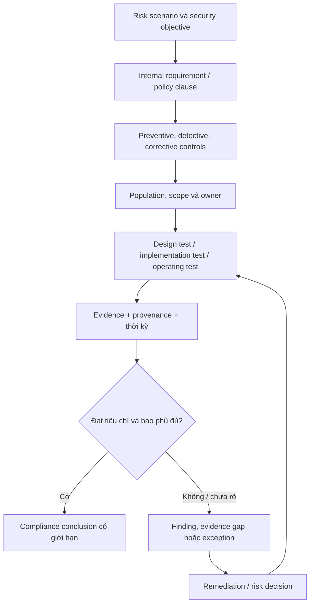
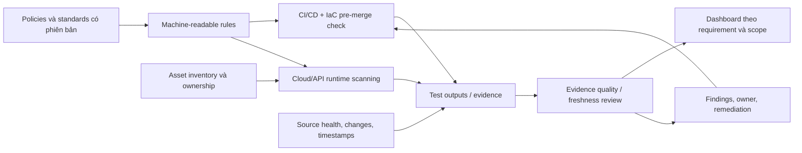
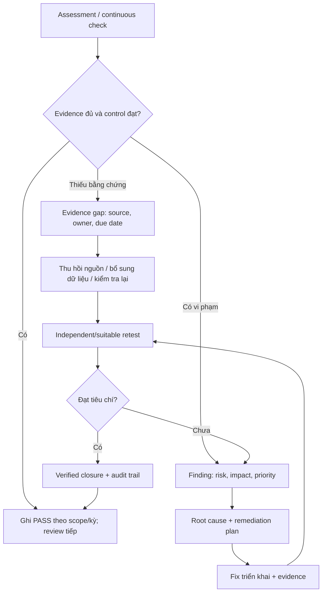

# Internal compliance: bảo đảm tuân thủ các yêu cầu và kiểm soát bảo mật nội bộ

## 1. Internal compliance là gì và giải quyết vấn đề nào?

**Internal compliance** là hoạt động xác lập, triển khai, kiểm tra và theo dõi việc các cá nhân, quy trình, hệ thống và đơn vị trong tổ chức có **đáp ứng những yêu cầu nội bộ được phê duyệt** hay không. Trong an toàn thông tin, các yêu cầu này thường được thể hiện qua security policy, security standard, baseline, quy trình phê duyệt, quy tắc phân quyền, quy định xử lý dữ liệu và các cam kết kiểm soát rủi ro.

Trong chương **Compliance assurance** của module **SECURITY_SECURITY_ASSURANCE**, internal compliance không đơn thuần là “đánh dấu đã đọc chính sách”. Nó là một phần của chương trình **security assurance dựa trên bằng chứng**, nối phân tích rủi ro, security objectives, yêu cầu và controls với kiểm thử thiết kế/hiệu quả vận hành, audit, ghi nhận phát hiện và xác minh khắc phục. Mục tiêu là trả lời:

> Tại thời điểm hoặc trong kỳ được đánh giá, hệ thống nào, chủ thể nào, yêu cầu nào đã được kiểm chứng là đáp ứng; bằng chứng nào hỗ trợ; phần nào chưa được kiểm tra; và ai phải xử lý những khoảng trống còn lại?

Ví dụ: chính sách nội bộ yêu cầu **mọi quyền quản trị production phải được phê duyệt, giới hạn phạm vi và rà soát định kỳ**. Việc lưu một bản policy đã ký không chứng minh yêu cầu này được thực hiện. Tổ chức cần biết population tài khoản có đặc quyền, danh sách quyền thực tế, hồ sơ cấp quyền, lịch sử rà soát, kết quả kiểm tra và ngoại lệ. Nếu chưa thu được audit event của một cloud account, kết luận đúng là **thiếu bằng chứng cho account đó**, không phải mặc định “đạt”.

**Ranh giới quan trọng:** nội bộ có thể xây chính sách nhằm hỗ trợ các nghĩa vụ pháp luật, hợp đồng hoặc framework; nhưng **tuân thủ chính sách nội bộ không tự đồng nghĩa tuân thủ pháp luật hoặc được chứng nhận**. Những nghĩa vụ bên ngoài phải được xác định và đánh giá riêng theo phạm vi áp dụng bởi bộ phận có thẩm quyền.

### Kết quả học tập

Sau bài học, người học có thể:

1. Phân biệt policy, standard, baseline, procedure, guideline, control, requirement và exception.
2. Biến yêu cầu nội bộ thành nghĩa vụ kiểm chứng được cho đúng đối tượng, phạm vi, mốc thời gian và chủ sở hữu.
3. Lập danh mục kiểm soát và mapping từ rủi ro đến mục tiêu bảo mật, control, phép thử và bằng chứng.
4. Tách **thiết kế control**, **triển khai** và **hiệu lực vận hành** khi kết luận compliance.
5. Tổ chức self-assessment, kiểm tra độc lập, lấy mẫu và giám sát liên tục theo rủi ro.
6. Xử lý các trạng thái `COMPLIANT`, `NON_COMPLIANT`, `UNKNOWN`, `NOT_APPLICABLE`, `EXCEPTION_APPROVED` một cách trung thực.
7. Tạo assurance claim có thể audit, chỉ rõ giới hạn, remediation và trách nhiệm phê duyệt rủi ro.

## 2. Phân biệt internal compliance với security assurance và internal audit

Ba khái niệm liên quan nhưng không thay thế nhau:

| Khái niệm | Câu hỏi chính | Đầu ra |
| --- | --- | --- |
| **Internal compliance** | Hoạt động thực tế có đáp ứng các yêu cầu nội bộ áp dụng không? | Compliance status, evidence, exception, remediation |
| **Security assurance** | Có đủ cơ sở kiểm chứng rằng controls đáp ứng security objectives trong phạm vi đã nêu không? | Assurance claims, kết quả test, giới hạn và rủi ro tồn dư |
| **Internal audit** | Một hoạt động đánh giá có tính độc lập phù hợp có xác minh thiết kế/vận hành, governance và báo cáo đúng không? | Audit findings, kết luận theo scope, khuyến nghị, theo dõi |

Internal compliance có thể dùng self-assessment và kết quả kiểm tra thường xuyên của control owner; internal audit có thể đánh giá các hoạt động đó. Một báo cáo self-assessment do chính người vận hành điền là **một nguồn bằng chứng**, nhưng có nguy cơ thiên lệch và không tự tương đương đánh giá độc lập.

### 2.1. Compliance không đồng nghĩa bảo mật tuyệt đối

Một hệ thống có thể đáp ứng hoàn toàn các yêu cầu nội bộ đang có nhưng vẫn tồn tại lỗ hổng chưa được biết đến hoặc rủi ro không được yêu cầu bao phủ. Ngược lại, một hệ thống có thể có biện pháp kỹ thuật rất mạnh nhưng không đạt một yêu cầu nội bộ về review, retention hay ghi nhật ký. Cần quản lý song song:

- **Compliance gap:** vi phạm yêu cầu đã được ban hành và có hiệu lực.
- **Security risk:** nguy cơ đối với confidentiality, integrity, availability hoặc mục tiêu khác.
- **Assurance gap:** chưa có đủ bằng chứng hợp lệ để kết luận về hiệu lực của yêu cầu/control.
- **Policy gap:** chính yêu cầu nội bộ không còn đầy đủ, nhất quán hoặc phù hợp rủi ro.

Không được biến kết quả “đã hoàn tất checklist” thành kết luận “hệ thống không thể bị tấn công”.

## 3. Hệ phân cấp policy, standard, baseline, procedure và control

Một chương trình nội bộ cần phân biệt **yêu cầu bắt buộc**, **cách thực hiện** và **bằng chứng hoàn thành**.

| Thành phần | Vai trò | Ví dụ |
| --- | --- | --- |
| **Policy** | Định hướng và nghĩa vụ cấp tổ chức, được phê duyệt theo thẩm quyền | “Quyền truy cập production phải được kiểm soát và có thể truy vết” |
| **Standard** | Các yêu cầu cụ thể, có tính bắt buộc để thực thi policy | “Tài khoản đặc quyền phải có MFA và được rà soát theo kỳ đã xác định” |
| **Security baseline** | Bộ cấu hình tối thiểu cho một nhóm asset/workload | “Production workload từ chối quyền public write theo danh mục đã duyệt” |
| **Procedure/runbook** | Trình tự vận hành, vai trò, đầu vào/đầu ra | Quy trình tạo yêu cầu, phê duyệt, cấp quyền, thu hồi, review |
| **Guideline** | Gợi ý thực hành, có thể không bắt buộc trừ khi được dẫn chiếu | Hướng dẫn thiết kế least-privilege role |
| **Control** | Biện pháp kỹ thuật hoặc quy trình để giảm rủi ro/thỏa yêu cầu | RBAC, IAM approval gate, audit logging, access recertification |
| **Evidence** | Kết quả/record chứng minh hành động hoặc trạng thái | Role-binding snapshot, ticket phê duyệt, test authz |
| **Exception** | Quyết định có thẩm quyền cho sai lệch có điều kiện | Tài khoản automation được phép dùng cơ chế bù trừ trong 30 ngày |

Một câu “nên sử dụng MFA” trong guideline không mặc nhiên là một nghĩa vụ bắt buộc. Ngược lại, khi standard yêu cầu MFA ở phạm vi admin production, reviewer phải đánh giá **toàn bộ population áp dụng**, không chỉ những tài khoản dễ lấy dữ liệu.

### 3.1. Tính hiệu lực của văn bản

Yêu cầu nội bộ phải ghi đủ:

- ID, chủ sở hữu, phiên bản, ngày phê duyệt, ngày bắt đầu hiệu lực và lịch review.
- Đối tượng áp dụng: đơn vị, nhân sự, môi trường, hệ thống, cloud account, nhà cung cấp hoặc loại dữ liệu.
- Điều khoản bắt buộc và tiêu chí chấp nhận có thể kiểm tra.
- Phương thức xử lý ngoại lệ, thẩm quyền chấp thuận và thời hạn.
- Mối quan hệ ưu tiên giữa các tài liệu nếu có quy định trùng hoặc mâu thuẫn.
- Trigger xem lại khi rủi ro, kiến trúc, luật, quy trình và trách nhiệm thay đổi.

Một tiêu chí mới ban hành không nên được áp ngược vào kỳ quá khứ nếu không có quy tắc chuyển tiếp đã phê duyệt. Reviewer phải dùng **policy version có hiệu lực tại thời điểm hoặc trong kỳ đánh giá**, đồng thời công bố nếu có thay đổi giữa kỳ.

## 4. Cấu trúc governance và trách nhiệm

Internal compliance không thể thành công khi đội security chỉ gửi checklist còn không ai chịu trách nhiệm với hệ thống thực.

| Vai trò | Trách nhiệm trong vòng đời compliance |
| --- | --- |
| **Policy owner** | Ban hành, giải thích và cập nhật yêu cầu theo thẩm quyền |
| **Business/service owner** | Xác nhận phạm vi nghiệp vụ, tài sản trọng yếu, chấp nhận tác động và ưu tiên |
| **Control owner** | Thiết kế, vận hành và khắc phục control; cung cấp bằng chứng thực tế |
| **Asset/system owner** | Duy trì inventory, cấu hình, dữ liệu và tích hợp trong phạm vi kiểm tra |
| **Compliance/assurance function** | Xây phương pháp, đánh giá chứng cứ, tổng hợp trạng thái và theo dõi findings |
| **Risk owner** | Xem xét rủi ro tồn dư và phê duyệt ngoại lệ trong giới hạn được ủy quyền |
| **Internal audit** | Kiểm tra độc lập phù hợp theo chương trình audit của tổ chức |
| **Legal/privacy** | Xác định nghĩa vụ pháp lý/dữ liệu và giới hạn chia sẻ, lưu trữ khi liên quan |
| **Platform/SecOps/DevOps** | Cung cấp automation, telemetry, enforcement và sửa control kỹ thuật |

Không nên mặc định “security team chịu trách nhiệm về mọi control”. Ví dụ control backup có thể do database/platform owner vận hành, business owner quyết định RTO/RPO, security assurance xác nhận mức độ kiểm chứng, còn internal audit đánh giá governance nếu thuộc kế hoạch.

**Nguyên tắc phân tách nhiệm vụ (segregation of duties, SoD):** người tạo hoặc vận hành control có thể chứng minh hoạt động của mình nhưng không nên là người duy nhất có quyền tự phê duyệt ngoại lệ rủi ro lớn hoặc tự xác nhận mọi phát hiện đã được khắc phục. Thiết kế phân quyền xem xét phải phù hợp quy mô và khả năng nhân sự thực tế.

### 4.1. Quyền quyết định phải rõ

Một quy trình điển hình:

1. Policy owner xác định nội dung bắt buộc và trường hợp áp dụng.
2. Control owner triển khai, giám sát và tự kiểm tra.
3. Assurance reviewer xác minh evidence/tiêu chí và đưa ra kết quả kiểm tra.
4. Risk owner quyết định tiếp tục hoặc hạn chế vận hành khi có rủi ro tồn dư, theo thẩm quyền.
5. Đơn vị kiểm toán độc lập, nếu có, có thể đánh giá tính đầy đủ và tin cậy của cả quy trình.

**Người review compliance không tự động có quyền cho phép vi phạm policy**. Quyền chấp nhận ngoại lệ hoặc sửa requirement cần đúng thẩm quyền và hồ sơ chính thức.

## 5. Khởi tạo danh mục yêu cầu và nghĩa vụ (obligation register)

Một dashboard chỉ liệt kê tên framework hoặc control ID mà không biết phạm vi và owner chưa thể dùng để đánh giá compliance. Nên tạo **requirement/obligation register** có khả năng liên kết với tài sản thực.

| Trường | Ý nghĩa |
| --- | --- |
| `requirement_id` | ID duy nhất và phiên bản của nghĩa vụ |
| `source_ref` | Policy/standard/baseline nào, điều khoản và effective date |
| `security_objective` | Confidentiality/integrity/availability/privacy hoặc mục tiêu cụ thể |
| `risk_id` | Tình huống rủi ro yêu cầu giúp giảm hoặc kiểm soát |
| `applicability_rule` | Đối tượng nào bắt buộc phải áp dụng |
| `scope_snapshot` | Population account, system, tenant, artifact hoặc user khi đánh giá |
| `control_id` | Biện pháp hỗ trợ thỏa yêu cầu |
| `control_owner` | Người/đội chịu trách nhiệm thực hiện |
| `assessor` | Người/đội xác minh phù hợp |
| `acceptance_criteria` | Điều kiện PASS/FAIL và trường hợp cần giải thích |
| `evidence_ref` | Bằng chứng, query/test ID, nguồn và thời kỳ |
| `assessment_period` | Khoảng thời gian hoặc mốc point-in-time |
| `status`, `finding_id` | Kết quả và liên kết khắc phục |
| `exception_id`, `next_review` | Quyết định ngoại lệ và lịch đánh giá tiếp |

### 5.1. Đi từ requirement đến một phép thử

Một requirement tốt phải có thể được kiểm tra dưới dạng:

> Với tất cả tài khoản quản trị trong production có hiệu lực trong kỳ T, các yêu cầu cấp quyền mới phải có phê duyệt bởi người có thẩm quyền trước khi cấp, quyền phải nằm trong phạm vi được duyệt, và mọi thay đổi phải được ghi nhật ký phục vụ truy vết.

Để đánh giá, phải biết **population** (mọi lần cấp quyền đặc biệt), **cách xác định approval hợp lệ**, **thời gian** (approval xảy ra trước grant), **dữ liệu** (IAM events, approval records), **ngoại lệ** (quy trình emergency đã phê duyệt), và **kết quả** (không có trường hợp vi phạm hoặc vi phạm đã được xác định rõ).

Không đủ nếu chỉ tìm xem “có bao nhiêu approval tickets”. Ticket có thể không cùng actor, target, role, scope hoặc không có hiệu lực tại thời điểm quyền được cấp.

## 6. Risk-based scoping: phạm vi phải đi trước kết quả

Hệ thống mới, cloud account mới và shadow IT là những nguyên nhân thường làm compliance report có vẻ tốt hơn thực tế. Tổ chức phải giải thích **tập population bắt buộc** trước khi đếm số hạng mục PASS.

### 6.1. Các chiều scope

- Dịch vụ hoặc khả năng nghiệp vụ, production/staging/dev, vùng, cloud account và tenant.
- Loại tài sản: server, container, endpoint, API, service account, database, CI/CD pipeline.
- Dữ liệu: cá nhân, khách hàng, secrets, tài sản có phân loại bảo mật cao.
- Chủ thể: nhân viên, nhà thầu, service identities, bên thứ ba, break-glass accounts.
- Khung thời gian: chính sách nào có hiệu lực, asset hoạt động từ khi nào, có thay đổi giữa kỳ không?
- Loại control: preventive, detective, corrective; tự động hay thủ công; point-in-time hay operating control.

### 6.2. Applicability, exception và not applicable

| Trạng thái | Khi nào sử dụng | Chứng cứ cần |
| --- | --- | --- |
| **Applicable** | Yêu cầu thực sự áp dụng cho tài sản/đối tượng | Rule applicability, asset inventory |
| **Not applicable (N/A)** | Yêu cầu không áp dụng theo điều kiện chính thức | Giải thích, dữ liệu scope, người review |
| **Exception approved** | Yêu cầu áp dụng nhưng có quyết định miễn/khác biệt có thời hạn | Quyết định, owner, rủi ro, control bù trừ, expiry |
| **Out of scope of assessment** | Yêu cầu có thể áp dụng nhưng chưa được đánh giá trong đợt này | Giới hạn scope và người chấp nhận giới hạn |
| **Unknown applicability** | Thiếu inventory hoặc dữ liệu để quyết định | Finding/owner và hành động xác minh |

**N/A khác với ngoại lệ.** Một workload không có tài khoản người dùng tương tác có thể được xác định N/A cho control về MFA người dùng theo định nghĩa; nhưng tài khoản service có quyền quản trị vẫn phải được đánh giá với các control về machine identity phù hợp. Việc đội kỹ thuật “chưa hỗ trợ MFA” cho một nhóm tài khoản áp dụng không tự tạo ra N/A.

Khi nhiều yêu cầu có cùng control hỗ trợ, một test có thể cung cấp bằng chứng cho nhiều requirement, nhưng phải chứng minh **mapping và scope** cho từng requirement. Không tự nhân bản một kết quả PASS giữa các cloud account hoặc sản phẩm khác nhau.

## 7. Thiết kế mô hình control có thể kiểm chứng

Một control hiệu quả cần mô tả rõ điều kiện hoạt động.

| Chiều thiết kế | Câu hỏi |
| --- | --- |
| **Risk scenario** | Nó giảm rủi ro cụ thể gì? |
| **Control objective** | Điều kiện an toàn cần đạt là gì? |
| **Trigger/frequency** | Khi nào control phải thực thi? Mỗi event, hằng ngày, theo kỳ? |
| **Input/population** | Nó nhận dữ liệu hay tác vụ nào, từ đâu, có đầy đủ không? |
| **Logic/decision** | Quy tắc nào quyết định allow/deny/review/escalate? |
| **Actor/ownership** | Ai vận hành, ai giám sát, ai xử lý lỗi? |
| **Failure behavior** | Khi nguồn lỗi, control từ chối, degrade hay tạo alert? |
| **Evidence** | Bản ghi nào chứng minh từng lần thực thi hoặc kết quả theo kỳ? |
| **Exception** | Ngoại lệ được quản lý ra sao và bao giờ hết hiệu lực? |
| **Independent validation** | Có phép thử tiêu cực/phát lại hoặc nguồn đối chứng nào? |

Ví dụ với **MFA cho quyền quản trị**, phải xác định MFA áp dụng cho user nào, qua ứng dụng/IdP nào, các đường đăng nhập bằng API/token có nằm trong phạm vi hay không, và trường hợp khẩn cấp xử lý thế nào. Chỉ có “MFA enabled” trong trang admin chưa cho biết mọi đường truy cập đặc biệt đã bị bảo vệ.

### 7.1. Mapping từ rủi ro tới bằng chứng



Một compliance conclusion chỉ nên được đưa ra khi evidence hỗ trợ đúng **requirement, population, thời kỳ và loại hiệu quả**. Không ghi “toàn hệ thống đạt” nếu sơ đồ chỉ có test ở một tenant.

## 8. Ba lớp kiểm tra: design, implementation, operating effectiveness

Đây là phân biệt quan trọng trong compliance assurance.

| Lớp | Câu hỏi | Bằng chứng phù hợp | Kết luận bị giới hạn |
| --- | --- | --- | --- |
| **Design effectiveness** | Nếu vận hành đúng, control có khả năng đáp ứng requirement/rủi ro? | Policy, kiến trúc, logic rule, walkthrough, threat analysis | Chưa chứng minh đã triển khai và chạy |
| **Implementation** | Control có thực sự được bật và áp dụng ở đúng phạm vi? | Config export, IaC state, IAM policy, deployment version | Chưa chứng minh chạy hiệu quả qua thời gian |
| **Operating effectiveness** | Control có hoạt động nhất quán theo tiêu chí trong kỳ đã chọn? | Event log, approvals, incident records, negative tests, samples | Chỉ kết luận cho population/kỳ đã thử và chất lượng evidence |

Ví dụ:

- Policy yêu cầu mỗi quyền admin phải được phê duyệt trước khi cấp: **thiết kế**.
- Workflow IAM đã yêu cầu trường approval ID và mapping quyền đúng production: **triển khai**.
- Chọn các lần cấp quyền trong quý, đối chiếu thứ tự phê duyệt và audit event; phát hiện mọi ngoại lệ liên quan: **vận hành**.

Một hệ thống có thiết kế tốt nhưng người dùng có thể bypass workflow qua cloud console thủ công vẫn có thể **không đáp ứng về implementation/operation**. Cần thử các đường đi ngoài “happy path”, quyền break-glass, service identity và trường hợp nguồn phê duyệt mất.

### 8.1. Positive và negative test

Với control authorization, test dương chứng minh truy cập hợp lệ được cho phép; test âm chứng minh truy cập sai quyền bị từ chối. Nếu chỉ thử user admin truy cập được, bạn chưa chứng minh least privilege. Với logging, phát sinh một event và thấy bản ghi tới kho mới chứng minh một phần; cần thêm test mất nguồn, tamper, retention và tra cứu theo phạm vi.

## 9. Evidence: chứng minh đúng loại claim, đúng thời điểm

Bằng chứng không nên là ảnh chụp màn hình tùy ý chỉ có timestamp tải xuống. Cần truy ngược **nguồn, phương pháp thu thập, trạng thái và kết quả**.

| Evidence | Claim có thể hỗ trợ | Điều không được tự suy ra |
| --- | --- | --- |
| Policy có phê duyệt | Có yêu cầu nội bộ được ban hành | Control đang được tuân thủ |
| IAM role snapshot | Danh sách quyền tại `observed_at` trên scope xác định | Mọi lần cấp quyền trong quý đều có approval |
| Approval + IAM event | Một lần cấp quyền có/không được phê duyệt đúng | Các lần cấp quyền khác cũng đúng |
| Audit report độc lập | Những control đã được kiểm tra trong scope và kỳ báo cáo | Mọi sản phẩm/region mới đều đã đạt |
| Automated policy check | Cấu hình được kiểm tra theo rule version | Luồng runtime không có bypass ngoài phạm vi rule |
| Penetration test summary | Các mục tiêu/kỹ thuật đã được thử | Toàn hệ thống không có lỗ hổng |
| Restore test | Hệ thống khôi phục trong kịch bản và môi trường xác định | DR sẽ luôn đạt mọi kịch bản thảm họa |
| Access review attestation | Một người đã xác nhận review một population | Chất lượng review thực tế nếu thiếu dữ liệu để đối soát |

### 9.1. Metadata evidence cần lưu

```yaml
evidence_id: EVD-IC-2026-0005
requirement_id: INT-IAM-01
control_id: CTRL-PRIV-GRANT
claim_type: operating_effectiveness
scope:
  environment: production
  cloud_accounts:
    - prod-a
    - prod-b
  population: "All privileged role grants in the assessment period"
assessment_period:
  start: "2026-10-01T00:00:00Z"
  end: "2026-10-31T23:59:59Z"
source:
  system: iam_audit_api
  query_version: "priv-grants-v3"
  collection_job_id: "evidence-job-example"
  approval_source: "change-management"
quality:
  completeness_status: "requires_verification"
  unknown_events: "must_be_reported"
  exceptions: "must_be_linked"
protection:
  classification: confidential_security
  artifact_ref: "controlled-evidence-repository"
review:
  owner: security_assurance_team
  status: pending
  reviewed_at: null
```

Đây là **cấu trúc minh họa**, không phải bằng chứng hay kết quả kiểm thử thật. Trong hệ thống thực, tất cả event ID, artifact reference, collector/runbook version và kết luận phải lấy từ nguồn được xác minh.

### 9.2. Freshness và coverage

Một screenshot mới vẫn có thể chứa thông tin của tuần trước. Cần phân biệt `observed_at`, `collected_at`, `period_start`, `period_end`, `verified_at` và policy version. Một thay đổi IAM sau snapshot có thể khiến ảnh cũ không còn hỗ trợ claim hiện tại, ngay cả khi ảnh mới chỉ vài phút.

Trạng thái `MISSING`/`STALE` hoặc nguồn audit bị tắt thường là **assurance gap**, chưa đủ căn cứ kết luận control tuân thủ hay vi phạm. Nếu bằng chứng trực tiếp chỉ ra cấp quyền sai, ghi **control failure**. Hai loại vấn đề có thể xảy ra cùng lúc nhưng cần quản lý riêng.

## 10. Lấy mẫu và đánh giá operating effectiveness

Khi đánh giá theo kỳ, nhiều control có hàng nghìn giao dịch. Reviewer phải quyết định **có cần kiểm tra 100% hay được phép lấy mẫu** theo rủi ro, tính chất control, khả năng tự động hóa và phương pháp đánh giá.

### 10.1. Xác định population trước

Đối với yêu cầu “mọi lần cấp quyền admin đều có approval”, population là **mọi lần cấp quyền thuộc phạm vi và kỳ**, không phải tập ticket có sẵn. Nếu lấy ticket làm mẫu số, các lần cấp quyền không có ticket biến mất khỏi dữ liệu.

Trình tự phù hợp:

1. Xác định toàn bộ asset/account/tenant và khoảng thời gian.
2. Thu mọi sự kiện đáp ứng định nghĩa trong phạm vi, xử lý duplicate/retry theo event ID.
3. Đối soát event counts và source coverage; ghi giai đoạn mất log.
4. Quyết định kiểm tra toàn bộ hay chọn mẫu, theo phương pháp có tài liệu.
5. Gắn kết quả kiểm tra từng đơn vị với bằng chứng có nguồn gốc.
6. Phân loại `PASS`, `FAIL`, `INCONCLUSIVE` và `NOT_TESTED` theo tiêu chí.
7. Kết luận trong phạm vi được hỗ trợ; không suy rộng tùy tiện.

### 10.2. Ví dụ định lượng

Giả sử có 200 lần cấp quyền đặc biệt trong một kỳ. Reviewer chọn mẫu 40 lần theo phương pháp đã phê duyệt; có 36 trường hợp đủ approval hợp lệ, 2 trường hợp không có approval và 2 trường hợp thiếu dữ liệu để kết luận.

- Trên **38 trường hợp có kết luận**, 36 đạt và 2 không đạt. Tỷ lệ đạt trên tập này bằng \(36/38\approx94,7\%\).
- Trong **toàn bộ 40 mẫu**, 36 đã xác nhận đạt; 2 không đạt; 2 inconclusive. Tỷ lệ đã xác nhận đạt trên mẫu là \(36/40=90\%\).
- Không được tuyên bố “94,7% tất cả 200 lần cấp quyền đều đạt” khi chưa xem cách lấy mẫu, độ tin cậy, sai số và các giới hạn.
- Hai trường hợp thiếu dữ liệu là **evidence gap**, không được tự chuyển thành PASS hay FAIL.
- Nếu policy là yêu cầu tuyệt đối với mọi cấp quyền admin, **hai vi phạm đã xác minh** phải được báo cáo và điều tra dù tỷ lệ tổng trông khá cao.

Với control tự động và rủi ro lớn, có thể dùng **100% population testing** từ audit stream đáng tin; nhưng cần kiểm tra tính đầy đủ của nguồn và logic truy vấn. “Script đã kiểm tra 100% các record nó nhận được” không đảm bảo **nhận được 100% record thực tế**.

### 10.3. Những lỗi sampling phổ biến

| Lỗi | Hệ quả |
| --- | --- |
| Chỉ chọn sự kiện có ticket | Bỏ qua vi phạm không tạo ticket |
| Chỉ chọn account có log đầy đủ | Biến mất các nhóm thiếu nguồn |
| Chỉ lấy các trường hợp được review sẵn | Có nguy cơ thiên lệch lựa chọn |
| Trộn dev/staging với production | Làm sai tỷ lệ cho phạm vi có rủi ro cao |
| Không xét thời gian hiệu lực policy | Kết luận sai cho giao dịch diễn ra trước khi chính sách áp dụng |
| Gộp nhiều lần cấp quyền thành một record | Có thể làm biến mất approval lỗi riêng biệt |
| Không lưu phương pháp lấy mẫu | Không thể tái hiện hoặc phản biện kết quả |

## 11. Kết quả compliance: trạng thái phải trung thực và có lý do

Một hệ thống có thể dùng các trạng thái sau cho **một requirement trong một scope và kỳ đánh giá**:

| Trạng thái | Ý nghĩa | Hành động tiếp theo |
| --- | --- | --- |
| `COMPLIANT` | Đã xác minh đủ bằng chứng theo phương pháp/tiêu chí được phê duyệt | Lưu phạm vi, thời điểm, evidence và lịch review |
| `NON_COMPLIANT` | Có bằng chứng cho thấy vi phạm requirement áp dụng | Mở finding, đánh giá tác động và remediation |
| `PARTIALLY_COMPLIANT` | Một phần phạm vi được xác minh đạt, phần khác không đạt hoặc chưa đủ | Tách nhóm, không che lỗi nghiêm trọng |
| `UNKNOWN`/`NOT_TESTED` | Chưa có kết quả kiểm chứng hoặc nguồn không đầy đủ | Thu evidence, xác định owner/deadline |
| `NOT_APPLICABLE` | Không thuộc phạm vi requirement theo quy tắc đã phê duyệt | Lưu căn cứ và đánh giá khi scope đổi |
| `EXCEPTION_APPROVED` | Không đáp ứng đúng yêu cầu nhưng được chấp nhận khác biệt có điều kiện | Quản lý risk, control bù trừ, expiry và review |
| `REMEDIATION_IN_PROGRESS` | Vi phạm đã xác minh, đang được sửa | Theo dõi finding; chưa được coi đạt |
| `PENDING_RETEST` | Đã có tuyên bố fix nhưng chưa kiểm chứng độc lập phù hợp | Kiểm tra lại và liên kết bằng chứng |
| `EXPIRED_EVIDENCE` | Bằng chứng không còn đại diện cho claim hiện tại | Làm mới; không giữ PASS hiện tại theo suy đoán |

Có thể tách **compliance conclusion**, **evidence quality** và **remediation status** thành ba trường riêng. Điều này tránh việc một control thất bại nhưng được hiển thị “green” chỉ vì có ticket sửa đang mở.

### 11.1. Vi phạm và chấp nhận ngoại lệ

**Exception accepted không phải compliant.** Nếu policy bắt buộc MFA, hệ thống chưa hỗ trợ và risk owner phê duyệt dùng giải pháp bù trừ ba mươi ngày, trạng thái vẫn phải phản ánh requirement chưa được đáp ứng bình thường; quyết định ngoại lệ giải thích **vì sao tiếp tục được phép**, với điều kiện và hạn chấm dứt.

Để xử lý yêu cầu đã lỗi thời, thay vì tạo ngoại lệ vĩnh viễn, policy owner nên đánh giá sửa standard và thực hiện impact review. Không hạ tiêu chí chỉ để tăng tỷ lệ compliance mà thiếu thẩm quyền.

## 12. Policy-as-code và continuous internal compliance

Với control có thể máy móc kiểm tra, tự động hóa giúp phát hiện drift ngay sau thay đổi thay vì đợi tới kỳ audit.



### 12.1. Tự động hóa điều gì?

| Use case | Phép kiểm tra | Giới hạn |
| --- | --- | --- |
| Cloud storage public access | Config/IaC rule cấm public write ngoài phạm vi đã duyệt | Runtime policy có thể bị sửa sau pipeline |
| Secrets trong repository | Secret scanning tại push/CI | Không chứng minh secrets ngoài repo đều được bảo vệ |
| Privileged IAM role | Compare bindings với approval/role allowlist | Approval có thể giả/cũ; cần xác minh thời gian hiệu lực |
| Encryption configuration | Kiểm tra resource dùng encryption và key policy | Không tự chứng minh key không bị lộ hoặc plaintext trong app |
| Audit logging | Kiểm tra nguồn và sample event end-to-end | Một sample không chứng minh không mất log cả kỳ |
| Dependency vulnerability | Scan artifact và SBOM của phiên bản build | Cần xác định artifact thực sự được deploy |
| Backup policy | Kiểm tra lịch backup và storage retention | Chưa chứng minh restore được và an toàn |
| Endpoint inventory | Đối soát thiết bị với agent/EDR policy | Thiết bị không gửi telemetry có thể biến mất khỏi mẫu |

**Policy-as-code không thay thế chính sách**. Machine-readable rule là biểu diễn của một phần yêu cầu, có version, reviewer, test và exception handling. Khi một tiêu chí khó tự động đánh giá (ví dụ chất lượng incident response tabletop), cần quy trình thủ công có bằng chứng rõ.

### 12.2. Pseudocode kiểm tra cấu hình

Ví dụ yêu cầu nội bộ: mọi bucket production thuộc phạm vi phải chặn public write, trừ ngoại lệ được phê duyệt và còn hiệu lực. Đây là **giả mã**, không phải policy chạy trực tiếp:

```text
for each bucket in requiredProductionInventory():
    config = readEffectiveBucketPolicy(bucket)

    if config is unavailable:
        result(bucket, "UNKNOWN", "missing_configuration_evidence")
        continue

    if blocksUnauthorizedPublicWrite(config):
        result(bucket, "COMPLIANT", "control_effectiveness_checked")
        continue

    exception = findApprovedException(
        resource=bucket.id,
        requirement="INT-STORAGE-01",
        evaluationTime=now
    )

    if exception is valid and compensatingControlsVerified(exception):
        result(bucket, "EXCEPTION_APPROVED", exception.id)
    else:
        result(bucket, "NON_COMPLIANT", "public_write_possible")
```

Những điểm phải xác minh khi triển khai:

- `requiredProductionInventory()` lấy từ nguồn population đáng tin và có cảnh báo khi nguồn mất.
- `blocksUnauthorizedPublicWrite` kiểm tra **effective permissions**, không chỉ một flag trong giao diện.
- `exception` khớp chính xác resource, requirement, time và người có thẩm quyền.
- Không đưa secret hoặc dữ liệu nhạy cảm của bucket vào log compliance.
- Hành động remediation tự động cần có giới hạn, cảnh báo và xử lý tác động nghiệp vụ.

## 13. Ví dụ xuyên suốt: tuân thủ nội bộ về privileged access

### 13.1. Yêu cầu và phạm vi

Một nền tảng SaaS đa tenant có ba production account (`prod-a`, `prod-b`, `prod-c`), sử dụng IdP và IAM control plane. Standard nội bộ mô tả:

> Các quyền quản trị production phải được cấp theo phê duyệt, giới hạn thời gian/phạm vi, ghi audit và được rà soát theo lịch đã phê duyệt; quyền emergency/break-glass phải có truy vết và review sau sử dụng.

Để đánh giá, cần tách requirement thành nhiều controls:

| Control | Câu hỏi kiểm chứng | Evidence |
| --- | --- | --- |
| **IAM-01: Approval** | Role grant có approval hợp lệ trước thời điểm grant? | IAM event và ticket được join đúng actor, target, role, time |
| **IAM-02: Least privilege** | Scope role có nằm trong nhu cầu và profile được phê duyệt? | IAM bindings, role definitions, business justification |
| **IAM-03: Authentication** | Đường truy cập đặc quyền có yêu cầu xác thực phù hợp? | IdP policy, negative access test, privileged session logs |
| **IAM-04: Revocation** | Quyền hết hạn/không còn cần đã được thu hồi? | Expiry schedule, revoke event, current bindings |
| **IAM-05: Review** | Population quyền được recertify theo kỳ? | Review record, population version, quyết định reviewer |
| **IAM-06: Audit** | Mọi thay đổi quan trọng tới kho log có thể điều tra? | End-to-end audit test, source coverage, retention |
| **IAM-07: Emergency** | Break-glass có giới hạn, log và review sau sử dụng? | Emergency ticket, event, hậu kiểm |

Một kết luận chung “IAM compliant” chỉ có ý nghĩa nếu tất cả các yêu cầu **áp dụng trong phạm vi đã nêu** được đánh giá theo cách có chứng cứ. Nếu IAM-03 chưa test cho service identities, phải chỉ ra phần thiếu thay vì gộp tất cả thành đạt.

### 13.2. Dữ liệu kiểm tra giả định

Giả sử trong tháng có tổng cộng **120 lần cấp quyền admin** trên ba account. Sau đối soát population:

| Account | Số role grants | Tình trạng kiểm chứng |
| --- | ---: | --- |
| `prod-a` | 45 | Đã đối soát đầy đủ với nguồn phê duyệt |
| `prod-b` | 50 | Một grant không có approval hợp lệ |
| `prod-c` | 25 | Collector mất log trong 2 giờ; chưa chứng minh population đầy đủ |

Có thể kết luận:

- `prod-a`: các grants đã đối soát đạt yêu cầu approval trong phạm vi và kỳ kiểm tra, giả sử các phép test đầy đủ khác đạt.
- `prod-b`: ít nhất một **non-compliance finding** về approval; cần điều tra actor, quyền, tác động và remediation.
- `prod-c`: **assurance gap** do không xác minh đầy đủ event; không được tính là 25/25 PASS chỉ vì hệ thống chỉ trả về 25 bản ghi.

Một dashboard cho cả ba account cùng màu xanh do có “access review document” là **sai loại bằng chứng** cho operating effectiveness theo sự kiện.

### 13.3. Quy trình xử lý finding

1. Gắn `requirement_id=INT-IAM-APPROVAL`, account, kỳ đánh giá và event ID liên quan.
2. Phân biệt sai lệch hành vi (grant trái quy trình) với thiếu nguồn (collector chưa đủ).
3. Với grant không có approval, xác minh có trường hợp emergency hợp lệ không; kiểm tra tác động, thu hồi khi cần.
4. Với mất log, kiểm tra nguyên nhân, phục hồi nguồn, backfill nếu có thể và đánh giá phạm vi không thể tái lập.
5. Mở finding và phân công owner, mức độ nghiêm trọng theo rủi ro; đề xuất kế hoạch, thời hạn, kiểm tra lại.
6. Báo cáo conclusion theo từng account/requirement; công bố unknown, ngoại lệ và giới hạn.
7. Sau khi sửa, test lại và giữ lịch sử: `OPEN → FIX_CLAIMED → VERIFIED_CLOSED`, không đổi kết quả kỳ trước bằng cách ghi đè.

### 13.4. Assurance claim mẫu

> Trong kỳ đánh giá tháng 10/2026, quy trình đối soát IAM grant và approval của `prod-a` không tìm thấy vi phạm theo tập sự kiện và quy tắc đã xác minh. Tại `prod-b`, một grant không có approval hợp lệ đã được mở finding. Ở `prod-c`, sự cố thu thập log để lại khoảng thời gian chưa có bằng chứng đầy đủ nên chưa thể kết luận việc đáp ứng requirement trên toàn account. Kết quả chỉ áp dụng cho các controls và nguồn đã liệt kê, không phải tuyên bố tuân thủ toàn bộ IAM.

Đây là **ví dụ về cấu trúc báo cáo**, không phải kết quả kiểm thử thật. Báo cáo chính thức cần evidence IDs, period, sample/population definition, rule version, owner và người review.

## 14. Quản lý exception, compensating control và risk acceptance

Trong vận hành thực tế, có tình huống một requirement áp dụng nhưng chưa thể tuân thủ ngay. Một quy trình ngoại lệ phải tránh biến “cần thêm thời gian” thành việc miễn trừ vĩnh viễn.

| Trường ngoại lệ | Cần ghi |
| --- | --- |
| `exception_id` | ID, requirement và control liên quan |
| `scope` | Asset, service, account, người dùng và thời gian được miễn |
| `reason` | Vì sao không thể đáp ứng trực tiếp và mức độ cấp thiết |
| `risk_impact` | Tình huống rủi ro, tài sản, mức ảnh hưởng và điều chưa chắc chắn |
| `compensating_control` | Biện pháp giảm thiểu tạm thời cùng phép kiểm tra hiệu quả |
| `approval` | Risk owner/policy owner được ủy quyền, ngày quyết định |
| `effective_from/until` | Ngày hiệu lực và tự hết hạn |
| `monitoring` | Trigger cảnh báo, phạm vi và tần suất review |
| `remediation_plan` | Việc cần làm, owner, deadline, tiêu chí retest |

### 14.1. Ví dụ tài khoản hệ thống không hỗ trợ MFA tương tác

Không nên ghi N/A cho tất cả vì “service account không đăng nhập bằng trình duyệt”. Nếu service account giữ quyền quản trị production, yêu cầu chung về kiểm soát truy cập đặc biệt vẫn cần được đáp ứng theo các cơ chế phù hợp như workload identity, short-lived credentials, giới hạn scope, quản lý khóa và audit.

Nếu standard áp dụng rõ ràng MFA cho mọi đường admin mà một hệ thống chưa hỗ trợ, phải đánh giá sửa kiến trúc/requirement hoặc ngoại lệ có thẩm quyền. **Compensating control** chỉ có ý nghĩa khi cho thấy giảm được rủi ro mục tiêu và đã được test; “có monitoring” là không đủ nếu không phát hiện được hành vi cần bảo vệ.

### 14.2. Chấp nhận rủi ro khác với đóng finding

Finding có thể được “accepted temporarily” nhưng trạng thái requirement không tự chuyển thành đạt. Theo dõi điều kiện và ngày hết hạn; khi quá hạn, tự động escalation hoặc hạn chế sử dụng theo chính sách. Việc sửa xong bằng triển khai code mới cũng chưa đủ để đóng finding nếu chưa có **retest evidence** hoặc cơ chế đánh giá được phê duyệt.

## 15. Remediation và kiểm chứng sau khắc phục

Internal compliance không kết thúc khi phát hiện vi phạm. Một vòng quản lý finding nên có các trạng thái minh bạch:



### 15.1. Hồ sơ finding tối thiểu

- ID, requirement/control/asset, phát hiện tại thời gian/kỳ nào.
- Bằng chứng gốc và cách tái hiện, mức độ tin cậy.
- Mô tả vi phạm và khác biệt với yêu cầu, không chỉ “failed policy”.
- Tác động rủi ro và phạm vi ảnh hưởng, owner nghiệp vụ/kỹ thuật.
- Root cause, remediation, control bù trừ và quyết định rủi ro tạm thời.
- Deadline và cơ chế escalation nếu quá hạn.
- Retest case, kết quả PASS/FAIL, bằng chứng, người xác nhận và ngày đóng.
- Quan hệ với sự cố, change request hoặc policy exception nếu có.

Một finding có thể cần cả **sửa nguyên nhân gây sai lệch** lẫn **sửa cách đo**. Ví dụ collector chỉ kiểm tra hai account vì account thứ ba bị thiếu inventory: tăng tài nguyên quét mà không sửa inventory vẫn có thể để lại các account mới không được kiểm chứng.

## 16. Compliance metrics: tránh dashboard đẹp nhưng sai

### 16.1. Các chỉ số cần đọc đúng mẫu số

| Chỉ số | Công thức hoặc cách đo | Giới hạn |
| --- | --- | --- |
| **Requirement verification coverage** | Số requirement-scope có kết quả kiểm chứng / tổng requirement-scope bắt buộc | Không loại `UNKNOWN` khỏi mẫu số chung |
| **Verified compliance rate** | Số requirement-scope được xác minh đạt / tổng requirement-scope áp dụng theo chính sách báo cáo | Phân biệt ngoại lệ và thiếu bằng chứng |
| **Non-compliance count by risk** | Số findings theo severity/criticality và thời gian tồn tại | Không phản ánh toàn bộ nếu testing coverage thấp |
| **Evidence freshness/coverage** | Bằng chứng đủ mới/đủ nguồn trên population cần kiểm tra | File vừa upload chưa chắc mô tả trạng thái hiện tại |
| **Exception aging** | Ngoại lệ sắp/quá hạn theo scope và mức rủi ro | Ít ngoại lệ có thể do không ghi nhận |
| **Remediation SLA attainment** | Findings được kiểm chứng đóng trong hạn / findings đến hạn của cohort xác định | Đóng ticket không bằng verified fix |
| **Repeat finding rate** | Tỷ lệ vấn đề lặp lại trên control/asset theo định nghĩa | Có thể do phương pháp kiểm tra tốt hơn |
| **Control test pass rate** | Số ca test đạt / tổng ca test đã chạy, theo loại | Không thay thế population compliance |
| **Asset inventory coverage** | Tài sản có owner và status đánh giá / tổng tài sản bắt buộc | Cần đối chiếu nguồn ngoài inventory chính |
| **Policy review currency** | Policy/standard được review đúng lịch / tổng đang có hiệu lực | Policy mới không chứng minh operating control |

Ví dụ trong một kỳ có **300 cặp requirement–scope bắt buộc**:

- 240 cặp được xác minh đạt.
- 25 cặp có vi phạm đã xác minh.
- 20 cặp chưa đủ bằng chứng.
- 10 cặp có ngoại lệ có thời hạn được phê duyệt.
- 5 cặp chưa được test.

Tỷ lệ **verified compliant / total applicable = 240/300 = 80%** theo cách báo cáo minh họa; không được âm thầm cộng 10 ngoại lệ thành PASS, hay loại 25 cặp chưa rõ/chưa thử khỏi mẫu số. Nếu muốn công bố tỷ lệ trên **tập đã có kết luận**, phải ghi công thức, tập mẫu, lý do loại và không dùng tỷ lệ đó làm đại diện 300 cặp.

### 16.2. Đừng dùng một tỷ lệ để thay thế đánh giá rủi ro

Một vi phạm quyền admin trên shared control plane có thể nghiêm trọng hơn 20 vi phạm tài liệu ở hệ thống thử nghiệm. Dashboard nên có lớp **risk tier, asset criticality, loại dữ liệu và tuổi tồn đọng**; đồng thời vẫn công bố số lượng/frequency để không che vấn đề quy mô lớn.

Đối với control phòng ngừa, một test negative chỉ chứng minh hành vi bị chặn tại thời điểm, route và actor đã thử. Đối với detective control, “không có alert” có thể là vì không có sự kiện hoặc vì nguồn bị tắt. Metrics phải phản ánh **khả năng quan sát và giới hạn mẫu**.

## 17. Internal compliance trong SDLC và vận hành cloud

Đưa compliance vào development workflow làm giảm chi phí phát hiện muộn; nhưng phải giữ nguồn kiểm tra production.

| Giai đoạn | Kiểm soát và bằng chứng | Điều cần cảnh giác |
| --- | --- | --- |
| **Design** | Threat model, policy applicability, data classification | Scope không bao phủ luồng dữ liệu/tenant mới |
| **Commit/PR** | Review yêu cầu, SAST/secret scan, branch protection | Test bỏ qua dependency hoặc file được sinh sau build |
| **Build** | Artifact digest, dependency scan, signing, SBOM khi cần | Đã scan một artifact nhưng deploy artifact khác |
| **Deploy** | IaC policy, config validation, approved change | Runtime drift và quyền deploy thủ công |
| **Runtime** | IAM review, logging health, vulnerability/patch, monitoring | Thiếu agent/permission làm mất population |
| **Incident** | Audit trail, escalation, containment và remediation | Tắt control để “khôi phục nhanh” mà không phê duyệt |
| **Recovery** | Restore/DR test, data integrity, tenant isolation | Backup success không chứng minh restore an toàn |
| **Retirement** | Data export/deletion, credential revoke, asset decommission | Dữ liệu còn trong backup, subprocessor hoặc log |

Compliance engine có thể cung cấp cổng kiểm tra tự động trong CI/CD, nhưng không nên thiết kế cách “tự động bỏ qua mọi kiểm tra nếu pipeline bị lỗi”. Cần quy tắc **fail-open/fail-closed theo rủi ro**, owner phê duyệt break-glass và audit cho thao tác bypass.

### 17.1. Internal vs external dependency

Nhà cung cấp có thể đáp ứng hợp đồng bảo mật nhưng khách hàng vẫn vi phạm policy nội bộ do cấp quyền API quá rộng. Ngược lại, khách hàng tự có control đạt nội bộ nhưng vendor không cung cấp evidence về backup/DR có thể tạo assurance gap. Phải gắn owner cho từng đường kiểm soát theo **shared responsibility**, không đẩy toàn bộ trách nhiệm sang một bên.

## 18. Audit readiness và cách viết báo cáo compliance

Một báo cáo có thể kiểm tra lại cần **thông tin chính xác hơn màu sắc dashboard**. Gợi ý cấu trúc:

1. **Mục tiêu và thời kỳ:** đánh giá yêu cầu nào, vì sao, trong khoảng nào.
2. **Nguồn chính sách:** phiên bản, effective date, phê duyệt, tính áp dụng.
3. **Phạm vi:** services, accounts, assets, users/tenants và exclusion có căn cứ.
4. **Phương pháp:** design/implementation/operating test, sample selection, tự động/thủ công.
5. **Bằng chứng:** source, query, test ID, timestamp, coverage, integrity/provenance.
6. **Kết quả:** PASS/FAIL/UNKNOWN/N/A/EXCEPTION theo từng requirement–scope, không trộn mẫu số.
7. **Findings:** risk, severity, owner, action, timeline và retest plan.
8. **Giới hạn:** data gap, report period, partial population, untested route, lệch phiên bản.
9. **Approvals:** người thực hiện, người review, người chấp nhận rủi ro, lịch review tiếp.

### 18.1. Mẫu assurance statement

> Trong kỳ đánh giá được ghi trong hồ sơ A, chương trình internal compliance đã kiểm tra các yêu cầu về cấp quyền đặc biệt và audit logging trên các cloud account production thuộc danh sách B theo policy version C. Kết quả xác nhận các trường hợp đạt đã có bằng chứng phù hợp với phạm vi và thời gian; phát hiện vi phạm D đã được mở remediation, còn khoảng thiếu log E chưa đủ bằng chứng để kết luận. Chưa thực hiện đánh giá đối với tài sản ngoài danh sách B và không dùng báo cáo này để khẳng định tuân thủ mọi nghĩa vụ bên ngoài.

Câu này là **mẫu cấu trúc**. Các ký hiệu A/B/C/D/E phải được thay bằng ID thực, kỳ, kết quả và evidence; không tạo ra kết luận PASS nếu bước kiểm chứng chưa diễn ra.

### 18.2. Kiểm tra “traceability” trước khi phát hành

Một reviewer độc lập nên có thể lần từ:

```text
Risk ID / Security objective
  → Policy clause / Version / Effective period
  → Requirement ID + applicability scope
  → Control design + owner
  → Test procedure + population + run ID
  → Evidence ID + source + timestamp
  → Result + reviewer + limitations
  → Finding / exception / remediation / retest
```

Nếu chain đứt ở điểm nào, kết luận có thể cần thu hẹp. Ví dụ có test ID nhưng không biết rule version, hoặc có screenshot nhưng không biết tenant nào, thì không thể tái hiện đánh giá một cách đáng tin.

## 19. Kiểm thử chương trình internal compliance

Không chỉ test từng security control, còn phải test **hệ thống kết luận compliance** có phát hiện trường hợp thiếu nguồn, ngoại lệ quá hạn và lỗi mapping hay không.

| Test ID | Dữ liệu/tình huống | Kỳ vọng |
| --- | --- | --- |
| **ICOMP-01** | Asset production mới được tạo trong cloud account | Tự đưa vào population theo applicability rule |
| **ICOMP-02** | IAM role grant có approval hợp lệ đúng actor/target/time | Đạt tiêu chí approval trong phạm vi cụ thể |
| **ICOMP-03** | Role grant không có approval nhưng có ticket không liên quan | NON_COMPLIANT, không join sai ticket |
| **ICOMP-04** | Collector mất quyền ở một production account | UNKNOWN/evidence gap, không báo toàn bộ compliant |
| **ICOMP-05** | Policy version mới có hiệu lực giữa kỳ | Đánh giá đúng điều kiện thời gian áp dụng |
| **ICOMP-06** | Exception đúng resource nhưng đã hết hạn | Không tiếp tục nhận `EXCEPTION_APPROVED` |
| **ICOMP-07** | Đề nghị N/A vì system không có interactive login | Đánh giá theo định nghĩa control và loại identity |
| **ICOMP-08** | Account trong phạm vi nhưng không phát sinh event | Xác minh nguồn khỏe và population, không suy luận từ stream im lặng |
| **ICOMP-09** | Một control fail nhưng ticket remediation đã được tạo | Giữ NON_COMPLIANT hoặc remediation-in-progress, không chuyển PASS |
| **ICOMP-10** | Sau fix, không có bằng chứng test lại | PENDING_RETEST, không đóng verified finding |
| **ICOMP-11** | Audit report mới nhưng chỉ bao phủ sản phẩm cũ | OUT_OF_SCOPE cho sản phẩm mới, không tự đạt |
| **ICOMP-12** | Snapshot IAM mới nhưng đã có thay đổi role sau snapshot | Yêu cầu revalidation/current-state evidence |
| **ICOMP-13** | Một test only-positive về quyền | Không kết luận least privilege nếu chưa thử negative path |
| **ICOMP-14** | Nghĩa vụ ghi log theo kỳ nhưng mất dữ liệu 30 phút | Coverage gap và kết luận có giới hạn |
| **ICOMP-15** | Rule automation bị bypass bởi deploy thủ công | Phát hiện drift hoặc lỗ hổng enforcement runtime |
| **ICOMP-16** | Reviewer không có quyền xem artifact gốc | Yêu cầu kênh truy cập kiểm soát hoặc chứng cứ thay thế có đánh giá |
| **ICOMP-17** | Một account bị xóa khỏi inventory nhưng còn active trong control plane | Phát hiện mismatch và không giảm mẫu số giả |
| **ICOMP-18** | Một ngoại lệ có compensating control chưa được test | Không coi là đã giảm rủi ro được kiểm chứng |

### 19.1. Phép thử mô phỏng quản trị

Trong tabletop, đưa ra ca không có approval và ca thiếu nguồn cùng lúc; yêu cầu security assurance reviewer, control owner và risk owner độc lập quyết định kết quả, trách nhiệm và escalation. Nếu ba bên hiểu khác nhau về `NON_COMPLIANT` và `UNKNOWN`, rubric cần được điều chỉnh.

Một bài thử có chất lượng ghi **inputs, expected outputs, actual results, policy version, test owner và giới hạn**; nếu chỉ thử vài trường hợp mẫu, báo cáo không được tuyên bố hệ thống phát hiện mọi loại vi phạm.

## 20. Sai lầm cần tránh

| Sai lầm | Hệ quả | Cách làm đúng |
| --- | --- | --- |
| Đồng nhất compliance với security | Che rủi ro nằm ngoài policy | Kết hợp risk assessment và assurance |
| Policy được ký là xem như control đạt | Không có evidence vận hành | Test design, implementation và operation |
| “Không có finding” nghĩa là compliant | Có thể chưa test, mất log hoặc scope thiếu | Có trạng thái UNKNOWN và coverage |
| Dùng snapshot mới nhưng thiếu account | Kết luận sai cho toàn production | Inventory và source completeness |
| Lấy ticket đã phê duyệt làm population | Bỏ sót grant không có ticket | Population từ hành động thực tế |
| Không quản lý policy effective date | Áp quy tắc sai kỳ | Version và hiệu lực theo thời gian |
| Gán N/A cho control khó triển khai | Che vi phạm thực sự | Applicability theo điều kiện có chứng cứ |
| Ngoại lệ đã phê duyệt được cộng PASS | Làm đẹp tỷ lệ | Báo ngoại lệ và residual risk riêng |
| Một bộ mẫu cho mọi risk tier | Bỏ sót tình huống rủi ro cao | Sampling/100% testing theo rủi ro |
| Xem CI pipeline pass là runtime pass | Không biết drift và manual changes | Runtime monitoring, config attestation |
| Ghi đủ ngày nhưng chưa có retest | Findings giả đóng | Verified closure có evidence |
| Tự sửa policy để phù hợp hiện trạng | Phá cơ chế quản trị | Phê duyệt theo thẩm quyền và đánh giá tác động |
| Lấy tỷ lệ pass của case đã test đại diện toàn scope | Sai mẫu số và độ tin cậy | Công bố coverage và limitations |
| Thu thập quá nhiều dữ liệu nhạy cảm | Tạo rủi ro audit repository | Minimal evidence, bảo vệ truy cập |
| Bỏ qua nhà cung cấp/integration | Shared responsibility bị mù | Map trách nhiệm, contract evidence |
| Chỉ review compliance trước kỳ audit | Drift tồn tại lâu | Continuous monitoring và change-trigger |

## 21. Bài tập thực hành

Bạn phụ trách internal compliance cho nền tảng SaaS có ba production cloud account, một môi trường staging, CI/CD pipeline và vendor cung cấp chức năng export dữ liệu khách hàng. Chính sách nội bộ quy định mọi quyền admin production phải có approval trước khi cấp; logging phải bao phủ IAM events; production bucket phải chặn public write; thay đổi release phải qua review; những hệ thống trọng yếu phải có bằng chứng restore test trong phạm vi chính sách đã phê duyệt.

Dữ liệu trong kỳ đánh giá (giả định):

- `prod-a`: phát hiện 35 role grants, tất cả có approval hợp lệ sau khi đối chiếu.
- `prod-b`: phát hiện 50 role grants, trong đó 2 trường hợp không khớp approval; một tài khoản break-glass đã được dùng và có biên bản hậu kiểm chờ phê duyệt.
- `prod-c`: collector mất IAM log trong 3 giờ; dashboard lại báo 100% vì không có record bị đánh dấu fail.
- Staging có nhiều user không bật MFA; chưa rõ control được định nghĩa chỉ cho production hay cả staging.
- CI pipeline chặn cấu hình public write, nhưng đội vận hành vẫn có thể sửa bucket trực tiếp bằng cloud console.
- Vendor cung cấp báo cáo audit cho phiên bản dịch vụ cũ; tính năng export mới có quyền đọc nhiều tenant và chưa được đưa vào scope.
- Tài liệu restore test của hệ thống trọng yếu được tạo 50 ngày trước; tuần này có thay đổi cơ chế KMS nên cần xem lại tính đại diện của kết quả.

**Yêu cầu:**

1. Phân biệt các loại nghĩa vụ nội bộ, external obligations liên quan và cơ chế shared responsibility; không khẳng định tuân thủ luật khi chưa đánh giá pháp lý.
2. Xây requirement register cho ít nhất năm control, mỗi control có owner, applicability, tiêu chí kiểm chứng, nguồn evidence và chu kỳ/trigger.
3. Xác định population và phương pháp lấy mẫu cho IAM grants, cloud config và review của CI/CD; giải thích vì sao không thể lấy tập approval tickets thay cho tập role grants.
4. Đánh giá riêng trạng thái của `prod-a`, `prod-b`, `prod-c` và staging. Nêu trường hợp `NON_COMPLIANT`, `UNKNOWN` và `NOT_APPLICABLE` cần bằng chứng nào.
5. Thiết kế một policy-as-code rule cho bucket; bổ sung cơ chế phát hiện sửa trực tiếp ngoài CI.
6. Đề xuất cách đánh giá break-glass, compensating controls, ngoại lệ có thời hạn và tuyến phê duyệt.
7. Xác định vì sao vendor audit report và restore test chưa đủ để kết luận đối với tính năng/kiến trúc mới.
8. Tạo một finding cho approval không khớp, một evidence-gap ticket cho mất log và một change-trigger review cho DR; gắn owner, deadline, retest.
9. Viết assurance claim cho kỳ hiện tại với phạm vi, các kết quả đã chứng minh, những điểm thiếu chứng cứ và những rủi ro tồn dư chưa được phê duyệt.
10. Xây test matrix gồm ít nhất sáu trường hợp (positive, negative, missing source, expired exception, runtime drift và pending retest).

### Gợi ý hướng giải

- `prod-a` có bằng chứng đạt yêu cầu approval trên population được kiểm tra nếu nguồn đầy đủ; không suy ra mọi control khác đều đạt.
- `prod-b` có các trường hợp approval không khớp phải điều tra và xử lý theo mức rủi ro; break-glass có thể hợp lệ nếu theo quy trình, nhưng vẫn cần hậu kiểm và bằng chứng.
- `prod-c` đang có **assurance gap**, không được báo compliance đạt cho kỳ thiếu nguồn.
- Staging phải được quyết định theo applicability **của policy đã phê duyệt**, không tự động N/A chỉ vì không phải production.
- Pipeline block public write không chứng minh không có runtime drift từ cloud console.
- Báo cáo vendor và restore test là dữ kiện lịch sử theo scope/kịch bản; cần reassessment sau thay đổi quan trọng.

**Tiêu chí hoàn thành:** người review có thể lần từ **risk → policy → requirement → scope/population → test → evidence → status → finding/exception → remediation**, không có đoạn nào sử dụng “chưa quan sát thấy sai lệch” làm bằng chứng tuyệt đối cho “đã tuân thủ”.

## 22. Ghi nhớ

**Internal compliance là hoạt động kiểm chứng việc thực hiện yêu cầu bảo mật nội bộ trong một phạm vi và thời kỳ xác định, chứ không phải việc hoàn thành checklist.** Một chương trình đáng tin cậy cần policy/standard có hiệu lực rõ, control owner và trách nhiệm phù hợp, inventory đầy đủ, phép thử design–implementation–operation, evidence có provenance và freshness, trạng thái trung thực cho cả các khoảng thiếu dữ liệu, ngoại lệ có kiểm soát và remediation được test lại. Trong **SECURITY_SECURITY_ASSURANCE**, chuỗi **rủi ro – yêu cầu – control – kiểm thử – bằng chứng – kết luận – khắc phục** chính là nền tảng để security assurance và compliance được duy trì liên tục trong phát triển và vận hành.
