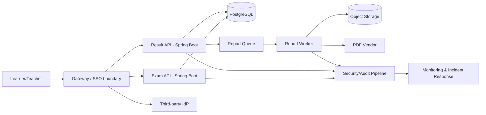
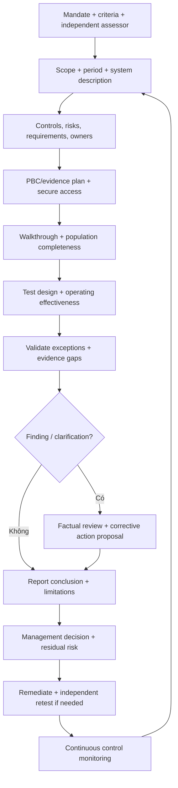
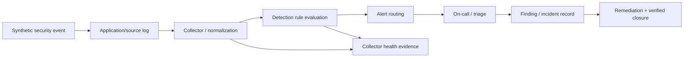
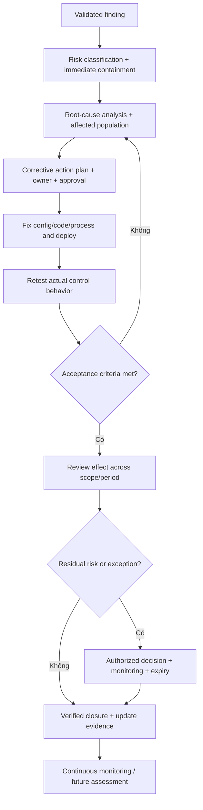
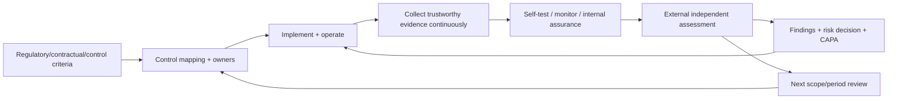

# External assessment: đánh giá bên ngoài và chứng minh tuân thủ bằng bằng chứng

## 1. Bài toán mở đầu: có chứng nhận nhưng API vẫn có lỗ hổng

Một nền tảng học tập đa tenant phát triển bằng Java/Spring Boot cung cấp các chức năng đăng nhập, thi trực tuyến, lưu kết quả và xuất báo cáo. Doanh nghiệp chuẩn bị làm việc với một tổ chức đánh giá độc lập nhằm chứng minh chương trình quản lý an toàn thông tin và một tập kiểm soát vận hành đã được triển khai.

Đội dự án đã chuẩn bị chính sách bảo mật, ảnh chụp màn hình MFA, báo cáo kiểm thử lỗ hổng, các dashboard vận hành và tài liệu chứng nhận từ cloud provider. Trong buổi walkthrough, assessor yêu cầu chọn một thay đổi quyền production trong kỳ được đánh giá, xem approval, source commit, deployment, log và thử quyền thực tế. Một request dùng tài khoản giảng viên tenant A lại đọc được bản ghi kết quả thuộc tenant B qua API cũ.

**Điểm mấu chốt:** bộ hồ sơ rất dày và một số chứng nhận của nhà cung cấp hạ tầng không đủ để chứng minh hệ thống ứng dụng của khách hàng đáp ứng mọi yêu cầu về object authorization. External assessment phải gắn **tiêu chí, phạm vi, phương pháp, nguồn bằng chứng và kết luận**; các findings cần được xử lý thay vì che giấu để đạt báo cáo đẹp.

**External assessment (đánh giá bên ngoài)** là hoạt động đánh giá do một chủ thể không thuộc nhóm chịu trách nhiệm vận hành trực tiếp hệ thống thực hiện, theo một phạm vi, bộ tiêu chí và mức độ độc lập/thẩm quyền đã xác định. Bên đánh giá có thể là đơn vị chứng nhận, tổ chức kiểm toán/assurance, bên đánh giá theo hợp đồng, khách hàng được cấp quyền hoặc cơ quan có thẩm quyền, tùy mục đích và yêu cầu pháp lý.

Trong chương **Compliance assurance** của module **SECURITY_SECURITY_ASSURANCE**, trọng tâm là thiết kế chương trình **đánh giá có bằng chứng** để hệ thống có thể chứng minh các security controls được thiết kế, triển khai, vận hành và cải tiến một cách đáng tin cậy. Một external assessment chỉ hỗ trợ kết luận **trong phạm vi, kỳ đánh giá, tiêu chí và phương pháp của chính nó**; không phải cam kết hệ thống “an toàn tuyệt đối”.

### Mục tiêu học tập

Sau bài này, bạn có thể:

1. Phân biệt đánh giá bên ngoài, internal audit, certification audit, SOC examination, customer audit, regulatory inspection và penetration test.
2. Xác định assessment objective, criteria, system boundary, business/data scope, period và assurance limitations.
3. Đánh giá tính độc lập, năng lực, thẩm quyền và xung đột lợi ích của assessor.
4. Thiết lập engagement, quyền tiếp cận, trách nhiệm, lịch, bảo mật, và kênh yêu cầu bằng chứng (PBC).
5. Chuyển các yêu cầu tuân thủ thành **control objectives → control design → operating evidence → test procedures → findings**.
6. Xây dựng evidence inventory và kiểm tra provenance, completeness, freshness, integrity, accuracy và access controls.
7. Hiểu khác biệt giữa inquiry, observation, inspection, reperformance, sampling; không dùng một screenshot để suy ra operating effectiveness cả kỳ.
8. Tổ chức đánh giá các security controls trên Java/Spring Boot, cloud/IAM, SDLC, logging, vulnerability, data protection, incident response và DR.
9. Quản lý phát hiện, bất đồng có căn cứ, corrective actions, residual risk và retest/closure đúng thẩm quyền.
10. Đọc kết quả đánh giá một cách không phóng đại, xây continuous compliance và cải tiến assurance.

## 2. Từ vựng cốt lõi và những điều dễ nhầm

| Thuật ngữ | Ý nghĩa | Ví dụ |
|---|---|---|
| **Assessment criteria** | Các yêu cầu/điều khoản mà hoạt động đánh giá dùng làm chuẩn | Control objectives được ánh xạ từ chuẩn áp dụng |
| **Assessment scope** | Pháp nhân, dịch vụ, hệ thống, địa điểm, kỳ, quy trình và tài sản được đánh giá | API thi trực tuyến trong hai clusters cụ thể |
| **Assessed entity** | Tổ chức/chủ thể chịu trách nhiệm cho đối tượng đánh giá | Công ty vận hành nền tảng học tập |
| **Assessor/auditor** | Người thực hiện đánh giá, có thẩm quyền/năng lực phù hợp | Đánh giá viên bên ngoài được ủy quyền |
| **Control objective** | Kết quả bảo mật/tuân thủ cần đạt | Chặn truy cập dữ liệu kết quả ngoài tenant |
| **Control owner** | Người/nhóm chịu trách nhiệm vận hành control | AppSec, IAM, SRE hoặc Data Owner |
| **Control design** | Cách control được thiết kế để đáp ứng mục tiêu | Server-side object-level authorization |
| **Implementation evidence** | Bằng chứng control đã được cấu hình/triển khai | Policy, PR, runtime config |
| **Operating effectiveness** | Control thực sự vận hành theo yêu cầu trong phạm vi/kỳ | Các thay đổi production trong kỳ có review và deploy gates |
| **Population** | Tập đầy đủ các đối tượng giao dịch/sự kiện thuộc phạm vi lấy mẫu | Tất cả production access grants trong kỳ |
| **Sample** | Tập con được chọn để kiểm tra theo phương pháp đã xác định | Một số changes/access grants chọn theo risk và phương pháp |
| **PBC/Provided by Client** | Tài liệu, dữ liệu và bằng chứng được yêu cầu từ tổ chức | Request list gồm access review, change tickets |
| **Finding/deviation** | Sai lệch hoặc thiếu sót được phát hiện theo tiêu chí | MFA cho admin thiếu ở một ứng dụng |
| **Remediation/CAPA** | Sửa lỗi và hành động ngăn tái diễn, có verification | Sửa policy + test + review nguyên nhân |
| **Management representation** | Tuyên bố của ban quản lý theo yêu cầu engagement | Xác nhận sự hoàn chỉnh/thông tin cung cấp |
| **Qualified/modified conclusion** | Kết luận có ngoại lệ/giới hạn theo loại engagement cụ thể | Một số controls không đạt hoặc scope bị giới hạn |
| **Assurance evidence** | Thông tin hỗ trợ một claim theo phương pháp đánh giá | Raw audit event + kiểm tra effective state |

### 2.1. Compliance không đồng nghĩa security

**Compliance** là mức đáp ứng các yêu cầu pháp lý, tiêu chuẩn, hợp đồng hoặc policy áp dụng. **Security** là khả năng bảo vệ thông tin/hệ thống trước các rủi ro. Hai mục tiêu liên quan nhưng không tương đương:

- Một yêu cầu được đáp ứng ở thời điểm kiểm tra không chứng minh không còn vulnerability.
- Một kỹ thuật bảo mật tốt chưa chắc đáp ứng nghĩa vụ ghi hồ sơ/thông báo của hợp đồng.
- Một chứng nhận có scope hạn chế không tự xác nhận mọi ứng dụng cùng tổ chức đều phù hợp.

### 2.2. Đánh giá khác kiểm thử xâm nhập

Penetration test có thể là **một nguồn bằng chứng** để kiểm soát kỹ thuật, nhưng không tự đánh giá được chính sách nhân sự, quản trị thay đổi, data retention hoặc hiệu lực chương trình audit cả kỳ. Ngược lại audit policy không thay penetration test hoặc authorization regression test khi cần.

### 2.3. Audit evidence khác “tài liệu có tồn tại”

Một chính sách năm nay có thể cho thấy yêu cầu đã được thiết kế. Để chứng minh security access review vận hành trong sáu tháng, assessor có thể cần population các accounts, review events, approvals, exceptions, removal evidence và kiểm tra phù hợp theo methodology. **Một file policy không phải bằng chứng đầy đủ cho control đang hoạt động.**

## 3. Những loại hình external assessment thường gặp

| Loại | Mục tiêu/phạm vi | Đầu ra có thể có | Không tự chứng minh |
|---|---|---|---|
| **Certification audit** | Đánh giá hệ thống quản lý theo chuẩn chứng nhận và phạm vi | Certificate và báo cáo đánh giá theo scheme | Mọi product, mọi lỗ hổng đều không tồn tại |
| **SOC examination / assurance engagement** | Đánh giá theo tiêu chí, kỳ và hệ thống được mô tả | Báo cáo độc lập theo hình thức engagement | Customer-specific configuration của từng khách hàng |
| **Customer/vendor assessment** | Đánh giá controls theo hợp đồng/risk của khách hàng | Questionnaire review, findings, report | Mọi chức năng không nằm trong scope |
| **Regulatory inspection/examination** | Kiểm tra tuân thủ nghĩa vụ được cơ quan có thẩm quyền xác định | Biên bản, yêu cầu khắc phục, kết luận theo quy định | Các tiêu chuẩn không thuộc kiểm tra |
| **Independent technical assessment** | Review architecture/config/test security của mục tiêu | Technical report, prioritized findings | Toàn bộ governance/operating controls |
| **External penetration test** | Kiểm thử khả năng khai thác trong rules of engagement | Finding/proof-of-concept theo quyền và giới hạn | Không có lỗ hổng ngoài thời gian/scope |
| **Third-party risk reassessment** | Xem vendor tiếp tục đáp ứng yêu cầu khi sử dụng | Risk rating, evidence gaps, decisions | Điều hành nội bộ vendor chưa được quan sát |
| **Due diligence / acquisition review** | Xác định exposure và control maturity trước giao dịch | Gap/risk report | Chứng nhận hoặc assurance opinion nếu không được giao |

### 3.1. ISO/IEC 27001

Một cuộc **chứng nhận hệ thống quản lý an toàn thông tin (ISMS)** theo ISO/IEC 27001 tập trung vào yêu cầu của chuẩn và **scope ISMS** được xác định. Đơn vị chứng nhận vận hành theo các quy tắc/chương trình công nhận áp dụng. Việc có chứng nhận hỗ trợ đánh giá hệ thống quản lý trong phạm vi, nhưng không thay thế kiểm thử security property cụ thể như tenant isolation của một endpoint.

### 3.2. SOC 2

SOC 2 là một dạng báo cáo theo **Trust Services Criteria** áp dụng cho system description và phạm vi đã nêu. Cách đọc cần xét loại báo cáo, thời kỳ, control objectives/criteria, exceptions, complementary user entity controls (CUECs), subservice organizations và kết luận của practitioner. **Type 1 và Type 2 không tương đương về câu hỏi được đánh giá**; Type 2 hướng đến tính vận hành của controls trong một kỳ nhất định, còn Type 1 tập trung vào mô tả/thiết kế tại một thời điểm theo report.

Không dùng SOC 2 như tên gọi đồng nghĩa với mọi loại chứng nhận; loại engagement và ngôn từ kết luận phải theo báo cáo thực.

### 3.3. PCI DSS khi có phạm vi xử lý thanh toán

Với hệ thống thuộc phạm vi PCI DSS, yêu cầu, cách đánh giá và hồ sơ có thể khác theo merchant/service provider role, phương thức xử lý dữ liệu và chương trình liên quan. Một nền tảng học tập dùng payment processor không tự động có cùng scope với processor; phải xác định luồng dữ liệu thanh toán, trách nhiệm và tiêu chuẩn/phiên bản áp dụng.

### 3.4. Pháp luật, kiểm tra và hợp đồng

Các yêu cầu về privacy, an toàn thông tin, giáo dục, lưu trữ hồ sơ hoặc nghĩa vụ báo cáo phụ thuộc **jurisdiction, loại dữ liệu, vai trò pháp lý, hợp đồng và ngày hiệu lực**. Không suy đoán mọi tổ chức phải thực hiện cùng một kiểu external audit hoặc chu kỳ cố định. Engagement cần bộ tiêu chí do legal/compliance và bên đánh giá xác nhận.

## 4. Mức độ độc lập, năng lực và thẩm quyền

“Bên ngoài” không tự bảo đảm tính độc lập. Một consultant vừa thiết kế control, tự kiểm chính thiết kế của họ và tự đưa ý kiến “independent assurance” có thể có **self-review threat**.

### 4.1. Các chiều cần đánh giá

| Chiều | Câu hỏi |
|---|---|
| **Organizational independence** | Assessor có thuộc nhóm trực tiếp thiết kế/triển khai control đang đánh giá? |
| **Financial/contractual conflicts** | Có lợi ích, phí thưởng hoặc áp lực làm ảnh hưởng kết luận? |
| **Competence** | Có hiểu chuẩn đánh giá, cloud, AppSec, identity và kỹ thuật cần thiết? |
| **Authority** | Có quyền đánh giá trong scope, xem evidence, phỏng vấn và báo cáo? |
| **Professional methodology** | Có sampling, test plan, review, quality control phù hợp? |
| **Confidentiality** | NDA, data handling, access permissions, retention/delete records rõ? |
| **Reporting independence** | Có thể báo phát hiện bất lợi mà không bị buộc chỉnh kết quả? |
| **Accreditation/eligibility** | Khi scheme yêu cầu, chứng nhận/đăng ký của assessor có phù hợp? |

### 4.2. Vai trò của internal team

Đội GRC/Compliance **có thể chuẩn bị hồ sơ, tự đánh giá và giúp kiểm chứng**; họ không nhất thiết thay thế external independent assessor. Khi cần tính độc lập theo engagement, phải xác định người chịu trách nhiệm đưa assurance conclusion và quyền của họ.

### 4.3. Phân tách “advisory” và “attestation”

Một đơn vị tư vấn đề xuất sửa cấu hình có thể tạo giá trị rất lớn, nhưng **không tự trở thành báo cáo chứng nhận hoặc ý kiến assurance độc lập**. Hợp đồng phải làm rõ deliverables, mức assurance và hạn chế sử dụng.

### 4.4. Quyền thử nghiệm có giới hạn

Assessor không mặc nhiên được phép quét mạng, chạy pentest, lấy dữ liệu thật hay truy cập cloud account. Các hoạt động kỹ thuật có ảnh hưởng phải nằm trong **rules of engagement**, authorization, dữ liệu thử, thời gian, stop conditions và quy trình escalation.

## 5. Tiêu chí đánh giá: từ requirement tới testable control

Một cuộc đánh giá có thể gặp nhiều bộ chuẩn cùng lúc: policies nội bộ, yêu cầu khách hàng, security baselines, hợp đồng và tiêu chuẩn chứng nhận. Cần **chuẩn hóa mapping** mà không nhầm các yêu cầu tương tự là hoàn toàn đồng nhất.

### 5.1. Một control mapping có ích

| Thành phần | Ví dụ |
|---|---|
| **Requirement** | Chỉ người có quyền mới được xem kết quả thuộc tenant/lớp của mình |
| **Risk scenario** | BOLA/IDOR gây truy cập kết quả học viên của tenant khác |
| **Control objective** | Server enforce object-level authorization trước mọi side effect |
| **Control design** | Xác minh principal → role → tenant → resource ownership ở service layer |
| **Control owner** | Application Security + Result Service owner |
| **Operation frequency** | Mỗi request, mỗi job/event theo architecture |
| **Evidence** | Source/release, policies, negative tests, audit events, runtime state |
| **Assessment procedure** | Inspect design, walkthrough, test tenant A→B và async path |
| **Expected outcome** | Deny trái quyền; không tạo job/file/DB mutation ngoài quyền |
| **Known limitations** | Phạm vi endpoint, API version, tenant fixtures và environment thử |

### 5.2. Control library và crosswalk

Một công cụ mapping có thể liên kết một technical control với nhiều yêu cầu có mục tiêu tương tự. Tuy nhiên cần lưu:

- **Control implementation version** và owner.
- **Requirement/standard version** và applicable clauses.
- **Applicability rationale:** cái gì áp dụng hoặc loại trừ và vì sao.
- **Evidence type:** thiết kế, thực thi tại thời điểm hay hoạt động trong kỳ.
- **Testing method, period và environment**.
- **Residual risks/compensating controls**, không tự dùng kết quả một framework thay mọi framework.

### 5.3. Requirement phải có ranh giới và tiêu chí đạt

**Yếu:** “Bảo mật tốt các API.”

**Tốt hơn:** “Mỗi request đọc/sửa/xuất kết quả phải xác minh verified actor, role và resource ownership; request trái tenant bị từ chối trước DB/queue/storage side effects; thay đổi permission liên quan được phê duyệt và test định kỳ.”

Requirement cụ thể giúp assessor lựa chọn evidence, giảm tranh cãi về thế nào là đạt.

### 5.4. Compliance checklist không được phủ kín threat model

Một checklist có thể không nhắc chi tiết đến queue replay hoặc signed URL; nhưng nếu hệ thống thực tế có các đường này, control assertion “tenant isolation” phải xem tới chúng. **Compliance assurance cần đi cùng risk analysis và technical assurance**, không thu hẹp security objective cho vừa mẫu biểu.

## 6. Scope: xác định đúng biên hệ thống và thời kỳ đánh giá

**Scope** là yếu tố quyết định giá trị kết luận. Một câu “platform compliant” có thể gây hiểu lầm nếu chỉ một service đã được xem.

### 6.1. Scope multidimensional

| Trục phạm vi | Ví dụ cần xác định |
|---|---|
| **Pháp nhân/đơn vị** | Công ty mẹ, công ty con hoặc đơn vị vận hành cụ thể |
| **Dịch vụ/sản phẩm** | Exam API, result export, IdP integration, customer admin |
| **Environment** | Production, staging, DR, managed SaaS tier |
| **Thời gian** | As-of date hoặc assessment period, look-back interval |
| **Tài sản** | Cloud accounts, clusters, networks, DB, storage, CI/CD, devices |
| **Địa lý** | Region, data center, remote work, locations dữ liệu |
| **Data flows** | Student submissions, scores, PII, access tokens, backups |
| **Users/identities** | Learner, teacher, admin, workloads, external support |
| **Trust boundaries** | Browser→gateway→service→worker→database/vendor |
| **Third/fourth parties** | Cloud, IdP, email, processors, managed security |
| **Excluded items** | Systems/processes ngoài scope có rationale được phê duyệt |
| **Criteria/report type** | Chuẩn/loại engagement và giới hạn sử dụng report |

### 6.2. Mermaid sơ đồ biên hệ thống



Ví dụ: nếu scope chỉ bao gồm Exam/Result API ở primary region, assessor không tự kết luận DR region, PDF vendor hoặc identity provider nội bộ đều đạt control giống nhau. Các phụ thuộc trọng yếu ngoài biên phải được **ghi rõ trách nhiệm và kế hoạch đánh giá bổ sung**.

### 6.3. Kỳ đánh giá và hiện trạng

Kiểm một snapshot ngày T có thể chứng minh configuration tại T nhưng không tự chứng minh control vận hành liên tục từ T-6 tháng tới T. Ngược lại một control vận hành trong kỳ trước không chắc còn hiệu lực sau major release hoặc chuyển region. Nên tách **period evidence**, **point-in-time evidence** và **subsequent-change review**.

### 6.4. System description và data flow

Một mô tả hệ thống cho assessor cần chính xác về authentication, multi-tenant model, dữ liệu lưu, code release process, admin roles, logs, vendor dependencies, service locations và backup. Không nên dùng sơ đồ “mẫu” cũ có component không còn triển khai để tạo ấn tượng phạm vi rộng.

### 6.5. Exclusions cần rationale

Một CronJob cũ nằm ngoài scope có thể vẫn gọi production API, một service account admin nằm ngoài tổ chức nhưng có quyền đổi cấu hình. Loại trừ một phụ thuộc có ảnh hưởng trực tiếp tới control assertion có thể khiến kết luận thiếu cơ sở; phải giải thích và được bên có thẩm quyền xác nhận.

## 7. Khởi tạo engagement: mục tiêu, quyền hạn và deliverables

Trước khi thu hàng nghìn chứng từ, nên có **engagement charter/statement of work** thống nhất với bên đánh giá.

### 7.1. Các nội dung tối thiểu

1. Purpose: chứng nhận, SOC examination, customer assurance, regulatory hoặc technical review.
2. Criteria/version và basis of evaluation.
3. Assessed entity, systems, services, locations và assessment period.
4. Mức assurance/report language theo scheme, không tự đặt nhãn.
5. Assessor qualifications, independence/competence và conflict disclosures.
6. Roles of management, control owners, assessor và legal/privacy.
7. Evidence access, NDA, data classification, encryption và retention.
8. Sampling/technique, interviews, observations và testing rights.
9. Testing environments, production safeguards, change windows, stop/escalation conditions.
10. PBC request/response workflow, timestamps và versioning.
11. Issue validation, preliminary findings review và factual correction process.
12. Report timeline, recipients, distribution restrictions và dispute process.
13. Material scope changes/subsequent events management.
14. Remediation plan, retest hoặc surveillance/follow-up theo scheme.

### 7.2. Mẫu charter minh họa

```yaml
engagement_id: "EA-LEARN-DEMO-006"
title: "External security control assessment"
status: "DRAFT_NOT_APPROVED"
assessment_type: "independent-control-review"
criteria:
  framework_reference: "<approved-criteria-and-version>"
  interpretation_owner: "compliance-and-assessor"
entity: "Example Learning Platform"
scope:
  services: ["exam-api", "result-api", "report-worker"]
  environment: "isolated-staging-plus-approved-production-evidence"
  cloud_accounts: ["<explicit-account-scope>"]
  period: "<start-to-end-or-as-of-date>"
  excluded: ["<approved-exclusion-and-rationale>"]
data:
  categories: ["synthetic-test-results", "redacted-operational-records"]
  handling: "restricted-evidence-portal"
roles:
  engagement_sponsor: "<management-sponsor>"
  assessor_lead: "<authorized-external-assessor>"
  evidence_coordinator: "<compliance-owner>"
  application_owner: "<app-owner>"
  cloud_security_owner: "<cloud-owner>"
  privacy_contact: "<privacy-owner>"
authorized_methods:
  - "document-inspection"
  - "interview-and-walkthrough"
  - "controlled-negative-and-positive-tests"
stop_conditions:
  - "unapproved-production-impact"
  - "unexpected-sensitive-data-exposure"
  - "evidence-access-exceeds-authority"
deliverables:
  - "assessment-scope-and-procedures"
  - "factual-findings-with-evidence-references"
  - "report-with-limitations"
  - "management-response-and-remediation-plan"
```

Đây là **biểu mẫu học tập**, không tự biến người sử dụng thành assessor được công nhận, không tạo quyền truy cập hạ tầng và không phải engagement đã ký.

## 8. Vòng đời thực hiện external assessment



### 8.1. Preparation là tạo khả năng kiểm chứng, không phải chỉnh sửa lịch sử

Đội nội bộ nên xác định control owners, dọn tài liệu lỗi thời, tổ chức PBC, kiểm population và sửa controls thiếu. Nhưng không được **fabricate approval quá khứ, sửa log, thay timestamps hoặc tạo sampling list thiếu những trường hợp không đạt**.

### 8.2. Fieldwork

Assessor có thể phỏng vấn, quan sát, kiểm hồ sơ, lấy mẫu, yêu cầu tái thực hiện test trong phạm vi đã duyệt. Đội kỹ thuật cần cung cấp evidence có provenance và bảo vệ hệ thống; không chỉ chuẩn bị một script trình diễn được dàn dựng để né các paths còn tồn tại.

### 8.3. Conclusion và phản hồi

Report phải dùng đúng ngôn ngữ/format của loại engagement. Assessed entity có quyền đưa **factual corrections và phản hồi có evidence**, nhưng không được buộc assessor đổi kết luận khi deviation thực sự có căn cứ.

### 8.4. Sau đánh giá

Việc phát hành certificate/report không tự khắc phục vulnerabilities hoặc đóng findings. Cần xử lý remediation, xem applicability của report, đưa evidence vào continuous monitoring và re-assess khi có thay đổi đáng kể.

## 9. Chuẩn bị PBC: yêu cầu bằng chứng phải rõ và truy vết được

**PBC (Provided by Client)** trong nhiều engagement là danh sách bằng chứng, tài liệu, population và thông tin người được đánh giá phải cung cấp. Một PBC thiếu chính xác làm cả hai bên tốn thời gian, tăng rủi ro chia sẻ dữ liệu không cần thiết và có thể khiến đánh giá không có cơ sở kết luận.

### 9.1. Một PBC request tốt gồm gì?

| Trường | Mục đích |
|---|---|
| **Request ID** | Tham chiếu duy nhất giữa assessor và control owner |
| **Assessment criterion** | Giải thích control/requirement nào cần chứng minh |
| **Requested artifact** | Policy, approval, population, runtime observation, test result |
| **Period and scope** | Những ngày, accounts, repos, services và regions liên quan |
| **Required attributes** | Actor, action, outcome, timestamps, object ID, reviewer, version |
| **Preferred source/method** | Nguồn dữ liệu hệ thống chuẩn và cách export có thể tái tạo |
| **Owner** | Ai cung cấp và ai xác minh thông tin trước gửi |
| **Sensitivity** | Loại dữ liệu, redaction/access/retention cần thiết |
| **Due date and priority** | Kế hoạch làm việc không buộc suy diễn thiếu bằng chứng |
| **Status/limitations** | Open, provided, needs clarification, partial, unavailable |
| **Assessor acceptance** | Evidence đã đủ để test hay cần thông tin bổ sung? |

### 9.2. PBC minh họa

```yaml
pbc_id: "PBC-AC-006"
control_id: "CTRL-PROD-ACCESS-REVIEW"
criterion_ref: "<approved-requirement-id>"
request: "Complete population of privileged access grants and revocations"
scope:
  period_start: "<UTC-start>"
  period_end: "<UTC-end>"
  environments: ["production"]
  identity_systems: ["<in-scope-idp>", "<in-scope-cloud-accounts>"]
required_fields:
  - "request_id"
  - "principal_ref"
  - "role_or_permission"
  - "resource_scope"
  - "requested_at"
  - "approved_by"
  - "applied_at"
  - "revoked_at_if_any"
  - "outcome"
population_source: "<system-of-record-and-query-revision>"
owner: "iam-team"
classification: "restricted"
delivery_method: "approved-access-controlled-evidence-portal"
status: "OPEN"
limitations: []
```

Mẫu không chứng minh control đã được thực hiện. Population thật phải được lấy đúng nguồn, lọc đúng scope và review tính đầy đủ.

### 9.3. Hạn chế gửi screenshots rời rạc

Một ảnh IAM console có thể không cho biết khi nào cấu hình thay đổi, một role đã được gỡ trước ảnh, hoặc những assignments khác có tồn tại. Khi cần kiểm tính vận hành, nên có exports từ nguồn chuẩn, audit trail, sample source records và phương pháp truy xuất tái tạo được; screenshots chỉ bổ trợ.

### 9.4. Quản lý yêu cầu không rõ

Nếu assessor yêu cầu “toàn bộ log production” mà chưa nêu mục tiêu/phạm vi, evidence coordinator cần làm rõ trước khi xuất. Có thể cung cấp summary, pseudonymized extracts hoặc read-only query trong portal đúng quyền; không tự động gửi toàn bộ PII, session tokens hoặc secret logs.

## 10. Quản lý bằng chứng an toàn: một quy trình riêng cần được kiểm soát

External assessments thường thu thập thông tin nhạy cảm về kiến trúc, quyền, incidents, vulnerabilities và dữ liệu cá nhân. Evidence leakage trong quá trình audit có thể trở thành một incident mới.

### 10.1. Quy tắc vận hành

1. Chỉ thu **phần evidence cần cho test procedure**, theo data minimization.
2. Gắn classification, owner, purpose, retention và permitted recipients.
3. Dùng kênh chia sẻ được phê duyệt với MFA, scoped permissions, audit logs.
4. Ưu tiên redacted/pseudonymized records hoặc synthetic fixtures khi đủ cho claim.
5. Không gửi private keys, raw bearer tokens, passwords, OTP, full student submissions hoặc dữ liệu nhạy cảm ngoài phạm vi.
6. Kiểm tra external assessor identity và contractual/legal sharing authority.
7. Đặt thời hạn truy cập, tránh share links công khai hoặc tài khoản chung.
8. Theo dõi access/download/export và có quy trình revoke khi engagement kết thúc.
9. Giữ source-of-truth; nếu biến đổi/redact, lưu phương pháp và bản gốc theo kiểm soát tổ chức.
10. Xác minh bên đánh giá xử lý/retention/deletion theo engagement và nghĩa vụ liên quan.

### 10.2. Evidence provenance và chain of custody

Một evidence item nên ghi:

- Hệ thống và môi trường nguồn, data owner.
- Người/automation thu, principal thực hiện.
- Query/script/report revision và filter.
- Source event time, extraction time, thời điểm upload.
- Source population/version, sample IDs.
- Integrity metadata như cryptographic hash khi phù hợp.
- Bản redacted và mapping tới evidence gốc được bảo vệ.
- Người đã review accuracy trước chia sẻ.
- Recipient/access log/retention policy.

**Hash chứng minh bytes phù hợp digest được giữ, không chứng minh evidence vốn đã chính xác hoặc population đủ.** Provenance, source controls và cross-checks vẫn cần thiết.

### 10.3. Data masking phải trung thực

Ẩn email/họ tên học viên nhưng giữ stable pseudonym để assessor đối chiếu một identity trong nhiều records. Không thay đổi outcomes, timestamps, actor classes, approval state hoặc xóa các cases không đạt chỉ để che thông tin. Mọi redaction có thể làm giảm testability; phải ghi hạn chế.

### 10.4. Read-only access và segregation

Nên cấp auditor quyền read-only, giới hạn thời gian trên evidence repository hoặc reports. Nếu evaluator cần thực hiện test kỹ thuật, dùng fixture accounts/sandbox, theo approval. Không đưa production admin key cho auditor để họ “tự tiện xem”.

### 10.5. Data retention sau engagement

Thỏa thuận cần nêu bao lâu các bên lưu evidence, cách trả/xóa, legal hold và nghĩa vụ audit tiếp theo. Không tự đặt kỳ hạn xóa thống nhất cho mọi loại hồ sơ nếu chuẩn/hợp đồng/pháp luật yêu cầu khác.

## 11. Chất lượng bằng chứng: “có file” chưa đủ

### 11.1. Tám thuộc tính cần đánh giá

| Thuộc tính | Câu hỏi kiểm chứng | Ví dụ failure |
|---|---|---|
| **Relevance** | Bằng chứng trực tiếp hỗ trợ requirement nào? | Dùng CPU dashboard để chứng minh authz |
| **Accuracy** | Nội dung phản ánh đúng trạng thái/hoạt động? | App log ghi “denied” nhưng DB đã có side effect |
| **Completeness** | Population và các paths có được bao phủ? | Chỉ export user grants từ một cloud account |
| **Provenance** | Ai, công cụ, nguồn, phương pháp tạo? | CSV không có query/filter/time |
| **Integrity** | Có bảo vệ khỏi sửa trái phép, audit sửa đổi? | Evidence được chỉnh thủ công không có track |
| **Freshness** | Còn phù hợp release/config/kỳ đang đánh giá? | Test access control trước major release |
| **Scope alignment** | Đúng tenant/region/api version/assessor criteria? | Chỉ staging test khi claim production |
| **Reproducibility** | Có thể kiểm lại đủ độc lập? | Screenshot một màn hình không có ID |

Ngoài ra cần xem **confidentiality** và **lawful handling** vì evidence có thể chứa dữ liệu nhạy cảm.

### 11.2. Claim–evidence strength

| Evidence | Claim có thể hỗ trợ | Claim không thể tự hỗ trợ |
|---|---|---|
| Security policy được duyệt | Control đã được quy định/thiết kế | Mọi nhân viên đều tuân thủ trong kỳ |
| CI pipeline YAML | Có cơ chế gate theo cấu hình mong muốn | Gate đã chạy cho mọi production releases |
| Screenshot IAM MFA enabled | Một trạng thái hiển thị tại thời điểm chụp | Mọi privileged users của mọi tenant đều dùng MFA |
| Audit log đã bảo vệ | Một số events được ghi nhận và bảo vệ | Không có events bị bỏ lọt |
| Negative authorization test | Đường request/tài khoản đã thử bị deny | Không còn mọi biến thể BOLA |
| SOC report của cloud provider | Một số inherited controls trong scope/period | Customer's network/IAM/tenant authorization đã chuẩn |
| Restore job success | Một tác vụ restore được thực thi | App/data integrity/RTO/RPO đã đáp ứng |
| Management statement | Ban quản lý đã đưa tuyên bố | Tuyên bố luôn chính xác nếu không có corroboration |

### 11.3. Evidence freshness phụ thuộc change

Một kết quả kiểm thử authz tuần trước có thể stale ngay khi endpoint mới được deploy. Một chính sách ISMS có thể vẫn hợp lệ nhiều tháng nếu không thay đổi và có review. Không áp một “TTL của mọi evidence” cứng nhắc; phân loại theo loại control, events/release và assessment period.

### 11.4. Bằng chứng không có = không thể kết luận

**Không có log sai quyền** không chứng minh không có truy cập sai quyền, nhất là khi collector ngừng hoạt động. Nếu population không đầy đủ hoặc một environment chưa kiểm, đánh dấu **INCONCLUSIVE/NOT_TESTED** cho claim liên quan, không mặc định PASS.

### 11.5. Bằng chứng mâu thuẫn

Nếu policy nói password rotation trong một khoảng nhưng audit cho thấy exception lâu hơn không được duyệt, cần ghi mâu thuẫn và điều tra. Không “chọn evidence đẹp hơn” để bỏ qua deviations. Cần giải thích timestamps, actor, scopes, policy versions và root causes.

## 12. Population completeness: nền tảng của lấy mẫu có ý nghĩa

Assessor thường không kiểm mọi sự kiện của một kỳ. Họ có thể chọn mẫu, nhưng **mẫu từ population sai sẽ dẫn tới kết luận sai**.

### 12.1. Population có thể là gì?

| Control | Population trong kỳ |
|---|---|
| Production change approvals | Tất cả thay đổi triển khai/chỉnh cấu hình production |
| Privileged account management | Tất cả grants/revokes/tạm cấp quyền admin |
| Security incident response | Tất cả incidents theo tiêu chí classification |
| Vulnerability remediation | Tất cả findings thuộc severity/scope xác định |
| Backup/restore | Tất cả expected backup jobs/restore tests được yêu cầu |
| User access review | Tất cả identities/roles trong application/tenant scope |
| Training/awareness | Tất cả users thuộc population phải được đào tạo |
| Vendor management | Tất cả vendors critical/changes trong scope |
| Certificate rotation | Tất cả certificates/keys thuộc yêu cầu trong kỳ |
| Security event alerting | Tất cả services/sources phải phát events theo inventory |

### 12.2. Sai lầm phổ biến

Đội triển khai đưa danh sách PR đã merge làm **population của production changes**, nhưng có manual hotfixes, IaC applies từ pipeline khác và console changes không qua PR. Những thay đổi này bị bỏ sót, khiến mẫu “100% có approval” không đáng tin.

### 12.3. Phương pháp đối chiếu completeness

1. Xác định control period và in-scope accounts/services.
2. Chọn nguồn hệ thống đủ authoritative: CI/CD, deployment records, cloud audit, IAM system, ITSM.
3. Ghi extraction query, filter, event schema, timezone và version.
4. Đối chiếu số lượng, unique IDs, thời điểm đầu/cuối với nguồn độc lập khi có.
5. Kiểm exports bị pagination/truncation, retention gaps, API rate limit hoặc permissions thiếu.
6. Kiểm manual/emergency paths và exceptions có nằm trong population.
7. Kiểm duplicates, deleted objects, test accounts và out-of-period records theo criteria.
8. Document exclusions và rationale; không loại bỏ cases không thuận lợi.
9. Reviewer xác nhận population readiness trước khi lấy mẫu.

### 12.4. Ví dụ đối chiếu

Giả sử trong một kỳ mẫu:

| Nguồn | Ghi nhận |
|---|---:|
| CI/CD deployments | 98 production deployment events |
| Cloud configuration audit changes ngoài pipeline | 7 events |
| Emergency fixes thông qua ITSM | 4 tickets, trong đó 2 có thể trùng 7 events |
| Bản PBC được cung cấp ban đầu | 98 dòng |

**Không thể kết luận population là 98** chỉ vì CI/CD chứa 98. Phải reconcile identities và xác định 7 events cùng 4 tickets có thuộc control hay trùng lặp thế nào. Không cộng cơ học thành 109 nếu chưa dedup và xét semantics.

### 12.5. Sampling không thể sửa một population sai

Nếu nguồn đã bỏ qua mọi manual changes, chọn ngẫu nhiên 30 records từ 98 deployments không thể phát hiện phần bị bỏ qua. **Completeness test phải đi trước hoặc đi cùng selection of samples**.

## 13. Sampling, judgment và giới hạn suy rộng

### 13.1. Mục tiêu lấy mẫu

Sampling giúp đánh giá operating effectiveness trong điều kiện thời gian, chi phí và volume có giới hạn. Phương pháp có thể là **random/statistical**, **risk-based/judgmental**, hoặc kiểm tra toàn bộ cho control rất quan trọng/population nhỏ, theo scheme và đánh giá của assessor.

### 13.2. Chiến lược có thể dùng

| Chiến lược | Điểm mạnh | Hạn chế |
|---|---|---|
| **Random selection** | Hạn chế selection bias theo phương pháp đúng | Cần population đáng tin và sample-size rationale |
| **Risk-based selection** | Tập trung high-impact exceptions/emergency changes | Không tự cho phép suy rộng thống kê |
| **Stratified selection** | Bao phủ vùng/role/thời điểm/loại giao dịch | Cần phân tầng dữ liệu chính xác |
| **Full population test** | Không bỏ sót records trong tập đã xác định | Vẫn phụ thuộc quality của population/source/test |
| **Time-spread samples** | Kiểm operating effectiveness qua nhiều mốc | Chưa chắc thấy rare failures |
| **Exception-focused follow-up** | Tìm root cause và phạm vi của deviation | Không thay chọn mẫu ban đầu có logic |

### 13.3. Kích thước mẫu không có con số chung

Không có “mọi control phải lấy 25 mẫu” áp dụng mọi engagement. Số lượng tùy criteria, frequency, period, risk, population, expected deviation, testing method và professional judgment. Nếu không có quyền chọn sample, owner không nên tự chọn “đẹp nhất” rồi giao assessor.

### 13.4. Ví dụ đánh giá access grants

Giả sử production IAM có 212 privileged grants trong một kỳ. Assessor chọn một tập mẫu bao phủ grants có thời hạn, emergency grants, service account grants và grants thông thường. Mỗi record kiểm:

- Có approved request trước thời điểm grant?
- Actor phê duyệt phù hợp separation-of-duties?
- Resource scope và quyền effective đúng yêu cầu?
- Privilege có được thu hồi khi hết nhu cầu/TTL?
- Có audit trail không sửa được trái quyền?
- Có những grant không qua workflow mà population bỏ lọt?

Nếu phát hiện một grant khẩn không có review, cần phân loại deviation và mở rộng thủ tục khi phương pháp yêu cầu. **Không suy thống kê “99,5% compliant” chỉ từ một bộ mẫu judgmental**.

### 13.5. Khi nào phải mở rộng kiểm tra?

Phát hiện sai lệch có thể đòi hỏi xem root cause, affected period, tương tự control instances hoặc kiểm thêm records theo assessor methodology. Reviewer không nên tự sửa một grant rồi yêu cầu “rút mẫu mới không có lỗi”.

## 14. Design effectiveness và operating effectiveness

Hai câu hỏi quan trọng nhất của một control test:

1. **Design:** Nếu control hoạt động như thiết kế, nó có ngăn/phát hiện rủi ro cần bảo vệ không?
2. **Operation:** Trong phạm vi và thời gian được kiểm, control có thực sự hoạt động như yêu cầu không?

### 14.1. Ma trận

| Tình huống | Design | Operation | Kết luận có thể có |
|---|---|---|---|
| IAM grants cần approval/TTL; records đúng | Adequate trong scope | Observed operating | Có evidence hỗ trợ claim |
| Policy chỉ yêu cầu review bằng email không xác định quyền | Design gap | Có thể đã gửi email | Không đủ cho authorization objective |
| Pipeline bắt buộc SAST nhưng một deploy path bypass | Design/coverage gap hoặc implementation gap | Operation không đầy đủ | Finding, đánh giá affected population |
| Multi-tenant authz có API rule đúng nhưng worker không kiểm | Incomplete end-to-end design | Một đường có thể vi phạm | Control failure/gap |
| Audit log design tốt nhưng collector dừng 12 giờ | Adequate design | Operation failure/gap | Không coi 12 giờ này clean |
| Backup policy có nightly job nhưng chưa thử restore | Một phần design | Chỉ backup job observed | Recovery claim không đủ |

### 14.2. Control at a point vs control throughout a period

Một screenshot ngày cuối kỳ cho thấy MFA enabled chưa chứng minh privileged MFA được enforced cả kỳ. Cần historical records, authentication events, policy change audit và evidence cho các identities quan trọng. Ngược lại nếu report chỉ có as-of objective, assessor phải mô tả đúng loại evidence và giới hạn.

### 14.3. Preventive vs detective controls

Preventive control như deny cross-tenant requests cần positive/negative behavior verification. Detective control như alert khi privileged role bị gỡ bỏ cần thử event pipeline, rule evaluation, notification và triage, không chỉ thấy rule YAML trong Git.

### 14.4. Automated control không miễn kiểm configuration change

Một gate chạy tự động trong CI có thể vận hành ổn định; nhưng nếu admins có thể tắt gate hoặc deploy ngoài CI, assessor cần xem **IT general controls (ITGC)**: quyền thay config, change approvals, monitoring và emergency procedures.

### 14.5. Control với shared responsibility

Một provider có audit report tốt về hạ tầng không thay việc khách hàng cấu hình cloud IAM, public buckets hoặc application authz. Design/operation evidence của customer và inherited controls phải mapping riêng.

## 15. Phương pháp thu thập và thử nghiệm của assessor

Một external assessor có thể kết hợp nhiều kỹ thuật. Không kỹ thuật nào tự nó bảo đảm đủ cho mọi control:

| Kỹ thuật | Mục đích | Ví dụ và lưu ý |
|---|---|---|
| **Inquiry/interview** | Hiểu quy trình/controls do owner mô tả | Hỏi cách xử lý emergency access; nên corroborate bằng records |
| **Inspection** | Kiểm chính sách, config, log, tickets | Xem CI gate config và records trong kỳ |
| **Observation** | Quan sát hành động/điều kiện tại thời điểm | Xem admin đi qua MFA hoặc restore drill; giới hạn thời điểm |
| **Walkthrough** | Theo một giao dịch từ đầu tới cuối | Change request → review → deploy → audit |
| **Reperformance** | Assessor tái thực hiện một bước kiểm tra trong quyền | Kiểm status của privileged role, test access bằng fixture |
| **Technical testing** | Đo hành vi thực tế của system control | Cross-tenant deny, webhook signature, audit event |
| **Sampling** | Chọn cases trong population | Các deployments/role grants trong kỳ |
| **Corroboration** | Đối chiếu nhiều nguồn khác nhau | CI deployment, cloud activity, ITSM approval |
| **Analytical review** | Phân tích trend, anomalies, inconsistencies | Emergency changes tăng bất thường |

### 15.1. Ví dụ walkthrough security incident

Assessor chọn một incident record thật trong kỳ và hỏi:

1. Alert detection source là gì, timestamp nào?
2. Triage owner/criteria và assignment history?
3. Evidence nào dẫn tới classification?
4. Containment approval/actual change/negative test?
5. Evidence root cause remediation và recovery?
6. Communication và escalation duties có được thực hiện?
7. Post-incident findings đã có retest/closure chưa?

Một walkthrough có thể bộc lộ lỗ hổng dù mọi trường của ticket đều có giá trị. **Điều quan trọng là sự thật của timeline và outcomes**, không chỉ ticket có trạng thái Closed.

### 15.2. Bảo vệ production khi technical testing

Các thử nghiệm có ảnh hưởng như restart, failover, fuzzing hoặc access probe phải được ủy quyền riêng. Ưu tiên **synthetic tenant accounts, test records, isolation/sandbox** và kiểm tra không thay đổi dữ liệu thật. Không dùng quyền external audit làm cớ thử phá hủy hoặc đọc dữ liệu người dùng không được phép.

### 15.3. Assessor có thể yêu cầu thông tin bổ sung

Khi một report không đủ chứng minh control, assessor có thể yêu cầu population khác, direct read-only view, internal owner explanation hoặc test thêm. Đội nội bộ nên phản hồi bằng evidence và scope rõ, không tự thêm “đã đạt” ngoài kết luận có quyền.

## 16. Control matrix tổng quát cho nền tảng học tập

| Domain | Risk/control objective | Evidence đề xuất | Testing method |
|---|---|---|---|
| Governance | Policies và risk decisions có owner, review | Approved policies, risk register, minutes | Inspect + interview |
| Identity/IAM | Least privilege, MFA, lifecycle | Active roles, grant/revoke population, access reviews | Population + sample + negative tests |
| Application authorization | Không BOLA/cross-tenant side effects | Code, threat model, test fixtures, runtime logs | Inspect + technical tests |
| Data protection | Classification, encryption, retention, deletion | Data-flow map, key policies, test object permissions | Inspect + effective behavior |
| Secure SDLC | Changes được review/test trước deploy | PRs, CI gates, release artifacts, approvals | Population + sample + reconciliation |
| Supply chain | Dependencies/artifacts có integrity và quản lý | SBOM, provenance, scan findings, digest inventory | Inspect + technical checks |
| Vulnerability management | Findings được triage/sửa theo risk | Scan inventory, ticket population, retest evidence | Sample + affectedness review |
| Logging/monitoring | Security events được phát và xử lý | Log schema, alerts, synthetic test, acknowledgement | End-to-end test |
| Incident response | Triage, containment, recovery và lessons learned | Incident records, timeline, postmortems | Walkthrough/sample |
| Business continuity | BCP/DRP, backup/restore và data integrity | BIA, test exercise, RTO/RPO measurements | Inspect + restore evidence |
| Third-party assurance | Vendor/subprocessor risk được giám sát | Vendor inventory, contracts, reports, exceptions | Sample + scope review |
| Cloud assurance | Shared responsibility/config posture | Runtime IAM/network/storage, provider reports | Inspect + effective tests |
| Privacy | Data use/location/retention được quản trị | Approved data flow, DPA, data handling tests | Inspect + sample |
| Physical/personnel | Access/HR controls tương ứng scope | Independent provider records, HR workflow | Approved inquiry/inspection |

### 16.1. Coverage matrix không phải phép cộng điểm

Một control test PASS về logging không bù cho authorization FAIL; một vendor có chứng nhận tốt không bù khách hàng để bucket public. Đánh giá phải phản ánh **critical failed controls** và limitation, không chỉ tỷ lệ tài liệu hoàn thành.

### 16.2. Tích hợp evidence từ những bài học assurance khác

Risk management cung cấp threat/impact; secure development cho source/CI tests; security architecture cho trust boundaries; detection/IR/BCP cho operating evidence; third-party assurance cho dependency reports. External assessment liên kết chúng bằng **scope, population, methodology và independent evaluation**.

## 17. Ví dụ kỹ thuật: đánh giá object authorization đa tenant trong Java/Spring Boot

### 17.1. Định nghĩa mục tiêu trước khi viết test

**Control objective AUTHZ-EX-01:** mọi request đọc, sửa, xuất bảng điểm phải dùng verified principal, role và quyền trên **đối tượng thực**, và không được tạo side effects nếu authorization thất bại.

Những đường cần xét:

- Spring MVC/REST API versions v1/v2.
- GraphQL/resolver hoặc admin API nếu được deploy.
- Service-to-service endpoints và internal workers.
- Scheduled jobs, queues, retry/dead-letter processing.
- Query/cache/search index/storage download links.
- Tenant membership/role changes và stale sessions.

### 17.2. Control design minh họa

Một controller có `@PreAuthorize("isAuthenticated()")` chỉ yêu cầu người dùng có phiên đăng nhập; **không tự kiểm quyền trên đối tượng**. Dịch vụ nên áp dụng authorization ở nơi được bảo đảm cho mọi entry point.

```java
// Mã minh họa: những interfaces/records là abstractions của dự án.
// Không phải implementation đầy đủ có thể deploy nguyên văn.
@Service
public class ResultReadService {
    private final ResultRepository results;
    private final ResultAccessPolicy accessPolicy;
    private final AuditSink audit;

    public ResultReadService(ResultRepository results,
                             ResultAccessPolicy accessPolicy,
                             AuditSink audit) {
        this.results = results;
        this.accessPolicy = accessPolicy;
        this.audit = audit;
    }

    @Transactional(readOnly = true)
    public ResultView readResult(VerifiedActor actor, UUID resultId) {
        var result = results.findById(resultId)
                .orElseThrow(ResultNotFoundException::new);

        // Chỉ actor đã được server xác minh; không tin tenant header do client tự gửi.
        accessPolicy.requireCanRead(actor, result);

        audit.authorizationAllowed(actor.reference(), resultId, "read");
        return ResultView.fromAuthorizedRecord(result);
    }
}
```

Ví dụ chỉ mô tả một đường; authorization policy còn cần xử lý tính nhất quán của ownership, caching, concurrency và caller contexts. Kết quả query có thể chứa dữ liệu nhạy cảm trong memory; phải bảo vệ response/log và bảo đảm **mọi đường xuất dữ liệu khác** enforce cùng invariant.

### 17.3. Integration test negative và positive

```java
// Pseudocode Testcontainers/Spring test fixture: các helpers chưa được định nghĩa.
@SpringBootTest
@AutoConfigureMockMvc
class TenantIsolationAssuranceIT {
    @Autowired MockMvc mvc;
    @Autowired SyntheticFixtureFactory fixtures;
    @Autowired TestTokenIssuer tokens;

    @Test
    void tenantAMayReadOwnResult() throws Exception {
        var teacherA = fixtures.teacherIn("tenant-A");
        var resultA = fixtures.resultIn("tenant-A");

        mvc.perform(get("/api/results/{id}", resultA.id())
                .header("Authorization", "Bearer " + tokens.forActor(teacherA)))
            .andExpect(status().isOk());
    }

    @Test
    void tenantACannotReadOtherTenantOrCauseSideEffects() throws Exception {
        var teacherA = fixtures.teacherIn("tenant-A");
        var resultB = fixtures.resultIn("tenant-B");
        var before = fixtures.sideEffectSnapshot(resultB.id());

        mvc.perform(get("/api/results/{id}", resultB.id())
                .header("Authorization", "Bearer " + tokens.forActor(teacherA)))
            .andExpect(status().isForbidden());

        assertThat(fixtures.sideEffectSnapshot(resultB.id()))
            .isEqualTo(before);
    }
}
```

Đây là **bộ khung cho assessor hoặc đội nội bộ**, không tự chạy được vì các classes giả định và cần cấu hình cụ thể. `MockMvc` có thể không đi qua gateway/IdP/worker như production; để chứng minh end-to-end assurance còn cần coverage deployment/runtime và các entry points khác.

### 17.4. Evidence đánh giá gồm gì?

| Claim | Evidence | Giới hạn |
|---|---|---|
| Code kiểm object ownership | Review phiên bản source, policy implementation | Chưa chắc mọi release đã deploy |
| Unit/integration tests có negative cases | CI result, fixtures, assertions | Scope của test và mock dependencies |
| Production image chứa bản đã test | Build provenance, image digest, deployment inventory | Config và live behavior vẫn có thể khác |
| Requests trái quyền bị deny | Synthetic authorized test trên môi trường có phép | Chưa kiểm mọi tenant/role/endpoint |
| Không có side effects | DB/queue/worker/object state before/after | Cần tính retry/delay và eventual behavior |
| Audit events được phát và nhận | Event source → collector → store check | Missing collector cần test riêng |

### 17.5. Khi control thất bại

Nếu một API cũ cho phép teacher A đọc result B, đó là **technical control failure trong scope đã test**. Việc assessor phát hiện không tự biến thành quyền khai thác rộng production. Tổ chức cần xử lý theo incident/vulnerability procedure, đánh giá exposure và remediation, cung cấp evidence sau sửa trong phạm vi.

### 17.6. Đọc đúng kết luận

Pass trên tenant A/B với hai test records giúp hỗ trợ claim ở **đường được thử**. Không đủ để tuyên bố “không có BOLA ở mọi API, workload và release”. Ngược lại một failure confirmed cần được xử lý như finding theo severity/risk, không bị che bởi tỷ lệ test passes cao.

## 18. Đánh giá IAM, MFA và privileged access operating evidence

### 18.1. Thiết kế, triển khai, vận hành

**Design:** privileged access yêu cầu role được xác định, approval, least privilege, MFA, time-bound elevation và review.

**Implementation:** IdP/cloud IAM policies, JIT/PAM config, trust relationships và SSO mappings được triển khai.

**Operation:** tất cả grants/revocations trong kỳ có evidence phù hợp; expired grants không kéo dài ngoài quyết định; active privileged sessions và break-glass audit được kiểm.

### 18.2. Population và mẫu

Đội IAM xuất population từ sources có thẩm quyền. Assessor có thể stratify:

- Human admins và workload/service principals.
- Long-lived vs temporary access.
- Normal vs emergency/break-glass grants.
- Primary và recovery cloud accounts.
- Privileged roles của ứng dụng nhiều tenant.
- Shared/vendor support identities nếu thuộc scope.

### 18.3. Walkthrough một grant

Một grant record nên liên kết:

`request → justification → approver → effective policy → apply timestamp → usage audit → expiry/review → revoke timestamp`.

Nếu ticket có phê duyệt nhưng AWS/cloud effective role trust cho phép principal khác assume role, approval ticket chưa chứng minh least privilege. Cần đối chiếu **identity policy, resource policy, trust policy và runtime assumption**, tùy hệ thống.

### 18.4. MFA và federation

Chỉ ghi “IdP MFA enabled” không đủ khi một admin đăng nhập qua fallback route, session không chịu policy, hoặc service accounts có quyền quản trị không được bảo vệ bằng controls phù hợp. MFA yêu cầu theo loại identity; automated workload identity không thể được đánh giá như user dùng MFA UI. Cần tiêu chí và alternative controls có căn cứ.

### 18.5. Privileged access exceptions

Nếu emergency access được cấp ngoài workflow do incident, có thể được phép theo approved break-glass procedure nhưng phải có audit, retrospective review và TTL. Đừng tự đánh dấu exception fail trước khi đọc criteria; cũng không tự miễn tất cả emergency access khỏi population.

## 19. Đánh giá secure SDLC, change management và release evidence

### 19.1. Những control assertions thường gặp

- Thay đổi code/config có source-of-truth, reviewer và approval phù hợp.
- Build/test/deploy artifacts có identity/provenance và separation of duties.
- SAST, SCA, secret scanning hoặc tests theo risk được thực thi đúng gate.
- Findings security quan trọng được triage và có exception do risk owner duyệt.
- Chỉ artifact/version phù hợp policy được deploy production.
- Emergency changes có logging và retrospective review.
- CI/CD privileged credentials được quản lý và hạn chế quyền.

### 19.2. Population release thực sự

Không lấy Git commit history làm population của deployment nếu có:

- Hotfix trực tiếp trên server/cloud console.
- Terraform/IaC apply ngoài CI.
- Feature flag thay behavior production.
- Thay container tag/digest không qua release gate.
- CronJob/worker image được cập nhật độc lập.
- Migration script hay DB trigger chạy ngoài pipeline.

Assessor có thể đối chiếu Git/PR, deployment controller, cloud audit, container runtime và change management để xác định completeness.

### 19.3. Một claim có điều kiện

**Claim:** “Mọi production release của `result-service` trong assessment period có code review và security tests theo chính sách.”

Để kiểm, cần:

1. Population **tất cả** deploys thực tế.
2. Identity mỗi artifact: commit, build ID, digest, environment và time.
3. Records của review, policy gates, exceptions.
4. Mapping deployed digest → tested digest.
5. Evidence các emergency paths.
6. Sample/test theo methodology và xét deviations.

**Một CI pipeline YAML có step `securityScan` không chứng minh gate đã chạy cho mọi production deploy**; job có thể bị skip hoặc deploy xảy ra ngoài pipeline.

### 19.4. Ví dụ kiểm artifact identity

```text
Source PR:       PR-0187, approved reviewer / commit abc...
CI run:          build-442, security-gates status and timestamps
Build output:    sha256:<digest-built>
Release approval: CHG-2026-EXAMPLE
Deployment:      production result-service revision R
Observed runtime:sha256:<digest-running>
Condition:       digest-running == digest-tested-and-approved
```

Đây là luồng **minh họa**, không phải evidence thật. Cần bảo vệ thông tin registry/workload và dùng công cụ kiểm chứng runtime phù hợp.

### 19.5. Artifact đã ký không tự động an toàn

Chữ ký/provenance hỗ trợ xác thực origin/build chain nhưng không bảo đảm không có lỗ hổng business logic. Một artifact được ký vẫn có thể chứa BOLA. Vì vậy software supply-chain evidence và application security tests là controls bổ sung nhau.

## 20. Đánh giá logging, detection và incident response

### 20.1. Vì sao logging control thường bị đánh giá quá lạc quan?

“SIEM đã bật” hoặc “dashboard có events” không chứng minh security events trọng yếu của **mọi service trong scope** được phát/nhận/đánh giá/định tuyến. Event pipeline có thể mất source, parser đổi schema, retention không đủ hoặc on-call không acknowledge.

### 20.2. Evidence theo chuỗi



### 20.3. Các câu hỏi assessor cần đặt

| Claim | Kiểm chứng |
|---|---|
| Security events được log | Authn/authz/IAM/critical changes phát events có đủ field? |
| Events được thu đúng | Source coverage, collector health, ingestion lag |
| Rule phát hiện đúng | Positive/negative/boundary fixtures, rule version |
| Alert tới đúng người | Delivery receipt, on-call owner, escalation |
| Incident được xử lý | Incident population, timeline, authority, controls |
| Evidence được bảo vệ | Retention, access, integrity, redaction và deletion |
| Lessons learned được áp dụng | Corrective actions, retest, updated runbook |

### 20.4. Missing data và period gaps

Nếu collector bị ngừng vào một tuần trong kỳ, assessor không thể suy rằng không có security incidents trong tuần đó. Cần đánh giá khả năng backfill, alternative evidence, gap impact, corrective action và limitation.

### 20.5. Alert threshold không tự chứng minh coverage

Một rule `count(denied) > 10` có thể chỉ phát hiện bursts, không phát hiện unauthorized successes. Security assurance report cần mô tả **đúng detection hypothesis**, không gọi rule đó là bảo đảm toàn bộ object authorization.

## 21. Đánh giá data protection, privacy, encryption và retention

### 21.1. Các lớp phải bao phủ

- Phân loại dữ liệu cá nhân, học vụ, đề thi, bài thi, kết quả và logs.
- Data inventory và flow từ application/DB/queue/cache tới vendor/cloud/backup.
- Authentication, role, tenant isolation và data access monitoring.
- Encryption at rest/in transit, KMS key policy, access và rotation procedures.
- Data retention, deletion, backups, legal hold hoặc exceptions.
- Access requests/export/erasure procedures nếu có nghĩa vụ áp dụng.
- DPA/subprocessor location, shared responsibility và purpose limitation.
- Evidence privacy-by-design trong thay đổi tích hợp.

### 21.2. Bật encryption chưa chứng minh confidentiality

Database hoặc object storage có encryption at rest vẫn có thể trả dữ liệu cho một principal có quyền sai. Một khách hàng nhận được `HTTP 200` trái tenant là failure ở authorization dù KMS/transport hoạt động. Cần đánh giá hiệu quả của nhiều controls, không thay thế nhau.

### 21.3. Key management evidence

Assessor có thể kiểm key policies, grants, separation of duties, service identity, rotation/retirement và authorized decrypt behavior trong scope. Không yêu cầu chủ sở hữu cung cấp **raw private keys** để chứng minh quản lý khóa. Khi cần thử, dùng fixture key/data và truy vấn effective permissions có phép.

### 21.4. Retention và deletion evidence

Một retention policy mô tả mục tiêu; deletion job log có thể hỗ trợ operation; nhưng dữ liệu còn trên backups, replicas hoặc subprocessor có thể có lifecycle riêng. Phải kiểm contract/law, các exceptions và phạm vi claim thay vì viết “mọi bản sao đã bị xóa ngay”.

### 21.5. Data protection trong evidence portal

Assessor cần xem cấu hình và một số mẫu, không nhất thiết cần toàn bộ điểm thi. Redacted data và test tenant có thể chứng minh một phần logic. Nếu không đủ để kết luận, phải yêu cầu permission/path phù hợp hoặc ghi limitation.

## 22. Đánh giá cloud và third-party inherited controls

### 22.1. Shared responsibility

Trong managed cloud, provider chịu trách nhiệm các phần hạ tầng/vận hành trong service/contract của mình; khách hàng chịu trách nhiệm nhiều phần application/IAM/data/config. Report provider có thể hỗ trợ inherited controls, nhưng **không tự chứng minh** rằng khách hàng đã:

- Không public storage sai.
- Áp NetworkPolicy/IAM đúng.
- Bật cloud audit đúng mọi regions.
- Bảo vệ cloud credentials.
- Cấu hình region/backup/retention đáp ứng nghĩa vụ.
- Test cross-tenant authorization trong ứng dụng.

### 22.2. Complementary user entity controls (CUECs)

Khi assurance report của vendor/cloud nêu customer responsibilities, đội đánh giá phải mapping từng CUEC với **customer control owner và implementation evidence**. Nếu một CUEC bắt buộc khách hàng review user access mà tổ chức chưa làm, không thể viện dẫn báo cáo nhà cung cấp để coi nó đã đạt.

### 22.3. Subservice organizations

Provider báo cáo có thể dùng subprocessors hoặc subservice organizations với phương pháp báo cáo khác nhau. Phải đọc scope, exclusions/carve-outs và data paths thực tế. Một báo cáo về cloud compute không tự bao phủ vendor xử lý PDF hay IdP riêng.

### 22.4. Mẫu inherited control mapping

| Objective | Provider evidence | Customer evidence | Kết luận được phép |
|---|---|---|---|
| Data center physical security | Relevant provider assurance report | Customer chọn correct service/region | Hỗ trợ inherited physical control trong scope |
| Storage confidentiality | Provider encryption service documentation/evidence | Effective bucket policy + role access tests | Chưa đủ nếu chỉ một bên |
| Cloud logging | Provider logging capability | Customer enabled scope + collector end-to-end test | Operational claim phụ thuộc customer |
| DR readiness | Provider service architecture/SLA | Customer restore/failover exercises | SLA provider không thay customer RTO/RPO |
| Tenant isolation | Cloud platform controls khi relevant | Application authz tests, data boundaries | Application responsibility còn nguyên |

### 22.5. Vendor evidence validity

Cần xác định **system/service, geography, reporting period, exceptions, CUECs, subservice orgs, report authenticity và distribution restrictions**. Không ghép một certificate không liên quan rồi nhận rằng toàn bộ stack “inherited compliant”.

## 23. Đánh giá incident response, backup và business continuity

### 23.1. IR assessment

Không đủ khi chỉ có incident response policy. Một assessor có thể lấy population incidents, test một hoặc nhiều case theo risk:

- Detection/triage nguồn và timestamps.
- Classification, affected systems/tenants/data và decision authority.
- Containment options và actual behavior verification.
- Evidence preservation và chain of custody khi cần.
- Remediation, eradication/recovery và return-to-service criteria.
- Notification obligations theo policy/hợp đồng/pháp luật áp dụng.
- Lessons learned, owners, action closure và retest.

### 23.2. BCP/DR assessment

Một backup report chỉ xác nhận job; cần restore tests, actual recovery points, app integrity checks và business workflow. Phân biệt **RTO**, **RPO**, production vs staging, simulated vs live exercises, data ACK semantics và IAM/TLS/tenant isolation sau failover.

### 23.3. Ví dụ một giả định sai

Đội vận hành ghi DR RTO 30 phút vì secondary Kubernetes cluster có Pod Running trong 30 phút. Nhưng IdP không hoạt động và người học không thể nộp bài đến phút 57. Với criterion RTO gắn **business flow nộp bài**, kết quả là 57 phút theo mốc đo quy định, không phải 30.

### 23.4. Incident không có không đồng nghĩa IR đã được thử

Nếu kỳ đánh giá không có incidents theo classification, có thể cần review plan/training/tabletop/synthetic response để đánh giá readiness theo scheme. Không tạo incident giả rồi mô tả như incident thật; phân biệt **simulation evidence và actual incident population**.

### 23.5. Security property sau khôi phục

Không đạt continuity nếu recovery mở hết quyền database/SSO chỉ để users truy cập nhanh. Assessor phải xem backup key availability, effective IAM, authentication, cross-tenant negative tests và audit coverage trong recovery environment.

## 24. Đánh giá security governance, accountability và training

### 24.1. Những câu hỏi quan trọng

- Security objectives và risk appetite có được xác định, phê duyệt, cập nhật?
- Control owners có thực sự được giao, có thẩm quyền và tài nguyên?
- Policies có version, review cycle và communication?
- Exceptions có owner, rationale, compensating controls, expiry?
- Board/executive review phản ánh risk findings và corrective actions?
- Personnel onboarding/offboarding ảnh hưởng quyền hệ thống thế nào?
- Security training áp dụng đúng đối tượng/role và có evidence?
- Vendor governance và contract obligations có được theo dõi?
- Internal audit/management review có độc lập và follow-up?

### 24.2. Bằng chứng về training

Một bảng “100% training completed” cần có target population rõ, time period, exclusions, role-specific requirements, completion records và đối chiếu với HR/user lifecycle. Nếu tài khoản nhân viên mới hoặc contractor thiếu trong population, tỷ lệ 100% có thể gây hiểu lầm.

### 24.3. Governance đối với exceptions

Một residual risk acceptance không phải xóa finding. Nó cần owner có thẩm quyền, mô tả rủi ro, thời hạn, monitoring, compensating controls và review triggers. Khi exception hết hạn hoặc environment thay đổi, không được tiếp tục coi control compliant nếu requirement vẫn chưa đáp ứng.

### 24.4. Independence với management review

Ban quản lý có thể xác nhận risk decisions nhưng không thể tự thay cho independent testing khi engagement yêu cầu. External assessment xem cả hồ sơ phê duyệt và evidence control thực sự vận hành.

## 25. Kỹ thuật thu bằng chứng dạng code: evidence as code

**Evidence as code** là dùng các tập lệnh/truy vấn/instrumentation được kiểm soát để tạo records có thể lặp lại, liên kết với source, scope và version. Nó giảm copy-paste screenshots, nhưng **script chạy được không đảm bảo population, logic hoặc privilege đúng**.

### 25.1. Schema record tham khảo

```yaml
evidence_id: "EV-EXT-DEMO-025"
engagement_id: "EA-LEARN-DEMO-006"
control_id: "CTRL-PROD-ACCESS-REVIEW"
claim_id: "CLM-ACCESS-PERIOD-01"
criterion_ref: "<assessment-criterion-version>"
scope:
  period: "<start-end-UTC>"
  environment: "production"
  cloud_accounts: ["<explicit-in-scope-account>"]
  role_classes: ["human-admin", "workload-admin"]
population:
  source: "<authoritative-IAM-and-activity-records>"
  extraction_query_revision: "<reviewed-query-revision>"
  extracted_count: "<actual-count>"
  reconciliation_reference: "restricted://<population-validation>"
  completeness_assessment: "NOT_VERIFIED"
sample:
  method: "<assessor-approved-method>"
  selected_record_ids: ["<pseudonymized-record-ids>"]
  selection_by: "<authorized-assessor>"
  rationale: "<sampling-rationale>"
test:
  procedure_version: "<approved-procedure>"
  expected: "reviewed, approved, effective and revoked per policy"
  actual: "<observed-outcomes>"
  result: "NOT_ASSESSED"
artifacts:
  - uri: "restricted://<source-records>"
    sha256: "<real-digest>"
  - uri: "restricted://<independent-reconciliation>"
    sha256: "<real-digest>"
collection:
  collector_identity: "<least-privileged-principal>"
  event_time_range: "<UTC-start-end>"
  collected_at: "<UTC-timestamp>"
  reviewed_by: "<reviewer>"
limitations:
  - "No assumptions of full production coverage without reconciliation"
assessor_decision: "PENDING"
```

### 25.2. Một mẫu quy trình tạo evidence

```text
1. Authenticate read-only extraction identity.
2. Load exact control scope and assessment period.
3. Export inventory/records from authoritative sources.
4. Record query revision, parameters, UTC timestamps, source ID.
5. Reconcile counts and identities with independent sources.
6. Validate schema, missing fields, duplicates and pagination.
7. Apply approved redaction; preserve restricted source evidence.
8. Hash/version evidence package and store with access logging.
9. Give assessor controlled access and limitations.
10. Record findings, evaluator decisions and follow-up triggers.
```

### 25.3. Ví dụ SQL minh họa tính population

```sql
-- Pseudocode dựa trên schema giả định của bảng audit thay đổi.
-- Không phải câu lệnh đã được xác minh cho một database thật.
SELECT change_id,
       applied_at,
       environment,
       service,
       actor_ref,
       change_type,
       approval_ref,
       outcome
FROM security_change_audit
WHERE environment = 'production'
  AND applied_at >= :period_start_utc
  AND applied_at <  :period_end_utc
  AND change_type IN ('DEPLOYMENT', 'IAM_CHANGE', 'CONFIG_CHANGE')
ORDER BY applied_at, change_id;
```

Với source thật cần định nghĩa canonical event types, timezone, retention, pagination và các manual/emergency paths. **Một SQL query chạy thành công không chứng minh population đủ** nếu các thay đổi ngoài ứng dụng không được log vào bảng đó.

### 25.4. CI evidence và runtime evidence

Có thể xuất Git commit, CI run, test summary và artifact digest tự động, sau đó đối chiếu với **deployment IDs và runtime image digest**. Nếu source changed nhưng production vẫn chạy image cũ hoặc ngược lại, evidence phải phản ánh thực tế, không chọn một bên cho thuận tiện.

### 25.5. Cảnh giác “evidence generator tự đánh dấu PASS”

Một script có thể tạo YAML `result: PASS` chỉ vì query không trả rows, trong khi nguồn dữ liệu down. Trạng thái phải có **ERROR/INCONCLUSIVE** khi collector không khỏe, thiếu source coverage, schema mismatch hoặc query timeout. Automation tăng tốc thu thập, không thay judgement của assessor.

## 26. Findings, exceptions và thống nhất sự thật trước báo cáo

Mục đích của external assessment không phải là tìm cách tạo nhiều findings nhất hay khiến mọi đối tượng “green”. Findings cần mô tả **control objective, evidence, deviation, impact/likelihood, root cause cần điều tra, scope và response**.

### 26.1. Phân loại theo bản chất

| Trạng thái | Khi dùng |
|---|---|
| **CONFIRMED_CONTROL_FAILURE** | Test/record cho thấy control không đáp ứng requirement trong scope |
| **DESIGN_DEFICIENCY** | Control design không đủ dù vận hành đúng thiết kế |
| **OPERATING_DEFICIENCY** | Design phù hợp nhưng việc vận hành trong kỳ không đáp ứng |
| **EVIDENCE_GAP** | Thiếu bằng chứng để xác minh, chưa đủ kết luận đúng/sai |
| **SCOPE_LIMITATION** | Bị giới hạn quyền/nguồn/thời gian khiến thủ tục cần thiết không thực hiện |
| **EXCEPTION_PER_POLICY** | Có ngoại lệ theo quy trình/authority, cần đánh giá ảnh hưởng lên criteria |
| **CONTRACTUAL_DEVIATION** | Nghĩa vụ hợp đồng đã xác minh bị vi phạm |
| **OBSERVATION/IMPROVEMENT** | Cơ hội cải tiến chưa chắc tạo nonconformity theo scheme |
| **FALSE_SIGNAL / FACTUAL_ERROR** | Evidence đủ bác bỏ nhận định ban đầu |
| **INCONCLUSIVE** | Không có kết luận có cơ sở dù đã thử |

**Severity, nonconformity grading và ngôn ngữ findings** phải theo phương pháp/chuẩn/contract của engagement; không tự coi bảng trên là cách xếp loại chính thức của mọi đơn vị chứng nhận.

### 26.2. Mô tả finding theo năm yếu tố

1. **Criteria:** Requirement nào bị vi phạm, phiên bản/phạm vi?
2. **Condition:** Trạng thái thực tế quan sát và bằng chứng cụ thể.
3. **Cause:** Nguyên nhân đã xác định hay đang điều tra; đừng coi suy đoán là fact.
4. **Effect/risk:** Tác động hoặc rủi ro có căn cứ, phần đã xảy ra và phần tiềm năng.
5. **Recommendation/action:** Hành động, owner, deadline, điều kiện kiểm chứng.

### 26.3. Ví dụ finding

```yaml
finding_id: "EA-FIND-AUTHZ-014"
engagement_id: "EA-LEARN-DEMO-006"
criterion_id: "AUTHZ-REQUIREMENT-01"
control_id: "CTRL-OBJECT-AUTHORIZATION"
classification: "CONFIRMED_CONTROL_FAILURE_IN_TEST_SCOPE"
scope:
  environment: "isolated-staging"
  service: "result-api"
  endpoint: "GET /api/v1/results/{id}"
  actor: "synthetic-teacher-tenant-A"
  target: "synthetic-result-tenant-B"
observed:
  request_outcome: "HTTP 200"
  unauthorized_data_in_response: true
  tested_at: "<UTC-timestamp>"
evidence:
  - "restricted://<redacted-request-response>"
  - "restricted://<application-release-identity>"
expected: "Deny without returning data or unauthorized side effects"
root_cause: "UNDER_INVESTIGATION"
impact: "Potential cross-tenant confidentiality exposure"
owner: "result-service-owner"
security_owner: "application-security"
containment: "<authorized-restriction-if-required>"
remediation: "<code-policy-fix-and-coverage-test>"
retest_status: "NOT_RUN"
limitations:
  - "Only synthetic fixtures and one API version evaluated"
assessor_response: "PENDING_FACTUAL_REVIEW"
```

Toàn bộ tình huống là **giả lập**. Một finding thật cần evidence, bối cảnh và phương pháp phù hợp, không gắn mức nghiêm trọng hay buộc cơ chế kỹ thuật nào thiếu thẩm quyền.

### 26.4. Assessed entity có thể phản hồi, nhưng phải bằng bằng chứng

Nếu assessor đọc nhầm một environment staging thành production, owner cung cấp asset inventory và runtime identity để sửa factual error. Nếu kết quả thực sự cho thấy truy cập trái quyền, không được xóa finding bằng cách đổi tên endpoint hoặc thu hồi quyền của test actor sau khi test mà không giải thích gốc.

### 26.5. Khi một phát hiện là incident

External assessment có thể gặp dấu hiệu compromise hoặc dữ liệu thật bị lộ. Engagement cần quy trình **stop testing, preserve evidence, activate IR, contain theo authority**, phối hợp privacy/legal và report requirements. Assessor không nên tự xử lý dữ liệu hoặc chạy thêm exploitation ngoài rules of engagement.

### 26.6. Management response khác assessor finding

Ban quản lý có thể trả lời: “Đã ghi nhận, tạm hạn chế route, đang sửa” hoặc “Không đồng ý vì evidence X cho thấy control hoạt động.” Nhưng kết luận độc lập phải do bên có thẩm quyền đưa ra theo scheme, không ép assessor đổi rating để phù hợp mục tiêu kinh doanh.

## 27. Corrective actions, root cause và retest

### 27.1. Sửa triệu chứng chưa đủ

Với finding production deploy bypass security gate, chỉ chạy lại SAST cho một bản release không giải quyết nguồn gốc nếu hệ thống vẫn cho phép manual deployments không audit. Cần xem **root cause, control design, operation và preventive change**.

### 27.2. Quy trình CAPA



### 27.3. Một corrective action record

```yaml
action_id: "CAPA-EXT-DEMO-017"
finding_id: "EA-FIND-AUTHZ-014"
control_owner: "result-service-team"
risk_owner: "<authorized-product-security-owner>"
root_cause:
  investigation_status: "OPEN"
  hypothesis: "legacy-api-path-missing-object-policy-check"
  verification_needed: "trace legacy controller to service and worker paths"
immediate_mitigation:
  decision: "<incident-authorized-restriction>"
  validated: false
planned_actions:
  - "Fix central authorization invariant across supported API versions"
  - "Add positive and negative tenant/role/object tests"
  - "Verify no DB, queue, or storage side effects on denial"
  - "Review production artifacts and affected deployment period"
acceptance_criteria:
  - "Unauthorized request denied in scoped pathways"
  - "No unauthorized side effects including async workers"
  - "Correct source commit/digest deployed and tested"
  - "Relevant logs/alerts remain functional"
target_date: "<agreed-risk-based-date>"
change_reference: "<approved-change-record>"
evidence: []
retest:
  status: "NOT_RUN"
  reviewer: "<authorized-assessor-or-verifier>"
residual_risk: "<pending-assessment>"
status: "OPEN"
```

**Không điền PASS hoặc CLOSED chỉ vì đã merge PR.** Cần xem phiên bản đang chạy và effective behavior; một finding cần revisit khi các paths chưa được test hoặc rủi ro còn tác động.

### 27.4. Retest trên đúng phạm vi

Nếu finding ở API v1 production và bản fix được thử ở v2 staging, đó không phải retest đầy đủ cho original observation. Cần so sánh:

- Same security objective/actor/target class.
- Same affected endpoint/worker/storage paths.
- Release artifact/active config/region đã khắc phục.
- Negative và positive cases.
- Before/after side effects.
- Evidence không sửa lại kết quả lịch sử.

### 27.5. Risk acceptance không nhất thiết xoá nonconformity

Ban quản lý có thể chấp nhận residual risk theo policy, nhưng **assessor vẫn áp dụng tiêu chí của engagement**. Một waiver nội bộ không làm control đáp ứng yêu cầu bắt buộc của chuẩn/hợp đồng khi chưa có cơ sở hợp lệ. Các compensating controls phải có applicability, approved owner và effectiveness evidence.

### 27.6. Vòng kiểm sau khi được xác nhận

Một technical fix có thể mất tác dụng khi rollback, API được thêm mới hoặc IAM policy thay. Vì thế cần regression tests, drift detection, change triggers và review của CAPA theo thời gian.

## 28. Đọc và sử dụng báo cáo external assessment đúng cách

Đầu ra phụ thuộc loại engagement. Có thể là certificate, audit report, independent assurance report, technical assessment summary hoặc regulatory finding letter. **Không đồng nhất tên gọi, mức assurance và hiệu lực pháp lý của chúng.**

### 28.1. Những phần cần đọc trước khi công bố

| Phần | Câu hỏi |
|---|---|
| **Issuing organization** | Ai đưa kết luận, có thẩm quyền/năng lực phù hợp? |
| **Report type** | Certification, SOC, agreed-upon procedures, review hay technical assessment? |
| **Subject/entity** | Báo cáo về pháp nhân/hệ thống nào? |
| **Scope** | Services, regions, subprocessors, customer responsibilities? |
| **Criteria/version** | Chuẩn nào, phiên bản/khoảng hiệu lực nào? |
| **Period/as-of date** | Controls được đánh giá trong khoảng nào? |
| **Methods/limitations** | Có sampling, exclusions, unavailable evidence? |
| **Exceptions/findings** | Các sai lệch nào, mức ảnh hưởng và status? |
| **Assurance conclusion** | Ngôn ngữ chính xác và qualification nếu có |
| **Subsequent events/changes** | Có thay đổi sau kỳ ảnh hưởng applicability? |
| **Distribution restrictions** | Report có được chia sẻ công khai không? |
| **Customer obligations** | CUECs hoặc controls khách hàng phải tự làm? |

### 28.2. Ví dụ câu truyền thông an toàn

**Không phù hợp:** “Chúng tôi đã được chứng nhận hoàn toàn an toàn, không còn rủi ro.”

**Phù hợp hơn:** “Hệ thống quản lý an toàn thông tin của tổ chức đã được đánh giá/chứng nhận theo phạm vi và thời kỳ ghi trong tài liệu chính thức. Các yêu cầu và phát hiện được theo dõi bằng chương trình khắc phục và đánh giá liên tục; chứng nhận không thay thế kiểm thử bảo mật riêng cho từng chức năng.”

Nếu không có certificate thật, không được viết rằng đã được chứng nhận. Các external reports có restrictions cần được chia sẻ theo quyền, không tự đăng công khai.

### 28.3. Reporting restrictions

Một SOC report hoặc tài liệu vendor có thể chỉ được chia sẻ cho các bên được phép theo quy định/contract; không copy toàn bộ lên website marketing. Tương tự, pentest report có thể chứa exploit details, secrets, architecture hoặc PII cần giới hạn.

### 28.4. Thời kỳ được đánh giá không đi theo hệ thống mãi mãi

Sau khi chuyển cloud region, thay IdP, tách tenant DB, đổi CI/CD hoặc có incident nghiêm trọng, một report cũ có thể không còn đủ cho claim mới. Cần **impact assessment, assurance refresh và next assessment** theo scheme.

### 28.5. Chứng nhận và findings không mâu thuẫn tuyệt đối

Một chứng nhận/assurance report có thể tồn tại cùng observations, nonconformities hay remediation actions theo quy tắc của scheme. Không tự suy “có bất kỳ finding nào = chứng nhận vô hiệu” hoặc “có chứng nhận = không thể có finding”; phải đọc conclusion chính thức.

## 29. Quản lý đánh giá của khách hàng, đối tác và cơ quan có thẩm quyền

### 29.1. Customer assessment

Một khách hàng doanh nghiệp có thể yêu cầu policy, security questionnaire, report, data-flow architecture hoặc onsite/remote walkthrough. Đội vendor/compliance cần:

- Xác thực quyền người yêu cầu và NDA/contract.
- Phân loại evidence có thể cung cấp, customer-specific needs.
- Đối chiếu dữ liệu liên quan tới khách hàng đó, không tiết lộ tenants khác.
- Chỉ nói những controls được hỗ trợ bởi evidence/period thực.
- Có secure portal và tracking câu hỏi/follow-ups.
- Ghi limitation/inherited controls thay vì điền “Yes” tùy tiện.

### 29.2. Regulatory examination

Nhiệm vụ đánh giá của cơ quan có thẩm quyền có thể kèm quy định pháp lý về documents, deadlines và access powers. Cần legal/compliance dẫn dắt, bảo toàn hồ sơ theo nghĩa vụ và tránh tự suy luận quyền từ một cuộc customer audit sang regulatory inspection hoặc ngược lại.

### 29.3. Multi-framework và multi-customer requests

Một evidence record được thu tốt có thể được **tái sử dụng** cho nhiều requirements nếu applicability, scope và period phù hợp. Nhưng một questionnaire “Yes” của khách hàng A không tự trả lời yêu cầu khác của khách hàng B khi criteria hoặc data location khác nhau.

### 29.4. Ngăn quá tải assessment requests

Một bộ control/evidence catalog tập trung, owner, standard responses đã review và self-service restricted reports có thể giảm PBC duplication. Tuy nhiên cần có **per-request scope validation**, vì tự động gửi nhiều tài liệu nhạy cảm cũng tăng data exposure.

### 29.5. Giao tiếp về findings

Khách hàng có thể hỏi “Bạn có phát hiện bảo mật nghiêm trọng nào còn tồn tại?” Câu trả lời cần tuân thủ nghĩa vụ thông báo, confidentiality và fact-check. Đừng nói “không có finding” chỉ vì chưa chia sẻ report; cũng không tự tiết lộ thông tin có thể làm tăng rủi ro khi chưa có authorization.

## 30. Continuous compliance: external assessment là một lần lấy mẫu trong chương trình lâu dài

### 30.1. Từ chuẩn bị vội đến vận hành thường xuyên

Một tổ chức kém trưởng thành thường gom tài liệu vài tuần trước external audit: xin chữ ký quá khứ, tìm chủ hệ thống, chụp màn hình, hỏi tại sao logs đã hết retention. Một chương trình trưởng thành giữ:

- Control library và ownership.
- Infrastructure/application inventory cập nhật.
- Evidence pipelines có source/period metadata.
- Effective security regression tests.
- Monitoring missing data và drift.
- Findings/exceptions/CAPA với deadline và review.
- Risk-based control reassessments.
- Management review và training.
- External assessment feedback chuyển thành controls.

### 30.2. Lập vòng lặp đo lường



### 30.3. Change triggers cần xét lại assurance

- Thêm tenant model, business API hoặc data classification mới.
- Chuyển regions, cloud accounts, IdP hoặc vendors.
- Thay CI/CD, release gates, service account privileges.
- Thay logging/alert engine hoặc retention.
- Thay security requirements/contract/regulatory obligations.
- Security incident, audit exception hoặc vulnerability trọng yếu.
- Thay audit scope, kỳ, tổ chức kiểm toán hoặc chứng nhận.
- Tắt/bật feature nhạy cảm hoặc rollback về artifact cũ.

### 30.4. Evidence freshness có thể theo semantics

Ví dụ evidence review quyền theo quý cần tính ngày chạy, period và population. Evidence về webhook signature ở release R có thể phải chạy lại ngay khi đổi signing scheme. Một policy được phê duyệt vẫn cần đánh giá khi governance requirements hoặc data processing purpose thay đổi.

### 30.5. “Continuous” không nhất thiết là kiểm mọi control theo giây

Frequency theo **control criticality, event/change triggers và risk**. Một technical metric có thể thu liên tục, access review theo cadence, independent audit theo engagement schedule. Quan trọng là không để scope/control gap âm thầm tồn tại cho tới kỳ audit.

## 31. Case study: external assessment cho nền tảng thi trực tuyến nhiều tenant

### 31.1. Đối tượng và mục tiêu

Một doanh nghiệp giả định vận hành:

- `exam-service`: đăng nhập, mở đề, nộp bài thi.
- `result-service`: giảng viên xem/chỉnh kết quả theo tenant.
- `report-service` và `report-worker`: xuất PDF theo queue.
- PostgreSQL, Redis, cloud object storage, Kubernetes cluster.
- Cloud IAM, customer-managed application identities và bên cung cấp IdP.
- CI/CD, container registry, centralized audit/monitoring.

Assessor bên ngoài được ủy quyền làm **một independent control review với tiêu chí riêng đã được thống nhất**, không giả định đây là ISO certification hay SOC attestation. Phạm vi gồm primary production region, 6 tháng vận hành được ghi trong engagement, và một staging sandbox dành cho tests với synthetic data.

**Assessment objectives:**

1. Privileged access có phê duyệt, hạn chế và review.
2. Production changes có review, security gates và traceable artifact.
3. Tenant data access được kiểm soát và ghi nhận.
4. Security events được phát/thu và incident response vận hành.
5. Backup/DR controls có evidence phù hợp business objectives.
6. IdP/cloud inherited controls được mapping với customer controls.
7. Findings và exceptions có remediation/monitoring, không bị che.

### 31.2. Mô hình evidence mapping

| Objective | Requested population/evidence | Sample/test |
|---|---|---|
| IAM | All production privileged grants + cloud audit | Sample emergency and ordinary grants |
| Change management | All deployments/IaC applies/console changes | Reconcile CI, cloud events, ITSM |
| Authz | Policy design, release, object-level tests | Cross-tenant fixture/API/worker negative tests |
| Logging | Source coverage, alert rules, incident records | Synthetic event to on-call confirmation |
| Vulnerability | In-scope asset/version + findings population | Sample remediation/affectedness/retest |
| Backup/DR | BIA, restore reports, business transactions | Inspect recent controlled exercise |
| Vendor | IdP scope, CUECs, service contracts and reports | Compare customer obligations/config |

### 31.3. Kịch bản timeline giả lập

| Mốc | Tình huống | Evidence/điều cần làm |
|---|---|---|
| Ngày 1 | Assessment kickoff, scope và method được duyệt | Engagement charter, roles, NDA |
| Ngày 2 | PBC list gửi control owners | Request IDs, period, classification |
| Ngày 4 | DevOps đưa 98 PR/CI deployments | Population extract, CI parameters |
| Ngày 5 | Cloud audit phát hiện 7 console/IaC config events ngoài CI | Source reconciliation, potential completeness gap |
| Ngày 6 | Assessor chọn một emergency role grant | Ticket, approval, effective IAM và revocation |
| Ngày 7 | Một access grant thiếu retrospective review | Operating deviation được ghi, owner phản hồi |
| Ngày 8 | Staging negative test cho API v1 đọc kết quả tenant B trả 200 | Technical finding trong staging test scope |
| Ngày 9 | Assessor hỏi version API v1 nào đang chạy production | Runtime image/API inventory, không suy từ Git |
| Ngày 10 | Team phát hiện log collector nghỉ 5 giờ trong kỳ | Evidence coverage gap và affected claims |
| Ngày 11 | Vendor IdP report có CUEC về admin MFA | Customer config/effective MFA test |
| Ngày 12 | BCP exercise chỉ kiểm Kubernetes readiness, không có DB reconciliation | DR assurance gap |
| Ngày 14 | Management response, facts và corrective actions | Finding records, approvals, root-cause plans |
| Ngày 16 | Assessor dự thảo report với scope/limitations | Factual accuracy review theo engagement |
| Sau đánh giá | Root-cause fixes và independent retest nếu được giao | Actual runtime, tests, updated risk decision |

Tất cả ngày/số lượng/sự kiện ở đây là **tình huống giáo dục giả định**, không phải dữ liệu của tổ chức thật.

### 31.4. Đánh giá population change management

CI ghi 98 deploys, cloud audit có 7 config events ngoài CI. Không kết luận ngay rằng 105 changes vi phạm hoặc rằng 98 là population đúng. Cần:

1. Xác định cái nào là thay đổi in-scope theo control definition.
2. Map events tới change IDs; kiểm duplicates và emergency paths.
3. Đối chiếu production resource/change records với ITSM và IaC.
4. Kiểm các event xảy ra trong kỳ, không lẫn staging hoặc automated provider operations.
5. Xác nhận tài khoản/cluster/namespace thuộc scope.
6. Reconcile population; assessor chọn sample sau khi biết completeness.

**Kết luận ban đầu chính xác:** `POPULATION_NOT_YET_VERIFIED`, không tự đánh dấu 100% review.

### 31.5. Finding về privileged grant

Một emergency grant có approval sau khi cấp quyền, nhưng policy có thể cho phép emergency access có retrospective review đúng thời hạn. Assessor phải đọc **criteria và runbook** trước khi kết luận. Nếu deadline retrospective review đã hết mà không có chứng cứ, đó có thể là operating deviation.

**Không được giả lập** hồ sơ approval cũ sau ngày hết hạn để xóa finding; có thể tạo retrospective acknowledgment mới và remediation, nhưng lịch sử vẫn giữ nguyên.

### 31.6. Finding tenant isolation

Staging test cho thấy teacher tenant A dùng API v1 lấy được dữ liệu thử tenant B. Nhóm kỹ thuật cần kiểm production exposure bằng **authorized inspection/tests phù hợp**, không tự phỏng đoán exploit production từ staging failure, cũng không coi staging failure là vô nghĩa.

Ưu tiên:

- Bảo toàn synthetic test evidence.
- Triage severity/risk; nếu nghi production affected phải theo incident response.
- Kiểm source/release/runtime API v1, tenant/resource ownership và alternate paths.
- Đánh giá side effects: DB, queue, storage, signed URLs.
- Sửa root cause, bổ sung regression tests, rollout đúng artifact.
- Xác minh stage và production hợp pháp; quản lý phạm vi chưa test.

**Security objective** là không lộ kết quả xuyên tenant, không phải chỉ trả HTTP 403.

### 31.7. Audit pipeline gap

Collector nghỉ 5 giờ nghĩa là thiếu một nguồn trong một khoảng thời gian. Có thể vẫn còn raw app/cloud logs để backfill hoặc alternative evidence, nhưng cần kiểm trước. Không tự nói “không có incident” dựa trên dữ liệu thiếu; evidence status phải phản ánh gap và những claims bị ảnh hưởng.

### 31.8. CUEC của IdP

IdP report có thể hỗ trợ provider-operated controls, nhưng nếu khách hàng chưa enforce MFA cho privileged admins thì customer control chưa đạt. Management phải xử lý customer-side gap và kiểm effective behavior, không dùng báo cáo vendor để phủ nhận.

### 31.9. BCP finding

Một exercise chỉ kiểm Pod readiness không chứng minh khôi phục nộp bài, điểm dữ liệu đúng RPO hoặc không nhầm tenant. Cần có kế hoạch test backup restore, business transaction, ACK reconciliation và security invariants trong môi trường có quyền.

### 31.10. Ma trận đánh giá tổng hợp

| Claim | Kết quả giả định | Kết luận trong scope |
|---|---|---|
| IAM privileged grants được review trong kỳ | Một deviation cần xác minh criteria | Có potential/confirmed finding theo review |
| Deployment approvals bao phủ mọi changes | Population chưa reconcile | INCONCLUSIVE |
| API v1 tenant isolation | Staging synthetic access trái quyền | CONFIRMED_FAILURE_IN_TEST_SCOPE |
| Security audit coverage cả kỳ | Collector gap 5 giờ | PARTIAL/GAP; cần alternative evidence |
| IdP MFA CUEC được thực hiện | Customer config chưa xác nhận | NOT_VERIFIED hoặc FAIL nếu đã test |
| DB/data DR đáp ứng RTO/RPO | Chỉ có readiness report | NOT_TESTED/INSUFFICIENT |
| SOC/ISO provider controls | Relevant report còn trong kỳ | Supported trong inherited scope theo conditions |

### 31.11. Report conclusion phù hợp

Một external assessor độc lập có trách nhiệm dùng **format và criteria của engagement thực** để kết luận. Trong case study, người học chỉ nên nói:

> “Đánh giá phát hiện sai lệch ở kiểm thử authorization của API v1 trên staging, đồng thời có khoảng trống population của change management, telemetry và bằng chứng DR. Các claims đó chưa có đủ căn cứ được coi là đáp ứng trọn vẹn phạm vi mục tiêu. Những controls khác phải được xem theo test results riêng, không lấy một kết luận tổng quát thay mỗi nhận định.”

Đây là **diễn giải học thuật có giới hạn**, không phải audit opinion chính thức.

### 31.12. Handoff sau đánh giá

Report nên liên kết finding IDs, evidence restrictions, assigned owners, risk decisions, remediation milestones, retests và changes có thể ảnh hưởng validity. Người ngoài cần được thông tin đúng phạm vi theo contract, không công bố sensitive findings hoặc report sai quyền.

## 32. Metrics và governance của chương trình external assessment

### 32.1. Những chỉ số hữu ích

| Chỉ số | Ý nghĩa | Rủi ro khi diễn giải |
|---|---|---|
| **Control owner coverage** | Requirements có người chịu trách nhiệm? | Owner trên giấy chưa chắc vận hành |
| **PBC fulfillment timeliness** | Evidence được cung cấp đúng lịch | Gửi nhanh nhưng thiếu/nhầm scope |
| **Evidence acceptance rate** | Evidence đáp ứng request/method? | Acceptance về format không đồng nghĩa control PASS |
| **Population reconciliation rate** | Các populations kiểm được completeness? | Không tính UNKNOWN như verified |
| **Evidence freshness coverage** | Records còn phù hợp release/period? | Document tồn tại nhưng stale |
| **Assessment exceptions by domain** | Vùng nào cần cải tiến? | Số ít không nghĩa controls tốt nếu scope hẹp |
| **Design vs operating deficiency** | Lỗi thiết kế hay thực thi? | Chọn sai giải pháp sửa lỗi |
| **Critical finding age** | Risk severity và thời gian tồn tại | Thay due date để làm đẹp biểu đồ |
| **CAPA verification rate** | Sửa đã retest có evidence? | PR merge không là retest |
| **Reopened findings** | Regression/assumptions change | Không đóng bừa để giữ KPI |
| **Assessor clarification cycles** | PBC/criteria có rõ? | Câu hỏi thêm không luôn là yếu kém |
| **Evidence leakage incidents** | Dữ liệu có an toàn trong audit? | Một sự cố nhỏ có thể rủi ro lớn |
| **External review cost/effort** | Hiệu quả điều phối, automation | Tối ưu chi phí không được hi sinh chất lượng |
| **Continuous controls monitored** | Critical controls có signal và owner? | Rule tồn tại chưa chứng minh end-to-end |
| **Scope/assumption changes** | Report còn dùng cho hệ thống hiện tại? | Không điều chỉnh scope sau major change |
| **Assessment decision traceability** | Findings/waivers có reviewer và approval? | Email “OK” không đủ metadata |

### 32.2. Một dashboard nên tách các trạng thái

| Dimension | Gợi ý values |
|---|---|
| Control state | Designed / Implemented / Operating verified / Failed |
| Evidence state | Current / Stale / Missing / Scope mismatch |
| Assessment state | Planned / Fieldwork / Issue review / Reported |
| Testing state | PASS / FAIL / INCONCLUSIVE / NOT_TESTED |
| Finding state | Open / Mitigated / Retest pending / Verified closed |
| Risk state | Unreviewed / Treatment planned / Accepted with expiry |
| Report applicability | In scope / Historical / Needs refresh |

**Một tỷ lệ “100% controls green” dựa trên evidence status Current nhưng không có testing state sẽ gây false assurance.**

### 32.3. Không biến assessor independence thành KPI điểm số

Đội nội bộ không nên được khuyến khích “đàm phán giảm findings” bằng mọi giá. Chất lượng chương trình nằm ở việc **phát hiện đúng, lập bằng chứng, sửa lỗi, retest và giảm rủi ro**, không phải số observations ít nhất.

### 32.4. Vai trò và RACI ở mức thực tế

| Vai trò | Công việc chính |
|---|---|
| **Management/assessment sponsor** | Phê duyệt engagement, nhận kết luận và ra risk decisions |
| **GRC/Compliance lead** | Control mapping, PBC coordination, criteria và schedule |
| **External assessor lead** | Phương pháp, sampling, independent conclusions |
| **Application owner/AppSec** | Authz, SDLC, testing, release evidence và remediation |
| **IAM/Platform/SRE** | Identity/network/logging/backup runtime evidence |
| **Incident response lead** | Incident population, timelines, containment evidence |
| **Business process owner** | RTO/RPO, critical workflow và impact acceptance |
| **Privacy/legal** | Data sharing, contracts, regulatory criteria và notifications |
| **Third-party risk owner** | Vendor reports, subprocessor, CUECs và shared controls |
| **Evidence custodian** | Restricted portal, provenance, access/retention/deletion |
| **Risk owner** | Treatment/exception approvals theo authority |

### 32.5. Các decision gates hữu ích

- **Scope gate:** criteria/period/system boundary được thống nhất trước fieldwork.
- **Evidence gate:** population đủ, records được phân quyền và có provenance.
- **Safety gate:** technical tests nằm trong rules of engagement.
- **Finding gate:** factual validation tách khỏi yêu cầu thay conclusion.
- **Closure gate:** remediation có verified retest phù hợp.
- **Renewal/change gate:** report và residual risks còn phù hợp architecture hiện tại.

## 33. Checklist triển khai và bài tập thực hành

### 33.1. Checklist trước khi mời external assessor

- [ ] Xác định **mục đích**: certification, SOC, customer, regulatory hay independent technical review?
- [ ] Có người bảo trợ/owner và authorized budget/engagement?
- [ ] Criteria/standard version, assessment period và report type được phê duyệt?
- [ ] Pháp nhân, dịch vụ, cloud accounts, regions, tenants và third parties trong scope được ghi?
- [ ] Mọi exclusions quan trọng có rationale và người duyệt?
- [ ] System description, DFD/data-flow diagram, dependency map và asset inventory hiện hành?
- [ ] Control library và requirement-to-control mapping có owner?
- [ ] Phân biệt provider-operated, shared và customer-operated controls?
- [ ] Có đánh giá độc lập/năng lực/conflict của assessor theo yêu cầu?
- [ ] NDA, access rights, testing permissions và distribution restrictions rõ?
- [ ] Có bộ phận legal/privacy xử lý việc chia sẻ dữ liệu và nghĩa vụ liên quan?
- [ ] Quy định PBC request/response, version, deadlines và secure portal?
- [ ] Có stop conditions, contact và real incident escalation cho tests?
- [ ] Có chuẩn hóa timestamps/timezone và evidence provenance?
- [ ] Có kế hoạch không để việc audit làm gián đoạn người dùng thật?

### 33.2. Checklist khi chuẩn bị PBC và evidence

- [ ] Mỗi yêu cầu evidence có control ID, criterion, source, scope và period?
- [ ] Có control owner và evidence custodian riêng?
- [ ] Đã xác định authoritative populations cho mỗi control dạng periodic/event-based?
- [ ] Population completeness được đối chiếu với nguồn độc lập và manual paths?
- [ ] Data extraction có query/version/filter, pagination và source identity?
- [ ] Không loại các records có deviation để “làm sạch” sample?
- [ ] Sample được chọn theo assessor methodology, không chỉ những cases đẹp?
- [ ] Evidence nêu control design và operating period đúng bản chất?
- [ ] Có mapping từ code source/CI tới actual deployed artifact?
- [ ] Có evidence effective IAM/network/authz, không chỉ policy/screenshot?
- [ ] Các report vendor/cloud được xem scope, period, exceptions và CUECs?
- [ ] Dữ liệu học viên/secret/PII được redacted hoặc dùng synthetic fixture khi đủ?
- [ ] Evidence portal hạn chế quyền, có access log và retention?
- [ ] Bản được redacted vẫn cho assessor kiểm tra kết quả cần thiết?
- [ ] Những phần không truy cập được được ghi rõ hạn chế/thay thế?

### 33.3. Checklist trong fieldwork

- [ ] Interviews xác nhận vận hành thực, có corroborating evidence?
- [ ] Walkthrough theo business transaction và trust boundary?
- [ ] Testing methods trong rules of engagement?
- [ ] Sample period, population, stratification và selection được lưu?
- [ ] Access grants và emergency changes được đánh giá theo đúng criteria?
- [ ] Positive và negative authorization tests có kiểm side effects?
- [ ] Logging collector errors/retention gaps có được ghi là uncertainty?
- [ ] Có kiểm deployments/CI gates trên production runtime identity?
- [ ] Có xem code paths, workers, CronJobs, API versions liên quan scope?
- [ ] Shared responsibility được mapping tới controls của khách hàng?
- [ ] BCP/DR tests có đo business workflow và data integrity/RPO?
- [ ] Findings được phân loại criteria/condition/cause/risk chính xác?
- [ ] Factual disputes dựa trên evidence, không bị lẫn với pressure đổi conclusion?
- [ ] Nếu thấy dấu hiệu incident thật, đã chuyển đúng incident response procedure?
- [ ] Không cấp assessor quyền đọc dữ liệu hoặc thay đổi tài nguyên ngoài thỏa thuận?

### 33.4. Checklist sau external assessment

- [ ] Report đúng subject, assessment criteria, period, scope và wording?
- [ ] Có ghi exclusions, material limitations và uncertainties?
- [ ] Management response/approved action plan không làm sai kết luận độc lập?
- [ ] Có owner, priority, due date và root-cause process cho findings?
- [ ] Corrective actions có acceptance criteria và reviewer?
- [ ] Retest thực hiện ở đúng affected runtime/scope và được ghi lại?
- [ ] Risk acceptance có authority, expiry, conditions và monitoring?
- [ ] Reports/documents được phân phối đúng quyền/hợp đồng?
- [ ] Assessor access đã thu hồi theo policy?
- [ ] Evidence retention/deletion và legal hold được xử lý?
- [ ] Những bài học được đưa vào CI, IAM, logging, BCP hoặc vendor controls?
- [ ] Có kế hoạch refresh assurance khi scope/release/vendor thay đổi?
- [ ] Không tự công bố certificate/report nếu engagement không cho phép?
- [ ] Đã báo cáo các gaps quan trọng cho business/risk owners?

### 33.5. Bài tập tình huống: external audit độc lập cho SaaS học tập

Một tổ chức đang chuẩn bị independent review các security controls trong kỳ **6 tháng** của production, gồm ứng dụng Spring Boot đa tenant, một Kubernetes cluster chính, cloud IAM, CI/CD, một IdP SaaS và dịch vụ xuất PDF ngoài.

Nhóm compliance cung cấp các “bằng chứng” ban đầu:

1. Chính sách least privilege đã được ký 2 năm trước, chưa rõ review cycle.
2. Một screenshot IAM tuần này hiển thị MFA enabled cho người chụp.
3. CSV có 120 PRs đã merge và được gọi là “100% production changes”.
4. Audit log cloud cho thấy 6 lần console changes không có trong CSV.
5. Một deployment image digest khác bản đã qua security tests.
6. CI báo 100% scans PASS nhưng có thể bỏ qua một job bằng manual parameter.
7. Bản SOC 2 của cloud provider còn trong kỳ; CUEC yêu cầu customer review privileged access.
8. Một IAM emergency grant kéo dài 5 ngày; runbook yêu cầu retrospective review nhưng chưa có evidence.
9. Một positive test xem điểm cùng tenant PASS; không có negative test khác tenant.
10. API v1 vẫn chạy ở production dù tài liệu architecture chỉ ghi API v2.
11. SIEM dashboard hiển thị 0 critical alerts; collector của region DR mất feed 10 ngày.
12. DR “PASS” vì pod Running, nhưng chưa thử khôi phục database/ACK submissions.
13. Vendor PDF báo report “không còn lỗ hổng”, nhưng customer webhook chấp nhận signature sai trong staging.
14. Team muốn xóa test record sai và chạy lại để gửi assessor bản “pass”.
15. Risk owner có một exception 90 ngày đã hết hạn nhưng báo cáo ghi “Accepted”.
16. Assessor đề xuất lấy mẫu 20 events nhưng chưa có population reconciliation.
17. Legal nói một phần evidence chứa dữ liệu học viên thật không thể chia sẻ công khai.
18. Sponsor muốn báo “hệ thống đã được chứng nhận an toàn” dù engagement chỉ là review kỹ thuật độc lập.

**Nhiệm vụ:**

1. Xác định phạm vi/loại engagement và phát biểu mục tiêu assessment hợp lý.
2. Phân biệt những vấn đề thuộc design deficiency, operating deficiency, evidence gap và scope limitation.
3. Xây system boundary và DFD bao gồm login, result reads, queue/worker, data storage, cloud/IdP dependencies.
4. Chỉ ra vì sao screenshot MFA không chứng minh privileged access review trong cả kỳ.
5. Thiết kế cách reconcile production change population từ CI, cloud audit và ITSM.
6. Đề xuất stratification/sampling plan sau khi population được xác minh; không đưa số mẫu như quy tắc phổ quát.
7. Viết một test để đối chiếu artifact digest tested/approved với observed runtime digest.
8. Phân tích CUEC của cloud provider và bằng chứng phía customer phải có.
9. Đánh giá emergency grant theo policy và quyền retrospective review.
10. Viết ít nhất năm negative/positive test cases cho tenant/object authorization, kể cả API v1 và async side effects.
11. Giải thích vì sao `0 critical alerts` không thể thay source coverage verification.
12. Đề xuất test DR chứng minh actual business flow, RTO/RPO và data reconciliation thay pod health.
13. Viết finding cho webhook signature failure và phân biệt vendor vs customer control owner.
14. Phân tích vì sao không được xóa hoặc đổi test result lịch sử.
15. Xác định cách xử lý exception hết hạn và residual risk.
16. Viết PBC request chuẩn cho privileged grants với scope/time/filter và data protection.
17. Mô tả quyền read-only/testing an toàn cho assessor và evidence portal access.
18. Soạn bảng `control → criterion → population/evidence → method → outcome/limitation`.
19. Viết hai câu management response: một chấp nhận finding, một phản biện factual error có evidence.
20. Thiết kế corrective action và acceptance criteria/retest cho một design finding và một operating finding.
21. Nêu giới hạn của SOC report/cloud SLA khi đánh giá authz hoặc data integrity.
22. Đề xuất dashboard không đẩy INCONCLUSIVE thành PASS.
23. Viết một conclusion đúng phạm vi, không dùng ngôn ngữ certification cho independent review.
24. Lập kế hoạch 90 ngày cải tiến continuous evidence collection theo risk.

### 33.6. Gợi ý tự đánh giá

Một bài làm có chất lượng phải nhận ra:

- **120 merged PRs chưa phải population production changes** nếu có console/IaC changes khác.
- **CI gates có thể bị bypass** dù cấu hình mặc định đang bật.
- **Cloud SOC report không thay CUEC của khách hàng**; privileged access review cần evidence riêng.
- **API positive test không thay negative BOLA test**, nhất là khi API v1 vẫn chạy.
- **Collector DR bị lỗi khiến “0 alerts” là inconclusive**, không phải proof healthy.
- **Pod Running không đo RTO/RPO của business workflow**.
- **Webhook signature failure** cần containment/technical fix/customer-side retest.
- **Không chỉnh sửa** hồ sơ quá khứ hoặc bỏ sample bất lợi để tạo pass giả.
- **Scope và report type** phải được diễn đạt đúng, không tự biến independent review thành certification.

## 34. Tự ôn tập, ghi nhớ và tài liệu tham khảo

### 34.1. Câu hỏi tự ôn tập

1. External assessment là gì, khác internal audit và penetration testing thế nào?
2. Vì sao external assessor cần độc lập và có năng lực phù hợp với system/criteria?
3. Certification, SOC report và customer audit khác nhau ở đầu ra/mức kết luận ra sao?
4. Scope phải bao gồm những chiều nào ngoài tên ứng dụng?
5. Point-in-time và period-based assessment khác nhau ở chứng cứ nào?
6. Vì sao một chứng nhận ISO 27001 không tự chứng minh API không có BOLA?
7. Những đặc điểm nào của SOC 2 report phải đọc trước khi áp dụng?
8. CUEC là gì, tại sao không được bỏ qua customer responsibility?
9. Requirement-to-control mapping giúp thiết kế PBC như thế nào?
10. Một request PBC tốt phải xác định scope/period/owner/source ra sao?
11. Điều gì khiến một evidence item có provenance và integrity tốt?
12. Tại sao hash không tự chứng minh evidence chính xác?
13. Vì sao screenshots khó chứng minh operating effectiveness cả kỳ?
14. Population là gì và completeness sai dẫn đến hậu quả nào?
15. Khi nào risk-based sample không thể suy rộng thống kê?
16. Những yếu tố nào quyết định sample size trong một engagement?
17. Design effectiveness khác operating effectiveness như thế nào?
18. Inquiry khác observation, inspection và reperformance ra sao?
19. Vì sao CI pipeline config không chứng minh mọi deploy đã chạy gate?
20. Cần gì để liên kết reviewed commit, build và deployed image?
21. Khi nào một MFA screenshot không đủ cho privileged access claim?
22. Vì sao `403` chưa đủ nếu DB/queue/storage vẫn có unauthorized side effects?
23. Làm sao đánh giá logging source coverage và delivery thay vì chỉ đếm alerts?
24. Provider report có thể hỗ trợ inherited control nào, nhưng không thay control nào?
25. Backup report và restore test khác nhau ở loại assurance claim?
26. Một finding nên có criteria, condition, cause, effect và corrective action ra sao?
27. Phản biện factual error khác cố thay kết luận độc lập thế nào?
28. Risk acceptance có luôn xóa nonconformity của chuẩn không? Vì sao?
29. Khi nào một remediation được coi là verified closed?
30. Bảo vệ dữ liệu khi chuyển evidence cho assessor cần những controls gì?
31. External report có thể chia sẻ công khai tự do không?
32. Khi report period kết thúc và hệ thống thay release lớn, assurance cần làm gì?
33. Continuous compliance khác annual document collection như thế nào?
34. Làm sao trình bày control FAIL, evidence missing và scope limitation mà không gây hiểu lầm?

### 34.2. Ghi nhớ

- **External assessment là một hoạt động đánh giá có tiêu chí, phạm vi, kỳ, thẩm quyền và phương pháp cụ thể**; không tự đồng nghĩa chứng nhận hay bảo đảm hệ thống an toàn tuyệt đối.
- **Independence và competence** của assessor cần được xác định theo loại engagement. Người tư vấn giúp thiết kế control chưa tự thành assessor độc lập cho chính control ấy.
- **System boundary và period là điều kiện cốt lõi của mọi conclusion**. Đừng kéo kết quả của một service/region/staging sang toàn bộ production khi không có evidence.
- **Evidence phải hỗ trợ đúng claim** với relevance, provenance, completeness, integrity, freshness và reproducibility; tài liệu có tồn tại không chứng minh vận hành.
- **Population completeness phải có trước khi tin vào sampling**; một mẫu đẹp từ danh sách đã bỏ manual changes có thể tạo false assurance.
- **Control design và operating effectiveness là hai câu hỏi khác nhau**; policy hoặc YAML chỉ là một phần của bằng chứng.
- **Shared responsibility không chuyển toàn bộ trách nhiệm sang cloud/IdP/vendor**; CUECs và customer-specific configurations cần được kiểm.
- **Compliance không thay security testing**. Authorization, logging, release, vulnerability, backup và incident controls cần những phương pháp test phù hợp.
- **Findings phải được mô tả trung thực và khắc phục có kiểm chứng**; exception không có quyền xóa nghĩa vụ bắt buộc, PR merge không tự là verified closure.
- **Report chỉ được sử dụng theo phạm vi, ngôn ngữ và quyền phân phối của engagement**. Một independent technical review không nên quảng bá như một certification.
- **Continuous assurance** kết nối risk, requirements, controls, evidence collection, assessments, incident findings, CAPA và change-driven revalidation.

### 34.3. Tài liệu tham khảo định hướng

- **ISO/IEC 27001 — Information security management systems — Requirements:** phạm vi và yêu cầu quản lý ISMS trong tổ chức.
- **ISO/IEC 27002 — Information security controls:** tham khảo control practices và responsibility mapping.
- **ISO 19011 — Guidelines for auditing management systems:** nguyên tắc, chương trình, năng lực và kỹ thuật audit management systems.
- **ISO/IEC 17021-1 — Requirements for bodies providing audit and certification of management systems:** nguyên tắc và yêu cầu cho tổ chức đánh giá/chứng nhận quản lý theo scope được áp dụng.
- **ISO/IEC 27006 series — Requirements for bodies providing audit and certification of information security management systems:** các yêu cầu liên quan tới chứng nhận ISMS theo phiên bản/scheme áp dụng.
- **ISO/IEC 27007 và ISO/IEC TS 27008:** hướng dẫn audit ISMS và đánh giá information security controls khi thích hợp.
- **AICPA Trust Services Criteria và SOC 2 guidance:** hiểu subject, report type, period, control operation, CUECs và subservice organizations.
- **NIST SP 800-53 — Security and Privacy Controls for Information Systems and Organizations:** control families về quản trị, IAM, audit, configuration, IR, CP, SA/SI và bên thứ ba.
- **NIST SP 800-53A — Assessing Security and Privacy Controls:** cấu trúc assessment objectives và kỹ thuật examine, interview, test.
- **NIST SP 800-37 — Risk Management Framework:** gắn đánh giá controls với quản trị rủi ro và continuous monitoring.
- **NIST SP 800-137 — Information Security Continuous Monitoring:** chiến lược theo dõi liên tục, đo controls và sử dụng kết quả.
- **NIST Cybersecurity Framework 2.0:** cấu trúc outcome quản trị, nhận diện, bảo vệ, phát hiện, ứng phó và phục hồi.
- **NIST SP 800-161 Rev. 1 — Cybersecurity Supply Chain Risk Management:** rủi ro third-party, supplier evidence và dependency assurance.
- **OWASP ASVS và OWASP API Security Top 10:** kỹ thuật đánh giá application security, object-level authorization và secure APIs.
- **PCI Security Standards Council — PCI DSS tài liệu chính thức:** dùng khi payment/cardholder-data scope và phương pháp assessment thực sự áp dụng.
- **Cloud provider Shared Responsibility/Assurance Reports Documentation:** đọc inherited controls, scope, khách hàng phải cấu hình và CUECs liên quan.
- **Hợp đồng, DPA, chính sách nội bộ và nghĩa vụ pháp lý hiện hành:** các căn cứ thực tế cho criteria, audit rights, retention, data access và notification.

Các tài liệu cần được đối chiếu phiên bản, phương pháp đánh giá, quyền hạn và jurisdiction áp dụng. **Một external assessment tạo giá trị security assurance khi tổ chức có thể giải thích chính xác điều gì đã được đánh giá, bằng chứng nào hỗ trợ, ngoại lệ nào tồn tại, rủi ro nào vẫn còn và hành động cải tiến nào thực sự đã được kiểm chứng.**
