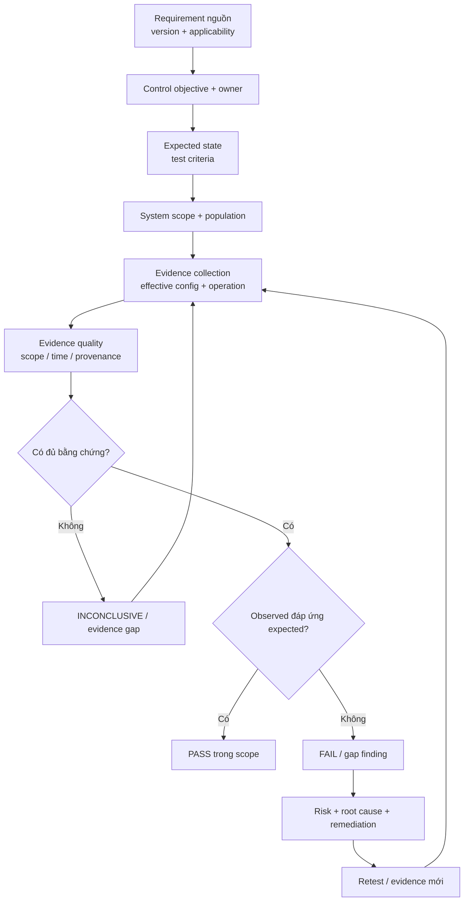
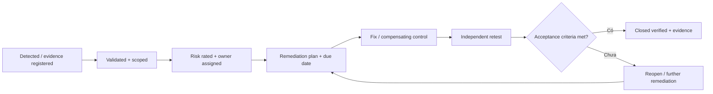
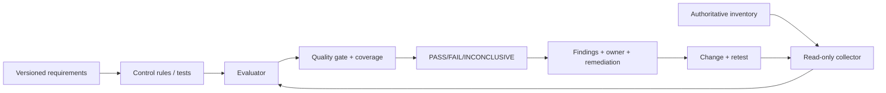

# Compliance gap trong Security Assurance: phát hiện, đánh giá và khắc phục khoảng trống tuân thủ

## 1. Compliance gap là gì?

Một tổ chức có thể công bố chính sách “mọi tài khoản quản trị production phải bật xác thực đa yếu tố (MFA)” và vẫn có những tài khoản đặc quyền không bị chặn khi đăng nhập bằng một giao thức cũ. Khi đó, việc **có chính sách** không có nghĩa tổ chức **đáp ứng yêu cầu**. Ngược lại, một nhóm đánh giá có thể không truy xuất được log đăng nhập do thiếu quyền đọc; chỉ từ tình huống này chưa đủ cơ sở khẳng định control MFA bị vi phạm.

**Compliance gap (khoảng trống tuân thủ)** là sự khác biệt cần được nhận diện và xử lý giữa **trạng thái tổ chức phải đạt theo một yêu cầu áp dụng** và **trạng thái thiết kế, triển khai hoặc vận hành đã được xác minh**. Gap có thể thể hiện ở thiếu control, cấu hình sai, kiểm soát không vận hành hiệu quả, độ phủ không đầy đủ, sai lệch quy trình hoặc không đáp ứng yêu cầu chứng minh tuân thủ.

Trong chương **Compliance assurance** của module **SECURITY_SECURITY_ASSURANCE**, mục tiêu không phải chỉ lập danh sách những ô “chưa đạt” trên bảng checklist. Mục tiêu là xây dựng khả năng **đánh giá có bằng chứng** rằng hệ thống đáp ứng yêu cầu bảo mật: liên kết phân tích rủi ro, nghĩa vụ áp dụng, security controls, kiểm thử, audit, khắc phục findings và kiểm tra lại liên tục trong phát triển và vận hành.

Câu hỏi cốt lõi luôn là:

> **Yêu cầu cụ thể nào áp dụng cho đối tượng nào, trạng thái kỳ vọng ra sao, bằng chứng hiện có chứng minh điều gì và phần chênh lệch cần xử lý là gì?**

Một báo cáo compliance gap tốt phải giúp người chịu trách nhiệm **ra quyết định**: cần sửa gì, ưu tiên ra sao, ai xử lý, cần evidence nào để đóng finding và rủi ro nào vẫn tồn tại.

### Mục tiêu học tập

Sau bài học này, người học có thể:

1. Phân biệt **compliance requirement, control, gap, finding, evidence gap, exception, residual risk** và nonconformity.
2. Xây dựng **requirement–control–evidence mapping** từ các nghĩa vụ áp dụng cho một hệ thống cụ thể.
3. Phân loại **design gap, implementation gap, operating gap, coverage gap** và trường hợp **không đủ bằng chứng**.
4. Đánh giá ảnh hưởng của gap theo mức rủi ro, phạm vi, yêu cầu bắt buộc và thời hạn.
5. Lập kế hoạch remediation, biện pháp bù trừ, quyết định ngoại lệ có thẩm quyền và kiểm chứng lại.
6. Tạo hồ sơ gap assessment có tính truy vết, có thể audit độc lập và dùng được cho assurance liên tục.

## 2. Compliance, security và assurance: liên quan nhưng không đồng nhất

**Compliance** là việc đáp ứng các nghĩa vụ hoặc yêu cầu áp dụng: có thể đến từ luật/quy định, hợp đồng, tiêu chuẩn được tổ chức cam kết áp dụng, chính sách nội bộ và những điều kiện kiểm soát đã phê duyệt. Cần phân biệt **bắt buộc theo pháp luật**, **nghĩa vụ hợp đồng**, **điều kiện chứng nhận** và **mục tiêu nội bộ**; cách xử lý sai lệch và thẩm quyền chấp nhận khác nhau.

**Security** liên quan tới việc bảo vệ tính bí mật, toàn vẹn, sẵn sàng và những mục tiêu bảo mật khác trước rủi ro thực tế. Một hệ thống có thể đáp ứng một checklist cụ thể nhưng vẫn có lỗ hổng chưa nằm trong phạm vi checklist. Một hệ thống có control kỹ thuật tốt cũng có thể chưa đáp ứng yêu cầu về chính sách, chứng cứ, thông báo, retention hoặc quyền kiểm toán.

**Security assurance** là quy trình sử dụng lập luận và bằng chứng đủ tin cậy để kết luận liệu những mục tiêu/control đã đặt ra được đáp ứng hay chưa, và duy trì kết luận đó khi hệ thống thay đổi.

| Tình huống | Góc nhìn compliance | Góc nhìn security assurance |
|---|---|---|
| Có policy MFA nhưng một đường đăng nhập admin bỏ qua MFA | Có thể không đáp ứng điều khoản yêu cầu thực thi MFA | Cần chứng minh phạm vi, đường bypass, nguyên nhân và mức độ ảnh hưởng |
| Mọi cấu hình hiện tại đều đáp ứng nhưng không có evidence cho kỳ sáu tháng | Có thể không đáp ứng nghĩa vụ lưu/chứng minh evidence nếu có | Chưa đủ cơ sở kết luận operating effectiveness cho cả kỳ |
| Nhà cung cấp có chứng nhận nhưng dịch vụ đang dùng nằm ngoài scope | Chứng chỉ không đủ hỗ trợ yêu cầu áp dụng cho dịch vụ | Cần bằng chứng phù hợp hoặc xác định gap/uncertainty |
| Policy nội bộ yêu cầu review quyền hàng quý, một nhóm không review | Vi phạm control policy nội bộ được áp dụng | Kiểm tra population, ticket và kỳ trước khi kết luận và xếp mức rủi ro |
| Dịch vụ đạt bộ control đã chọn nhưng còn đường tấn công chưa mô hình hóa | Có thể vẫn đạt các điều khoản đã kiểm | Phải báo rủi ro ngoài coverage, không đồng nhất “compliant” với “secure” |

**Không tự suy diễn:** một “compliance gap” thuộc luật cụ thể không thể được giải quyết chỉ bằng risk acceptance nội bộ nếu nghĩa vụ pháp lý vẫn phải thực hiện. Các yêu cầu pháp lý và hợp đồng cần được người có thẩm quyền chuyên môn/pháp lý xác nhận trước khi đánh giá và xử lý.

## 3. Định nghĩa những đơn vị phải quản lý

| Thuật ngữ | Ý nghĩa | Ví dụ |
|---|---|---|
| **Obligation/requirement** | Điều kiện bắt buộc hoặc đã cam kết, có nguồn và phiên bản | “Quyền admin được rà soát theo chu kỳ được duyệt” |
| **Applicability** | Quy tắc xác định yêu cầu áp dụng cho ai/cái gì/khi nào | Áp cho tài khoản đặc quyền ở production tenant |
| **Control** | Quy trình, cơ chế hoặc biện pháp dùng để đáp ứng yêu cầu | IAM access review + workflow thu hồi quyền |
| **Expected state** | Trạng thái hoặc tiêu chí đạt được định nghĩa trước | Review có owner, approval, hạn và evidence |
| **Observed state** | Trạng thái được kiểm tra qua dữ liệu hợp lệ | 3/40 tài khoản không có review record đúng kỳ |
| **Compliance gap** | Chênh lệch đã xác minh giữa yêu cầu và trạng thái | Thiếu review ở 3 tài khoản thuộc phạm vi |
| **Finding/nonconformity** | Kết quả được ghi nhận theo quy tắc audit/đánh giá khi yêu cầu không đạt | `GAP-IAM-014` có scope, bằng chứng và khắc phục |
| **Evidence gap** | Dữ liệu chưa đủ để xác nhận đạt/không đạt | Collector không đọc được 5 tài khoản của tenant B |
| **Exception/deviation** | Trường hợp được xem xét cho phép khác baseline theo quy trình | Ngoại lệ có owner, thời hạn, bù trừ và điều kiện |
| **Residual risk** | Rủi ro còn lại sau khi xét các control thực sự hữu hiệu | Quyền quá rộng còn có thể bị lạm dụng trước khi sửa |
| **Remediation** | Hành động loại bỏ sai lệch hoặc giảm rủi ro | Sửa RBAC và review lại quyền |
| **Retest/closure** | Đánh giá bằng evidence mới để xác minh sửa xong | Negative test + inventory + decision record |

**Gap không đồng nghĩa một lỗ hổng CVE.** Khoảng trống tuân thủ có thể do tài liệu, trách nhiệm, retention, missing review, khâu giám sát hoặc phản ứng, nhưng vẫn tạo ra rủi ro cần xử lý.

Cần tách **gap đã xác minh** và **chưa có đủ dữ liệu**. Việc không tìm được bản ghi không nhất thiết chứng minh control chưa thực hiện; tuy nhiên nếu chính yêu cầu bắt buộc là “phải lưu hồ sơ kiểm toán đầy đủ” và chắc chắn hồ sơ không tồn tại trong kho có thẩm quyền, thì **record-retention control** có thể FAIL. Kết luận luôn gắn với claim đang kiểm.

## 4. Nguồn hình thành yêu cầu: tránh dùng checklist không rõ thẩm quyền

Một tổ chức thường chịu nhiều lớp nghĩa vụ. Không nên đưa tất cả vào một bảng rồi coi chúng tương đương.

| Nguồn yêu cầu | Ví dụ phạm vi | Việc phải xác minh |
|---|---|---|
| **Luật và quy định áp dụng** | Bảo vệ dữ liệu, bảo mật ngành, lưu trữ, thông báo | Phạm vi tài phán, đối tượng chịu nghĩa vụ, thời điểm hiệu lực, cách diễn giải được phê duyệt |
| **Hợp đồng/cam kết với khách hàng** | Bảo mật thông tin, SLA, audit rights, notification | Hợp đồng, phụ lục, dịch vụ, thời hạn và bên chịu trách nhiệm |
| **Tiêu chuẩn/chứng nhận cam kết** | ISO/IEC 27001, PCI DSS hoặc tiêu chuẩn theo chương trình cụ thể | Phiên bản, scope, điều khoản kiểm tra, điều kiện áp dụng |
| **Chính sách/baseline nội bộ** | IAM, mã hóa, change management, logging, backup | Policy ID/version, owner, ngoại lệ được duyệt |
| **Rủi ro và control objectives nội bộ** | Yêu cầu phát hiện admin change hoặc RPO dịch vụ trọng yếu | Threat model, BIA, risk register và acceptance criteria |
| **Yêu cầu bên thứ ba** | Nhà cung cấp xử lý dữ liệu hoặc hoạt động theo hợp đồng | Shared responsibility, service scope, subprocessor, bằng chứng vendor |

**Ví dụ về framework không phải lời khẳng định pháp lý.** Khi mapping ISO/IEC 27001, SOC 2, PCI DSS hay quy định địa phương, cần dùng **phiên bản yêu cầu thực tế và nguồn có thẩm quyền** do tổ chức áp dụng; số hiệu cụ thể, thời hạn, mẫu chứng cứ và phạm vi có thể thay đổi. Bài học này tập trung vào phương pháp, không thay thế đánh giá pháp lý hoặc hướng dẫn của assessor chuyên ngành.

### Requirement register cần có gì?

Mỗi requirement nên có: `requirement_id`, nguồn, version, ngày hiệu lực, jurisdiction/contract scope khi áp dụng, business service, data class, asset scope, owner, cách kiểm tra applicability, control mappings, expected result, thời hạn evidence và cơ chế review khi thay đổi. Nếu không biết yêu cầu nào áp dụng thì không nên tự gán `NOT_APPLICABLE`.

## 5. Xác định applicability trước khi tìm compliance gap

Một sai lầm lớn là đánh giá một control cho những hệ thống không thuộc phạm vi, hoặc ngược lại bỏ sót hệ thống vì không nằm trong bảng inventory.

Để xác định applicability, hỏi:

1. **Ai:** pháp nhân, bộ phận, owner, vendor, processor/controller và những vai trò liên quan.
2. **Cái gì:** tài sản, tài khoản, dữ liệu, ứng dụng, business process, loại giao dịch.
3. **Ở đâu:** production/staging, cloud account, region, tenant, môi trường vendor.
4. **Khi nào:** kỳ audit, thời điểm hiệu lực và những ngoại lệ đã được phê duyệt.
5. **Điều kiện đặc thù:** loại dữ liệu, mức giao dịch, quyền admin, chức năng, ngành, kiến trúc.
6. **Nghĩa vụ phía nào:** tổ chức, SaaS vendor, đối tác hoặc shared responsibility.
7. **Ai quyết định:** business/compliance/legal/security owner xác nhận phạm vi cuối cùng.

Ví dụ baseline yêu cầu MFA cho **tài khoản người dùng có đặc quyền tương tác**. Tài khoản workload dùng chứng thư và chỉ có đường API xác thực máy không nhất thiết tuân theo cùng phương thức MFA của con người; nó phải được đánh giá theo **control identity assurance cho workload**. Không tự loại toàn bộ service accounts ra khỏi chương trình, và cũng không gán FAIL MFA tương tác khi đối tượng không thể tương tác theo định nghĩa.

### Ví dụ bảng applicability

| Đối tượng | Yêu cầu | Áp dụng? | Căn cứ |
|---|---|---|---|
| Admin human ở production | MFA interactive | Có | Role privilege + policy scope |
| Standard user không có quyền admin | Admin-only MFA | Không theo claim này | Có thể thuộc baseline MFA chung khác |
| Workload identity | Admin human MFA | Không theo claim này | Cần control workload authentication |
| Break-glass admin | MFA interactive | Theo baseline và ngoại lệ được duyệt | Cần review riêng, giám sát và điều kiện emergency |
| SaaS tenant mới | Audit export cho admin changes | Có nếu thuộc scope production | Phụ thuộc cấu hình/tích hợp phía khách hàng |

**NOT_APPLICABLE** chỉ hợp lệ nếu giải thích và xác nhận scope; không dùng như cách che những đối tượng khó kiểm tra.

## 6. Sơ đồ chuỗi từ obligation tới quyết định



Có thể có quan hệ **nhiều–nhiều**: một requirement yêu cầu nhiều controls, một control hỗ trợ nhiều requirements. Vì vậy, không nên cố tính “số control PASS / số requirement” mà không có mapping, độ phủ và quy tắc đánh giá đã định.

Một control tương tự ở hai môi trường có thể có kết luận khác nhau vì cấu hình, log, owner và rủi ro khác nhau. Hồ sơ cần định danh cụ thể thay vì chỉ ghi tên policy.

## 7. Các loại compliance gap

| Loại | Dấu hiệu | Ví dụ | Cách xử lý ban đầu |
|---|---|---|---|
| **Requirement/interpretation gap** | Không rõ điều kiện hoặc phiên bản áp dụng | Dùng bản tiêu chuẩn cũ cho scope mới | Xác nhận nguồn yêu cầu và interpretation với owner |
| **Design gap** | Control dự kiến không đủ đáp ứng yêu cầu | Chỉ review user admin, bỏ qua service accounts có quyền tương đương | Sửa thiết kế/control coverage |
| **Implementation gap** | Control đã thiết kế nhưng chưa triển khai đúng | Policy yêu cầu MFA có nhưng tenant B chưa gắn | Triển khai và kiểm tra effective config |
| **Operating effectiveness gap** | Control tồn tại nhưng thực thi thất bại trong kỳ | 4 trong 30 thay đổi đặc quyền thiếu approval | Phân tích root cause và sửa workflow |
| **Coverage/scope gap** | Một phần population không được control bao phủ | 8/100 host không gửi audit log bắt buộc | Onboard nguồn và đo coverage |
| **Process/governance gap** | Thiếu owner, review hoặc escalation | Exception hết hạn mà không được review | Phân vai và bổ sung workflow |
| **Documentation/record gap** | Bản ghi bắt buộc không tồn tại hoặc không lưu đúng | Không lưu chứng cứ truy cập theo nghĩa vụ | Khắc phục record keeping; đánh giá điều gì chưa chứng minh |
| **Third-party gap** | Bên thứ ba hoặc shared responsibility không đáp ứng | Vendor chưa có cơ chế incident notice đã cam kết | Kiểm tra hợp đồng, controls và decision gate |
| **Evidence gap** | Không có dữ liệu đáng tin để kết luận trạng thái | Scanner thiếu quyền đọc một cloud account | `INCONCLUSIVE` cho claim, khắc phục collector/access |
| **Remediation gap** | Finding trước chưa được xử lý hoặc closure thiếu retest | Ticket đóng khi mới cập nhật policy | Đánh giá lại closure evidence |
| **Continuous compliance drift** | Cấu hình từng đạt nhưng đã lệch baseline | Deployment mới tạo quyền wildcard | Phát hiện drift, sửa và ngăn tái phát |

Một finding có thể có **nhiều nguyên nhân**: policy rộng, quyền thiếu, role owner chưa xác định và kiểm thử không đủ. Nên phân biệt **symptom**, **root cause**, **impact** và **remediation** để tránh chỉ sửa triệu chứng.

## 8. Một điều kiện quan trọng: bằng chứng yếu không nhất thiết đồng nghĩa noncompliance

Để đánh giá công bằng và chính xác, cần tách hai câu hỏi:

- **Evidence quality:** có nguồn đáng tin, phạm vi đầy đủ, thời gian phù hợp và phương pháp đủ để đánh giá không?
- **Control compliance:** trên phần đã xác minh, trạng thái triển khai/vận hành có đáp ứng requirement không?

| Quan sát | Kết luận phù hợp |
|---|---|
| Có bằng chứng đọc trực tiếp cho thấy control bị tắt trong tài sản thuộc phạm vi | `FAIL` control theo requirement tương ứng |
| API kiểm tra trả lỗi permission denied; không biết control thực tế | `INCONCLUSIVE` với evidence gap |
| Có policy đúng nhưng chưa có dữ liệu vận hành cho kỳ đánh giá | Có thể PASS thiết kế/implementation, `INCONCLUSIVE` operating effectiveness |
| Tài khoản admin có đường bypass được thử xác nhận | `FAIL` cho control enforcement; điều tra phạm vi còn lại |
| Không tìm thấy evidence mà requirement **bắt buộc lưu evidence** và đã xác minh record thực sự không được giữ | Có thể `FAIL` control record-retention/documentation |
| Một system không thuộc requirement theo quy tắc được duyệt | `NOT_APPLICABLE` có reason, không tính là PASS |

**Nguyên tắc bất đối xứng:** chỉ một trường hợp vi phạm được xác minh có thể đủ để chứng minh claim “mọi đối tượng trong scope đều đáp ứng” là sai; trong khi một mẫu PASS nhỏ thường không đủ để chứng minh toàn population tuân thủ. Không được loại mẫu FAIL để làm đẹp số liệu.

## 9. Thiết kế phương pháp gap assessment có thể lặp lại

Một đợt gap assessment nên có các bước rõ và có quyền sở hữu:

1. **Khóa baseline:** xác định bộ requirement, phiên bản, ngày hiệu lực và điều khoản áp dụng.
2. **Chốt scope:** business service, tài sản, vùng, tenant, dữ liệu, owner, audit period.
3. **Tạo control mapping:** yêu cầu nào được kiểm soát bằng thiết kế, quy trình, cấu hình và monitoring nào.
4. **Xác định acceptance criteria:** expected state, threshold, unit, population, test method và evidence bắt buộc.
5. **Lập evidence plan:** lấy từ nguồn nào, ai được quyền đọc, thời điểm và độ mới cần thiết.
6. **Thu và xác minh evidence:** truy xuất raw data, kiểm tra completeness, timestamp, query/filter và quyền truy cập.
7. **So sánh expected–observed:** ghi PASS/FAIL/INCONCLUSIVE theo từng đối tượng/control.
8. **Ghi nhận gaps:** phân loại nguyên nhân, phạm vi ảnh hưởng, owner, risk tier và độ ưu tiên.
9. **Ra quyết định:** sửa trước go-live, bù trừ, xin ngoại lệ hợp lệ, chặn thay đổi hoặc chuyển escalation.
10. **Retest và giám sát:** xác minh control sau sửa, cập nhật evidence register và các trigger drift.

**Không cố bấm “PASS all” để hoàn thành kiểm toán.** Mỗi bước nhằm cung cấp bằng chứng và thông tin xử lý, không phải đảm bảo tỷ lệ PASS cao.

### Lựa chọn kỳ đánh giá

Đối với **configuration control**, có thể đánh giá trạng thái hiệu lực tại thời điểm. Với **approval process**, phải xem các thay đổi phát sinh trong cả kỳ. Với **continuous monitoring**, nên dùng coverage và trạng thái pipeline theo thời gian; một lần chụp màn hình cuối kỳ không chứng minh control luôn hoạt động.

## 10. Xây dựng requirement–control–evidence matrix

Ví dụ nội bộ giả định về hệ thống học tập và vận hành cloud:

| Requirement ID | Expected state | Control ID | Evidence cần | Cách kết luận |
|---|---|---|---|---|
| `REQ-IAM-01` | Admin tương tác production bị yêu cầu MFA | `IAM-01` | Inventory, policy bindings, sign-in/negative test | Đủ scope và enforcement |
| `REQ-LOG-02` | Thay đổi quyền admin phát sinh audit event và được thu nhận | `LOG-02` | Source event, SIEM ingest, retention/health | Thử từ nguồn đến đích |
| `REQ-CHG-03` | Production changes có review/approval theo chính sách | `CHG-03` | Change inventory, ticket history, exceptions | Sample hoặc full population theo kế hoạch |
| `REQ-DATA-04` | Dữ liệu nhạy cảm có mã hóa và quyền key phù hợp | `DATA-04` | Effective storage config, key policy, access test | Xác minh config và đường truy cập |
| `REQ-DR-05` | Dataset trọng yếu đạt RPO theo BIA được duyệt | `DR-05` | BIA, restore test, transaction watermark | RPO thực đo đạt mục tiêu |
| `REQ-VEND-06` | Nhà cung cấp có quyền truy cập dữ liệu phải qua due diligence | `TP-06` | Vendor inventory, scope, review, findings/approval | Đầy đủ theo vendor/service tier |
| `REQ-EVID-07` | Evidence được giữ an toàn và truy vết theo policy | `EVID-07` | Manifest, retention, access log, retrieval test | Record đầy đủ, bảo mật và khả truy |

Đây là **baseline minh họa**, không phải trích dẫn nguyên văn yêu cầu từ luật hay framework cụ thể. Cần dùng bản điều khoản thực tế do tổ chức phê duyệt trước khi áp dụng.

Một yêu cầu không có control mapping không tự động là `FAIL` ngay lập tức nếu chưa làm rõ cách thực hiện thực tế; trước tiên xác minh các control khả dĩ và phạm vi. Nếu đã chứng minh nghĩa vụ bắt buộc không có biện pháp đáp ứng, đó là **design/implementation gap** cần finding.

## 11. Mẫu machine-readable cho một requirement và phép đánh giá

Hồ sơ cấu trúc giúp hệ thống tự động lập mapping và tránh thất lạc thông tin về scope.

```yaml
requirement_id: REQ-IAM-01
requirement_version: "1.3"
source:
  type: internal_security_policy
  document_id: IAM-BASELINE
  clause_id: admin-mfa
  effective_from: "2026-10-01"
owner: identity-security
applicability:
  environments: [production]
  principal_types: [interactive-human-admin]
  tenants: [tenant-a, tenant-b]
expected:
  requirement: "Admin sessions must satisfy approved MFA"
  control_id: IAM-01
  no_unapproved_bypass: true
  observation_period: "2026-11-01/2026-11-28"
test:
  population_source: authoritative-iam-role-inventory
  methods:
    - compare_admin_population_with_policy_assignments
    - inspect_sign_in_audit_and_policy_outcome
    - run_approved_negative_authentication_test
evidence_requirements:
  - inventory_snapshot_with_time_and_scope
  - effective_policy_export
  - authentication_test_result
  - evidence_integrity_manifest
```

Cấu trúc trên mô tả **điều kiện cần kiểm chứng**, chưa có kết quả. Các trường tenant, ngày tháng và control ID chỉ là giả định để minh họa. Trong hệ thống thực, cần thêm dữ liệu theo yêu cầu áp dụng, service principals và break-glass được đánh giá theo phạm vi tương ứng.

## 12. Xác định population và đo coverage

Trước khi tính tỷ lệ compliance, phải có **mẫu số độc lập đáng tin cậy**: tất cả tài khoản, assets, changes, workloads hay vendors thuộc requirement.

Ví dụ: inventory xác nhận có 100 máy chủ production cần gửi security audit logs. Dashboard monitoring nhận log từ 87 máy. Không nên viết “100% hosts đang được theo dõi” chỉ vì danh sách trên dashboard có 87 hosts và tất cả 87 healthy.

\[
\text{Verified control coverage}
=\frac{\text{Đối tượng được kiểm chứng đủ điều kiện}}{\text{Tổng đối tượng thuộc phạm vi}}\times100\%
\]

Nếu chỉ có 87/100 host được xác minh đủ loại event bắt buộc thì coverage là **87%**. 13 host còn lại phải được phân loại: chưa onboard, mất kết nối, thiếu quyền, lỗi agent, bị loại theo lý do hợp lệ hay chưa có evidence.

**Phải tách:**

- `population_total`: tất cả đối tượng thuộc phạm vi, không gồm đối tượng đã được xác minh N/A.
- `collected_count`: đối tượng có dữ liệu thu được.
- `qualified_count`: dữ liệu đủ chất lượng để đánh giá.
- `pass_count`: đối tượng được chứng minh đạt.
- `fail_count`: đối tượng có vi phạm được xác minh.
- `inconclusive_count`: đối tượng trong scope chưa có đủ căn cứ.
- `exception_count`: đối tượng có risk decision còn hiệu lực, được theo dõi riêng.

Không gọi tỷ lệ pass trên những đối tượng được kiểm tra là tỷ lệ tuân thủ toàn hệ thống. Cũng không tính `NOT_APPLICABLE` vào tử số PASS chỉ để tăng compliance rate.

## 13. Evidence quality trước khi kết luận compliance gap

Evidence hỗ trợ một gap phải đủ tin cậy để xác định vấn đề và tránh finding sai.

| Đặc tính | Câu hỏi cần kiểm | Lỗi thường gặp |
|---|---|---|
| **Relevance** | Bằng chứng có đúng clause/control và assertion? | Screenshot backup thay evidence restore |
| **Scope/completeness** | Đúng tenant, asset, population và kỳ? | Quên một cloud account/region |
| **Freshness** | Thời điểm thu/kỳ kiểm tra còn hợp lệ? | Dùng scan trước một đợt migration |
| **Accuracy** | Parser, identifiers, fields, timezone đúng? | Diễn giải một field chuỗi sai kiểu |
| **Provenance** | Nguồn, collector, quyền, query/filter, version có rõ? | CSV không biết xuất từ đâu |
| **Integrity** | Raw artifact có được bảo vệ khỏi sửa đổi không? | Bản gốc bị sửa thủ công để làm đẹp |
| **Reproducibility** | Người khác có thể tái dựng phương pháp? | Chỉ gửi bảng PASS/FAIL không raw refs |
| **Independence** | Có rủi ro chọn mẫu hoặc đánh giá thiên lệch? | Chỉ gửi 5 trường hợp thuận lợi |
| **Confidentiality** | Evidence có được phân quyền và giảm dữ liệu nhạy cảm? | Log chứa token được đưa vào ticket công khai |

**Một evidence gap cũng là kết quả quản trị quan trọng.** Nếu scanner không có quyền đọc một account, cần tạo nhiệm vụ khôi phục evidence collection và ghi `INCONCLUSIVE` cho control liên quan, thay vì tự gán PASS hoặc luôn gán FAIL control không chứng minh được.

Checksum giúp phát hiện artifact bị sửa khi manifest được bảo vệ tin cậy, nhưng không chứng minh dữ liệu nguồn là chính xác nếu collector/query sai hoặc source bị chiếm quyền.

## 14. So sánh design, implementation và operating effectiveness

Kết luận gap sẽ sai nếu nhầm ba lớp kiểm soát.

| Lớp kiểm tra | Câu hỏi | Ví dụ evidence | Khoảng trống điển hình |
|---|---|---|---|
| **Design** | Thiết kế control có đáp ứng yêu cầu không? | Policy, architecture, workflow, control mapping | Thiết kế không xét tài khoản break-glass |
| **Implementation** | Control có được triển khai đúng và áp vào toàn scope? | Effective config, IAM assignments, IaC/live diff | Policy chỉ gắn tenant A, bỏ tenant B |
| **Operation** | Control có thực thi đúng qua các sự kiện/kỳ yêu cầu? | Sign-in logs, approval records, recovery tests | MFA bị bypass qua legacy client |
| **Evidence/assessment** | Có thể chứng minh các lớp trên không? | Provenance, sample, test report, manifest | Scanner không có quyền, missing logs |

**Ví dụ:** SOP quy định backup hàng ngày có thể đủ để nói đã thiết kế control backup; backup job success cho thấy có vận hành một phần; khôi phục dữ liệu thành công với RPO đo được mới hỗ trợ claim có thể phục hồi theo mục tiêu. Nếu RPO không có bằng chứng kiểm thử, không nên mặc định là FAIL hoặc PASS; cần xác định liệu nghĩa vụ yêu cầu **backup, restore testing hay actual recovery** trước khi phân loại.

## 15. Gap analysis theo trạng thái thời gian

Compliance không tĩnh. Một control có thể PASS hôm trước và FAIL hôm sau vì deploy, thay quyền, thay nhà cung cấp hoặc thay scope.

Cần phân biệt các mốc:

- `requirement_effective_at`: khi yêu cầu bắt đầu áp dụng.
- `asset_added_at`: khi đối tượng vào scope.
- `config_effective_at`: khi cấu hình/control áp dụng.
- `event_occurred_at`: khi sự kiện cần kiểm tra xảy ra.
- `collected_at`: khi thu dữ liệu.
- `assessed_at`: khi đánh giá.
- `remediated_at`: khi thay đổi triển khai.
- `retested_at`: khi kiểm chứng bằng chứng mới.
- `exception_expires_at`: khi ngoại lệ cần được xem lại hoặc tự hết hiệu lực.

Một tài khoản từng không có MFA trong tuần đầu nhưng đã bật MFA vào cuối tháng **không có nghĩa cả tháng PASS**. Báo cáo kỳ phải phản ánh **khoảng thời gian không đáp ứng**, những phiên có liên quan và tiêu chí đã được phê duyệt.

Với framework/cam kết được cập nhật, cần tạo **requirement version transition**: điều khoản thêm, đổi, bỏ; ảnh hưởng mapping và thời hạn áp dụng. Không hồi tố một requirement mới cho kỳ cũ nếu không có căn cứ áp dụng.

## 16. Phương pháp lựa chọn mẫu và tránh thiên lệch

Không phải lúc nào cũng cần hoặc có thể đọc tất cả record trong một kỳ. Tuy nhiên, lấy mẫu sai dễ tạo compliance gap giả hoặc che compliance gap thật.

1. Xác định population độc lập, đồng nhất theo control.
2. Chọn đơn vị: tài khoản, change ticket, sự kiện, deployment hoặc backup test.
3. Định nghĩa sampling: random, stratified (production/region/role), targeted high-risk hoặc full population.
4. Ghi phương pháp, kỳ, kích thước mẫu và danh sách mẫu **trước khi biết kết quả** khi phù hợp.
5. Giữ mẫu FAIL và inaccessible; không thay bằng mẫu khác để đạt.
6. Nếu phát hiện sai lệch, xem xét mở rộng population và kiểm tra nguyên nhân có tính hệ thống.
7. Chỉ suy luận về toàn population theo mức được phương pháp cho phép.

Ví dụ 10/10 change tickets mẫu đúng approval không chứng minh 1.000 changes đều tuân thủ; ngược lại một change thuộc scope thiếu approval được xác minh có thể là bằng chứng FAIL cho yêu cầu không có ngoại lệ của control.

Cần tránh **sampling unit mismatch**: 20 events không tương đương 20 phiên thay đổi nếu một change sinh nhiều events. Không dùng mẫu chỉ gồm những ticket “đã đóng hoàn tất” nếu population requirement bao gồm cả thay đổi khẩn cấp và rollback.

## 17. Đánh giá độ nghiêm trọng của gap theo rủi ro và nghĩa vụ

Một gap nhỏ về tài liệu và một bypass xác thực đặc quyền không nên có cùng mức ưu tiên. Nhưng cũng không được dùng điểm rủi ro kỹ thuật để bỏ qua một yêu cầu pháp lý/hợp đồng bắt buộc.

### Các yếu tố đánh giá

| Chiều | Câu hỏi |
|---|---|
| **Requirement criticality** | Nghĩa vụ có bắt buộc và có thời hạn/điều kiện không? |
| **Security impact** | Có nguy cơ mất bí mật, toàn vẹn, sẵn sàng, an toàn hoặc fraud không? |
| **Exposure** | Hệ thống Internet-facing, privileged, dữ liệu nhạy cảm hay chỉ internal test? |
| **Population & duration** | Bao nhiêu đối tượng bị ảnh hưởng, trong bao lâu? |
| **Likelihood/attackability** | Có đường khai thác thực tế hoặc đã từng xảy ra tương tự không? |
| **Compensating control effectiveness** | Biện pháp bù trừ đã được thử và đủ phạm vi chưa? |
| **Detection/response readiness** | Có giám sát và xử lý kịp thời không? |
| **Contract/regulatory consequences** | Có nguy cơ vi phạm cam kết, nghĩa vụ thông báo, phạt hoặc mất chứng nhận không? |
| **Business continuity** | Gián đoạn có tác động lớn và khó thay thế không? |
| **Evidence confidence** | Quan sát chắc chắn tới đâu, còn những điều chưa biết nào? |

**Không tự động lấy CVSS để chấm compliance gap.** CVSS phù hợp cho lỗ hổng kỹ thuật theo ngữ cảnh, nhưng nhiều gap (thiếu review, không lưu log, data residency, không có audit clause) không thể định lượng chính xác bằng CVSS. Có thể dùng risk matrix nội bộ với tiêu chí và owner được duyệt.

### Ví dụ phân mức ưu tiên minh họa

| Priority | Tình huống ví dụ | Hành động |
|---|---|---|
| **Critical** | Đường đăng nhập admin production không yêu cầu MFA, đã xác minh exploit path trong test an toàn | Escalate ngay, containment/bù trừ, kế hoạch sửa khẩn |
| **High** | Dữ liệu nhạy cảm không có mã hóa theo yêu cầu trong một service production | Owner và deadline ngắn, risk review |
| **Medium** | Một nhóm access reviews quá hạn có bằng chứng nhưng chưa ghi nhận misuse | Khắc phục quy trình, kiểm tra độ phủ và root cause |
| **Low** | Metadata báo cáo thiếu một trường thứ yếu nhưng evidence chính còn đầy đủ và obligation cho phép | Sửa quy trình evidence và theo dõi kỳ sau |
| **Inconclusive** | Không truy xuất được log để đo rule effectiveness | Thu bổ sung; đánh giá riêng rủi ro khả năng quan sát |

Các mức và phản ứng trên chỉ là ví dụ. **Deadline xử lý và thẩm quyền acceptance phải theo chính sách đã duyệt**, không suy ra từ bài học.

## 18. Root cause analysis: vì sao gap tồn tại?

Một gap có thể quay lại nếu chỉ “đổi cấu hình cho đúng” mà không xử lý nguyên nhân hệ thống.

| Dấu hiệu | Root cause khả dĩ | Biện pháp phòng tái phát |
|---|---|---|
| Admin role được cấp thủ công ngoài quy trình | Không có policy-as-code/approval gate | JIT workflow, review tự động, kiểm thử privilege |
| Một region thiếu audit | Provisioning template bỏ logging | IaC baseline, drift scanning, test khi tạo region mới |
| Change ticket không có approver | Workflow cho phép bypass | Mandatory fields, approval gate, exception path |
| Sao lưu chạy nhưng không restore được | KMS/backup dependencies chưa được kiểm thử | Restore exercise theo failure model, quyền DR site |
| Exception tồn tại quá hạn | Không có owner/expiry alert | Exception registry, thông báo và thu hồi |
| Vendor không gửi incident notices | Hợp đồng không quy định trigger/contact rõ | Contractual control + thử escalation |
| Findings liên tục tái xuất hiện | Sửa triệu chứng, thiếu regression tests | CI policy checks, control owner và postmortem |

Cần phân biệt **điều đã quan sát** và **nguyên nhân đang giả thuyết**. Ví dụ thấy audit log thiếu không thể khẳng định ngay do agent hỏng; có thể do source chưa phát event, network, ingestion filter, retention, quyền đọc hoặc query sai.

Dùng kỹ thuật như 5 Whys, fault tree, causal timeline khi phù hợp; kết quả phải có bằng chứng hoặc đánh dấu cần điều tra.

## 19. Quản lý remediation theo vòng đời finding

Một compliance gap cần kết thúc ở **trạng thái đã khắc phục có kiểm chứng**, không chỉ một ticket “resolved”.



Một hồ sơ remediation cần nêu:

- `finding_id`, control/requirement và loại gap.
- Mô tả expected/observed, số assets/accounts, kỳ ảnh hưởng, dữ liệu gốc.
- Mức độ nghiêm trọng, lý do, business impact và owner.
- Root cause đã xác minh hoặc giả thuyết cần điều tra.
- Phương án sửa, dependencies, ticket, change approval và deadline.
- Biện pháp containment/bù trừ đang áp dụng trước khi sửa.
- Acceptance criteria cho retest và người đánh giá.
- Lịch sử thay đổi, kết quả test trước/sau, residual risk.
- Điều kiện đóng finding và trigger kiểm tra lại.

**Cần phân biệt “fix deployed” và “control passes retest”.** Ví dụ đã cập nhật policy MFA, nhưng test một giao thức cũ vẫn bypass, finding không được đóng. Chỉ dùng kết quả hiện tại để kết luận kỳ hiện tại; lịch sử gap vẫn cần giữ lại theo nghĩa vụ và audit trail.

## 20. Compensating controls và quản lý exception

Có trường hợp không thể sửa ngay: ứng dụng legacy không hỗ trợ một phương thức xác thực mới, nhà cung cấp yêu cầu thời gian phát triển, hoặc hệ thống quan trọng chưa thể dừng để triển khai bản vá.

**Compensating control** là một hoặc nhiều biện pháp bổ sung nhằm giảm rủi ro của việc không đáp ứng trực tiếp yêu cầu. Một biện pháp chỉ có giá trị khi **đáp ứng mục tiêu bảo vệ, áp đúng phạm vi, có test chứng minh hiệu lực và được bên có thẩm quyền chấp thuận**.

Ví dụ thiếu MFA ở ứng dụng legacy: giải pháp bù trừ có thể gồm access gateway enforce MFA, giới hạn VPN, thiết bị được quản lý, privileged session monitoring và JIT access — **chỉ khi được kiểm chứng không còn đường bypass tương ứng**. Network allowlist đơn lẻ có thể không đủ để thay MFA, tùy yêu cầu và rủi ro.

### Exception record nên ghi

| Trường | Vai trò |
|---|---|
| Exception ID, requirement/control | Xác định deviation thực sự |
| Asset/data scope và lý do | Không cho phép ngoại lệ lan rộng |
| Risk assessment/residual risk | Người duyệt biết rủi ro chưa xử lý |
| Compensating controls và test | Không dựa trên lời hứa |
| Approving authority và approval date | Phù hợp phân quyền và nghĩa vụ |
| Effective/expiry date | Ngoại lệ có thời hạn |
| Remediation plan và milestones | Không biến ngoại lệ thành vĩnh viễn |
| Monitoring/review trigger | Phát hiện khi điều kiện thay đổi |
| Closure/revocation evidence | Chứng minh đã khôi phục baseline |

**Quan trọng:** exception có hiệu lực **không tự động biến compliance finding thành PASS**. Trạng thái đo nên phản ánh sai lệch thực; quyết định rủi ro được ghi ở cột riêng. Hơn nữa, một số nghĩa vụ pháp luật/hợp đồng/tiêu chuẩn không cho phép ngoại lệ nội bộ hoặc yêu cầu phê duyệt bên ngoài; phải xác minh điều kiện cụ thể.

## 21. Ma trận trạng thái: PASS, FAIL, INCONCLUSIVE, NOT_APPLICABLE

| Kết luận kiểm soát | Khi dùng | Hành động |
|---|---|---|
| `PASS` | Phạm vi áp dụng rõ, evidence tin cậy đủ mới, control đáp ứng tiêu chí | Lưu bằng chứng và tiếp tục giám sát |
| `FAIL` | Có quan sát hợp lệ về không đáp ứng requirement | Tạo finding, risk rating, owner, remediation và retest |
| `INCONCLUSIVE` | Evidence thiếu hoặc chất lượng chưa đủ để xác nhận trạng thái | Ghi gap bằng chứng, collection issue và follow-up |
| `NOT_APPLICABLE` | Requirement không áp theo scope/điều kiện được duyệt | Lưu căn cứ và phê duyệt, không tính là PASS |
| **Accepted exception** | Có quyết định tạm chấp nhận rủi ro trong phạm vi được phép | Giữ trạng thái đo thực tế và quản lý exception riêng |

Pseudo-logic minh họa, mỗi tổ chức cần cụ thể hóa theo requirement:

```text
if requirement_version_unverified or applicability_unknown:
    return INCONCLUSIVE with applicability_review

if not applicable_in_approved_scope:
    return NOT_APPLICABLE with reason_and_approver

if evidence_source_untrusted or population_incomplete:
    return INCONCLUSIVE with evidence_quality_gap

if reliable_observation_shows_violation:
    return FAIL with finding_id_and_scope

if accepted_test_method_confirms_all_required_conditions:
    return PASS with scope_period_and_limitations

return INCONCLUSIVE with next_evidence_action
```

Quy tắc phải được gắn với **claim**: một collector ngừng hoạt động có thể là FAIL đối với control `AUDIT-LOG-HEALTH`, nhưng tình trạng logging của hoạt động khác có thể vẫn INCONCLUSIVE nếu chưa xác định được các event gốc. Một case có thể có nhiều kết luận theo nhiều control.

## 22. Hồ sơ compliance gap chuẩn để audit

Một assessment record cần liên kết **requirement → expected → observed → evidence → decision → remediation**. Dưới đây là bản YAML giả định về MFA của tài khoản đặc quyền.

```yaml
assessment_id: cmp-assurance-20261128-007
requirement:
  requirement_id: REQ-IAM-01
  source: IAM-BASELINE
  version: "1.3"
  applicability_approved_by: security-compliance-owner
control:
  control_id: IAM-01
  test_method_version: iam-mfa-assess-v2
scope:
  environment: production
  tenants: [tenant-a, tenant-b]
  population_source: authoritative-iam-role-inventory
  population_count: 50
  assessment_period: "2026-11-01/2026-11-28"
collection:
  collected_at_utc: "2026-11-28T04:00:00Z"
  identity: assurance-readonly
  source_permissions: partial
  collected_count: 45
  qualified_count: 43
observations:
  confirmed_violations: 2
  missing_or_unqualified: 7
  affected_principal_ids:
    - principal-test-017
    - principal-test-033
  verification:
    - "Approved negative tests show legacy sign-in bypass"
    - "Remaining seven principals require further evidence"
assessment:
  control_result: FAIL
  finding_id: CMP-FIND-031
  evidence_gap_id: CMP-EV-GAP-004
  reason: "Two verified scoped admin identities bypass MFA"
  limitations:
    - "Seven principals lack qualified evidence"
  severity: high
  evaluator_version: gap-rule-v2
evidence_refs:
  population: "secure-evidence/IAM-01/admin-population.json"
  policy: "secure-evidence/IAM-01/effective-policy.json"
  sign_in: "secure-evidence/IAM-01/authorized-test-events.json"
  manifest: "secure-evidence/IAM-01/hashes.sha256"
remediation:
  owner: identity-platform
  planned_action: "Disable legacy auth bypass and verify scope"
  due_on: "2026-12-10"
  retest_required: true
decision:
  risk_acceptance: none
  production_exception_allowed: false
```

Ở ví dụ này, **2 principal vi phạm đã được xác minh** đủ để kết luận `FAIL` cho yêu cầu “mọi admin tương tác production đều được MFA”. Đồng thời, **7 principal chưa đủ evidence** phải tiếp tục được thu thập, không bị xóa khỏi population chỉ vì đã có FAIL.

Mẫu dùng các giá trị mô phỏng; trong hệ thống thực phải bảo vệ tài khoản, log xác thực và dữ liệu truy cập. `source_permissions: partial` không nhất thiết lý giải toàn bộ 7 missing items, cần điều tra theo ID để tránh suy đoán nguyên nhân.

### Metadata tối thiểu của một gap register

| Trường | Mục đích |
|---|---|
| `gap_id`, `requirement_id`, `control_id` | Định danh và truy vết |
| Source/version/effective date | Biết nghĩa vụ được so với phiên bản nào |
| Scope/environment/population/kỳ | Tránh kết luận vượt phạm vi |
| Expected/observed state | Căn cứ chênh lệch |
| Evidence refs và checksum/source | Chứng minh observation và khả năng tái kiểm |
| Quality/limitations | Những điều chưa thể kết luận |
| Severity/impact/priority | Cơ sở phân bổ nguồn lực |
| Root cause/owner | Gắn trách nhiệm sửa nguyên nhân |
| Remediation/compensating controls | Biện pháp đã và sẽ thực hiện |
| Exception ID/approval/expiry | Quyết định rủi ro tách biệt |
| Retest/reviewer/closure status | Điều kiện đóng finding và audit trail |

**Không đưa secret hoặc thông tin cá nhân không cần thiết vào hồ sơ.** Bằng chứng thô có thể được lưu trong kho phân quyền, assessment chỉ tham chiếu ID và bản tóm tắt redacted.

## 23. Tính compliance coverage đúng mẫu số

Giả sử doanh nghiệp có 120 workloads trong phạm vi yêu cầu kiểm tra encryption at rest:

- 100 workloads có evidence được thu.
- 90 workloads có evidence đủ điều kiện đánh giá.
- Trong 90 đó, 84 được xác minh đạt, 6 vi phạm.
- 10 workloads có dữ liệu thu nhưng không đủ chất lượng.
- 20 workloads chưa thu được evidence.

Tỷ lệ cần phân biệt:

\[
\text{Collection coverage}=\frac{100}{120}=83{,}33\%
\]

\[
\text{Qualified assessment coverage}=\frac{90}{120}=75\%
\]

\[
\text{Pass rate among assessed}=\frac{84}{90}=93{,}33\%
\]

\[
\text{Verified pass share of all in-scope}
=\frac{84}{120}=70\%
\]

**Không được nói “93,33% toàn production compliant”** khi còn 30 workloads chưa có bằng chứng đủ điều kiện. Báo riêng **6 FAIL** và **30 thiếu evidence đạt yêu cầu**; sau đó phân nhóm những missing items theo lý do và mức rủi ro.

Nếu một requirement có hai controls bắt buộc, một PASS một FAIL, không thể tự tính requirement là “50% compliant” trừ khi có logic được phê duyệt giải thích ý nghĩa. Với các điều kiện **AND** bắt buộc, requirement chỉ đạt khi mọi điều kiện cần đều đạt.

### Trường hợp N/A và ngoại lệ

Đối tượng N/A phải bị loại khỏi **mẫu số in scope** sau khi có bằng chứng applicability. Accepted exception vẫn cần được báo riêng; không coi nó là PASS hoặc bỏ ra khỏi mẫu số khi đánh giá sự phù hợp với baseline, trừ khi quy tắc đánh giá của nghĩa vụ cho phép và điều này được công bố rõ.

## 24. Tự động hóa gap detection và giới hạn của policy-as-code

Policy-as-code, CI checks, CSPM, SIEM, asset inventory và compliance scanners có thể rút ngắn thời gian phát hiện drift. Tuy nhiên, tool chỉ đánh giá được **điều nó quan sát và tiêu chí nó được cấu hình để kiểm tra**.

### Pipeline minh họa



**Các kiểm soát cần thiết cho automation:**

- Gắn `requirement_version`, `rule_version` và `collector_version` vào từng run.
- Đọc đúng account, region, tenant, namespace và population snapshot; xác minh scope.
- Phân biệt query empty vì thực sự không có assets với lỗi permission/pagination/rate limit.
- Đánh dấu stale evidence, trường thiếu, schema drift, tool outage và thời gian không đồng bộ.
- Lưu raw/normalized artifacts theo chính sách để reviewer tính lại.
- Kiểm tra negative cases, edge cases và regression tests khi đổi evaluator.
- Không tự đóng finding chỉ khi IaC repository được cập nhật; cần xác minh effective runtime.
- Gắn quyền truy cập least privilege cho collector và bảo vệ dữ liệu được trích xuất.
- Có alert khi scanner ngừng hoạt động hoặc coverage giảm đột ngột.

Ví dụ policy-as-code có thể phát hiện public object storage, security group mở rộng hoặc workload thiếu security context; nó khó chứng minh nhân viên đã hiểu quy trình incident response nếu không kết hợp diễn tập và dữ liệu vận hành.

## 25. Quản lý requirement drift và thay đổi scope

Compliance gap mới có thể xuất hiện khi yêu cầu hoặc hệ thống thay đổi, không nhất thiết do ai “sửa sai” control trước đây.

### Trigger cần tái đánh giá

- Một luật/quy định/hợp đồng hoặc tiêu chuẩn được cập nhật và được xác định áp dụng.
- Dịch vụ mới, cloud account/region mới, dữ liệu thuộc loại nhạy cảm hơn.
- Tăng quyền đặc biệt, thay quy trình quản trị danh tính, điều kiện break-glass.
- Thay đổi vendor, subprocessor, vị trí xử lý hoặc shared responsibility.
- Thay kiến trúc, deploy pipeline, encryption keys, backup, audit source.
- Phát hiện sự cố, audit exception, pentest finding hoặc control failure.
- Mở rộng nhóm người dùng/khách hàng làm thay đổi phạm vi nghĩa vụ.
- Đến kỳ review, hết hạn exception, remediation quá hạn hoặc người chịu trách nhiệm thay.

Quy trình tốt tạo **change-to-requirement impact mapping**: mỗi thay đổi quan trọng cần xác định những requirements và controls bị ảnh hưởng, chạy lại phép kiểm phù hợp và cập nhật evidence. Không nên chỉ quét lại toàn bộ dashboard cuối năm trong khi production thay đổi mỗi ngày.

### Baseline theo phiên bản

Lưu cả requirement version và control implementation version. Nếu một control FAIL trên bản cũ, sau sửa PASS trên bản mới, hồ sơ vẫn phải ghi **thời gian vi phạm** và bằng chứng lịch sử. Không viết lại kết quả cũ thành PASS để tạo lịch sử đẹp.

## 26. Compliance gap với nhà cung cấp và mô hình trách nhiệm chia sẻ

Trong SaaS/Cloud, một yêu cầu có thể gồm phần do provider và phần do khách hàng chịu trách nhiệm.

| Yêu cầu | Vendor/Provider | Khách hàng | Evidence cần kết hợp |
|---|---|---|---|
| Mã hóa dữ liệu | Cung cấp cơ chế encryption và vận hành nền tảng theo scope | Chọn key mode, cấu hình tenant, phân quyền key | Independent scope report + customer config |
| IAM và MFA | Cung cấp tích hợp SSO, support access controls | Enforce IdP MFA, RBAC và offboarding | Vendor evidence + tenant/user tests |
| Logging | Sinh sự kiện audit và cung cấp API/export | Bật export, lưu log, SIEM/detection | Event catalog + ingestion test |
| Incident notification | Phát hiện/điều tra và thông báo theo nghĩa vụ | Phân loại tác động, phản ứng tới khách hàng/nhân sự | Contract + IR coordination exercise |
| Business continuity | Phục hồi platform theo cam kết | Định nghĩa MBCO, workaround, data export và exit | DR exercise + business test |
| Data deletion/retention | Xử lý bản sao trong scope vendor | Gửi yêu cầu hợp lệ, thu hồi token và kiểm tra data return | DPA + deletion/export test |

Một SOC 2 report có thể chứng minh các controls **trong scope và kỳ đã kiểm tra**, không tự chứng minh tenant configuration của khách hàng hoặc một sản phẩm ngoài scope. Khi evidence vendor bị hạn chế vì bảo mật, có thể sử dụng bản tóm tắt thích hợp, báo cáo độc lập, NDA, test phía khách hàng và quyết định rủi ro theo yêu cầu; không tự cho rằng bên thứ ba đáp ứng mọi control.

**Vendor gap** cần có owner ở cả hai phía nếu phù hợp, điều khoản hợp đồng, thời hạn, quy trình escalation và phương án dự phòng khi bên thứ ba không thể sửa.

## 27. Tình huống thực hành: “Compliant 98%” nhưng có gap trọng yếu

**Bối cảnh:** một hệ thống cung cấp khóa học trực tuyến có baseline nội bộ yêu cầu: MFA cho mọi admin production, log thay đổi quyền quản trị và kiểm thử khôi phục dữ liệu điểm số theo RPO được BIA phê duyệt.

Dashboard compliance hiển thị **98%**. Tuy nhiên, kết quả rà soát có các phát hiện:

| Yêu cầu | Observation | Diễn giải |
|---|---|---|
| MFA admin production | Một tài khoản break-glass có đường login không enforce MFA và không có exception hợp lệ | Đã có **FAIL** nếu thuộc policy scope |
| Audit admin changes | 90/100 tài khoản/nguồn được xác minh gửi event; 10 nguồn chưa có evidence | Coverage gap; phân loại thêm FAIL/INCONCLUSIVE theo nguyên nhân |
| RPO dữ liệu kết quả học tập | Backup job thành công hằng ngày, không có test restore có transaction watermark | **INCONCLUSIVE** cho actual RPO; kiểm tra yêu cầu restore testing |
| Change approvals | 18/20 sampled changes có approval, 2 thiếu record bắt buộc | Cần xác minh scope và record obligation; có thể FAIL |
| Audit scanner | Collector không được quyền đọc tenant mới | Evidence collection gap, không tự coi control tenant mới PASS |
| Exception registry | Một ngoại lệ đã hết hạn nhưng score vẫn loại nó khỏi mẫu số | Báo cáo score sai, cần sửa evaluation rule |

**Phân tích:** 98% là một tỷ lệ không giải thích mẫu số, cách gán trọng số, những control N/A hoặc exception. Một tài khoản break-glass admin không có MFA được xác minh có thể là gap rất nghiêm trọng dù nhiều cấu hình khác PASS. Chưa thử restore không chứng minh RPO thất bại hay đạt; cần kiểm tra điểm dữ liệu thực.

**Kế hoạch xử lý:**

1. Xác nhận requirement version và applicability của từng đối tượng, đặc biệt break-glass và tenant mới.
2. Tạo finding riêng cho đường bypass MFA và cho coverage/log health khi có bằng chứng thất bại.
3. Chuyển RPO actual thành `INCONCLUSIVE`; lập exercise restore an toàn với transaction IDs.
4. Điều tra 2 change tickets thiếu record và nguyên nhân workflow; phân loại theo tiêu chí đã duyệt.
5. Sửa rule dashboard không loại ngoại lệ hết hạn; ghi riêng metric collection/qualified/compliant.
6. Đề xuất priority, owner, deadline, biện pháp giảm rủi ro tạm thời, rồi retest.
7. Báo cáo **rủi ro trọng yếu còn mở** thay vì chỉ cung cấp một phần trăm tổng hợp.

**Bài học:** compliance assurance không chỉ là đạt nhiều chỉ tiêu. Nó phải làm rõ **những yêu cầu bắt buộc chưa đáp ứng, nơi chưa có bằng chứng và hậu quả của từng khoảng trống**.

## 28. Case study: gap do sai mapping, không phải do hệ thống không an toàn

Một SaaS vận hành trên cloud và có chứng nhận cho phạm vi dịch vụ A. Nhóm đánh giá muốn dùng chứng chỉ đó cho dịch vụ B khác kiến trúc, chứa dữ liệu nhạy cảm hơn và dùng region mới. Báo cáo tự động đánh dấu “compliant” vì cùng nhà cung cấp.

**Sai lầm:** chứng nhận một phạm vi không tự mở rộng sang mọi sản phẩm. Compliance gap ở đây trước hết là **scope/evidence mapping gap**. Cần xác định liệu dịch vụ B có control cần thiết, có report tương ứng, có shared responsibilities nào, và vendor có cung cấp evidence bổ sung hay không.

Nếu sau review phát hiện dịch vụ B thực sự không có access review theo requirement áp dụng, đó là **operating/design control gap** có thể xác minh. Nhưng nếu chỉ chưa nhận được evidence, kết luận cho control là **INCONCLUSIVE** cho tới khi có dữ liệu phù hợp. Sự phân biệt này ngăn việc đánh giá thiếu công bằng đồng thời bảo vệ quyết định mua sắm.

**Retest:** cập nhật vendor/service inventory, report scope, CUECs, tenant integration tests, risk decision và review lại khi subprocessor/region thay đổi. Không đồng nhất tên công ty với đối tượng kiểm toán.

## 29. Những sai lầm phổ biến trong compliance gap assessment

| Sai lầm | Rủi ro | Cách khắc phục |
|---|---|---|
| Chỉ đếm controls FAIL rồi gọi đó là risk profile | Bỏ qua critical requirement chưa được kiểm chứng | Risk mapping và gap theo nghĩa vụ |
| Dùng tiêu chuẩn/framework khác phiên bản áp dụng | Kết luận sai hoặc bỏ sót điều khoản mới | Requirement source/version control |
| Tự đánh N/A khi khó kiểm tra | Che tài sản và nghĩa vụ | Quy tắc applicability + approval |
| Policy có sẵn được xem là control vận hành | False assurance | Evidence effective config và test behavior |
| Không thu population độc lập | Mẫu số nhỏ giả tạo | Reconcile inventory và tool coverage |
| Missing evidence được mặc định PASS | Che trạng thái chưa biết | INCONCLUSIVE + evidence gap |
| Mọi missing evidence đều bị gán FAIL control | Kết luận vượt dữ liệu | Tách record-retention requirement với operational claim |
| Bỏ các exceptions khỏi báo cáo | Làm đẹp tỷ lệ tuân thủ | Theo dõi measured result và risk decision tách biệt |
| Một sample PASS được coi full period PASS | Không chứng minh toàn kỳ | Sampling rationale và limitations |
| Chỉ xem IaC không xem runtime | Bỏ qua drift | Effective configuration check |
| Không xem shared responsibility cloud/SaaS | Bỏ control phía khách hàng hoặc vendor | RACI và evidence hai phía |
| Chấm gap chỉ theo mức tiện sửa | Không phản ánh hậu quả/obligation | Risk + regulatory/contractual priority |
| Bằng chứng là ảnh không nguồn/giờ | Không thể tái kiểm tra | API export, provenance, timestamp |
| Finding đóng khi ticket ghi “Fixed” | Không có evidence after change | Retest theo acceptance criteria |
| Dùng risk acceptance để bỏ qua nghĩa vụ bắt buộc | Rủi ro pháp lý/hợp đồng chưa được giải quyết | Legal/compliance approval và phương án tuân thủ |
| Chỉ audit cuối năm | Không thấy drift mới | Change-triggered/continuous checks |
| Báo “compliance 95%” không có mẫu số | Kết quả không thể diễn giải | Coverage, qualified/pass/fail/unknown riêng |

## 30. Bài tập xây dựng compliance gap register

**Bối cảnh giả định:** doanh nghiệp triển khai nền tảng quản lý học tập trên hai cloud accounts production, sử dụng một dịch vụ identity provider, database lưu kết quả bài thi và SaaS gửi email. Baseline đã phê duyệt gồm:

- Admin interactions phải qua MFA phù hợp.
- Những thay đổi IAM đặc quyền phải sinh audit events và được lưu trong kỳ.
- Dữ liệu kết quả kiểm tra phải được khôi phục theo RPO do business owner duyệt.
- Production deployments phải có phê duyệt theo quy trình thay đổi.
- Các nhà cung cấp xử lý dữ liệu cá nhân phải qua risk-based due diligence.

Đợt đánh giá cho thấy 30 admin principals, 28 có bằng chứng MFA enforcement hợp lệ, một tài khoản bị xác minh bypass, một tài khoản chưa thể đọc log. Trong 12 workloads phải gửi IAM audit, 10 nguồn có event được xác minh; một nguồn collector báo disconnected, nguồn còn lại chưa thể đánh giá do thiếu quyền. Backup dashboard báo thành công nhưng chưa chạy restore test. Một trong ba vendor có chứng nhận cho sản phẩm không đúng scope. Trong 25 deployment tickets, 3 thiếu approval record.

### Yêu cầu

1. Lập **requirement register** có ID, nguồn, version, applicability, owner, control mappings và acceptance criteria.
2. Chọn **population và phương pháp kiểm tra** riêng cho MFA, audit, DR, change approvals và vendor due diligence.
3. Phân biệt những trường hợp `FAIL`, `INCONCLUSIVE`, `NOT_APPLICABLE` và điều kiện còn thiếu để kết luận.
4. Tính **coverage của MFA** theo bằng chứng hợp lệ và giải thích vì sao kết luận chung có thể là FAIL dù coverage chưa đủ.
5. Đề xuất **gap register** gồm ID, description, risk/severity, owner, deadline, evidence references, root-cause hypothesis, next action.
6. Thiết kế một bài negative test được ủy quyền cho đường bypass MFA và một restore test có giao dịch giả để đo RPO.
7. Xác định các vấn đề thuộc **shared responsibility** khi đánh giá vendor và cloud services.
8. Lập kế hoạch **remediation, compensating controls, decision approval và retest** có thể audit.
9. Thiết kế báo cáo điều hành: compliance coverage, pass rate among qualified, known failures, inconclusive và exceptions tách biệt.
10. Mô tả cách CI/IaC/policy-as-code và evidence collection tự động sẽ nhận biết gap phát sinh lại sau một thay đổi.

### Gợi ý phân tích

- MFA: **28/30 tài khoản được chứng minh PASS (93,33% verified pass share)**; một tài khoản có bằng chứng bypass nên **FAIL**, một tài khoản còn `INCONCLUSIVE`. Như vậy **29/30 tài khoản có evidence đủ để kết luận (96,67% qualified coverage)**. Nếu control yêu cầu mọi admin phải có MFA thì claim toàn scope **FAIL** dù chưa đánh giá được tài khoản cuối cùng.
- Audit source: 10/12 nguồn có telemetry xác minh (**83,33% verified coverage**); nguồn collector disconnected có thể **FAIL** control pipeline health, nguồn thiếu quyền là `INCONCLUSIVE` tới khi thu được.
- RPO: backup success **chưa đủ kết luận actual RPO**; cần kiểm tra restoration và transaction consistency.
- Vendor: chứng nhận sai scope **không chứng minh dịch vụ đang dùng tuân thủ**, cần evidence khác và review hợp đồng/luồng dữ liệu.
- Change approvals: ba ticket thiếu record cần xác minh requirement và lịch sử; nếu thật sự thiếu approval trong trường hợp thuộc scope, có căn cứ **FAIL**.

## 31. Câu hỏi tự đánh giá

1. Compliance gap khác evidence gap như thế nào?
2. Vì sao cần xác nhận applicability và requirement version **trước** khi audit control?
3. Khi control có một vi phạm đã được xác minh, người đánh giá có phải kiểm tra toàn bộ population rồi mới ghi finding không?
4. Một chính sách mã hóa đã được ban hành có đủ chứng minh mọi dataset production được mã hóa không?
5. Có thể dùng risk acceptance nội bộ để hợp thức hóa mọi nghĩa vụ pháp lý không? Vì sao?
6. Vì sao một tỷ lệ “95% compliant” có thể không phản ánh risk profile thực?
7. Khi nào dùng PASS, FAIL, INCONCLUSIVE và NOT_APPLICABLE?
8. Sự khác nhau giữa remediation deployed và finding closed verified là gì?
9. Vì sao cần lưu cả expected state, observed state, collection method và evidence quality?
10. Làm thế nào phát hiện lại gap khi service/region/vendor/requirement thay đổi?

## 32. Checklist hoàn tất một vòng compliance gap assurance

Một lượt gap assessment có thể bàn giao cho audit hoặc risk owner khi:

- **Requirements chính xác:** có nguồn áp dụng, phiên bản, thời điểm hiệu lực, owner, điều khoản và applicability.
- **Scope đầy đủ:** business processes, systems, accounts, tenants, regions, data classes, vendors và population đã xác nhận.
- **Control mapping rõ:** mỗi yêu cầu có expected state, controls, phương pháp đánh giá và evidence cần có.
- **Evidence đáng tin:** nguồn, collector, quyền đọc, raw refs, timestamp, integrity, sample strategy và những giới hạn.
- **Trạng thái tách biệt:** PASS/FAIL/INCONCLUSIVE/NOT_APPLICABLE theo đúng claim; không che missing data.
- **Coverage minh bạch:** phân biệt population, collected, qualified, verified PASS, FAIL và unknowns.
- **Gap có khả năng xử lý:** finding ID, expected–observed, scope, impact, severity, root cause, owner và deadline.
- **Risk decisions hợp lệ:** không đổi sai lệch thành PASS; exception chỉ dùng đúng thẩm quyền, thời hạn và nghĩa vụ cho phép.
- **Remediation có bằng chứng:** change approval, cấu hình hiệu lực, negative/positive tests và kết quả trước/sau.
- **Review liên tục:** trigger từ thay đổi hệ thống, framework, vendor, incident, audit cycle, ngoại lệ hết hạn và drift.
- **Hồ sơ bảo mật:** không lộ credentials, PII, tài liệu audit nhạy cảm; lưu evidence đúng quyền và retention.

**Compliance gap không chỉ là một ô đỏ trên checklist.** Đó là sự khác biệt có thể chứng minh giữa **nghĩa vụ áp dụng** và **thực tế tổ chức đã triển khai hoặc vận hành**, được diễn giải đúng phạm vi, mức rủi ro, chất lượng bằng chứng và trách nhiệm khắc phục. Một chương trình security assurance đáng tin phải phân biệt điều đã vi phạm với điều chưa biết, theo dõi từng finding tới khi **retest** và cập nhật lại đánh giá khi môi trường thay đổi.
