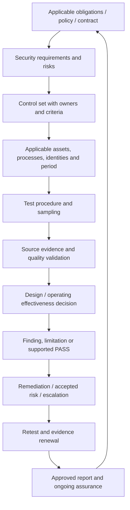
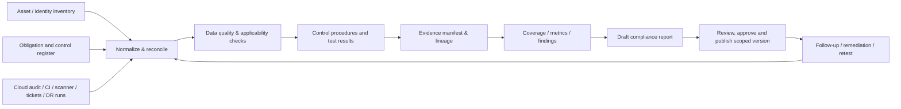

# Compliance Report: lập báo cáo tuân thủ có thể kiểm chứng trong Security Assurance

## 1. Compliance Report là gì?

**Compliance Report (báo cáo tuân thủ)** là tài liệu có cấu trúc trình bày **các nghĩa vụ, yêu cầu hoặc tiêu chí áp dụng**, phạm vi và kỳ đánh giá, **bằng chứng đã thu thập**, kết quả kiểm tra từng control, các sai lệch và rủi ro tồn dư, cùng **kết luận đúng giới hạn** để người có trách nhiệm ra quyết định.

Trong chương **Compliance assurance** thuộc module **SECURITY_SECURITY_ASSURANCE**, báo cáo không chỉ để trả lời câu hỏi “đã tuân thủ hay chưa”. Nó phải giúp xây dựng **sự tin cậy có căn cứ** rằng hệ thống đáp ứng mục tiêu bảo mật, từ phân tích rủi ro và security requirements đến các controls được triển khai, kiểm thử, audit, remediation và kiểm tra lại trong phát triển và vận hành.

Hãy tưởng tượng một nhóm phát hành báo cáo:

> “Hệ thống của chúng tôi tuân thủ 98% các yêu cầu bảo mật.”

Con số trên không có ý nghĩa nếu thiếu thông tin: **98% của mẫu số nào?** Chỉ tính controls được quét hay cả controls chưa đánh giá? Kiểm tra production hay staging? Trong ngày hôm nay hay suốt cả quý? Có control cực kỳ quan trọng bị FAIL không? Scanner có thấy hết mọi cloud account không? Ai kiểm tra tính đúng của kết quả?

Một báo cáo có giá trị cần trả lời cụ thể:

1. **Tuân thủ điều gì?** Luật/quy định/hợp đồng/chính sách/standard nào thực sự áp dụng, đúng điều khoản và phiên bản.
2. **Đối với ai và ở đâu?** Pháp nhân, dịch vụ, quy trình, assets, identities, environments, regions và third parties nào.
3. **Trong thời gian nào?** Point-in-time hay period-of-time; khoảng thời gian, timezone và hiệu lực tiêu chí.
4. **Đánh giá bằng cách nào?** Methods, test procedures, population, samples, công cụ, review và tiêu chí phân loại.
5. **Bằng chứng nào hỗ trợ?** Source, event/config IDs, thời gian, integrity, chain of custody khi cần, coverage gaps.
6. **Kết quả thực là gì?** PASS, FAIL, INCOMPLETE, NOT APPLICABLE, accepted risk hoặc tình trạng remediation.
7. **Ai chịu trách nhiệm?** Control owner, risk owner, reviewer, approver, deadlines và escalation.
8. **Giới hạn kết luận ở đâu?** Những control, tài sản, thời kỳ, nguồn log hay tình huống chưa kiểm.

### Mục tiêu học tập

Sau bài này, người học có thể:

- Phân biệt **compliance report**, audit report, security posture dashboard, compliance attestation và chứng nhận.
- Xây **obligation-to-control-to-evidence mapping** có truy vết và có phiên bản.
- Lập phạm vi, kỳ báo cáo, phương pháp, coverage, findings và trạng thái cải tiến.
- Trình bày kết quả **design effectiveness** và **operating effectiveness** không suy rộng từ một snapshot.
- Tính toán compliance/coverage metrics với mẫu số đúng, không dùng điểm số để che critical findings.
- Thiết kế evidence package, một executive summary và báo cáo kỹ thuật dễ kiểm tra lại.
- Xử lý external assurance, privacy, sign-off, báo cáo định kỳ và automation có giới hạn.

**Lưu ý:** các con số, account IDs, điều khoản và kết quả trong ví dụ là **giả lập cho mục đích học tập**, không phải chứng cứ về một hệ thống thực, không xác nhận đã được chứng nhận và không thay thế tư vấn pháp lý hoặc quy trình đánh giá chính thức.

## 2. Compliance Assurance và các loại báo cáo liên quan

**Compliance assurance** là hoạt động duy trì căn cứ cho nhận định rằng **những yêu cầu có hiệu lực đã được nhận diện, chuyển thành controls, thực thi, theo dõi và kiểm tra đúng phạm vi**. Báo cáo là **đầu ra trình bày các căn cứ và giới hạn**, không phải bản thân control.

| Đầu ra | Mục đích | Điều không được tự suy ra |
|---|---|---|
| **Compliance report nội bộ** | Tổng hợp nghĩa vụ, controls, evidence, gaps và kế hoạch xử lý | Không tự tương đương ý kiến kiểm toán độc lập |
| **Audit report** | Trình bày mục tiêu, tiêu chí, thủ tục kiểm tra và findings theo phương pháp audit | Không tự chứng nhận mọi tiêu chuẩn hoặc mọi thời kỳ |
| **Continuous compliance dashboard** | Hiển thị trạng thái telemetry/config/rules gần thời gian thực | Một điểm màu xanh không chứng minh vận hành trong cả kỳ |
| **Risk report** | Phân tích mức rủi ro, tác động, khả năng xảy ra, biện pháp xử lý | Risk accepted không có nghĩa criterion đã được đáp ứng |
| **Management attestation** | Tuyên bố có trách nhiệm của management về phạm vi/kiểm soát theo cơ chế nhất định | Không phải kiểm tra độc lập nếu không có cơ chế assurance độc lập |
| **Independent assurance report** | Kết luận do bên có thẩm quyền và độc lập đưa ra theo tiêu chí/phương pháp xác định | Không bao phủ dịch vụ, thời kỳ hay control nằm ngoài báo cáo |
| **Certification/accreditation** | Kết quả từ chương trình đánh giá chính thức có phạm vi và điều kiện riêng | Một báo cáo nội bộ không tự cấp chứng nhận |
| **Evidence package** | Bộ artifact giúp kiểm tra lại từng nhận định | Nhiều tài liệu không tự động tạo ra kết luận có cơ sở |

### 2.1. Compliance không bằng “bảo mật tuyệt đối”

Hệ thống có thể **đáp ứng một bộ tiêu chí** nhưng vẫn còn threat scenario chưa được bao phủ hoặc rủi ro tồn dư. Ngược lại, hệ thống có security control tốt nhưng **thiếu hồ sơ phê duyệt, review hoặc retention** vẫn có thể không đạt tiêu chí tuân thủ yêu cầu bằng chứng.

Ví dụ:

- Việc bật encryption at rest có thể đạt một control kỹ thuật; nhưng nếu key policy cho phép quá nhiều administrators, một yêu cầu least privilege riêng vẫn có thể FAIL.
- Một ứng dụng không có incident trong quý **không phải bằng chứng** rằng incident response plan đã được diễn tập theo yêu cầu.
- Có backup job thành công nhưng chưa thử restore không chứng minh **khả năng khôi phục** đạt RTO/RPO.
- Mọi scanner rule đều PASS nhưng còn một cloud account ngoài coverage, **kết luận toàn bộ tổ chức đạt** sẽ không được hỗ trợ.

Mục tiêu là **tính trung thực và khả năng kiểm tra** của assurance claim, không phải tối đa hóa điểm số đẹp.

### 2.2. Compliance là quan hệ với nghĩa vụ áp dụng

Không phải mọi tiêu chuẩn, quy định hoặc điều khoản đều áp dụng cho mọi doanh nghiệp. Cần dựa trên **pháp nhân, ngành, dữ liệu, địa bàn, hợp đồng, dịch vụ và kỳ đánh giá** để xác định applicability. Khi dùng nguồn tham khảo như ISO/IEC 27001, NIST SP 800-53, SOC 2 Trust Services Criteria, PCI DSS hoặc các quy định về dữ liệu, phải kiểm tra **đúng phiên bản, đối tượng áp dụng, phạm vi và phương pháp thực tế**.

Không nên ghi “đã tuân thủ ISO/SOC 2/PCI DSS” chỉ vì đã mapping một số controls theo tài liệu công khai. Một framework dùng cho **benchmark nội bộ** khác với việc được đánh giá/chứng nhận hoặc phát hành báo cáo chính thức theo chương trình tương ứng.

## 3. Ai đọc Compliance Report và họ cần quyết định gì?

Một báo cáo quá kỹ thuật khiến lãnh đạo không hiểu rủi ro, còn báo cáo chỉ có màu xanh/đỏ khiến auditor không kiểm tra được. Nên xác định **độc giả và mục đích sử dụng** ngay lúc thiết kế.

| Người đọc | Câu hỏi cần quyết định | Thông tin nên ưu tiên |
|---|---|---|
| **Executive / board / risk committee** | Rủi ro trọng yếu, nghĩa vụ sắp đến hạn và nguồn lực nào cần quyết định? | Executive summary, critical gaps, xu hướng, accepted risks, quyết định đang chờ |
| **Compliance / GRC** | Nghĩa vụ nào áp dụng, control owner nào chưa có evidence, cần follow-up gì? | Obligation register, control matrix, kỳ hạn, exceptions, plan of action |
| **Security Assurance / AppSec** | Security requirements có được triển khai và xác minh không? | Design/operating tests, defects, scope, evidence linkage, retest |
| **Internal audit / independent assessor** | Chứng cứ có đầy đủ, phù hợp criteria và tái lập được không? | Audit scope, population, sampling, raw sources, test methods, limitations |
| **Platform / engineering / operations** | Phải sửa gì, ở đâu, phiên bản nào, kiểm lại ra sao? | Findings, affected assets, reproduction/verification, owner, target |
| **Legal / privacy / procurement** | Điều khoản hoặc nghĩa vụ dữ liệu/hợp đồng nào ảnh hưởng? | Applicable obligations, data boundaries, third-party scope, hạn cần xác minh |
| **Customer / partner** | Dịch vụ họ sử dụng có được đánh giá trong thời kỳ họ quan tâm? | Phiên bản đã phê duyệt, scope, control summary, caveats, quyền chia sẻ |

### 3.1. Một nguồn sự thật, nhiều góc nhìn

Nên lưu **control/evidence records** có cấu trúc ở nguồn được quản trị, rồi tạo:

1. **Executive summary:** ít thuật ngữ, nhấn mạnh rủi ro và quyết định.
2. **Control results annex:** từng control, criterion, population, procedure, outcome.
3. **Evidence manifest:** IDs, hashes khi phù hợp, source, timestamp, revision, quyền truy cập.
4. **Remediation tracker:** finding, business impact, owner, due date, exception và retest.

Các bản phải cùng **kỳ báo cáo và scope revision**, không được để dashboard tự cập nhật bằng dữ liệu mới trong khi executive summary vẫn ghi con số của tháng trước mà không công bố.

### 3.2. Chỉ chia sẻ theo quyền

Bản nội bộ có thể chứa chi tiết về tài sản yếu, exploit path, audit evidence hoặc privileged identities. Bản gửi khách hàng không nên tự động sao chép nguyên toàn bộ log, cloud account IDs, secret references hoặc thông tin bảo mật đặc biệt nhạy cảm. Cần thiết kế **data classification, redaction và approval workflow** riêng cho từng đối tượng nhận.

## 4. Chuỗi truy vết: từ nghĩa vụ đến kết luận

Một báo cáo đáng tin phải gắn được **tuyên bố tuân thủ** với **control được kiểm**, dữ kiện nguồn và trạng thái remediation.



### 4.1. Tập thuật ngữ tối thiểu

| Thuật ngữ | Vai trò trong report |
|---|---|
| **Obligation / requirement** | Điều khoản hoặc yêu cầu nào đang áp dụng |
| **Control** | Cơ chế, quy trình hoặc hoạt động nhằm đáp ứng yêu cầu |
| **Control owner** | Người/nhóm chịu trách nhiệm thực thi và duy trì control |
| **Criterion** | Điều kiện xác định control được thiết kế/vận hành phù hợp |
| **Scope unit** | Asset, principal, business process, account hoặc cặp control-asset cần đánh giá |
| **Test case/procedure** | Cách kiểm cụ thể và expected outcomes |
| **Population/sample** | Tập tổng thể áp dụng và các đơn vị thực tế được kiểm |
| **Evidence record** | Artifact có nguồn, time, đối tượng, integrity/provenance |
| **Finding** | Sai lệch/thiếu hụt được xác nhận hoặc bằng chứng không đủ theo phương pháp |
| **Exception/accepted risk** | Quyết định có điều kiện về sai lệch chưa khắc phục, không thay kết quả kiểm |
| **Assurance conclusion** | Nhận định phù hợp với phạm vi và mức độ bằng chứng hiện có |

### 4.2. Mapping không phải bằng chứng hiệu lực

Nếu yêu cầu `REQ-IAM-01` được mapping với control `CTRL-IAM-01` và một scanner check `CHK-IAM-01`, đây mới là **thiết kế truy vết**. Để kết luận operating effectiveness, vẫn cần:

- Tập tài sản và danh tính đúng trong kỳ.
- Bằng chứng quyền được cấp/thu hồi và approvals thực tế.
- Review đủ mẫu hoặc toàn population theo phương pháp đã duyệt.
- Các ngoại lệ, field thiếu, trường hợp rule không chạy và trạng thái remediation.

Một mục “mapped” không thể tự biến thành “tested” hoặc “passed”.

## 5. Xác định applicable obligations và phiên bản

Bước đầu tiên là tạo hoặc tham chiếu **obligation register** được quản trị. Nó mô tả nguồn yêu cầu, đối tượng áp dụng, thời gian hiệu lực và trách nhiệm đánh giá.

### 5.1. Các trường cần có

| Trường | Ý nghĩa | Ví dụ minh họa |
|---|---|---|
| **Obligation ID** | ID ổn định trong hệ thống nội bộ | `OBL-SEC-LOG-001` |
| **Source & clause** | Chính sách, hợp đồng, điều khoản, phiên bản | `Internal-Logging-v3, section 4` |
| **Jurisdiction/business context** | Pháp nhân, thị trường, dữ liệu, hoạt động chịu tác động | Order Service production |
| **Effective period** | Từ ngày nào đến ngày nào áp dụng | `2026-Q3` |
| **Requirement statement** | Nội dung testable, không bỏ mất nghĩa vụ gốc | Ghi nhận thay đổi đặc quyền và lưu bằng chứng |
| **Applicability decision** | Applicable / not applicable / pending và cơ sở | Applicable cho các prod accounts |
| **Owner** | Bộ phận giải thích, duy trì hoặc phê duyệt yêu cầu | Compliance owner |
| **Controls & evidence** | Control IDs, procedures, artifacts dự kiến | `CTRL-LOG-01`, cloud audit events |
| **Review trigger** | Khi nào phải xem lại applicability/version | Thêm region hoặc đổi data class |

Các IDs và tên điều khoản đều **giả lập**. Một compliance analyst không nên tự khẳng định hạn pháp lý chỉ bằng trí nhớ; cần dùng nguồn chính thức, hợp đồng thực và chuyên gia pháp chế khi cần.

### 5.2. Mẫu obligation record

```yaml
obligation_id: OBL-SEC-LOG-001
source_type: internal_security_standard
source_reference: "Internal Logging Standard, version 3, section 4"
requirement: "Record privileged role changes on production cloud accounts"
effective_from: "2026-01-01"
applicability:
  environments: [production]
  asset_groups: [cloud_management_accounts]
  decision: applicable
  rationale: "Management-plane events affect privileged access"
controls: [CTRL-LOG-01]
control_owner: platform-security
obligation_owner: governance-risk-compliance
review_triggers:
  - new_production_account
  - new_logging_policy_revision
```

Không có nghĩa là tên standard/điều khoản này có thật; đây là ví dụ cấu trúc register. Không tự thêm một control vào register là đủ để tuyên bố đã tuân thủ.

### 5.3. Một requirement, nhiều controls; một control, nhiều requirements

Ví dụ nghĩa vụ bảo vệ truy cập dữ liệu có thể cần **identity proofing, least privilege, authorization tests, access reviews và audit logs**. Một control ghi log thay đổi quyền có thể hỗ trợ nhiều tiêu chí nội bộ và hợp đồng.

Do đó quan hệ thường là **many-to-many**:

```text
OBL-A ──> CTRL-IAM-01 ──> IAM test evidence
     └──> CTRL-LOG-01 ──> Log pipeline evidence
OBL-B ──────────────────> CTRL-LOG-01
OBL-C ──> CTRL-DR-01 ──> Restore exercise evidence
```

Khi **cùng một evidence dùng hỗ trợ nhiều requirements**, phải xác minh evidence thực sự đáp ứng tiêu chí của từng requirement; không nhân bản “PASS” chỉ vì có cùng đường dẫn file.

## 6. Phạm vi báo cáo, thời kỳ và population

Không có một mẫu số rõ, mọi bảng tỷ lệ tuân thủ dễ gây hiểu lầm. Scope của compliance report cần xác định:

- **Tổ chức/pháp nhân:** đơn vị chịu nghĩa vụ, bộ phận và owner.
- **Business processes:** hoạt động quan trọng, sản phẩm, khách hàng và đối tác bị ảnh hưởng.
- **Technical assets:** applications, APIs, cloud accounts/subscriptions/projects, clusters, storage, identity, CI/CD, KMS, logging, backup và DR.
- **Environment & location:** production, staging, DR, region, tenant, data residency khi liên quan.
- **Data & identity classes:** PII/confidential data, admins, service principals, external users.
- **Third-party boundaries:** services do provider vận hành, customer-managed controls và tài liệu bên thứ ba.
- **Controls & criteria:** được áp dụng đầy đủ hay chỉ một subset; tiêu chí kỹ thuật và quản trị nào.
- **Time:** point-in-time snapshot, period-of-time, các policy revisions có hiệu lực.
- **Exclusions, not applicable, pending và evidence gaps:** có owner, rationale và người phê duyệt.

### 6.1. Point-in-time khác operating over a period

Một cloud posture scan ngày 30/09/2026 cho thấy tất cả buckets trong tập kiểm có block public access. Điều đó hỗ trợ kết luận về **cấu hình tại snapshot**; không chứng minh không có bucket public ở tháng 7.

Để đánh giá yêu cầu “mỗi privileged grant được phê duyệt trong Quý III”, cần tập sự kiện cấp quyền trong **toàn kỳ**, approval records và thời điểm; việc xem IAM snapshot cuối quý là không đủ.

Nếu policy thay đổi trong kỳ, phải mô tả tiêu chí áp dụng theo từng **subperiod** hoặc cơ chế chuyển tiếp đã được phê duyệt. Không dùng policy mới để chấm tất cả giao dịch lịch sử mà không giải thích.

### 6.2. Tài sản tồn tại một phần trong kỳ

Một tài khoản cloud được tạo ngày 10/08 rồi xóa ngày 15/09 có thể chứa hành vi thuộc Q3 nhưng không còn trên inventory cuối kỳ. Nếu objective về **operating effectiveness suốt Q3**, population có thể cần mọi tài sản **từng thuộc scope trong kỳ**, không chỉ tài sản còn hoạt động lúc lập báo cáo.

Nguồn nên được reconcile giữa service catalog, cloud organization inventory, event history, CI/CD, CMDB và data catalog. Nếu thiếu quyền đọc một account quan trọng, ghi **coverage gap** thay vì bỏ account khỏi mẫu số để có 100%.

### 6.3. Scope charter và versioning

Một báo cáo nên tham chiếu một **approved scope charter** có:

```yaml
scope_id: COMP-SCOPE-EXAMPLE-009
version: 2
legal_entity: example-business-unit
business_service: order-platform
period:
  start_utc: "2026-07-01T00:00:00Z"
  end_utc: "2026-09-30T23:59:59Z"
included:
  environments: [production]
  cloud_accounts: [prod-orders-a, prod-orders-b]
  services: [order-api, orders-db, orders-attachments]
  control_ids: [CTRL-IAM-01, CTRL-LOG-01, CTRL-DATA-01, CTRL-DR-01]
dependencies_to_review:
  - production_ci_deploy_identity
  - centralized_security_logging
excluded:
  - asset: synthetic-development-sandbox
    rationale: "No production identities or data after verified review"
scope_approver: example-compliance-sponsor
```

Đây là ví dụ minh họa, không phải tuyên bố đã xác minh sandbox thật sự độc lập. Scope phải được cập nhật theo change control nếu phát hiện tài sản hoặc đường dữ liệu mới ảnh hưởng control.

## 7. Control–Requirement–Evidence Matrix: lõi dữ liệu của báo cáo

**Control matrix** liên kết obligation, tiêu chí cần kiểm, đối tượng áp dụng, owner, phương pháp, bằng chứng và kết quả. Đây là cách để cả management lẫn reviewer có thể đi **từ một dòng tổng kết đến nguồn dữ kiện**.

### 7.1. Ví dụ matrix cho Order Service

| Requirement | Control | Scope unit | Test và expected outcome | Evidence |
|---|---|---|---|---|
| `REQ-IAM-01`: đặc quyền có kiểm soát | `CTRL-IAM-01`: approval và access review | IAM grants/users/workload roles ở production | Các thay đổi đặc quyền có approval hợp lệ, quyền thực tế không vượt baseline | IAM change events, tickets, role snapshots, review decisions |
| `REQ-DATA-02`: dữ liệu không bị public ngoài quyền | `CTRL-DATA-01`: storage policy và API authz | Buckets/data classes, API routes, principals | Tài nguyên nhạy cảm private; test ngoài quyền bị từ chối | Effective policies, bucket config, canary tests, application logs |
| `REQ-LOG-03`: thao tác bảo mật truy vết được | `CTRL-LOG-01`: audit source và pipeline | Cloud accounts, event categories, log destinations | Sự kiện quan trọng sinh và đến kho đúng schema/retention | Source configs, raw/normalized events, canary IDs, pipeline health |
| `REQ-SDLC-04`: thay đổi được phê duyệt | `CTRL-SDLC-01`: release controls | CI/CD pipelines và production deployments | Deploy được trace đến code review, build, artifact digest và approval | PR, CI run, signature/provenance, deployed digest |
| `REQ-DR-05`: phục hồi dịch vụ trọng yếu | `CTRL-DR-01`: DR tests và remediation | Business processes, recovery scenarios | RTO/RPO/MBCO được kiểm bằng restore/failover evidence | BIA, test scenario, restore logs, transaction markers, recovery approval |

Các mã `REQ-*` và `CTRL-*` là **định danh trong ví dụ**, không đại diện điều khoản pháp lý hoặc control IDs của tổ chức bên ngoài. Trong report thật phải liên kết ID với **điều khoản gốc và phiên bản** được áp dụng.

### 7.2. Một control dùng nhiều loại evidence

Ví dụ với `CTRL-IAM-01`:

1. **Policy/control design:** tài liệu quyền, quy trình yêu cầu và phê duyệt, phân tách nhiệm vụ.
2. **Current-state evidence:** IAM role assignments, privileged principals, effective permissions.
3. **Period-of-time evidence:** events cấp/thu hồi quyền và tickets/approvals trong kỳ.
4. **Negative/positive test evidence:** thử với identity có phép và ngoài quyền trên dữ liệu canary.
5. **Review evidence:** periodic access review, exceptions, decisions và remediation.

Một policy file có thể chứng minh **thiết kế đã được định nghĩa** nhưng không chứng minh tất cả grants thực tế đều được duyệt. Một scan cấu hình một ngày không đủ thay thế lịch sử vận hành trong cả quý.

### 7.3. Control dependency và inherited control

Một hệ thống SaaS có thể kế thừa một số biện pháp từ cloud provider hoặc shared platform. Report cần chỉ rõ:

- Control do **provider**, **customer** hay **shared responsibility** thực hiện.
- Report/attestation nào của provider hỗ trợ phần được kế thừa, đúng service/location/period/criteria không.
- Các **customer responsibility hoặc complementary controls** mà nhóm nội bộ vẫn phải thực hiện.
- Phần không có evidence hoặc nhà cung cấp không cho review trực tiếp.

Không được đánh PASS toàn bộ `CTRL-DATA-01` chỉ vì provider báo datacenter vật lý có kiểm soát bảo mật; quyền bucket và authorization của API vẫn có thể thuộc trách nhiệm khách hàng.

## 8. Thiết kế thủ tục kiểm thử và mức độ hiệu lực

Một báo cáo tổng hợp cần làm rõ **đã thực hiện loại test nào**. Cùng một control có thể đạt về thiết kế nhưng FAIL về vận hành.

### 8.1. Design effectiveness (DE) và operating effectiveness (OE)

| Trạng thái | Nội dung kiểm tra | Ví dụ |
|---|---|---|
| **Design effectiveness** | Control nếu được vận hành đúng thiết kế có hợp lý để đáp ứng mục tiêu? | Quy trình privileged grant yêu cầu requester, approver và review |
| **Implementation check** | Control đã thực sự được triển khai tại hệ thống/asset cần kiểm chưa? | IAM policy và logging source được cấu hình ở accounts thuộc scope |
| **Operating effectiveness** | Trong kỳ, control có vận hành đúng theo tiêu chí không? | Thực tế grants có approval và log; review theo chu kỳ có evidence |
| **Technical behavior validation** | Khi hành vi thử đã được phép xảy ra, kiểm soát có đúng expected? | Principal ngoài quyền bị từ chối, audit canary xuất hiện |
| **Continuous monitoring** | Theo dõi drift, run failures, control quality qua thời gian | Scan revisions, event health, exceptions và gaps |

Một tổ chức có thể dùng cách phân loại khác; report cần giải thích **methodology**, không giả định mọi độc giả hiểu DE/OE giống nhau.

### 8.2. Viết test procedure có thể tái lập

Mỗi thủ tục tối thiểu nên có:

- **Control ID/criterion** và expected state/behavior.
- **Population source** và cách biết tập đó đầy đủ.
- **Selection method** và test/sample IDs.
- **Thời kỳ và môi trường**, tool/query revision, account/region.
- **Các bước kiểm tra** có thể tái lập, với quyền đọc thích hợp.
- **Observed result** và raw evidence reference.
- **Pass/fail rule**, điều kiện incomplete và người review.
- **Exceptions** đã phê duyệt nhưng không xóa bản chất finding.

Ví dụ procedure cho cloud IAM (pseudocode, không phải lệnh có thể dùng trực tiếp):

```text
FOR each privileged IAM grant in the approved audit population:
    locate corresponding change request / approval
    confirm actor, target, action, time and approver identity
    compare effective privilege with baseline for that time
    check exception validity and separation of duties
    record test outcome + evidence IDs
IF source event unavailable:
    classify evidence gap, do not infer "no grants occurred"
```

### 8.3. Sampling có giới hạn

Có thể:

- Kiểm **toàn bộ** high-risk grants hoặc máy chủ thuộc phạm vi nhỏ.
- Lấy **random sample** từ population đã reconcile.
- Chia **strata** theo business criticality, môi trường, loại quyền hoặc thời kỳ.
- Chọn **judgmental/risk-based samples** cho đường có khả năng sai lệch cao.

**Không lấy tỷ lệ lỗi trong judgmental sample để suy rộng thành tỷ lệ lỗi toàn population**. Nếu 5 trong 20 mẫu chủ đích sai, đó là 5/20 của mẫu đã chọn, không chứng minh 25% tất cả grants sai.

Kích thước mẫu phụ thuộc phương pháp, đặc tính tổng thể, mức rủi ro, tiêu chí kiểm toán và yêu cầu mức assurance; không có một công thức “kiểm 10% là đủ” cho mọi trường hợp.

### 8.4. Negative control và incomplete tests

Ví dụ test policy trên object storage:

- **Positive control:** principal hợp lệ đọc object canary được cấp phép.
- **Negative control:** principal ngoài quyền cố đọc cùng object và bị từ chối.
- **Invalid test:** object không tồn tại nên cả hai đều 404; kết quả không chứng minh authorization.
- **Incomplete:** tester không có quyền lấy effective policy hoặc log nguồn; không được đánh PASS vì lệnh kiểm tra trả lỗi.

Một test chỉ có kết quả khi **prerequisites đáp ứng**. Phải tách “control không hoạt động” khỏi “không đủ dữ liệu để kết luận”.

## 9. Evidence: nguồn gốc, tính liên quan, đầy đủ và an toàn

**Evidence package** phải giúp một reviewer có quyền tái kiểm tra mối liên hệ giữa yêu cầu và kết quả. Đếm số file đính kèm không phải một thước đo về chất lượng.

### 9.1. Những đặc tính cần xác minh

| Đặc tính | Câu hỏi | Phản ví dụ |
|---|---|---|
| **Relevance** | Artifact có liên quan đúng control, asset, criterion và kỳ? | Report scan staging đính vào kết luận production |
| **Authenticity/source** | Nguồn sinh và người thu dữ liệu có thể xác minh? | Screenshot không ID, không biết ai chụp |
| **Completeness** | Population, thời kỳ và sources có bao phủ đầy đủ? | SIEM mất event 15 ngày nhưng báo không có vi phạm |
| **Accuracy/consistency** | Actor, role, outcome, timestamp và object IDs có khớp nguồn khác? | Approval ticket ghi account A, event ở account B |
| **Integrity** | Artifact có bị sửa ngoài quy trình, có lịch sử hoặc hash đối chứng? | Chỉ có checksum trong file cùng quyền được sửa |
| **Freshness** | Evidence còn có hiệu lực sau thay đổi pipeline, policy hay asset? | Dùng scan cũ cho role mới triển khai |
| **Repeatability** | Có query, snapshot, tool/revision và test ID để kiểm tra lại? | “Tool nói xanh” không có rule hoặc input |
| **Security/privacy** | Evidence được phân quyền, giảm nhạy cảm và giữ đúng retention? | Log có token được đưa vào báo cáo công khai |

**Hash hỗ trợ kiểm tra tính nhất quán của file**, nhưng không tự chứng minh file chứa thông tin đúng hoặc được lấy từ nguồn đáng tin. Hash phải gắn với bytes của đúng bản (raw hay redacted), manifest được bảo vệ và cách thu.

### 9.2. Evidence register

```yaml
evidence_id: COMP-EV-EXAMPLE-009-001
control_id: CTRL-IAM-01
test_id: IAM-T-EXAMPLE-014
scope:
  account: prod-orders-a
  environment: production
  period: "2026-Q3"
source:
  system: example-cloud-audit
  query_reference: "IAM-grants-Q3-example-query-v2"
  record_ids: [evt-demo-2201, evt-demo-2202]
collection:
  actor: approved-audit-reader
  collected_at_utc: "2026-10-08T03:30:00Z"
  method: read_only_api_export
artifact:
  path: evidence/iam-grants-redacted.json
  checksum_sha256: "<actual-checksum-of-redacted-file>"
  access_classification: restricted
assessment:
  test_result: review_required
limitations:
  - "Production account B not represented in this record"
```

Các IDs, timestamps, đường dẫn và trạng thái **là minh họa**. Mẫu không chứng minh rằng những file đó đã tồn tại. Trong báo cáo thực tế phải thay bằng dữ liệu thu được, đối chiếu với raw evidence được cấp quyền và không tạo kết quả PASS giả.

### 9.3. Evidence ở nhiều cấp

```text
Obligation / criterion: OBL-SEC-LOG-001
  → Control: CTRL-LOG-01
    → Scope unit: prod-orders-a / cloud IAM audit events
      → Test: LOG-TEST-EXAMPLE-001
        → Raw source event: event ID and timestamp
        → Collected record: artifact reference
        → Normalized event: parser revision and field checks
        → Detection/retention check: outcome and log destination
        → Reviewer decision: PASS / FAIL / INCOMPLETE
          → Finding/remediation/retest (if needed)
```

Một control có thể cần bằng chứng của **source generation, transport, parser và retention**. Chỉ thấy log ở dashboard không chứng minh tất cả các loại sự kiện trong scope đều được thu đủ trong kỳ.

### 9.4. Third-party evidence

Nếu dùng report bên thứ ba, cần:

1. Chỉ rõ **dịch vụ, pháp nhân, region/location và thời kỳ** provider report bao phủ.
2. Xác minh **tiêu chí** và hoạt động kiểm tra phù hợp nghĩa vụ nội bộ.
3. Đọc exclusions, subservice arrangements và **complementary user entity controls** khi có.
4. Ghi khoảng trống giữa thời kỳ report provider và thời kỳ báo cáo của mình.
5. Kiểm riêng phần control **phía khách hàng**: IAM, configuration, application authz, logging, data handling.

Đừng biến “nhà cung cấp có chứng nhận” thành kết luận “dịch vụ của chúng ta hoàn toàn compliant” khi nghĩa vụ và trách nhiệm không trùng khớp.

## 10. Phân loại trạng thái: đừng chỉ dùng xanh hoặc đỏ

Tùy chương trình, tổ chức có thể dùng các mã trạng thái khác nhau. Nhưng để tránh nhầm lẫn, cần tách **trạng thái kiểm tra**, **trạng thái control**, **rủi ro còn tồn tại** và **trạng thái xử lý**.

### 10.1. Đề xuất taxonomy báo cáo

| Trạng thái | Ý nghĩa đúng | Ví dụ |
|---|---|---|
| **PASS / COMPLIANT_FOR_TESTED_SCOPE** | Đáp ứng tiêu chí trong phạm vi/kỳ/test đã xác minh | Grants được kiểm đều có approvals phù hợp |
| **FAIL / NONCOMPLIANT** | Bằng chứng cho thấy không đáp ứng tiêu chí | Storage nhạy cảm bị public ngoài ngoại lệ |
| **INCOMPLETE / INCONCLUSIVE** | Không đủ evidence hoặc test conditions để kết luận | Collector mất quyền đọc log một account |
| **UNTESTED / NOT ASSESSED** | Trong scope nhưng chưa được thử | Region dự phòng chưa được audit |
| **NOT APPLICABLE** | Control không áp dụng với lý do và approval hợp lệ | Control DB encryption cho dịch vụ không có DB |
| **EXCLUDED** | Đã loại khỏi engagement có phê duyệt và tác động được ghi | Sandbox độc lập sau khi xác minh |
| **ACCEPTED RISK / WAIVER** | Sai lệch còn tồn tại, có quyết định quản trị trong thẩm quyền | Quá hạn fix có biện pháp bù trừ đến ngày X |
| **REMEDIATED_PENDING_RETEST** | Chủ hệ thống báo đã sửa nhưng chưa xác minh lại | IAM policy merge xong, chưa thử effective permissions |
| **VERIFIED_FIXED** | Có evidence retest trên revision và scope phù hợp | Negative authz test đạt, finding đóng có review |

**Không gộp** `INCOMPLETE` thành `PASS` chỉ vì không tìm thấy lỗi; không gộp `ACCEPTED RISK` thành `COMPLIANT` chỉ vì lãnh đạo chấp nhận hậu quả.

### 10.2. Một control có thể có nhiều trạng thái theo asset

Ví dụ control `CTRL-LOG-01` yêu cầu audit events trên ba accounts:

| Account | Test status | Control outcome | Ghi chú |
|---|---|---|---|
| `prod-orders-a` | Tested | PASS | Có canary và dữ liệu theo yêu cầu |
| `prod-orders-b` | Tested | FAIL | Data-access events thiếu trong 15 ngày |
| `prod-orders-c` | Untested | Chưa kết luận | Account mới, chưa có quyền thu evidence |

Không báo control “PASS toàn tổ chức” chỉ vì 1/3 account đạt. Control có thể **partial**, hoặc cần severity/risk decision riêng theo phương pháp áp dụng.

### 10.3. Phân biệt finding kỹ thuật và quyết định quản trị

Nếu một role có quyền rộng hơn baseline:

- **Observed state:** quyền rộng, có thời điểm và asset cụ thể.
- **Criteria outcome:** FAIL với control least privilege, trừ khi rule có ngoại lệ hợp lệ theo tiêu chí.
- **Risk treatment:** remediate, compensate, accept có thời hạn hoặc escalate.
- **Implementation status:** planned, in progress, fixed pending retest, verified fixed.

Không xóa **finding history** khi đổi trạng thái. Compliance report cần giữ được câu chuyện qua các kỳ: từng FAIL, đã sửa ra sao và bằng chứng khi nào.

## 11. Coverage metrics, compliance score và sự thật của mẫu số

Một báo cáo thường được yêu cầu cung cấp tỷ lệ. Trước khi tính, phải biết **đơn vị đếm** và **quy tắc tính**; nếu không, metric dễ tạo assurance ảo.

### 11.1. Ba tỷ lệ khác nhau

**Assessment coverage** cho các đơn vị applicable (ví dụ cặp control–asset):

\[
\text{Assessment coverage} =
\frac{\text{Số đơn vị được kiểm đủ bằng chứng để kết luận}}
{\text{Tổng đơn vị applicable trong scope}}\times100\%.
\]

**Pass rate trên các đơn vị có kết luận:**

\[
\text{Tested pass rate} =
\frac{\text{Số đơn vị PASS}}
{\text{Số đơn vị PASS + FAIL}}\times100\%.
\]

**Verified compliance coverage** trên toàn bộ applicable population:

\[
\text{Verified pass coverage} =
\frac{\text{Số đơn vị PASS có evidence còn hiệu lực}}
{\text{Tổng đơn vị applicable trong scope}}\times100\%.
\]

Hai tỷ lệ sau có mẫu số khác nhau, nên có thể trông rất khác. “Tested pass rate” có thể cao trong khi nhiều đơn vị chưa kiểm.

### 11.2. Ví dụ số liệu với missing data

Giả sử báo cáo xác định **40 cặp control–asset applicable**, trong đó:

| Trạng thái | Số cặp |
|---|---:|
| PASS có evidence phù hợp | 24 |
| FAIL được xác nhận | 6 |
| INCOMPLETE | 4 |
| UNTESTED | 6 |
| **Tổng applicable** | **40** |

Khi đó:

\[
\text{Assessment coverage} = \frac{24+6}{40} = 75\%.
\]

\[
\text{Tested pass rate} = \frac{24}{24+6} = 80\%.
\]

\[
\text{Verified pass coverage} = \frac{24}{40} = 60\%.
\]

**Cách trình bày đúng:** “Trong 40 cặp applicable, 24 PASS, 6 FAIL, 4 INCOMPLETE và 6 UNTESTED. 75% có đủ evidence để kết luận; 80% các đơn vị đã có kết luận PASS; nhưng chỉ 60% tổng population có evidence đạt.” Đừng rút gọn thành “tuân thủ 80%” mà không giải thích rõ mẫu số và phần còn thiếu.

### 11.3. Mẫu số bằng 0 và Not Applicable

Nếu không có đơn vị applicable, không được tự báo “100% PASS”: cần xem lại applicability hoặc ghi **metric không xác định**. Các trường hợp `NOT APPLICABLE` chỉ được loại khỏi mẫu số nếu có **rationale và approval**, không phải vì khó kiểm.

### 11.4. Weighted score và critical controls

Có thể gán trọng số theo risk/impact, nhưng:

- Trọng số phải được xác định **trước khi biết kết quả**, có phê duyệt và phiên bản.
- Critical control FAILED không nên bị che bởi nhiều control nhỏ PASSED.
- Không tự coi một số ratio là “mức độ an toàn của hệ thống”.
- Báo critical noncompliance, accepted risks, missing evidence **riêng** với score.
- Không so sánh hai quý nếu scope, criteria, denominators hoặc scoring rules đã đổi mà không giải thích.

### 11.5. Continuous monitoring cũng có coverage gaps

Một scanner báo `250/250 checks passed` chỉ cho biết những checks mà nó **thực sự chạy**. Nếu 3 cloud accounts chưa onboarding, log source không có data events hoặc policy engine bị disable, report cần ghi những đơn vị ngoài khả năng đo. Không lấy telemetry vắng mặt làm tín hiệu “không có vi phạm”.

## 12. Finding, severity, root cause và remediation plan

Compliance report cần vượt qua câu “không đạt control” để giúp người chịu trách nhiệm **hiểu sai lệch, tác động và cách kiểm tra lại**.

### 12.1. Một finding đủ hành động

| Trường | Nội dung cần mô tả |
|---|---|
| **Finding ID** | Định danh có thể theo dõi giữa report, ticket và retest |
| **Criterion/control** | Nghĩa vụ và control bị ảnh hưởng, phiên bản có hiệu lực |
| **Observed facts** | Điều đã thực sự nhìn thấy, nguồn, thời gian, sample/resource |
| **Expected state** | Điều kiện phải đạt theo criterion |
| **Impact/risk** | Hậu quả khả dĩ, asset/data/business impact và mức ưu tiên |
| **Cause/hypothesis** | Root cause đã xác minh hoặc giả thuyết chưa kiểm, không nhầm nhau |
| **Evidence refs** | Logs, policy, test output và reviewer |
| **Owner** | Người thực thi remediation, người chịu rủi ro và reviewer |
| **Treatment** | Fix, compensating control, escalate hoặc acceptance theo policy |
| **Due date & milestones** | Mốc xử lý có căn cứ, kỳ vọng cụ thể |
| **Retest criteria** | Hành vi/test nào phải đạt để kết luận FIXED |
| **Exception/acceptance** | Scope, lý do, người phê duyệt, expiry và điều kiện xem lại |

### 12.2. Ví dụ finding về logging

```yaml
finding_id: COMP-FIND-EXAMPLE-014
report_id: COMP-REPORT-EXAMPLE-2026Q3
obligation_id: OBL-SEC-LOG-001
control_id: CTRL-LOG-01
scope:
  environment: production
  account: prod-orders-b
  period: "2026-Q3"
expected: "Privileged management events are collected and retained"
observed: "Required event category unavailable for a 15-day period"
evidence_refs:
  - COMP-EV-EXAMPLE-014-A
  - COMP-EV-EXAMPLE-014-B
classification: noncompliant
priority: high
root_cause: under_investigation
control_owner: cloud-platform-team
risk_owner: example-order-service-owner
remediation:
  action: "Restore event source configuration and pipeline permissions"
  verify:
    - "Required events appear with actor, resource, outcome and time"
    - "Retention and read access tested for approved scope"
status: open
```

**Không suy luận từ việc SIEM không có event rằng nguồn audit chắc chắn bị tắt.** Cần kiểm tra event generation, collector, transport, parser, time range, quyền truy cập và retention; root cause của khoảng thiếu phải được điều tra. YAML chỉ minh họa cách giữ observed facts tách khỏi hypothesis.

### 12.3. Risk acceptance không xóa không tuân thủ

Giả sử phiên bản agent cũ chưa thể nâng cấp vì tương thích. Risk owner có thể chấp thuận tạm thời và áp dụng compensating controls. Report vẫn cần ghi:

- Control/criterion chưa đạt trong kỳ và evidence của sai lệch.
- Risk owner có thẩm quyền, ngày phê duyệt, scope và thời hạn.
- Biện pháp giảm thiểu, monitoring và trigger rà soát.
- Phương án sửa cùng deadline và retest sau sửa.

**Không viết `PASS` vì risk accepted.** Tùy quy định của chương trình, acceptance có thể là một trạng thái xử lý, nhưng không thay đổi sự kiện kỹ thuật quan sát được.

### 12.4. Verified fixed phải có evidence mới

Khi owner ghi “đã sửa”, reviewer nên:

1. Kiểm phiên bản cấu hình/commit/change ticket thật đã áp dụng ở đúng môi trường.
2. Chạy lại test phù hợp, bao gồm negative/positive controls khi cần.
3. Kiểm những tài sản/identities tương tự trong scope, tránh sửa riêng một trường hợp.
4. Thu evidence mới, ghi thời gian, kết quả và các giới hạn.
5. Chuyển `REMEDIATED_PENDING_RETEST` thành `VERIFIED_FIXED` chỉ khi chứng cứ đạt.

Một control đạt lại hôm nay **không làm các ngày không tuân thủ trong kỳ trước tự biến mất**. Báo cáo lịch sử phải giữ finding và thông tin thời điểm khắc phục.

## 13. Cấu trúc một Compliance Report có thể đưa vào sử dụng

Một báo cáo thực tế nên chia **phần điều hành** và **phần có thể kiểm toán lại**. Cùng một kết quả xuất hiện ở hai mức trình bày, nhưng không được mâu thuẫn số liệu, scope hay kỳ đánh giá.

### 13.1. Cấu trúc khuyến nghị

| Mục báo cáo | Mục đích | Kiểm tra chất lượng |
|---|---|---|
| **Cover, version, status** | Tên báo cáo, kỳ, scope version, đơn vị phát hành, người phê duyệt | Phân biệt draft, approved và superseded |
| **Executive summary** | Vấn đề chính, tình trạng, rủi ro trọng yếu và quyết định cần đưa ra | Không tuyên bố vượt quá evidence |
| **Purpose and intended users** | Báo cáo phục vụ ai, cho quyết định gì | Tránh dùng sai đối tượng hoặc mục đích |
| **Criteria and applicability** | Nghĩa vụ/chuẩn/chính sách và phiên bản thực sự áp dụng | Có legal/obligation owner review khi cần |
| **Scope and assessment period** | Org, process, system, data, region, time, inclusions/exclusions | Khớp inventory, audit charter |
| **Methodology** | Control mapping, DE/OE tests, sampling, tool versions, review | Có thể tái lập, nêu giới hạn suy rộng |
| **Results and coverage** | Control-level PASS/FAIL/INCOMPLETE, mẫu số, risk priority | Tách test coverage khỏi pass rate |
| **Material findings** | Sai lệch quan trọng, ảnh hưởng, owner, bằng chứng | Tách observed facts và giả thuyết |
| **Exceptions and residual risks** | Waivers, compensating controls, risk owner, expiry | Không đổi accepted risk thành PASS |
| **Remediation and action plan** | Actions, dates, trách nhiệm, milestones, retest | Có thể theo dõi đến verified fixed |
| **Conclusions and limitations** | Tuyên bố có cơ sở trong phạm vi đã kiểm, ngoại lệ và phần chưa biết | Không gọi internal review là certification |
| **Approval, distribution, retention** | Người kiểm, người duyệt, người nhận, data classification | Quyền chia sẻ và lịch sử revision rõ |
| **Technical annex / evidence index** | Matrix, test IDs, query refs, evidence, samples | Từ kết luận lần ngược về source được |

Không nhất thiết mọi report phải dài. Một bản quản trị hằng tháng có thể ngắn hơn, nhưng phải có **đường liên kết** tới control register, evidence index và findings. Một báo cáo gửi đối tác có thể lược chi tiết nhạy cảm, nhưng không được làm mờ đi material limitations.

### 13.2. Cover page metadata minh họa

```yaml
report_id: COMP-REPORT-EXAMPLE-2026Q3
title: "Order Service production security compliance assessment"
report_type: internal_compliance_assurance
status: draft_for_review
version: 0.9
period_start_utc: "2026-07-01T00:00:00Z"
period_end_utc: "2026-09-30T23:59:59Z"
scope_revision: COMP-SCOPE-EXAMPLE-009-v2
criteria_revision: comp-criteria-example-r4
prepared_by: compliance-assurance-team
control_owner_review: pending
independent_reviewer: pending
management_approval: pending
classification: restricted
distribution:
  - internal-risk-committee
  - approved-audit-reviewers
```

Tất cả đều là dữ liệu giả; `draft_for_review` có nghĩa **chưa được phê duyệt**. Việc đặt tên “compliance assessment” không chứng minh đã qua thủ tục kiểm toán/chứng nhận độc lập.

### 13.3. Đọc ngược từ phần executive

Một dòng trong executive summary như “Quyền cloud cần được tăng cường” phải chỉ được:

```text
Executive issue: Privileged IAM grants lack approval evidence
  → Finding ID: COMP-FIND-EXAMPLE-011
  → Criterion: OBL-IAM-EXAMPLE-01
  → Control: CTRL-IAM-01
  → Population: Q3 production privileged grants
  → Samples/procedures: IAM-T-EXAMPLE-011..019
  → Event IDs, approval decisions, IAM policy versions
  → Root-cause assessment and remediation ticket
  → Risk owner, due date and retest requirement
```

Đây là **audit trail của kết luận**, không phải nghĩa vụ xuất tất cả logs ra phần tóm tắt. Người có quyền xem annex/evidence phải có thể kiểm tra kết luận mà không chỉ tin vào hình dashboard.

## 14. Viết Executive Summary đúng mức bằng chứng

Phần điều hành thường là phần được đọc nhiều nhất. Nó cần **ngắn, có quyết định và trung thực**, thay vì chỉ ghi phần trăm.

### 14.1. Những thông tin nên trình bày

1. **What/when/who:** dịch vụ, tổ chức, giai đoạn và bản scope được đánh giá.
2. **Overall assessment:** trạng thái đánh giá tổng hợp theo quy tắc được duyệt; tránh “compliant toàn diện” nếu có limitation trọng yếu.
3. **Coverage:** mẫu số và số PASS/FAIL/INCOMPLETE/UNTESTED/N/A.
4. **Top material findings:** tối đa một số vấn đề ảnh hưởng lớn, có owner, kỳ xử lý và kết quả cần đạt.
5. **Decisions needed:** chấp thuận nguồn lực, xử lý risk, giới hạn phát hành, yêu cầu kiểm toán bổ sung.
6. **Known limitations:** phần chưa thể xác minh hoặc thay đổi scope.
7. **Trend:** cải thiện/suy giảm chỉ khi số liệu cùng tiêu chí và mẫu số có thể so sánh.

### 14.2. Ví dụ executive summary giả lập

> **Phạm vi:** Order Service production tại hai cloud accounts được liệt kê, kỳ Q3/2026, đánh giá các controls về quản lý truy cập đặc biệt, hạn chế truy cập dữ liệu, security logging và thay đổi triển khai.
>
> **Kết quả:** Trên 40 cặp control–asset applicable, có 24 PASS, 6 FAIL, 4 INCOMPLETE và 6 UNTESTED. Assessment coverage là 75%; verified pass coverage là 60%. Đây không phải kết luận tuân thủ 60% một framework chính thức.
>
> **Rủi ro quan trọng:** Một nhóm privileged grants thiếu bằng chứng approval; một log source bị thiếu dữ liệu trong 15 ngày; và các tài sản chưa được onboarding cần kiểm tra bổ sung. Chủ hệ thống cần khôi phục logging, xử lý quyền và hoàn thiện coverage trước kỳ đánh giá kế tiếp.
>
> **Giới hạn:** Các nhà cung cấp ngoài phạm vi và các hệ thống chưa được kiểm không nằm trong kết luận. Việc thiếu log không chứng minh không xảy ra truy cập ngoài quyền.

Đây là **mẫu học thuật**, không phải báo cáo đã xuất bản. Khi dùng thật, phải dựa trên population và bằng chứng thực, ghi severity/priority đã được review và bảo đảm mọi finding có ID để truy vết.

### 14.3. Các kiểu tuyên bố cần tránh

| Không nên viết | Lý do | Nên viết |
|---|---|---|
| “Tất cả hệ thống an toàn” | Không thể kiểm chứng mọi hệ thống, mọi thời điểm | “Các controls X/Y được xác minh trong scope và kỳ đã nêu” |
| “Không có lỗ hổng” | Có thể scanner thiếu coverage, không tương đương security | “Không phát hiện findings thuộc các checks đã chạy; còn các giới hạn…” |
| “Tuân thủ 100%” | Có thể đã loại control chưa kiểm hoặc N/A không hợp lệ | Nêu PASS/FAIL/INCOMPLETE/UNTESTED trên mẫu số thực |
| “Log không ghi nhận sự cố” | Log thiếu không chứng minh hành vi vắng mặt | Nêu event source coverage, time window và gap |
| “Đã khắc phục” | Thay đổi config chưa chắc đã đến runtime | “Đã triển khai; chờ retest” hoặc “verified fixed tại revision…” |
| “Nhà cung cấp bảo đảm toàn bộ compliance” | Report provider có scope/time và shared responsibility giới hạn | Nêu phần provider-backed và customer-controlled riêng |
| “Đã được chứng nhận” | Nội bộ không có quyền tự cấp certification | Ghi rõ internal assessment, independent review nếu có |

## 15. Case study xuyên suốt: báo cáo tuân thủ Order API

### 15.1. Bối cảnh và risk objectives

Hệ thống giả lập `order-api` phục vụ đặt hàng, lưu dữ liệu khách hàng trong database và object storage; dùng cloud IAM, KMS, CI/CD và central security monitoring. Business owner muốn biết trong **Quý III/2026** các biện pháp kiểm soát có được thực hiện đúng để giảm:

- Quyền privileged được cấp không có phê duyệt.
- Đường đọc dữ liệu sai quyền, nhất là tài liệu/đính kèm.
- Không thể truy vết thao tác quan trọng qua audit logs.
- Production deployment không được review hoặc không gắn với artifact đã phê duyệt.
- Không có bằng chứng đủ để phục hồi hệ thống khi xảy ra gián đoạn.

Đội Compliance Assurance xác định nội bộ các control IDs, scope và phương pháp kiểm. Tất cả là **tình huống giả lập**, không đại diện tổ chức thực.

### 15.2. Định nghĩa scope

| Chiều | Trong scope | Giới hạn |
|---|---|---|
| **Pháp nhân/quy trình** | Đơn vị Order Platform và quy trình xử lý đơn hàng | Không bao phủ toàn công ty |
| **Environment** | Production, DR nơi hỗ trợ controls được chọn | Development sandbox nếu tách thật được loại có lý do |
| **Cloud resources** | Hai production cloud accounts A/B, database, buckets, IAM | Account mới chưa review phải ghi pending/gap |
| **Identities** | Human admin, service identities, CI deployment roles | Không suy rộng mọi identity trong tập đoàn |
| **Time** | Q3/2026 cho operating controls; snapshot cuối kỳ cho config controls | Không chứng minh hành vi ngoài kỳ |
| **Third party** | Customer-side PSP integration controls | Hạ tầng PSP chỉ đánh giá qua bằng chứng được phép |
| **Criteria** | Approved internal IAM/logging/data/SDLC/DR standards | Không tuyên bố chứng nhận ISO/SOC 2/PCI |

### 15.3. Ví dụ evidence và kết quả

| Control | Scope/test | Quan sát giả lập | Kết luận giới hạn |
|---|---|---|---|
| `CTRL-IAM-01` | Privileged grants trong Q3, approval/review test | Một số grants thiếu approval sau khi đối chiếu population | FAIL cho các samples; mở rộng đánh giá theo rủi ro |
| `CTRL-DATA-01` | Selected buckets và API canary | Negative authz controls bị từ chối; positive thành công | PASS trên paths và fixtures đã thử, không phải mọi biến thể |
| `CTRL-LOG-01` | Management/data events trên accounts A/B | Account B có khoảng thiếu data events 15 ngày | FAIL hoặc INCOMPLETE theo criterion cụ thể; phải ghi coverage gap |
| `CTRL-SDLC-01` | Các deployments được chọn | Một deployment thiếu bằng chứng phê duyệt theo tiêu chí | FAIL cho trường hợp đó |
| `CTRL-DR-01` | Restore/failover evidence thuộc kỳ/chu kỳ | Có restore job status nhưng thiếu business recovery test | INCOMPLETE hoặc FAIL nếu criterion bắt buộc diễn tập đã quá hạn |

**Tại sao logging có thể là FAIL hoặc INCOMPLETE?** Nếu tiêu chí quy định **nguồn log bắt buộc phải hoạt động liên tục** thì có chứng cứ thiếu event source trong kỳ là FAIL. Nếu chỉ không có quyền truy cập để kiểm chứng nhưng chưa xác định control hoạt động hay không, đó là INCOMPLETE/scope limitation. Phải phân biệt **control failure** và **evidence limitation**; không tự chọn trạng thái cho thuận tiện.

### 15.4. Phân bổ 40 scope units minh họa

| Control group | Applicable | PASS | FAIL | INCOMPLETE | UNTESTED |
|---|---:|---:|---:|---:|---:|
| Identity and access | 10 | 6 | 2 | 1 | 1 |
| Data protection | 8 | 6 | 0 | 1 | 1 |
| Logging and monitoring | 8 | 4 | 2 | 1 | 1 |
| Secure change/deployment | 8 | 5 | 1 | 0 | 2 |
| Recovery readiness | 6 | 3 | 1 | 1 | 1 |
| **Tổng** | **40** | **24** | **6** | **4** | **6** |

Bảng trên là **mô hình số liệu giả lập** để minh họa mẫu số. Một finding không nhất thiết tương đương một cặp control–asset FAIL; cần lưu unit IDs và logic aggregation khi có nhiều findings cho cùng một control.

### 15.5. Từ kết quả đến action plan

| Finding/Gap | Hành động | Owner | Evidence xác minh |
|---|---|---|---|
| Grants thiếu approval | Rà effective privileges, bỏ quyền không cần, cải tiến approval guardrail | Identity + application owner | IAM snapshots, revocation events, access-review test |
| Log source thiếu event | Kiểm audit config/collector/permissions, test canary và retention | Platform observability | Source event IDs, collector data, query và coverage report |
| Deployment thiếu approval | Bổ sung change/pipeline gate, trace commit → artifact digest → runtime | DevSecOps | PR, CI run, admission/deploy evidence, negative gate test |
| DR evidence chưa đủ | Xây DR exercise theo BIA, restore có giao dịch mẫu và authz/log checks | SRE/BCM/data owner | Exercise run, RTO/RPO/MBCO, sign-off |
| Tài sản chưa onboarding | Reconcile inventory, bổ sung scope/control tests | Asset owner + GRC | Updated inventory, scope revision, test outputs |

**Risk owner** có thể quyết định thứ tự và biện pháp bù trừ, nhưng report phải giữ **thực trạng và điều kiện retest** thay vì chỉ ghi “đã nhận”.

### 15.6. Một kết luận phù hợp

> “Báo cáo nội bộ này đánh giá những controls được chỉ định của Order Service production trong Q3/2026. Trên 40 cặp control–asset applicable, 30 cặp có đủ evidence để kết luận, bao gồm 24 PASS và 6 FAIL; 10 cặp chưa đủ điều kiện đánh giá. Các findings về đặc quyền, logging, deployment và recovery readiness cần remediation. Kết quả không chứng minh toàn bộ tổ chức hay dịch vụ của bên thứ ba tuân thủ mọi tiêu chuẩn và không được xem là chứng nhận độc lập.”

Mỗi claim trong bản thật phải dẫn tới **control-test-result–evidence** cùng phiên bản scope và kỳ. Bản ví dụ này không phải evidence và không được phát hành như kết quả kiểm tra một hệ thống thật.

## 16. Compliance Report Manifest có cấu trúc

Một manifest máy có thể đọc giúp kiểm tra tính nhất quán khi tổng hợp hàng trăm control-test records. Nhưng schema nội bộ phải được quản trị; một file YAML đẹp chưa thay bằng chứng hay phê duyệt.

```yaml
# Illustrative internal report manifest; not a certification format
report_id: COMP-REPORT-EXAMPLE-2026Q3
service: SECURITY_SECURITY_ASSURANCE
report_kind: internal_compliance_assurance
status: draft_for_review
report_revision: "0.9"
generated_at_utc: "2026-10-15T07:00:00Z"
period:
  start_utc: "2026-07-01T00:00:00Z"
  end_utc: "2026-09-30T23:59:59Z"
scope:
  charter_ref: COMP-SCOPE-EXAMPLE-009-v2
  inventory_snapshot: COMP-INVENTORY-EXAMPLE-Q3
  included_accounts: [prod-orders-a, prod-orders-b]
  environments: [production]
  excluded_services:
    - "PSP internal infrastructure: indirect evidence only"
criteria:
  register_revision: COMP-CRITERIA-EXAMPLE-R4
  control_catalogue_revision: COMP-CONTROLS-EXAMPLE-R7
method:
  assessment_types: [configuration_review, period_sampling, behavioral_test]
  sampling_plan: COMP-SAMPLE-PLAN-EXAMPLE-Q3
  evidence_manifest: evidence/index.yml
units:
  applicable: 40
  passed: 24
  failed: 6
  incomplete: 4
  untested: 6
  not_applicable_excluded_from_denominator: 3
metrics:
  assessment_coverage_pct: 75
  tested_pass_rate_pct: 80
  verified_pass_coverage_pct: 60
material_findings:
  - COMP-FIND-EXAMPLE-011
  - COMP-FIND-EXAMPLE-014
limitations:
  - "Some accounts and controls remain incomplete or untested"
  - "Third-party provider infrastructure not directly assessed"
  - "Period-of-time claims only for controls with period evidence"
remediation_tracker: remediation/open-findings.yml
review:
  control_owner_acknowledgement: pending
  compliance_review: pending
  independent_review: pending
  management_approval: pending
classification: restricted
```

Các đường `evidence/index.yml` và `remediation/open-findings.yml` chỉ là **tham chiếu ví dụ**, không phải file được tạo ra trong bài. Khi dùng thật, cần xác nhận file tồn tại, phiên bản và quyền. Mục `not_applicable_excluded_from_denominator: 3` mô tả số đơn vị **nằm ngoài 40 applicable**; không được cộng 3 vào mẫu số rồi vẫn dùng tỷ lệ như cũ.

### 16.1. Kiểm tra tính nhất quán của manifest

Với mẫu trên:

\[
24 + 6 + 4 + 6 = 40.
\]

Và:

\[
\frac{24+6}{40}=75\%,\quad \frac{24}{24+6}=80\%,\quad \frac{24}{40}=60\%.
\]

Các phép tính nên được tính từ **unit-level facts**, không nhập lại thủ công trên nhiều biểu đồ. Nếu có các trạng thái khác như partially tested, cần công bố cách ánh xạ vào denominator và outcome, tránh tự ý double-count.

### 16.2. Schema cho một control test result

```yaml
test_result_id: COMP-TEST-EXAMPLE-021
report_id: COMP-REPORT-EXAMPLE-2026Q3
requirement_id: REQ-IAM-01
control_id: CTRL-IAM-01
unit:
  type: account_control
  id: prod-orders-a--CTRL-IAM-01
method: period_of_time_sample_review
population_snapshot: IAM-GRANTS-EXAMPLE-Q3-A
sample_ids: [IAM-SAMPLE-EXAMPLE-01, IAM-SAMPLE-EXAMPLE-02]
policy_revision: IAM-BASELINE-EXAMPLE-R2
tested_at_utc: "2026-10-10T06:15:00Z"
expected: "Each sampled privileged grant has valid approval and matches effective rights"
observed: "One of two sampled grants lacks a valid approval record"
outcome: fail
evidence_refs:
  - COMP-EV-EXAMPLE-009-001
finding_refs:
  - COMP-FIND-EXAMPLE-011
reviewed_by: example-assurance-reviewer
limitations:
  - "Judgmental sample: cannot infer population deviation rate"
```

Nếu report thật có 40 cặp control–asset, cần lưu **40 unit IDs không trùng**, đồng thời có quan hệ một-nhiều với test procedures và findings. Hai findings trên cùng cặp **không làm mẫu số tăng thành 41**.

## 17. Sign-off, tính độc lập và giới hạn thẩm quyền kết luận

Một báo cáo có thể chính xác về kỹ thuật nhưng vẫn không được phép phát hành nếu chưa có đủ **review, ownership, approvals và kiểm soát chia sẻ**.

### 17.1. RACI gợi ý

| Công việc | GRC/compliance | Control owner | Assurance reviewer | Risk owner | Management sponsor |
|---|---|---|---|---|---|
| Xác định applicable obligations | **R** | C | C | C | A theo governance |
| Lập scope và criteria | **R** | C | **R** | C | **A** |
| Cung cấp control evidence | C | **R/A** cho phần mình vận hành | C | I | I |
| Thực hiện assessment/test | C | C | **R/A** theo mô hình độc lập | I | I |
| Ghi và phê duyệt risk acceptance | C | R | C | **A** | I |
| Lập report và đối chiếu số liệu | **R** | C | **R** | C | A |
| Phê duyệt phát hành/phân phối | R | C | C | C | **A** |
| Khắc phục, retest, cập nhật report | C | **R** | **R** (xác minh) | C | I |

R = Responsible, A = Accountable, C = Consulted, I = Informed. Đây là bảng **phân công mẫu**, không phải một RACI bắt buộc. Tổ chức cần điều chỉnh theo quyền thực tế, tránh người triển khai control vừa tự đưa ra ý kiến đảm bảo độc lập duy nhất về control đó.

### 17.2. Các lớp review

1. **Data owner/control owner check:** asset, diễn biến và facts có chính xác không; có missing evidence hoặc config khác cần bổ sung?
2. **Compliance mapping review:** obligation/criteria/applicability/period có đúng không?
3. **Assurance/independent review:** test design, sampling, outcomes và evidence đủ hỗ trợ kết luận không?
4. **Risk/management review:** findings, risk treatments và quyết định nguồn lực được hiểu đúng; không sửa verdict trái evidence.
5. **Distribution approval:** report classification, đối tượng nhận, redaction và thời hạn chia sẻ phù hợp.

**Management approval không làm một FAIL thành PASS.** Nếu management đồng ý chấp nhận rủi ro, hãy ghi risk decision, scope và expiry; kết quả kỹ thuật và finding history phải giữ nguyên.

### 17.3. Attestation và certification

Cần định danh đúng loại assurance:

- Báo cáo **tự đánh giá nội bộ** do nhóm vận hành/compliance lập.
- Báo cáo có **independent internal review** theo chính sách.
- Báo cáo của **external auditor/assessor** theo phạm vi và methodology riêng.
- **Chứng nhận hoặc attestation chính thức** trong chương trình có thẩm quyền.

Một báo cáo nội bộ, dù có đầy đủ evidences, **không tự có tư cách thay thế** báo cáo của một tổ chức kiểm toán/chứng nhận được công nhận trong chương trình tương ứng. Nếu khách hàng yêu cầu loại báo cáo cụ thể, phải đáp ứng đúng yêu cầu hợp đồng thay vì đổi tên tài liệu.

### 17.4. Giới hạn và những điều chưa biết là một phần kết luận

Ví dụ lời kết:

> “Các kết quả áp dụng cho những controls, assets, mẫu và thời kỳ được liệt kê. Một số phạm vi thiếu evidence hoặc chưa kiểm; kết luận của report không mở rộng tới chúng. Các finding còn mở, risk acceptances có điều kiện và external dependency limits được trình bày tại phụ lục.”

Nêu giới hạn **không làm báo cáo kém chất lượng**; ngược lại, cho phép người dùng quyết định có cần mở rộng scope, sửa telemetry hoặc tăng assurance.

## 18. Tự động hóa và continuous compliance reporting

Khi tổ chức có hàng nghìn tài sản, lập báo cáo thủ công dễ bỏ sót và lỗi thời. **Compliance-as-code** và **continuous controls monitoring** giúp kiểm thường xuyên, phát hiện drift và tổng hợp evidence có cấu trúc. Tuy nhiên, **tự động hóa là công cụ tạo tín hiệu**, không thay thế trách nhiệm xác định applicability, review, privacy, risk và xác minh độ đầy đủ.

### 18.1. Kiến trúc tổng hợp dữ liệu



Các lớp cần có:

1. **Discovery:** inventory reconcile và xác định mọi scope unit, kể cả mới tạo/đã xóa trong kỳ.
2. **Criteria engine:** policy/control revision, rule/applicability, test definitions.
3. **Collector:** thu source có quyền, không ghi secret, giữ event/snapshot IDs.
4. **Normalizer:** chuẩn hóa identity, asset, cloud account, timestamps và data types.
5. **Quality gates:** phát hiện missing source, stale scan, schema mismatch, scanner errors.
6. **Evaluation:** chạy procedure, mapping outcomes, tạo findings và follow-up.
7. **Evidence provenance:** link run, source, tool/version, policy, raw/redacted artifacts.
8. **Reporting:** tạo draft từ data records, tính metrics có mẫu số, review và phát hành phiên bản cố định.

### 18.2. Không đánh đồng tool success với control success

Một pipeline có các kết quả khác nhau:

| Tình huống | Trạng thái phù hợp |
|---|---|
| Query chạy thành công và thấy cấu hình đúng, scope đầy đủ | Có thể PASS **cho phần test xác minh** |
| Query chạy thành công và phát hiện cấu hình sai | FAIL |
| Scanner không có credential đúng hoặc rate-limited | INCOMPLETE, không phải 0 findings |
| Rule chỉ quét account A nhưng scope có A/B/C | Partial evidence và coverage gap |
| Parser đổi schema, field quan trọng bị null | Data quality issue; đánh giá lại test validity |
| Scanner PASS hôm qua, control mới bị sửa trong hôm nay | Revalidation needed; không tái dùng kết luận cũ vô điều kiện |
| Một cloud account vừa bị xóa trong kỳ | Cần historical population; không tự bỏ toàn bộ dữ liệu kỳ trước |

**Fail-open reporting** là một rủi ro: nếu log/scanner bị tắt và dashboard vẫn xanh vì không có finding mới, báo cáo đang phát tín hiệu sai. Chương trình cần giám sát **health của chính nguồn evidence**, ví dụ collector heartbeat, timestamp của lần kiểm cuối, scheduled run failures, inventory coverage và parser quality.

### 18.3. Pseudocode quality gate trước khi tạo report

```text
INPUT:
  approved_scope
  applicable_control_units
  evidence_records
  test_results
  accepted_risk_register

ASSERT scope and criteria revisions are approved
ASSERT each applicable control-unit has one canonical identity

FOR each applicable control-unit:
  IF source inventory, test prerequisites or evidence are missing:
    classify INCOMPLETE / UNTESTED
  ELSE:
    evaluate using control-specific procedure and time window
    preserve PASS or FAIL evidence references

FOR each finding:
  attach owner, risk, treatment, due date and retest conditions
  preserve original FAIL regardless of risk acceptance

VERIFY:
  passed + failed + incomplete + untested == applicable_total
  exclusions / not-applicable records have approved rationale
  all executive claims link to supported control-level results
  counts and timestamps are based on same scope and report revision
  all critical gaps are disclosed regardless of weighted score

OUTPUT:
  immutable report snapshot for review, then approved version
```

Đây là pseudocode kiến trúc, **không chạy trực tiếp** ở một công cụ GRC hay SIEM. Một số hệ thống có nhiều trạng thái hơn bốn nhóm; điều quan trọng là báo cáo định nghĩa **quy tắc quy đổi và các invariant** sao cho không bị đếm thiếu hoặc đếm trùng.

### 18.4. Mối quan hệ với CI/CD và change management

Khi có release hoặc cloud configuration change:

- Test bảo mật có thể chạy trong CI để phát hiện deviation **trước deploy**.
- Deployment event được gắn với commit, artifact digest, control IDs và change ticket.
- Runtime/cloud posture evaluation xác minh effective state **sau deploy**.
- Kết quả chạy có timestamp, inventory revision và risk owner.
- Việc thay policy/requirement có thể trigger **re-evaluation** kết quả cũ.

**Một CI gate PASS không chứng minh runtime luôn PASS.** Drift, thủ tục console, permissions thay đổi hoặc lỗ hổng mới có thể khiến cần kiểm lại sau triển khai.

### 18.5. Generated report cần freeze phiên bản

Continuous dashboard có thể cập nhật mỗi phút, nhưng báo cáo Q3 được ký duyệt cần **snapshot bất biến** của:

- Scope và control catalogue revisions.
- Population và evidence input IDs.
- Test run revisions, outcomes, finding statuses theo ngày cutoff.
- Metrics và methodology.
- Sign-off, distribution, report version và thời điểm phát hành.

Nếu sau đó có fix trong Q4, không nên âm thầm thay bản Q3 thành “all green”; phát hành một **follow-up/addendum** hoặc version cập nhật có lịch sử, giữ kết quả tại thời điểm gốc.

## 19. Bảo vệ báo cáo, bằng chứng và dữ liệu nhạy cảm

Compliance report thường tập trung danh sách tài sản, đường mạng, quyền privileged, vị trí data và vulnerabilities. Nếu chia sẻ sai, chính hoạt động assurance có thể tạo bề mặt tấn công và rủi ro riêng tư.

### 19.1. Phân loại và tối thiểu hóa

| Loại dữ liệu trong evidence | Rủi ro | Hướng xử lý |
|---|---|---|
| Account IDs, hostnames, topology | Tiết lộ cấu trúc hạ tầng | Chỉ chia sẻ cho người có nhu cầu, dùng alias trong executive copy |
| User IDs, email, IP, PII | Quyền riêng tư và lộ danh tính | Minimize, redact/pseudonymize phù hợp |
| Cloud tokens, API keys, session cookies | Truy cập trái phép ngay lập tức | Không đưa vào report, rotate khi phát hiện lộ |
| Vulnerability reproduction details | Hỗ trợ khai thác khi rơi vào sai người | Hạn chế access, cân bằng nội dung kỹ thuật |
| Privileged policies và break-glass procedure | Lộ đường quản trị đặc biệt | Lưu annex hạn chế quyền, không đưa link công khai |
| Audit log raw payload | Có thể chứa data khách hàng, credential, secrets | Redact, access control, retention và audit trail |
| External auditor/provider reports | Giới hạn chia sẻ theo hợp đồng | Kiểm tra license, NDA và quyền người nhận |

### 19.2. Cách tổ chức kho evidence

```text
compliance-assurance/
  report/
    approved-report.pdf                 # nếu đã được tạo và phê duyệt
    executive-summary-redacted.md
    report-manifest.yml
  scope/
    scope-charter.yml
    obligation-register-snapshot.yml
    control-catalogue-snapshot.yml
    inventory-snapshot.json
  tests/
    result-index.json
    method-and-sampling-plan.md
  evidence/
    evidence-index.yml
    iam/
    logging/
    deployment/
    recovery/
  findings/
    open-findings.yml
    risk-decisions.yml
    retest-index.yml
  approval/
    reviewer-decisions.yml
    distribution-log.yml
```

Cấu trúc trên **chỉ là gợi ý**, không hàm ý các file đã được tạo hoặc một bản PDF được phát hành. Thực tế có thể dùng hệ thống GRC, evidence repository hoặc DMS có kiểm soát quyền thay cho folder.

### 19.3. Bản raw và bản chia sẻ

Nên tách:

- **Raw evidence:** có thể chứa thông tin nhạy cảm, quyền truy cập nghiêm ngặt, ghi nguồn và phương pháp thu.
- **Redacted evidence:** bản được tối thiểu hóa cho reviewer/người nhận phù hợp.
- **Executive claims:** chỉ có kết luận, phạm vi, trạng thái và references không lộ secrets.

Nếu hash raw và redacted evidence, giữ **hai hash riêng**, ghi thuật toán, bytes của bản nào và cách đối chiếu. Không gửi raw secret trong email/chats để “chứng minh có bằng chứng”.

### 19.4. Retention, legal hold và xóa an toàn

Thời hạn giữ evidence, report và raw logs phụ thuộc **policy nội bộ, hợp đồng, nghĩa vụ áp dụng và nhu cầu điều tra**. Nếu có legal hold hoặc incident investigation, việc xóa phải theo chỉ dẫn của bộ phận có thẩm quyền; không tự áp một thời hạn chung cho mọi loại tài liệu.

Nên kiểm tra:

1. Người nào có quyền tạo, xem, sửa và xóa bản gốc.
2. Có audit trail cho việc truy cập hoặc sửa evidence không.
3. File ở regions/providers nào, có hạn chế data residency không.
4. Khi hết retention, có quy trình xóa hoặc archive phù hợp không.
5. Bản đã chia sẻ cho khách hàng/đối tác có tuân theo điều khoản cấp quyền không.

## 20. Kiểm soát chất lượng trước khi phát hành

Một báo cáo có thể viết rất đẹp nhưng sai vì **lỗi số liệu, scope drift, policy version hoặc kết luận quá mức**. Cần có review checklist dùng trước khi ký.

### 20.1. Checklist dữ liệu và phương pháp

- [ ] Mọi applicable obligations có nguồn, phiên bản, effective date và owner.
- [ ] Scope được duyệt, gồm org/service/asset/environment/region/time rõ ràng.
- [ ] Reconciliation inventory đầy đủ; có giải thích tài sản mới/đã decommission trong kỳ.
- [ ] Criteria/control mappings và DE/OE methods có tài liệu.
- [ ] Mọi population và sample có phương pháp, nguồn và sample IDs có thể tái lập.
- [ ] Các result records gắn đúng control, scope unit, test period và evidence references.
- [ ] Evidence completeness, nguồn, time, integrity, accessibility đã được review.
- [ ] Scanner failures, ingestion gaps và quyền bị từ chối được ghi INCOMPLETE/limitation, không gọi PASS.
- [ ] Mọi kết quả FAIL có finding/treatment; accepted risk tách khỏi technical outcome.
- [ ] Metrics sử dụng mẫu số đúng; PASS + FAIL + INCOMPLETE + UNTESTED khớp applicable total.
- [ ] Critical findings và scope exclusions được hiển thị riêng, không giấu trong trung bình có trọng số.
- [ ] Các so sánh kỳ trước được điều chỉnh hoặc chú thích nếu criteria/scope thay đổi.

### 20.2. Checklist trình bày, phê duyệt và bảo vệ

- [ ] Executive summary, control annex và manifest là cùng một report revision.
- [ ] Mỗi statement trong summary có thể trace về record và evidence hợp lệ.
- [ ] Ngôn ngữ không biến internal audit thành external certification.
- [ ] Kết luận nêu rõ scope, period, methodology, confidence và limitations.
- [ ] Các ý kiến từ control owners đã được đánh giá nhưng không làm thay đổi verdict vô căn cứ.
- [ ] Có người review độc lập phù hợp, audit sponsor và người chịu trách nhiệm ký.
- [ ] Report có classification, distribution list và chia sẻ theo quyền.
- [ ] Secrets/PII đã được kiểm soát; raw/approved/redacted versions có lịch sử.
- [ ] Có remediation plan, owners, due dates, exception expiry, retest criteria.
- [ ] Bản báo cáo đã phê duyệt được freeze; bản sửa đổi tiếp theo có change log.

### 20.3. Các phép kiểm consistency tự động

Một chương trình reporting có thể kiểm:

```text
assert report_period.start <= report_period.end
assert scope_version and criteria_revision are nonempty
assert applicable_units == passed + failed + incomplete + untested
assert every failed test has valid finding reference or explicit documented reason
assert every PASS has eligible evidence within applicable scope/time
assert every exception has approver, scope, reason and expiry
assert every excluded/not-applicable decision has rationale and owner
assert no report claim refers to unsupported or outside-scope asset
assert no publishing artifact contains detected credentials
assert approvals correspond to exact report revision
```

Đây là **logical assertions để thiết kế validator**; các tên field không phải schema thực của công cụ nào. Một validator PASS chỉ bảo đảm các quy tắc đã mã hóa; reviewer vẫn cần kiểm chất lượng facts, sample và tính đầy đủ của các trường hợp thực tế.

## 21. Quản lý chu kỳ báo cáo và thay đổi

Compliance là chương trình liên tục, nhưng **báo cáo từng kỳ phải có lịch sử**. Mỗi thay đổi đáng kể có thể làm mất hiệu lực một kết luận từng đúng.

### 21.1. Trigger cập nhật hoặc phát hành addendum

- Có tài khoản cloud, region, product, tenant, data flow hoặc nhà cung cấp mới.
- Nghĩa vụ hoặc policy/standard thay phiên bản, thay applicability hoặc thời điểm hiệu lực.
- Scanner/SIEM/collector không còn thu được telemetry hoặc thay schema.
- Phát hiện previous evidence không đúng nguồn hoặc population thiếu.
- Incident hoặc audit finding quan trọng phát sinh sau thời điểm cutoff.
- Remediation đã hoàn thành và có verified retest; cần cập nhật status cho người theo dõi.
- Risk acceptance hết hạn hoặc biện pháp bù trừ không còn hiệu lực.

### 21.2. Không ghi đè kết quả lịch sử

Ví dụ:

| Thời điểm | Sự kiện | Cách trình bày |
|---|---|---|
| 30/09 | Kết thúc kỳ Q3; logging control không đạt trong 15 ngày | Q3 report ghi FAIL và evidence |
| 10/10 | Platform team sửa collector | Finding ghi remediated pending retest |
| 12/10 | Retest canary và retention PASS | Follow-up ghi verified fixed ngày 12/10 |
| 15/10 | Management phê duyệt báo cáo Q3 | Bản Q3 vẫn ghi lịch sử FAIL, có remediation status sau kỳ |

Bản Q3 có thể ghi thêm **subsequent remediation update**, nhưng không được thay số liệu Q3 thành “compliant” vì bản sửa được thực hiện tháng 10.

### 21.3. So sánh kỳ báo cáo

Nếu Q2 có 30 cặp applicable nhưng Q3 có 40 vì thêm account, **pass coverage có thể giảm** dù các controls trên 30 cặp cũ không hề suy giảm. Nên so sánh theo:

- **Like-for-like cohort:** các units chung giữa hai kỳ.
- **Scope growth:** đơn vị mới, tiêu chí mới.
- **Control outcome changes:** từ FAIL sang PASS hoặc ngược lại.
- **Evidence quality changes:** coverage tăng/giảm.
- **Critical residual risks:** tác động thực tế, không chỉ trung bình số học.

Trình bày rõ scope revision và methodology version là điều kiện để trend có ý nghĩa.

## 22. Bài thực hành: tạo Compliance Report cho một dịch vụ cloud

### 22.1. Bối cảnh

Bạn là thành viên nhóm Security Assurance của một ứng dụng quản lý đơn hàng dùng API, IdP, cloud storage, database, CI/CD và central logging. Ban quản trị yêu cầu **báo cáo tuân thủ nội bộ trong Q3/2026** về các controls truy cập, bảo vệ dữ liệu, logging và release management.

Các dữ liệu được cung cấp **giả định**:

- 2 production cloud accounts và 1 sandbox chưa được xác minh hoàn toàn có tách khỏi production hay không.
- Trong kỳ có 120 privileged change events, 8 storage buckets nhạy cảm, 12 deployment events và 3 required audit sources.
- Một account thiếu log 10 ngày; một deployment không có approval record; 2 privileged grants không đủ bằng chứng xác minh quyền được phê duyệt.
- Một số test configuration hiện tại PASS, nhưng chưa có đủ historical evidence.

Bạn **không được tự truy cập hệ thống thật**; bài thực hành chỉ dùng fixture, bảng dữ liệu giả và evidence model được cho phép. Mục tiêu là **lập báo cáo có căn cứ**, không phải tạo con số xanh đẹp.

### 22.2. Nhiệm vụ A — Scope và criteria

1. Viết các nghĩa vụ/requirements nội bộ giả định với ID, nguồn/phiên bản và applicability.
2. Xác định service, cloud accounts, data classes, identities, CI/CD, log pipeline và third-party boundaries.
3. Chốt thời kỳ, time zone, điểm snapshot và control nào cần period evidence.
4. Đánh giá sandbox: có data production hoặc privileged access không; ghi pending nếu chưa đủ cơ sở exclusion.
5. Lập matrix **requirement → control → scope units → test → evidence**.

### 22.3. Nhiệm vụ B — Test và evidence

1. Lập population cho privileged changes, không chỉ từ approved tickets.
2. Chọn phương pháp sampling cho 120 changes; nói rõ vì sao không suy rộng từ mẫu có chủ đích.
3. Định nghĩa một positive và negative authorization test với object canary, không đụng dữ liệu thật.
4. Với audit sources, thiết kế bài test để phân biệt **source thiếu event** và **collector không nhận được event**.
5. Với deployments, trace review → build ID → artifact identity → deployed runtime.
6. Tạo evidence manifest cho ít nhất ba controls, nêu time, asset, tool/revision, source, limitation.
7. Chấm mỗi scope unit PASS/FAIL/INCOMPLETE/UNTESTED theo cách hợp lý.

### 22.4. Nhiệm vụ C — Tổng hợp báo cáo

1. Tạo executive summary không quá một trang, có key risk, coverage denominator và quyết định cần đưa ra.
2. Tạo control matrix có test IDs, status, evidence references và owner.
3. Viết hai findings có expected/observed, scope, impact, phương án sửa và retest.
4. Mô tả nguồn data mất 10 ngày và ảnh hưởng đến auditability, không khẳng định không có incident.
5. Tạo một risk acceptance mẫu có owner, expiry, compensating control nếu có sai lệch chưa thể sửa.
6. Tính assessment coverage, tested pass rate và verified pass coverage trên bảng giả định **đã định nghĩa mẫu số**.
7. Viết một kết luận giới hạn; ghi rõ report là **internal assessment**, không phải chứng nhận.

### 22.5. Worksheet để nộp

```markdown
# Compliance Report Assessment Worksheet

Report ID / report version / status:
Intended users / decisions required:
Organizational scope / services / data classes:
Audit period, timezone, point-in-time snapshots:
Applicable obligations / clauses / versions:
Applicability rationale and approved exclusions:
Scope inventory and revision:
Third-party/customer responsibilities:

Control IDs and owner:
Criteria and expected outcomes:
Design / implementation / operating tests:
Population source and completeness:
Sampling method, sample IDs and limits:
Evidence IDs, source, collection time, integrity and permissions:
Test results PASS / FAIL / INCOMPLETE / UNTESTED:

Applicable scope units:
Count PASS / FAIL / INCOMPLETE / UNTESTED:
Assessment coverage formula and result:
Tested pass rate formula and result:
Verified pass coverage formula and result:
Critical issues and material limitations:

Finding ID / risk impact / observed facts:
Remediation owner / due date / accepted-risk conditions:
Retest steps and evidence needed:
Management decisions and review status:
Report approval, classification, distribution and retention:
Final conclusion restricted to supported scope:
```

### 22.6. Rubric đánh giá

| Tiêu chí | Đạt | Chưa đạt |
|---|---|---|
| **Applicability** | Yêu cầu và source/phiên bản có phạm vi/owner rõ | Ghi “tuân thủ ISO/SOC 2” không có cơ sở |
| **Scope/time** | Org, data, assets, period và exclusions rõ | Dùng staging thay production mà không ghi |
| **Traceability** | Control → procedure → source evidence → outcome | Chỉ đưa dashboard screenshot |
| **Sampling** | Biết population và giới hạn sample | Suy rộng judgmental sample thành tỷ lệ toàn bộ |
| **Status** | Phân biệt PASS, FAIL, INCOMPLETE, UNTESTED | Thiếu evidence mà ghi PASS |
| **Metrics** | Cộng đúng mẫu số, phân biệt coverage và pass rate | Chỉ ghi “98% compliant” |
| **Remediation** | Finding có owner, risk, deadline, retest | Risk accepted thành compliant |
| **Reporting** | Executive summary, limitations và review rõ | Khẳng định vượt scope hoặc tự nhận chứng nhận |
| **Information protection** | Redact và phân quyền raw/summary | Đưa credential/PII vào báo cáo chung |

### 22.7. Tình huống tự đánh giá

**Tình huống 1.** Một báo cáo ghi 100% scanner checks PASS, nhưng scanner chỉ có quyền trên 5 trong số 8 cloud accounts applicable. Kết luận nào phù hợp?

**Gợi ý:** Report có thể nói các checks đã chạy trên 5 accounts có kết quả PASS trong thời kỳ/mức kiểm cụ thể. Ba accounts còn lại là coverage gap/INCOMPLETE/UNTESTED; không được tuyên bố 100% toàn bộ 8 accounts.

**Tình huống 2.** Một control FAIL ở tháng 8, được sửa tháng 10. Báo cáo Q3 có thể đổi thành PASS không?

**Gợi ý:** Không đổi thực trạng lịch sử. Ghi FAIL trong kỳ Q3, kèm subsequent remediation và verified retest tháng 10 nếu có.

**Tình huống 3.** Report nhà cung cấp nói control về physical security đạt, nhưng không nói đến customer IAM. Có thể dùng để chấm IAM PASS không?

**Gợi ý:** Không. Report provider chỉ hỗ trợ phần control/period/location nằm trong scope của nó; IAM phía khách hàng cần evidence riêng.

**Tình huống 4.** Có 24 PASS, 6 FAIL, 4 INCOMPLETE, 6 UNTESTED trên 40 applicable units. “Compliance rate” nào đúng?

**Gợi ý:** Báo ba metric tách biệt: assessment coverage 75%, pass rate trên units có kết luận 80%, verified pass coverage 60%; không gọi một con số là tỷ lệ tuân thủ toàn diện.

**Tình huống 5.** Risk owner chấp nhận tạm thời quyền admin rộng. Auditor có thể ghi control đạt không?

**Gợi ý:** Không biến technical FAIL thành PASS; lưu approved risk acceptance, compensating controls, expiry và deadline/remediation riêng theo tiêu chí áp dụng.

## 23. Những sai lầm thường gặp trong Compliance Reporting

| Sai lầm | Hệ quả | Cách khắc phục |
|---|---|---|
| Gắn tên một framework và báo “đã tuân thủ” | Có thể không đúng applicability/chứng nhận | Ghi nguồn/điều khoản/phiên bản/phạm vi thật |
| Chỉ liệt kê policies mà không có evidence | Không chứng minh operating effectiveness | Thêm population, tests, source records |
| Bỏ qua tài sản chưa được scanner onboarding | Che blind spot | Reconcile inventory và báo gap |
| Không cố định kỳ/timezone | Snapshot bị suy thành cả kỳ | Nêu period, cutoff và methodology |
| Trộn design, implementation và operation thành một PASS | Bỏ qua control không được thực thi | Kết luận riêng DE/OE khi thích hợp |
| Chọn mẫu chỉ từ approved tickets | Bỏ grants không có approval | Lấy population từ events/effective changes |
| Dùng mẫu có chủ đích để suy rộng thống kê | Báo sai tỷ lệ deviation | Nêu sampling method và limitations |
| Không kiểm evidence source và completeness | Log thiếu được hiểu là không có vi phạm | Data quality checks, INCOMPLETE |
| Coi scanner lỗi là 0 findings | Tạo false assurance | Fail/flag evidence collection health |
| Không có đối chiếu mẫu số | Tỷ lệ cao nhưng thiếu units | Công bố PASS/FAIL/INCOMPLETE/UNTESTED |
| Gộp critical failure trong điểm trung bình | Che control trọng yếu | Báo critical gaps riêng |
| Risk accepted được chuyển thành compliant | Sai lệch bị xóa lịch sử | Giữ FAIL và quản lý decision riêng |
| PR merge được ghi verified fixed | Runtime có thể chưa đổi | Revalidate effective state và retest |
| Dùng supplier report cho mọi trách nhiệm khách hàng | Inherited control không đúng scope | Review complementary controls |
| Một report nội bộ tự nhận chứng nhận độc lập | Sai thẩm quyền, gây hiểu lầm | Ghi loại assurance và người phát hành đúng |
| Tự sửa scope sau khi thấy FAIL | Selection bias | Version charter và approvals |
| Cho phép dashboard thay kết quả report cũ âm thầm | Mất lịch sử compliance | Freeze approved report, versioned addendum |
| Không liên kết summary với test/evidence | Không thể audit lại | IDs, manifests, traceability |
| Xuất toàn bộ raw logs cho mọi stakeholder | Lộ PII, tokens và cấu hình nhạy cảm | Classification, redaction, least privilege |
| Không ghi limitations khi thiếu log | Kết luận không trung thực | Nêu missing source/time/asset và impact |
| Không có remediation/retest owner | Findings không được khép vòng | POA&M, deadlines, verified fixed evidence |
| So sánh các quý với control sets khác nhau | Đọc sai xu hướng | Like-for-like và scope growth analysis |
| Chỉ chạy tự động hóa nhưng không review | Rule mapping sai vẫn phát hành xanh | Data quality, technical và governance review |
| Coi mọi no-alert là không có incident | Hệ thống detection có thể chưa có coverage | Test health, log event source và uncertainty |

## 24. Tổng kết

**Compliance Report** không phải một bảng điểm đẹp mà là **công cụ quản trị kết luận có trách nhiệm dựa trên bằng chứng**. Một báo cáo đáng tin xác định được **nghĩa vụ/tiêu chí áp dụng, phạm vi, thời kỳ, controls, phương pháp kiểm tra, mẫu số, nguồn evidence, sai lệch và hành động cải tiến**.

Trong module **SECURITY_SECURITY_ASSURANCE**, chuỗi bảo đảm cần có thể truy ngược:

```text
Risk and applicable obligation
  → Approved security requirement / control
  → Audit scope, criteria and effective period
  → Population / sample / test procedure
  → Evidence source and quality review
  → PASS / FAIL / INCOMPLETE / UNTESTED outcome
  → Finding, owner and risk decision
  → Remediation and verified retest
  → Scoped compliance conclusion and continuous assurance update
```

**Những giới hạn của bằng chứng phải xuất hiện cùng kết quả tốt.** Một control FAIL có kế hoạch khắc phục minh bạch hoặc một scope gap được nhận diện đúng thường giúp tổ chức cải thiện an ninh nhiều hơn câu “100% tuân thủ” không có mẫu số. Kết luận chất lượng là kết luận **có thể kiểm tra lại, không vượt phạm vi đã thử, được người có thẩm quyền review và thúc đẩy security controls hoạt động hiệu quả hơn trong phát triển và vận hành**.
