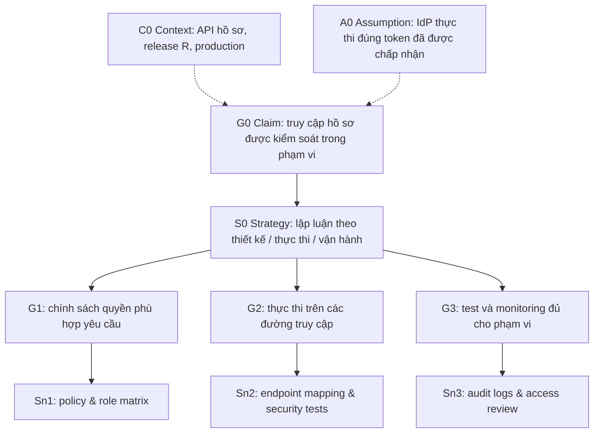

# Assurance case là gì? Lập luận có bằng chứng cho mức bảo đảm an ninh hệ thống

**Assurance case** là một cấu trúc lập luận có tổ chức, trình bày **tuyên bố cần được tin cậy (claim)**, **lý lẽ nối các tuyên bố với nhau (argument)** và **bằng chứng hỗ trợ (evidence)**, để người đọc đánh giá một hệ thống có đáp ứng **mục tiêu xác định, trong phạm vi và điều kiện đã nêu**, hay chưa. Assurance case không phải một bản cam đoan rằng hệ thống “an toàn tuyệt đối”; sức mạnh của nó đến từ việc làm cho lập luận về tính an toàn/bảo mật **rõ ràng, có thể kiểm tra, có thể phản biện và cập nhật khi hệ thống thay đổi**.

Trong chương **Assurance case** của module **SECURITY_SECURITY_ASSURANCE**, đối tượng được quan tâm là **security assurance**: xây dựng và đánh giá mức tin cậy có cơ sở rằng một hệ thống đáp ứng các mục tiêu bảo mật đã được lựa chọn. Vì vậy, assurance case kết nối phân tích rủi ro, yêu cầu bảo mật, thiết kế security controls, kiểm thử kỹ thuật, vận hành, audit và khắc phục phát hiện thành **một lập luận có thể truy vết**. Một sơ đồ đẹp hoặc một chồng báo cáo sẽ chưa tạo thành assurance case tốt nếu không giải thích được **bằng chứng nào hỗ trợ tuyên bố nào và tại sao**.

> Câu hỏi trung tâm: **“Dựa trên điều gì chúng ta có thể chấp nhận tuyên bố rằng hệ thống đáp ứng mục tiêu bảo mật X, với các giới hạn Y và bằng chứng Z?”**

## 1. Kết quả học tập

Sau bài học, người học có thể:

1. Định nghĩa assurance case và lý giải vì sao cần cách lập luận có cấu trúc trong security assurance.
2. Phân biệt **claim**, **argument**, **evidence**, **context**, **assumption**, **justification**, **counterevidence** và **residual risk**.
3. Mô tả mô hình **Claim–Argument–Evidence (CAE)** và cách diễn đạt theo **Goal Structuring Notation (GSN)** ở mức nhập môn.
4. Chuyển một mục tiêu bảo mật rộng thành các tuyên bố có phạm vi, tiêu chí và mức bằng chứng có thể kiểm tra.
5. Đánh giá xem một evidence thực sự hỗ trợ claim hay chỉ minh họa một phần; nhận diện các lỗ hổng lập luận.
6. Xây dựng assurance case mẫu cho API xử lý dữ liệu nhạy cảm, gồm bằng chứng kỹ thuật, vận hành, audit và những điểm chưa thể kết luận.
7. Hiểu vai trò của review độc lập, quản lý thay đổi và duy trì tính cập nhật của assurance case qua vòng đời phát triển và vận hành.

---

## 2. Tại sao cần assurance case?

Một tổ chức có thể sở hữu nhiều hiện vật bảo mật:

- Threat model, risk register và danh sách yêu cầu.
- Sơ đồ kiến trúc, IAM policy, mã nguồn và cấu hình cloud.
- Báo cáo SAST, DAST, penetration testing, vulnerability scan.
- Kết quả test tự động, biên bản review, audit findings.
- Dữ liệu từ SIEM, dashboard, log và báo cáo xử lý sự cố.
- Chính sách chấp nhận rủi ro, ngoại lệ, kết quả diễn tập DR.

Những hiện vật này quan trọng nhưng phân tán. Chúng chưa tự trả lời đầy đủ: **hệ thống an toàn ở khía cạnh nào, theo mục tiêu nào, tại phiên bản nào, vì sao bằng chứng đủ mạnh và còn điều gì chưa được chứng minh?**

Ví dụ, câu “Chúng tôi đã chạy penetration test” nói rằng có một hoạt động kiểm thử. Nó chưa cho biết **phạm vi kiểm thử**, **mối đe dọa được xem xét**, **các chức năng được bao phủ**, **kết quả**, **ngày thực hiện**, **cách xử lý lỗ hổng** hoặc **vì sao kết quả đó hỗ trợ một mục tiêu bảo mật cụ thể**.

Assurance case giúp giải quyết khoảng trống bằng ba câu hỏi liên tiếp:

1. **Chúng ta muốn tuyên bố điều gì?** Ví dụ: chỉ chủ thể được cấp quyền mới có thể đọc hồ sơ khách hàng qua API production trong phạm vi đã định.
2. **Vì sao tuyên bố đó hợp lý?** Ví dụ: hệ thống có chính sách cấp quyền, thực thi xác thực/phân quyền tại mọi endpoint, kiểm tra tính đúng của chính sách, giám sát thay đổi và rà soát vận hành.
3. **Bằng chứng nào xác nhận những lý lẽ đó?** Ví dụ: tập endpoint được kiểm kê, kiểm thử authorization, cấu hình IdP, log cấp quyền, audit về rà soát quyền và kết quả retest sau phát hiện.

Assurance case làm nổi bật **lỗ hổng lập luận**: một security control có thể được thiết kế đúng nhưng chưa chứng minh đã triển khai trên production, hoặc từng được kiểm thử nhưng evidence đã lỗi thời sau khi thay đổi identity provider.

### 2.1. Assurance case khác “bảng checklist đạt/không đạt” ở đâu?

| Checklist | Assurance case |
|---|---|
| “MFA: Yes”, “Encryption: Yes”, “Pen test: Done” | Tuyên bố mục tiêu nào được hỗ trợ bởi MFA/mã hóa/kiểm thử, với phạm vi và giả định nào |
| Có thể ghi trạng thái theo từng mục riêng lẻ | Nêu **mối quan hệ** giữa yêu cầu, thiết kế, thực thi, vận hành và bằng chứng |
| Thường chưa giải thích đủ tại sao “đạt” | Phải có **lập luận** giải thích vì sao evidence phù hợp và đủ |
| Dễ bỏ qua mâu thuẫn giữa các nguồn | Phải nhận diện **phản chứng**, lỗ hổng và rủi ro còn lại |
| Trạng thái có thể không gắn phiên bản/tình huống | Cần chỉ rõ sản phẩm, môi trường, thời điểm và điều kiện áp dụng |

Checklist vẫn rất hữu ích để quản lý công việc, nhưng assurance case đặt checklist vào một **cấu trúc quyết định có thể bảo vệ bằng lập luận**.

## 3. Cấu trúc cơ bản: Claim – Argument – Evidence

Ba thành phần quan trọng nhất thường được viết tắt là **CAE**.

### 3.1. Claim — tuyên bố cần chứng minh

**Claim** là một phát biểu có thể xem xét và đánh giá, ví dụ:

> “Trong môi trường production của API hồ sơ, tất cả endpoint đọc hồ sơ khách hàng bắt buộc áp dụng kiểm tra quyền ở phía máy chủ theo danh tính và phạm vi tài nguyên trước khi trả dữ liệu, đối với những đường truy cập thuộc phạm vi kiểm kê phiên bản X.”

Claim tốt cần có:

- **Đối tượng:** hệ thống, dịch vụ, quy trình hoặc security control cụ thể.
- **Thuộc tính:** tính bí mật, toàn vẹn, khả dụng, xác thực, phân quyền, phát hiện, khôi phục…
- **Phạm vi:** phiên bản, môi trường, luồng, tài sản, dữ liệu, thành phần hoặc giai đoạn.
- **Điều kiện:** threat model, giả định, các dependency và ngoại lệ đã được phê duyệt.
- **Tiêu chí kiểm tra:** người khác có thể biết claim đã được hỗ trợ tới đâu.

**Claim yếu:** “Hệ thống rất an toàn”, “Không có lỗ hổng”, “Không ai truy cập trái phép được.”

**Claim tốt hơn:** “Với các endpoint của API hồ sơ trong release R, thử nghiệm kiểm soát truy cập trên các vai trò và kiểu tài nguyên đã định không cho phép một user đọc bản ghi thuộc tenant khác; cấu hình và giám sát production bảo đảm cùng chính sách đang được áp dụng.”

Ngay cả claim tốt hơn cũng **không chứng minh không tồn tại mọi đường tấn công**. Nó được giới hạn ở tập endpoint, user role, kiểu dữ liệu, phương pháp thử và phiên bản được xem xét.

### 3.2. Argument — lập luận nối claim với bằng chứng

**Argument** mô tả vì sao những tuyên bố con hoặc bằng chứng đủ hỗ trợ cho claim chính. Một lập luận cần chỉ rõ:

- Hệ thống được phân rã theo cách nào: theo rủi ro, chức năng, vòng đời control, thuộc tính bảo mật hoặc kiến trúc?
- Những điều kiện **phải cùng đạt** và điều kiện nào là **các phương án thay thế**?
- Các giả định/tiền đề nào được sử dụng?
- Tại sao từng claim con là cần thiết và tập các claim con **đủ** để hỗ trợ claim cha trong phạm vi đã chọn?
- Có phản chứng, kịch bản bỏ sót hoặc phụ thuộc bên ngoài nào làm suy yếu kết luận không?

Ví dụ, để hỗ trợ claim “không có truy cập đọc hồ sơ trái quyền trong các luồng đã xác định”, chỉ nêu “mọi user phải đăng nhập” là chưa đủ: **xác thực trả lời ai là người dùng, còn phân quyền trả lời họ được phép đọc hồ sơ nào**. Một lập luận hợp lý phải đề cập cả authorization ở resource level, quyền cấp/thu hồi, đường admin, service identity và cơ chế giám sát phù hợp với phạm vi.

### 3.3. Evidence — bằng chứng hỗ trợ

**Evidence** là thông tin có thể kiểm tra và đối chiếu, được đưa vào để củng cố claim hoặc một bước trong lập luận. Ví dụ:

| Loại evidence | Có thể hỗ trợ | Giới hạn thường gặp |
|---|---|---|
| Review thiết kế và threat model | Các threat/attack path quan trọng đã được nhận diện và có control dự kiến | Chưa chứng minh control thực sự chạy |
| Cấu hình IAM, network, KMS xuất từ production | Trạng thái triển khai tại một thời điểm hoặc trong lịch sử nếu có snapshot/log đầy đủ | Có thể không thể hiện hành vi của từng request |
| Unit/integration/security test | Hành vi đúng với dữ liệu và kịch bản đã thử | Chưa bao phủ các đường hoặc trạng thái chưa thử |
| Penetration test độc lập | Những kịch bản tấn công cụ thể đã được kiểm tra và kết quả xử lý | Không chứng minh hệ thống miễn nhiễm mọi kỹ thuật |
| Audit log, monitoring, access review | Control được vận hành hoặc theo dõi trong một khoảng thời gian | Có thể thiếu nguồn, bị lọc, mất log hoặc không đo đủ |
| Biên bản audit, finding closure | Một điểm không phù hợp đã được xác nhận và retest theo tiêu chí | Cần xác minh phạm vi, ngày và kết quả thực tế |
| Risk acceptance được phê duyệt | Có quyết định quản trị với rủi ro còn lại | **Không chứng minh control kỹ thuật đã đạt** |

Không thể thay thế lập luận bằng cách đính kèm thật nhiều evidence không liên quan. Một phép thử có thể rất đáng tin về khía cạnh **cấu hình mã hóa** nhưng không hỗ trợ trực tiếp claim “không có truy cập trái phép ở tầng API”.

## 4. Context, Assumption và Justification

Khi dùng assurance case, việc định nghĩa **bối cảnh và điều kiện** quan trọng ngang việc tạo lập bằng chứng.

| Thành phần | Câu hỏi | Ví dụ |
|---|---|---|
| **Context (C)** | Những thuật ngữ, phạm vi, môi trường, tiêu chí và phụ thuộc nào định hình claim? | “API hồ sơ v2, production, 36 endpoint, tenant isolation theo tenant_id” |
| **Assumption (A)** | Điều gì được giả định là đúng nhưng bản thân chưa được chứng minh trong case? | “Nhà cung cấp IdP thực thi đúng giao thức token theo điều khoản và kết quả đánh giá được viện dẫn” |
| **Justification (J)** | Vì sao chọn cách phân rã/lập luận/tiêu chí này? | “Chọn threat-based decomposition vì rủi ro rò rỉ dữ liệu chéo tenant được BIA/risk assessment đánh giá cao” |
| **Scope limitation** | Điều gì rõ ràng nằm ngoài kết luận? | “Không bao gồm quyền truy cập nội bộ trực tiếp DB của đội vận hành” |
| **Residual risk** | Những rủi ro nào chưa loại bỏ được, ai quyết định? | “Rủi ro từ IdP outage được xử lý bởi kế hoạch BC và risk owner” |

Một giả định trọng yếu nên có **người chịu trách nhiệm, lý do chấp nhận và điều kiện kiểm tra lại**. Nếu assurance case dựa trên việc nhà cung cấp quản lý key an toàn, nó không thể bỏ qua hoàn toàn phụ thuộc KMS. Có thể viện dẫn kết quả đánh giá nhà cung cấp phù hợp, hợp đồng và phương án xử lý khi dịch vụ không khả dụng, cùng giới hạn những gì bằng chứng bên thứ ba thực sự bao phủ.

**Không biến giả định thành bằng chứng.** Câu “Giả định tất cả endpoint đều dùng authorization middleware” không thay cho danh mục endpoint và kiểm thử việc middleware được áp dụng. Nếu giả định liên quan chính nội dung đang cố chứng minh, đó là vòng lập luận (*circular argument*) cần sửa.

## 5. CAE và GSN: hai cách biểu diễn assurance case

### 5.1. Claim–Argument–Evidence (CAE)

CAE là cách trình bày trực tiếp:

```text
CLAIM C0:
  API chỉ phục vụ dữ liệu hồ sơ theo quyền được cấp, trong phạm vi X.

ARGUMENT S0:
  Để hỗ trợ C0 cần đồng thời chứng minh:
  - C1: quyền được định nghĩa đúng và phân công hợp lệ;
  - C2: mọi đường truy cập đã kiểm kê thực thi authorization;
  - C3: cơ chế được kiểm thử và giám sát qua thời gian.

EVIDENCE:
  E1: chính sách và ma trận phân quyền được phê duyệt.
  E2: inventory endpoint + mapping middleware/policy.
  E3: kết quả kiểm thử truy cập chéo tenant.
  E4: log thay đổi quyền và kết quả access review.
```

Giữa E1–E4 và C0 vẫn cần **lập luận**: tại sao các phép thử bao phủ đúng threat, vì sao inventory đủ, vì sao kết quả được coi là đại diện, và liệu bằng chứng còn hiệu lực sau thay đổi gần đây không.

### 5.2. Goal Structuring Notation (GSN)

**Goal Structuring Notation (GSN)** thường được dùng để hình dung luận cứ assurance dưới dạng các nút và quan hệ. Những loại nút cơ bản:

- **Goal (G):** tuyên bố hoặc claim cần được hỗ trợ.
- **Strategy (S):** cách phân rã một goal thành các goal con.
- **Context (C):** thông tin giúp hiểu goal/strategy.
- **Assumption (A):** điều kiện giả định làm nền tảng cho lập luận.
- **Justification (J):** lý do chọn strategy hoặc cấu trúc.
- **Solution (Sn):** dẫn chiếu tới evidence hỗ trợ một goal.

Sơ đồ đơn giản sau **minh họa logic** bằng Mermaid, không phải ký pháp GSN chính thức:



Sơ đồ cho thấy **mối quan hệ định hướng**; để dùng trong một case thật cần ghi rõ các điều kiện nối là AND hay OR, phạm vi từng nút, vai trò context/assumption, tính đầy đủ của việc phân rã và trạng thái của từng evidence.

### 5.3. GSN không tự biến một tuyên bố thành đúng

Một sơ đồ với nhiều nhánh “xanh” vẫn có thể yếu nếu một claim con quá mơ hồ, bằng chứng không đại diện hoặc có phản chứng chưa được xử lý. Assurance case là **một lập luận có thể thẩm tra**, còn ký pháp chỉ giúp biểu diễn, tổ chức và trao đổi lập luận đó.

## 6. Các thành phần trong assurance case có thể kiểm tra được

Để xây dựng assurance case hữu dụng, một record thường cần nhiều hơn tiêu đề claim:

| Thuộc tính | Nội dung cần ghi |
|---|---|
| Claim ID, text | Mã duy nhất và câu tuyên bố được giới hạn, có thể kiểm tra |
| Parent/child relationship | Claim nào hỗ trợ claim nào, điều kiện liên kết AND/OR |
| Argument/strategy | Lý do phân rã và đánh giá về tính đầy đủ |
| Context | Sản phẩm, kiến trúc, version, tài sản, môi trường, thời kỳ |
| Assumptions/dependencies | Các điều kiện nền, bên thứ ba, người sở hữu giả định |
| Criteria | Tiêu chí đánh giá bằng chứng: thế nào là đạt/chưa đạt |
| Evidence references | Liên kết tới test report, log, config, audit, phê duyệt |
| Evidence quality | Nguồn, phạm vi, độ đầy đủ, độ mới, tính toàn vẹn, độc lập |
| Counterevidence/defeaters | Dữ liệu ngược lại hoặc tình huống khiến luận cứ bị bác bỏ |
| Residual risk | Rủi ro không được giải quyết, sự chấp nhận có thẩm quyền |
| Review status | Draft, pending evidence, challenged, supported, rejected… |
| Version/owner/reviewer | Người phụ trách, người kiểm tra, thời điểm và sự kiện thay đổi |

Cần phân biệt **trạng thái của bằng chứng** với **trạng thái kết luận claim**. Một test pass không đồng nghĩa toàn bộ claim “được chứng minh” nếu các tiền đề khác chưa được kiểm tra.

## 7. Từ security objective đến claim có phạm vi

Tuyên bố “Hệ thống bảo vệ dữ liệu khách hàng” quá rộng để chứng minh. Bắt đầu bằng cách xác định **nguy cơ, tài sản, đường tấn công, chức năng và điều kiện hoạt động**.

### 7.1. Ví dụ chuyển từ mục tiêu tổng quát

**Mục tiêu nghiệp vụ:** ngăn rò rỉ dữ liệu hồ sơ khách hàng trong ứng dụng SaaS đa tenant.

**Bối cảnh:** API hồ sơ chạy trên production, sử dụng IdP, backend service, database, object storage và hệ thống log tập trung. Rủi ro chính được xác định gồm BOLA/IDOR, quyền quản trị quá rộng, cấu hình storage công khai, token bị lộ và truy cập chéo tenant.

**Claim cấp cao (minh họa):**

> “Trong kiến trúc và phạm vi production release R, hệ thống triển khai và vận hành các biện pháp kiểm soát đã được duyệt để giảm rủi ro truy cập trái phép vào hồ sơ khách hàng qua các đường truy cập đã kiểm kê xuống mức rủi ro còn lại được chủ sở hữu có thẩm quyền chấp nhận, tính đến mốc đánh giá T.”

Claim này hẹp hơn “hệ thống an toàn tuyệt đối”, nhưng vẫn cần kiểm chứng từng phần. Có thể phân rã theo đường tấn công hoặc nhóm control:

1. **C1 — Policy & governance:** quyền nào được phép, ai phê duyệt, ngoại lệ nào được kiểm soát.
2. **C2 — Application authorization:** từng endpoint kiểm tra đúng người dùng và đối tượng tài nguyên (object-level authorization).
3. **C3 — Data protection:** storage và đường truyền được kiểm soát, không có đường truy cập công khai ngoài phạm vi.
4. **C4 — Operating effectiveness:** thay đổi quyền và cấu hình được giám sát, các control vận hành trong giai đoạn đánh giá.
5. **C5 — Residual risks & exceptions:** các trường hợp không đạt hoặc không kiểm chứng được đều được đánh giá và có quyết định phù hợp.

Mỗi nhánh phải nối với **yêu cầu gốc**, **threat model** và tiêu chí nghiệm thu. Nếu một nguy cơ đáng kể không nằm trong cấu trúc, người lập case cần nêu vì sao nguy cơ ấy nằm ngoài phạm vi hoặc được quản lý trong assurance case khác.

### 7.2. Chọn cách phân rã

| Cách phân rã | Khi phù hợp | Rủi ro khi dùng |
|---|---|---|
| Theo security properties | Confidentiality, integrity, availability, authenticity | Dễ bỏ sót phụ thuộc xuyên thuộc tính |
| Theo threat/attack path | BOLA, token theft, privilege escalation, data exfiltration | Threat model có thể không đầy đủ hoặc lỗi thời |
| Theo control lifecycle | Design → implementation → operation → monitoring | Control có thể vận hành đúng nhưng không giải quyết đúng rủi ro |
| Theo kiến trúc | API, IdP, DB, storage, network, SIEM | Tối ưu từng thành phần nhưng bỏ đường truy cập end-to-end |
| Theo yêu cầu/tiêu chuẩn | Từng requirement và control mapping | “Tuân thủ checklist” chưa chắc tương ứng mục tiêu rủi ro |

Có thể kết hợp, nhưng cần quản lý trùng lặp: một evidence có thể hỗ trợ nhiều claim, song mỗi quan hệ vẫn cần được giải thích. **Không được tính một evidence nhiều lần như thể là các nguồn chứng minh độc lập**.

## 8. Lập luận thế nào để không rơi vào “có control = an toàn”?

Giả sử policy yêu cầu MFA cho tài khoản quản trị. Một argument hợp lý cần trả lời:

- **Design adequacy:** MFA có giúp giảm nguy cơ chiếm tài khoản trong những đường truy cập được xét không? Có kênh khẩn cấp, token/session hoặc service principal nào cần control khác?
- **Implementation:** MFA có được cưỡng chế ở IdP và tại tất cả đường login liên quan không?
- **Operating effectiveness:** việc cấp account mới, thay policy, ngoại lệ và thu hồi quyền có được kiểm tra trong giai đoạn đánh giá không?
- **Detection/response:** có giám sát sự kiện bỏ qua MFA, thay đổi policy hoặc đăng nhập rủi ro cao không?
- **Residual risk:** phishing-resistant MFA, session theft, lạm dụng token, quyền quá rộng hoặc IdP compromise được xử lý/giới hạn thế nào?

Một bằng chứng “MFA enabled” tại một tài khoản **không thể tự hỗ trợ** claim rằng “mọi tài khoản đặc quyền production được bảo vệ trước mọi hình thức chiếm dụng”. Nếu có ba đường vào hệ thống, luận cứ phải xét ít nhất các đường được liệt kê hoặc nêu rõ giới hạn.

### 8.1. Nguyên tắc không suy luận quá đà

| Evidence quan sát được | Có thể hỗ trợ | Không nên suy ra |
|---|---|---|
| 100% các endpoint trong inventory được gán middleware phân quyền | Trong inventory đó, policy enforcement đã được cấu hình | Inventory đã chắc chắn đủ, middleware không có lỗi, không có bypass |
| 50 security test đều PASS | Hành vi khớp kỳ vọng trên 50 tình huống được thử | Không tồn tại input/cấu hình hoặc tấn công khác |
| Pen test không tìm thấy lỗ hổng critical | Không có finding critical theo phương pháp và phạm vi test | Hệ thống không còn bất kỳ lỗ hổng nào |
| Cloud storage không public tại ngày audit | Cấu hình được kiểm tra tại thời điểm đó | Không từng public trong quá khứ hoặc sẽ không drift |
| Access review có biên bản | Có hoạt động rà soát được ghi nhận | Quyền bị đánh dấu dư thừa đã được thu hồi và không cấp lại |
| Risk acceptance có chữ ký | Chủ thể có thẩm quyền đã ra quyết định quản trị theo phạm vi hồ sơ | Lỗ hổng đã được xử lý hoặc tiêu chí bên ngoài không còn áp dụng |

Đây là lý do assurance case cần **mức độ tin cậy tương xứng với bằng chứng** và nêu tường minh những điều kiện chưa được kiểm tra.

## 9. Evidence chất lượng cao: đủ, đúng, mới và liên quan

Trước khi gắn một hiện vật vào claim, nên đánh giá:

1. **Relevance:** hiện vật hỗ trợ đúng mệnh đề nào, có suy luận trung gian nào chưa chứng minh?
2. **Sufficiency:** có đủ bằng chứng cho toàn bộ population/luồng/chu kỳ hoặc mẫu hợp lý theo rủi ro?
3. **Reliability:** dữ liệu do ai tạo, ai có thể sửa, có thể đối chiếu độc lập với nguồn khác không?
4. **Accuracy:** câu truy vấn, bộ lọc, thời gian, định danh hệ thống và diễn giải dữ liệu có đúng không?
5. **Timeliness:** bằng chứng có còn đại diện cho release/cấu hình và giai đoạn được tuyên bố?
6. **Integrity & provenance:** có nhận diện nguồn, người thu thập, timestamp, phiên bản và cơ chế phát hiện thay đổi không?
7. **Independence:** nhà cung cấp/đội vận hành tự báo cáo hay có xác minh khác theo mức bảo đảm cần thiết?
8. **Contradictory evidence:** có log, issue, incident hoặc bài test khác cho kết quả trái ngược chưa được xử lý không?

Một case có thể dùng metadata tối thiểu:

```yaml
evidence_id: E-AUTHZ-042
evidence_type: security-integration-test
artifact_ref: "restricted/evidence/authz-test-report"
collected_at_utc: "2026-09-30T09:00:00Z"
system: customer-records-api
release: "R-2026-09"
environment: production-like
scope:
  endpoints_tested: 36
  roles: [customer, support, tenant-admin]
  scenarios: [own-record, cross-tenant, missing-token, expired-token]
collection:
  owner_role: security-test-engineer
  method: automated-authorization-suite
review:
  reviewer_role: independent-security-reviewer
  verified_scope: "test suite and representative results"
result: PASS
limitations:
  - "does not cover direct database access"
  - "not proof of behavior after later configuration changes"
linked_claims: [G2]
```

**Tất cả số liệu, tên, mốc thời gian và đường dẫn trong ví dụ là giả định.** Metadata không phải bản thân bằng chứng: người kiểm tra vẫn cần mở báo cáo thực, xác nhận phạm vi và phương pháp, kiểm tra dữ liệu gốc. Hash giúp phát hiện thay đổi của một tệp đã thu thập; nó không chứng minh dữ liệu nguồn chính xác hoặc đủ trước thời điểm tính hash.

### 9.1. Khi nào chứng cứ cũ trở nên không phù hợp?

Sau khi thay đổi rule IAM, thêm endpoint, nâng phiên bản framework, thay IdP hoặc chuyển storage, một test trước đó có thể không còn đại diện. Tổ chức cần xác định **triggers for re-evaluation**, chẳng hạn:

- New endpoint/role/data category, đổi schema hoặc đường truy cập.
- Thay trust boundary, identity provider, khóa mã hóa hoặc routing.
- Phát hiện lỗ hổng/incident ảnh hưởng giả định an toàn.
- Cập nhật threat intelligence làm thay đổi attack scenario quan trọng.
- Bằng chứng hết kỳ hợp lệ theo chính sách assurance hoặc audit period đã khác.
- Xuất hiện finding mới trái với conclusion trước.

Lúc đó, nên đánh dấu evidence và các claim phụ thuộc là **needs review** cho đến khi đánh giá tác động và kiểm thử lại.

## 10. Phản chứng (counterevidence) và defeaters

Một assurance case đáng tin không chỉ tìm evidence ủng hộ. Nó phải tìm **counterevidence** (bằng chứng trái chiều) và **defeaters** (điều kiện, phản ví dụ hoặc lập luận có thể làm suy yếu/bác bỏ claim).

Các ví dụ:

- Claim: “Tất cả đường đọc hồ sơ có kiểm tra object-level authorization.” Phản chứng: một endpoint export batch chưa kiểm tra tenant.
- Claim: “Secret không thể truy cập công khai.” Phản chứng: một token có hiệu lực xuất hiện trong public repository.
- Claim: “Logging đầy đủ trong thời kỳ.” Phản chứng: SIEM ingestion mất dữ liệu 12 giờ do queue đầy.
- Claim: “RTO 4 giờ có thể đạt.” Phản chứng: diễn tập end-to-end gần nhất khôi phục sau 6 giờ.
- Claim: “Các lỗ hổng critical đã đóng.” Phản chứng: scan production mới còn phát hiện cùng CVE trên image đang chạy.

Một phản chứng **không nên bị xóa khỏi case chỉ vì action item đã tạo**. Hãy gắn nó với finding, root cause, remediation, retest và cập nhật trạng thái claim sau khi có chứng cứ mới.

### 10.1. Các loại điểm yếu thường gặp trong lập luận

| Kiểu yếu | Cách nhận diện | Cách cải thiện |
|---|---|---|
| **Missing premise** | Kết luận cần điều kiện nhưng chưa có claim/evidence | Bổ sung claim con hoặc nêu giả định có trách nhiệm |
| **Circular reasoning** | Claim A được “chứng minh” bởi B, B lại dựa vào A | Thay bằng evidence độc lập hoặc phân rã khác |
| **Appeal to authority** | “Đã được vendor xác nhận” mà không có scope/bằng chứng | Kiểm tra báo cáo bên thứ ba đúng phạm vi và thời kỳ |
| **Evidence mismatch** | Scan vulnerability được dùng chứng minh authorization đúng | Thay hoặc bổ sung security tests đúng thuộc tính |
| **Incomplete population** | Chỉ test 10/36 endpoint nhưng claim toàn bộ 36 | Thu thập inventory và mở rộng/phạm vi hóa kết luận |
| **Stale evidence** | Test trước thay đổi IAM vẫn được dùng sau release mới | Impact analysis và retest |
| **Ignoring counterexample** | Có endpoint bypass nhưng vẫn ghi claim PASS | Đánh dấu chưa hỗ trợ; khắc phục, retest |
| **Unjustified assumption** | “Không ai có quyền admin trực tiếp” nhưng không có chứng cứ | Kiểm tra role, break-glass, đường DBA và ngoại lệ |
| **Overgeneralization** | Một diễn tập thành công đại diện mọi sự cố | Mô tả kịch bản, tải, điều kiện, giới hạn |
| **False independence** | Ba dashboard lấy từ cùng một log thiếu nguồn | Tìm nguồn độc lập hoặc ghi tương quan phụ thuộc |

**Phản biện hữu ích:** “Điều gì có thể khiến kết luận này sai ngay cả khi mọi bằng chứng hiện có đều chính xác?” Câu hỏi buộc nhóm lập luận xem xét phần chưa được kiểm tra.

## 11. Xây dựng assurance case từng bước

Một quy trình có thể áp dụng trong dự án:

### Bước 1 — Chọn quyết định mà case phải hỗ trợ

Assurance case có thể phục vụ quyết định **phê duyệt go-live**, chấp nhận thay đổi có rủi ro, trình bày mức bảo đảm cho khách hàng, xác nhận trạng thái control sau audit hoặc đánh giá khả năng phục hồi. Cần biết **ai ra quyết định và cần được thuyết phục về điều gì**.

Ví dụ: Security owner phải quyết định release API hồ sơ R có đủ bằng chứng để đưa vào production theo ngưỡng rủi ro đã duyệt không.

### Bước 2 — Xác định assets, scope và threat model

Ghi tài sản, dữ liệu, môi trường, phiên bản, luồng truy cập, trust boundaries, attacker capabilities được giả định, dependency và những gì ngoài phạm vi. Các rủi ro được ưu tiên phải dẫn chiếu về threat model/risk assessment.

### Bước 3 — Viết claim cấp cao có thể kiểm tra

Không viết “secure by design”. Viết điều kiện rõ: thuộc tính, chức năng, môi trường, thời kỳ và chuẩn nghiệm thu. Chỉ chọn claim mà nhóm thực sự có thể cung cấp bằng chứng thích hợp.

### Bước 4 — Phân rã claim và giải thích strategy

Với mỗi claim con, hỏi: nó giải quyết rủi ro nào, điều kiện nào làm nó trở thành một phần cần thiết của claim cha, có phần nào thiếu không? Gắn logic **AND/OR** chính xác; nếu có các phương án thay thế, nêu điều kiện để một phương án đủ dùng.

### Bước 5 — Xác định evidence và thử nghiệm cần có

Đối với từng claim, lập **evidence plan**: nguồn, phép thử, tiêu chí PASS/FAIL, dữ liệu đại diện, thời điểm lấy, người xác minh, thời hạn còn giá trị. Nếu hiện tại chưa có bằng chứng, tạo nhiệm vụ thu thập/kiểm thử và để trạng thái **PENDING**.

### Bước 6 — Phản biện và ghi defeaters

Phân tích abuse cases, threat scenario chưa bao phủ, nguồn log bị thiếu, điểm phụ thuộc chung, lỗ hổng đã biết, sai khác production/test, ngoại lệ và rủi ro còn lại. Khi phát hiện phản chứng, mở finding và cập nhật claim liên quan.

### Bước 7 — Review độc lập và ra quyết định

Người review có đủ năng lực kiểm tra *factual accuracy* của bằng chứng, logic của phân rã, độ đầy đủ, sự phù hợp của giả định, và quyền của người chấp nhận residual risk. Ghi rõ **kết luận có căn cứ**, **lỗ hổng chưa giải quyết**, **phạm vi chấp nhận** và **điều kiện cần kiểm tra lại**.

### Bước 8 — Duy trì case theo thay đổi

Gắn assurance case với change management, release pipeline, risk register, audit findings và monitoring. Khi control hoặc context thay đổi, đánh dấu các claim liên quan để đánh giá lại. Lưu lịch sử phiên bản để biết một quyết định trước đó dựa trên bằng chứng nào.

## 12. Ví dụ xuyên suốt: Assurance case cho API hồ sơ khách hàng

Tình huống sau **hoàn toàn giả định để học**. Nó nhằm minh họa cách lập luận, không tuyên bố một hệ thống thực tế đã được bảo đảm.

### 12.1. Context và mục tiêu

Một ứng dụng SaaS nhiều tenant có 36 endpoint API truy cập hồ sơ khách hàng. Yêu cầu bảo mật trọng tâm: user của tenant A không được xem dữ liệu thuộc tenant B bằng cách thay ID, token hoặc tham số query. Hệ thống sử dụng IdP, gateway, backend service và database quan hệ. Có cả tài khoản hỗ trợ và vai trò tenant-admin.

- **C0:** production release R-2026-09, danh mục 36 endpoint được cập nhật tại ngày đánh giá.
- **A0:** IdP cung cấp token theo cấu hình được phê duyệt; cần có evidence đánh giá cấu hình và phụ thuộc.
- **J0:** phân rã theo đường truy cập vì threat model đánh giá BOLA/IDOR là nguy cơ nghiêm trọng.
- **G0:** “Trong phạm vi 36 endpoint, các vai trò và đường truy cập đã xác định, release R có kiểm soát xác thực và phân quyền nhằm ngăn truy cập hồ sơ trái quyền chéo tenant, với hiệu lực được kiểm tra tại thời điểm và giai đoạn vận hành được nêu.”

Đây là một claim **có điều kiện**. Nó không bao gồm truy cập DBA trực tiếp, bản sao dữ liệu sang hệ phân tích hay các endpoint mới sau release R trừ khi được cập nhật vào case.

### 12.2. Cấu trúc claim và argument

| Claim | Tuyên bố con cần hỗ trợ | Tại sao cần |
|---|---|---|
| **G1** | Ma trận vai trò, tenant ownership và quy tắc quyền được định nghĩa, phê duyệt | Không biết quyền hợp lệ thì không thể đánh giá truy cập trái quyền |
| **G2** | Toàn bộ endpoint thuộc population thực thi authentication + object/tenant authorization ở server | Ngăn việc chỉ đổi object ID hoặc token để đọc hồ sơ người khác |
| **G3** | Các luồng đặc quyền, hỗ trợ và service identity được kiểm soát theo chính sách | Quyền hỗ trợ/admin có thể bỏ qua luồng user thông thường |
| **G4** | Thực thi được kiểm thử và kết quả lỗi/ngoại lệ có quy trình xử lý | Cấu hình đúng về mặt tài liệu chưa chứng minh hành vi |
| **G5** | Thay đổi, logging, review quyền và phát hiện drift hoạt động trong giai đoạn xác định | Control có thể bị vô hiệu hóa hoặc thay đổi sau test |
| **G6** | Những rủi ro/đường ngoài phạm vi được xác định, xử lý hoặc có quyết định đúng thẩm quyền | Tránh ngộ nhận một đường an toàn đồng nghĩa toàn hệ thống an toàn |

Lập luận mẫu: **G0 được hỗ trợ khi** G1–G5 đều đáp ứng tiêu chí theo phạm vi; đối với G6, phải đánh giá rõ các rủi ro còn lại và quyền ra quyết định. Nếu G2 FAIL trên một endpoint trọng yếu thì bằng chứng G1, G3, G4, G5 không thể bù trừ để tự động khẳng định G0 đã đáp ứng theo nghĩa đầy đủ của nó.

### 12.3. Ánh xạ bằng chứng và tiêu chí

| Claim | Evidence dự kiến | Kiểm tra và giới hạn |
|---|---|---|
| G1 | Role matrix, policy version và business/security approvals | Đối chiếu role với hành động và điều kiện tenant; kiểm tra ngày hiệu lực |
| G2 | Endpoint inventory từ router, OpenAPI, gateway và test authz | Đối chiếu coverage; thử user khác tenant và các dạng object ID/route |
| G3 | Danh sách admin/support/service principal, IAM config, phê duyệt | Kiểm tra đường admin và break-glass theo tiêu chí riêng |
| G4 | Security integration tests, manual abuse-case tests, retest của finding | Kịch bản có input đại diện, đúng release, có PASS/FAIL và raw logs |
| G5 | Audit logs, change events, review quyền, drift alert | Đánh giá độ bao phủ telemetry và thời kỳ vận hành, thử alert |
| G6 | Risk register, exception approvals, scope statement, dependency reviews | Đảm bảo owner, rủi ro, hạn và điều kiện xem lại; không nhầm accepted với secured |

**Tại sao cần nhiều evidence?** Ví dụ, bộ test có thể xác nhận API từ chối user tenant A yêu cầu hồ sơ tenant B. Nhưng nếu inventory thiếu endpoint `/v2/export`, claim “tất cả đường truy cập” vẫn chưa được hỗ trợ. Việc đối chiếu **độ đầy đủ của population** là một claim phụ, cần bằng chứng riêng.

### 12.4. Một lần review phát hiện phản chứng

Giả sử security integration test cho 36 endpoint thu được:

- 35 endpoint có kết quả đúng theo ca kiểm tra đã định.
- Endpoint `GET /v2/reports/export` trả dữ liệu chéo tenant khi truyền `report_id` đoán được.
- Log gateway chỉ ghi đường API, không ghi tenant và đối tượng tài nguyên cần cho phép đối chiếu chéo tenant.
- Chưa có kết quả retest sau khi ticket sửa phân quyền được merge.

Khi đó:

- **G2** có phản chứng trực tiếp; không được tuyên bố PASS.
- **G4** cho thấy chương trình test đã phát hiện sai lệch, nhưng sự tồn tại của test **không biến G2 thành đúng**.
- **G5** có khoảng trống về bằng chứng vận hành/khả năng phát hiện.
- **G0** chưa có cơ sở để được chấp nhận ở trạng thái “supported” theo tiêu chí đã đặt.

Bản ghi case nên ghi rõ:

```yaml
assurance_case_id: AC-CUSTOMER-RECORDS-EXAMPLE
claim_id: G0
status: NOT_SUPPORTED
assessment_scope:
  release: "R-2026-09"
  environment: production-like
  endpoints_in_inventory: 36
unresolved_defeaters:
  - finding_id: AUTHZ-EXAMPLE-007
    affects_claims: [G2, G0]
    condition: "Cross-tenant access via reports export"
  - finding_id: LOG-EXAMPLE-004
    affects_claims: [G5, G0]
    condition: "Tenant-level logging coverage not demonstrated"
required_actions:
  - "Fix object-level authorization and add regression cases"
  - "Validate endpoint inventory completeness"
  - "Prove audit logging coverage on affected pathways"
  - "Independently verify retest before changing claim status"
decision: "Release/security acceptance pending authorized review"
```

Tên, mốc, đường dẫn và status ở trên là **mẫu minh họa**; mỗi tổ chức cần thống nhất cách đặt trạng thái. Quan trọng nhất là **lập luận không che phản chứng** và người ra quyết định không nhầm việc ticket đã merge với việc hiệu lực đã được chứng minh.

### 12.5. Sau khắc phục: điều gì cho phép cập nhật case?

Nhóm phát triển sửa authorization ở endpoint export, bổ sung test chéo tenant, cập nhật log và chạy lại test. Người review cần xem:

1. Bản sửa đã triển khai ở đúng release/môi trường liên quan?
2. Inventory có bao gồm các biến thể route, method, version và luồng async/export?
3. Test có xác minh response, quyền đối tượng, side effect, cache và các đường truy cập qua role đặc biệt?
4. Log và drift alert có đầy đủ trên đường bị ảnh hưởng?
5. Bằng chứng có nguồn, timestamp, version và người review đủ độc lập?
6. Có lỗ hổng mới, dependency thay đổi hay rủi ro chưa được xử lý?

Nếu tất cả điều kiện kiểm chứng của G1–G6 được đáp ứng trong phạm vi đề ra, management có thể xem xét chấp nhận claim G0 **cho release và ngữ cảnh ấy**. Không dùng kết luận đó như chứng nhận vĩnh viễn cho mọi phiên bản hoặc kịch bản.

## 13. Assurance case và các tài liệu quản trị khác

| Hiện vật | Nó trả lời điều gì? | Quan hệ với assurance case |
|---|---|---|
| **Risk assessment / risk register** | Rủi ro nào quan trọng, tác động, phương án xử lý và người quyết định? | Xác định mục tiêu/assumptions, residual risks cần thể hiện |
| **Security requirements** | Hệ thống phải đạt thuộc tính và control nào? | Cung cấp criteria cho claims |
| **Threat model** | Đối thủ, bề mặt tấn công, đường lạm dụng và trust boundary nào? | Giúp lập luận đủ phạm vi và tìm defeaters |
| **Architecture / design docs** | Hệ thống được thiết kế ra sao? | Bằng chứng cho lựa chọn thiết kế và dependencies |
| **Test/scan/pen-test report** | Các tình huống cụ thể đã được thử và kết quả thế nào? | Một phần evidence, cần kiểm tra coverage và tính đại diện |
| **Audit report** | Theo criteria, phạm vi, thời kỳ, control đáp ứng tới mức nào? | Hỗ trợ claim về vận hành/tuân thủ và tạo phản chứng |
| **Compliance mapping** | Những yêu cầu hoặc control đã được ánh xạ tới tài liệu nào? | Tăng truy vết, không thay argument về hiệu lực |
| **Safety/security assurance case** | Những claim nào được hỗ trợ bởi lý lẽ và bằng chứng, với điều kiện nào? | Tổng hợp thành luận cứ hướng quyết định |
| **Management response / CAP** | Finding được xử lý bằng hành động, owner, deadline nào? | Theo dõi defeaters và tái xác minh trước khi nâng mức tin cậy |

Assurance case có thể **tham chiếu các hiện vật có sẵn**, không cần sao chép tất cả tài liệu và dữ liệu nhạy cảm vào một nơi. Điều quan trọng là liên kết phải đến đúng phiên bản và bằng chứng có thể đọc/kiểm tra theo quyền phù hợp.

### 13.1. Safety case và security assurance case

**Safety case** thường lập luận rằng một hệ thống chấp nhận được về mặt an toàn trước các nguy hại trong phạm vi vận hành. **Security assurance case** tập trung vào tính chất bảo mật trước các mối đe dọa và hành vi đối kháng. Chúng có thể chia sẻ cấu trúc Claim–Argument–Evidence, nhưng security có khác biệt đáng chú ý:

- Đối thủ **chủ động thích ứng**, không chỉ là hỏng hóc ngẫu nhiên.
- Lỗ hổng mới, threat intelligence và thay đổi attack surface có thể làm evidence cũ nhanh chóng mất giá trị.
- Tấn công có thể nhắm vào chính nguồn bằng chứng, logging hoặc pipeline kiểm thử.
- Đánh giá residual risk thường cần cập nhật theo mức phơi nhiễm và khả năng khai thác.

Vì vậy, một security assurance case cần được **xem xét động qua vòng đời**, không chỉ lưu lại khi release lần đầu.

## 14. Mức độ bảo đảm và cách phát biểu kết luận

Một trong những sai lầm lớn nhất là xem assurance case như công thức cho một câu “PASS toàn hệ thống”. Cần phân biệt:

- **Evidence collected:** đã có hiện vật.
- **Evidence validated:** hiện vật được kiểm tra nguồn/phạm vi/tính toàn vẹn.
- **Subclaim supported:** lập luận cho một claim con có bằng chứng tương xứng và không còn phản chứng chưa xử lý trong phạm vi.
- **Top-level claim supported:** tất cả nhánh bắt buộc, giả định, lỗ hổng và residual risks được đánh giá; có quyết định của người đủ thẩm quyền.
- **Claim not demonstrated:** thiếu bằng chứng cần thiết; chưa đủ kết luận đúng hay sai.
- **Claim contradicted:** có bằng chứng trái với claim.
- **Acceptance with residual risk:** chủ sở hữu rủi ro chấp nhận phần rủi ro còn lại theo điều kiện; đây là **quyết định quản trị**, không xóa phản chứng.

Không có một thang “assurance level” chung áp dụng mặc định cho mọi lĩnh vực. Một tổ chức có thể thiết lập yêu cầu khác nhau theo dữ liệu, tác động nghiệp vụ, môi trường, độ tin cậy cần thiết và đối tượng dựa vào kết luận. Nếu sử dụng một bộ tiêu chuẩn/chương trình đánh giá cụ thể, phải dùng đúng thuật ngữ và quy tắc của chương trình đó.

### 14.1. Ví dụ phát biểu quá mức và đúng mức

**Quá mức:** “Hệ thống đã được chứng minh là chống mọi tấn công.”

**Phù hợp hơn:** “Trong release R, các nguy cơ được ưu tiên trong threat model phiên bản T đã được ánh xạ đến control và kiểm chứng bằng tập test, cấu hình và bằng chứng vận hành liệt kê trong case. Có hai rủi ro còn lại được đánh giá và xử lý theo hồ sơ đã duyệt; các tình huống ngoài phạm vi gồm truy cập DBA trực tiếp và sự cố toàn bộ IdP.”

**Quá mức:** “Không còn lỗ hổng vì pen test báo không có finding critical.”

**Phù hợp hơn:** “Đợt kiểm thử đã không phát hiện finding critical trong phạm vi, phương pháp và thời điểm được mô tả. Kết quả hỗ trợ nhánh security testing nhưng cần kết hợp với evidence về thiết kế, cấu hình, vận hành và các phát hiện khác.”

## 15. Review assurance case: người đánh giá hỏi gì?

Một review hữu ích nên đi từ claim cấp cao xuống từng tiền đề và evidence:

| Nhóm kiểm tra | Câu hỏi phản biện |
|---|---|
| **Rõ mục tiêu** | Ai dựa vào case để quyết định? Claim có đúng thuộc tính và tiêu chí không? |
| **Đúng scope** | Bao gồm asset, môi trường, thời kỳ, role, đường truy cập và phụ thuộc cần thiết? |
| **Tính đầy đủ** | Những threat/control trọng yếu đã được phân rã đầy đủ? Có bỏ đường ngoài ý muốn? |
| **Tính hợp lý** | Có giải thích vì sao subclaims cùng hỗ trợ top claim? Có vòng suy luận? |
| **Giả định** | Giả định nào trọng yếu? Ai sở hữu? Có lý do chấp nhận và trigger review? |
| **Chất lượng evidence** | Nguồn tin cậy, phương pháp thích hợp, population đầy đủ, độ mới, integrity? |
| **Phản chứng** | Có finding, incident, failing test, log gap hoặc claim chưa chứng minh? |
| **Rủi ro còn lại** | Rủi ro được biểu diễn đúng, người có thẩm quyền quyết định và theo dõi? |
| **Quản lý thay đổi** | Bằng chứng gắn đúng release? Có cơ chế invalidate và retest khi có thay đổi? |
| **Khả năng kiểm toán** | Người ngoài nhóm tác giả có thể lần từ quyết định đến nguồn gốc evidence? |

Một hướng kiểm tra hiệu quả là yêu cầu reviewer chọn **một claim bất kỳ**, lần về criteria và threat model, theo đến artifact gốc, rồi thử tìm **một counterexample** làm claim không còn đúng. Nếu liên kết bị đứt hoặc mọi câu trả lời dựa trên “team nói rằng”, case cần cải thiện.

## 16. Duy trì assurance case trong SDLC và vận hành

Một assurance case không cần bị viết lại từ đầu cho mọi release, nhưng phải được quản lý như **hiện vật sống**.

### 16.1. Trong thiết kế

- Xác định claim từ security objectives, BIA/risk assessment và threat model.
- Chốt boundaries, trust assumptions, acceptance criteria và evidence plan.
- Đưa các claim có rủi ro cao thành tiêu chí review kiến trúc và design gate.

### 16.2. Trong phát triển và CI/CD

- Gắn test case, policy-as-code, static analysis và artifact signing tới claim liên quan.
- Khi thêm endpoint, role hoặc service mới, yêu cầu cập nhật inventory, threat model và claim coverage.
- Không chỉ lưu trạng thái CI xanh; lưu version, commit/build, môi trường, kết quả, bộ kiểm thử và các ngoại lệ.

### 16.3. Trong production

- Thu thập dữ liệu vận hành có thể chứng minh control được áp dụng liên tục theo phạm vi.
- Theo dõi IAM drift, config changes, audit logs, incident, vulnerability và kết quả access review.
- Gắn finding vào claim bị ảnh hưởng và giảm trạng thái assurance khi có phản chứng mới.
- Rà soát evidence phụ thuộc nhà cung cấp, backup/DR và các control không thể kiểm tra chỉ bằng unit tests.

### 16.4. Khi có audit hoặc incident

- Dùng case để xác định chính xác **tuyên bố nào bị ảnh hưởng** bởi finding/incident.
- Bảo toàn evidence và provenance; tránh sửa lại kết luận cũ mà không lưu lịch sử.
- Liên kết finding với CAP, người chịu trách nhiệm, hạn, retest và risk acceptance.
- Đánh giá lại claim sau khi có chứng cứ, không đóng tự động chỉ vì ticket “Done”.

### 16.5. Khi ngừng hệ thống hoặc chuyển kiến trúc

- Ghi các claim hết hiệu lực và thời kỳ đã từng được hỗ trợ.
- Xem xét dữ liệu còn lưu trữ, quyền truy cập còn tồn tại, hạ tầng phụ thuộc và nghĩa vụ bằng chứng.
- Chuyển/migrate evidence và các rủi ro còn lại sang assurance case của hệ thống mới nếu phù hợp.

## 17. Tổ chức trách nhiệm và quản trị bằng chứng

Một phân công tham khảo:

| Vai trò | Đóng góp vào assurance case |
|---|---|
| **Business/system owner** | Phê duyệt mục tiêu, tác động, ranh giới quyết định và residual risk trong thẩm quyền |
| **Security architect / assurance lead** | Xây cấu trúc claim–argument, yêu cầu evidence và tổ chức review |
| **Engineering / platform / IAM / data team** | Triển khai control, cung cấp cấu hình, test, log và giải thích hành vi hệ thống |
| **Threat modeling / risk team** | Kiểm tra phạm vi threat, các giả định và rủi ro chưa xử lý |
| **Independent reviewer / audit** | Thử phản biện luận cứ, kiểm tra chất lượng evidence, xác nhận trạng thái trong phạm vi |
| **Change/release owner** | Kích hoạt đánh giá tác động khi thay đổi có thể vô hiệu hóa claim/evidence |
| **GRC/compliance** | Quản lý mapping control, risk exception, CAP, chu kỳ kiểm toán và lưu trữ evidence |

RACI cụ thể tùy tổ chức, nhưng mỗi claim quan trọng cần có **người chịu trách nhiệm duy trì**, người xác minh và người quyết định sử dụng kết luận. Người viết claim không nên tự coi mình là nguồn chứng minh độc lập duy nhất cho mọi nội dung do chính họ thực hiện.

Kho bằng chứng cần phân quyền, quản lý phiên bản, timestamp, provenance và retention thích hợp. Các báo cáo thường nhắc đến account, token, kiến trúc nội bộ và dữ liệu khách hàng; nên dẫn chiếu **mã evidence** thay vì sao chép dữ liệu nhạy cảm vào sơ đồ chia sẻ rộng.

## 18. Mẫu assurance case tối giản

Dưới đây là một biểu diễn YAML **minh họa**, tập trung vào quan hệ giữa claim, argument và evidence. Đây không phải schema chuẩn bắt buộc hoặc một kết quả đánh giá thực tế.

```yaml
assurance_case:
  id: AC-API-EXAMPLE
  version: "1.0"
  title: "Object-level authorization for customer-record API"
  owner_role: SECURITY_ASSURANCE_LEAD
  decision_context: "Release review for production API R"
  top_claim: G0
  context:
    environment: production
    release: "R"
    inventory_ref: "restricted/inventory/api-routes"
    risk_assessment_ref: "restricted/risk/authz-threat-model"
  assumptions:
    - id: A1
      text: "Trusted IdP token validation follows approved configuration"
      verification_ref: "restricted/evidence/idp-config-review"
      review_trigger: "IdP configuration or trust boundary changes"
  claims:
    - id: G0
      statement: "Object access is controlled for scoped API pathways"
      strategy: S0
      requires_all: [G1, G2, G3, G4]
      status: PENDING_REVIEW
    - id: G1
      statement: "Allowed access is defined and approved"
      supported_by: [E1]
      status: SUPPORTED
    - id: G2
      statement: "Authorization is enforced across in-scope endpoints"
      supported_by: [E2, E3]
      status: NOT_DEMONSTRATED
    - id: G3
      statement: "Access policy operation is monitored"
      supported_by: [E4]
      status: PENDING_EVIDENCE
    - id: G4
      statement: "Residual risks and scope exclusions are accounted for"
      supported_by: [E5]
      status: PENDING_REVIEW
  arguments:
    - id: S0
      type: ALL_REQUIRED
      rationale: "Policy, implementation, monitoring and residual-risk governance"
  evidence:
    - id: E1
      type: approved-role-matrix
      artifact_ref: "restricted/evidence/roles"
    - id: E2
      type: endpoint-inventory
      artifact_ref: "restricted/evidence/endpoints"
    - id: E3
      type: authorization-security-test
      artifact_ref: "restricted/evidence/authz-tests"
    - id: E4
      type: operating-control-evidence
      artifact_ref: "restricted/evidence/access-audit"
    - id: E5
      type: residual-risk-decision
      artifact_ref: "restricted/risk/risk-decision"
  unresolved_questions:
    - "Are routes outside the primary API router included?"
    - "Does logging cover every relevant production account?"
  review:
    reviewer_role: INDEPENDENT_SECURITY_REVIEWER
    status: PENDING
```

Mẫu này cố ý để một số claim ở trạng thái **NOT_DEMONSTRATED** hoặc **PENDING**. Đó là trạng thái hợp lệ khi chưa có bằng chứng; việc ghi trung thực các lỗ hổng giúp tránh kết luận sai và xác định chính xác công việc còn lại.

Không nên để chuỗi `SUPPORTED` trong YAML thay cho review thực tế. Người kiểm tra phải xem lập luận, điều kiện nghiệm thu và hiện vật gốc, rồi mới xác nhận trạng thái.

## 19. Những sai lầm thường gặp

| Sai lầm | Hệ quả | Cách khắc phục |
|---|---|---|
| Tuyên bố “an toàn 100%” | Không có phạm vi, không thể chứng minh | Xác định mục tiêu, threat, version, điều kiện |
| Liệt kê hàng trăm tài liệu nhưng không có argument | Người đọc không biết vì sao evidence hỗ trợ claim | Viết rõ các liên kết claim–strategy–evidence |
| Giả định chính điều cần chứng minh | Lập luận vòng, không có giá trị độc lập | Kiểm tra giả định bằng nguồn riêng hoặc hạ phạm vi claim |
| Mỗi control xanh là top-level xanh | Bỏ đường tấn công/phụ thuộc và vấn đề tích hợp | Kiểm tra completeness của decomposition |
| Một penetration test được coi là bằng chứng duy nhất | Không kiểm tra vận hành và thay đổi sau test | Kết hợp design, implementation và operating evidence |
| Không ghi điều kiện AND/OR | Claim cha được kết luận dù nhánh bắt buộc thiếu | Định nghĩa strategy và acceptance logic |
| Dùng evidence ngoài phiên bản/thời kỳ | Kết luận dựa trên trạng thái không còn đúng | Gắn version, thời điểm và trigger invalidate |
| Bỏ qua phản chứng vì đã mở ticket | Claim vẫn bị trái bởi bằng chứng hiện có | Chuyển trạng thái challenged, retest rồi đánh giá lại |
| Chấp nhận rủi ro được hiểu là control đã hiệu quả | Trộn quyết định quản trị với bằng chứng kỹ thuật | Giữ risk decision và security claim tách bạch |
| Không có reviewer độc lập | Nguy cơ tự đánh giá thiên lệch | Peer/independent review theo mức assurance |
| Copy dữ liệu nhạy cảm vào sơ đồ | Tăng rủi ro lộ nội bộ | Mã evidence, kho hạn chế quyền |
| Mỗi release phải làm lại bằng tay từ đầu | Case nhanh lỗi thời, tốn chi phí | Traceability và tự động thu thập evidence có kiểm soát |
| Dùng phần trăm test PASS như xác suất hệ thống an toàn | Khái quát sai về số liệu và rủi ro | Báo phạm vi test, mẫu, phương pháp và giới hạn |

## 20. Bài tập thực hành

### Tình huống A — Từ claim yếu tới claim có thể kiểm tra

Một đội phát triển nêu claim: **“Dữ liệu khách hàng đã được bảo mật tốt vì có TLS, backup và scan bảo mật mỗi tháng.”**

Hãy trả lời:

1. Claim này mơ hồ ở những điểm nào? Các thuộc tính **confidentiality, integrity, availability** đang bị trộn ra sao?
2. TLS, backup và scan hỗ trợ những thuộc tính hoặc mối đe dọa cụ thể nào? Điều gì chưa được chứng minh?
3. Viết lại một top-level claim có **hệ thống**, **môi trường**, **phạm vi luồng**, **tiêu chí chấp nhận**, **thời kỳ** rõ ràng.
4. Phân rã thành ít nhất bốn subclaim, nêu vì sao các subclaim ấy cần thiết.
5. Chỉ ra ba evidence cần thu và hai defeaters có thể bác bỏ claim.

### Tình huống B — Một evidence có đủ để đóng claim?

Audit cho thấy cloud storage không public tại ngày 01/10. Pen test API của tháng trước không phát hiện truy cập trái quyền theo 12 kịch bản. Tuy nhiên, sau đó đội ứng dụng thêm endpoint export và không chạy lại test; một tài khoản support mới được cấp role rộng mà chưa được phê duyệt.

1. Evidence nào còn có giá trị và phạm vi của nó là gì?
2. Những claim nào phải chuyển sang **needs review**, **not demonstrated** hoặc **challenged**?
3. Cần kiểm thử bổ sung và truy vết thay đổi nào?
4. Nếu business owner chấp nhận rủi ro tạm thời với endpoint mới, liệu có thể tự đổi claim “không có đường truy cập trái quyền” thành PASS không?
5. Hãy trình bày cách ghi một counterevidence, action item, evidence sau sửa và quyết định review.

### Tình huống C — Review assurance case của nhóm khác

Nhóm A trình bày:

```text
G0: Hệ thống tuân thủ an toàn thông tin.
  G1: Có chính sách bảo mật.  Evidence: policy PDF.
  G2: Có CI pipeline.         Evidence: CI screenshot.
  G3: Có log tập trung.       Evidence: SIEM dashboard.
  G4: Đã kiểm thử.            Evidence: pen-test report.
Kết luận: G0 = PASS.
```

Hãy viết một nhận xét review có cấu trúc về:

- Vì sao G0 không có phạm vi và tiêu chí kiểm tra rõ?
- Liên kết nào giữa G1–G4 và G0 cần bổ sung argument?
- Những rủi ro hoặc đường tấn công nào có thể đang bị bỏ sót?
- Cần làm gì để xác minh policy được thực thi, pipeline kiểm tra đúng release, SIEM bao phủ đúng nguồn và pen test có phạm vi thích hợp?
- Phải nêu residual risk, giới hạn bằng chứng và trạng thái claim ra sao trước khi có thể sử dụng case cho quyết định go-live?

**Gợi ý:** Một bản review tốt sẽ yêu cầu **claim được giới hạn**, **logic phân rã có thể bảo vệ**, **evidence tương xứng**, **phản chứng được xử lý** và **quyết định phù hợp với rủi ro**. Không cần gán FAIL cho mọi thành phần; có thể đánh dấu **NOT DEMONSTRATED** nếu chưa đủ dữ liệu kết luận.

## 21. Ghi nhớ

**Assurance case là một lập luận có bằng chứng cho một tuyên bố xác định trong một phạm vi xác định.** Claim nêu điều cần được tin cậy; argument giải thích vì sao; evidence cung cấp dữ liệu để kiểm chứng. Context, assumptions, limitations và counterevidence quyết định **giới hạn của niềm tin đó**.

Trong module **SECURITY_SECURITY_ASSURANCE**, một assurance case hữu ích phải nối được:

**Security objective / risk → requirement và claim → argument và subclaims → control design/implementation/operation → evidence → phản biện và residual risk → review/decision → cập nhật sau thay đổi.**

Năng lực quan trọng nhất không phải vẽ một sơ đồ có nhiều nút, mà là **chứng minh được vì sao mỗi claim có thể chấp nhận đến mức nào, bằng nguồn nào, còn thiếu gì và điều gì sẽ khiến kết luận cần xem xét lại**. Đây là nền tảng của security assurance liên tục có trách nhiệm, có thể kiểm toán và hỗ trợ quyết định thật.
