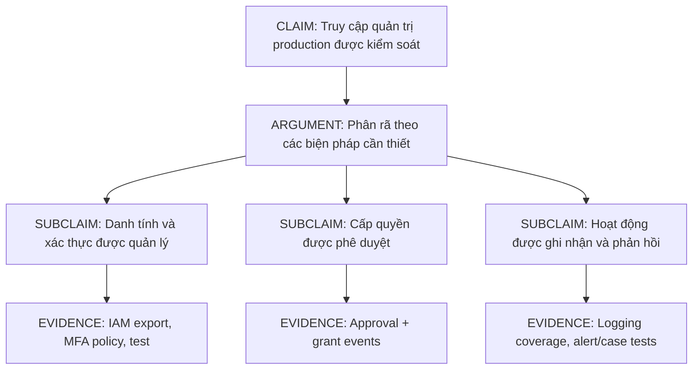

# Claim trong Assurance Case: phát biểu bảo đảm có phạm vi và có thể chứng minh

## 1. Claim là gì?

Trong **assurance case**, **claim** là một **phát biểu mà tổ chức muốn đưa ra và phải hỗ trợ bằng lập luận cùng bằng chứng phù hợp**. Claim thường diễn tả một thuộc tính của hệ thống, kiểm soát, quy trình hoặc kết quả mà người đánh giá cần có cơ sở tin cậy, chẳng hạn:

> “Các quyền truy cập quản trị đối với hệ thống production thuộc phạm vi đã được kiểm soát phù hợp với các yêu cầu bảo mật được phê duyệt trong kỳ đánh giá.”

Câu trên là một **tuyên bố cần chứng minh**, không phải kết luận đã được xác minh. Để trở thành một phần hữu ích của assurance case, claim phải có ranh giới, ngữ cảnh, tiêu chí đánh giá và đường lập luận dẫn đến bằng chứng. Một câu như “hệ thống an toàn tuyệt đối” gần như không thể kiểm chứng: không xác định trước mối đe dọa, hệ thống, thời kỳ hoặc mức độ bảo đảm nào.

Trong chương **Assurance case** thuộc module **SECURITY_SECURITY_ASSURANCE**, người học cần xây dựng cách **đánh giá có bằng chứng rằng hệ thống đáp ứng mục tiêu bảo mật**, từ phân tích rủi ro, yêu cầu và security controls đến kiểm thử, audit và khắc phục phát hiện. **Claim là đơn vị trung tâm của kết luận assurance**: mục tiêu kiểm tra phải được phát biểu rõ, bằng chứng hỗ trợ phải được liên kết và các giới hạn còn lại phải được trình bày minh bạch.

Học xong bài này, người học có thể:

- Phân biệt claim, requirement, control, argument, evidence, assumption và conclusion.
- Viết claim có **chủ thể, thuộc tính, scope, thời kỳ, điều kiện và mức kết luận** rõ ràng.
- Phân rã top-level claim thành những subclaim có thể đánh giá riêng và xây dựng lập luận nối chúng.
- Nhận diện **claim thiếu căn cứ, bằng chứng không đủ, giả định sai, phản chứng và lập luận vòng tròn**.
- Dùng claim làm trục truy vết trong một chương trình security assurance liên tục.

## 2. Assurance case là gì và claim nằm ở đâu?

**Assurance case** là một tập lập luận có cấu trúc cùng bằng chứng nhằm hỗ trợ một hoặc nhiều kết luận rằng đối tượng được đánh giá đáp ứng một tập thuộc tính hoặc mục tiêu đã định trong điều kiện cụ thể. Đối tượng có thể là sản phẩm, hệ thống, kiến trúc, quy trình vận hành, một dịch vụ cloud hoặc một tập kiểm soát bảo mật.

Ba thành phần cốt lõi thường được mô tả là **Claim – Argument – Evidence (CAE)**:

| Thành phần | Câu hỏi | Ví dụ |
|---|---|---|
| **Claim** | Chúng ta muốn kết luận điều gì? | “Các quyền admin production được kiểm soát phù hợp với yêu cầu” |
| **Argument** | Vì sao những dữ kiện bên dưới đủ để hỗ trợ claim? | “Kiểm soát gồm xác thực, phê duyệt, quyền tối thiểu, giám sát và quản lý ngoại lệ; từng phần được xác minh trong phạm vi” |
| **Evidence** | Những dữ kiện kiểm chứng cụ thể nào tồn tại? | Role inventory, policy export, approval logs, kết quả thử cấp quyền và review ngoại lệ |

Một sơ đồ đơn giản:



Các mũi tên trong sơ đồ biểu thị **quan hệ hỗ trợ lập luận**, không phải luồng dữ liệu, trình tự thực thi hay chứng minh toán học. Bằng chứng có thể xác thực một phần subclaim nhưng không tự động chứng minh claim gốc nếu còn khoảng trống ở phần khác.

**Điều phân biệt assurance case với bảng checklist** là việc diễn giải *vì sao* các dữ kiện cùng nhau đủ để hỗ trợ kết luận, trong bối cảnh và các giả định xác định. Một tập file cấu hình rời rạc không tự tạo thành lập luận.

## 3. Claim khác requirement, risk, control và evidence như thế nào?

Một chuỗi bảo đảm thông thường:

| Khái niệm | Vai trò | Ví dụ với quyền quản trị |
|---|---|---|
| **Risk / threat** | Điều cần giảm thiểu hoặc kiểm soát | Kẻ tấn công chiếm tài khoản quản trị và sửa cấu hình |
| **Security objective** | Kết quả bảo mật mong muốn | Chỉ chủ thể được ủy quyền sử dụng đặc quyền |
| **Requirement** | Điều kiện cụ thể được ban hành để đáp ứng mục tiêu | Grant thông thường phải được phê duyệt trước khi cấp |
| **Control** | Biện pháp tổ chức/kỹ thuật thực hiện requirement | Workflow IAM, role policy, audit logging |
| **Claim** | Phát biểu về trạng thái đáp ứng muốn đưa ra | Mọi grant thuộc scope trong kỳ đã được kiểm soát theo quy tắc |
| **Argument** | Lý do từ requirement, implementation và evidence dẫn đến claim | Đối chiếu tập grant độc lập với approvals và nhánh emergency |
| **Evidence** | Tài liệu/sự kiện/đầu ra thử nghiệm kiểm tra thực tế | Tất cả IAM grant events, approval timestamps và exceptions |
| **Finding** | Sai lệch hay giới hạn được phát hiện | Hai grant thiếu approval hoặc chưa có chứng cứ |
| **Conclusion** | Phán đoán đã được review, với phạm vi và giới hạn | Claim chỉ được hỗ trợ một phần, cần khắc phục và thử lại |

Requirement thường có tính quy định (*phải làm*); claim có tính nhận định (*đã/đang đáp ứng điều gì*). Hai câu có thể dùng từ tương tự nhưng khác thời điểm và trạng thái logic. Ví dụ:

- **Requirement:** “Các bản backup dữ liệu giao dịch phải đáp ứng RPO 5 phút.”
- **Claim:** “Trong các kịch bản DR thuộc phạm vi đã thử, điểm phục hồi dữ liệu giao dịch không lùi quá 5 phút.”
- **Evidence:** kết quả restore có điểm dữ liệu nhất quán, log thao tác, thời gian mô phỏng sự cố và đối soát.

Nếu diễn tập cho thấy lùi 8 phút, **requirement không đổi** nhưng **claim không được hỗ trợ** trong kịch bản đó. Không nên sửa claim thành “đã backup thành công” rồi báo đáp ứng RPO.

## 4. Những kiểu claim phổ biến

| Loại | Mức phát biểu | Ví dụ |
|---|---|---|
| **Top-level claim** | Kết luận bảo đảm chính đối với hệ thống hoặc mục tiêu | “Dịch vụ X đáp ứng các mục tiêu bảo mật đã phê duyệt trong scope và kỳ đánh giá” |
| **Intermediate/subclaim** | Một điều kiện hoặc nhóm khía cạnh hỗ trợ claim trên | “Thao tác privileged được xác thực, phê duyệt và ghi log” |
| **Leaf claim** | Phát biểu cụ thể có thể được kiểm tra trực tiếp bằng evidence | “Không có grant thường nào thiếu approval hợp lệ trong population đã xác minh” |
| **Process claim** | Phát biểu về quy trình, vai trò và hành vi kiểm soát | “Incident P1 được tiếp nhận và chuyển cấp theo quy trình” |
| **Product/system claim** | Phát biểu về trạng thái hoặc năng lực kỹ thuật | “Restore database đạt điểm dữ liệu đã cam kết trong kịch bản thử” |
| **Conditional claim** | Đúng với điều kiện/giả định xác định | “Khi IdP hoạt động và thiết bị thuộc tập được quản lý, user không thể đăng nhập admin nếu chưa hoàn tất xác thực yêu cầu” |
| **Negative claim** | Nói rằng điều không mong muốn không xảy ra trong một phạm vi | “Không có tài khoản không được phê duyệt có quyền admin trong snapshot đã kiểm tra” |
| **Comparative claim** | Đánh giá chênh lệch với baseline hoặc tiêu chí | “Thời gian xử lý alert P1 đáp ứng mục tiêu đã phê duyệt trong tập case kiểm tra” |

**Claim phủ định** như “không tồn tại đường truy cập trái phép” đặc biệt khó hỗ trợ nếu không thể liệt kê đầy đủ mọi đường truy cập. Thường nên đổi thành phát biểu có giới hạn: “trên các giao diện, vai trò và đường truy cập đã liệt kê, phép kiểm thử A–B–C không tìm thấy đường bypass điều kiện phê duyệt”. Đó là kết luận mạnh hơn về **tính trung thực**, dù hẹp hơn về phạm vi.

Không phải leaf claim nào cũng có một file chứng minh trực tiếp. Có thể phải dùng nhiều evidence item và phép kiểm tra tổng hợp; quan trọng là **phương pháp suy luận được giải thích và có thể xem lại**.

## 5. Cách viết claim rõ ràng và có thể bác bỏ

Một mẫu thực dụng:

> **[Đối tượng/tập population]** **[đạt thuộc tính hoặc đáp ứng yêu cầu]** **[trong môi trường và thời kỳ]**, **[theo tiêu chí/điều kiện đã phê duyệt]**, với **[giới hạn và ngoại lệ được công bố]**.

Ví dụ chưa tốt:

> “Backup an toàn và đáng tin cậy.”

Ví dụ được giới hạn tốt hơn:

> “Với các cơ sở dữ liệu giao dịch nằm trong BIA phiên bản được duyệt, quy trình restore từ vault độc lập có thể khôi phục một trạng thái nhất quán đáp ứng RPO tối đa 15 phút và RTO tối đa 2 giờ trong các kịch bản failover đã diễn tập, đồng thời hạn chế quyền xóa backup theo thiết kế được kiểm tra.”

Câu thứ hai vẫn phải được hỗ trợ bằng **các phép thử đúng quy mô và đúng kịch bản**, chứ không được coi là sự thật chỉ vì viết đủ dài.

### 5.1. Sáu câu hỏi trước khi chấp nhận một claim

1. **Subject:** đang nói về dịch vụ, bản build, tenant, tập tài sản, quy trình hay con người nào?
2. **Property:** thuộc tính bảo mật hoặc tiêu chí nào muốn khẳng định?
3. **Boundary:** cái gì nằm ngoài phạm vi? Có environment, region, loại tài khoản hoặc thứ tư không?
4. **Time:** claim đúng tại thời điểm nào, trong kỳ nào, hay liên tục dưới điều kiện nào?
5. **Condition:** giả định vận hành, threat model, cấu hình và version nào phải giữ?
6. **Verification:** bằng chứng nào có thể làm claim mạnh hơn, và phản ví dụ nào sẽ khiến claim bị từ chối?

Một claim có giá trị phải **có khả năng bị bác bỏ bằng dữ liệu phù hợp**. Nếu mọi kết quả kiểm thử đều được diễn giải là hỗ trợ claim, đây không phải tiêu chí bảo đảm tốt.

### 5.2. Tránh bốn kiểu phát biểu quá mức

| Phát biểu yếu | Vấn đề | Cách cải thiện |
|---|---|---|
| “Hệ thống hoàn toàn an toàn.” | Không giới hạn threat, time hoặc scope | Ghi mục tiêu và rủi ro cụ thể, giới hạn môi trường |
| “100% thiết bị được bảo vệ.” | Không biết population và định nghĩa bảo vệ | Dẫn danh mục tài sản đã đối chiếu và kiểm soát áp dụng |
| “Dữ liệu không thể bị mất.” | Không xét lỗi chung, sai dữ liệu, ransomware, RPO | Diễn đạt năng lực khôi phục theo kịch bản đã kiểm thử |
| “Nhà cung cấp compliant.” | Không biết dịch vụ, nghĩa vụ, kỳ hay evidence | Claim riêng về phần trách nhiệm và bằng chứng của engagement |

## 6. Claim có định danh và trạng thái riêng

Để theo dõi xuyên suốt các kỳ, mỗi claim nên có metadata tối thiểu:

| Thuộc tính | Vai trò |
|---|---|
| `claim_id` | Định danh ổn định, không phụ thuộc tên hiển thị |
| `statement` | Nội dung phát biểu có thể kiểm tra |
| `claim_type` | Top-level, intermediate, leaf, conditional... |
| `scope_ref` | Tài sản, môi trường, population và ranh giới |
| `time_window` | Thời kỳ hoặc mốc đánh giá |
| `objective_refs` | Rủi ro, yêu cầu và mục tiêu liên quan |
| `parent_claims`, `child_claims` | Liên kết cấu trúc lập luận |
| `argument_ref` | Lý do dùng subclaims/evidence để hỗ trợ |
| `assumption_refs`, `context_refs` | Điều kiện và ngữ cảnh |
| `evidence_refs`, `test_refs` | Bằng chứng và phương pháp kiểm chứng |
| `owner`, `reviewer` | Người chịu trách nhiệm và người đánh giá |
| `status`, `confidence` | Trạng thái hỗ trợ và mức tin cậy kèm căn cứ |
| `version`, `effective_at`, `last_reviewed` | Quản lý thay đổi và hiệu lực |
| `defeaters`, `open_findings` | Phản chứng, sai lệch và giới hạn chưa giải quyết |

Có thể có những trạng thái như **draft, under review, supported, partially supported, unsupported, inconclusive, superseded**. Đây là ví dụ về danh mục quản trị, không phải bộ trạng thái bắt buộc trong mọi notation.

**`supported` không nghĩa “đúng vĩnh viễn”**; nó nghĩa là có sự hỗ trợ phù hợp với scope, thời điểm và chất lượng evidence đã đánh giá. Nếu môi trường thay đổi hoặc chứng cứ hết hiệu lực, trạng thái phải được rà soát.

## 7. Context: điều kiện để hiểu đúng câu khẳng định

**Context** cung cấp thuật ngữ, phạm vi, mô tả hệ thống, mối đe dọa và quyết định thiết kế cần thiết để hiểu claim. Một claim “MFA đã bật” có thể rất khác nhau tùy:

- Tenant nào và role nào là production privileged?
- “Bật MFA” nghĩa là có cấu hình hay **thực sự enforce** trên các đường đăng nhập?
- Định nghĩa human, service, emergency identities?
- Login qua console, CLI, API, SSO, token cũ và đường bypass?
- Kỳ nào, với phiên bản IdP và policy nào?
- MFA là một yếu tố bổ sung hay một chính sách mạnh hơn với phương thức cụ thể?
- Kiểm soát nhằm đáp ứng requirement nào và threat model nào?

Context nên dẫn tới **tài liệu phiên bản xác định** như system boundary, asset inventory, identity model, danh mục privileged roles và security requirement. Không dùng một “bối cảnh chung chung” để hợp thức hóa thiếu bằng chứng.

### 7.1. Giới hạn của system boundary

Ví dụ claim được viết cho **production tenant A**, nhưng một nhân sự có thể truy cập production qua tenant B hoặc tài khoản vendor. Nếu context không đưa những đường đó vào, claim có thể đúng trong một phần rất hẹp nhưng không hỗ trợ mục tiêu kinh doanh rộng hơn.

Phải ghi rõ **những đường hoặc tài sản ngoài scope** và có phân tích về tác động của các phần bị loại trừ. Một ngoại lệ phạm vi chưa được quản trị không tự biến thành chấp nhận rủi ro.

## 8. Assumption và justification: không phải bằng chứng

**Assumption** là điều được xem như đúng để xây dựng lập luận, nhưng có thể cần kiểm tra, giám sát hoặc được một bên khác bảo đảm. **Justification** giải thích vì sao một chiến lược lập luận hoặc phân rã được chọn là phù hợp.

Ví dụ:

- **Context:** “Các tài khoản privileged được định nghĩa trong role catalog phiên bản 4.”
- **Assumption:** “Danh mục role catalog phản ánh các quyền quản trị có hiệu lực trong production.”
- **Justification:** “Đánh giá qua các đường truy cập xác thực, cấp quyền và audit vì ba khía cạnh này giải quyết các bước khác nhau của rủi ro lạm dụng đặc quyền.”
- **Evidence:** “So sánh role catalog với IAM export và các quyền kế thừa; có log xác nhận của kỳ.”

Nếu role catalog không đầy đủ thì **assumption không còn đứng vững**, kéo theo độ tin cậy của claim. Không coi một giả định chưa được kiểm chứng là leaf claim đã có bằng chứng.

Một bảng kiểm soát giả định:

| Assumption | Owner | Cách xác minh | Khi bị vi phạm |
|---|---|---|---|
| Danh mục privileged identities đầy đủ | IAM owner | Đối chiếu role inventory, group membership và cloud audit | Mở rộng population, thử lại claim |
| Log trọng yếu không bị mất | Logging owner | Kiểm tra coverage, ingest lag, dropped events | Kết quả operational claim có thể inconclusive |
| Cấu hình thử tương đương production | SRE/Test owner | So sánh version, topology, policy và data paths | Giới hạn suy diễn từ test |
| Nhà cung cấp giữ đúng cam kết log | Vendor manager | Xem phạm vi hợp đồng/báo cáo, test export | Mở finding và đánh giá control bù |

Assumption ảnh hưởng mạnh phải có người chịu trách nhiệm và **điều kiện giám sát**, nhất là đối với claim duy trì dài hạn.

## 9. Phân rã top-level claim thành subclaim

Phân rã giúp biến một mục tiêu lớn thành các phần có thể kiểm tra. Tuy nhiên **phân rã sai tạo ảo giác bảo đảm**.

Chẳng hạn top-level claim:

> “Hệ thống xử lý đơn hàng bảo đảm khả năng phục hồi an toàn theo mục tiêu đã phê duyệt.”

Có thể phân theo các điều kiện cần:

- **C1:** Các dữ liệu cần thiết và phụ thuộc đã được xác định từ BIA.
- **C2:** Có các điểm khôi phục đủ mới và có khả năng restore nhất quán.
- **C3:** Hạ tầng, IAM, key, network và cấu hình có thể phục hồi trong giới hạn RTO.
- **C4:** Bản sao khôi phục được bảo vệ khỏi những nguyên nhân lỗi hoặc tấn công nằm trong threat model.
- **C5:** Hoạt động nghiệp vụ và monitoring được xác minh trước khi nhận traffic.
- **C6:** Có quy trình xử lý sai lệch, ngoại lệ và kết quả diễn tập chưa đạt.

Phải giải thích **vì sao những subclaim này là đủ** cho top-level claim theo threat model và scope. Nếu toàn bộ claim chỉ phân thành “database chạy” và “ứng dụng chạy”, có thể bỏ qua quyền IAM, dữ liệu queue, đối soát thanh toán và điều kiện an toàn.

### 9.1. AND và OR không thể dùng tùy ý

- **AND decomposition:** tất cả subclaim bắt buộc phải được hỗ trợ để hỗ trợ claim gốc.
- **OR / alternative argument:** có ít nhất một chiến lược phù hợp trong **các điều kiện được định rõ** có thể hỗ trợ claim.
- **Conditional branch:** một nhánh chỉ áp dụng khi có tình huống cụ thể, ví dụ emergency access; cần chứng minh trường hợp thuộc nhánh và điều kiện của nhánh.

Ví dụ, “một đăng nhập được bảo vệ bằng MFA **hoặc** bằng mã OTP không được kiểm tra” không phải là hai lựa chọn ngang nhau. Việc dùng OR phải dựa trên **nghĩa vụ cho phép phương án thay thế** và lập luận vì sao lựa chọn đó đủ.

### 9.2. Kiểm tra tính đầy đủ và độc lập

Khi review decomposition, hỏi:

1. Có đủ **mọi đường thực thi** và đối tượng thuộc population?
2. Có bỏ qua trường hợp hiếm nhưng hậu quả lớn như break-glass hay workload identity?
3. Subclaim có thực sự độc lập hay cả ba cùng dựa vào một giả định chưa được kiểm chứng?
4. Có claim nào chỉ lặp lại câu top-level bằng từ khác?
5. Evidence dùng cho các nhánh có phải cùng một nguồn và cùng một điểm mù?
6. Có thể chỉ ra một phản ví dụ khiến top-level sai dù các nhánh hiện tại vẫn “pass” không?

Nếu tìm được phản ví dụ, cần **sửa decomposition hoặc thu hẹp top-level claim** thay vì ẩn điểm yếu.

## 10. Cấu trúc Goal Structuring Notation (GSN) ở mức nhập môn

**Goal Structuring Notation (GSN)** là một cách biểu diễn có cấu trúc cho lập luận assurance. Trong GSN, một **Goal** thường chứa phát biểu claim cần được hỗ trợ; **Strategy** giải thích cách phân rã; **Context**, **Assumption** và **Justification** cung cấp nền và cơ sở; **Solution** tham chiếu bằng chứng hỗ trợ. Cấu trúc ký hiệu GSN giúp xem được claim nào chưa được hỗ trợ hoặc còn giả định.

| Thành phần GSN | Vai trò | Ví dụ |
|---|---|---|
| **Goal (G)** | Phát biểu cần hỗ trợ | `G0`: Quyền admin được kiểm soát |
| **Strategy (S)** | Lập luận về cách chia hoặc giải quyết Goal | `S0`: Phân theo danh tính, cấp quyền và giám sát |
| **Context (C)** | Định nghĩa/ranh giới giúp hiểu Goal | `C0`: Tenant và role catalog |
| **Assumption (A)** | Điều được giả định để lập luận có hiệu lực | `A0`: Danh mục role đầy đủ |
| **Justification (J)** | Lý do chọn Strategy hoặc tiêu chí | `J0`: Các nhánh bao phủ chuỗi lạm dụng đặc quyền đã mô hình |
| **Solution (Sn)** | Bằng chứng hoặc kết quả xác minh | `Sn1`: IAM export và test |

Ví dụ ý tưởng:

```text
G0: Privileged access control objective is satisfied in defined scope
  inContextOf C0: production tenants A/B and period 2026-Q3
  inContextOf A0: privileged-role inventory is complete
  supportedBy S0: argue through identity, grant and monitoring
    supportedBy G1: identities are adequately authenticated
      supportedBy Sn1: identity-policy mapping test evidence
    supportedBy G2: grants follow authorized approval workflow
      supportedBy Sn2: grant population and approval comparison
    supportedBy G3: privileged actions are auditable and triaged
      supportedBy Sn3: log coverage and response exercises
```

Đây là **mã giả mô tả cấu trúc**, không phải file GSN có thể nhập trực tiếp vào một công cụ. Trong notation đầy đủ, các loại nút và quan hệ phải tuân theo quy tắc riêng. Không gắn nhãn `Solution` cho một lời khẳng định không có dữ liệu: **Solution phải tham chiếu evidence cụ thể và khả năng xem lại kết quả**.

### 10.1. Claim chưa có bằng chứng

Có thể tạm ghi claim là **undeveloped / unsubstantiated** trong giai đoạn thiết kế, nhưng phải hiển thị rõ và có kế hoạch kiểm tra. Không lấp khoảng trống bằng câu “theo thông lệ ngành” nếu đây không phải là bằng chứng thích hợp với hệ thống thực tế.

## 11. Argument: bằng chứng không tự nhảy thành kết luận

**Argument** là lý do có cấu trúc giúp người đánh giá thấy vì sao các bằng chứng đã chọn hỗ trợ claim. Nó phải liên kết giữa requirement, các giả định về dữ liệu, phương pháp kiểm tra và kết quả.

Ví dụ:

> “Trong kỳ đã định, chúng tôi xác định tập tất cả lần cấp quyền privileged từ audit log nguồn. Mỗi lần cấp quyền thuộc nhóm thông thường được đối chiếu với một approval hợp lệ có thời điểm trước grant; các trường hợp emergency được kiểm tra theo quy trình riêng. Population được đối chiếu với inventory của cloud và IdP; vì vậy kết quả test trên tập đã xác nhận hỗ trợ claim kiểm soát cấp quyền trong phạm vi này.”

Người review cần thẩm định **các bước suy luận**:

- IAM audit log có nhìn thấy mọi đường cấp quyền hoặc còn API bypass?
- Approval có thể bị tạo hậu kiểm hoặc sửa timestamp?
- Các role được xem là privileged có đầy đủ không?
- Trường hợp emergency có định nghĩa, thẩm quyền, expiry và hậu kiểm?
- Có các sự kiện thiếu ID, log trễ hoặc nhập trùng làm lệch kết quả?
- Những gì nằm ngoài scope có làm top-level claim thành quá mức?

Lập luận phải giải thích vì sao dữ liệu đủ, không chỉ kể tên các file nộp.

### 11.1. Tránh lập luận vòng tròn

Ví dụ vòng tròn:

- “Hệ thống an toàn vì đã pass security assessment.”
- “Security assessment đạt vì hệ thống được đội vận hành xác nhận an toàn.”

Không có bằng chứng độc lập nào về kết quả cần kiểm tra. Cần nối tới **các thử nghiệm thực tế, phương pháp đánh giá được định nghĩa và dữ liệu từ nguồn đáng tin**, với kết quả có thể tái hiện.

### 11.2. Tránh suy luận từ vắng mặt tín hiệu

“Không có incident P1 nào được phát hiện” **không chứng minh** “không có sự cố P1”. Có thể thiếu telemetry, rule không hoạt động hoặc SOC bỏ sót alert. Nếu muốn hỗ trợ claim về detection, cần kiểm tra **độ phủ, health của nguồn log, rule testing, escalation và những giới hạn của threat coverage**.

## 12. Evidence có đủ để hỗ trợ claim không?

Có nhiều loại evidence:

| Loại | Ví dụ | Giới hạn thường gặp |
|---|---|---|
| **Design artifact** | Threat model, policy, kiến trúc, procedure | Cho thấy dự định, chưa xác nhận thực tế |
| **Configuration artifact** | Policy export, IaC, IAM roles, SIEM rule | Có thể chỉ phản ánh một thời điểm |
| **Operational record** | Audit log, approval, ticket, backup runs, triage cases | Phải xác minh population, timeframe và provenance |
| **Test result** | Integration test, restore exercise, adversary simulation | Chỉ hỗ trợ scope và điều kiện đã thử |
| **Review / independent assessment** | Audit finding, test review, vendor assessment | Cần xem phạm vi, kỳ, phương pháp và các giới hạn |
| **Observation/interview** | Quan sát vận hành, phỏng vấn owner | Có thể thiếu bằng chứng lịch sử và độ bao phủ |
| **Metrics** | Coverage, detection latency, RPO/RTO attainment | Mẫu số, cách tính và chất lượng nguồn quyết định giá trị |

Một evidence item mạnh cần **relevant, complete, accurate, timely, reliable, traceable** và được bảo vệ phù hợp. Cần biết: ai tạo, hệ thống nào, lúc nào, lọc thế nào, phạm vi có đủ, file có thay đổi và có thể kiểm chứng bản ghi gốc không.

Một chữ ký số hoặc hash sau xuất giúp đánh giá **tính toàn vẹn của file từ thời điểm ghi nhận**, nhưng **không tự chứng minh nguồn tạo hay kết quả truy vấn ban đầu đúng**. Cần kết hợp nguồn có thẩm quyền, phương pháp lấy, audit trail và phép kiểm tra ngược.

### 12.1. Thiết kế evidence theo claim, không ngược lại

Sai lầm thường gặp là có sẵn một screenshot và viết claim phù hợp screenshot đó. Cách tốt hơn:

1. Xác định claim và tiêu chí có thể bác bỏ.
2. Liệt kê population, scope, kỳ và nguồn dữ liệu cần có.
3. Thiết kế test để kiểm tra cả trường hợp đạt và trường hợp sai.
4. Thu evidence theo data contract, lưu query/filter và phiên bản.
5. Phân tích kết quả, ghi bất định và điều chỉnh status claim.
6. Nếu không thể lấy đủ bằng chứng, giữ **inconclusive** hoặc thu hẹp claim với giải thích minh bạch.

## 13. Population, sampling và độ phủ của claim

Một claim có từ **“mọi”**, **“không có”** hoặc **“liên tục”** đặt yêu cầu mạnh về **tính đầy đủ của tập quan sát**.

Ví dụ: “Mọi tài khoản admin production đều nằm trong chính sách xác thực được duyệt.” Phải xác định:

- Toàn bộ tài khoản hiện có và **đã từng có quyền admin trong kỳ**.
- Vai trò trực tiếp, quyền kế thừa qua nhóm, quyền tạm thời, cross-account/tenant và break-glass.
- Human, non-human, service, external identities.
- Các đường truy cập console, API, CLI, federation và token lâu đời.
- Nguồn IAM authoritative, giới hạn export, paging và các trường thiếu.

Nếu danh sách reviewer chỉ gồm 50 người dùng đăng nhập SSO nhưng có thêm 8 service identities và 2 tài khoản khẩn, claim cho **mọi danh tính** chưa được xác minh.

### 13.1. Minh họa kết quả nhiều trạng thái

Một population đã đối chiếu có **64 danh tính** từng có quyền đặc quyền: **57 human, 6 workload identities, 1 break-glass**. Sau khi áp dụng **các tiêu chí kiểm soát tương ứng từng loại**, kết quả ví dụ:

| Loại | Population | Đủ bằng chứng đạt | Sai lệch xác thực | Chưa đủ bằng chứng |
|---|---:|---:|---:|---:|
| Human | 57 | 56 | 1 | 0 |
| Workload identities | 6 | 5 | 0 | 1 |
| Break-glass | 1 | 1 | 0 | 0 |
| **Tổng** | **64** | **62** | **1** | **1** |

Trong ví dụ có **62/64 = 96,875%** đối tượng được đánh giá đạt tiêu chí tương ứng. Đây là **tỷ lệ mô tả**, không có nghĩa “claim mọi danh tính đáp ứng yêu cầu” đã đúng: một trường hợp **fail** và một trường hợp **inconclusive** phải được xử lý riêng. Nếu mục tiêu nguồn bắt buộc mọi trường hợp, không có cơ sở chuyển 96,875% thành kết luận tuân thủ.

Lưu ý: **MFA dành cho người dùng** và **kiểm soát xác thực cho workload identity** có thể khác về kỹ thuật. Claim top-level phải mô tả mục tiêu quản lý truy cập đặc quyền theo loại định danh, tránh áp một phép thử MFA người dùng lên mọi loại tài khoản.

### 13.2. Khi dùng sampling

Kiểm tra theo mẫu có thể là công cụ assurance hữu ích nếu:

- Population đã được xác nhận đủ theo nguồn phù hợp.
- Phương pháp chọn mẫu được công bố: ngẫu nhiên, theo rủi ro, phân tầng hoặc hỗn hợp.
- Có tiêu chí sai lệch, độ bao phủ, giới hạn và cách suy diễn tương ứng.
- Các trường hợp rủi ro cao như break-glass, thay đổi policy và ngoại lệ được xét thích hợp.

**Pass 20 mẫu không chứng minh tất cả 20.000 giao dịch đều pass.** Không nên khẳng định tuyệt đối nếu chỉ dựa trên mẫu; nếu dùng phương pháp thống kê, phải nêu rõ các giả định về chọn mẫu và độ tin cậy, không tự tạo tỷ lệ đảm bảo.

## 14. Defeaters, counterevidence và vấn đề chưa giải quyết

Trong thực hành assurance, **defeater** là một lý do hoặc bằng chứng có khả năng làm suy yếu/bác bỏ lập luận đang hỗ trợ claim. Defeater có thể là phản ví dụ thật, một giả định bị sai hoặc giới hạn quan sát làm giảm độ tin cậy.

Ví dụ claim “backup đủ để phục hồi sau ransomware” có các defeater:

| Defeater | Rủi ro cho claim | Kiểm chứng/biện pháp |
|---|---|---|
| Kho backup cùng quyền admin production | Kẻ tấn công có thể xóa cả bản sao | Xác minh IAM, phân tách control plane, thử từ chối xóa |
| Backup mới chứa mã độc hoặc dữ liệu bị sửa | Restore có thể tái nhiễm | Chọn điểm sạch, test trong môi trường cô lập |
| Không còn quyền giải mã khi IAM/KMS chính hỏng | Bản sao còn nhưng không dùng được | Test key recovery và break-glass đúng thẩm quyền |
| Không phục hồi được hệ thống phụ thuộc | Dữ liệu restore xong nhưng dịch vụ chưa hoạt động | End-to-end DR exercise và dependency validation |
| Không có test ở quy mô production | RTO tuyên bố chưa đáng tin | Diễn tập có tải/khối lượng tương đương hoặc ghi giới hạn |

Phải phân biệt:

- **Counterevidence:** chứng cứ thực cho thấy một trường hợp sai.
- **Potential defeater:** kịch bản hợp lý có thể phá lập luận, chưa được kiểm tra đủ.
- **Open question:** thông tin chưa có để quyết định.
- **Residual risk:** rủi ro còn lại đã biết sau kiểm soát và phản hồi của tổ chức.

Không phải potential defeater nào cũng làm claim sai ngay, nhưng claim không nên được báo ở mức mạnh khi **defeater quan trọng chưa được xử lý hoặc đánh giá**. Cần gắn owner, thời hạn và tác động lên kết luận.

## 15. Confidence: mức tin cậy của kết luận được hiểu thế nào?

**Confidence** trong assurance thường thể hiện mức tin tưởng đối với claim dựa trên chất lượng lập luận và evidence. Không nên coi nhãn `high`, `medium`, `low` là xác suất toán học nếu chưa có phương pháp định lượng hợp lệ.

Có thể cân nhắc các chiều:

1. **Evidence quality:** nguồn, thời điểm, completeness, khả năng tái lập.
2. **Argument strength:** cách suy luận có đầy đủ, không vòng tròn, không bỏ qua điều kiện cần?
3. **Coverage:** có đầy đủ tài sản, dữ liệu, quyền và đường thực thi thuộc scope?
4. **Validation diversity:** test cấu hình, thử vận hành và kiểm tra độc lập có bổ sung cho nhau?
5. **Outstanding defeaters:** điểm phản chứng hoặc giả định chưa xác minh có tác động nào?
6. **Change/freshness:** dữ liệu và kết luận còn phù hợp với hệ thống hiện hành không?

Ví dụ đánh giá định tính:

| Mức mô tả | Điều kiện minh họa |
|---|---|
| **Higher confidence** | Scope rõ, population được đối chiếu, test bao phủ điều kiện trọng yếu, evidence đáng tin, không còn defeater lớn chưa xử lý |
| **Moderate confidence** | Evidence hỗ trợ phần lớn nhưng còn giả định/giới hạn không trọng yếu hoặc chưa test một số biến thể |
| **Lower confidence** | Scope thiếu, dữ liệu nguồn không tin cậy, test hẹp hoặc các defeater quan trọng chưa giải quyết |
| **No basis to conclude** | Không có evidence hoặc argument hợp lệ cho thuộc tính được tuyên bố |

Các nhãn là khung diễn giải học thuật. Tổ chức cần định nghĩa thang đánh giá riêng nếu muốn dùng trong báo cáo. Một claim có evidence chất lượng cao trong **scope hẹp** không nên bị diễn đạt thành có confidence cao cho **scope rộng hơn**.

## 16. Ví dụ hoàn chỉnh: assurance case cho privileged access

Giả định một công ty đánh giá tenant production A trong kỳ **01/09/2026–30/11/2026 UTC**. Mục tiêu là kiểm soát nguy cơ lạm dụng đặc quyền trên hệ thống danh tính và cloud resources.

### 16.1. Top-level claim

**G0 — Phát biểu:**

> “Trong tenant production A và kỳ đã định, các hoạt động cấp và sử dụng quyền quản trị thuộc phạm vi kiểm soát được xác thực, phê duyệt, ghi nhận và xử lý ngoại lệ theo các yêu cầu được phê duyệt.”

**Context:** role catalog, tenant IDs, chính sách access control, phân loại danh tính, điều kiện khẩn cấp, các đường truy cập thuộc phạm vi.

**Assumption trọng yếu:** IAM grant log và privileged-role inventory đủ để xác định population. Assumption này cần **kiểm tra**, không chấp nhận bằng lời khẳng định của owner.

### 16.2. Các subclaim

| ID | Subclaim | Evidence chính | Defeater trọng yếu |
|---|---|---|---|
| **G1** | Các danh tính con người có quyền admin được áp dụng xác thực theo chính sách | IdP policy export, role mapping, test login | Một đường API/SSO bypass enforcement |
| **G2** | Các workload identity và emergency accounts có kiểm soát tương ứng | Inventory, credential policy, expiry, break-glass tests | Shared credential không có owner |
| **G3** | Mỗi grant thông thường có phê duyệt hợp lệ trước grant | IAM grant population, approval workflow, timestamp test | Grant trực tiếp ngoài workflow |
| **G4** | Hoạt động quản trị và thay đổi quyền được ghi log đủ để điều tra | Log coverage, collection health, historical retrieval test | Mất nguồn log hoặc đổi schema |
| **G5** | Các sai lệch và ngoại lệ được phát hiện, giao owner và xử lý | Exception register, case/ticket, test escalation | Alert bị tắt, case bị đóng không có xử lý |

**Argument:** G0 chỉ được hỗ trợ nếu G1–G5 được hỗ trợ **theo đúng các điều kiện áp dụng**, và việc phân rã được chứng minh đủ với threat model đang xét. Không có claim G6 về xâm nhập vật lý hoặc tính an toàn mọi thư viện phần mềm: những rủi ro đó không được bao phủ bởi G0 này.

### 16.3. Kịch bản thử

- **Positive:** cấp một grant admin được phê duyệt hợp lệ; log và workflow khớp; kết quả pass.
- **Negative:** mô phỏng cấp quyền không có approval trong môi trường cho phép; kiểm soát preventive từ chối hoặc detective tạo alert theo tiêu chí đã duyệt.
- **Boundary:** approval có sau grant; chỉ được phép theo emergency flow nếu đáp ứng điều kiện cụ thể.
- **Coverage:** đối chiếu tất cả role assignments và historical changes, không chỉ người dùng hiện còn admin.
- **Outage:** log collector lỗi hoặc mất quyền; hệ thống phải thể hiện telemetry gap và claim liên quan không thể được suy diễn là pass.
- **Emergency:** kích hoạt tài khoản break-glass có audit và hậu kiểm theo quy trình.

### 16.4. Kết luận đúng khi có sai lệch

Giả sử có **1 grant không có phê duyệt**, một nhánh non-human chưa có evidence đầy đủ và hai lần log forwarding bị lỗi chưa được đánh giá tác động. Không được ghi “G0 pass vì 98% trường hợp đúng”.

Kết luận thích hợp là: **G3 không đạt** trong những điều kiện đã kiểm tra; **G2 chưa đủ bằng chứng** ở một phần population; **G4 cần đánh giá tác động của log gap**; do đó **G0 chưa được hỗ trợ đầy đủ**. Mỗi điểm được gắn finding/assurance limitation, owner và kế hoạch thử lại. Có thể nêu các phần đã được hỗ trợ, nhưng không thay đổi tiêu chí G0 để che sai lệch.

## 17. Ví dụ thứ hai: claim về khả năng phục hồi an toàn

Một dịch vụ đặt hàng có **RPO yêu cầu = 5 phút**, **RTO yêu cầu = 2 giờ**. Claim top-level:

> “Dữ liệu và chức năng xử lý đơn của dịch vụ có thể khôi phục an toàn trong giới hạn RPO/RTO đã phê duyệt đối với các kịch bản gián đoạn nằm trong phạm vi DR.”

Bốn subclaim có thể là:

1. **Dữ liệu đúng:** backup/transaction log có thể phục hồi một trạng thái nghiệp vụ nhất quán, trong giới hạn RPO.
2. **Thời gian đúng:** môi trường và dịch vụ đạt chức năng nghiệp vụ cần thiết trong giới hạn RTO.
3. **An toàn:** IAM, secret, key, logging và kiểm tra nguồn dữ liệu tin cậy được thực hiện trước khi mở traffic.
4. **Vận hành:** runbook, owner, capacity và cơ chế phối hợp có thể dùng khi production hoặc account chính mất.

Trong diễn tập giả định: mất dịch vụ lúc **10:00 UTC**, trạng thái dữ liệu nhất quán mới nhất là **09:52 UTC**, dịch vụ xử lý đơn đầy đủ lúc **11:40 UTC**.

- **RPO thực tế = 8 phút**, không đáp ứng yêu cầu 5 phút.
- **RTO thực tế = 1 giờ 40 phút**, đáp ứng yêu cầu 2 giờ.
- Nếu chỉ test restore database, chưa thử IAM/logging hoặc đối soát, claim an toàn và chức năng nghiệp vụ cũng **chưa có đầy đủ bằng chứng**.

Đánh giá đúng là **chưa hỗ trợ top-level claim**. Kết quả “backup success”, “database started” hoặc “RTO đạt” không thay thế các điều kiện còn lại.

## 18. Claim về liên tục giám sát và tính hiệu lực theo thời gian

Một claim **point-in-time** có thể đúng trong một snapshot. Claim **continuous** hoặc **period-of-time** mạnh hơn nhiều:

- **Point-in-time:** “Tại 12:00 UTC ngày T, các storage bucket thuộc population đã xác minh có bật mã hóa theo chính sách.”
- **Period-of-time:** “Trong quý, không có thời gian nào bucket thuộc scope bị tắt mã hóa trái chính sách.”
- **Ongoing capability:** “Hệ thống giám sát phát hiện và xử lý drift theo giới hạn được quy định.”

Các phát biểu cần những bằng chứng khác nhau. Screenshot tại ngày T không đủ chứng minh mọi giây trong quý, trong khi snapshot hiện tại và log thay đổi có thể cùng hỗ trợ kỳ đánh giá nếu **độ phủ và tính đáng tin của log** đã được kiểm tra.

Khi dùng automated assurance, cần xác định:

- Chu kỳ quét và khoảng trễ quan sát.
- Các tài sản xuất hiện rồi biến mất giữa hai lần quét.
- Missing data, API timeout, schema drift hoặc token hết quyền.
- Cách tính các khoảng không quan sát được: thường là `unknown`, không phải `pass`.
- Khả năng sửa evaluator, tắt rule, thay scope hoặc thêm ngoại lệ.
- Cách version hóa kết luận khi policy, IaC hoặc threat model thay đổi.

Một dashboard báo “compliant = 100%” có thể chỉ nói về **tập assets được scanner quét thành công**. Phải xem **mẫu số và chất lượng nguồn** trước khi nâng thành claim toàn hệ thống.

## 19. Assurance case là một hồ sơ sống: phiên bản và thay đổi

Claim không tồn tại ngoài thời gian. Những thay đổi cần review có thể gồm:

| Trigger | Tác động lên claim |
|---|---|
| Bản phát hành phần mềm mới | Phạm vi cấu hình, API, threat model hoặc test có thể thay đổi |
| Thêm region/cloud account/tenant | Population và các đường truy cập mới chưa có evidence |
| Đổi IAM/IdP, quản lý key hoặc backup vendor | Assumption, shared responsibility và cơ chế kiểm chứng thay đổi |
| Policy/requirement mới | Tiêu chí chấp nhận hoặc thời điểm hiệu lực khác trước |
| Sự cố bảo mật thực tế | Có thể cung cấp counterevidence hoặc làm giả định vô hiệu |
| Kiểm thử phát hiện false negative | Leaf claim về detection phải xem lại |
| Thay logging/retention | Không còn evidence lịch sử hoặc mất khả năng truy xuất |
| Finding được khắc phục | Cần chạy retest, không chỉ gắn ticket `done` |
| Evidence hết kỳ hoặc bị thay thế | Kết luận có thể trở thành stale hoặc inconclusive |

Cần lưu **claim version**, **argument version**, **evidence IDs**, **assessment date**, **system baseline**, **người review** và **các thay đổi điều kiện**. Không sửa ngược claim cũ cho giống kết luận mới mà mất dấu vết.

### 19.1. Baseline cho kỳ đánh giá

Khi báo cáo kết luận của quý III/2026, cần giữ:

- Statement và requirement có hiệu lực trong quý.
- Asset/identity population theo kỳ và giả định tương ứng.
- Phiên bản policy/control và những thay đổi trong kỳ.
- Test method, input/output, kết quả và evidence references.
- Findings hoặc limitations tồn tại ở thời điểm kết luận.

Bản cấu hình tháng 11 không đủ chứng minh môi trường đã như vậy trong tháng 9. Tương tự, thay đổi requirement có hiệu lực tháng 12 không tự động được dùng để đánh giá lại hành vi tháng 9 nếu không có căn cứ áp dụng hồi tố.

## 20. Mẫu claim có cấu trúc bằng YAML

Ví dụ sau là **hồ sơ học tập**, không phải cấu hình nhập trực tiếp cho GSN, SACM, công cụ GRC hay tiêu chuẩn bắt buộc. Những ID, ngày và tiêu chí đều giả định.

```yaml
assurance_case_id: AC-PRIV-001
case_version: "1.0"
top_level_claim:
  id: G0
  statement: >
    Privileged access in production tenant A is
    authenticated, authorized and auditable according
    to the approved controls during the stated period.
  status: partially_supported
  claim_type: top_level

scope:
  tenant_ids: [tenant-a]
  environment: production
  interval:
    start_inclusive: "2026-09-01T00:00:00Z"
    end_exclusive: "2026-12-01T00:00:00Z"
  population_sources:
    - privileged-role-catalog
    - iam-role-assignment-history

context:
  requirement_refs:
    - REQ-PRIV-AUTH-01
    - REQ-PRIV-GRANT-02
    - REQ-PRIV-LOG-03
  threat_model_ref: TM-PRIV-2026
  baseline_ref: prod-tenant-a-2026-sep-nov

assumptions:
  - id: A1
    statement: "The privileged role inventory covers all paths."
    validation_ref: TEST-ROLE-COVERAGE
    validation_status: pending

argument:
  id: S0
  type: all_required_subclaims
  rationale: >
    Authentication, authorized privilege grants and
    auditable operations jointly support G0 for scope.
  subclaims:
    - id: G1
      statement: "Human privileged access follows approved authentication controls."
      status: supported
      evidence_refs: [EV-IDP-001, EV-TEST-002]
    - id: G2
      statement: "Privileged grants follow the approved authorization path."
      status: not_supported
      evidence_refs: [EV-IAM-GRANTS-003, EV-APPROVALS-004]
      finding_refs: [FIND-IAM-019]
    - id: G3
      statement: "Privileged actions are logged and investigated as required."
      status: inconclusive
      evidence_refs: [EV-LOG-HEALTH-005]
      finding_refs: [GAP-LOG-006]

review:
  owner: security-assurance
  reviewer: independent-security-reviewer
  assessed_at: "2026-12-05T10:00:00Z"
  next_review_trigger:
    - "Material IAM change"
    - "Control retest"
    - "Important evidence becomes invalid"
  open_defeaters:
    - "Privileged role catalog coverage pending validation"
```

Điểm đáng lưu ý:

- `G0` không được gắn `supported` khi một subclaim cần thiết không đạt hoặc còn bất định quan trọng.
- Các `EV-...` chỉ là **reference**; trong hệ thống thực phải trỏ tới evidence có nguồn, kỳ, scope, owner và bảo vệ thích hợp.
- `Assumption A1` chưa được xác minh nên **không thể âm thầm dùng như sự thật**.
- `status` của claim phản ánh đánh giá, **không phải kết quả build/test tự động**.
- `reviewer` nên có mức độc lập phù hợp với yêu cầu của chương trình assurance.

## 21. Đánh giá một claim: quy trình kiểm tra 8 bước

Một người review có thể dùng quy trình sau:

1. **Đọc phát biểu:** chính xác hệ thống, thuộc tính, phạm vi, thời kỳ và mức độ bảo đảm nào được tuyên bố?
2. **Kiểm tra căn cứ:** requirement, risk assessment và threat model nào đặt ra claim? Phiên bản và hiệu lực đúng không?
3. **Đọc context/assumptions:** thuật ngữ, phạm vi, các giả định quan trọng có được xác minh hay quản lý?
4. **Review decomposition:** subclaims có đủ, không trùng lặp hình thức, không bỏ qua đường thực thi hoặc điều kiện cần?
5. **Review argument:** vì sao subclaims và evidence được coi là hỗ trợ claim? Có lập luận vòng tròn hoặc suy diễn quá mức?
6. **Kiểm tra evidence:** đúng nguồn, kỳ, population, kỹ thuật thu thập, metadata, kết quả và tính toàn vẹn?
7. **Tìm counterevidence:** sai lệch, defect, incidents, test thất bại, thiếu log, ngoại lệ hoặc phản ví dụ làm yếu claim?
8. **Kết luận và quyết định:** supported/partially supported/unsupported/inconclusive trong scope nào; finding, owner, deadline và retest ra sao?

### 21.1. Bộ kiểm thử để đánh giá sức bền của claim

| Test review | Cách làm | Kết quả mong đợi |
|---|---|---|
| **Boundary test** | Thêm một tenant/asset ngoài scope và xem kết luận có tự mở rộng | Claim vẫn giới hạn theo scope, hoặc phải đánh giá mới |
| **Population test** | Tìm tài khoản/quyền được tạo rồi thu hồi giữa kỳ | Không bỏ qua lịch sử vì snapshot cuối kỳ |
| **Negative test** | Mô phỏng violation có kiểm soát | Control/test phát hiện hoặc chỉ ra gap rõ |
| **Missing evidence test** | Cho collector mất log hoặc export bị cắt trang | Claim chuyển thành inconclusive ở phần bị ảnh hưởng |
| **Assumption invalidation** | Giả lập role catalog sai hoặc lỗ hổng inventory | Lập luận bị yêu cầu xem lại, không tự pass |
| **Defeater review** | Nêu một đường bypass khả dĩ | Có test hoặc giới hạn rõ, owner xử lý |
| **Freshness test** | Đổi policy/version sau ngày test | Evidence cũ không tự chứng minh phiên bản mới |
| **Independent reproducibility** | Reviewer khác thực hiện lại query/test với input và manifest | Có thể đạt kết quả tương ứng hoặc giải thích chênh lệch |

## 22. Những sai lầm thường gặp khi viết claim

| Sai lầm | Hệ quả | Cách khắc phục |
|---|---|---|
| Claim “100% an toàn” không có ranh giới | Không thể bác bỏ hoặc kiểm tra | Ghi mục tiêu, scope, threat và kỳ |
| Sao chép requirement rồi đánh dấu “met” | Kết luận không có test | Phân biệt yêu cầu và nhận định đã được chứng minh |
| Chia G0 thành các mục quá chung | Lỗ hổng giữa các subclaim | Phân tích đường tấn công/phụ thuộc và điều kiện cần |
| Lấy screenshot làm evidence cho “mọi” trường hợp | Không chứng minh population hoặc lịch sử | Dùng nguồn có thẩm quyền, log và đối chiếu |
| Lấy chính assumption làm bằng chứng | Lập luận vòng tròn | Kiểm tra assumption hoặc giới hạn kết luận |
| Không xét phản chứng và ngoại lệ | Phát hiện thất bại bị che | Ghi defeaters, open findings và impact |
| Chỉ test happy path | Bỏ qua lỗi, bypass và trường hợp ranh giới | Test negative, outage, boundary, emergency |
| Coi tool xanh nghĩa là toàn hệ thống đạt | Tool có scope/độ trễ/điểm mù | Kiểm tra coverage, scanner health và data contract |
| Nói “compliant” thay cho claim có phạm vi | Vượt nội dung nghĩa vụ và bằng chứng | Dẫn requirement và đánh giá từng điều kiện |
| Coi risk acceptance là evidence đạt nghĩa vụ | Báo cáo sai trạng thái tuân thủ | Tách residual risk khỏi compliance conclusion |
| Không quản lý version và hiệu lực | Kỳ đánh giá không thể tái hiện | Baseline statement, evidence và test theo thời kỳ |
| Sửa claim cho giống kết quả test | Che gap hoặc hạ yêu cầu không phê duyệt | Review thay đổi và giữ dấu vết |
| Đóng finding chỉ vì ticket đã xong | Chưa biết control có hoạt động đúng | Retest và cập nhật trạng thái claim |
| Không phân biệt fail và inconclusive | Hoặc kết luận sai, hoặc bỏ qua thiếu evidence | Ghi rõ hai trạng thái và bước xác minh tiếp |

## 23. Bài thực hành: lập assurance case cho log và incident triage

**Bối cảnh giả định:** nền tảng học trực tuyến có API production, tài khoản quản trị và kho log tập trung. Chính sách nội bộ yêu cầu các thay đổi đặc quyền phải được ghi lại; cảnh báo liên quan phải được triage theo mức ưu tiên và thời gian được duyệt. Hệ thống có SIEM, nhưng một số máy chủ mới có thể chưa gắn collector.

Hãy thiết kế assurance case ở mức claim:

1. Viết **G0** về khả năng ghi nhận và xử lý hoạt động privileged theo yêu cầu đã duyệt; nêu **tenant, môi trường, tập tài sản và kỳ**.
2. Liệt kê các context: role catalog, nguồn log, định nghĩa severity, lịch trực, workflow phê duyệt và threat model.
3. Đưa ra **ít nhất ba subclaim** cho coverage telemetry, logic detection và xử lý alert/case. Giải thích tại sao là các điều kiện cần và điều gì chưa được bao phủ.
4. Viết **một assumption trọng yếu** và kế hoạch xác minh độc lập, ví dụ tính đầy đủ của danh mục host.
5. Với mỗi subclaim, nêu **test, population, nguồn evidence, tiêu chí pass/fail/inconclusive và thời kỳ**.
6. Tạo hai tình huống *negative*: một host không gửi log và một alert P1 bị mất đường escalation. Mô tả chúng ảnh hưởng đến claim nào.
7. Nêu **một counterexample** có thể khiến tất cả các subclaim đã viết đều pass nhưng G0 vẫn không được hỗ trợ; bổ sung hoặc điều chỉnh cấu trúc.
8. Thiết kế manifest bằng chứng gồm claim ID, test ID, evidence ID, query, thời gian xuất, source và kết quả.
9. Giả sử 50 host thuộc population, 47 host gửi log đúng, 2 host thiếu collector và 1 host chưa xác minh. Tính tỷ lệ quan sát được, phân biệt fail và inconclusive và đưa ra kết luận phù hợp cho G0.
10. Thiết kế workflow khắc phục, owner và retest sau khi bật collector trên hai host và xác nhận host còn lại.

**Gợi ý đánh giá:** trong giả định ở câu 9, **47/50 = 94%** host có bằng chứng đạt điều kiện gửi log; hai host không gửi log là **sai lệch**, một host **chưa đủ bằng chứng**. Nếu G0 đòi hỏi toàn bộ host trong scope phải được giám sát, claim **chưa được hỗ trợ đầy đủ**. Không biến tỷ lệ 94% thành `pass` chỉ vì chưa có incident nào.

**Tiêu chí đạt:** G0 đủ rõ để bị bác bỏ, các subclaim và lập luận không vòng tròn, từng leaf claim có cách kiểm tra và nguồn evidence, các giả định/defeater được quản trị, kết luận thể hiện phạm vi và giới hạn trung thực.

## 24. Tóm tắt

Claim là **phát biểu kết luận cần chứng minh** của assurance case. Giá trị của claim đến từ **tính chính xác của phạm vi**, **lập luận phân rã hợp lý**, **bằng chứng đáng tin**, **đánh giá phản chứng** và **khả năng cập nhật khi môi trường thay đổi**.

Chuỗi ghi nhớ:

**Mục tiêu bảo mật → claim được giới hạn → context/assumptions → strategy và subclaims → evidence/test → đánh giá defeaters → kết luận có điều kiện → remediation/retest.**

Trong **SECURITY_SECURITY_ASSURANCE**, mục tiêu không phải tạo nhiều nhãn “compliant” hoặc “secure”, mà là đưa ra **kết luận có thể kiểm tra lại**: điều gì đã được hỗ trợ, trong điều kiện nào, bằng chứng nào hỗ trợ, điều gì còn chưa biết và ai sẽ chịu trách nhiệm khắc phục.
