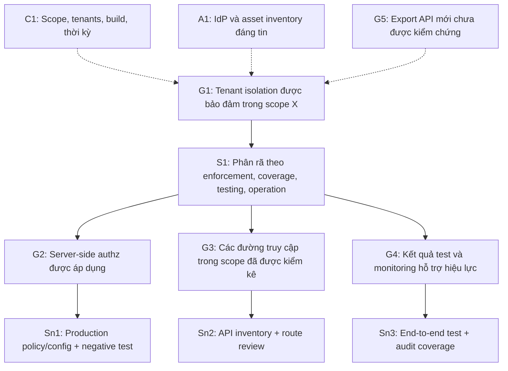
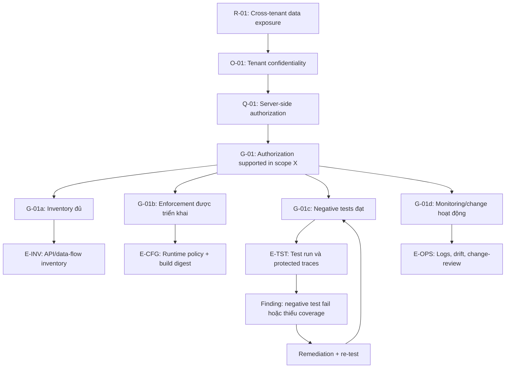
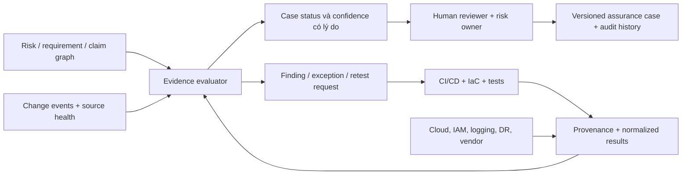

# Evidence trong assurance case: biến dữ liệu thành cơ sở kiểm chứng các tuyên bố bảo mật

## 1. Evidence giữ vai trò gì trong assurance case?

**Assurance case** là một cấu trúc lập luận có tổ chức nhằm giải thích **vì sao có thể tin** rằng một hệ thống hoặc hoạt động đáp ứng một mục tiêu xác định, trong phạm vi, giả định và giới hạn đã nêu. Với **security assurance**, một tuyên bố (claim) không thể trở thành kết luận đáng tin chỉ vì tổ chức có nhiều tài liệu. Nó cần một **argument** hợp lý và các **evidence** liên quan, có chất lượng, có thể truy vết, đủ để hỗ trợ các bước suy luận.

Trong chương **Assurance case** thuộc module **SECURITY_SECURITY_ASSURANCE**, *Evidence* là chủ đề nền tảng: liên kết rủi ro, security objectives, requirements, controls, kiểm thử, audit và remediation thành một lập luận có thể được người khác thẩm tra. Bài học tập trung vào **bằng chứng trong cấu trúc lập luận**, khác với việc chỉ quản lý file audit.

Ví dụ tổ chức muốn phát biểu:

> “Các API truy cập dữ liệu khách hàng của nền tảng SaaS được bảo vệ để tài khoản của tenant A không thể đọc dữ liệu tenant B trong phạm vi các endpoint và phiên bản production được đánh giá.”

Một số thứ có thể được đưa ra làm bằng chứng:

- Tài liệu thiết kế phân tách tenant và định nghĩa authorization.
- Cấu hình IAM và policy trong môi trường production.
- Kết quả kiểm thử âm tính: token tenant A yêu cầu tài nguyên tenant B bị từ chối.
- Kết quả kiểm tra end-to-end với API, background job và đường truy cập quản trị.
- Bản ghi deployment cho thấy đúng phiên bản đã kiểm thử đang chạy.
- Audit logs và kết quả giám sát việc truy cập trái phép, kèm coverage của log source.
- Findings, exceptions và bằng chứng khắc phục khi một đường truy cập bị thiếu kiểm soát.

Tuy vậy, **không nguồn nào tự chứng minh mọi truy cập luôn an toàn**. Một test chỉ bao phủ một endpoint; tài liệu có thể lỗi thời; log có thể bị mất nguồn; một rule scan có thể không nhận diện đường vòng. Assurance case phải thể hiện **bằng chứng hỗ trợ claim nào, suy luận nào nối chúng, những giả định và phản chứng nào vẫn tồn tại**.

### Kết quả học tập

Sau bài học, người học có thể:

1. Phân biệt evidence, observation, test result, claim, argument, assumption, context, justification và rebuttal/defeater.
2. Dùng Goal Structuring Notation (GSN) hoặc mô hình tương đương để nối claim với subclaim và evidence.
3. Đánh giá tính phù hợp, đầy đủ, chính xác, xác thực, toàn vẹn, cập nhật và độc lập của bằng chứng.
4. Xây evidence requirements và traceability matrix từ rủi ro, requirement tới security control và phép thử.
5. Xử lý evidence thiếu, cũ, mâu thuẫn, kết quả thất bại và giới hạn của kiểm thử theo phương pháp có thể audit.
6. Thiết kế evidence catalog, bảo vệ chain of custody và theo dõi invalidation khi hệ thống thay đổi.
7. Viết kết luận security assurance không khẳng định vượt quá phạm vi đã kiểm chứng.

## 2. Phân biệt dữ liệu, bằng chứng và kết luận

Có một khoảng cách logic giữa “tôi có dữ liệu” và “tôi có lý do tin claim đúng”.

| Khái niệm | Diễn giải | Ví dụ |
| --- | --- | --- |
| **Raw data / record** | Nội dung gốc được ghi lại hoặc thu thập | HTTP trace, IAM policy JSON, event trong audit log |
| **Observation** | Điều được quan sát từ dữ liệu theo phương pháp nhất định | API trả HTTP 403 với token tenant A khi gọi tài nguyên B |
| **Test result** | Kết quả quan sát so với expected behavior/criteria | Negative authorization test `T-AUTH-17` PASS |
| **Evidence artifact** | Đối tượng và metadata được giữ để đánh giá | Test run, trace đã loại bí mật, artifact digest, thời điểm, scope |
| **Evidence** | Artifact/observation được xem là căn cứ cho một claim cụ thể | Kết quả test hỗ trợ subclaim về cross-tenant access denial |
| **Claim** | Tuyên bố cần được đánh giá | “Mọi endpoint được liệt kê từ chối cross-tenant reads” |
| **Argument** | Lý do các subclaim và evidence đủ hỗ trợ claim | Mọi đường truy cập liên quan được kiểm kê, có enforcement, test và monitoring |
| **Assumption** | Điều được tạm chấp nhận cần quản lý rủi ro | Inventory API thực sự đầy đủ ở phiên bản được đánh giá |
| **Conclusion** | Kết quả đánh giá claim có phạm vi, mức tin cậy, giới hạn | “Supported for listed endpoints/build X, with issue Y open” |

Một log ghi `403` chưa tự chứng minh người gọi không có cách truy cập khác hoặc dữ liệu không bị lộ qua error body, cache, export, background job. **Bằng chứng có giá trị theo câu hỏi mà nó giúp trả lời.**

### 2.1. Evidence luôn có đối tượng và ngữ cảnh

Cùng một artifact có thể:

- Hỗ trợ claim “hệ thống có cấu hình deny-by-default tại thời điểm X”.
- **Không đủ** hỗ trợ claim “mọi hành vi truy cập trái phép đều bị chặn trong cả quý”.
- Thậm chí trở thành **phản chứng** nếu tìm thấy một tài nguyên hoặc đường đi bypass.

Vì vậy, không nên lưu evidence như một nhãn `compliant=true` tách khỏi `claim_id`, kỳ đánh giá, environment, version, population và phương pháp thu thập.

## 3. Cấu trúc claim–argument–evidence

Mô hình thường được sử dụng để trình bày assurance case là **claim–argument–evidence (CAE)**:

1. **Claim:** điều muốn khẳng định.
2. **Argument:** chuỗi lý do cho thấy claim có thể được hỗ trợ nếu những điều kiện cụ thể đúng.
3. **Evidence:** dữ liệu, kết quả kiểm thử và hồ sơ đáng tin có thể kiểm tra lại, hỗ trợ hoặc bác bỏ các bước trong argument.

Ví dụ:

- **Top-level claim:** dữ liệu giữa các tenant được cách ly theo yêu cầu đã duyệt.
- **Argument:** tất cả đường truy cập trong phạm vi sử dụng tenant identity đáng tin, kiểm tra quyền trên server, được kiểm thử âm tính và có cơ chế phát hiện regression.
- **Evidence:** endpoint inventory đã review, authorization policy đang deploy, kết quả negative tests, audit logs, coverage của CI/CD và runtime drift test.
- **Giới hạn:** sản phẩm export mới ngoài phạm vi và một nhà cung cấp phụ chưa được đánh giá.

Nếu argument nói “vì mọi endpoint đều có policy” nhưng evidence chỉ có kiểm thử một endpoint, có một **lỗ hổng suy luận**. Nếu tài liệu mô tả policy mà runtime không bật, có một **lỗ hổng triển khai**. Nếu runtime đã test một lần nhưng chính sách vừa thay đổi, có một **lỗ hổng về tính cập nhật**.

### 3.1. Evidence không thay thế logic lập luận

Kết luận không nên được tạo bằng phép cộng tùy ý: “có 7 tài liệu nên đạt 7/7”. Một finding nghiêm trọng như cross-tenant read thành công có thể bác bỏ top-level claim dù hàng trăm test khác PASS.

Mức độ thuyết phục phụ thuộc vào **relevance, coverage, quality và cách evidence đối mặt với các giả thuyết thay thế**, chứ không phải số lượng.

## 4. GSN và cách biểu diễn evidence

**Goal Structuring Notation (GSN)** là một cách trình bày lập luận bảo đảm dưới dạng node và mối quan hệ. Có thể sử dụng GSN hoặc phương pháp lập luận khác; điều quan trọng là bảo toàn ý nghĩa của từng thành phần.

| Thành phần GSN | Ý nghĩa | Minh họa |
| --- | --- | --- |
| **Goal (G)** | Claim cần chứng minh | G1: Production APIs không cho truy cập chéo tenant |
| **Strategy (S)** | Cách phân rã claim thành subclaims | S1: chứng minh policy, coverage, tests và operation |
| **Context (C)** | Định nghĩa, scope, thuật ngữ và tiêu chí áp dụng | C1: API inventory/build, tenant boundaries |
| **Assumption (A)** | Điều kiện cần giả định đúng | A1: identity từ IdP không bị giả mạo |
| **Justification (J)** | Giải thích vì sao chọn chiến lược hoặc phân rã | J1: bảo vệ cả preventive và detective controls |
| **Solution (Sn)** | Evidence/artefact hỗ trợ các claim con | Sn1: kết quả test, Sn2: policy diff và audit |
| **Undeveloped goal** | Claim chưa được phát triển thành argument/evidence | Gx: chưa kiểm chứng export API mới |

Hình dưới là **sơ đồ Mermaid mô phỏng quan hệ lập luận**, không phải hình ký pháp GSN chuẩn:



Các mũi tên đứt tới Context/Assumption ở sơ đồ này chỉ biểu diễn liên hệ để đọc; **không xem chúng là quan hệ chứng minh tương đương Solution**. Nếu G5 chưa được phát triển, phải **loại khỏi claim tổng có lý do hoặc để top claim ở trạng thái chưa đủ bằng chứng**. Không để node undeveloped bị che vì sơ đồ tổng vẫn đẹp.

### 4.1. Cách đọc một assurance case

Reviewer nên lần được:

- Top-level claim chính xác, giới hạn ở hệ thống và thời kỳ nào?
- Strategy phân rã có bao phủ các rủi ro và failure modes trọng yếu?
- Mỗi subclaim có điều kiện chấp nhận rõ không?
- Evidence nào trực tiếp hỗ trợ subclaim nào, có đúng source và version không?
- Có assumptions, exceptions, context và defeaters nào bị bỏ qua?
- Claim nào chưa có bằng chứng và ai chịu trách nhiệm?
- Kết luận cấp trên có vượt quá độ mạnh của các subclaim cấp dưới không?

Không nên biến sơ đồ thành “cây chứng nhận PASS” cứng nhắc. Nó là một **lập luận có thể bị phản biện và cập nhật**.

## 5. Thiết kế claim để có thể kiểm chứng

Một claim mơ hồ như “ứng dụng được bảo mật tốt” gần như không thể xác minh. Hãy định nghĩa ranh giới và tiêu chí.

| Thành phần claim | Câu hỏi bắt buộc |
| --- | --- |
| **Subject** | Dịch vụ, ứng dụng, hệ thống, dữ liệu hoặc chức năng nào? |
| **Security objective** | Confidentiality, integrity, availability hoặc đặc tính gì? |
| **Threat/failure context** | Chống các hành vi hoặc lỗi được giả định nào? |
| **Environment/version** | Production, staging, build digest, architecture revision nào? |
| **Population** | Tất cả endpoints, accounts, transaction types hay mẫu đã xác định? |
| **Time** | Point-in-time, giai đoạn kiểm tra hay continuous monitoring tới mốc nào? |
| **Acceptance criteria** | Điều kiện nào là PASS/FAIL? |
| **Assumptions** | Những giả định về dependency hoặc hành vi attacker nào? |
| **Limitations** | Điều chưa kiểm tra hoặc không thể kết luận? |
| **Owner** | Ai sở hữu claim và chấp nhận rủi ro khi có khoảng trống? |

### 5.1. Cải thiện cách viết

**Claim yếu:** “Hệ thống không có lỗ hổng truy cập chéo tenant.”

**Claim phù hợp hơn:**

> “Đối với các endpoint đọc dữ liệu khách hàng được liệt kê trong inventory phiên bản I, triển khai production build B tại thời điểm T sử dụng authorization theo tenant phía server. Các kiểm thử âm tính và kiểm tra cấu hình đã thực hiện không phát hiện truy cập chéo tenant trong tập tình huống đã định nghĩa. Kết luận không bao gồm export service mới và không chứng minh không tồn tại các đường bypass chưa được nhận diện.”

Câu sau vẫn không nên được tự động đánh `SUPPORTED` nếu test đã phát hiện vi phạm, inventory thiếu hoặc nguồn evidence chưa đủ tin cậy. **Viết claim rõ không thay cho thu thập bằng chứng.**

## 6. Phân loại evidence theo loại kết luận

Một assurance case thường cần kết hợp nhiều loại bằng chứng để giải quyết những rủi ro khác nhau.

| Loại evidence | Ví dụ | Hỗ trợ claim gì? | Giới hạn |
| --- | --- | --- | --- |
| **Requirements/design** | Policy, threat model, data-flow diagram | Control được thiết kế nhằm đáp ứng yêu cầu nào | Không chứng minh đã triển khai |
| **Implementation** | IaC state, IAM bindings, deployed artifact digest | Control được bật trên một scope tại thời điểm quan sát | Có thể đổi sau snapshot |
| **Static analysis** | SAST, secret scan, policy-as-code | Những lỗi thuộc phạm vi bộ kiểm tra và mã đã chạy | False negatives và coverage giới hạn |
| **Dynamic/negative test** | Authz bypass test, API integration test | Hành vi thực tế với đầu vào, actor và environment đã thử | Không chứng minh mọi input/path |
| **Operational telemetry** | Audit event, alert, source health, access-review records | Control hoặc giám sát hoạt động trong khoảng quan sát | Có thể thiếu event, log source hoặc retention |
| **Change/approval evidence** | Pull request, approval, deployment record | Một thay đổi được phê duyệt/thực hiện theo quy trình | Ticket không chứng minh runtime đúng |
| **Incident/failure evidence** | Post-incident report, root-cause, remediation | Hành vi kiểm soát khi có sai lệch, bài học và fix | Có thể bộc lộ claim cũ sai |
| **Independent review** | Audit report, red-team/pentest result | Đánh giá theo scope và phương pháp đã định | Chỉ bao phủ kỳ, hệ thống, phương pháp trong báo cáo |
| **Recovery evidence** | Restore test, DR drill, transaction reconciliation | Khả năng phục hồi trong kịch bản đã thử | Không bảo đảm mọi thảm họa |
| **Third-party evidence** | SOC 2 report, vendor attestation | Controls do vendor vận hành trong phạm vi được đánh giá | Không mặc nhiên bao phủ khách hàng và subprocessor mới |

Đối với một claim có rủi ro cao, chỉ một ảnh chụp cấu hình ít khi đủ. **Kết hợp các nguồn bổ trợ** — cấu hình, phép thử và bằng chứng vận hành — có thể tăng sức thuyết phục; nhưng phải kiểm tra chúng có **phụ thuộc vào cùng một nguồn sai** hay không.

### 6.1. Design và operating effectiveness khác nhau

Policy yêu cầu “thay đổi quyền đặc biệt phải có approval” là bằng chứng thiết kế. Workflow IAM có trường approval ID là bằng chứng triển khai. Log các role grants được đối chiếu với approval xảy ra **trước khi cấp quyền** mới hỗ trợ hiệu quả vận hành theo kỳ.

Cả ba loại được trình bày trong assurance case sẽ mạnh hơn một screenshot “approval enabled”. Reviewer phải chỉ rõ mỗi loại bằng chứng chứng minh điều gì, chứ không nâng kết luận từ mức thiết kế lên vận hành mà thiếu cầu nối.

## 7. Tính chất của evidence có thể chấp nhận

Có ít nhất chín câu hỏi cần đặt với một artifact trước khi sử dụng nó cho claim.

| Tiêu chí | Câu hỏi thẩm định | Bằng chứng hỗ trợ kiểm tra |
| --- | --- | --- |
| **Authenticity** | Ai hoặc hệ thống nào thực sự tạo ra record? | Source identity, signature, API provenance |
| **Integrity** | Artifact có bị sửa trái phép từ lúc tạo/thu thập? | Versioning, checksum, access audit |
| **Relevance** | Nội dung có trực tiếp trả lời subclaim? | Claim–test mapping, rationale |
| **Completeness** | Đã bao phủ population, đối tượng, nguồn, kỳ cần thiết? | Inventory, source coverage, sample method |
| **Accuracy** | Giá trị/timestamp có đúng với hệ thống và ngữ nghĩa dữ liệu? | Đối chiếu, schema validation, independent source |
| **Freshness** | Có còn đại diện cho claim tại thời điểm đánh giá? | Observation time, age rule, change triggers |
| **Scope compatibility** | Đúng sản phẩm, version, region, tenant, môi trường? | Build ID, environment and asset IDs |
| **Reproducibility** | Người khác có thể lặp lại phép thử/truy vấn? | Query/test version, input, expected result |
| **Independence** | Nhiều chứng cứ có thật sự từ nguồn hoặc phương pháp độc lập? | Source dependency analysis, reviewer separation |
| **Security/privacy protection** | Evidence được thu thập/chia sẻ đúng quyền, không làm lộ dữ liệu? | Classification, redaction, access policy |
| **Uncertainty disclosure** | Ngoại lệ, giả định và điểm không biết có được nêu? | Exception register, test limitations, open findings |

**Hash là bằng chứng toàn vẹn trong một phạm vi**, không tự chứng minh nguồn chính xác. Nếu attacker điều khiển collector để tạo record sai rồi hash file, digest vẫn có thể hợp lệ. Khi assurance case liên quan hệ thống có thể bị compromise, provenance và **nguồn đối chứng nằm ngoài cùng trust boundary** đặc biệt quan trọng.

### 7.1. Rủi ro “hai bằng chứng” nhưng cùng một lỗi nguồn

Ví dụ:

- Test dashboard A đọc dữ liệu từ cùng một API truy vấn với dashboard B.
- Báo cáo audit PDF được sinh từ chính dashboard A.
- Hai artifact trùng kết quả nhưng dựa vào cùng collector đã mất quyền đối với account C.

Chúng **không phải hai xác nhận độc lập**. Argument phải ghi rõ dependency evidence; nếu upstream data bị thiếu, mọi downstream reports cần được đánh giá lại.

## 8. Từ risk scenario tới evidence requirements

Trước khi chạy test, cần thiết kế **cần bằng chứng gì để trả lời câu hỏi rủi ro nào**.

Ví dụ rủi ro: actor thuộc tenant A dùng endpoint đọc hóa đơn của tenant B.

| Bước | Kết quả cụ thể |
| --- | --- |
| **Risk R-01** | Unauthorized cross-tenant read làm lộ dữ liệu hóa đơn |
| **Objective O-01** | Bảo mật thông tin của từng tenant |
| **Requirement Q-01** | Đường đọc hóa đơn phải kiểm tra authorization theo actor và tenant phía server |
| **Control CT-01** | Middleware/API resource policy và kiểm tra quyền dữ liệu ở lớp phù hợp |
| **Top-level claim G-01** | Các đường đọc hóa đơn trong phạm vi chống được cross-tenant access theo tiêu chí thử |
| **Subclaim G-01a** | Inventory endpoint và data path được xác minh đầy đủ theo scope |
| **Subclaim G-01b** | Policy được triển khai ở đúng build/environment |
| **Subclaim G-01c** | Negative tests cho phép đối chứng đúng/mis-scoped actor/resource |
| **Subclaim G-01d** | Giám sát, change controls và xử lý regression đang vận hành |
| **Evidence requirements** | API inventory, deployed digest, policy config, test run/trace, coverage logs, change review |
| **Open defeater** | Endpoint export mới chưa kiểm thử; service token có thể bypass middleware |

Đừng bắt đầu bằng bộ evidence có sẵn rồi viết ngược claim cho tất cả đều PASS. Có thể tái sử dụng artifact, nhưng **claim được hình thành theo rủi ro và yêu cầu bảo mật**, không theo sự tiện lợi của báo cáo.

### 8.1. Mỗi subclaim cần acceptance criteria riêng

Chẳng hạn G-01c yêu cầu:

- Test với một actor hợp lệ trong tenant A gọi dữ liệu tenant A: kết quả hợp lệ theo business rule.
- Cùng actor gọi tài nguyên tenant B: quyền bị từ chối và không lộ nội dung nhạy cảm qua response.
- Thử IDOR/BOLA với ID thay đổi, batch list, pagination, indirect lookup và endpoint liên quan trong scope.
- Thử service-to-service identity và admin/support path nếu có trong threat model.
- Trace gắn test ID, actor/tenant/resource đã dùng dữ liệu giả hoặc được bảo vệ, build digest và kết quả thực tế.
- Các trường hợp không chạy, fail hoặc skipped phải được nêu trong coverage, không được tự coi PASS.

Kiểm tra HTTP status thôi chưa đủ: một endpoint có thể trả `403` nhưng log hoặc response body vẫn chứa thông tin không được phép. Cần so sánh **đầu ra dữ liệu và tác dụng phụ** theo tiêu chí.

## 9. Lập traceability graph: claim, evidence và rủi ro

Một mô hình traceability rõ giúp auditor tìm được điều nào chưa hỗ trợ.



Một evidence có thể hỗ trợ nhiều subclaims; một subclaim có thể cần nhiều artifacts. Do đó cấu trúc thực tế là **đồ thị nhiều-nhiều**, không bắt buộc một cây mà mỗi node chỉ có một con duy nhất. Graph cần lưu điều kiện scope và trạng thái của từng cạnh `supports`, `contradicts`, `depends_on` hoặc `supersedes`.

### 9.1. Khi evidence phản bác claim

Nếu test `T-AUTH-17` trả về dữ liệu tenant B cho token A, kết quả **FAIL là bằng chứng quan trọng**, không phải file “xấu” cần xóa. Nó có thể làm G-01c không đạt, và do đó claim tổng cần sửa hoặc rút lại. Phương pháp tốt lưu phản chứng, thông báo người chịu trách nhiệm, remediation và kết quả retest; không ghi đè test cũ bằng lần PASS mới.

## 10. Ma trận claim–evidence mẫu

Bảng minh họa cho một hệ thống SaaS có nhiều tenant. Các mã bên dưới là **giả định phục vụ bài học**.

| Subclaim | Tiêu chí chấp nhận | Evidence dự kiến | Kiểm tra chất lượng | Trạng thái minh họa |
| --- | --- | --- | --- | --- |
| **G-01a: scope complete** | Inventory bao phủ các đường đọc dữ liệu trong phạm vi | `E-INV-01` từ API catalog + route scan | Đối chiếu deployment, gateway và worker | `UNDER_REVIEW` vì export API mới |
| **G-01b: authz deployed** | Đúng policy được bật ở build production | `E-CFG-03`, `E-DEP-02` | So runtime config, digest và tenant context | `SUPPORTED` trong scope đã kiểm |
| **G-01c: cross-tenant deny** | Negative tests theo test matrix không truy cập sai | `E-TST-17`, trace/DB check | Kết quả thực, retries, test coverage | `UNSUPPORTED` nếu có test FAIL |
| **G-01d: privileged path** | Admin/support/service path có kiểm soát tương ứng | `E-IAM-09`, `E-TST-19` | Phê duyệt quyền, negative tests, audit | `PENDING` nếu chưa test service token |
| **G-01e: detection** | Những hành vi truy cập sai thuộc scope có thể ghi log/phát hiện | `E-LOG-11`, `E-DET-04` | Event đến collector, rule replay, missing data | `PARTIAL` nếu một account mất log |
| **G-01f: changes** | Thay đổi policy/route kích hoạt review và test | `E-CICD-08`, deployment audit | Version, coverage và bypass path | `SUPPORTED` sau kiểm tra cụ thể |

Lưu ý quan trọng: khi claim tổng dùng điều kiện “tất cả đường truy cập trong phạm vi”, **một subclaim `PENDING` hoặc `UNSUPPORTED` trọng yếu khiến claim tổng chưa thể được xác nhận hoàn toàn**. Không lấy trung bình trạng thái để biến thiếu sót trọng yếu thành PASS.

### 10.1. Evidence requirement nên ghi gì?

Một phiếu yêu cầu bằng chứng thường có:

- `evidence_requirement_id`, `claim_id`, `risk_id` và `control_id`.
- Câu hỏi đánh giá, acceptance criteria và phép thử được chọn.
- Environment, asset/tenant, build, population và khoảng thời gian.
- Nguồn dự kiến, phương pháp thu thập, đầu ra tối thiểu và dữ liệu cần bảo vệ.
- Owner sản xuất, reviewer độc lập phù hợp, thời hạn và trigger refresh.
- Phương pháp xử lý lỗi: missing, stale, invalid, unsupported, contradiction.
- Giới hạn dự kiến (ví dụ sample thay vì population toàn bộ).

## 11. Chất lượng lập luận: warrant, assumption và defeater

**Warrant** là lý do nối một observation/evidence tới claim. Ví dụ: “Nếu một server-side authorization test sử dụng đúng identity, endpoint, build và dữ liệu tenant thực sự được cách ly, test FAIL/PASS cung cấp thông tin về enforcement trên đường đó.”

Nếu actor được giả lập bằng header client tùy ý nhưng production dùng identity từ IdP, warrant của test có thể yếu hoặc không áp dụng. Nếu test chạy staging còn claim nói production, cần evidence bổ sung cho sự tương đương môi trường và build.

### 11.1. Assumption

Một assurance case không thể kiểm tra mọi thứ từ đầu. Các assumptions có thể bao gồm:

- IdP cung cấp tenant/subject identity được xác thực theo chính sách.
- Asset inventory và source data chứa tất cả API endpoint thuộc scope.
- Clock và event ordering đủ chính xác để đối chiếu.
- Cơ chế deploy đảm bảo artifact được test chính là artifact production.
- Các nguồn log không bị attacker chiếm quyền hoặc mất dữ liệu chưa phát hiện.

Assumption cần có **owner, lý do chấp nhận, bằng chứng kiểm tra khi có thể và trigger đánh giá lại**. Đừng đưa “hệ thống chắc chắn không bị xâm nhập” thành assumption rồi từ đó kết luận an toàn.

### 11.2. Defeater / rebuttal

**Defeater** là tình huống, dữ kiện hoặc lập luận có thể làm suy yếu hay bác bỏ claim. Ví dụ:

- Endpoint export không nằm trong inventory nhưng có thể đọc dữ liệu.
- Service account quyền toàn tenant không đi qua middleware.
- Test dùng mock authorization thay cho production enforcement.
- Source logs im lặng do collector mất quyền.
- Schema mới làm một đường kiểm tra resource ownership bị bỏ qua.
- Pentest tìm được đường IDOR truy cập thành công.

Tổ chức nên chủ động đặt câu hỏi **“Có điều gì khiến top-level claim sai dù những evidence hiện có vẫn PASS?”**. Điều này giúp assurance case tránh thiên lệch xác nhận và có giá trị trong threat modeling.

### 11.3. Phân biệt giải quyết và che giấu defeater

Nếu tìm được một bypass, không nên xóa khỏi argument hoặc đổi tên claim để làm đẹp kết quả. Hãy ghi finding, owner, risk, containment, corrective action và test lại. Sau sửa lỗi, giữ cả evidence phát hiện và evidence retest; kết luận mới có thể có hiệu lực **từ thời điểm xác minh**, không tự sửa sự thật ở kỳ trước.

## 12. Bao nhiêu evidence là “đủ”?

Không có công thức “ba artifact là đủ”. **Sufficiency** phụ thuộc vào claim, failure modes, assurance level mong muốn, độ tin cậy của nguồn và chi phí chấp nhận sai lầm.

Có thể dùng một tập câu hỏi:

1. Mọi nhánh lập luận cần thiết của top claim có được phát triển và hỗ trợ không?
2. Evidence có khớp claim type: design, implementation hay operating effectiveness?
3. Population và scope có đầy đủ trong kỳ đánh giá?
4. Có kết hợp preventive, detective và corrective controls cho rủi ro quan trọng?
5. Phương pháp kiểm thử có thử trường hợp âm tính, lạm dụng, lỗi nguồn và đường bypass?
6. Có phản chứng hay exceptions chưa xử lý?
7. Nguồn có đủ độc lập và tin cậy, hay tất cả đi qua một pipeline chung?
8. Có gap do thiếu log, môi trường, version hay thay đổi sau test?
9. Người có thẩm quyền đã đánh giá rủi ro tồn dư và giới hạn?
10. Kết luận cuối có mạnh hơn những gì evidence thực sự hỗ trợ?

### 12.1. Giới hạn của số lượng test PASS

Giả sử 50 negative test độc lập theo 50 tình huống khác nhau đều PASS. Điều này hỗ trợ rằng **50 tình huống đó** không bị bypass trong điều kiện đã thử. Nó **không chứng minh** mọi loại attack đều không thể thành công, bởi còn có unknown paths, logic flaws và điều kiện khác.

Với sampling, nếu chọn một mẫu không đại diện hoặc bỏ những sự kiện không có log, tỷ lệ PASS không thể suy rộng hợp lệ cho toàn hệ thống. Nếu phép thử là 50 lần lặp một route với cùng actor, số lượng 50 không tương đương coverage 50 đường truy cập.

Khi dùng xác suất thống kê để diễn giải kết quả mẫu, phải xác định phương pháp chọn mẫu, giả định độc lập, population, confidence interval và rủi ro sai loại; **đừng tự gắn mức “99% an toàn” vì không quan sát được lỗi**.

### 12.2. Mức độ bằng chứng theo hậu quả

Một report tổng hợp có thể đủ cho thay đổi rủi ro thấp trong sandbox; một claim về phân tách tenant của dữ liệu tài chính production có thể cần test end-to-end, đối chiếu độc lập, giám sát nguồn, pentest có phạm vi phù hợp và kiểm tra sau triển khai.

Điều này không có nghĩa “rủi ro cao thì bắt buộc phải dùng một công cụ cụ thể”, mà là cần **lý do chọn độ sâu kiểm chứng tương xứng hậu quả của kết luận sai**.

## 13. Bằng chứng mâu thuẫn và cách tổng hợp kết luận

Một assurance case có thể nhận các kết quả không nhất quán:

- Config snapshot cho thấy deny-by-default bật; test thực tế vẫn đọc được dữ liệu sai tenant.
- Pipeline CI PASS; deployment thực tế lại chạy image digest khác.
- Vendor báo dịch vụ có backup; restore exercise không giải mã được dữ liệu.
- Access review ghi “đã phê duyệt”; IAM audit cho thấy role grant diễn ra trước approval.

Khi mâu thuẫn, **không chọn bằng chứng dễ chịu nhất**. Cần phân tích:

1. Hai nguồn nói về cùng asset, version, environment và thời kỳ không?
2. Chúng kiểm chứng cùng control hay các mức khác nhau (design vs operation)?
3. Nguồn nào có độ tin cậy cao hơn trong bối cảnh đó?
4. Có thể tái hiện test hoặc dùng nguồn độc lập để giải thích không?
5. Trạng thái hiện tại có an toàn để tiếp tục hay cần containment?
6. Nếu chưa giải quyết được, claim nên là `DISPUTED`/`INCONCLUSIVE` thay vì PASS?

**Bằng chứng thất bại của kiểm thử thực tế** thường có giá trị rất mạnh đối với claim tuyệt đối như “không tồn tại cross-tenant access trên endpoint này”; nó không thể bị triệt tiêu chỉ vì nhiều tài liệu thiết kế PASS. Bối cảnh, khả năng tái hiện và sự chính xác của test vẫn phải được xác minh.

## 14. Freshness, validity và invalidation trong assurance case

Assurance case có vòng đời. Evidence từng đáng tin có thể trở thành **historical evidence** sau deployment, thay đổi policy, thêm tenant, thay KMS, rotate key hoặc đổi nhà cung cấp.

| Loại thay đổi | Claim/evidence bị ảnh hưởng | Phản ứng cần xem xét |
| --- | --- | --- |
| Thêm endpoint export hoặc batch API | Inventory, negative tests và top claim tenant isolation | Cập nhật scope, threat model và test cases |
| Thay middleware/authentication provider | Design và runtime authorization evidence | Review luồng identity, regression/negative tests |
| Cấp role admin mới | Access control và privileged review claims | Kiểm tra policy, approval và audit |
| Deploy build mới | SAST/DAST, artifact provenance, integration tests | Gắn kết quả với digest đang chạy |
| Đổi logging pipeline | Operating evidence và detection coverage | Test end-to-end, source health và backfill |
| Đổi region, cloud account hoặc subprocessor | Scope, third-party và data residency evidence | Review impact và hợp đồng khi áp dụng |
| Sửa encryption/key policy | Claims bảo vệ dữ liệu, DR/restore | Kiểm tra key use, decrypt, access denial và restore |
| Phát hiện security incident nghiêm trọng | Assumptions và trustworthiness của evidence | Điều tra, đánh giá lại case và preserve artifacts |

### 14.1. Các mốc thời gian cần giữ riêng

- `event_time`: sự kiện trong hệ thống xảy ra.
- `observed_at`: thời điểm trạng thái được quan sát.
- `collected_at`: lúc collector nhận evidence.
- `test_run_at`: lúc phép thử thực hiện.
- `period_start/end`: khoảng mà bằng chứng được dự định bao phủ.
- `reviewed_at`: lúc analyst đánh giá.
- `freshness_due_at`: thời hạn phải kiểm chứng lại theo policy.
- `superseded_at`: lúc artifact được thay để phục vụ claim mới.

**Ngày tải file** không thay cho **thời điểm trạng thái được quan sát**. Một báo cáo SOC 2 mới phát hành có thể bao phủ kỳ kết thúc từ nhiều tháng trước; một pentest tháng trước có thể chỉ xét build cũ. Khi claim nói về hệ thống hiện tại, cần kiểm tra **thay đổi liên quan sau mốc evidence**.

### 14.2. Lưu lịch sử để giải thích quyết định

Không chỉnh sửa artifact của kỳ trước để làm giống trạng thái mới. Lưu version mới, mối quan hệ `supersedes`, phạm vi, review và kết luận mới. Bằng chứng cũ vẫn có thể quan trọng cho audit, forensics, root cause và giải thích vì sao người ra quyết định từng đánh giá rủi ro như vậy.

## 15. Provenance, integrity và chain of custody

Trong security assurance, evidence có thể chứa tên account, cấu hình mạng, lỗ hổng, user IDs, dữ liệu khách hàng và khóa truy cập. Quản lý bằng chứng phải bảo vệ **tính tin cậy lẫn tính bí mật**.

### 15.1. Chuỗi nguồn gốc

Một artifact có giá trị thường cần trả lời:

- **Source:** hệ thống, tài khoản, môi trường, vùng và API nào tạo ra dữ liệu?
- **Collector:** agent/job nào thu thập, dùng quyền gì, có thể đã bị xâm nhập không?
- **Transformation:** đã lọc, ẩn danh, chuẩn hóa, deduplicate, aggregate bằng thuật toán/query version nào?
- **Time:** event time, observation, collection, verification và period coverage?
- **Storage:** bản gốc được lưu ở đâu, quyền nào truy cập, có versioning và retention?
- **Review:** ai đã kiểm tra scope, expected outcome, exceptions và conclusion?
- **Link:** artifact hỗ trợ claim/test/risk ID nào, có nguồn đối chứng không?

### 15.2. Chain of custody khi nhạy cảm

Với sự cố, tố tụng hoặc điều tra nội bộ có yêu cầu nghiêm ngặt, cần quản lý việc thu thập, chuyển giao, lưu trữ, phân quyền và xử lý chứng cứ theo chính sách áp dụng. Có thể lưu hash/checksum ở các mốc phù hợp, danh tính người/tiến trình nhận, thời điểm, lý do và kết quả kiểm tra toàn vẹn.

Không gửi raw packet captures chứa token, personal data hoặc secret vào một ticket truy cập rộng. Dùng kho bằng chứng có phân quyền, tham chiếu ID và bản trích xuất đã redacted. Nếu redaction làm mất thông tin quan trọng cho phép tái kiểm tra, phải giữ **bản gốc được bảo vệ** và tài liệu hóa quy tắc redaction.

### 15.3. Không đánh đồng hash với authenticity

Hash giúp phát hiện thay đổi của một tập byte khi biết digest đáng tin ban đầu; nó không khẳng định dữ liệu đúng sự thật hoặc người tạo đáng tin. Chữ ký số cũng cần kiểm tra key, trust chain, quyền ký và thời hạn; signed artifact của một nguồn bị compromise vẫn cần xét bối cảnh.

## 16. Evidence catalog và đồ thị truy vết có cấu trúc

Khi assurance case có hàng trăm node, chỉ lưu link tài liệu trong slide là không đủ. Một **evidence catalog** có ID ổn định giúp liên kết claim, risk, test và artifact.

Ví dụ YAML dưới đây là **schema minh họa**, chưa phải kết quả thực của một hệ thống. Các giá trị được cố ý đặt ở trạng thái cần xem xét; không dùng chúng để khẳng định production đã đạt.

```yaml
assurance_case:
  id: CASE-TENANT-ISOLATION-01
  subject: invoice-api
  environment: production
  claim_id: G-01
  claim: "Tenant A cannot read tenant B data via scoped invoice endpoints"
  scope:
    api_inventory_version: "inv-api-v4"
    build_digest: "example-build-digest"
    regions: ["region-a"]
    assessment_period: "2026-11-01/2026-11-28"
  status: UNDER_REVIEW
  assumptions:
    - id: A-01
      description: "Source identities are correctly validated by the IdP"
      owner: identity_team
      validation_status: pending
  subclaims:
    - id: G-01a
      statement: "Scoped endpoint inventory is complete"
      evidence_refs: ["E-INV-01"]
      status: UNDER_REVIEW
    - id: G-01b
      statement: "Authorization checks are deployed"
      evidence_refs: ["E-CFG-03", "E-DEP-02"]
      status: PENDING_EVIDENCE
    - id: G-01c
      statement: "Cross-tenant negative tests pass"
      evidence_refs: ["E-TST-17"]
      status: PENDING_TEST
  defeaters:
    - id: D-01
      description: "New export endpoint is not in inventory"
      disposition: OPEN
      owner: api_team
  evidence:
    - evidence_id: E-TST-17
      test_id: T-AUTH-17
      producer: security_test_pipeline
      artifact_ref: controlled-evidence-store://test/T-AUTH-17
      artifact_digest: "illustrative-digest-not-verified"
      observed_at: "2026-11-28T09:00:00Z"
      collected_at: "2026-11-28T09:02:00Z"
      build_digest: "example-build-digest"
      population: "Defined cross-tenant negative test matrix"
      result: pending
      reviewer: security_assurance_team
      limitations:
        - "Export endpoint not tested"
  review:
    accountable_owner: service_security_owner
    status: NOT_APPROVED
```

Để chạy trong production, schema phải được version hóa và kiểm tra: `evidence_refs` có tồn tại không, referenced test đúng build không, artifacts có thể truy xuất qua quyền được phép không, và có open defeater nào cần giải quyết.

### 16.1. Những trường không nên rút gọn quá mức

| Trường | Vì sao quan trọng |
| --- | --- |
| `claim_id` và `claim_version` | Phân biệt nội dung claim và thay đổi ý nghĩa |
| `subclaim_id`, `supports`, `contradicts` | Xác định quan hệ lập luận, không chỉ danh sách link |
| `risk_id` và `requirement_id` | Biết claim giải quyết mục tiêu nào |
| `scope`, `asset/population`, `build/version` | Tránh sử dụng evidence sai phạm vi |
| `source`, `query/test_version`, `artifact_ref` | Truy vết và tái hiện được |
| `observed_at`, `period_end`, `reviewed_at` | Kiểm tra freshness và thời kỳ kết luận |
| `result`, `exception`, `limitation` | Không giấu test thất bại hoặc khoảng trống |
| `reviewer`, `approval`, `finding_id` | Trách nhiệm, audit và khắc phục |
| `assumption`, `defeater`, `invalidation_trigger` | Cấu trúc lập luận vẫn đứng vững khi điều kiện thay đổi? |

Không nên biến evidence catalog thành nơi chứa token hoặc dữ liệu khách hàng gốc. Danh mục chỉ giữ tham chiếu và metadata tối thiểu cần cho traceability.

## 17. Evidence trong chương trình continuous assurance

Một assurance case chỉ được cập nhật vào cuối quý dễ bị lạc hậu khi code, IAM, logging và nhà cung cấp thay đổi liên tục. **Continuous assurance** không có nghĩa mọi claim luôn được chứng minh trong mọi khoảnh khắc; nó có nghĩa chương trình thường xuyên thu nhận sự kiện, xác minh tác động tới claim và công bố khoảng trống khi cần.



### 17.1. Mọi automation phải kiểm tra cả dữ liệu và metadata

Một evaluator tối thiểu cần:

1. Tìm đúng `claim_id` và evidence requirements được version hóa.
2. Kiểm tra artifact source, integrity, scope, thời gian và dữ liệu đầy đủ.
3. Đối chiếu test result với acceptance criteria; phân biệt PASS, FAIL, SKIP, ERROR.
4. Xác định change events sau test có làm kết quả stale không.
5. Đánh giá thiếu coverage, mâu thuẫn và open defeaters.
6. Gán trạng thái subclaim theo quy tắc đã phê duyệt.
7. Không tự gán top claim `SUPPORTED` khi subclaim trọng yếu đang FAIL/UNKNOWN.
8. Tạo finding/retest request với owner và deadline khi phát hiện gap.
9. Lưu decision reason, policy version, nguồn evidence và thời điểm đánh giá.
10. Chuyển quyết định rủi ro hoặc phê duyệt ngoại lệ tới người có thẩm quyền.

Pseudo-code chỉ minh họa kiểm tra **trạng thái bằng chứng**, không thể thay thế sự đánh giá logic của reviewer:

```text
function reviewSubclaim(subclaim, evidenceSet, scope, asOfTime):
    required = getRequiredEvidence(subclaim)

    if anyUnresolvedCriticalDefeater(subclaim):
        return "DISPUTED_OR_UNSUPPORTED"

    if not coversScopeAndPeriod(required, evidenceSet, scope, asOfTime):
        return "INSUFFICIENT_EVIDENCE"

    if anyInvalidSourceOrStaleEvidence(required, evidenceSet):
        return "NEEDS_REVALIDATION"

    if anyVerifiedFailureContradictsAcceptanceCriteria(required, evidenceSet):
        return "UNSUPPORTED"

    if not validateWarrantAndAssumptions(subclaim, evidenceSet):
        return "REVIEW_REQUIRED"

    return "EVIDENCE_SUFFICIENT_FOR_REVIEW"
```

`EVIDENCE_SUFFICIENT_FOR_REVIEW` không có nghĩa “security bảo đảm tuyệt đối”; nó chỉ nói bộ evidence đáp ứng những kiểm tra đã quy định, còn lập luận cuối cùng phải có thẩm quyền review phù hợp.

### 17.2. Kiểm tra failure mode của chính pipeline assurance

- Collector không có quyền ở một cloud account nhưng dashboard vẫn xanh.
- CI/CD chỉ test feature flag bật trên staging, trong khi production dùng cấu hình khác.
- Automation chỉ đọc test PASS, bỏ qua SKIP/ERROR.
- Retest PASS ghi đè bằng chứng FAIL ban đầu.
- Không có event từ source vì pipeline lỗi nhưng hệ thống coi là “không có vi phạm”.
- Một chứng nhận vendor mới được upload nhưng kỳ và scope không bao phủ sản phẩm vừa mua.

Chương trình phải có health/coverage tests cho chính hệ thống đánh giá, tránh **assurance false confidence**.

## 18. Quy trình review, chấp nhận và xử lý claim thiếu bằng chứng

Assurance case cần một vòng đời rõ ràng, tránh để các nhãn `PASS` vô chủ.

| Trạng thái | Ý nghĩa |
| --- | --- |
| `DRAFT` | Claim và argument đang được xây dựng, evidence requirements chưa đầy đủ |
| `UNDER_REVIEW` | Reviewer đang kiểm tra logic, nguồn, scope và chất lượng |
| `SUPPORTED_WITH_LIMITATIONS` | Evidence đủ theo phương pháp được phê duyệt trong giới hạn công bố |
| `PARTIALLY_SUPPORTED` | Một số nhánh được hỗ trợ, nhánh khác còn thiếu/giới hạn |
| `INSUFFICIENT_EVIDENCE` | Chưa đủ bằng chứng cho claim trong scope |
| `UNSUPPORTED` | Bằng chứng hiện có không hỗ trợ hoặc có phản chứng đủ mạnh |
| `DISPUTED` | Có evidence mâu thuẫn/defeater chưa giải quyết |
| `NEEDS_REVALIDATION` | Thay đổi hoặc thời gian khiến case cũ không đại diện hiện tại |
| `SUPERSEDED` | Một phiên bản claim/case mới thay thế phiên bản cũ |
| `CLOSED_HISTORICAL` | Đóng kỳ đánh giá, giữ bản để phục vụ truy vết |

Các nhãn là gợi ý nội bộ. Nếu muốn ghi `ACCEPTED_RISK`, nên lưu **ở trường quyết định rủi ro riêng** chứ không đồng nhất với `SUPPORTED`. Người có quyền chấp nhận rủi ro có thể cho phép triển khai khi case chưa đạt, nhưng điều đó không biến evidence thiếu thành hợp lệ.

### 18.1. Một quyết định reviewer nên ghi

- Case ID, scope, claim text/version và thời gian đánh giá.
- Những subclaims đã hỗ trợ, chưa hỗ trợ và lý do.
- Evidence ID nguồn, kỳ, bộ test và kết quả thực.
- Assumptions và defeaters; cách đã xử lý hoặc vì sao còn mở.
- Kết luận, mức độ tin cậy/giới hạn và rủi ro tồn dư.
- Người review, người phê duyệt/risk owner và lịch đánh giá lại.
- Findings, due date, re-test evidence và liên hệ với incident nếu có.

Nên tách người thiết kế/vận hành control khỏi reviewer độc lập đối với claim có hậu quả cao, trong phạm vi khả năng tổ chức. Một người không nên tự cho phép ngoại lệ nghiêm trọng chỉ vì mình đang sở hữu implementation.

## 19. Ma trận kiểm thử assurance case và evidence engine

Mục tiêu là kiểm tra **logic lập luận, chất lượng evidence và hành vi hệ thống khi có sai lệch**, không chỉ chạy những test bảo mật vốn đã có.

| Test ID | Tình huống | Kỳ vọng |
| --- | --- | --- |
| **ACE-01** | Claim rõ scope, tất cả subclaims có evidence đủ và được review | Có thể kết luận `SUPPORTED_WITH_LIMITATIONS` theo scope |
| **ACE-02** | Một endpoint trong inventory thiếu negative test | `INSUFFICIENT_EVIDENCE`, không tự suy từ các endpoint khác |
| **ACE-03** | Negative authorization test trả dữ liệu tenant khác | `UNSUPPORTED` và finding/incident triage theo hậu quả |
| **ACE-04** | Artifact mới được thu nhưng `observed_at` cũ | Check freshness đúng mốc quan sát, không dựa upload time |
| **ACE-05** | CI PASS nhưng production chạy build digest khác | Không dùng result của build khác để chứng minh deployment |
| **ACE-06** | Open critical defeater liên quan đường bypass | Không tự phê duyệt top-level claim |
| **ACE-07** | IAM change phát sinh sau snapshot trong tuổi còn cho phép | `NEEDS_REVALIDATION` theo trigger |
| **ACE-08** | Log collector mất một cloud account | Evidence gap/coverage, không tự báo “không có truy cập sai” |
| **ACE-09** | Một test FAIL sau đó PASS khi sửa lỗi | Giữ lịch sử FAIL và retest; kết luận mới có mốc hiệu lực |
| **ACE-10** | Báo cáo vendor mới nhưng sai sản phẩm hoặc audit period | Out-of-scope/insufficient cho claim liên quan |
| **ACE-11** | Hai báo cáo từ một collector lỗi | Không đếm như hai nguồn độc lập |
| **ACE-12** | Evidence hash không khớp bản đã lưu | Invalid/quarantine và review provenance |
| **ACE-13** | Reviewer thử dùng evidence của staging cho production | Scope mismatch, không đủ điều kiện |
| **ACE-14** | Test có trạng thái SKIP nhưng dashboard chỉ đếm PASS đã chạy | Coverage phải tính SKIP/NOT_RUN và lý do |
| **ACE-15** | Risk owner chấp nhận ngoại lệ chưa kiểm thử | Quyết định rủi ro được ghi riêng; case không tự SUPPORTED |
| **ACE-16** | Thay API route nhưng inventory và case không cập nhật | Change trigger invalidates coverage |
| **ACE-17** | Test âm tính đúng HTTP code nhưng trả dữ liệu nhạy cảm ở body | FAIL theo acceptance criteria đầy đủ |
| **ACE-18** | Một assumption về IdP bị phản bác bởi incident | Re-open claim và đánh giá lại trust model |
| **ACE-19** | Request audit yêu cầu thời kỳ lịch sử | Chọn đúng evidence/policy version từng kỳ, không thay bản hiện tại |
| **ACE-20** | Auditor không có quyền xem raw evidence chứa PII | Có bản redacted hoặc cơ chế review an toàn; không phát tán dữ liệu |

### 19.1. Test khả năng kiểm toán ngược

Một reviewer độc lập chọn ngẫu nhiên một kết luận của case và thực hiện:

1. Đọc claim cùng scope và kỳ.
2. Truy vết tới subclaim, argument, acceptance criteria.
3. Mở evidence refs, xác minh nguồn và artifact.
4. Đối chiếu input, expected/actual, test version và môi trường.
5. Kiểm tra freshness, completeness và dependency của nguồn.
6. Tìm exceptions, open findings, defeaters và lần thay đổi gần nhất.
7. So conclusion với evidence, ghi rõ điểm không thể tái hiện.

Nếu không thể lần được đường này, vấn đề là **khả năng kiểm chứng của assurance case**, không nhất thiết là bằng chứng control đã thất bại. Hai loại phát hiện cần được phân loại riêng.

## 20. Sai lầm phổ biến khi dùng evidence

| Sai lầm | Vì sao không đủ? | Cách xử lý |
| --- | --- | --- |
| Đếm số tài liệu thay cho chất lượng lập luận | Nhiều artifact không đúng claim vẫn không có giá trị | Mapping claim–argument–evidence |
| Đánh dấu tất cả node GSN màu xanh khi có file đính kèm | File có thể không chứng minh node tương ứng | Acceptance criteria và review thực chất |
| Dùng policy làm proof operating effectiveness | Policy chỉ mô tả kỳ vọng | Test config, runtime và period evidence |
| Dùng một test PASS để kết luận toàn hệ thống | Scope/coverage quá hẹp | Inventory, negative tests và limitations |
| Xóa hoặc ghi đè bằng chứng FAIL sau remediation | Mất lịch sử và khả năng phân tích | Versioning, finding và linked retest |
| Bỏ `assumption` và `defeater` khỏi case | Kết luận dễ sai khi dependency thất bại | Explicit assumptions + challenge review |
| Gộp evidence của các build/region khác nhau | Không còn traceability đúng subject | Digest, environment, time và scope |
| Coi report vendor/certificate là guarantee | Report có period, scope và ngoại lệ | Kiểm tra entity, subservice, exclusions |
| Hai dashboard cùng dữ liệu được xem là độc lập | Common failure mode của collector | Source dependency graph và đối chiếu |
| Bỏ missing/skip/collector fail khỏi mẫu số | Dashboard tạo cảm giác compliance sai | Population, status và reason code |
| Xem risk acceptance là control PASS | Che rủi ro tồn dư | Tách approval risk khỏi evidence conclusion |
| Không lưu warrant hoặc logic phân rã | Không chứng minh vì sao evidence đủ | Argument review và rationale |
| Không cập nhật sau architecture/security change | Evidence trở thành lịch sử | Invalidation rules + versioned case |
| Lưu raw PII/secret trong evidence catalog | Tạo rủi ro lộ thông tin mới | Data minimization và access-controlled refs |
| Reviewer cũng là người duy nhất phê duyệt ngoại lệ lớn | Giảm tính độc lập và kiểm soát | Segregation of duties phù hợp |
| Tuyên bố “không có lỗ hổng” từ kết quả pentest | Test có giới hạn phương pháp và thời điểm | Claim có phạm vi và độ bất định |

## 21. Bài tập thực hành

Bạn là chuyên viên security assurance của một nền tảng SaaS nhiều tenant xử lý dữ liệu hóa đơn. Hệ thống gồm `invoice-api`, `export-worker`, IAM/IdP, database, message queue và một vendor cung cấp công cụ báo cáo. Doanh nghiệp muốn có assurance case cho claim:

> “Khách hàng không thể đọc dữ liệu hóa đơn của tenant khác thông qua các dịch vụ production trong phạm vi xử lý hóa đơn.”

Thông tin đã thu thập (giả định của bài tập):

1. API inventory bản v4 liệt kê 12 endpoint đọc hóa đơn nhưng một export endpoint mới chưa được bổ sung.
2. CI có 40 negative tests PASS ở staging cho build `b-17`; production đang chạy `b-18`.
3. IAM policy snapshot production mới hai giờ trước; sau snapshot có một thay đổi service role chưa được review.
4. Runtime audit logs có dữ liệu cho `invoice-api`, nhưng collector của `export-worker` ngừng gửi trong 90 phút.
5. Một pentest của vendor đã xác minh 8 endpoint ở phiên bản cũ, không kiểm tra export flow.
6. Kiểm thử thủ công vừa thấy một token service có thể xem một số metadata của tenant khác ở một API nội bộ; chưa biết có lộ dữ liệu hóa đơn hay không.
7. Business owner có đề xuất ngoại lệ tạm thời cho export feature, nhưng chưa có đánh giá rủi ro và phê duyệt.

### Yêu cầu thực hiện

1. **Viết lại top-level claim** theo scope, build, time và security objective; xác định vì sao claim gốc hiện tại quá rộng.
2. **Phân rã GSN/CAE** thành subclaims cho inventory completeness, server-side authorization, runtime deployment, negative tests, privileged/service identity, logs và changes.
3. Tạo **evidence requirement matrix** cho ít nhất sáu subclaims, ghi source, test criteria, scope, owner, freshness và kết luận khả dụng.
4. Chỉ ra *design evidence*, *implementation evidence*, *operating evidence* trong danh sách.
5. Nêu **assumptions/warrants** của kết quả CI và nguồn audit; giải thích vì sao 40 PASS staging không chứng minh `b-18` production.
6. Liệt kê ít nhất ba **defeaters**, gồm endpoint chưa kiểm kê, service token ngoài policy và collector mất nguồn.
7. Phân loại trạng thái của từng nhánh `SUPPORTED`, `INSUFFICIENT_EVIDENCE`, `UNSUPPORTED`, `DISPUTED` hoặc `NEEDS_REVALIDATION` với căn cứ.
8. Thiết kế hai phép thử âm tính mới cho export endpoint, một phép thử service token và một phép thử pipeline/collector mất nguồn.
9. Đề xuất cách bảo toàn evidence và điều tra phát hiện metadata cross-tenant mà không khẳng định quá sớm là data breach.
10. Viết **assurance conclusion** cho thời điểm hiện tại, thể hiện điểm đã chứng minh, những lỗ hổng và điều kiện cần trước khi top claim có thể được chấp thuận.
11. Nêu ai có quyền review claim, ai sở hữu remediation, ai có quyền quyết định exception và khi nào phải đánh giá lại case.

### Hướng dẫn tự kiểm

Một bài làm tốt sẽ chỉ ra:

- **Top claim chưa thể được xác nhận đầy đủ**, vì scope inventory thiếu, build không khớp, nguồn log bị mất và có hành vi metadata cross-tenant cần điều tra.
- CI test là evidence của build và environment đã thử; chỉ có thể chuyển sang claim production nếu có cầu nối triển khai đáng tin cùng kiểm chứng phù hợp.
- IAM snapshot mới nhưng thay role sau đó phải revalidate.
- Một dấu hiệu metadata cross-tenant là **phản chứng quan trọng đối với claim về metadata nếu thuộc scope**, nhưng chưa đủ tự kết luận đã lộ nội dung hóa đơn.
- Đề xuất ngoại lệ chưa phê duyệt không thay đổi evidence status.
- Kết luận phải giữ nguyên các `UNKNOWN` và open findings; không dùng số test PASS để lấn át một đường bypass đã quan sát.

**Tiêu chí đánh giá:** reviewer độc lập có thể lần từ **risk → objective → top claim → subclaims/argument → test → evidence → finding → remediation/retest**, biết rõ phạm vi từng nguồn và điều kiện làm thay đổi kết luận.

## 22. Ghi nhớ

**Evidence trong assurance case không phải tập tài liệu đính kèm để minh họa kết luận đã quyết định trước.** Nó là phần có thể kiểm chứng của một lập luận: có nguồn, phạm vi, thời điểm, cách thu thập và giới hạn; có thể hỗ trợ **hoặc bác bỏ** claim. Một case đáng tin cần kết hợp claim rõ, argument chặt, evidence đúng câu hỏi, assumptions và defeaters công khai, traceability, revalidation khi thay đổi, cùng trách nhiệm xử lý phát hiện. Với **SECURITY_SECURITY_ASSURANCE**, chuỗi **rủi ro → security objective → control → argument → evidence → kết luận có giới hạn → remediation** tạo nền tảng cho security assurance liên tục trong phát triển và vận hành.
