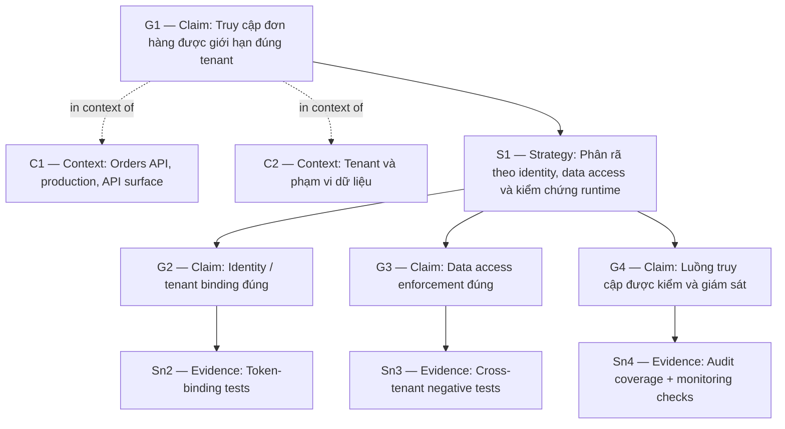
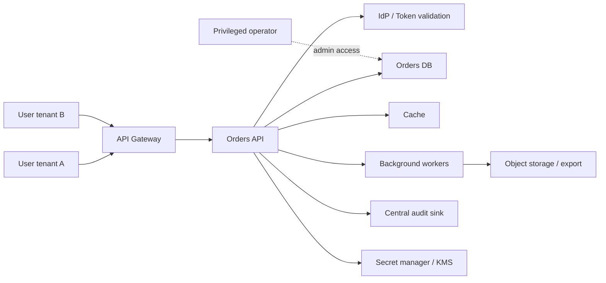
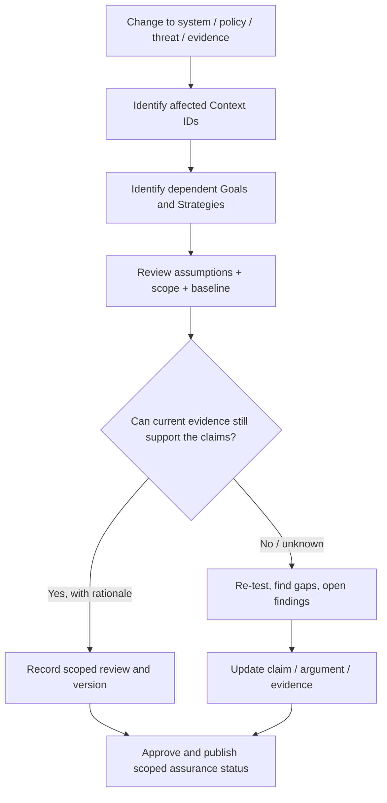

# Context trong Assurance case: Xác định phạm vi và điều kiện để một lập luận bảo đảm có ý nghĩa

## 1. Mục tiêu học tập

Sau bài học, người học có thể:

- Giải thích **Context** trong **assurance case** (hồ sơ lập luận bảo đảm), đặc biệt theo cách thể hiện của **Goal Structuring Notation (GSN)**: làm rõ ý nghĩa, phạm vi, định nghĩa và điều kiện áp dụng của claim hoặc strategy.
- Phân biệt **Context** với **Goal/Claim**, **Strategy/Argument**, **Assumption**, **Justification** và **Solution/Evidence**, tránh dùng sơ đồ hoặc tuyên bố bối cảnh như thể chúng đã chứng minh một yêu cầu.
- Xác định bối cảnh từ **hệ thống đang xét, chức năng nghiệp vụ, tài sản, dữ liệu, kiến trúc, ranh giới tin cậy, môi trường vận hành, threat model, security objectives, control baseline** và kỳ đánh giá.
- Viết các Context nodes và bản ghi context có ID, nguồn, phiên bản, phạm vi, người sở hữu, độ tin cậy, liên kết claim và điều kiện cập nhật.
- Phát hiện các claim bị diễn giải quá rộng do thiếu context: “mọi dữ liệu”, “luôn an toàn”, “đã đáp ứng” khi chỉ kiểm một tenant, một môi trường hoặc một thời điểm.
- Liên kết context với **test plan, bằng chứng security assurance, giới hạn kết luận, risk acceptance** và quy trình thay đổi; xác định khi nào cần đánh giá lại assurance case.
- Thực hành xây dựng context cho tình huống **tenant isolation**, **khôi phục sau thảm họa** và **dịch vụ do nhà cung cấp vận hành**.

Bài thuộc chương **Assurance case** của dịch vụ `SECURITY_SECURITY_ASSURANCE`. Dịch vụ hướng tới đánh giá **có bằng chứng** rằng hệ thống đáp ứng các mục tiêu bảo mật, từ phân tích rủi ro, yêu cầu và security controls đến kiểm thử, audit và khắc phục phát hiện; công việc này được thực hiện liên tục trong phát triển và vận hành. Trong chuỗi đó, **Context** quyết định **bằng chứng nào liên quan đến claim nào, trong điều kiện nào**, nhờ vậy giúp tránh các kết luận assurance vượt quá dữ liệu thực tế.

## 2. Context là gì?

Một **assurance case** trình bày có cấu trúc **điều muốn khẳng định (claim)**, **lập luận vì sao claim được hỗ trợ (argument)** và **bằng chứng dùng để kiểm chứng (evidence)**. **Context** là thông tin làm rõ ý nghĩa và điều kiện của claim hoặc lập luận: hệ thống nào đang xét, thuật ngữ nào được sử dụng, môi trường nào là đối tượng, tiêu chí nào đang được áp dụng và giới hạn nào phải giữ nguyên khi diễn giải.

Ví dụ, claim:

> “API bảo vệ truy cập dữ liệu khách hàng.”

là quá rộng. Cần context để biết:

- API nào, phiên bản build nào, trên môi trường nào?
- Khách hàng là **người dùng cuối**, **tenant** hay **tài khoản tổ chức**?
- “Bảo vệ truy cập” nghĩa là authentication, authorization theo tenant, không lộ dữ liệu qua cache hay bao gồm cả người vận hành?
- Dữ liệu nào được bao phủ: dữ liệu trả từ API, backup, export jobs, logs hay dữ liệu bên thứ ba?
- Lúc nào và trong điều kiện nào claim được đánh giá?
- Những thành phần hoặc quyền truy cập nào nằm **ngoài** phạm vi và vì sao?

Một phát biểu có context tốt hơn:

> “Với `orders-api` phiên bản đã triển khai trên cụm production `cluster-prod-a` trong phạm vi các tenant được quản lý, yêu cầu đọc đơn hàng qua endpoint `GET /orders/{id}` phải chỉ trả về đơn thuộc tenant của danh tính đang được ủy quyền, theo policy `AUTHZ-TENANT-01` được phê duyệt cho kỳ đánh giá này.”

Context ở đây chưa chứng minh API đã hoạt động đúng; nó giúp định nghĩa **đối tượng và điều kiện** để thiết kế phép kiểm và đánh giá evidence.

### 2.1. Câu hỏi cốt lõi

> **“Phát biểu này đúng theo nghĩa nào, đối với hệ thống nào, trong phạm vi nào, vào thời điểm nào và dựa trên định nghĩa/baseline nào?”**

Nếu không trả lời được câu hỏi này, ngay cả bằng chứng có vẻ tốt cũng có thể dẫn tới kết luận sai phạm vi.

### 2.2. Context là thành phần của lập luận, không phải nhãn trang trí

Một kiến trúc được gắn vào assurance case chỉ có giá trị khi chỉ rõ **claim hoặc strategy nào cần dựa vào nó để được diễn giải**. Một file sơ đồ không có phiên bản, môi trường, owner hoặc thời điểm xác nhận có thể khiến người đánh giá tưởng nó mô tả production trong khi thực tế chỉ là thiết kế cũ.

Cũng không nên biến Context thành một kho tài liệu khổng lồ chứa mọi thứ về dự án. Context tốt **đủ cụ thể để làm rõ hoặc giới hạn phát biểu cần đánh giá**, có khả năng được tra cứu và duy trì.

## 3. Context đứng ở đâu trong cấu trúc Claim–Argument–Evidence?

Một assurance case thường có ít nhất ba ý tưởng:

1. **Claim/Goal:** điều cần được chứng minh hoặc bảo đảm.
2. **Argument/Strategy:** cách phân rã và nối các lý do, điều kiện hoặc subclaims để hỗ trợ claim.
3. **Evidence/Solution:** dữ liệu, kết quả kiểm thử, review hoặc quan sát hỗ trợ các subclaims.

Context **không nằm ở cuối chuỗi như một loại test**. Nó đi **cùng claim hoặc strategy** để mô tả ý nghĩa, miền áp dụng, định nghĩa và môi trường cần hiểu khi đánh giá.

### 3.1. Minh họa lập luận có context



Đây là **sơ đồ Mermaid để giảng giải**, không phải bản vẽ GSN đúng toàn bộ quy tắc đồ họa. Đường nét đứt mô tả quan hệ “in context of”; các nhánh hỗ trợ claim dùng liên kết lập luận/bằng chứng. Để đánh giá chặt chẽ, phải bổ sung assumptions, justification, trạng thái từng claim và sự đầy đủ của các phép thử.

### 3.2. Vai trò của Context đối với chất lượng suy luận

Nếu G1 không định nghĩa “truy cập dữ liệu”, reviewer có thể xem một phép thử `GET /orders` và kết luận hệ thống an toàn. Nhưng còn đường đọc qua:

- Endpoint export/report.
- Database access của nhân viên vận hành.
- Background jobs hoặc message consumers.
- Cache, search index hoặc object storage.
- Logging/tracing chứa dữ liệu phản hồi.
- Backup hoặc hệ thống của third party.

Context giúp quyết định các luồng trên **nằm trong claim, được bao phủ bởi claim khác hay được đưa thành giới hạn rõ ràng**. Không thể chỉ bỏ chúng đi mà vẫn tuyên bố “mọi truy cập dữ liệu đã an toàn”.

## 4. Phân biệt Context với các phần tử lập luận khác

Trong GSN, Context, Assumption và Justification thường xuất hiện gần Goal hoặc Strategy nên dễ bị nhầm.

| Thành phần | Công dụng | Ví dụ cho tenant isolation | Lỗi phổ biến |
|---|---|---|---|
| **Goal / Claim** | Điều muốn bảo đảm, cần lập luận và bằng chứng | “Truy cập đơn hàng qua API bị giới hạn đúng tenant” | Dùng lời khẳng định tuyệt đối không định nghĩa phạm vi |
| **Strategy** | Cách phân rã hoặc lập luận hỗ trợ claim | “Đánh giá theo identity, authorization và data access” | Chỉ liệt kê hoạt động, không chỉ ra vì sao đủ |
| **Context** | Làm rõ định nghĩa, ranh giới và điều kiện áp dụng | “Tenant là legal customer account; API v2 production” | Coi sơ đồ kiến trúc là chứng minh isolation |
| **Assumption** | Tiền đề cần giả định để lập luận áp dụng, chưa được chứng minh đầy đủ trong nhánh đang xét | “IdP phát hành claim `tenant_id` đúng với danh tính đã xác thực” | Giấu assumption trong context để tránh kiểm chứng |
| **Justification** | Lý do lựa chọn strategy hoặc cách phân rã | “Tách theo các điểm kiểm authorization vì tất cả đường API bắt buộc đi qua lớp đó, theo kiến trúc đã xác minh” | Dùng câu “best practice” chung chung thay rationale |
| **Solution / Evidence** | Bằng chứng hỗ trợ claim | Negative test giữa hai tenants trên runtime, kiểm effective policy | Dùng tài liệu thiết kế thay cho test hiệu lực |
| **Undeveloped/Unresolved** | Phần chưa được hỗ trợ đầy đủ trong một mô hình/biểu diễn nhất định | “Đường export chưa được test” | Vẽ như đã chứng minh hoặc im lặng bỏ qua |

### 4.1. Một số ví dụ phân biệt

**Phát biểu:** “Ứng dụng chạy trên Kubernetes managed cluster.”

- Có thể là **Context** nếu chỉ xác định kiến trúc và phạm vi.
- **Không phải bằng chứng** rằng security controls hoặc tenant isolation đang đạt.
- Cần được đối chiếu với runtime asset inventory nếu kiến trúc là điều kiện quan trọng.

**Phát biểu:** “Không attacker nào có quyền root trên node.”

- Không nên lặng lẽ viết thành context nếu đây là một tiền đề chưa kiểm.
- Có thể là **Assumption** với chủ sở hữu, rủi ro, điều kiện giám sát và biện pháp giảm thiểu.
- Nếu claim bắt buộc chịu được node compromise, phải có chiến lược và bằng chứng tương ứng; không thể loại trừ tình huống chỉ bằng một câu giả định.

**Phát biểu:** “Bài test request từ tenant A không đọc được đơn của tenant B.”

- Là **Evidence** cho một assertion cụ thể nếu có test metadata và kết quả.
- Chưa chứng minh toàn bộ tenants, endpoints và kỳ vận hành đều an toàn; cần context về mẫu, thời điểm, build và cách mở rộng kết luận.

### 4.2. Khi một thông tin vừa là context vừa cần evidence xác nhận

Một sơ đồ kiến trúc có thể đóng vai trò **Context** để người đọc hiểu ranh giới hệ thống. Đồng thời claim “đúng toàn bộ traffic đi qua API Gateway” có thể cần **bằng chứng độc lập** như ingress/runtime inventory hoặc network policy tests.

Không có mâu thuẫn: **tài liệu sơ đồ cung cấp ngữ cảnh**, còn phép kiểm đối chiếu với thực tế cung cấp **bằng chứng về tính đúng của sơ đồ hoặc một claim khác**. Cần thể hiện hai quan hệ riêng, tránh đánh đồng một artifact với mọi mục đích.

## 5. Context bắt đầu bằng System of Interest (SoI)

**System of Interest** là hệ thống hoặc tập hợp năng lực được chọn làm đối tượng đánh giá trong assurance case. SoI phải có danh tính và biên rõ ràng.

### 5.1. Những thông tin tối thiểu

- **Tên và ID ổn định:** dịch vụ, account, cluster, application, platform.
- **Business capability:** chức năng nghiệp vụ được bảo vệ.
- **Môi trường:** production, staging, DR, customer-hosted hoặc vendor-operated.
- **Triển khai:** build version, image digest, IaC commit, vùng và tenant liên quan.
- **Cấu phần bên trong:** endpoints, workers, database, cache, queue, secrets, policy engine.
- **Interfaces:** API, event bus, admin plane, user interfaces và external integrations.
- **Các nhóm actor:** người dùng, administrator, service identities, vendor support.
- **Dữ liệu:** loại dữ liệu, mức nhạy cảm, nơi lưu và đường truy cập.
- **Owners:** business, technical, security và assessor.
- **Thời kỳ:** snapshot hoặc assessment window mà kết luận có hiệu lực.

Một architecture diagram chỉ liệt kê service names không thay thế danh mục assets và phiên bản cấu hình.

### 5.2. Phân biệt SoI với môi trường ngoài

Ví dụ `orders-api` là SoI, còn IdP, payment gateway hoặc cloud KMS có thể là **external dependencies**. Tuy nhiên, external không nghĩa là **không liên quan đến assurance**. Nếu claim phụ thuộc vào IdP phát hành token đúng, phải mô tả cách yêu cầu đó được bảo đảm: subclaim, contract assurance, kiểm chứng tích hợp hoặc assumption có quản trị.

Nếu toàn bộ dữ liệu và quyền của bên thứ ba nằm ngoài quyền quan sát của tổ chức, kết luận phải ghi rõ **giới hạn bằng chứng** và phần trách nhiệm của các bên.

## 6. Scope, boundaries và exclusions

Một claim có thể bị sai chỉ vì dùng từ “toàn bộ”, “luôn”, “không bao giờ” mà không xác định phạm vi. Context phải thể hiện ranh giới rõ ràng.

### 6.1. Những chiều scope quan trọng

| Chiều | Ví dụ | Vì sao quan trọng |
|---|---|---|
| Business | Đọc đơn hàng, tạo đơn, thanh toán, hoàn tiền | Một control không nhất thiết bao phủ mọi user journey |
| Assets | `orders-api`, DB, message workers, object storage | Thiếu thành phần có thể tạo blind spot |
| Tenancy | Tenant A/B/C, multi-tenant SaaS, internal admins | Cần phân tích cross-tenant access |
| Environment | Production region-a và region-b | Test staging không chứng minh production |
| Identity | End user, support staff, service account | Đường quyền có semantics khác nhau |
| Interfaces | REST, GraphQL, admin UI, batch, export API | Một endpoint test không đại diện tất cả |
| Data | Order metadata, PII, attachments, logs, backup | “Dữ liệu khách hàng” có nhiều bản sao |
| Time | Kỳ 01–30/11 hoặc thời điểm deployment | Cấu hình thay đổi làm mất hiệu lực kết luận |
| Threats | Credential theft, privilege escalation, insider misuse | Claim cần xét các attacker capabilities liên quan |
| Suppliers | Cloud provider, IdP, payment gateway | Mức bảo đảm có phần phụ thuộc ngoài |
| Controls | Policy và security baseline có version | Không có baseline thì “đáp ứng” mơ hồ |

### 6.2. Exclusion phải giải thích được

Ví dụ:

- **Đã bao phủ:** các đường đọc qua public REST endpoints của API v2 production.
- **Chưa bao phủ:** export jobs, backup readers và truy cập trực tiếp của đội vận hành.
- **Lý do:** đang được phân tích trong các assurance cases bổ sung, chưa có đủ bằng chứng.
- **Hành động:** gắn người chịu trách nhiệm, hạn xử lý và nguy cơ còn lại.
- **Kết luận:** không được dùng case này để khẳng định “toàn bộ khả năng đọc dữ liệu của doanh nghiệp đều đã an toàn”.

Một exclusion có căn cứ có thể giúp kết luận **trung thực**, nhưng không tự miễn trách nhiệm nếu nguy cơ ngoài phạm vi có tác động nghiêm trọng đến mục tiêu bảo mật đang được thẩm định.

### 6.3. Phạm vi được đánh giá và phạm vi được bảo vệ

Hai khái niệm thường khác nhau:

- **Intended protection scope:** các tài sản, luồng, danh tính mà tổ chức cần bảo vệ theo mục tiêu.
- **Assessed scope:** phần thực tế đã thu evidence và chạy test.

Nếu intended scope là 20 accounts nhưng assessed scope mới 15 accounts, phải ghi **coverage gap 5 accounts**. Không thu hẹp intended scope ngầm chỉ để tạo kết luận PASS.

## 7. Context về môi trường vận hành và assumptions

Hệ thống có thể đạt mục tiêu an ninh trong điều kiện thường nhưng không đạt khi failover hoặc control plane bị lỗi. Context nên thể hiện chế độ vận hành.

### 7.1. Các chế độ có thể thay đổi lập luận

- **Steady state:** hệ thống đang phục vụ bình thường.
- **Deployment/rollout:** nhiều phiên bản, rolling upgrade và migration đồng thời tồn tại.
- **Maintenance:** admin bypass có kiểm soát, bảo trì dữ liệu, chuyển khóa.
- **Degraded mode:** IdP, cache, logging hoặc third party không khả dụng.
- **Failover/DR:** chuyển vùng, restore backup, break-glass và fencing.
- **Incident response:** cô lập, thu hồi credential, điều tra nguồn tin cậy bị mất.
- **Bootstrap/cold start:** tạo node, lấy image từ registry, truy secret manager.
- **Decommission:** dữ liệu bị xóa/chuyển đi và quyền còn tồn tại tạm thời.

Một Context có thể nói “case đánh giá đường login mới trong steady state”; nếu session refresh trong IdP outage chưa được thử, đó là giới hạn phải nêu, không được ngầm coi đã bao phủ.

### 7.2. Khi nào phải dùng Assumption?

Giả sử một case về kiểm soát truy cập dựa trên tiền đề “tất cả khách hàng được gán đúng tenant ID bởi quy trình onboarding”. Đây là **assumption** hoặc một **subclaim cần bằng chứng**, tùy cách phân rã assurance case. Việc thêm câu đó vào Context như một “thực tế hiển nhiên” có thể che giấu điểm yếu quan trọng.

Có thể quản lý assumptions bằng:

| Thuộc tính | Nội dung |
|---|---|
| `assumption_id` | ID ổn định |
| `statement` | Phát biểu được giả định đúng |
| `why_needed` | Claim/strategy phụ thuộc vào nó thế nào |
| `validity_conditions` | Phạm vi, thời gian, điều kiện còn hiệu lực |
| `owner` | Người chịu trách nhiệm xác minh/giảm thiểu |
| `risk_if_false` | Tác động nếu tiền đề sai |
| `monitoring_ref` | Phép kiểm định kỳ hoặc nguồn cảnh báo |
| `closure_path` | Test hoặc subclaim để thay assumption bằng chứng cứ |

**Quy tắc:** Context nói rõ cách hiểu; Assumption làm rõ một tiền đề chưa được chứng minh. Cả hai đều có thể cần quản trị nguồn và thay đổi, nhưng không được tráo đổi vai trò.

## 8. Architecture Context: Ranh giới tin cậy và luồng dữ liệu

Trong security assurance, context về kiến trúc thường quan trọng vì control nằm ở các **trust boundaries**.

### 8.1. Ví dụ kiến trúc multi-tenant



Để assurance case có nghĩa, người đọc cần biết:

1. `GW` có phải đường vào bắt buộc cho mọi request hay API còn private/admin ingress khác?
2. `tenant_id` được rút từ token đã xác minh, từ đường dẫn request hay từ tham số client có thể sửa?
3. DB có policy cưỡng chế tenant isolation, hay hoàn toàn dựa vào filter trong application?
4. Cache keys có mang tenant ID và kiểm quyền trên cache hit hay không?
5. Background jobs và export có được gắn identity/tenant scope đúng không?
6. Operator và support accounts có bypass và được audit như thế nào?
7. Token validation phụ thuộc vào IdP và cache key/certificate ra sao?
8. Khi log hoặc secret manager bị lỗi, API fail closed hay vẫn hoạt động?
9. Kết quả về user-facing API có được suy rộng sang data copies và backup không?

Sơ đồ chỉ là **mô hình bối cảnh**. Những khẳng định về hành vi thực phải được hỗ trợ bằng test hoặc runtime evidence tương ứng.

### 8.2. Ranh giới điều khiển và ranh giới dữ liệu

- **Data plane:** nơi request và dữ liệu được xử lý, đọc, ghi, truyền.
- **Control plane:** nơi triển khai cấu hình, IAM policy, routing, keys, version và audit settings.
- **Management plane:** thao tác của operator, support hoặc nhà cung cấp.

Một claim “user A không đọc được dữ liệu tenant B” qua public API chưa đủ để kết luận operator hoặc cloud admin không truy cập dữ liệu tenant B. Đó là **claim khác**, hoặc phạm vi khác cần được chỉ rõ.

### 8.3. Shared infrastructure và shared responsibility

Một managed cloud service có thể cung cấp isolation ở tầng hạ tầng, nhưng customer vẫn chịu trách nhiệm cấu hình IAM, tenant mapping, query authorization hoặc key access. Context nên mô tả rõ **điều gì do provider đảm bảo theo phạm vi nào** và **điều gì phía tổ chức phải tự kiểm**.

## 9. Context về mục tiêu bảo mật và threat model

Một assurance case security phải gắn claim vào **security objectives** và các nguy cơ liên quan, thay vì chỉ khẳng định “secure”.

### 9.1. Các lớp cần xác định

| Lớp | Nội dung | Ví dụ |
|---|---|---|
| Business objective | Vì sao phải bảo vệ hệ thống? | Tránh lộ đơn hàng giữa các khách hàng |
| Security objective | Tính chất cần đạt | Confidentiality và authorization theo tenant |
| Asset/value | Dữ liệu hoặc năng lực có giá trị | Order records, customer PII |
| Threat scenario | Hành vi có thể vi phạm objective | Người dùng sửa order ID để đọc đơn tenant khác |
| Trust boundary | Nơi cần kiểm hành vi | Request → API → DB |
| Control requirement | Điều hệ thống phải bảo đảm | Mọi object read được kiểm quyền theo tenant |
| Assurance claim | Phát biểu kiểm chứng được | API v2 enforce tenant authorization trong scope |
| Evidence plan | Cách xác minh | Cross-tenant tests, code review, policy/runtime checks |

### 9.2. Threat context không phải danh sách IOC

Một threat model hữu ích nêu **attacker capabilities và điều kiện**: attacker có tài khoản hợp lệ? Có thể đoán object IDs? Có thể gửi request qua public API? Có kiểm soát một service account? Có quyền node hay DB?

Nếu chỉ thử attacker không đăng nhập, không thể suy ra hệ thống chống được **user đã đăng nhập của tenant A** cố đọc tài nguyên tenant B.

Cũng không nên nhầm một mapping tới MITRE ATT&CK hay STRIDE là bằng chứng đã chống toàn bộ biến thể tấn công. Các nhãn giúp phân loại; phải có **assurance claims và tests** thích hợp.

### 9.3. Rủi ro thay đổi theo bối cảnh

Một endpoint mở công khai trong production có mức độ lộ diện khác với endpoint chỉ dùng trong staging. Một service account chỉ đọc một dataset khác với danh tính có quyền thay IAM của toàn tenant. Context về **impact, likelihood assumptions, control posture và deployment topology** giúp quyết định mức bảo đảm cần đạt.

Không đưa đánh giá “risk low” vào Context mà không có nguồn và kỳ đánh giá. Mức rủi ro là **kết quả phân tích có thẩm quyền**, cần được cập nhật khi threat landscape hoặc tác động thay đổi.

## 10. Context về policy, control baseline và tiêu chí nghiệm thu

Một claim như “IAM đã đáp ứng yêu cầu” cần một **baseline được định danh**.

### 10.1. Gắn baseline bằng ID và phiên bản

Ví dụ:

| Thành phần | ID giả lập | Ý nghĩa |
|---|---|---|
| Security objective | `OBJ-DATA-ISOLATION-01` | Không lộ dữ liệu qua ranh giới tenant |
| Requirement | `REQ-AUTHZ-01` | Quyền đọc đối tượng phải được kiểm theo tenant |
| Control | `AUTHZ-TENANT-01` | Enforce authorization trước data access |
| Baseline | `POLICY-API-SEC-v3` | Bộ quy tắc áp dụng cho API production |
| Test suite | `TST-TENANT-ISOLATION-v2` | Kiểm positive/negative object access |
| Runtime release | `orders-api@sha256:<digest>` | Artifact đang chạy, digest giả lập |
| Assessment window | `2026-11` | Kỳ đánh giá được xác định |

`<digest>` là ký hiệu thay thế, không phải một giá trị triển khai thật.

### 10.2. Khi baseline không rõ, điều gì xảy ra?

Không thể quyết định endpoint “đã đủ bảo vệ” nếu policy chưa nói:

- Khi nào phải yêu cầu authentication?
- Có cho phép support/admin bypass và điều kiện kiểm soát không?
- Sự kiện nào bắt buộc phải audit?
- Phải xử lý thế nào khi authorization service không sẵn sàng?
- Có yêu cầu kiểm thử đối với export/report/background jobs không?
- Có ngưỡng coverage và tần suất test không?

Trong assurance case, baseline vừa là **nguồn định nghĩa tiêu chí** vừa có thể gắn với **requirement traceability**; bằng chứng runtime phải được đối chiếu với đúng phiên bản baseline.

### 10.3. Context không làm chính sách trở nên đúng

Nếu một chính sách được viết chưa đầy đủ, lập luận dựa trên policy đó có thể đạt theo nghĩa hẹp nhưng **không giải quyết đủ rủi ro**. Cần đánh giá sự phù hợp giữa **security objective**, threat/risk và control baseline; không dừng ở “đã comply với policy” mà bỏ tác động thực tế.

## 11. Context về data classification, identity và privacy

Dữ liệu và danh tính là những chiều dễ bị thiếu khi viết Context.

### 11.1. Phân loại dữ liệu

Cần mô tả dữ liệu nào là:

- Public / internal / confidential / restricted theo phân loại tổ chức.
- Dữ liệu cá nhân hoặc dữ liệu có nghĩa vụ xử lý riêng.
- Secrets, tokens, cryptographic keys.
- Dữ liệu giao dịch mà tính toàn vẹn đặc biệt quan trọng.
- Bản sao dẫn xuất: cache, search index, log, object export, backup.
- Dữ liệu do vendor/subprocessor xử lý thay cho tổ chức.

Một claim về **encrypted database** chưa đủ khẳng định dữ liệu được bảo vệ trên network, trong logs hoặc khi được export. Context phải mô tả asset/data scope chính xác.

### 11.2. Identity model

Một số chi tiết cần nêu:

- Principal ID có ổn định khi người dùng đổi email/tên không?
- Tenant membership được duy trì ở đâu?
- User/service/admin identities được phân biệt thế nào?
- Có quyền kế thừa qua group, external federation, trust policy hay không?
- Tokens có expiry, revocation và refresh semantics ra sao?
- Có API operations được chạy không gắn user request, ví dụ batch jobs?
- Khi danh tính bị xâm nhập, claim vẫn áp dụng theo mức attacker capability nào?

Những thông tin này giúp người đánh giá hiểu **authorization tests nào có ý nghĩa**, không dùng kết quả của một loại principal để chứng minh toàn bộ danh tính.

### 11.3. Privacy-specific context

Trong các claim về quyền riêng tư, cần xác định **vai trò xử lý dữ liệu, nguồn nghĩa vụ, loại dữ liệu, mục đích xử lý, luồng dữ liệu, đối tác, thời kỳ và quy tắc được phê duyệt**. Không tự động kết luận tuân thủ pháp lý chỉ vì có encryption hoặc access control; đó là controls hỗ trợ, không thay thế đánh giá applicability và nghĩa vụ chuyên biệt.

## 12. Context theo thời gian: Phiên bản và hiệu lực kết luận

Security assurance không phải một phép chứng minh “một lần là mãi mãi”. Context cần có **time dimension** rõ ràng.

### 12.1. Những mốc không được gộp

- Ngày thiết kế/baseline được phê duyệt.
- Thời điểm version ứng dụng được build và deploy.
- Thời điểm config snapshot được thu.
- Thời kỳ log hoặc tập giao dịch được đánh giá.
- Thời điểm test được chạy.
- Thời điểm reviewer chấp thuận kết luận.
- Thời điểm một thay đổi sau đó có thể làm vô hiệu kết luận.

Ví dụ test ngày 10/11 trên `orders-api v2.8` không tự chứng minh build v2.9 deploy ngày 20/11 an toàn, nhất là nếu v2.9 thay đổi authorization middleware. Context cần liên kết kết luận với release/runtime version và trigger revalidation.

### 12.2. Temporal validity

Có thể dùng các thuộc tính:

| Trường | Vai trò |
|---|---|
| `valid_from` | Mốc bắt đầu context/baseline áp dụng |
| `valid_until` | Mốc giới hạn dự kiến, nếu có |
| `observed_at` | Khi một điều kiện được xác minh |
| `assessment_period` | Kỳ cho phép kết luận |
| `last_reviewed_at` | Thời điểm được owner rà soát |
| `review_due_at` | Hạn rà soát theo rủi ro |
| `invalidating_events` | Thay đổi khiến kết luận phải đánh giá lại |
| `superseded_by` | Phiên bản context mới thay thế |

Một bản ghi có `valid_until` tương lai **không đảm bảo đúng đến ngày đó** nếu đã có thay đổi quan trọng. Đây là mốc quản trị, không phải “giấy bảo hành an toàn”.

### 12.3. Stable IDs và versioning

Không lưu Context duy nhất dưới dạng “sơ đồ kiến trúc mới nhất”. Cần một phiên bản được ghim trong assurance case, đồng thời có liên kết tới phiên bản hiện hành và nguồn thay đổi. Việc giữ lịch sử giúp giải thích vì sao kết luận cũ đúng theo context cũ nhưng cần xem xét lại với cấu hình mới.

## 13. Chất lượng và nguồn gốc của Context

Context thường là **thông tin nền cần tin cậy**. Vì vậy không chỉ cần nội dung mà còn phải ghi **nguồn, mức độ chắc chắn và người xác minh**.

### 13.1. Những nguồn thường gặp

| Nguồn | Cung cấp tốt | Giới hạn |
|---|---|---|
| Business/service owner | Mục tiêu nghiệp vụ, quy trình, tác động | Có thể không biết mọi đường technical access |
| Architecture review | Cấu trúc dự kiến, trust boundaries | Sơ đồ có thể cũ hoặc chưa tương ứng runtime |
| IaC, manifests, CI/CD | Desired configuration, artifact và release IDs | Có thể thiếu drift thủ công ở production |
| Cloud/K8s inventory | Tài sản và cấu hình quan sát được | Không nhất thiết chứng minh control hoạt động theo hành vi |
| Runtime tracing/flow logs | Quan hệ request thực trong khoảng đo | Không thấy batch, DR hoặc đường ít được gọi |
| IAM/effective permissions | Principal và quyền hiệu lực ở thời điểm truy vấn | Có thể bỏ token cache và third-party paths |
| Threat model/risk register | Attacker capabilities, risk assumptions | Cần cập nhật khi hệ thống/threat thay đổi |
| Policy/control registry | Yêu cầu, baseline, owner và phiên bản | Policy existence chưa chứng minh implementation |
| Vendor reports/contracts | Shared responsibility, dịch vụ, thời kỳ | Scope hạn chế, không mô tả toàn bộ tenant của mình |
| Audit/test records | Phạm vi, kết quả đo, known gaps | Một bài test có thể không đại diện mọi môi trường |

### 13.2. Mức độ tin cậy của Context

Có thể phân biệt:

- `CONFIRMED`: có nguồn phù hợp và phương pháp đối soát đủ trong phạm vi.
- `INFERRED`: suy ra có cơ sở nhưng chưa xác nhận đầy đủ.
- `DECLARED`: do owner/vendor tuyên bố, chưa có đối soát độc lập.
- `UNKNOWN`: chưa đủ thông tin.
- `STALE`: nguồn hoặc thời gian không còn phù hợp.
- `CONFLICTING`: các nguồn cho kết quả mâu thuẫn.

Mức độ tin cậy **không phải severity**. Một Context chưa xác minh về asset ít rủi ro có thể ít ảnh hưởng hơn một Context chưa xác minh về quyền quản trị toàn tenant. Cần kết hợp **mức độ cần thiết cho claim** và **tác động nếu sai**.

### 13.3. Khi hai nguồn mâu thuẫn

Ví dụ architecture diagram nói mọi request đi qua gateway, nhưng cloud load balancer inventory cho thấy có một endpoint private trực tiếp tới API. Không nên chọn sơ đồ để tiện kết luận. Cần:

1. Ghi sự mâu thuẫn và nguồn.
2. Đánh dấu Context `CONFLICTING` hoặc claim bị giới hạn.
3. Phân tích đường private có thuộc SoI không.
4. Cập nhật kiến trúc hoặc xác nhận ngoại lệ có owner.
5. Bổ sung tests/controls cho đường truy cập mới.
6. Đánh giá lại claim và evidence plan.

## 14. Bản ghi Context có cấu trúc

Trong một hệ thống quản lý assurance cases, Context có thể được lưu bằng YAML/JSON hoặc mô hình GSN. Đây là **schema minh họa**, không phải định dạng tiêu chuẩn GSN bắt buộc.

```yaml
assurance_case_id: AC-ORDER-ISOLATION-01
assurance_case_version: "1.2.0"
goal:
  id: G1
  statement: >
    Trong phạm vi API v2 production, user chỉ đọc được
    order thuộc tenant đã được ủy quyền.
  security_objective_ref: OBJ-DATA-ISOLATION-01

contexts:
  - id: C1
    title: "System of Interest"
    context_type: system_scope
    statement: "Orders API v2 tại production cluster-a"
    applies_to: [G1]
    scope:
      environment: production
      cluster_id: cluster-prod-a
      service_id: orders-api
    source_refs:
      - "architecture://orders/v2"
      - "inventory://production/orders-api"
    confidence: DECLARED
    owner: orders-platform
    last_reviewed_at: "2026-11-28T03:00:00Z"

  - id: C2
    title: "Tenant definition"
    context_type: terminology
    statement: >
      Tenant là khách hàng tổ chức theo định danh
      tenant_id từ identity policy đã được phê duyệt.
    applies_to: [G1]
    source_refs: ["policy://auth/tenant-definition-v3"]
    confidence: CONFIRMED
    owner: identity-governance
    last_reviewed_at: "2026-11-28T03:00:00Z"

  - id: C3
    title: "Claimed API operations"
    context_type: coverage_boundary
    statement: "Chỉ bao phủ read-by-ID REST endpoint; export là case khác"
    applies_to: [G1]
    included_operations: ["GET /orders/{id}"]
    excluded_operations: ["POST /orders/export"]
    exclusion_owner: security-assurance
    followup_case_ref: AC-ORDER-EXPORT-02
    confidence: DECLARED
    owner: orders-platform
    last_reviewed_at: "2026-11-28T03:00:00Z"

  - id: C4
    title: "Assessment period and release"
    context_type: temporal_scope
    statement: "Đánh giá cho bản triển khai và kỳ được định danh"
    applies_to: [G1]
    assessment_period: "2026-11"
    runtime_release_ref: "release://orders-api/v2.8"
    confidence: UNKNOWN
    source_refs: []
    owner: release-engineering
    last_reviewed_at: null

assumptions:
  - id: A1
    statement: "IdP gắn tenant_id chính xác vào token đã xác thực"
    used_by: [G1]
    owner: identity-platform
    validation_status: PENDING_VALIDATION

review:
  status: DRAFT
  findings:
    - "C1 chưa được đối soát đầy đủ với runtime"
    - "C4 chưa có release evidence"
    - "A1 chưa được chứng minh"
  reviewer: security-assurance
```

Các đường `architecture://`, `inventory://`, `policy://` và `release://` là **tham chiếu minh họa**. Dữ liệu không phải một assurance case đã được phê duyệt. Context C3 giới hạn claim; không chứng minh export API an toàn. C4 ở `UNKNOWN` làm kết luận về release chưa đủ căn cứ.

### 14.1. Vì sao tách Context và Assumption trong YAML?

- C2 định nghĩa thuật ngữ “tenant” theo policy, giúp người đọc hiểu claim.
- A1 giả định IdP phát hành tenant ID đúng trong thực tế; đây là **tiền đề vận hành** phải được xác minh hoặc quản trị.
- C4 mô tả kỳ và phiên bản cần xét; nếu chưa có runtime release evidence, không thể suy từ C4 tới PASS.

Một chuỗi dữ liệu có cấu trúc tốt **không tự tạo ra evidence**. Chỉ khi các references và assertions được kiểm tra theo test plan mới có cơ sở kết luận.

## 15. Từ Context đến một claim có thể kiểm chứng

Một câu claim tốt nên **rõ đối tượng, thuộc tính an ninh và phạm vi**. Context giúp chọn phép kiểm và giới hạn cách dùng kết quả.

### 15.1. Ví dụ claim mơ hồ

> “Hệ thống được mã hóa và an toàn.”

Thiếu: hệ thống nào, data at rest hay in transit, keys ai quản lý, tiêu chuẩn nào, endpoint nào, phiên bản nào, bảo vệ trước attacker nào.

### 15.2. Ví dụ claim đủ rõ hơn

> “Trong phạm vi database `orders-db` tại production region-a, dữ liệu order lưu trên storage được mã hóa bằng cấu hình KMS do tổ chức quản lý; quyền sử dụng key được giới hạn theo baseline `KEY-ACC-03` tại thời điểm đánh giá.”

Bây giờ có thể xác định:

- **Design/implementation evidence:** encryption settings, key policy, access roles.
- **Runtime/effective evidence:** permissions tests, storage state, key access audit.
- **Negative tests:** principal không được phép không thể dùng key.
- **Limitation:** chưa bao phủ dữ liệu in transit, exports, logs, DR region, backup nếu không nêu.
- **Time:** config và quyền có thể thay đổi sau khi đánh giá.

### 15.3. Claim refinement không được thay đổi yêu cầu một cách tùy tiện

Nếu mục tiêu ban đầu là “mọi dữ liệu khách hàng phải được bảo vệ”, không thể tự thu hẹp thành “chỉ storage encryption tại một DB” và tuyên bố đã đáp ứng mục tiêu ban đầu. Có thể viết **subclaim hẹp** với Context, nhưng top-level assurance case vẫn phải xử lý các nhánh khác hoặc ghi gap rõ.

Context giúp **nói đúng giới hạn của kết luận**, không phải công cụ né một yêu cầu khó.

## 16. End-to-end case study: Context cho tenant isolation

### 16.1. Bối cảnh giả định

Một nền tảng SaaS có 200 tenants, chạy `orders-api` trong Kubernetes managed cluster. Mỗi request user mang access token. Dữ liệu đơn hàng được lưu trên database dùng chung; chính sách yêu cầu không cho phép một tenant đọc dữ liệu của tenant khác.

Phần triển khai có:

- API Gateway và authorization middleware.
- Tenant-aware query layer và data access library.
- Background export jobs, cache và object storage.
- Cloud IAM và Kubernetes ServiceAccounts.
- Quyền support để chẩn đoán sự cố.
- CI/CD và audit sink.

Assurance goal ban đầu:

> “Tenant data của hệ thống được bảo vệ khỏi truy cập chéo.”

Đây là goal tổng quan. Nó cần context và các subclaims riêng cho từng đường truy cập hoặc lập luận hợp lý vì sao các đường đó đều được bao phủ bởi một cơ chế cưỡng chế chung.

### 16.2. Bộ Context đề xuất

| Context | Phát biểu | Nguồn và trạng thái |
|---|---|---|
| `C-SYS` | SoI là `orders-api` v2 production trong các clusters đã liệt kê | Architecture + runtime inventory, cần đối soát |
| `C-TENANT` | Tenant là tổ chức có `tenant_id` ổn định theo IdP policy | Identity policy có version |
| `C-DATA` | Order records và customer contact được phân loại confidential | Data catalog + owner |
| `C-BOUNDARY` | Public API, export jobs, cache và support access là các đường liên quan | DFD + threat model; coverage cần review |
| `C-THREAT` | User hợp lệ tenant A có thể đoán order ID của tenant B | Threat scenario, risk owner |
| `C-BASELINE` | `AUTHZ-TENANT-01` yêu cầu kiểm quyền trước mỗi object read | Policy/control registry |
| `C-TIME` | Kỳ đánh giá và build/digest production cụ thể | Release record + runtime query |
| `C-EXCL` | Legacy export endpoint chưa đạt kiểm thử, được mở finding | Finding + owner, **không** coi PASS |

### 16.3. Phân rã assurance argument

Có thể chọn:

- **G1:** Truy cập order data qua các luồng đã xác định không vi phạm tenant boundary.
  - **G1.1:** Token và tenant identity binding đáng tin trong các luồng user.
  - **G1.2:** API object-level authorization được cưỡng chế.
  - **G1.3:** Cache/search paths không trả dữ liệu cross-tenant.
  - **G1.4:** Export/background operations bảo toàn tenant scope.
  - **G1.5:** Quyền admin/support được giới hạn và audit phù hợp.
  - **G1.6:** Đường dữ liệu, control drift và các thay đổi được giám sát.

Context trên giải thích hệ thống và phạm vi của từng goal. Nếu G1.4 chưa có evidence, G1 không nên được tuyên bố đầy đủ chỉ vì G1.2 có test đạt.

### 16.4. Test matrix xuất phát từ Context

| Test ID | Assertion | Phạm vi/test data | Kỳ vọng |
|---|---|---|---|
| `T01` | Token tenant A không đọc được order tenant B | User tokens A/B, API read-by-ID | 403/404 theo contract; không có data leak |
| `T02` | Token không hợp lệ không truy cập được order | Invalid/expired tokens | Bị từ chối và audit phù hợp |
| `T03` | Cache key không làm lộ response khác tenant | Cùng logical key giữa A/B | Không nhận dữ liệu sai tenant |
| `T04` | Export job chỉ lấy dữ liệu tenant đã duyệt | Scheduled/background identity | Dataset đúng tenant và quyền |
| `T05` | Support bypass phải có quyền và dấu vết | Authorized/unauthorized support actor | Quyền hẹp và audit truy vết |
| `T06` | Direct DB access không vượt policy | Workload IAM và support roles | Effective privileges phù hợp baseline |
| `T07` | Kết quả áp dụng cho release đang chạy | Runtime image digest, config fingerprint | Khớp release được kiểm |
| `T08` | Logging của các đường nhạy cảm đủ coverage | API/export/audit pipeline | Event có identity, target, outcome và đến sink |
| `T09` | Đường lỗi/failover không bỏ authz | IdP unavailable/degraded, approved test setup | Không fail open trái policy |
| `T10` | Tài sản ngoài inventory được phát hiện | Asset discovery/reconciliation | Scope gap được mở finding |

### 16.5. Diễn giải bằng chứng đúng phạm vi

Giả sử T01–T03 PASS trên staging, nhưng export T04 chưa có data lineage, support T05 thiếu audit và production T07 chưa đối chiếu digest.

Kết luận **không phù hợp**:

> “Tenant isolation đã được chứng minh hoàn toàn.”

Kết luận **phù hợp hơn**:

> “Các ca kiểm thử object access và cache trên staging release đã xác định cho kết quả phù hợp với policy; chưa có bằng chứng đủ cho export, support access và runtime release production. Assurance claim tổng thể còn **PARTIALLY_SUPPORTED/UNKNOWN** theo các nhánh liên quan. Cần bổ sung kiểm thử và đối soát trước khi xác nhận đủ phạm vi.”

Mức kết luận thực tế phụ thuộc vào quy tắc lập luận và ngưỡng đánh giá đã phê duyệt; không có một nhãn thống nhất áp dụng mọi hệ thống.

## 17. Context về evidence và mức độ suy rộng kết luận

Một phép kiểm có thể đúng nhưng không hỗ trợ claim vì Context không tương thích.

### 17.1. Các cặp không tương thích thường gặp

| Claim context | Evidence được đề xuất | Vì sao chưa đủ |
|---|---|---|
| Production release hiện hành | Screenshot cấu hình staging | Sai môi trường |
| Mọi cloud accounts | IAM export của một account | Sai phạm vi tài sản |
| Toàn bộ kỳ kiểm toán | Snapshot tại một thời điểm | Không chứng minh operating effectiveness trong kỳ |
| Dữ liệu được restore đạt RPO | Backup job success | Không chứng minh restore/data loss |
| Log mọi admin action | Một audit event thành công | Không chứng minh data-source coverage |
| Không có truy cập cross-tenant | Chỉ thử chưa đăng nhập | Thiếu authenticated attacker case |
| Quyền của vendor support đã bị thu hồi | Ticket ghi “revoked” | Thiếu effective permission/session check |
| Tenant isolation bao gồm export | Test chỉ `GET /orders/{id}` | Thiếu đường dữ liệu export |

### 17.2. Context của một evidence record

Một evidence record đủ dùng nên có:

- `evidence_id`, `source_system`, `collected_at`.
- `asset_id`, `environment`, `tenant_scope`.
- `control_version`, `test_id`, `tool_version` khi liên quan.
- `event_time_range` hoặc assessment period.
- `expected` và `observed`.
- `quality/coverage`, hạn chế và dữ liệu thiếu.
- `integrity/provenance` và nơi lưu có quyền.
- `reviewer`, `checked_at` và kết luận scoped.

**Thời gian và phạm vi của evidence phải giao với Context**. Một bản test đã hết hiệu lực hoặc khác loại hệ thống không thể tự động “nối” để hỗ trợ claim.

### 17.3. Context alignment là bài toán kiểm chứng riêng

Cần đánh giá **claim–context–evidence alignment**:

1. Evidence có đúng loại assertion?
2. Cùng system/release/environment?
3. Cùng tập tài sản và đường truy cập?
4. Cùng kỳ đánh giá?
5. Cùng policy/control baseline?
6. Không có deployment/config drift sau test?
7. Những unknowns và exclusions đã được giữ khi tổng hợp?

Nếu không cùng điều kiện, có thể yêu cầu **re-test** hoặc justification riêng về khả năng áp dụng, không được tự suy rộng.

## 18. Context của một assurance case về Disaster Recovery

Chủ đề Context không chỉ áp dụng cho authorization. Với **disaster recovery**, một claim có thể là:

> “Dịch vụ checkout có thể khôi phục chức năng tiếp nhận đơn hàng trong RTO đã phê duyệt và mất dữ liệu không vượt RPO.”

Để hiểu claim phải có:

| Context | Nội dung |
|---|---|
| Business function | “Tiếp nhận đơn hàng” có cần thanh toán hoàn tất không? |
| BIA version | RTO/RPO mục tiêu và minimum service level được phê duyệt |
| Failure scenario | Mất zone, mất region, dữ liệu bị hỏng hay compromise |
| System scope | Primary, recovery region, DB, queue, identity, DNS, KMS |
| Data definition | Thế nào là một đơn “được xác nhận” và mốc commit |
| Recovery strategy | Failover, restore, data reconciliation, traffic routing |
| Temporal conditions | Lúc tải đỉnh, kết nối bên thứ ba, retention/backups |
| Trust assumptions | Primary đã được fencing, backup không nhiễm và IAM dùng được |
| Security gates | Encryption, identity, network, audit, artifact provenance |
| Validation scope | Bài diễn tập ở staging hay production, lượng traffic thử |

### 18.1. Bằng chứng không thể tự vượt Context

Giả sử bài drill khởi động VM dự phòng trong 12 phút. Nếu Context của top-level claim là **business service được phục hồi đầy đủ trong 60 phút**, thì kết quả 12 phút chỉ hỗ trợ một phần. Cần tính thời gian **DR declaration, access, restore, failover, data integrity, business journey và security gates** theo phương pháp đã phê duyệt.

Tương tự, replication lag 2 phút chưa chứng minh RPO nếu mất giao dịch đã acknowledged hoặc trạng thái payment bên ngoài không được đối soát.

### 18.2. Một thay đổi Context có thể đảo kết luận

Nếu BIA thay RTO từ 4 giờ xuống 45 phút, bài diễn tập 90 phút từng được xem là đạt **không còn phù hợp** với tiêu chí mới. Không phải hệ thống bỗng lỗi mới; **điều kiện đánh giá đã đổi**. Phải version claim/context, cập nhật test plan và kết luận.

## 19. Context với Third-party, compliance và shared responsibility

Các assurance cases hiện đại thường dựa vào dịch vụ và báo cáo bên ngoài.

### 19.1. Ví dụ: Managed database

Claim: “Dữ liệu trên managed database được bảo vệ phù hợp security objective của tổ chức.”

Context cần nêu:

- Dữ liệu, database instance, region, tenant, môi trường.
- Mức service được provider vận hành và trách nhiệm do customer cấu hình.
- Phương thức encryption/key management.
- Cloud IAM, network policy, backup, tenant database users và audit.
- Kỳ/phiên bản báo cáo vendor và phần complementary customer controls.
- Các kiểm thử do tổ chức thực hiện và phần chỉ có thể dựa trên vendor evidence.

Một báo cáo độc lập của provider chỉ hỗ trợ các controls và thời kỳ **nằm trong scope báo cáo**. Nó không mặc nhiên chứng minh customer đã cấu hình database users, keys, logging hay retention đúng.

### 19.2. Context về compliance

Với một claim “hệ thống đáp ứng yêu cầu tuân thủ”, Context phải ghi:

- Nguồn yêu cầu và **phiên bản hiệu lực**.
- Pháp nhân, loại dữ liệu, hệ thống và jurisdiction được xác định là áp dụng.
- Phạm vi đánh giá, thời kỳ và kỳ báo cáo.
- Cách diễn giải applicability do legal/compliance owner phê duyệt.
- Những exclusions có cơ sở.
- Control mappings, tests và tiêu chí đánh giá.

**Một framework mapping không phải bằng chứng tuân thủ pháp lý**. Nếu nghĩa vụ có điều kiện chuyên biệt, chỉ chủ có thẩm quyền mới quyết định cách diễn giải; người viết assurance case không nên biến một câu context ngắn thành kết luận pháp lý.

### 19.3. Shared responsibility là context hay claim?

Bảng phân trách nhiệm từ nhà cung cấp có thể là **Context** để định nghĩa “bên nào phải chứng minh điều gì”. Nhưng khẳng định rằng customer control **đã hoạt động** vẫn cần evidence của customer; khẳng định provider control **đã được kiểm** cần bằng chứng hợp lệ trong scope của provider.

## 20. Quản lý Context drift và invalidating changes

Một assurance case có thể trở nên lỗi thời khi context thay đổi dù tài liệu claim và evidence không đổi.

### 20.1. Các thay đổi thường làm mất hiệu lực

- Thêm endpoint, API version, data export hoặc background job.
- Chuyển từ single-tenant sang multi-tenant hoặc thay tenant mapping.
- Bổ sung cloud account, region, cluster, third-party processor.
- Thay IdP/federation, IAM policy, KMS, secret manager, RBAC.
- Thay database access layer, cache, search, queue hoặc data lineage.
- Thay security objective, threat model hoặc risk acceptance.
- Thay luật/hợp đồng/framework version trong phạm vi áp dụng.
- Thay loại dữ liệu xử lý hoặc nhóm người dùng/admin.
- Có incident cho thấy trust boundary hoặc assumption trước đây sai.
- Thay release/config sau khi đã chạy test.
- Backup/DR architecture và recovery dependencies đổi.
- Bằng chứng cũ hết hạn hoặc collector/monitoring mất coverage.

### 20.2. Change impact analysis



Điều quan trọng là **truy vết ngược từ Context tới các claims phụ thuộc**. Nếu một context node C1 được dùng bởi 12 claims, thay đổi C1 có thể yêu cầu 12 đánh giá lại, không chỉ cập nhật một sơ đồ.

### 20.3. Theo dõi drift có bằng chứng

Một quy trình continuous assurance có thể:

1. Thu architecture/IaC/runtime inventory và baseline versions.
2. Chuẩn hóa IDs, environment và asset relationships.
3. So sánh với Context register đang được phê duyệt.
4. Phát hiện node/edge mới, scope thay đổi hoặc source stale.
5. Gắn owner và đánh giá impact tới claims/tests.
6. Quyết định revalidate, revise, restrict conclusion hoặc chấp nhận rủi ro.
7. Lưu evidence, kết quả review và phiên bản assurance case mới.

Không xóa một dependency chỉ vì không thấy network traffic trong một lần trace; đó có thể là đường batch, startup hoặc DR.

## 21. Mẫu review Context và tiêu chí đánh giá chất lượng

Có thể dùng bảng sau trước khi chấp thuận một assurance case.

| Tiêu chí | Câu hỏi review | Hành động khi chưa đạt |
|---|---|---|
| **Clarity** | Thuật ngữ chính đã được định nghĩa chưa? | Thêm glossary/context ID |
| **Scope precision** | Tài sản, môi trường, dữ liệu, actor, operation, kỳ đã rõ? | Giới hạn claim hoặc mở rộng đánh giá |
| **Architecture accuracy** | Sơ đồ và inventory có phản ánh runtime không? | Đối soát IaC, cloud/K8s, tracing |
| **Trust boundaries** | Các đường dữ liệu/quyền có được thể hiện? | Bổ sung DFD/threat analysis |
| **Threat relevance** | Threat model có đủ những hành vi quan trọng trong scope? | Bổ sung threat scenario và subclaims |
| **Baseline validity** | Có policy/control version và chủ phê duyệt? | Ghim baseline, review applicability |
| **Responsibility** | Owner và bên thứ ba có rõ trách nhiệm? | Bổ sung RACI/shared responsibility |
| **Evidence alignment** | Test/evidence có đúng Context và version không? | Re-test hoặc ghi giới hạn |
| **Assumptions visible** | Tiền đề chưa kiểm được tách khỏi Context? | Viết Assumption node và risk tracking |
| **Time validity** | Bằng chứng và kết luận có còn mới? | Revalidate/đánh dấu stale |
| **Exceptions** | Phần loại trừ có lý do, owner, follow-up? | Mở finding hoặc claim khác |
| **Integrity/provenance** | Context có nguồn, tác giả, thời điểm và lịch sử? | Bổ sung source refs và kiểm access |
| **Reviewability** | Người độc lập có tái lập lý do mapping không? | Thêm rationale, version, evidence links |

### 21.1. Trạng thái Context và kết luận nên tách riêng

Context có thể là `CONFIRMED`, `DECLARED`, `INFERRED`, `UNKNOWN`, `STALE`. Một Goal/Claim có thể là `SUPPORTED_IN_SCOPE`, `PARTIALLY_SUPPORTED`, `UNSUPPORTED`, `UNKNOWN`, `REQUIRES_REVIEW`. Hai bộ trạng thái **không đồng nhất**:

- Context CONFIRMED chưa chứng minh Goal SUPPORTED.
- Context UNKNOWN trọng yếu có thể làm kết luận Goal UNKNOWN hoặc bị giới hạn.
- Context STALE có thể bắt buộc chạy lại test đã từng PASS.

Tên trạng thái do tổ chức định nghĩa, cần giữ ngữ nghĩa ổn định trong báo cáo và metric.

## 22. Tự động hóa kiểm tra Context: Những gì có thể và không thể

Có thể tự động kiểm sự nhất quán cấu trúc, phiên bản và scope để giảm lỗi thủ công.

### 22.1. Các kiểm tra phù hợp với automation

- Context IDs duy nhất và không có liên kết đến Goal không tồn tại.
- Mọi top-level claim đều có system/asset scope và assessment period.
- Mọi context trọng yếu có owner và source reference hoặc trạng thái UNKNOWN.
- Không có context đã hết hạn được dùng để tạo một kết luận current PASS.
- Evidence scope phải phù hợp môi trường, tài sản và release được mô tả.
- Các external dependencies trọng yếu có trách nhiệm và phương án xác minh.
- Khi asset inventory thay đổi, phát hiện Context chưa review.
- Khi policy version đổi, nhắc revalidate claims bị tác động.
- Các exclusions chưa có owner/follow-up không được “ẩn” dưới trạng thái PASS.

### 22.2. Pseudocode kiểm coverage và freshness

```text
INPUT:
  assurance_case, context_register,
  asset_inventory, evidence_records, change_events

for each goal in assurance_case.goals:
    required_context = contexts_linked_to(goal)
    if required_context is empty:
        flag("MISSING_CONTEXT", goal)

    for each context in required_context:
        if context.owner is missing:
            flag("MISSING_OWNER", context)
        if context.status in ["UNKNOWN", "STALE", "CONFLICTING"]:
            flag("CONTEXT_REVIEW_REQUIRED", context)
        if context.scope conflicts with current asset inventory:
            flag("SCOPE_DRIFT", context)
        if a material change occurred after context.last_reviewed_at:
            flag("REVALIDATION_REQUIRED", goal)

    for each evidence in evidence_supporting(goal):
        if not matches(evidence, goal.scope, goal.period, goal.release):
            flag("EVIDENCE_CONTEXT_MISMATCH", goal, evidence)

report flags and owners
do not automatically conclude "secure" or "compliant"
```

Đây là **pseudocode khái niệm**, không phải công cụ thực thi. Thực tế cần thiết kế so khớp version, window và phạm vi phức tạp; reviewer phải xác nhận ý nghĩa của một sự thay đổi.

### 22.3. Giới hạn automation

Không thể chỉ nhìn YAML rồi xác định:

- Threat model đã đầy đủ mọi rủi ro chưa?
- Một exclusion có chính đáng với nghĩa vụ pháp lý không?
- Một lập luận strategy đủ mạnh để từ các subclaims suy ra Goal không?
- Một vendor assurance report có thẩm quyền và phạm vi phù hợp không?
- Bằng chứng có bị thiên lệch do chọn mẫu hoặc nguồn thiếu không?

Automation giúp **phát hiện điều kiện phải kiểm tra** và **giữ traceability**, không thay thế phân tích chuyên môn và quyết định rủi ro.

## 23. Case study: Context mâu thuẫn làm sai kết luận assurance

**Bối cảnh giả định:** đội phát triển trình một assurance case “mọi truy cập customer profile đều được kiểm quyền”. Tài liệu Context đính kèm là sơ đồ `customer-profile-api v3` chạy qua API Gateway, dùng authorization middleware chung. Test suite có 200 ca positive/negative đều PASS.

Sau review độc lập:

- Một batch export job có quyền đọc database trực tiếp và không đi qua API Gateway.
- Một legacy admin endpoint còn chạy trên subdomain nội bộ.
- Tenant ID được client gửi qua một header ở một nhánh API cũ, không được lấy từ token đã xác minh.
- Bài test chỉ chạy trên staging trong khi production có config override.
- Evidence không ghi image digest và ngày thu; một số control logs thiếu.
- Threat model chưa xét service account có quyền export toàn bộ tenant.
- Scope statement ghi “all access paths” dù test chỉ bao phủ public REST APIs.

### 23.1. Vì sao đây là lỗi Context nghiêm trọng?

| Phát hiện | Context bị ảnh hưởng | Tác động lập luận |
|---|---|---|
| Batch export đọc DB trực tiếp | System boundary / data flow | Goal “all access paths” không được bao phủ |
| Legacy admin endpoint | API surface / identity | Cần subclaim và test admin paths |
| Client-controlled tenant header | Identity semantics | Assumption về tenant binding có thể sai |
| Staging ≠ production | Environment / deployment | Không thể suy rộng kết quả |
| Thiếu digest/time | Temporal/provenance | Evidence khó gắn với release |
| Thiếu service-account threat | Threat context | Argument decomposition có thể chưa đủ |
| Scope “all” | Claim boundary | Kết luận vượt quá phép kiểm |

### 23.2. Cách sửa assurance case

1. **Tạm giới hạn kết luận** vào API paths thực sự đã kiểm trong môi trường/phiên bản đã xác nhận.
2. Bổ sung Context về export, admin endpoint, service identity và production release.
3. Chuyển tiền đề về tenant ID thành subclaim/test hoặc Assumption được quản trị, không che trong Context.
4. Cập nhật threat model và bổ sung negative tests cho đường truy cập mới.
5. Đối soát runtime inventory/IaC và xác định các đường bypass.
6. Gắn evidence đúng source, timestamp, build digest, account/cluster và assessor.
7. Tạo findings cho các chỗ thiếu hoặc hành vi sai, có owner và recheck.
8. Chỉ sau khi các nhánh bắt buộc được hỗ trợ đủ mới review lại top-level claim.

### 23.3. Kết luận đúng trong khi chưa sửa xong

> “Bộ kiểm thử hiện có hỗ trợ một phần claim kiểm soát truy cập trên các public REST endpoints trong môi trường staging đã xác định. Context ban đầu thiếu batch export, legacy admin path, identity semantics và sự khác biệt cấu hình production. Vì vậy assurance goal ‘mọi đường truy cập customer profile đều được kiểm quyền’ hiện **chưa được chứng minh**. Các gaps đã được ghi thành findings và yêu cầu bổ sung test/bằng chứng.”

Đây là kết luận có phạm vi và trung thực. **200 tests PASS** không sửa được một **claim được định nghĩa sai hoặc thiếu context**.

## 24. Các sai lầm thường gặp

1. **Viết Context như phần giới thiệu chung chung:** không giúp giải thích Goal/Strategy cụ thể.
2. **Nhầm Context với Evidence:** sơ đồ thiết kế không chứng minh control hoạt động.
3. **Giấu tiền đề không được kiểm trong Context:** assumption trở thành “sự thật” trên giấy.
4. **Không ghi System of Interest:** người đọc không biết đánh giá hệ thống nào.
5. **Không giới hạn thời gian:** dùng chứng cứ của release cũ cho production hiện tại.
6. **Không định nghĩa thuật ngữ:** “user”, “tenant”, “sensitive”, “secure” mang nhiều nghĩa.
7. **Chỉ nêu ứng dụng, bỏ data copies:** cache, export, backup và logs bị quên.
8. **Bỏ luồng admin và service accounts:** chỉ test end-user public API.
9. **Coi các môi trường giống nhau:** staging và production có policies hoặc resources khác.
10. **Coi nhà cung cấp chịu mọi trách nhiệm:** quên tenant configuration và shared responsibility.
11. **Gắn threat tags mà không có capability/attack path:** threat context không dẫn tới test.
12. **Đổi phạm vi để làm đẹp kết quả:** intended security objective bị thu hẹp mà không có phê duyệt.
13. **Context không có nguồn/owner:** không biết ai xác nhận hay khi nào cần cập nhật.
14. **Không xử lý nguồn mâu thuẫn:** chọn architecture slide thay runtime evidence.
15. **Dùng một evidence cho mọi claim:** bỏ khác biệt scope, thời gian và mục tiêu.
16. **Không nêu exclusions:** top-level claim bị hiểu bao phủ toàn tổ chức.
17. **Không đánh dấu unknowns:** thiếu telemetry được diễn giải là không có vi phạm.
18. **Không có trigger cập nhật:** API, IdP, topology và policy thay đổi nhưng case không thay.
19. **Gộp trạng thái context và claim:** Context CONFIRMED bị tính thành Goal SUPPORTED.
20. **Không review tính đầy đủ lập luận:** có Context và tests nhưng không chứng minh các subclaims đủ để hỗ trợ Goal.

## 25. Bài tập thực hành: Thiết kế Context cho một assurance case

**Tình huống:** một nền tảng thương mại điện tử nhiều tenant vận hành trên cloud và Kubernetes, sử dụng managed database, IdP, payment gateway và hệ thống audit. Nhóm security đưa ra top-level claim:

> “Nền tảng bảo đảm rằng dữ liệu khách hàng không bị truy cập trái phép và có thể phục hồi an toàn sau sự cố.”

Thông tin ban đầu:

| Mã | Quan sát |
|---|---|
| A | API production chạy ở hai regions nhưng không rõ image digest được test |
| B | REST API có kiểm tenant authorization, còn export jobs dùng service account chung |
| C | Một số dữ liệu PII được cache trong Redis và ghi vào logs |
| D | IdP phát hành tenant ID; chưa có test xác minh mapping tại middleware |
| E | DB backup có mã hóa, nhưng recovery region chưa được thử quyền KMS |
| F | Vendor payment có assurance report kỳ trước, chưa thử failover end-to-end |
| G | Một cluster mới chưa có audit collector đầy đủ |
| H | Security policy vừa thay đổi yêu cầu review quyền admin theo chu kỳ mới |
| I | DR exercise đo VM readiness, chưa đo business RTO/RPO |
| J | Một endpoint hỗ trợ nội bộ được phép truy cập dữ liệu liên tenant theo quy trình break-glass |

### 25.1. Yêu cầu

1. Xác định **System of Interest** và tối thiểu ba subclaims cần thiết để tránh top-level claim quá rộng.
2. Viết ít nhất **10 Context nodes** có ID, nội dung, claim liên quan, source và scope, trong đó có architecture, identity, data, threat, policy và time.
3. Tách ít nhất **ba Assumptions** khỏi Context; giải thích vì sao từng giả định cần được kiểm chứng hoặc quản trị.
4. Viết một **Justification** cho chiến lược phân rã claim theo các đường truy cập dữ liệu và theo recovery.
5. Vẽ đồ thị Goal–Strategy–Context–Evidence với các quan hệ “in context of” thể hiện rõ.
6. Với B, C, J, lập bản đồ trust boundaries và chỉ ra các đường dữ liệu/đặc quyền ngoài public REST API.
7. Với A, G, H, xác định **temporal/context drift** và tests/evidence cần cập nhật.
8. Với D, đưa ra phép kiểm token→tenant binding ở negative và positive cases.
9. Với E, I, mô tả context để kiểm **RTO/RPO, backup integrity, KMS, data reconciliation và security gates**.
10. Với F, phân biệt Context về vendor responsibility và Evidence của từng bên.
11. Viết matrix **Goal → Context → Test → Evidence → Status → Gap** cho ít nhất sáu assertions.
12. Viết kết luận assurance 150–250 từ nêu rõ **đã chứng minh gì, chưa chứng minh gì, trong phạm vi và thời gian nào, chủ sở hữu của các gaps**.

### 25.2. Gợi ý tự đánh giá

- **A:** phải liên kết runtime release/digest với test environment; nếu không, scope evidence chưa khớp.
- **B:** một public API test không bao phủ service account và đường export.
- **C:** data context gồm cache/logs, không chỉ DB.
- **D:** lời tuyên bố IdP “phát hành đúng” là assumption hoặc subclaim cần kiểm theo kiến trúc.
- **E:** backup encrypted không bảo đảm khôi phục được nếu key/permissions không sẵn.
- **F:** report vendor hỗ trợ đúng scope và kỳ báo cáo, không tự chứng minh customer controls.
- **G:** thiếu audit là evidence/coverage gap, không thể coi như không có sự kiện.
- **H:** baseline thay đổi có thể làm mất hiệu lực một kết luận cũ.
- **I:** VM readiness không phải business recovery; phải đo dịch vụ và data integrity.
- **J:** đường break-glass phải có claim, quyền có giới hạn, approval và audit, không được âm thầm loại khỏi phạm vi.

Một bài làm tốt nối được **Claim → Context/Assumptions/Justification → Strategy → Evidence → Scoped conclusion**, phát hiện những điều còn UNKNOWN và chỉ định người chịu trách nhiệm kiểm lại.

## 26. Tổng kết

**Context** làm cho một assurance claim **có thể hiểu đúng và có thể đánh giá đúng**. Nó mô tả **hệ thống, phạm vi, thuật ngữ, kiến trúc, dữ liệu, danh tính, threat environment, security baseline và thời gian**; giúp lập luận không vượt quá đối tượng hoặc điều kiện đã được xác định. Context **không phải bằng chứng hoàn thành control**, cũng không phải chỗ giấu những tiền đề chưa được kiểm chứng.

Trong `SECURITY_SECURITY_ASSURANCE`, Context cần được quản trị như một phần **sống** của assurance case: có ID, owner, nguồn, phiên bản, liên kết claim/evidence, cơ chế nhận biết thay đổi và kết quả review. Một lập luận bảo đảm có trách nhiệm chỉ kết luận **đúng trong phạm vi được xác minh, tại thời điểm được xác minh, theo yêu cầu và các giả định được công bố**. Khi Context thay đổi, câu hỏi đầu tiên không phải “giữ nhãn PASS như cũ được không?” mà là **claim nào bị tác động, bằng chứng nào còn phù hợp, những phép kiểm nào phải làm lại và ai chịu trách nhiệm đối với phần chưa được chứng minh**.
