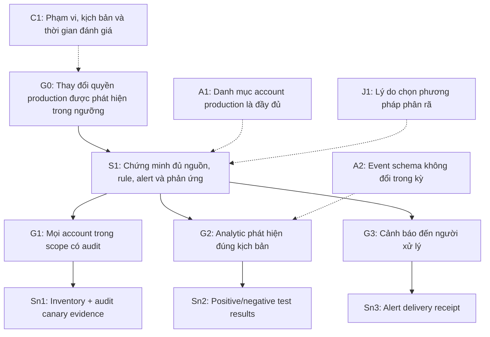
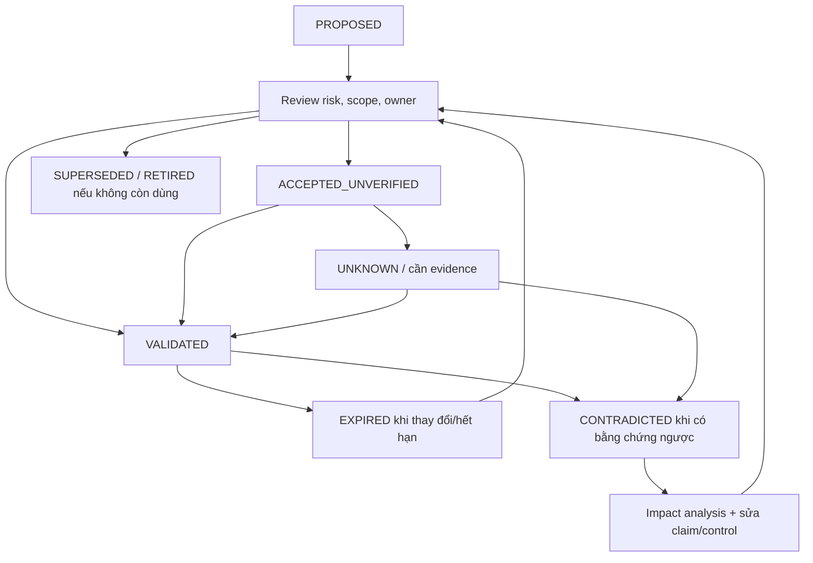
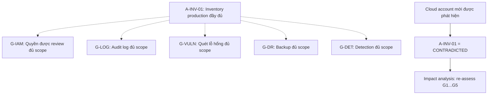

# Assumption trong Assurance Case: Quản lý giả định để lập luận bảo mật đáng tin cậy

## 1. Assumption là gì và tại sao phải ghi rõ?

Trong một **assurance case**, *assumption* (giả định) là một mệnh đề được **tạm chấp nhận là đúng để xây dựng hoặc đánh giá một phần lập luận**, mặc dù sự đúng đắn của mệnh đề đó chưa được chứng minh đầy đủ ngay tại điểm sử dụng. Giả định phải được nêu minh bạch cùng **phạm vi, điều kiện, người sở hữu, cách kiểm chứng và hệ quả nếu không còn đúng**.

Một assurance case không chỉ tập hợp tài liệu. Nó là lập luận có cấu trúc, thường đi theo chuỗi **claim → argument → evidence**:

- **Claim (khẳng định):** điều tổ chức muốn chứng minh về hệ thống, chẳng hạn “các thay đổi IAM đặc quyền trên production được phát hiện và điều tra kịp thời”.
- **Argument (lập luận):** vì sao những khẳng định con, phương pháp kiểm tra và bằng chứng hỗ trợ được claim tổng.
- **Evidence (bằng chứng):** quan sát, phép thử, audit record, cấu hình, kết quả đo và hiện vật có thể kiểm tra.
- **Assumption (giả định):** điều kiện chưa được chứng minh đầy đủ mà lập luận đang phụ thuộc; nếu điều kiện thay đổi, kết luận có thể mất hiệu lực.

Trong chương **Assurance case** của module **SECURITY_SECURITY_ASSURANCE**, mục tiêu là xây dựng cách đánh giá có bằng chứng rằng hệ thống đáp ứng các mục tiêu bảo mật, từ phân tích rủi ro và yêu cầu đến security controls, kiểm thử, audit và khắc phục phát hiện. Việc **phát hiện, kiểm soát và theo dõi giả định** là nền tảng để tránh biến một báo cáo đầy đủ về hình thức thành khẳng định an toàn thiếu cơ sở.

### Tình huống mở đầu

Một nhóm chứng minh control phát hiện thay đổi quyền trên cloud bằng cách chạy 20 bài thử. Tất cả bài thử đều tạo cảnh báo và được xử lý. Báo cáo kết luận: “100% thay đổi quyền đặc quyền trong production đều có thể phát hiện”.

Nhưng 20 bài thử chỉ chạy trên 3 tài khoản cloud đã có trong SIEM. Trong thực tế, hệ thống production có 4 tài khoản; tài khoản thứ tư chưa bật audit. Lập luận đã dựa vào giả định ngầm:

> “Toàn bộ tài khoản cloud production đều có nguồn audit và nằm trong tập kiểm thử.”

Giả định này sai, nên kết luận “100% production” **không được bằng chứng hỗ trợ**. Bản thân việc 20 bài thử đạt vẫn đúng *cho ba tài khoản đã thử*. Sai lầm xảy ra ở bước mở rộng kết luận vượt qua phạm vi bằng chứng.

**Thông điệp cốt lõi:** giả định không nhất thiết là sai, nhưng **giả định chưa được kiểm soát có thể làm cả assurance case trông mạnh hơn thực tế**.

### Mục tiêu học tập

Sau bài học, người học có thể:

1. Phân biệt assumption với context, justification, evidence, limitation và risk acceptance.
2. Viết giả định rõ ràng, có khả năng bác bỏ/kiểm tra, có scope và thời gian hiệu lực.
3. Sử dụng giả định đúng trong Goal Structuring Notation (GSN) hoặc dạng claim–argument–evidence.
4. Lập **assumption register** và ánh xạ giả định tới các claims phụ thuộc.
5. Xác minh giả định qua inventory, cấu hình, phép thử, log, hợp đồng và nguồn độc lập.
6. Xử lý giả định sai, thiếu bằng chứng hoặc hết hiệu lực mà không tạo PASS giả.
7. Tích hợp theo dõi giả định vào SDLC, vận hành, thay đổi hệ thống và vòng đời security assurance.

## 2. Một lập luận bảo đảm là mệnh đề có điều kiện

Khi một claim phụ thuộc vào các giả định, kết luận nên được trình bày dưới dạng có điều kiện, không phải chân lý vô điều kiện.

Giả sử:

- `G`: mọi thao tác thay đổi quyền quản trị trong phạm vi được phát hiện trong thời hạn yêu cầu;
- `E`: bộ kiểm thử detection đã đạt và có event/alert/ticket;
- `W`: lập luận cho rằng bộ kiểm thử và dữ liệu quan sát đại diện cho phạm vi;
- `A`: mọi tài khoản production đều tạo và chuyển đầy đủ loại event cần thiết.

Khi đó một lập luận minh họa là:

\[
A \land E \land W \;\Longrightarrow\; G
\]

Đây là **mô hình lý luận**, không phải một định lý đã được chứng minh cho mọi hệ thống. Muốn đánh giá `G`, phải xem `A` có được xác nhận, `E` có tin cậy, và `W` có đủ để suy từ các bài kiểm tra tới mục tiêu hay không.

Điểm quan trọng về logic:

- **Nếu `A` được xác minh đúng trong scope**, bằng chứng `E` có thể hỗ trợ `G` qua lập luận `W`.
- **Nếu `A` chưa được kiểm tra**, `G` chưa được bảo đảm đầy đủ; phải công bố điều kiện và giới hạn.
- **Nếu `A` đã được chứng minh sai**, suy luận này không còn hỗ trợ `G` như dự định. Điều đó **không tự động chứng minh `G` sai trong mọi trường hợp**; có thể tồn tại nguồn bằng chứng/đường phát hiện khác. Phải đánh giá lại claim.
- **Nếu `A` đã từng đúng nhưng hệ thống thay đổi**, evidence cũ chưa chắc còn đủ cho assessment mới.

Trong bảo mật, các giả định thường liên quan **threat model, inventory, quyền, phạm vi dữ liệu, cấu hình, nhà cung cấp, chất lượng log, sự độc lập của nguồn chứng cứ và mốc thời gian**. Một thay đổi nhỏ ở chúng có thể ảnh hưởng nhiều claims đồng thời.

## 3. Assumption nằm ở đâu trong cấu trúc assurance case?

Một assurance case thường có:

| Thành phần | Vai trò | Câu hỏi |
| --- | --- | --- |
| **Top-level goal / claim** | Khẳng định bảo mật cần chứng minh | Hệ thống phải an toàn ở khía cạnh nào và trong scope gì? |
| **Context** | Định nghĩa hệ thống, thuật ngữ, phạm vi, tiêu chí | Đang nói về hệ thống, thời gian và điều kiện nào? |
| **Strategy / argument** | Cách phân rã claim và nối bằng chứng | Vì sao các subclaims đủ để hỗ trợ goal? |
| **Subclaim** | Khẳng định nhỏ có thể kiểm tra | Telemetry, detection, response, retention đã đạt chưa? |
| **Solution / evidence** | Hiện vật hỗ trợ kiểm chứng | Test, log, policy readback hay audit record nào? |
| **Assumption** | Điều kiện tạm chấp nhận cho lập luận | Điều gì phải đúng để suy luận có giá trị? |
| **Justification** | Lý do lựa chọn chiến lược/tiêu chí | Vì sao phương pháp phân rã hoặc ngưỡng này hợp lý? |
| **Defeater / challenge** | Lý do có thể bác bỏ hoặc làm suy yếu claim | Trường hợp nào khiến lập luận thất bại dù evidence có vẻ đạt? |

**Goal Structuring Notation (GSN)** là một cách diễn đạt có cấu trúc các nút Goal, Strategy, Context, Assumption, Justification và Solution. Trong GSN, giả định thường được biểu thị bằng **Assumption node**, ký hiệu như `A1`, liên kết với thành phần lập luận sử dụng nó. Sơ đồ dưới đây dùng Mermaid để minh họa ý nghĩa liên kết; **không phải bản vẽ GSN chuẩn hóa**:



Nếu `A1` sai, bằng chứng các nguồn đã đăng ký không chứng minh coverage đối với tài khoản bị bỏ sót. Nếu `A2` sai, rule có thể tiếp tục chạy nhưng không nhận diện sự kiện sau khi provider đổi schema. Các giả định này cần kiểm tra riêng, không biến thành mệnh đề “đã đạt” chỉ vì chúng xuất hiện trong sơ đồ.

### Assumption nên xuất hiện tại điểm phụ thuộc

Không nên chỉ có một phụ lục chung ghi “giả định hệ thống hoạt động bình thường”. Mỗi giả định cần liên kết tới **claim/strategy/test nào đang phụ thuộc**. Một giả định có thể được nhiều claims sử dụng, và khi nó mất hiệu lực, tất cả liên kết đó phải được xem lại.

## 4. Phân biệt assumption với những loại phát biểu dễ nhầm

| Loại | Ví dụ | Tại sao không thể hoán đổi? |
| --- | --- | --- |
| **Assumption** | “Mọi cluster production đều nằm trong inventory được dùng để đánh giá” | Là điều kiện cần xác minh hoặc theo dõi để lập luận không vượt scope |
| **Context** | “Phạm vi đánh giá gồm môi trường production tại hai region” | Định nghĩa đối tượng và phạm vi, chưa tự khẳng định nguồn dữ liệu đầy đủ |
| **Claim** | “Mọi cluster trong phạm vi đều có audit phù hợp” | Là điều muốn chứng minh, cần lập luận và evidence |
| **Evidence** | “Kết quả đối chiếu inventory từ cloud API và SIEM lúc 10:00 UTC” | Là quan sát có nguồn, độ mới và giới hạn |
| **Justification** | “Dùng audit canary vì cần kiểm tra tuyến source-to-sink” | Giải thích lý do lựa chọn chiến lược hoặc phép kiểm |
| **Constraint / prerequisite** | “Bài thử chỉ chạy khi tenant thử có quyền ghi log” | Điều kiện vận hành của phép thử, cần xem có gây giới hạn kết luận không |
| **Risk acceptance** | “Risk owner đồng ý dùng dịch vụ 30 ngày khi thiếu nguồn X” | Quyết định quản trị rủi ro, không chứng minh giả định X đúng |
| **Known limitation** | “Bài thử không bao phủ cluster do vendor quản lý” | Giới hạn đã biết; phải thu hẹp claim hoặc thêm kiểm tra |
| **Hypothesis** | “Sự kiện bị bỏ do parser mới” | Giả thuyết cần điều tra, không nên coi là tiền đề đã đúng |

**Assumption không phải bằng chứng.** Việc một reviewer đồng ý tạm thời chấp nhận một giả định để tiếp tục phân tích không chứng minh nó đúng trong môi trường sản xuất.

Khi điều từng là assumption đã được xác minh bằng nguồn đáng tin, có thể cập nhật trạng thái thành **VALIDATED** và dẫn chứng kiểm tra; nếu fact đó biến động theo thời gian, vẫn cần theo dõi. Không nên xóa lịch sử giả định để làm case trông “không có giả định”.

## 5. Vì sao assurance case cần giả định?

Không thể kiểm tra mọi bit dữ liệu, mọi biến thể tấn công, mọi ngày vận hành và mọi trạng thái tương lai. Các phương pháp assurance luôn có phạm vi, mức tin cậy và điều kiện sử dụng. Ghi giả định giúp **làm rõ các giới hạn đó**.

Một số lý do chính đáng:

1. **Giới hạn scope:** báo cáo chỉ áp dụng cho tài sản, phiên bản hoặc thời gian cụ thể.
2. **Phụ thuộc bên ngoài:** nhà cung cấp cloud, IdP, nhà phát triển thư viện hoặc đơn vị vận hành phần hạ tầng.
3. **Mô hình hóa đe dọa:** xác định lớp attacker và khả năng ngoài hoặc trong threat model.
4. **Giả định vận hành:** log, backup, time synchronization, ownership và kênh báo cáo hoạt động như kỳ vọng.
5. **Ranh giới kiểm thử:** không thực hiện hành động có thể gây hại để thử trực tiếp production; dùng môi trường đại diện với điều kiện tương đương phải được xem xét.
6. **Thiếu dữ liệu lịch sử:** thời kỳ trước khi bật audit không có event để tái dựng đầy đủ.
7. **Sự ổn định theo thời gian:** cấu hình và phiên bản chưa thay đổi kể từ lúc được kiểm chứng.

Nhưng một giả định **không chính đáng** là điều vốn có thể kiểm tra trực tiếp với chi phí hợp lý, đặc biệt khi nó quyết định một claim rủi ro cao, mà nhóm chỉ ghi “assumed OK” để đạt PASS.

Ví dụ, nếu cloud API có thể liệt kê các account production theo quyền được phê duyệt, câu “chúng tôi giả định không có account bị bỏ sót” nên được thay bằng **đối chiếu inventory** hoặc ghi rõ phần không truy cập được là UNKNOWN.

## 6. Phân loại các giả định trong security assurance

| Nhóm assumption | Ví dụ cụ thể | Điều gì có thể làm sai? |
| --- | --- | --- |
| **Scope/inventory** | “Danh sách tài sản production là đầy đủ” | Shadow IT, tài khoản mới, autoscaling, tenant ngoài danh mục |
| **Threat model** | “Attacker không kiểm soát đồng thời hai hệ thống độc lập” | Credentials đặc quyền bị chiếm, common-mode compromise |
| **Architecture** | “Mọi request đều đi qua API gateway” | Đường nội bộ/bypass, service-to-service traffic |
| **Identity/trust** | “Role thuộc danh sách phê duyệt chỉ được quản lý qua IaC” | Console changes, permission delegation, federation |
| **Telemetry** | “Event loại X được ghi đủ và chuyển đến SIEM” | Audit tắt, sampling, collector lỗi, schema đổi |
| **Data quality** | “Mã asset/actor ổn định và có thể correlation” | Trùng tên, tái sử dụng IP, thay schema |
| **Time** | “Đồng hồ các nguồn có sai lệch đủ nhỏ” | NTP lỗi, event ingest trễ, timestamp không tin cậy |
| **Security controls** | “Baseline áp dụng được triển khai ở mọi environment” | Cấu hình drift, ngoại lệ không ghi sổ |
| **Operational process** | “On-call roster có owner và route đang hoạt động” | Nhân sự thay đổi, channel bị mute |
| **Third party** | “Vendor bảo đảm key và backup phục hồi được” | Provider incident, đổi contract/subprocessor |
| **Recovery** | “Backup không chứa trạng thái độc hại” | Snapshot sau compromise, replication lan malware |
| **Evidence reliability** | “Nguồn evidence độc lập với control được kiểm tra” | Cùng credential hoặc cùng logging pipeline bị ảnh hưởng |
| **Human factors** | “Operator thực hiện maker-checker đúng thủ tục” | Thiếu nhân sự, phê duyệt chéo hình thức |
| **Legal/regulatory scope** | “Dịch vụ không thuộc một loại hoạt động được quản lý” | Sản phẩm đổi chức năng, quy định sửa, fact chưa rõ |

Không phải nhóm nào cũng xuất hiện ở mọi case. Phải ưu tiên **giả định có thể đảo ngược kết luận an toàn hoặc tạo rủi ro nghiêm trọng khi sai**, thay vì thêm những dòng chung chung để tăng số lượng.

## 7. Viết giả định tốt: rõ, có phạm vi và kiểm chứng được

Một assumption tốt nên:

- **Là một mệnh đề cụ thể:** tránh “mạng an toàn”, “nhà cung cấp đáng tin”, “không có lỗi”.
- **Nêu phạm vi rõ:** asset group, môi trường, service, dữ liệu, kỳ đánh giá.
- **Có người sở hữu và nguồn có thể kiểm tra:** ai biết điều kiện có còn đúng?
- **Có điều kiện bác bỏ:** quan sát nào chứng minh assumption sai?
- **Nêu thời gian hiệu lực:** kiểm tra tại một thời điểm hay trong một cửa sổ vận hành?
- **Gắn claim phụ thuộc:** case nào phải review khi assumption thay đổi?
- **Có kế hoạch xử lý khi sai/UNKNOWN:** fail-closed, hạn chế scope, bổ sung evidence hay mở finding.

### Từ câu yếu đến câu có thể đánh giá

| Câu yếu | Vấn đề | Assumption tốt hơn |
| --- | --- | --- |
| “Logs đầy đủ” | Không có loại event, asset, mốc thời gian | “Trong kỳ 01–07/11, mọi account production trong inventory revision R tạo management events loại X và truyền vào sink S theo cấu hình đã được kiểm tra” |
| “Clock chính xác” | Không xác định ngưỡng | “Sai lệch thời gian của nguồn audit được kiểm tra dưới ngưỡng đã phê duyệt trong assessment window” |
| “Không ai bypass gateway” | Không nêu ranh giới | “Mọi yêu cầu public vào service A đều phải qua ingress G, theo kiểm tra route/network hiện hành” |
| “Vendor an toàn” | Quá rộng và không thể bác bỏ | “Dịch vụ KMS B có cơ chế khôi phục khóa tại region DR theo điều khoản và bài thử liên quan” |
| “Tests giống production” | Không chỉ rõ khác biệt | “Môi trường thử có cùng phiên bản parser/rule và cùng event schema với production tại thời điểm đánh giá; những khác biệt khác được liệt kê” |
| “On-call luôn phản hồi” | Khẳng định tuyệt đối thiếu kiểm tra | “Nhóm on-call được cấu hình trên hệ thống paging và bài kiểm tra route trong kỳ đánh giá có acknowledgment theo SLA” |

Trong nhiều trường hợp, câu cải tiến đã gần trở thành một **claim có thể chứng minh**. Điều đó là tốt: mục tiêu lâu dài là chuyển những giả định trọng yếu thành những điều kiện được kiểm chứng, chứ không giữ chúng mãi dưới dạng niềm tin.

## 8. Assumption register: quản lý như một đối tượng có vòng đời

**Assumption register** là nguồn quản trị tập trung để mỗi giả định có ID ổn định, ngữ cảnh và mối liên hệ với các claims. Nó có thể nằm trong hệ thống GRC, tài liệu assurance case hoặc kho mã có kiểm soát thay đổi; quan trọng là **truy vết và cập nhật được**.

| Trường | Ý nghĩa | Ví dụ |
| --- | --- | --- |
| `assumptionId` | ID ổn định | ASSUMP-LOG-001 |
| `statement` | Mệnh đề có thể kiểm tra | “Inventory account production đầy đủ theo API tổ chức” |
| `scope` | Tài sản/môi trường/kỳ áp dụng | Cloud prod accounts, region nhóm A |
| `type` | Nhóm giả định | inventory |
| `dependentClaims` | Những claims sử dụng assumption | G-LOG-COVERAGE, G-DETECT |
| `owner` | Người/nhóm xác nhận điều kiện | Cloud Platform |
| `riskIfFalse` | Hệ quả nếu sai | Không thể suy ra detection coverage toàn production |
| `verificationMethod` | Phép kiểm | So sánh cloud organization API với CMDB/SIEM |
| `evidenceRefs` | Tham chiếu bằng chứng | Evidence có thời gian/phiên bản |
| `lastValidatedAt` | Khi nào đã kiểm tra | Timestamp có timezone |
| `validUntil` / `reviewTrigger` | Mốc hoặc thay đổi cần review | Tạo account, thay IAM, đổi logging |
| `status` | DRAFT, UNVERIFIED, VALIDATED, INVALID, EXPIRED... | UNVERIFIED |
| `decisionOwner` | Ai có quyền quyết định khi gap kéo dài | Security Risk Owner |
| `closure / replacement` | Phương án thay thế hoặc claim mới | Subclaim và evidence thay assumption |

Trường `riskIfFalse` đặc biệt quan trọng: một assumption nhỏ ở đường kiểm thử ít rủi ro khác với giả định rằng **mọi đặc quyền quản trị đều được ghi log**. Không nên ưu tiên bằng một phép đếm.

## 9. Vòng đời assumption và ngữ nghĩa trạng thái

Một workflow hữu ích có các trạng thái:

| Trạng thái | Nghĩa | Cách dùng trong assurance |
| --- | --- | --- |
| **PROPOSED** | Mới được nêu, chưa review | Chưa dùng như tiền đề được chấp thuận |
| **ACCEPTED_UNVERIFIED** | Reviewer chấp thuận sử dụng tạm với lý do/ràng buộc | Claim phải ghi điều kiện và giới hạn |
| **VALIDATED** | Có evidence hiện hành hỗ trợ trong scope | Có thể dùng với điều kiện freshness và coverage |
| **CONTRADICTED / INVALID** | Bằng chứng cho thấy mệnh đề sai | Phải xem lại dependent claims và finding |
| **EXPIRED** | Hết thời gian hoặc có thay đổi làm mất tính đại diện | Không tiếp tục dùng evidence cũ làm bảo đảm hiện tại |
| **UNKNOWN** | Chưa đủ quyền, dữ liệu hoặc cách kiểm chứng | Không tự động PASS; cần owner và hạn xử lý |
| **SUPERSEDED** | Được thay bằng assumption/claim đã version hóa | Giữ lịch sử và liên kết quyết định mới |
| **RETIRED** | Không còn được sử dụng do scope/kiến trúc thay đổi | Đảm bảo không còn claim phụ thuộc |

Các tên trạng thái trên là **gợi ý quản trị**, không phải định nghĩa bắt buộc của một chuẩn. Nên phân biệt **giả định đã được kiểm chứng tại thời điểm T** với **giả định được bảo đảm đúng mọi lúc**: hầu hết điều kiện vận hành biến động và cần monitor.

### Sơ đồ trạng thái



**Không được đặt trạng thái VALIDATED chỉ vì người có chức vụ cao đồng ý.** Approval xác nhận quyết định quản trị; validation cần bằng chứng về **độ đúng của mệnh đề** trong phạm vi.

## 10. Tìm giả định ngầm từ một assurance case

Những giả định nguy hiểm nhất thường **không được viết ra**. Có thể khai thác bằng kỹ thuật *challenge the argument*: hỏi điều gì phải đúng để đi từ evidence sang claim.

### Quy trình truy tìm

1. Đọc **top-level claim** và yêu cầu diễn đạt scope, tính chất bảo mật, kỳ đánh giá.
2. Với từng **strategy**, hỏi “vì sao các subclaims này đủ?” và “có trường hợp nào chúng đều đạt nhưng goal vẫn không đạt không?”.
3. Với từng **solution/evidence**, hỏi “nguồn có độc lập không?”, “mẫu có đại diện không?”, “tài sản nào chưa được chọn?”, “thời gian nào không có dữ liệu?”.
4. Với **threat model**, hỏi “nếu attacker có khả năng khác thì lập luận còn đúng không?”.
5. Với **tổ chức vận hành**, hỏi “ai sẽ thực thi, trong điều kiện thiếu nhân sự/IdP/network?”.
6. Với **vendor**, hỏi “cái gì là trách nhiệm provider, cái gì customer phải làm và điều gì chưa kiểm tra?”.
7. Ghi các điều kiện ngầm thành assumption IDs, nối vào claims và ưu tiên kiểm chứng.
8. Cập nhật argument nếu phát hiện phạm vi claim vượt evidence, không chỉ thêm phụ lục cảnh báo.

### Ví dụ

Claim: “Mọi bản backup của dịch vụ thanh toán có thể khôi phục đúng RPO”.

Evidence: “Lần thử restore database hôm qua thành công”.

Các câu hỏi có thể làm lộ:

- Liệu **mọi dataset** đều có trong lần thử, kể cả queue, object storage và config?
- Có xác minh **transaction commit watermark** hay chỉ thấy database mở được?
- Khóa giải mã có sẵn khi **primary region/IdP không hoạt động**?
- Backup thử có chứa dữ liệu tương đương production về khối lượng và quan hệ?
- Snapshot có thể chứa **malware hoặc cấu hình độc hại**?
- Bài thử hôm qua dùng phiên bản hệ thống nào, đã thay đổi chưa?

Không phải tất cả câu hỏi đều trở thành assumption. Một số là **subclaims mới phải chứng minh**; một số là limitation đã xác nhận hoặc finding. Quan trọng là không bỏ qua chúng.

## 11. Kiểm chứng giả định: phương pháp và mức tin cậy

| Phương pháp | Phù hợp với giả định nào? | Giới hạn |
| --- | --- | --- |
| **Readback cấu hình runtime** | IAM, logging, network, encryption, audit, backup | Chụp tại một thời điểm, không chứng minh toàn kỳ |
| **Inventory reconciliation** | Phạm vi tài sản, account, workload, identities | Nguồn inventory có thể cùng lỗi hoặc không độc lập |
| **Synthetic / canary test** | Event source-to-sink, alert delivery, backup restore | Test chỉ bao phủ loại sự kiện/đường thử |
| **Negative testing** | Quyền bị từ chối, ingress không bypass, policy enforcement | Phải chọn identity và test cases đại diện |
| **Sampling có phương pháp** | Thực thi quy trình, thay đổi có phê duyệt, access review | Có sampling risk và giới hạn suy rộng |
| **Review tài liệu có thẩm quyền** | Contract, vendor responsibility, BIA, scope pháp lý | Chính sách/cam kết không chứng minh runtime |
| **Independent corroboration** | Đồng hồ, completeness, log integrity, incident timeline | Hai nguồn có thể dùng cùng dependency nên chưa độc lập |
| **Fault injection được phê duyệt** | Failover, network partition, missing-source alert | Phải kiểm soát tác động, không thực hiện tùy tiện trên production |
| **Tabletop/walkthrough** | Decision ownership, escalation và quy trình | Không chứng minh throughput hoặc kỹ thuật vận hành |
| **Threat modeling/review độc lập** | Ranh giới attacker capability, bypass paths | Mô hình luôn có phạm vi và cần cập nhật |

**Một phương pháp không phù hợp** là tự khai “đúng” mà không có dữ liệu đối chiếu cho giả định trọng yếu về trạng thái kỹ thuật. Với hệ thống rủi ro thấp, self-attestation có thể là đầu vào chấp nhận được theo chính sách, nhưng phải ghi **mức độ tin cậy và giới hạn**.

### Kết quả kiểm chứng không chỉ là YES/NO

Phép kiểm có thể tạo:

- **SUPPORTED:** có evidence hỗ trợ theo tiêu chí và trong scope.
- **CONTRADICTED:** có evidence bác bỏ.
- **INDETERMINATE:** lỗi quyền, dữ liệu thiếu, nguồn mâu thuẫn hoặc test chưa đủ.
- **OUT_OF_SCOPE:** phép kiểm không áp dụng đối tượng cụ thể; cần xác minh scope.
- **STALE:** từng đủ evidence nhưng đã hết thời kỳ đại diện.

Các trạng thái nội bộ này cần được ánh xạ rõ vào quyết định assurance về claim; không tự chuyển mọi kết quả không phải CONTRADICTED thành PASS.

## 12. Giả định về dữ liệu và tính đầy đủ của telemetry

Trong security assurance, nhóm giả định thường xuyên sai là:

> “Không thấy sự kiện vi phạm nghĩa là không có vi phạm.”

Đây là một bước suy luận **không hợp lệ** nếu chưa biết khả năng thu thập và phát hiện của hệ thống. Không có alert có thể do không có hành vi phù hợp, nhưng cũng có thể do:

- Asset không được thêm vào inventory.
- Nguồn audit bị tắt hoặc bộ lọc loại mất event.
- Collector lỗi, thiếu quyền, queue quá tải hoặc log đến muộn.
- Parser không nhận trường sau schema change.
- Detection rule sai query, bị disable hoặc suppression quá rộng.
- Alert được tạo nhưng routing không đến on-call.
- Dữ liệu hết retention hoặc người đánh giá không có quyền truy vấn.

### Hai subclaims nên tách

1. **Visibility claim:** các asset và event types bắt buộc có bằng chứng được thu thập trong thời gian đánh giá.
2. **Detection claim:** rule và luồng phản ứng có khả năng nhận diện kịch bản đã định nghĩa trong phạm vi visibility đã xác nhận.

Giả định “visibility đầy đủ” nếu chưa có bằng chứng thì **không thể dùng làm nền cho detection PASS toàn scope**.

### Ví dụ PromQL có giới hạn

```promql
# Target được hệ thống scrape biết đến nhưng lần scrape gần nhất lỗi.
up{job="node-exporter"} == 0

# Không có mẫu nào cho cả job trong 10 phút.
# KHÔNG phát hiện được từng node bị mất khỏi inventory.
absent_over_time(up{job="node-exporter"}[10m])
```

Hai biểu thức chỉ kiểm tra một khía cạnh monitoring. Để kiểm chứng giả định bao phủ tất cả node, cần **inventory kỳ vọng độc lập** và phép đối chiếu asset IDs với telemetry. `up=1` còn không chứng minh API audit, runtime events hoặc log đặc quyền được gửi đến SIEM.

## 13. Giả định về threat model và attacker capability

Một assurance case có thể tuyên bố: “Dữ liệu không thể bị sửa trái phép vì mọi update đều qua API được kiểm soát”. Nhưng lập luận đang dựa vào những điều kiện như:

- Không có đường ghi trực tiếp vào database bên ngoài API.
- Không có principal quản trị nào có thể thay policy, sửa logs và làm giả dữ liệu cùng lúc.
- Các service-to-service identities tuân thủ ranh giới tin cậy.
- Attacker không có quyền trên KMS/backup/CI/CD ở mức đủ để thay đổi thiết kế.
- Những attack paths ngoài threat model đã được **định nghĩa và chấp nhận** phù hợp.

Nên viết rõ phạm vi threat model, ví dụ:

> “Lập luận này xét attacker có khả năng khai thác một workload application nhưng không có quyền quản trị cloud organization; kịch bản cloud organization compromise được đánh giá trong một assurance case riêng.”

Đó là **giới hạn threat model có chủ đích**, không phải tuyên bố attacker không bao giờ đạt quyền đó. Nếu rủi ro cloud organization compromise đáng kể, cần đánh giá riêng hoặc mở rộng claim, chứ không giấu nó sau assumption.

### Đánh giá giả định đối kháng

Với từng assumption quan trọng, hỏi:

1. Một attacker có **động cơ** làm điều kiện này sai không?
2. Attacker có **khả năng** thay dữ liệu chứng cứ hoặc chính nguồn đo không?
3. Sự kiện nào sẽ **phát hiện sớm** điều kiện không còn đúng?
4. Có **defense-in-depth** nào giới hạn tác động nếu assumption sai?
5. Nếu cả security control và công cụ kiểm tra dùng chung một identity, kênh hoặc admin account, **common-mode compromise** có khiến cả hai cùng sai không?

## 14. Giả định về thời gian, sampling và suy rộng kết quả

Assurance case thường tổng hợp evidence từ các thời điểm khác nhau. Một trạng thái `PASS` ở 10:00 UTC không chứng minh hệ thống PASS suốt 30 ngày nếu cấu hình có thể thay đổi giữa các lần quan sát.

### Những giả định dễ bị bỏ qua

- Clock skew giữa SIEM, app và provider đủ nhỏ để sắp thứ tự event.
- Snapshot tại thời điểm T đại diện cho khoảng thời gian W.
- Mẫu test được chọn đại diện cho các account/tenant được tuyên bố.
- Người đánh giá có đủ quyền để nhìn thấy toàn bộ dữ liệu thuộc scope.
- Không có deployment hoặc policy change giữa lúc kiểm tra và lúc phê duyệt.
- Tỷ lệ mất event, sampling hoặc telemetry lag ở trong ngưỡng chấp nhận.

Nếu cần kết luận về vận hành liên tục, nên dùng **nhiều loại bằng chứng**: inventory/reconciliation, control configuration, event/test traces và monitoring trong assessment window. Nếu có blind spots, công bố khoảng thời gian và những claims bị ảnh hưởng.

**Ví dụ:** một cấu hình firewall đọc lại lúc 09:00 có thể cho thấy chặn cổng quản trị theo baseline. Để khẳng định rule không bị tắt trong suốt tuần trước, cần thêm change/audit history hoặc quan sát liên tục; nếu history thiếu, kết luận tuần trước còn giới hạn.

## 15. Assumption về bên thứ ba và shared responsibility

Một nhà cung cấp có thể vận hành IAM, backup, KMS, WAF hoặc log pipeline, nhưng **sự hiện diện của hợp đồng, chứng chỉ hoặc SLA không thay thế việc xác minh vai trò và điều kiện của mình**.

Ví dụ:

- **Claim:** “Dữ liệu production có thể phục hồi từ vùng dự phòng.”
- **Assumption:** “KMS key cần giải mã backup vẫn truy cập được khi primary region không khả dụng.”
- **Evidence hỗ trợ:** tài liệu key redundancy, readback cấu hình và một bài restore trong failure scenario đại diện.
- **Gap:** nếu chỉ dùng KMS của primary trong restore lab thì bài test chưa chứng minh trường hợp primary mất hoàn toàn.

Assumption quan trọng về vendor phải có:

1. **Đúng pháp nhân và dịch vụ:** không dùng certificate của một dịch vụ khác.
2. **Scope và thời kỳ:** report có bao gồm vùng và control liên quan không?
3. **CUECs/shared controls:** điều khách hàng phải tự cấu hình, kiểm soát và kiểm thử.
4. **Fourth-party dependencies:** có subprovider nào khiến lời cam kết phụ thuộc thêm điều kiện?
5. **Material-change triggers:** incidents, điều khoản, region, subprocessor, key management, data retention.
6. **Exit/compensating path:** tổ chức làm gì nếu assumption về vendor không còn đúng?

Nếu một nhà cung cấp từ chối evidence vì NDA, ghi điều kiện không thể kiểm chứng và đánh giá biện pháp thay thế. **Không suy ra vendor an toàn chỉ vì không có bằng chứng cho thấy họ thất bại.**

## 16. Case study A: Assurance case cho audit và detection trên cloud

### Bối cảnh

Một doanh nghiệp vận hành ứng dụng thanh toán trên bốn cloud accounts production. Mục tiêu `G0`:

> “Các thay đổi quyền quản trị cloud trong tất cả tài khoản production được ghi nhận, phát hiện và chuyển tới người xử lý theo thời hạn yêu cầu.”

Nhóm detection đã thử 20 sự kiện thay đổi IAM và thấy toàn bộ tạo alert. Tuy nhiên, các bài thử đều được thực hiện trong ba accounts có kết nối SIEM.

### Ma trận assurance

| Nút | Nội dung | Trạng thái ban đầu |
| --- | --- | --- |
| `G0` | Toàn bộ production accounts có detection hợp lệ | **Chưa được chứng minh** |
| `G1` | Mọi tài khoản thuộc scope đều tạo audit event quan trọng | **UNKNOWN** cho account thứ tư |
| `G2` | Parser và detection rule xử lý event chính xác | PASS cho các dạng event đã test ở 3 accounts |
| `G3` | Alert routing đến đúng on-call | PASS cho tuyến đã kiểm thử |
| `A1` | Inventory SIEM bao gồm tất cả accounts production | **CONTRADICTED** bởi inventory độc lập |
| `A2` | Event schema không khác giữa các accounts | Chưa có bằng chứng |
| `A3` | On-call roster không thay đổi trong kỳ | Chỉ kiểm tra tại một thời điểm |

### Phân tích điều kiện suy luận

Với **3/4** accounts đã có nguồn và test, không thể công nhận `G0` toàn scope. Việc `A1` sai khiến lập luận tổng thiếu premise; dữ liệu không đủ cho account thứ tư. Giải pháp đúng:

1. Đối chiếu cloud organization inventory và service catalog, xác định asset ID ổn định.
2. Xác nhận audit configuration, log route và quyền trên account thứ tư.
3. Chạy synthetic/canary event an toàn từ nguồn tới sink; kiểm tra parser.
4. Test rule và alert routing cho account đó, bao gồm missing-source case.
5. Xác minh coverage theo loại event và time window, không chỉ số lượng rule.
6. Cập nhật `A1` thành một subclaim kiểm chứng được với evidence riêng, hoặc thu hẹp `G0` còn ba tài khoản khi chưa thể xác nhận.
7. Mở finding cho thời kỳ thiếu telemetry; khi sửa được, phải ghi rõ **không thể khôi phục những event đã mất nếu nguồn không còn lưu**.

### Kết luận có giới hạn

*“Detection tests đạt đối với ba accounts đã kiểm tra, nhưng claim về tất cả production accounts chưa được chứng minh vì inventory và audit coverage không đầy đủ. Account thứ tư và độ tương thích event schema cần đánh giá bổ sung. Không có căn cứ để tuyên bố không xảy ra hành vi IAM bất thường trong khoảng thiếu dữ liệu.”*

Kết luận này có giá trị assurance hơn một điểm số “20/20 PASS” không nêu scope.

## 17. Case study B: Authorization và đường bypass trong Kubernetes

### Mục tiêu

`G0`: “Không workload không được phê duyệt nào có thể chạy với quyền container privileged trong production.”

Nhóm platform cung cấp evidence rằng **admission policy** chặn tạo Pod mới với `securityContext.privileged: true` trên một namespace thử. Người viết assurance case đưa giả định:

> `A1`: “Mọi đường đưa container vào production đều đi qua cùng admission policy đã kiểm thử.”

### Các khả năng phản ví dụ

- Các cluster khác dùng cấu hình admission khác hoặc có ngoại lệ.
- Một namespace được exclude bởi policy label.
- Workload có thể tồn tại từ trước khi policy được áp dụng.
- Một đường thao tác đặc biệt hoặc workload type khác không được bao phủ theo thiết kế.
- Metadata được cập nhật theo cách làm điều kiện matching thay đổi.
- Người quản trị có quyền đổi policy hoặc labels và đã không được ghi audit.

**Không nên biến bài test tạo Pod thất bại trên một namespace thành kết luận toàn cluster.** Cần inventory policy assignments, danh sách exemptions, workload states, các phương thức triển khai và negative tests trên những nhóm tài sản đại diện.

### Chuyển assumption thành subclaim

Thay vì giữ `A1` dưới dạng niềm tin:

- **Subclaim:** “Admission enforcement phù hợp được áp dụng cho mọi namespace/workload thuộc phạm vi.”
- **Evidence:** cluster/namespace inventory, policy readback, đối chiếu exclusions và thử tạo workload an toàn trong namespace kiểm thử được phê duyệt.
- **Monitoring:** phát hiện policy drift, change approval và creation of new namespaces.
- **Residual limitation:** workload tồn tại trước khi policy được bật cần được kiểm kê/đánh giá riêng.

Khi threat model có khả năng attacker chiếm quyền admin để đổi admission policy, phải có claim bổ sung về bảo vệ cấu hình và audit, không mặc định attacker không bao giờ có quyền đó.

## 18. Case study C: Disaster recovery và recovery point “sạch”

### Mục tiêu

`G0`: “Ứng dụng thanh toán có thể khôi phục an toàn sau ransomware trong RTO/RPO đã duyệt.”

Evidence gồm backup job SUCCESS, restore lab PASS và một lần failover trong diễn tập. Giả định tiềm ẩn:

- `A1`: “Bản backup được chọn không chứa malicious persistence hoặc sửa đổi trái phép.”
- `A2`: “KMS/IdP dùng để giải mã và quản trị DR không phụ thuộc cùng failure domain.”
- `A3`: “Database và queue có recovery points nhất quán hoặc có cơ chế reconciliation.”
- `A4`: “Thời gian khôi phục đo đến business acceptance và security gate, không dừng tại VM boot.”

### Tại sao restore PASS chưa đủ?

Một snapshot có thể khởi động ứng dụng nhưng chứa tài khoản độc hại. Một database khôi phục đúng checksum storage nhưng queue mất offset hoặc có event trùng. Hạ tầng có thể sẵn sàng trong RTO nhưng security logging tại vùng DR chưa có.

### Evidence và quyết định

| Assumption | Phép kiểm cần thiết | Hệ quả khi UNKNOWN |
| --- | --- | --- |
| `A1` recovery point sạch | Forensic assessment/threat hunting phù hợp, review phiên bản và cấu hình | Không công nhận claim “an toàn” chỉ từ boot test |
| `A2` keys/identity sẵn sàng | Restore/failover test với primary dependency bị giả lập không khả dụng | Mức sẵn sàng DR chưa chứng minh |
| `A3` dữ liệu nhất quán | Commit watermark, queue offset, transaction reconciliation | RPO/data integrity UNKNOWN |
| `A4` mốc thời gian đúng | Impact timestamp, acceptance record, clock quality | Không dùng thời gian VM lên để kết luận RTO |

Không phải bài test nào cũng cần phá hủy môi trường thật. Có thể dùng isolated recovery environment với dữ liệu được phép, thiết kế failure injection có kiểm soát và công bố **giới hạn suy rộng**.

## 19. Assumption challenge: phản ví dụ, defeater và defeater handling

Một assurance case tốt nên có cơ chế **chủ động tìm tình huống khiến lập luận thất bại**, thay vì chỉ tìm bằng chứng xác nhận điều đã tin.

**Defeater** là một lý do hoặc dữ kiện có thể làm yếu, bác bỏ hoặc đặt nghi vấn lên claim hay mối nối lập luận. Không phải defeater nào cũng chứng minh claim sai, nhưng nó buộc reviewer kiểm tra khả năng tồn tại của đường đi khác, nguồn evidence lỗi hoặc điều kiện trái giả định.

### Ví dụ thử thách lập luận

| Claim | Giả định liên quan | Defeater có thể xảy ra | Hành động |
| --- | --- | --- | --- |
| Mọi tài khoản admin cần MFA | Mọi đường đăng nhập dùng IdP X | Legacy login/API token bypass | Đối chiếu identity routes, disable/restrict, test |
| Log luôn được chuyển tới SIEM | Collector health phản ánh event delivery | Collector báo khỏe nhưng parser drop event | Source-to-sink canary, parser health checks |
| Dữ liệu mã hóa khi lưu | Mọi disk có encryption flag | Snapshot export hoặc backup nằm ngoài scope | Inventory backup/snapshot, readback controls |
| Restore an toàn | Backup sạch và khóa sẵn sàng | Snapshot chứa persistence; KMS phụ thuộc primary | Clean-room review và dependency failover |
| Nhà cung cấp đáp ứng control | Audit report bao phủ dịch vụ | Carve-out subservice hoặc CUEC chưa thực hiện | Report scope review, customer control tests |
| Detection không bỏ sót | Rule chạy đúng trên event schema | Schema change hoặc suppression quá rộng | Regression và negative/missing-source tests |

### Các bước xử lý defeater

1. Ghi **defeater ID** và claim/assumption bị ảnh hưởng.
2. Kiểm tra mức tin cậy của nguồn thông tin và điều kiện áp dụng.
3. Quyết định thêm phép thử, dữ liệu hay subclaim.
4. Nếu có bằng chứng mâu thuẫn, cập nhật status giả định thành **CONTRADICTED/INVALID**.
5. Đánh giá lại các claims phụ thuộc và quyết định có tạm hạn chế chức năng/thu hồi kết luận hay không.
6. Chỉ đóng defeater khi có lập luận hoặc evidence đủ giải quyết, kèm người review và mốc thời gian.

Việc “không quan sát thấy defeater” không chứng minh nó không thể xảy ra; cần ghi khả năng phát hiện và phần rủi ro chưa bao phủ.

## 20. Lan truyền tác động khi một assumption không còn đúng

Một assumption có thể được dùng lại ở nhiều tầng. Ví dụ giả định “cloud asset inventory đầy đủ” có thể hỗ trợ đồng thời:

- Claim về **IAM access review coverage**.
- Claim về **audit logging coverage**.
- Claim về **vulnerability scanning coverage**.
- Claim về **backup coverage**.
- Claim về **detection coverage**.

Khi inventory phát hiện thêm một cloud account, phải đánh giá lại **tất cả dependent claims**. Chỉ sửa dashboard của đội inventory không đủ.



### Quy trình impact analysis

1. Tìm assumption ID bị thay đổi và evidence mới.
2. Truy vấn **reverse dependencies**: claim, strategy, test, control assessment sử dụng ID đó.
3. Xác định giới hạn bị ảnh hưởng: asset nào, time window nào, threat scenarios nào.
4. Đánh giá các kết luận trước đây: vẫn đúng với scope cũ, cần thêm qualifier hay phải rút lại?
5. Tạo findings/owners và kiểm thử lại những điều kiện bị ảnh hưởng.
6. Phát hành assurance case version mới, bảo lưu phiên bản lịch sử.
7. Thông báo tới người sử dụng các kết luận cũ nếu có ảnh hưởng quyết định rủi ro.

Đặc biệt, nếu assumption sai từ ngày T nhưng chỉ phát hiện ở ngày T+7, không được khẳng định phạm vi sai lệch chỉ bắt đầu lúc phát hiện. Cần tìm **last known good / first known bad** và ghi độ bất định.

## 21. Khi nào thay assumption bằng subclaim, control hoặc evidence?

Assumption là công cụ minh bạch, không phải cách né nghĩa vụ kiểm tra.

### Ba cách xử lý

**Cách A – Xác minh trực tiếp:** Nếu có nguồn authoritative và phép thử an toàn, chuyển giả định thành **subclaim có evidence**. Ví dụ “mọi production account được bật management audit” có thể xác minh bằng inventory, cấu hình audit và canary trên từng account thuộc phạm vi.

**Cách B – Giữ giả định có điều kiện:** Nếu kiểm tra toàn bộ chưa thực tế và rủi ro cho phép, nêu scope, owner, justification, hạn, monitoring và hạn chế kết luận. Ví dụ một bài thử trên môi trường lab dựa vào giả định được biện minh rằng schema của parser khớp production trong cửa sổ cụ thể, với kiểm tra version bổ sung.

**Cách C – Thu hẹp hoặc bác bỏ claim:** Nếu giả định trọng yếu đã sai hoặc không thể chấp nhận, thay claim “mọi account” bằng “ba account đã kiểm chứng”, mở gap cho account chưa kiểm tra và ra quyết định rủi ro phù hợp.

Không nên giữ một giả định **vừa trọng yếu vừa có thể kiểm tra** mãi ở trạng thái ACCEPTED_UNVERIFIED chỉ vì dự án cần đóng audit đúng hạn.

## 22. Tác động lên quyết định bảo mật và risk acceptance

Một assumption chưa được xác minh là **nguồn bất định**, không phải tự động là lỗ hổng đã bị khai thác. Tổ chức phải quyết định cách xử lý tương ứng với rủi ro.

| Trường hợp | Kết luận hợp lý | Hành động |
| --- | --- | --- |
| Giả định phụ, tác động thấp, có monitoring và hạn review | Có thể chấp nhận có điều kiện theo policy | Ghi rationale, owner, validUntil |
| Giả định trọng yếu chưa có evidence | Assurance claim chưa đủ cơ sở | Thu thập evidence, hạn chế scope hoặc trì hoãn quyết định |
| Giả định được chứng minh sai | Argument phụ thuộc mất hỗ trợ | Impact analysis, sửa control và retest |
| Giả định liên quan nghĩa vụ pháp luật bắt buộc | Không thể tự “miễn” bằng risk acceptance | Legal/Compliance review, phương án hợp lệ |
| Giả định liên quan third party không thể kiểm toán | Giới hạn assurance phải được công bố | Alternative evidence, contractual rights, compensating controls |
| Giả định dựa vào dữ liệu đã mất vĩnh viễn | Có khoảng không thể chứng minh hồi tố | Nêu limitation, xử lý residual risk, cải tiến lưu bằng chứng |

**Risk acceptance** có thể chấp thuận tiếp tục hoạt động trong điều kiện cụ thể; nó **không chứng minh giả định đúng**, không thay đổi dữ liệu quá khứ và không tự làm một control FAIL thành PASS. Reviewer cần nhìn rõ **risk decision** và **control/claim result** là hai lớp khác nhau.

## 23. Assumption trong kết luận PASS/FAIL/UNKNOWN/EXCEPTION

Để tránh sai lệch, nên phân biệt:

- **Assumption status:** đã được kiểm chứng, bị phản bác, chưa rõ, hết hạn.
- **Claim assessment:** claim có được hỗ trợ đầy đủ theo phạm vi hay không.
- **Risk decision:** sử dụng tiếp, hạn chế, chấp nhận ngoại lệ hoặc cần bổ sung kiểm tra.

| Kết quả claim/control | Khi dùng | Ví dụ |
| --- | --- | --- |
| **PASS** | Có evidence phù hợp và mọi premise bắt buộc đã được kiểm tra hoặc xử lý theo tiêu chí đánh giá đã duyệt | Các account trong scope có audit, test và alert route đạt |
| **FAIL** | Bằng chứng xác nhận điều kiện bắt buộc không đạt | Một account production không có audit bắt buộc |
| **UNKNOWN** | Thiếu bằng chứng quan trọng hoặc assumption chưa đủ cơ sở | Inventory chưa được đối chiếu, không biết có account bị bỏ sót |
| **EXCEPTION** | Sai khác đã chấp thuận rủi ro hợp lệ có thời hạn; không đồng nghĩa PASS | Cho phép hoạt động hạn chế đến khi hoàn thiện logging |
| **NOT_APPLICABLE** | Control không áp dụng theo scope/baseline có căn cứ | Quy tắc container chỉ áp dụng cluster dùng container |

Một assumption **ACCEPTED_UNVERIFIED** có thể được phép xuất hiện trong **lập luận có điều kiện**; nó không tự biến claim thành PASS không giới hạn. Phải công bố điều kiện, mức độ tin cậy và chính sách đánh giá đã áp dụng. Với các controls trọng yếu cần bằng chứng trực tiếp, việc thiếu kiểm chứng phải giữ UNKNOWN cho claim tương ứng.

## 24. Mẫu YAML assumption register

Đây là **schema giả định của tổ chức**, không phải định dạng bắt buộc của GSN/SACM hay một nền tảng GRC. Các mốc, ngưỡng và owners phải được thay bằng chính sách hệ thống thực.

```yaml
assumptionRegister:
  assuranceCaseId: SAC-CLOUD-DETECTION
  caseVersion: "1.3.0"
  owner: Security Assurance
  scope:
    service: payment-platform
    environment: production
    assetType: cloud-account

  assumptions:
    - id: A-INV-01
      statement: >
        All production cloud accounts are represented by the
        authoritative inventory used in coverage evaluation.
      type: scope-inventory
      dependentClaims:
        - G-AUDIT-COVERAGE
        - G-IAM-REVIEW
        - G-DETECTION-COVERAGE
      riskIfFalse: "Unmonitored privileged activity in an omitted account"
      criticality: high
      owner: Cloud Platform
      status: UNVERIFIED
      scopeRevision: "prod-inventory-revision-42"
      verification:
        method: "independent-inventory-reconciliation"
        expectedSources:
          - cloud-organization-api
          - service-catalog
          - siem-registered-accounts
        acceptanceCriteria: "no unreviewed in-scope mismatches"
        evidenceRefs: []
      reviewTriggers:
        - new-cloud-account
        - account-moved-between-organizations
        - monitoring-onboarding-change
      onContradiction:
        - "mark dependent claims for reassessment"
        - "open finding and assign account owner"
        - "run source-to-sink checks"

    - id: A-SCHEMA-02
      statement: >
        Event fields used by privileged-IAM detection maintain
        the documented schema during the assessment period.
      type: telemetry-schema
      dependentClaims:
        - G-DETECTION-COVERAGE
      owner: Detection Engineering
      criticality: high
      status: VALIDATED
      verification:
        method: "parser-regression-and-schema-readback"
        lastValidatedAt: "2026-11-28T08:00:00Z"
        evidenceRefs:
          - "evidence://sac-cloud/schema-check-20261128"
      reviewTriggers:
        - cloud-event-schema-change
        - collector-version-change
        - siem-parser-or-rule-change
```

Dữ liệu minh họa đặt `A-INV-01` ở UNVERIFIED và `A-SCHEMA-02` ở VALIDATED theo một thời điểm cụ thể. Reviewer không được lấy một trạng thái VALIDATED về schema để lấp khoảng trống inventory; mỗi assumption có **tập claims phụ thuộc và cách kiểm tra riêng**.

## 25. Hồ sơ JSON: kiểm chứng giả định và lan truyền kết luận

Một assumption evidence record nên lưu được:

- Statement/version được kiểm tra.
- Nguồn độc lập hay phụ thuộc.
- Cửa sổ thời gian và asset scope.
- Tiêu chí xác minh và observation thực.
- Tình trạng supported/contradicted/unknown.
- Những claims cần đánh giá lại.
- Finding, remediation, retest và người phê duyệt kết quả.

Ví dụ giả định:

```json
{
  "assumptionId": "A-INV-01",
  "caseId": "SAC-CLOUD-DETECTION",
  "caseVersion": "1.3.0",
  "checkedAt": "2026-11-28T08:30:00Z",
  "assessmentWindow": {
    "from": "2026-11-21T00:00:00Z",
    "to": "2026-11-28T08:30:00Z"
  },
  "scope": "production-cloud-accounts",
  "statement": "All in-scope accounts appear in the monitoring inventory",
  "expectedCount": 4,
  "observedCount": 3,
  "verificationResult": "CONTRADICTED",
  "evidenceRefs": [
    "evidence://sac-cloud/cloud-org-inventory",
    "evidence://sac-cloud/siem-account-inventory",
    "evidence://sac-cloud/reconciliation-query"
  ],
  "affectedClaims": [
    "G-AUDIT-COVERAGE",
    "G-IAM-REVIEW",
    "G-DETECTION-COVERAGE"
  ],
  "impact": {
    "known": "One production account was not monitored",
    "unknown": "Extent and duration of the observation gap",
    "requiresHistoricalReview": true
  },
  "findingId": "SAC-FIND-027",
  "owner": "Cloud Platform",
  "nextStep": "Onboard missing account and retest all dependent controls",
  "claimDecision": "REASSESSMENT_REQUIRED"
}
```

Đây là **record học tập**, không phải kiểm tra đã thực hiện trên hệ thống thật. Kết quả `observedCount=3` trong khi `expectedCount=4` cần được đối chiếu bằng IDs, môi trường, quyền truy vấn và thời gian; nếu chỉ đếm những nguồn đã có trong SIEM, mẫu số 4 có thể cũng không đáng tin.

## 26. Pseudocode: tự động tìm claims bị ảnh hưởng

Tự động hóa giúp không bỏ sót những claims phụ thuộc vào một giả định dùng chung, nhưng không thay thế reviewer đánh giá tính đầy đủ của lập luận.

```text
function reassess_assumption(assumption_id, new_evidence):
    assumption = registry.get(assumption_id)
    result = evaluator.check(
        statement = assumption.statement,
        scope = assumption.scope,
        criteria = assumption.verification.acceptanceCriteria,
        evidence = new_evidence
    )

    registry.record_result(assumption_id, result)

    if result in ["CONTRADICTED", "UNKNOWN", "EXPIRED"]:
        affected = argument_graph.reverse_dependencies(assumption_id)

        for claim in affected:
            claim.mark_review_required()
            claim.attach_limitation(
                assumption_id = assumption_id,
                status = result,
                evidence = new_evidence.references
            )

        open_or_update_finding(
            assumption_id = assumption_id,
            impacted_claims = affected,
            required_actions = assumption.onContradiction
        )

        notify_assurance_owner_and_risk_owner(affected)
        prohibit_unqualified_case_pass_if_required()

    else:
        refresh_assumption_validity_window(assumption_id)
        schedule_review_on_change_triggers(assumption_id)

    return decision_requires_human_review()
```

Thuật toán là **pseudocode**, không phải công cụ đánh giá chính thức. Điểm quan trọng là một assumption bị phản bác phải **lan tác động theo dependency graph**, chứ không chỉ thay nhãn trên dashboard của chính assumption đó.

### Guardrails cho tự động hóa

- Không thay đổi claim từ UNKNOWN sang PASS chỉ vì evidence được upload; phải đánh giá nội dung, scope và consistency.
- Không để hệ thống tự động chấp nhận rủi ro hoặc miễn trừ nghĩa vụ pháp lý.
- Không truy cập raw secrets hoặc dữ liệu khách hàng chỉ để thu evidence nếu có cách kiểm tra ít nhạy cảm hơn.
- Giữ audit trail về versions, reviewer, nguồn, điều kiện test và lý do thay đổi.
- Khi evaluator không có quyền truy vấn, ghi UNKNOWN thay vì suy ra false/true.

## 27. Mẫu review checklist cho một assurance case

Khi review một case có assumptions, người đánh giá nên trả lời những câu sau:

| Nhóm | Câu hỏi kiểm tra | Dấu hiệu đạt |
| --- | --- | --- |
| **Completeness** | Có assumption ngầm ở những mối nối claim–evidence quan trọng không? | Critical premises được nhận diện và đăng ký |
| **Specificity** | Mệnh đề có rõ phạm vi, thời gian, điều kiện bác bỏ? | Người khác có thể thiết kế test tương ứng |
| **Traceability** | Assumption nào hỗ trợ claim nào? | Có ID và argument graph liên kết |
| **Evidence** | Giả định trọng yếu đã được kiểm chứng thích hợp chưa? | Có readback/test/nguồn đối chiếu và giới hạn |
| **Independence** | Nguồn chứng cứ có cùng dependency với control không? | Common-mode risks được kiểm tra |
| **Freshness** | Có thay đổi làm evidence cũ mất giá trị? | Trigger và validation timestamps cập nhật |
| **Defeaters** | Có phản ví dụ rõ ràng nào chưa được giải quyết? | Có log challenge và kết quả xử lý |
| **Impact** | Nếu assumption sai, ảnh hưởng tới claim nào? | Có reverse-dependency map và action owners |
| **Decision** | UNKNOWN/EXCEPTION có bị gộp thành PASS không? | Claim status và risk decision được tách |
| **Lifecycle** | Ai giám sát, retest và quyết định hết hạn? | Owner, trigger, due date và evidence closure |

### Quy trình review thực tế

1. Chọn **top-level security claim** và xác định độ quan trọng.
2. Đi ngược từ từng solution: nguồn ở đâu, khoảng thời gian nào, vì sao đủ đại diện?
3. Chỉ ra những premises chưa kiểm tra và gắn assumption IDs.
4. Xây thử một **phản ví dụ** cho mỗi assumption Critical.
5. Yêu cầu evidence hoặc thu hẹp kết luận khi điều kiện chưa được chứng minh.
6. So sánh assumption register với kiến trúc, inventory và threat model hiện hành.
7. Kiểm tra tình trạng finding, ngoại lệ và quyết định rủi ro.
8. Kết luận **case validity** trong scope và assessment window, kèm limitations.

## 28. Chỉ số theo dõi chất lượng assumption management

| Chỉ số | Ý nghĩa | Giới hạn |
| --- | --- | --- |
| **Critical assumption identification coverage** | Tỷ lệ critical premises đã đăng ký so với tập xác định qua independent review | Không biết toàn bộ giả định ngầm chỉ từ register hiện hành |
| **Validation coverage** | Số assumptions trong scope có evidence phù hợp / số bắt buộc cần kiểm chứng | Không phải tỷ lệ hệ thống “an toàn” |
| **Open contradicted assumptions** | Giả định đã bị bác bỏ còn được claims sử dụng | Nên ưu tiên theo mức rủi ro và phạm vi tác động |
| **UNKNOWN aging** | Thời gian điều kiện trọng yếu chưa đủ bằng chứng | Không loại khỏi dashboard |
| **Expired assumption count** | Giả định hết hiệu lực chưa được review | Phân biệt hết hạn thời gian và thay đổi kiến trúc |
| **Claims awaiting reassessment** | Số claims bị ảnh hưởng sau assumption change | Một assumption có thể tác động nhiều claims Critical |
| **Time to validate/revalidate** | Thời gian từ trigger đến evidence mới và review | Đếm việc đóng ticket không đủ |
| **Defeater closure quality** | Defeaters có evidence hoặc lập luận giải quyết thỏa đáng | Không coi “không tái hiện” là chứng minh không thể xảy ra |
| **Case evidence freshness** | Bằng chứng còn đại diện cho scope và phiên bản hệ thống | Bài test mới nhưng sai môi trường vẫn không đủ |
| **Risk decision traceability** | Ngoại lệ có owner, lý do, thời hạn, biện pháp bù trừ | Risk acceptance không làm premise đúng |

### Cách diễn giải một chỉ số

Giả sử một chương trình có 25 assumptions trọng yếu đã đăng ký: 15 VALIDATED, 5 ACCEPTED_UNVERIFIED, 3 UNKNOWN và 2 CONTRADICTED. **Tỷ lệ validated = 15/25 = 60%**, nhưng không thể kết luận “security assurance đạt 60%”. Có thể 2 assumptions CONTRADICTED đang hỗ trợ một top-level claim rất quan trọng, khiến case đó không thể công nhận đạt. Nên hiển thị **criticality và dependent claims** cạnh từng con số.

## 29. Tích hợp assumptions vào SDLC và vận hành

| Giai đoạn | Hoạt động | Evidence cần lưu |
| --- | --- | --- |
| **Threat modeling** | Xác định attacker model, trust boundaries và những giả định cần kiểm chứng | Threat model version, assumption IDs |
| **Architecture review** | Đánh giá dependencies, single points of failure và assumptions về luồng dữ liệu | Architecture/dependency graph, decision log |
| **Control design** | Nối goal–strategy–subclaim–assumption–test | Assurance case và control mapping |
| **Pull request** | Phát hiện thay đổi policy, schema, IAM hoặc routes có thể làm premise lỗi thời | CI checks, reviewer approvals, changed assumptions |
| **Pre-release** | Chạy kiểm thử assumption trọng yếu và các dependent controls | Test IDs, evidence, acceptance |
| **Post-release** | Đối chiếu trạng thái production và scope thực tế | Runtime readback, inventory reconciliation |
| **Continuous monitoring** | Giám sát validity windows, drift, missing telemetry và alert routes | Health events, assumption change notifications |
| **Incident response** | Xác định assumption nào đã thất bại khi sự cố vượt dự kiến | Timeline, case impact analysis, new defeaters |
| **Compliance audit** | Kiểm tra nguồn, độ mới, đầy đủ và tính có điều kiện của assurance claims | Reviewer notes, status và limitations |
| **Postmortem/retrospective** | Biến assumptions sai thành kiểm soát, test hoặc thiết kế mới | Findings, remediation, regression evidence |

Một thay đổi nhỏ như **thêm cloud account, bật feature mới, đổi SIEM parser hoặc thay KMS** phải được xem là trigger tiềm năng nếu case phụ thuộc vào điều kiện liên quan. Triggers nên nằm trong change workflow, không phụ thuộc trí nhớ của một reviewer.

### Khi incident thực tế bác bỏ giả định

Giả sử threat model tin rằng attacker không thể tạo token tồn tại sau khi rotation. Incident thực tế cho thấy phiên truy cập cũ vẫn có hiệu lực. Phải:

1. Ghi phản ví dụ và liên kết evidence.
2. Xác định những claims đã phụ thuộc vào assumption.
3. Cập nhật threat model, authorization design và tests.
4. Đánh giá khoảng thời gian mà kết luận cũ không còn đáng tin.
5. Sửa control, retest, cập nhật assurance case version.
6. Thông báo tới risk owners và các bên đã sử dụng kết luận trước đó nếu cần.

Không nên chỉ sửa từ ngữ assumption để nó “vẫn đúng”; làm vậy che khuất một bài học quan trọng từ sự cố.

## 30. Những sai lầm thường gặp

1. **Không ghi assumptions:** người đọc tưởng claim không có điều kiện.
2. **Dùng assumption thay cho evidence bắt buộc:** “giả định logging đầy đủ” trong khi có thể kiểm tra bằng cloud API.
3. **Viết quá mơ hồ:** “mọi thành phần hoạt động đúng” không có scope hoặc cách bác bỏ.
4. **Gộp context và assumption:** danh sách tài sản là context nhưng tính đầy đủ danh sách là claim/assumption cần kiểm chứng.
5. **Nhầm justification thành validation:** “chúng tôi tin provider uy tín” không chứng minh backup hoặc key hoạt động.
6. **Không gắn dependent claims:** assumption sai nhưng dashboard claims vẫn xanh.
7. **Lấy test staging làm bằng chứng cho production:** không đánh giá khác biệt về quyền, quy mô, schema và network.
8. **Giả định source monitoring độc lập:** collector và watchdog dùng cùng IdP/network có thể cùng hỏng.
9. **Mở rộng từ mẫu hẹp sang “100% hệ thống”:** không có mẫu số từ inventory đáng tin.
10. **Không theo dõi thời gian:** assessment cũ vẫn được dùng sau thay đổi kiến trúc.
11. **Không thử missing-source/negative cases:** chỉ xác minh đường thuận, bỏ sót phản ví dụ.
12. **Ghi UNKNOWN thành NOT_APPLICABLE:** thiếu dữ liệu bị che như ngoại lệ hợp lý.
13. **Dùng risk acceptance để biến giả định thành đúng:** nhầm quyết định kinh doanh với sự thật kiểm chứng.
14. **Không kiểm tra third-party carve-outs/CUECs:** nhà cung cấp có report nhưng customer controls thiếu.
15. **Không phân biệt logical entailment với tương quan:** có log và có rule không đủ suy ra phát hiện mọi hành vi.
16. **Bỏ qua threat-model change:** biến thể attacker mới làm điều kiện cũ không còn phù hợp.
17. **Không giữ assumption history:** không tái dựng được vì sao một case đã được duyệt.
18. **Xóa giả định bị phản bác thay vì mở finding:** không còn dấu vết lỗ hổng trong lập luận.
19. **Đánh giá từng claim độc lập:** bỏ qua một assumption chung ảnh hưởng nhiều goals.
20. **Báo số lượng assumptions VALIDATED như chỉ số an toàn tuyệt đối:** không xét mức nghiêm trọng và coverage.
21. **Không bảo vệ evidence:** ticket hoặc tài liệu chứa keys/log nhạy cảm chỉ để xác minh một premise.
22. **Đóng finding khi code đã merge:** chưa chạy retest trên scope liên quan.
23. **Không ghi uncertainty của timestamps:** tính sai mốc đầu/cuối một khoảng thiếu telemetry.
24. **Giữ assumption “không có sự cố” vì không có alert:** đánh đồng không quan sát thấy và thực sự không xảy ra.

## 31. Bài tập và câu hỏi tự đánh giá

1. Một assurance case kết luận mọi account production có MFA dựa trên ảnh cấu hình của hai account. Cloud inventory có năm account. Hãy xác định các giả định ngầm, claim cần sửa và phép kiểm đủ phạm vi.
2. Một rule SIEM có 100% positive tests PASS nhưng parser đổi schema hôm qua. Assumption nào có thể đã hết hạn? Bằng chứng cần thu?
3. Nhóm dựa vào nguồn logs để chứng minh không có unauthorized IAM changes. Logs bị ngắt một giờ. Hãy nêu khác biệt giữa claim FAIL và UNKNOWN, và tình huống nào cần incident response.
4. Vẽ argument graph cho goal “mã hóa dữ liệu nhạy cảm khi lưu” với ba subclaims, hai assumptions và bằng chứng. Chỉ ra potential defeaters.
5. Một cluster Kubernetes có admission policy chặn privileged Pods nhưng namespace thử không giống production. Viết assumption rõ scope và kế hoạch kiểm chứng đường bypass.
6. Vendor cam kết backup cross-region nhưng bản restore thử cần khóa từ primary region. Giả định nào sai, claims DR nào bị ảnh hưởng và remediation cần làm?
7. Một reviewer chấp nhận assumption “không có admin bypass” để kịp ngày audit. Giải thích vì sao approval không phải validation và cách ghi residual risk.
8. Có ba assumptions VALIDATED, một EXPIRED và một CONTRADICTED cùng phụ thuộc goal Critical. Có thể kết luận goal PASS không? Phải làm gì?
9. Viết assumption register theo YAML cho hai giả định: “inventory account đầy đủ” và “alert route đến on-call”. Mỗi giả định có owner, method, trigger và dependent claims.
10. Cho 25 assumptions gồm 15 VALIDATED, 5 ACCEPTED_UNVERIFIED, 3 UNKNOWN và 2 CONTRADICTED. Tính validation coverage và giải thích vì sao không thể coi là 60% mức an toàn.
11. Một bài test trong tháng trước PASS nhưng từ đó thêm subprocessor xử lý dữ liệu nhạy cảm. Assumption nào về data flow/custody cần review?
12. Một hệ thống có hai watchdogs nhưng cả hai dùng cùng IAM account và network. Phân tích common-mode failure và cách có bằng chứng độc lập hơn.
13. Một giả định “dữ liệu đã khôi phục là sạch” không thể chứng minh vì nguồn forensics thiếu. Đề xuất điều kiện khôi phục an toàn và cách báo cáo UNKNOWN.
14. Viết phản ví dụ cho claim “mọi API requests đều đi qua gateway”, rồi đề xuất cách kiểm tra routes và quyền production.
15. Khi một tài khoản cloud mới xuất hiện, hãy liệt kê các claims cần re-assess nếu assumption inventory được dùng cho IAM, logging, vulnerability scanning và DR.
16. Thiết kế điều kiện kiểm chứng cho giả định “clock skew đủ nhỏ để tính detection latency”; dữ liệu nguồn nào cần và khi không đo được thì kết luận gì?
17. Phân biệt `A1` là assumption, `G1` là subclaim, `Sn1` là solution/evidence trong một sơ đồ GSN do bạn tự thiết kế.
18. Một assurance case dùng threat model không xét quyền quản trị tổ chức cloud. Hãy mô tả cách công bố giới hạn mà không biến nó thành khẳng định attacker không thể có quyền đó.
19. Viết một decision log có version khi assumption từ ACCEPTED_UNVERIFIED thành CONTRADICTED, bao gồm ai cần thông báo và claim nào phải rút lại/thu hẹp.
20. Thiết kế một quy trình CI/CD kích hoạt reassessment khi PR thay admission policy, SIEM parser hoặc IAM trust; chỉ rõ automation không được tự phê duyệt điều gì.
21. Có hai nguồn evidence đồng thuận nhưng cùng lấy dữ liệu từ một collector bị lỗi. Việc đồng thuận đó có nghĩa chúng độc lập không?
22. Reviewer thấy claim PASS trong 30 ngày, nhưng evidence chỉ là snapshot hôm qua. Giả định về continuity nào đang bị ẩn?
23. Một business owner muốn loại bỏ assumption bị bác bỏ khỏi register để kết quả audit đẹp hơn. Nêu hậu quả assurance và cách xử lý đúng.
24. Chọn một claim về log retention và thiết kế **positive test, negative test, missing-source test** để kiểm tra các assumptions liên quan.
25. Xác định điều kiện nào cho phép **RETIRED** một assumption sau khi thay architecture, và cách bảo đảm không còn claim tham chiếu tới nó.

**Tiêu chí đánh giá:** câu trả lời tốt phải nối được **claim → strategy → assumptions/limitations → evidence và phương pháp xác minh → phản ví dụ/defeaters → tác động tới dependent claims → quyết định có phạm vi → remediation và retest**. Một assumption chưa kiểm chứng không được dùng để tự tạo kết luận bảo mật tuyệt đối.

## 32. Tài liệu tham khảo

- **Goal Structuring Notation (GSN) – GSN Community Standard:** tham khảo cách biểu diễn Goal, Strategy, Context, Assumption, Justification, Solution và quan hệ trong assurance case. Khi triển khai, sử dụng tài liệu/phiên bản chuẩn đang được tổ chức chấp thuận.
- **Claims–Arguments–Evidence (CAE) approach:** phương pháp xây dựng lập luận và gắn bằng chứng, hữu ích cho review tính đầy đủ của premises và reasoning.
- **OMG Structured Assurance Case Metamodel (SACM):** mô hình biểu diễn cấu trúc assurance case và liên kết evidence/argument theo triển khai phù hợp.
- **NIST SP 800-53:** nguồn tham khảo các mục tiêu control và đánh giá kiểm soát liên quan IAM, audit, monitoring, incident response, configuration và recovery.
- **NIST SP 800-137 – Information Security Continuous Monitoring (ISCM):** cách tiếp cận bảo đảm và đánh giá tình trạng an ninh liên tục theo rủi ro và dữ liệu.
- **NIST SP 800-30 – Guide for Conducting Risk Assessments:** tham khảo phân tích giả định, threat scenarios, likelihood/impact và uncertainty trong đánh giá rủi ro.
- **NIST Cybersecurity Framework 2.0:** tư duy quản trị rủi ro và security outcomes trong Govern, Identify, Protect, Detect, Respond và Recover.
- **MITRE ATT&CK:** tham khảo kỹ thuật/hành vi đối kháng để xem threat assumptions có bỏ sót đường đi hay không; mapping một technique không chứng minh coverage mọi biến thể.
- **Tài liệu kiến trúc, threat model, asset inventory, security baseline, control tests, incident logs và vendor contracts thực tế:** là nguồn bằng chứng có thẩm quyền trong phạm vi hệ thống cụ thể; không dùng tài liệu tham khảo chung để thay thế kiểm chứng runtime.

**Assumption không phải một điểm yếu cần che đi, mà là một điều kiện phải được quản lý công khai.** Một assurance case mạnh cho thấy rõ **lập luận dựa trên điều gì, điều kiện đó đã được xác minh đến đâu, còn đúng trong phạm vi nào, điều gì có thể bác bỏ và những claims nào phải đánh giá lại khi giả định thay đổi**. Việc chủ động kiểm thử các giả định trọng yếu giúp biến security assurance từ một bản tuyên bố tĩnh thành quá trình học hỏi, khắc phục và kiểm chứng liên tục.
