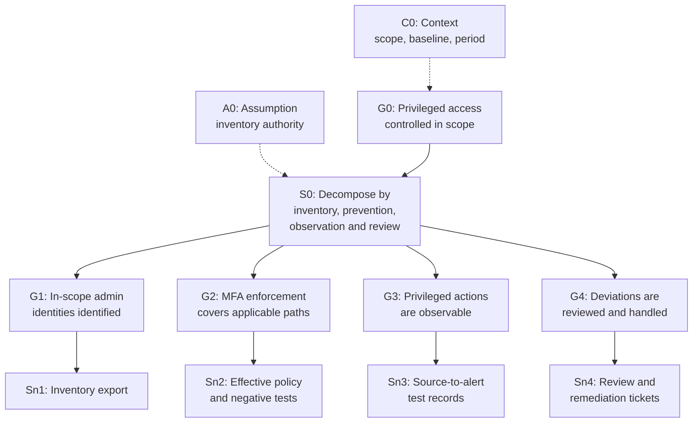

# Claim hierarchy trong Assurance Case: phân rã tuyên bố bảo mật thành lập luận và bằng chứng

## 1. Vì sao phải có Claim hierarchy?

Một báo cáo có thể viết: **“Hệ thống production đáp ứng các mục tiêu bảo mật.”** Nhưng câu này chưa nói hệ thống nào, mục tiêu nào, loại rủi ro nào, trong khoảng thời gian nào hoặc bằng chứng nào cho phép kết luận. Nếu dựa vào một chứng chỉ, một ảnh dashboard hay một lần kiểm thử thành công, báo cáo rất dễ tạo cảm giác an toàn không có cơ sở.

Trong chương **Assurance case** thuộc module **SECURITY_SECURITY_ASSURANCE**, **claim hierarchy (cấu trúc phân cấp tuyên bố)** là cách tổ chức một mục tiêu bảo đảm cấp cao thành các **subclaim nhỏ, cụ thể và có thể kiểm tra**, sau đó liên kết từng subclaim với lập luận, giả định, phạm vi và bằng chứng phù hợp.

Một claim hierarchy tốt giúp trả lời bốn câu hỏi:

1. **Đang khẳng định điều gì?** Ví dụ: quyền quản trị production được kiểm soát trong những đường truy cập đã xác định.
2. **Vì sao có cơ sở tin vào khẳng định đó?** Những subclaim nào, cùng nhau, bảo vệ lập luận?
3. **Bằng chứng nào hỗ trợ từng subclaim?** Cấu hình có hiệu lực, kết quả kiểm thử, log, audit, báo cáo, phép đo hay xác nhận có thẩm quyền?
4. **Điều gì còn chưa được chứng minh?** Giới hạn phạm vi, assumptions, trường hợp ngoại lệ, nguồn dữ liệu chưa đủ và các phản chứng (*defeaters*).

Một hệ thống có thể có nhiều security controls vẫn chưa có assurance case đáng tin, vì **tồn tại control** khác với **chứng minh control xử lý đúng rủi ro, áp đủ phạm vi và vận hành hiệu quả**.

### Mục tiêu học tập

Sau bài này, người học có thể:

- Giải thích mối liên hệ giữa **claim, subclaim, argument, strategy, context, assumption, evidence** và **defeater**.
- Xây dựng cây/đồ thị claim có ranh giới rõ, tiêu chí thành công, nút lá có thể kiểm thử và quy tắc kết hợp **AND/OR** phù hợp.
- Biểu diễn lập luận theo tư duy **Goal Structuring Notation (GSN)** hoặc **Claims–Arguments–Evidence (CAE)** mà không coi hình vẽ là bằng chứng.
- Truy vết claim tới requirements, threat/risk model, control IDs, bài kiểm thử, bản ghi evidence và findings.
- Đánh giá **độ phủ, tính đầy đủ, tính tin cậy, mức chưa biết và phản chứng** trước khi chấp nhận claim cấp trên.
- Quản lý vòng đời claim khi requirement, kiến trúc, cấu hình, chứng cứ hoặc rủi ro thay đổi.

## 2. Assurance case và Claim hierarchy khác gì một checklist?

**Assurance case** là một **lập luận có cấu trúc, được hỗ trợ bằng bằng chứng**, nhằm giải thích vì sao một hệ thống/dịch vụ đáp ứng các mục tiêu hoặc thuộc tính cần được bảo đảm **trong phạm vi và các giả định đã công bố**.

**Claim hierarchy** là phần tổ chức các tuyên bố của assurance case: nó biểu thị **claim cấp cha được hỗ trợ bởi những claim cấp con nào**, theo chiến lược lập luận nào và cần điều kiện gì để chấp nhận suy luận.

| Thành phần | Vai trò | Ví dụ |
|---|---|---|
| **Top-level claim** | Tuyên bố tổng thể cần bảo đảm | “Quyền admin trong phạm vi production được kiểm soát phù hợp baseline” |
| **Subclaim** | Một điều kiện nhỏ hỗ trợ claim cấp trên | “Các principal admin thuộc scope được nhận diện đầy đủ” |
| **Argument/strategy** | Lý do phân rã và kết hợp các subclaim | “Bảo đảm qua inventory, preventive control, detection và governance” |
| **Context** | Phạm vi, định nghĩa, thiết kế, phiên bản và mục tiêu | Hai tenant production, kỳ 01–30/11, baseline IAM v4 |
| **Assumption** | Điều được chấp nhận có điều kiện nhưng chưa chứng minh trong nhánh hiện tại | “Nguồn IAM inventory là authoritative theo quy định tổ chức” |
| **Evidence/solution** | Bản ghi hoặc kết quả kiểm chứng hỗ trợ claim | Inventory API export, policy bindings, negative tests |
| **Defeater / counterargument** | Tình huống có thể làm lập luận sai | Một đường legacy auth không thực thi MFA |
| **Finding/gap** | Sai lệch hoặc thiếu bằng chứng cần xử lý | Một principal bypass, một tenant thiếu audit access |

Checklist có thể giúp đảm bảo không quên công việc, nhưng chỉ ghi `MFA enabled = Yes`, `Logging = Yes`, `Backup = Yes` không giải thích vì sao ba mục này **đủ** cho claim “truy cập admin được kiểm soát”, cũng không thể hiện sự phụ thuộc và những điều kiện chưa được kiểm chứng.

**Lưu ý:** assurance case là một lập luận có căn cứ, không mặc nhiên là **chứng minh hình thức tuyệt đối**. Độ mạnh của kết luận phụ thuộc chất lượng phân rã, lý do kết hợp, bằng chứng và các giả định.

## 3. Từ rủi ro đến top-level claim có giới hạn rõ

Một top-level claim tốt phải hướng tới một **thuộc tính bảo mật có ý nghĩa đối với rủi ro**, không dùng những từ tuyệt đối như “an toàn hoàn toàn”, “không thể bị xâm nhập” hoặc “compliant với mọi tiêu chuẩn”.

### Mẫu viết claim

> Trong **[hệ thống/phạm vi]**, đối với **[tài sản và hành vi/rủi ro]**, trong **[kỳ/trạng thái]**, **[thuộc tính bảo mật]** được đáp ứng theo **[baseline/acceptance criteria]**, dưới **[giả định và giới hạn được công bố]**.

Ví dụ:

> Đối với các đường truy cập quản trị tương tác tới hai identity tenant production trong kỳ tháng 11/2026, các phiên thuộc phạm vi được kiểm soát bằng cơ chế xác thực và giám sát đáp ứng IAM Baseline v4, theo dữ liệu nguồn và những phép kiểm đã định.

Câu này **vẫn cần phân rã** và kiểm thử mới có thể đạt. Nhưng đã xác định được:

- Đối tượng: hai tenant production, các principal và đường truy cập admin.
- Thuộc tính: xác thực và giám sát truy cập quản trị.
- Thời gian: kỳ cụ thể.
- Baseline: tài liệu/phiên bản mục tiêu.
- Điều kiện: phạm vi dữ liệu và phương pháp kiểm chứng.

Một claim về **tính sẵn sàng của hoạt động kinh doanh** sẽ có ranh giới khác: dịch vụ, MBCO, RTO, RPO, phụ thuộc và failure model. Không nên áp một cây IAM cho mọi thuộc tính khác.

## 4. Những khái niệm logic quan trọng trong hierarchy

### 4.1. Claim cha không tự đúng chỉ vì có claim con

Đặt `G0` là claim cấp cao và `G1`, `G2` là subclaims. Mũi tên `G1 → G0` biểu thị “G1 hỗ trợ G0”, **không mặc nhiên là phép kéo theo logic**. Phải có chiến lược lập luận giải thích vì sao nhóm subclaims bao quát yêu cầu của `G0`.

Ví dụ, claim “mọi admin đều yêu cầu MFA” không thể được hỗ trợ đủ bởi hai subclaim “MFA policy tồn tại” và “policy đã được review”. Nó thiếu **phạm vi áp dụng**, **effective enforcement**, **đường bypass** và **vận hành trong kỳ**.

### 4.2. Đơn vị khẳng định và lượng từ

Cần phân biệt:

- **Tồn tại ít nhất một:** có một đường đăng nhập admin dùng MFA.
- **Tất cả trong scope:** mọi đường đăng nhập admin thuộc population được áp MFA.
- **Theo tỷ lệ:** ít nhất 99% các phiên được kiểm tra đáp ứng quy tắc đã duyệt.
- **Theo điều kiện:** nếu quyền admin được cấp thì thay đổi phải sinh audit event đúng hạn.

Một phép test thành công hỗ trợ claim **“tồn tại đường hoạt động đúng”**; nó không đủ cho claim **“mọi đường đều đúng”**. Mẫu số, kỳ, coverage và phương pháp lấy mẫu phải nhất quán với lượng từ.

### 4.3. Mức bảo đảm không phải một nhãn trang trí

Hai top-level claim cùng có nhãn “High assurance” nhưng chỉ một claim có negative tests, inventory đáng tin, independent review và counterexample analysis thì chất lượng lập luận khác nhau. Mức bảo đảm, nếu tổ chức dùng, cần dựa trên **tiêu chí công bố** và không che các nút FAIL/INCONCLUSIVE.

## 5. Cấu trúc GSN: Goal, Strategy, Context, Assumption, Solution

**Goal Structuring Notation (GSN)** là một cách biểu diễn assurance argument theo các loại phần tử chuyên biệt. Trong phạm vi bài này, tập trung vào cách đọc và ứng dụng các ý tưởng cơ bản:

| Thành phần theo GSN | Nội dung | Câu hỏi |
|---|---|---|
| **Goal (G)** | Claim cần hỗ trợ | “Điều gì phải đúng?” |
| **Strategy (S)** | Cách phân rã claim thành các goal con | “Vì sao cách chia này đủ và hợp lý?” |
| **Context (C)** | Định nghĩa, thông tin nền, phạm vi và tiêu chí | “Lập luận đang xét điều kiện gì?” |
| **Assumption (A)** | Điều giả định để suy luận có hiệu lực | “Điều gì được chấp nhận nhưng cần giám sát?” |
| **Justification (J)** | Lý do chọn chiến lược hoặc tiêu chí | “Vì sao lựa chọn này hợp lý?” |
| **Solution/Evidence (Sn)** | Dữ liệu/kiểm thử hỗ trợ một claim | “Tài liệu hoặc kết quả nào hỗ trợ?” |
| **Away goal/context** | Tham chiếu một goal/argument được quản lý ở nơi khác | “Phần bảo đảm nào được tái sử dụng?” |
| **Undeveloped goal** | Claim chưa phân rã hoặc chưa có đủ lập luận | “Điểm nào còn phải hoàn thiện?” |

Không nên nhầm **Strategy** với “action plan remediation”. Strategy trong assurance case là **lý do phân rã và liên kết**, còn kế hoạch khắc phục thuộc workflow quản lý finding.

### Hình biểu diễn ý tưởng (không phải sơ đồ GSN chuẩn)



Sơ đồ là **minh họa luồng hỗ trợ**, chưa đủ giải thích tất cả semantics của các cạnh. Với argument thật phải gắn `strategy_id`, điều kiện kết hợp, claim owner, context, assumptions và evidence references; ở ví dụ này bốn subclaims là **điều kiện cùng cần (AND)** theo chiến lược được lựa chọn, **chưa tự chứng minh đầy đủ** cho mọi rủi ro ngoài scope.

## 6. CAE: Claims–Arguments–Evidence là tư duy nền tảng

Mô hình **Claims–Arguments–Evidence (CAE)** nhấn mạnh ba lớp:

1. **Claim:** một tuyên bố cần được bảo đảm.
2. **Argument:** lý do và phương pháp suy luận từ kết quả/bằng chứng tới tuyên bố.
3. **Evidence:** quan sát hoặc kết quả kiểm tra đáng tin hỗ trợ lập luận.

Ví dụ:

| Thành phần | Nội dung |
|---|---|
| Claim | Trong kỳ, mọi thay đổi cấp quyền admin thuộc phạm vi đều được ghi audit |
| Argument | Xác định đầy đủ population từ nguồn thay đổi, đối chiếu event ID/timestamp với audit pipeline và kiểm tra các trường hợp mất dữ liệu |
| Evidence | Change inventory, source audit events, SIEM ingestion records, pipeline health, thử nghiệm phát event đã phê duyệt |
| Limitation | Ba tài khoản tích hợp ngoài scope chưa được kiểm chứng nếu không có cách xác minh nguồn |

Nếu chỉ có **evidence mà không có argument**, một auditor không biết dữ liệu liên quan gì tới kết luận. Nếu có **argument mà không có evidence**, kết quả chỉ là giả thuyết. Nếu evidence không đủ scope, claim cấp trên không thể được nâng thành PASS chỉ vì cách trình bày logic đẹp.

## 7. Kỹ thuật phân rã từ top claim: bắt đầu bằng proof obligations

**Proof obligation** trong ngữ cảnh assurance case là **điều cần phải được chứng minh hoặc có bằng chứng đủ tin** để chấp nhận một claim theo phương pháp đã chọn; không nhất thiết là chứng minh toán học.

Ví dụ top claim:

> `G0`: “Mọi đường admin access thuộc scope được ngăn sử dụng khi không đáp ứng xác thực bắt buộc.”

Phân rã thành:

| Subclaim | Nghĩa vụ chứng minh | Nếu không đạt |
|---|---|---|
| `G1 Population` | Tất cả principal và đường admin thuộc scope được xác định | Không biết ai/đường nào còn chưa kiểm soát |
| `G2 Policy` | Có chính sách xác thực phù hợp với baseline và nhóm admin | Thiết kế không đủ |
| `G3 Enforcement` | Chính sách có hiệu lực trên những đường admin cần bảo vệ | Đường bypass dẫn tới truy cập không MFA |
| `G4 Change governance` | Thêm principal/role/path mới không âm thầm thoát scope | Claim nhanh chóng lỗi thời |
| `G5 Exceptions` | Emergency/legacy exceptions có kiểm soát riêng đúng yêu cầu | Ngoại lệ mở đường truy cập vượt quyền |
| `G6 Observation` | Có phép đo/kiểm tra để phát hiện trường hợp enforcement không đúng | Không đủ khả năng chứng minh claim theo kỳ |

Có thể chọn cách chia khác nếu có lý do rõ. Một cây tốt **không phải càng nhiều nút càng tốt**, mà là **không có khoảng trống lý luận trọng yếu** giữa mục tiêu và bằng chứng.

### Kiểm tra tính MECE có điều kiện

Có thể dùng tư duy **mutually exclusive, collectively exhaustive (MECE)** để phát hiện overlap và missing branches, nhưng security controls thường xuyên có liên hệ chéo. Không bắt buộc các subclaims loại trừ hoàn toàn nhau. Quan trọng là:

- **Coverage:** có bỏ quên failure mode hay yêu cầu quan trọng?
- **Sufficiency:** nếu mọi subclaim đạt, có đủ cơ sở chấp nhận claim cha *trong scope* không?
- **Necessity:** subclaim nào là bắt buộc, subclaim nào chỉ hỗ trợ confidence?
- **Independence:** nhiều subclaim có cùng một lỗi chung làm tất cả bằng chứng mất giá trị không?
- **Traceability:** có biết mỗi subclaim dựa vào risk/control/evidence nào không?

## 8. AND, OR và các chiến lược lập luận khác nhau

Một claim hierarchy dễ gây sai kết luận nếu không định nghĩa quy tắc kết hợp giữa các nút.

### 8.1. AND: tất cả điều kiện bắt buộc phải đạt

Ví dụ `G0` yêu cầu đủ **G1: inventory**, **G2: MFA enforcement** và **G3: exception governance**. Khi ba điều kiện là bắt buộc, một nút **FAIL** không thể bị “bù điểm” từ hai nút PASS.

\[
G_0 \Leftarrow G_1 \land G_2 \land G_3
\]

Đây là **quy tắc đánh giá được đặt ra**, không chứng minh từ biểu thức rằng ba điều kiện đã đủ cho mọi mối đe dọa; còn cần đánh giá logic phân rã và assumptions.

### 8.2. OR: có nhiều đường đáp ứng cùng một mục tiêu

Ví dụ yêu cầu kiểm soát truy cập từ xa có thể được triển khai bằng **phương án A** hoặc **phương án B** đã được tổ chức phê duyệt là có hiệu lực tương đương **cho cùng mục tiêu và cùng scope**.

\[
G_0 \Leftarrow G_A \lor G_B
\]

Nhưng không được tự đặt OR giữa “MFA” và “logging” nếu yêu cầu bắt buộc cả hai. Logging không đương nhiên thay thế preventive authentication.

### 8.3. Weighted/score-based: cần thận trọng

Một mô hình “70% điểm là PASS” có thể phù hợp **đánh giá mức trưởng thành** khi công thức, trọng số và hard gates đã duyệt. Không dùng nó để tuyên bố **mọi điều kiện bắt buộc của một claim đều được đáp ứng**. Một control critical FAIL không được che bởi nhiều controls low-risk PASS.

### 8.4. Điều kiện chưa biết không phải TRUE

Dùng ba trạng thái logic giúp nhận thức sự thiếu bằng chứng:

| Phần con | Nghĩa | Trong AND |
|---|---|---|
| PASS | Có bằng chứng hợp lệ rằng điều kiện được đáp ứng | Không cản trở nếu những điều kiện khác đạt |
| FAIL | Có bằng chứng hợp lệ rằng điều kiện bắt buộc không đạt | Claim cha FAIL theo quy tắc đã định |
| INCONCLUSIVE | Không đủ dữ liệu để xác định | Claim cha không thể PASS; nếu không có FAIL đã biết, thường INCONCLUSIVE |

Khi một subclaim FAIL và subclaim khác INCONCLUSIVE, claim cha có thể **FAIL với coverage gap**, không được làm mất thông tin về phần chưa kiểm tra.

## 9. Cách viết một nút claim đủ rõ để kiểm thử

Một nút claim có thể mô tả theo các trường:

| Trường | Ý nghĩa | Ví dụ |
|---|---|---|
| `claim_id` | ID ổn định trong phiên bản hierarchy | `IAM-G3` |
| `parent_claim_id` | Vị trí trong hierarchy | `IAM-G0` |
| `text` | Mệnh đề rõ ràng, không vòng lặp | “Admin interactive authentication enforces MFA” |
| `scope` | Tenant, environment, principal types và đường truy cập | `prod-a`, `prod-b` |
| `period` | Thời điểm hoặc kỳ có hiệu lực | 01–30/11/2026 |
| `requirement_refs` | Điều khoản/baseline liên quan | `IAM-BASELINE-v4` |
| `risk_refs` | Threat/risk scenario liên quan | Privileged session compromise |
| `acceptance_criteria` | Điều kiện PASS định lượng/định tính | Không có đường bypass trong các test đã duyệt; population được bao phủ |
| `decomposition_rule` | AND/OR/other có lý do | `AND` |
| `evidence_refs` | Raw artifacts, tests, review records | `EV-IAM-032` |
| `assumptions` | Điều phải đúng để kết luận được áp dụng | Inventory nguồn là authoritative |
| `defeaters` | Những phản chứng cần xử lý | Legacy protocol bypass |
| `owner` | Người chịu trách nhiệm kiểm soát và cập nhật | Identity platform |
| `status` | PASS/FAIL/INCONCLUSIVE có nguyên nhân | `INCONCLUSIVE` khi thiếu tenant B |

**Tránh claim bất khả kiểm chứng:** “Hệ thống được thiết kế tối ưu”, “Mọi tấn công đều bị chặn”, “Không có rủi ro còn lại”. Thay bằng phát biểu có phạm vi, mô hình đe dọa, hành vi mục tiêu và tiêu chí.

## 10. Phân rã theo threat, asset, lifecycle hay control?

Không có duy nhất một mô hình phân cấp đúng. Chọn chiến lược từ câu hỏi cần bảo đảm.

| Chiến lược phân rã | Khi phù hợp | Dễ bỏ sót điều gì |
|---|---|---|
| **Theo rủi ro/threat scenario** | Mục tiêu phòng ngừa, phát hiện và xử lý những đường tấn công đã xác định | Những lỗi vận hành không nằm trong threat model |
| **Theo tài sản/kiến trúc** | Hệ thống nhiều trust boundaries, nhiều nguồn dữ liệu/tenant | Logic kinh doanh chạy qua nhiều hệ |
| **Theo security objective** | Confidentiality, integrity, availability, accountability | Các dependency chung và đường kiểm soát chéo |
| **Theo control lifecycle** | Thiết kế, triển khai, vận hành, phát hiện drift, khắc phục | Một failure mode cụ thể qua nhiều lớp |
| **Theo giai đoạn SDLC** | Secure design, build, deployment, operation | Rủi ro chạy ngang lifecycle hoặc third party |
| **Theo claim của stakeholder** | Cần trình bày với auditor, business owner, regulator, customer | Suy luận từ KPI thay vì yêu cầu kỹ thuật |
| **Kết hợp nhiều chiến lược** | Hệ thống phức tạp, có đủ khả năng quản trị traceability | Dễ lặp claim, mơ hồ ownership và trùng evidence |

Ví dụ với **bảo vệ dữ liệu khách hàng**, có thể phân rã theo vòng đời **thu thập → truyền → xử lý → lưu → chia sẻ → xóa**, sau đó phân rã từng giai đoạn theo **control design, effective configuration và operating effectiveness**. Nhưng phải thêm các điều kiện xuyên suốt như key management, identity và third-party processing.

**Quy tắc:** một strategy phải nêu **vì sao sự phân chia bao phủ yêu cầu của claim cha** và những phần được giải quyết ở argument khác.

## 11. Claim hierarchy mẫu cho quản lý quyền admin

Giả sử hệ thống có hai identity tenant production `prod-a` và `prod-b`, kết nối tới cloud management APIs. Business và security owner yêu cầu quyền truy cập đặc quyền phải được xác thực, giới hạn, ghi nhận và rà soát theo `IAM-Baseline-v4`.

### 11.1. Top-level claim

`IAM-G0`: “Trong hai tenant production và các admin access paths được liệt kê trong scope, những hoạt động quản trị được kiểm soát theo baseline được duyệt trong kỳ đánh giá.”

Mệnh đề tổng này cần xác định **“được kiểm soát” gồm những gì**. Bảng sau coi bốn nhóm subclaim là bắt buộc:

| Node | Subclaim | Mục tiêu | Nhóm evidence chính |
|---|---|---|---|
| `IAM-G1` | Admin identities và access paths được nhận diện đầy đủ | Có mẫu số đúng | Inventory, role graph, access paths |
| `IAM-G2` | Quyền đặc quyền và xác thực được áp đúng phạm vi | Prevention/enforcement | Role bindings, SSO/MFA, negative tests |
| `IAM-G3` | Hành vi thay đổi quyền và truy cập được quan sát đủ | Accountability/detection | Source audit logs, ingest, alert tests |
| `IAM-G4` | Thay đổi, ngoại lệ và hành vi sai được quản trị trong kỳ | Governance/correction | Reviews, tickets, exceptions, retests |

**Strategy `IAM-S0`:** dùng cách phân rã **AND** trên các lớp **nhận diện → kiểm soát → quan sát → quản trị**. Các nhánh là điều kiện hỗ trợ claim trong **scope đã định**, không là bằng chứng rằng mọi đường tấn công ngoài baseline được loại trừ.

### 11.2. Đi sâu một nhánh prevention

`IAM-G2` có thể gồm:

- `IAM-G2.1`: các human admins có điều kiện xác thực mạnh đã được duyệt.
- `IAM-G2.2`: quyền admin được cấp đúng phạm vi, theo least privilege.
- `IAM-G2.3`: privileged sessions ở các đường truy cập được định danh không có bypass ngoài ngoại lệ hợp lệ.
- `IAM-G2.4`: temporary privilege và emergency access được cấp/thu hồi theo điều kiện.

Nhánh `IAM-G2.3` cần **negative testing** theo đường đăng nhập/giao thức, không chỉ “đã có policy MFA”. Nhánh `IAM-G2.4` cần review tài khoản break-glass và thực tế truy cập; đây không phải lý do mặc nhiên loại chúng khỏi population.

### 11.3. Nhánh observation có thể FAIL độc lập

Nếu auth MFA PASS nhưng SIEM không nhận event của một cloud account, `IAM-G3` có thể FAIL hoặc INCONCLUSIVE tùy control cụ thể và bằng chứng hiện có. Theo chiến lược đã nêu, không thể cho `IAM-G0` PASS chỉ vì prevention tốt.

Đây là lý do **claim hierarchy cần nhấn mạnh quan hệ giữa controls**, không chỉ ghi danh sách công cụ.

## 12. Gắn từng leaf claim với bằng chứng phù hợp

**Leaf claim** là nút không tiếp tục phân rã trong một phiên bản argument; nó phải có **evidence hoặc một tham chiếu hợp lệ tới argument khác**, không phải mặc định được chứng minh khi không có con.

| Leaf claim | Evidence trực tiếp | Quality checks |
|---|---|---|
| `IAM-G1.1`: inventory admin đầy đủ | IAM API export + role graph + source inventory đối chiếu | Scope, pagination, tenant IDs, snapshot time |
| `IAM-G2.1`: MFA enforced | Effective policy + sign-in logs + negative test | Đúng đường truy cập, period, account types |
| `IAM-G2.2`: privilege scoped | Role binding export + `can-i` test hoặc tương đương | Effective permissions, inheritance, impersonation |
| `IAM-G3.1`: audit event generated | Source audit config + event test | Event ID, nguồn, clock, required fields |
| `IAM-G3.2`: event forwarded | Collector/SIEM records + pipeline health | Drop, parse errors, lag, missing sources |
| `IAM-G4.1`: access review operational | Access review tickets trong kỳ + sample | Population đầy đủ, approval evidence |
| `IAM-G4.2`: exceptions managed | Exception register + approvals + expiry + tests | Scope, authority, monitoring, overdue |

**Không thể thay evidence loại này bằng loại khác mà không xem lại argument.** Một ISO certificate không chứng minh chính xác IAM tenant do khách hàng cấu hình; một policy PDF không chứng minh control đã vận hành cả kỳ; một screenshot log không chứng minh log pipeline bao phủ mọi nguồn.

Nếu node là **unresolved/undeveloped**, phải giữ trạng thái rõ và không lấp khoảng trống bằng diễn giải “phần này hẳn đã hoạt động”.

## 13. Tính đủ của decomposition: kiểm tra reasoning gap

**Reasoning gap** xảy ra khi evidence và subclaims đều có vẻ hợp lệ nhưng **không đủ để suy ra claim cha**.

Ví dụ:

- `G1`: mã hóa at rest được bật cho database.
- `G2`: API sử dụng TLS.
- `G0`: dữ liệu khách hàng không thể bị đọc trái phép.

Hai subclaims có thể PASS nhưng claim cha **vẫn chưa được chứng minh** vì có thể thiếu access control, IAM role governance, key management, logging, backup và các đường dữ liệu ra ngoài.

Để kiểm tra reasoning gap, đặt câu hỏi:

1. Nếu tất cả nút con PASS, hãy tìm một **tình huống phản ví dụ** mà claim cha vẫn sai.
2. Nêu những điều kiện phụ thuộc chưa xuất hiện trong cây: account scope, data flow, third party, identity, privileged admin.
3. Kiểm tra claim con có chỉ mô tả **thiết kế** trong khi claim cha lại nói về **vận hành** không.
4. Kiểm tra một nhánh có ghi “all systems” nhưng mẫu số chỉ gồm danh sách từ scanner không đầy đủ.
5. Kiểm tra các subclaims có cùng dependency khiến lỗi một nguồn làm mất độ tin cậy của toàn bộ.
6. Nếu phát hiện phản ví dụ, **sửa strategy/hierarchy**, không chỉ thêm screenshot.

**Ví dụ phản chứng:** database đã mã hóa nhưng application support role có quyền export plaintext toàn bộ dữ liệu. Lỗi không ở mức có/không mã hóa, mà ở **logic claim cấp cao đã thiếu nhánh phân quyền xuất dữ liệu**.

## 14. Assumptions, contexts và justifications phải được nhìn thấy

Một claim chỉ đúng **dưới một số điều kiện**. Che assumptions khiến người đọc tưởng assurance rộng hơn thực tế.

| Loại | Ví dụ | Cách quản trị |
|---|---|---|
| **Context** | Dịch vụ version v3, production tenant IDs, audit period | Version, source và ngày hiệu lực |
| **Assumption** | Hệ IAM inventory được công nhận authoritative cho admin roles | Owner xác nhận, kiểm tra định kỳ/đối chiếu |
| **Justification** | Chia theo phòng ngừa, phát hiện, phản ứng vì threat model cho thấy cần đủ ba lớp | Threat model/risk rationale |
| **External dependency** | Cloud provider kiểm soát hypervisor security | Shared-responsibility mapping, evidence vendor |
| **Scope limitation** | Không bao phủ legacy integration sẽ bị retire theo kế hoạch | Finding/exception và tác động tới top-level claim |

**Assumption quan trọng có thể trở thành claim con.** Nếu sự đầy đủ của inventory là yếu tố quyết định, không nên mãi để câu “inventory authoritative” làm assumption không được kiểm tra. Có thể tạo subclaim riêng về đối chiếu inventory với resource/role graph và quá trình cập nhật.

Với **third-party assurance**, một báo cáo vendor chỉ được tái sử dụng khi đúng service/region/period/control scope; những **Complementary User Entity Controls (CUECs)** phía khách hàng phải được đáp ứng bằng chứng riêng khi cần.

## 15. Defeaters: cố tìm điều có thể làm claim sai

**Defeater** là tình huống, bằng chứng hoặc lập luận có thể **phủ định, làm suy yếu hoặc đặt nghi vấn** đối với claim hay mối liên kết trong assurance case.

Ví dụ với claim MFA:

- Một đường legacy authentication vẫn cho phép admin đăng nhập không MFA.
- Có tài khoản break-glass thiếu điều kiện bảo vệ, chưa được approved.
- Conditional-access policy có exception cho cả nhóm ngoài ý muốn.
- Log không thu được từ một tenant nên không thể biết enforcement trong kỳ.
- Một identity provider có hành vi fallback mà negative tests chưa bao phủ.

Không phải mọi defeater đều chứng minh FAIL ngay: có cái là **verified counterexample**, có cái là **plausible but untested**, có cái đã được **mitigated** và cần evidence.

| Trạng thái defeater | Ý nghĩa | Cách xử lý |
|---|---|---|
| **OPEN – verified** | Phản chứng được xác minh, làm sai claim liên quan | Finding, FAIL, containment và retest |
| **OPEN – plausible** | Có đường phá vỡ lập luận hợp lý nhưng chưa được đánh giá | Threat analysis, test và nêu bất định |
| **MITIGATED – evidence pending** | Đã có biện pháp sửa nhưng chưa xác nhận hiệu lực | Giữ open hoặc cần test trước closure |
| **CLOSED – verified** | Phản chứng đã được giải quyết trong phạm vi, có evidence mới | Lưu lịch sử, reason và reviewer |
| **OUT OF SCOPE – approved** | Không thuộc phạm vi claim và đã phê duyệt giới hạn | Không dùng để che rủi ro trái phạm vi ban đầu |

**Đặt câu hỏi “điều gì sẽ chứng minh chúng ta sai?” trước khi chọn mẫu**, tránh cherry-picking các test dễ PASS.

## 16. Evidence quality và độ tin cậy của từng claim

Một evidence record có thể **đúng định dạng** nhưng vẫn không phù hợp để hỗ trợ claim.

| Thuộc tính | Câu hỏi | Dấu hiệu rủi ro |
|---|---|---|
| **Relevance** | Evidence đúng đối tượng, control và assertion? | Bằng chứng backup dùng chứng minh MFA |
| **Scope/completeness** | Đúng population, account, region và kỳ? | Thêm tenant mới nhưng báo cáo không bao gồm |
| **Accuracy** | Field, identity, time, units được hiểu đúng? | Sai timezone hoặc parser interpretation |
| **Freshness** | Evidence còn đại diện trạng thái đang đánh giá? | Trích trước khi migration lớn |
| **Provenance** | Biết nguồn, collector, quyền, query và version? | CSV không có source metadata |
| **Integrity** | Artifact có bảo vệ khỏi thay đổi không được phép? | Manifest và file có thể bị sửa cùng quyền |
| **Reproducibility** | Có thể tái dựng phép đo hoặc kiểm tra raw? | Chỉ có ảnh dashboard không filter |
| **Independence** | Các evidence thật sự độc lập hay cùng pipeline? | Hai dashboard lấy từ cùng collector lỗi |
| **Confidentiality** | Thu/lưu chứng cứ có tạo rủi ro mới không? | Log chứa secret/PII được chia sẻ rộng |

**Hai mệnh đề tách biệt:** “evidence qualified” và “claim passed”. Bằng chứng chất lượng cao có thể chứng minh **FAIL**; thiếu bằng chứng chất lượng thường dẫn tới **INCONCLUSIVE**, không phải PASS.

Checksum giúp phát hiện sửa file nếu manifest được bảo vệ; checksum không chứng minh source event đã xảy ra hoặc collector dùng đúng filter. Với yêu cầu audit quan trọng, cần artifact ID, source metadata, identity, thời điểm UTC, access history và quy tắc redaction.

## 17. Claim coverage: cây đẹp nhưng còn nhánh trống

Chất lượng claim hierarchy phụ thuộc **những gì cây bao phủ**. Có thể đo từ nhiều chiều:

| Coverage | Mẫu số đúng | Ý nghĩa |
|---|---|---|
| **Requirement coverage** | Tổng requirement thuộc phạm vi | Có claim/control liên kết với yêu cầu nào? |
| **Risk scenario coverage** | Kịch bản threat/risk đã duyệt | Những rủi ro trọng yếu nào có argument? |
| **Claim development coverage** | Tất cả leaf claims cần evidence | Bao nhiêu claim lá đã có phép đo hợp lệ? |
| **Evidence qualification coverage** | Claim/asset/period cần kiểm chứng | Bao nhiêu phần có evidence đạt chất lượng? |
| **Tested behavior coverage** | Những hành vi/kịch bản cần thử | Bao nhiêu hành vi đã được thử trong scope? |
| **Dependency coverage** | Các phụ thuộc quan trọng được xác định | Đã kiểm tra IAM/KMS/vendor/collector/DR chưa? |

Ví dụ: cây có **20 leaf claims**, 16 có evidence hợp lệ, trong đó 14 PASS và 2 FAIL; 4 chưa kiểm tra. Khi đó:

- **Evidence-qualified leaf coverage:** `16/20 = 80%`.
- **Pass rate trên tập qualified:** `14/16 = 87,5%`.
- **Verified PASS share trên tất cả leaf claims:** `14/20 = 70%`.
- **Trạng thái tổng:** không thể gọi “87,5% top-level assurance PASS” nếu AND có 2 subclaim FAIL và 4 chưa kiểm tra.

Một con số tổng hợp chỉ hữu ích khi biết **đơn vị đo, scope, weighting và logic kết hợp**. Với yêu cầu bắt buộc, không cho một phần trăm đẹp che FAIL của nhánh critical.

## 18. Sampling và tính đại diện của evidence

Một leaf claim có thể ghi “tất cả thay đổi quyền admin có approval” nhưng evidence chỉ là 10 tickets chọn sẵn. Cần biết population và phương pháp chọn mẫu.

### Quy trình gắn sample với claim

1. Xác định **population độc lập** gồm tất cả events/assets/identities trong scope và kỳ.
2. Xác định đơn vị: một admin change, một người dùng, một session hay một ticket; không trộn.
3. Chọn sampling phù hợp với rủi ro: full population, random, stratified hoặc targeted high-risk.
4. Ghi query, method, kích thước, thời gian, loại trừ và chọn mẫu trước khi biết kết quả khi có thể.
5. Giữ cả trường hợp FAIL, timeout hoặc thiếu dữ liệu; không thay mẫu thất bại bằng mẫu dễ.
6. Đánh giá giới hạn suy rộng: một targeted sample không đại diện ngẫu nhiên cho toàn population.
7. Khi tìm thấy counterexample, cập nhật claim và finding, cân nhắc mở rộng phạm vi để tìm root cause.

**Một vi phạm đã xác minh có thể đủ bác bỏ claim phổ quát** (“mọi thay đổi đều được phê duyệt”); trong khi 10 trường hợp PASS không nhất thiết đủ để chứng minh tất cả 10.000 changes đều đạt.

### Sample design là một phần của strategy

Nếu subclaim được hỗ trợ bằng thống kê từ sample, argument phải giải thích vì sao sample phù hợp và tiêu chí sai số/chấp nhận được, không chỉ gắn một bảng kết quả rồi xem như toàn bộ population đã được kiểm tra.

## 19. Confidence in evidence khác với truth của claim

Có thể có hai dạng nhận định:

- **Claim result:** PASS, FAIL, INCONCLUSIVE so với tiêu chí đã xác định.
- **Confidence in assessment:** mức độ tin tưởng vào cách đánh giá, dựa trên chất lượng evidence, coverage, independence và bất định.

Không đồng nhất “confidence cao” với “PASS”: có thể **rất tin tưởng** rằng claim đã FAIL vì negative test tái lập được đường bypass. Ngược lại, “PASS trong một test staging” có thể chỉ hỗ trợ confidence giới hạn đối với production.

| Claim result | Confidence | Diễn giải |
|---|---|---|
| PASS | High trong scope | Bằng chứng đủ mạnh cho các điều kiện đã kiểm tra |
| PASS | Limited | Có thể cần thu hẹp claim hoặc thêm test; không mở rộng sang mọi failure mode |
| FAIL | High | Có bằng chứng vi phạm rõ, cần remediation |
| FAIL | Limited | Có dấu hiệu vi phạm nhưng source/method cần xác minh để tránh false positive |
| INCONCLUSIVE | N/A hoặc thấp | Chưa đủ cơ sở đưa ra kết luận control |
| NOT_APPLICABLE | Cần applicability evidence | Phải chứng minh vì sao đối tượng nằm ngoài scope |

Không tạo “mức tin cậy 99%” nếu không có mô hình thống kê/định lượng phù hợp. Nếu dùng score nội bộ, cần công bố rubric, hard gates và cách xử lý rủi ro của subclaim critical.

## 20. Quy tắc tổng hợp trạng thái từ leaf lên root

Khi hierarchy có **các nhánh bắt buộc theo AND**, có thể dùng quy tắc quyết định thận trọng sau, với điều kiện **strategy được xác nhận là đủ và các assumptions còn hợp lệ**:

| Trạng thái các subclaim bắt buộc | Kết quả cấp cha gợi ý | Lưu ý |
|---|---|---|
| Tất cả PASS, strategy/evidence hợp lệ | Có thể PASS theo scope | Cần kiểm tra reasoning gap và defeaters trước |
| Ít nhất một FAIL đã xác minh | FAIL | Đồng thời ghi các nhánh chưa có evidence |
| Không có FAIL, có ít nhất một INCONCLUSIVE | INCONCLUSIVE | Không được suy ra PASS |
| Có N/A đúng phạm vi | Đánh giá lại strategy/scope | N/A không tự tính như PASS |
| Assumption quan trọng không còn đúng | Cần đánh giá lại, thường INCONCLUSIVE hoặc FAIL tùy claim | Không chỉ chạy lại phép cộng trạng thái |

**Với OR:** một nhánh PASS chỉ có thể hỗ trợ claim cha nếu các đường thay thế **thực sự được chấp thuận là đủ để đáp ứng cùng mục tiêu**; đừng dùng OR để tránh một control bắt buộc.

### Pseudocode minh họa

```text
evaluate(parent):
    if strategy_not_justified or scope_unverified:
        return INCONCLUSIVE with argument_gap

    if critical_assumption_invalid:
        return reevaluate_parent_with_assumption_finding

    children = applicable_mandatory_subclaims(parent)

    if parent.strategy == AND:
        if any(child.status == FAIL for child in children):
            return FAIL with failing_children_and_unknowns
        if any(child.status == INCONCLUSIVE for child in children):
            return INCONCLUSIVE with missing_evidence
        if all(child.status == PASS for child in children)
           and defeaters_resolved and evidence_is_qualified:
            return PASS
        return INCONCLUSIVE

    if parent.strategy == OR:
        if alternatives_are_approved_and_equivalent
           and any(branch_is_proven_sufficient for branch in children):
            return PASS with selected_branch_and_limitations
        if all(branch_is_disproven for branch in children):
            return FAIL
        return INCONCLUSIVE
```

Đây là **logic giáo dục**, không phải bộ luật tự động áp cho mọi framework hay tiêu chuẩn. Khi một assumption sai, cần xem **tác động cụ thể** trước khi chọn FAIL/INCONCLUSIVE; các claim có bằng chứng phản chứng trực tiếp có thể FAIL độc lập.

## 21. Một schema YAML để lưu claim hierarchy có thể audit

Mô hình dữ liệu cần tách **định nghĩa claim**, **lập luận phân rã**, **bằng chứng** và **trạng thái đánh giá**; nếu không, lịch sử kết luận có thể bị ghi đè khi baseline thay đổi.

```yaml
assurance_case_id: ac-privileged-access-20261128
version: "1.0"
service: SECURITY_SECURITY_ASSURANCE
top_claim:
  claim_id: IAM-G0
  text: "Scoped production administrative access is adequately controlled"
  scope:
    environments: [production]
    tenant_ids: [prod-a, prod-b]
    principal_types: [interactive-human-admin]
    period: "2026-11-01/2026-11-28"
  requirement_refs: [IAM-BASELINE-v4]
  risk_refs: [RISK-PRIV-ACCESS]
  owner: security-architecture
  strategy:
    id: IAM-S0
    type: AND
    rationale: "Complete population, prevention, observation, and governance are all required"
    child_claim_ids: [IAM-G1, IAM-G2, IAM-G3, IAM-G4]
  context_refs: [IAM-C0]
  assumptions: [IAM-A1]
  defeaters: [IAM-D1]
claims:
  - claim_id: IAM-G1
    text: "Administrative identities and paths in scope are identified"
    owner: identity-platform
    acceptance_criteria:
      - "Authoritative population reconciled with cloud role assignments"
    evidence_refs: [EV-INV-001, EV-ROLE-002]
  - claim_id: IAM-G2
    text: "Approved MFA and privilege controls are enforced"
    owner: identity-security
    acceptance_criteria:
      - "No unauthorized bypass on approved negative tests"
    evidence_refs: [EV-POLICY-003, EV-TEST-004]
  - claim_id: IAM-G3
    text: "Privileged access and changes are observable"
    owner: detection-engineering
    evidence_refs: [EV-AUDIT-005, EV-PIPELINE-006]
  - claim_id: IAM-G4
    text: "Changes and exceptions are governed and corrected"
    owner: iam-governance
    evidence_refs: [EV-REVIEW-007, EV-EXCEPTIONS-008]
assessment:
  assessed_at_utc: "2026-11-28T05:00:00Z"
  evaluator_version: claim-evaluator-v2
  child_results:
    IAM-G1: PASS
    IAM-G2: FAIL
    IAM-G3: INCONCLUSIVE
    IAM-G4: PASS
  top_claim_result: FAIL
  reasoning: "MFA bypass confirmed; one audit source lacks valid coverage"
  finding_refs: [FIND-IAM-021, EV-GAP-006]
  confidence: "High in verified bypass, limited for full audit coverage"
```

**Đây là dữ liệu mô phỏng.** File YAML chỉ là định dạng lưu trữ; nó không biến `top_claim_result: FAIL` thành kết quả kiểm toán độc lập nếu không có artifacts thực. Trong hệ thống thật cần kiểm tra rằng mọi referenced ID tồn tại, không có cycle không hợp lệ, strategy nhất quán và evidence có provenance, period, hash/manifest và access controls.

### Phân biệt reusable case và current assessment

Một cấu trúc claim có thể dùng lại cho các kỳ đánh giá sau, nhưng `assessment` nên có **snapshot/version** riêng theo kỳ. Không sửa `PASS` của tháng trước thành `FAIL` của tháng này; lưu **lịch sử trạng thái** để biết drift và thời gian ảnh hưởng.

## 22. Quản lý assumption và dependency giữa nhiều assurance cases

Trong hệ thống lớn, nhiều claim phụ thuộc cùng một điều kiện: inventory, KMS, cloud identity, logging, time synchronization hay nhà cung cấp. Nếu sao chép subclaim sang nhiều cây khác nhau mà không liên kết phiên bản, dễ xảy ra trường hợp một nơi đã phát hiện FAIL nhưng nơi khác vẫn hiển thị PASS.

Các biện pháp:

- Tạo **claim registry** với ID, version, owner, scope, dependencies, last reviewed và evidence refs.
- Dùng **away goal/reference** để tái sử dụng assurance argument khi thật sự tương đương về scope.
- Kiểm tra những **shared assumptions** có thể tạo common-mode failure.
- Khi dependency thay đổi, xác định các claim cấp trên phải được đánh giá lại.
- Không tạo vòng lặp `G1 → G2 → G1` như thể hai claim tự chứng minh lẫn nhau.
- Tránh tái sử dụng evidence cũ của version/tenant khác mà không đánh giá applicability.

Ví dụ, claim “backup có thể khôi phục” phụ thuộc vào **KMS key readiness**; nếu KMS key bị revoke, nhiều claim về RPO, DR và business continuity cùng chịu ảnh hưởng. Dependency graph phải thể hiện các claim cần xem lại.

## 23. Traceability từ requirements, risk và controls tới nodes

Claim hierarchy không được trở thành tài liệu tách rời thực tế. Mỗi leaf hoặc nhánh quan trọng cần có traceability.

| Hướng truy vết | Câu hỏi | Công cụ/record |
|---|---|---|
| **Risk → Claim** | Rủi ro nào đang được argument xử lý? | Threat model/risk register |
| **Requirement → Claim** | Điều kiện nào bắt buộc trong scope? | Baseline, policy, contract clause |
| **Claim → Control** | Cơ chế nào giúp đáp ứng assertion? | Control framework, config/runbook |
| **Claim → Test** | Phép đo nào có khả năng bác bỏ/ủng hộ claim? | Test plan, negative tests, sampling |
| **Test → Evidence** | Raw dữ liệu nào từ nguồn nào? | Test run ID, event/asset ID, manifest |
| **Evidence → Decision** | Vì sao PASS/FAIL/INCONCLUSIVE? | Evaluator version, reasoning, reviewer |
| **Finding → Retest** | Sai lệch được sửa và kiểm chứng thế nào? | Ticket, change ID, evidence before/after |
| **Change → Impacted claims** | Khi nào cần invalidate assurance cũ? | CI/CD, asset inventory, change alerts |

**Traceability hai chiều** có ích: từ một security requirement tìm được các claims hỗ trợ, và từ một evidence artifact thấy nó đang được dùng để hỗ trợ claim nào. Khi một artifact bị phát hiện sai nguồn hoặc hết hạn, có thể xác định **tất cả kết luận bị ảnh hưởng**.

## 24. Tính toàn vẹn và nguồn gốc evidence trong một cây claim

Một cây claim thường tham chiếu nhiều artifact: architecture design, config export, logs, ticket, DR result, report bên thứ ba. Cần phân biệt **nguồn gốc dữ liệu** với **nơi file được lưu**.

Metadata khuyến nghị:

| Trường | Ý nghĩa |
|---|---|
| `evidence_id` | ID ổn định |
| `source_system` / `source_resource_id` | Hệ thống và đối tượng gốc |
| `collector_identity` / `method_version` | Ai/điều gì thu và bằng phương pháp nào |
| `collected_at_utc` / `event_at_utc` | Mốc thu và mốc sự kiện |
| `assessment_period` | Kỳ được dùng để kết luận |
| `query/filter`, `pagination` | Cách xác định dữ liệu được thu |
| `raw_ref` / `derived_ref` | Phân biệt bản gốc và bản xử lý |
| `hash_algorithm` / `manifest_ref` | Kiểm tra tính toàn vẹn có điều kiện |
| `access_classification` / `retention` | Bảo vệ và vòng đời |
| `limitations` / `quality_status` | Những phần chưa đủ tin cậy |

**Hash file không xác thực sự thật của nội dung.** Một screenshot sai filter nhưng được hash hoàn chỉnh vẫn không chứng minh đúng claim. Evidence chất lượng cao cần **provenance, coverage, accuracy, integrity và method phù hợp**.

## 25. Phản ví dụ đầy đủ: ba subclaim PASS nhưng top claim vẫn không đạt

Giả sử kiến trúc xử lý dữ liệu cá nhân có top-level claim:

> `DATA-G0`: “Dữ liệu hồ sơ người dùng chỉ được truy cập bởi chủ thể được phép trong production.”

Người lập argument ban đầu chọn:

- `DATA-G1`: storage encryption at rest enabled — PASS.
- `DATA-G2`: client-to-server TLS enforced — PASS.
- `DATA-G3`: secrets stored in secret manager — PASS.

**Counterexample:** một tài khoản support của ứng dụng có quyền đọc tất cả hồ sơ dù không có lý do nghiệp vụ và không được audit; tất cả G1/G2/G3 vẫn có thể PASS. Do đó **strategy không đủ** để hỗ trợ DATA-G0.

Cây phải bổ sung hoặc tái cấu trúc:

| Subclaim cần thêm | Bằng chứng phù hợp |
|---|---|
| **Identity authorization** – mọi đường truy cập dữ liệu có kiểm soát quyền hiệu lực | RBAC/ABAC policies, access tests, row-level authorization |
| **Privileged access governance** – quyền support/admin có lý do và giới hạn | JIT approvals, role reviews, expiry |
| **Key management** – khóa chỉ được dùng bởi principal phù hợp | KMS grants, access logs, rotation controls |
| **Data flow coverage** – API, backup, export và third parties thuộc scope | Data flow mapping, export tests, vendor assurance |
| **Monitoring/response** – truy cập bất thường được ghi và xử lý | Audit events, detection tests, case records |
| **Retention/deletion** – dữ liệu không tồn tại ngoài phạm vi đã duyệt | Retention config, deletion test |

**Bài học:** nếu mọi subclaim con PASS mà claim cha vẫn có một phản ví dụ hợp lý thuộc scope, đó là **lỗi lập luận**, không chỉ lỗi thiếu test. Cần sửa hierarchy và strategy.

## 26. Phân tích tình huống với số liệu: một MFA bypass làm thay đổi root

Giả sử `IAM-G0` yêu cầu **mọi admin interactive principal** trong hai tenant production đáp ứng baseline MFA. Authoritative inventory xác định 50 principal:

- 48 principal có evidence enforcement hợp lệ và được kết luận **PASS**.
- Một principal có negative test xác nhận legacy login **bypass MFA** → **FAIL**.
- Một principal không thể thu bằng chứng do collector thiếu quyền → **INCONCLUSIVE**.

**Kết quả theo population:**

| Chỉ số | Công thức | Kết quả |
|---|---:|---:|
| Verified PASS share | 48/50 | 96% |
| Qualified assessment coverage | (48 + 1)/50 | 98% |
| Known FAIL | 1/50 | 2% |
| INCONCLUSIVE | 1/50 | 2% |
| Parent enforcement claim (AND/“mọi”) | Có ít nhất một bypass đã xác minh | **FAIL** |

Không được viết “đạt 98% compliance” vì 98% là **coverage đánh giá**, gồm cả một FAIL. Con số 96% cũng không chứng minh top-level universal claim đạt. Một trường hợp bypass đã đủ bác bỏ yêu cầu “mọi admin phải có MFA” trong scope.

Nếu `IAM-G3` về audit coverage cũng INCONCLUSIVE vì một tenant thiếu event source, `IAM-G0` có thể báo **FAIL (confirmed bypass) + audit evidence gap open**, không che thiếu sót bằng một tỷ lệ duy nhất.

### Cách khắc phục có thể kiểm tra

1. Kiểm tra đường legacy login nào được phép; giới hạn tác động trong phạm vi an toàn.
2. Sửa policy/selector hoặc chặn legacy authentication theo quy trình đã duyệt.
3. Chạy lại negative test với principal thử, giữ source sign-in event và decision.
4. Đối chiếu toàn bộ admin population với effective enforcement, kể cả break-glass exceptions hợp lệ.
5. Khôi phục quyền đọc của collector, thu đầy đủ tenant còn thiếu.
6. Cập nhật claim leaf, evidence IDs, findings, retest timestamp và chỉ đánh giá lại root sau khi mọi điều kiện bắt buộc đủ căn cứ.

Không đóng finding chỉ vì owner đã thay cấu hình; phải xác minh **đường bypass không còn hoạt động** và không xuất hiện regression trong các đường khác.

## 27. Claim hierarchy và vòng đời thay đổi

Một assurance case từng hợp lệ có thể trở nên lỗi thời sau:

- Thêm cloud account/region/tenant hoặc dữ liệu nhạy cảm mới.
- Thay kiến trúc identity, authentication policy, secrets hoặc KMS.
- Thay vendor/subprocessor, nơi xử lý dữ liệu và shared responsibility.
- Thay requirement, baseline hoặc risk acceptance criteria.
- Thay code, parser, event schema, CI/CD hoặc deployment configuration.
- Phát hiện incident, bypass, vulnerability hoặc audit exception mới.
- Evidence hết kỳ, collector ngừng hoạt động hoặc sampling không còn đại diện.

### Trạng thái của claim theo thời gian

Nên quản lý ít nhất:

- `DRAFT`: claim/strategy đang xây dựng, chưa có kết luận.
- `UNDER_REVIEW`: đánh giá logic, scope và artifacts.
- `SUPPORTED` / `PASS`: đáp ứng theo tiêu chí trong scope, evidence còn hiệu lực.
- `NOT_SUPPORTED` / `FAIL`: có phản chứng hoặc điều kiện bắt buộc không đạt.
- `INCONCLUSIVE`: chưa đủ dữ liệu để quyết định.
- `SUPERSEDED`: phiên bản khác thay thế; giữ lịch sử.
- `REASSESSMENT_REQUIRED`: thay đổi làm đánh giá cũ không còn áp dụng.

Tên trạng thái có thể tùy tổ chức. **Đừng nhập nhằng** giữa trạng thái workflow của tài liệu và kết quả security claim: một tài liệu “Approved” không làm claim bên trong tự động PASS.

## 28. Các dạng lỗi lập luận dễ gặp

| Anti-pattern | Vì sao sai | Cách sửa |
|---|---|---|
| **Top claim quá rộng** | Không biết phải chứng minh gì | Thu hẹp asset, threat, period và baseline |
| **Chia theo tên công cụ** | “Có SIEM, có WAF” không bảo đảm mục tiêu | Chia theo proof obligations và threat paths |
| **Leaf không có evidence** | Claim chỉ là lời hứa | Gắn test/record hoặc ghi undeveloped |
| **Policy = operating effectiveness** | Nhầm thiết kế với hành vi thực | Bổ sung effective config và runtime tests |
| **AND bị tính như trung bình** | Một subclaim critical FAIL bị che | Logic kết hợp có hard gates |
| **OR tùy tiện** | Control không tương đương được coi thay thế | Yêu cầu justification cho alternative controls |
| **Lượng từ “mọi” với sample nhỏ** | Suy rộng vượt dữ liệu | Công bố population, sample và giới hạn |
| **Scope/period không rõ** | Không biết evidence áp cho cái gì | Gắn IDs, dates, baseline |
| **Shared assumption ẩn** | Một lỗi chung phá nhiều kết luận | Tạo dependency và assumption registry |
| **Không xử lý defeater** | Cây đẹp nhưng còn đường bypass | Counterargument review + negative tests |
| **Đánh thiếu evidence thành PASS** | Tạo false assurance | INCONCLUSIVE + follow-up |
| **Đánh thiếu evidence thành FAIL mọi control** | Khẳng định không có cơ sở | Tách collection gap và control violation |
| **Reuse vendor report khác scope** | Không hỗ trợ hệ thống đang xét | Kiểm tra product, period, exceptions, CUECs |
| **Một artifact chống lưng mọi claim** | Không kiểm tra relevance và tính độc lập | Mapping claim-specific evidence |
| **Update evidence nhưng không cập nhật claim** | Assurance case lỗi thời | Change impact mapping và reassessment |
| **Đóng finding theo ticket “Fixed”** | Không có retest | Test lại đường thất bại và lưu evidence |
| **Giấu ngoại lệ vào N/A** | Không phản ánh residual risk | Ghi accepted exception riêng có hạn |
| **Đếm nút PASS làm KPI duy nhất** | Bỏ severity/coverage/reasoning gap | Multi-dimensional scorecard và review |

## 29. Bài tập: tự tạo claim hierarchy cho cloud key management

**Bối cảnh giả định:** một hệ thống học trực tuyến lưu dữ liệu kết quả học tập và thông tin khách hàng đã mã hóa. Dịch vụ chạy trong hai cloud accounts production, có backup cross-region và sử dụng KMS. Chủ sở hữu dữ liệu yêu cầu **ngăn truy cập plaintext trái phép và có thể khôi phục dữ liệu trong phạm vi mục tiêu đã được phê duyệt**.

Nhóm kỹ thuật gửi các evidence:

- IaC cho database khai báo encryption at rest.
- Một bảng IAM cho thấy key policy hiện tại cho phép application role dùng KMS.
- Report backup job success hằng ngày, **chưa có restore test** trên vùng dự phòng.
- Một alert về privileged key policy change, nhưng không có end-to-end alert delivery test.
- Danh sách service accounts từ một cloud account, thiếu account thứ hai.
- Một vendor report mô tả cloud provider controls, nhưng chưa rõ trách nhiệm key policy phía khách hàng.

### Nhiệm vụ

1. Viết **top-level claim có scope và điều kiện kiểm tra**, hoặc tách thành hai top claims nếu confidentiality và recoverability yêu cầu logic khác nhau.
2. Chọn chiến lược phân rã **AND** theo data flow, IAM, KMS, backup, operation, monitoring và governance; giải thích vì sao bao phủ risk.
3. Viết ít nhất **8 subclaims/leaf claims**, mỗi nút có ID, owner, acceptance criteria và evidence dự kiến.
4. Chỉ ra **contexts, assumptions, dependencies và defeaters**; ít nhất hai defeaters phải có phép thử đối chứng an toàn.
5. Phân biệt việc có encryption config với chứng minh effective key usage và không có đường truy cập plaintext ngoài quyền.
6. Phân loại trạng thái **PASS/FAIL/INCONCLUSIVE** cho các subclaims dựa vào evidence được cung cấp; không tự tưởng tượng dữ liệu chưa có.
7. Xác định các **reasoning gaps** nếu cây chỉ có “encrypted” và “backup enabled”.
8. Thiết kế **recovery test** có transaction watermark, quyền KMS ở DR site và kiểm tra data consistency để hỗ trợ RPO.
9. Đề xuất **evidence register, integrity manifest, reviewer và retest strategy**.
10. Viết một đoạn assurance conclusion rõ: những gì đã được hỗ trợ, những gì chưa được chứng minh và các công việc ưu tiên.

### Câu hỏi tự kiểm tra

- Vì sao subclaim PASS không tự động kéo theo top claim PASS?
- Strategy khác evidence và khác remediation plan ở điểm nào?
- Khi nào nên phân rã bằng AND, khi nào OR là hợp lệ?
- GSN có những thành phần nào giúp ghi context/assumption?
- Tại sao một screenshot “policy enabled” không đủ chứng minh operating effectiveness?
- Đâu là ranh giới giữa verified counterexample và giả thuyết defeater?
- Tại sao “1 bypass đã xác minh” có thể bác bỏ claim có lượng từ “mọi”?
- Coverage 90% leaf evidence có đồng nghĩa hệ thống tuân thủ 90% không?
- Nếu nhiều claim dùng một cloud KMS, cần quản lý dependency nào?
- Khi thay nhà cung cấp hoặc IAM baseline, điều gì xảy ra với assurance case cũ?

## 30. Checklist review trước khi chấp nhận claim hierarchy

Một assurance case chỉ nên được dùng làm cơ sở ra quyết định khi người review trả lời được:

- **Top claim rõ:** đối tượng, security objective, threat/failure model, kỳ, baseline và giới hạn.
- **Strategy được giải thích:** lý do phân rã, AND/OR hợp lệ, các điều kiện bắt buộc và alternative controls.
- **Không có reasoning gap hiển nhiên:** đã tìm counterexamples trong scope dù các subclaims có thể PASS.
- **Nút lá có test/evidence:** claim IDs, owner, acceptance criteria, raw refs và thông tin provenance.
- **Scope và population đủ rõ:** tenant/account/region, subject types, data flows, kỳ và ngoại lệ.
- **Assumptions/dependencies được quản trị:** authoritative inventory, vendor shared controls, IAM/KMS/log pipeline, change impacts.
- **Defeaters được xét:** phản chứng đã biết, những trường hợp plausible chưa thử và kết quả mitigations/retests.
- **Evidence đủ chất lượng:** relevance, completeness, accuracy, freshness, integrity, reproducibility và independence khi cần.
- **Kết luận không bị làm đẹp:** PASS/FAIL/INCONCLUSIVE theo claim, không bỏ missing data hoặc critical FAIL.
- **Risk/exception tách khỏi trạng thái đo:** acceptance có quyền và thời hạn, không đổi FAIL thành PASS.
- **Finding tới được retest:** owner, mức độ ưu tiên, change evidence, negative tests và closure review.
- **Versioning và continuous assurance:** claim/evaluator/baseline versions, artifacts theo kỳ, trigger đánh giá lại.
- **Bảo mật evidence:** không lưu token/private key, giới hạn quyền, retention và chain of custody theo mức rủi ro.

**Claim hierarchy là bộ khung lập luận của assurance case.** Giá trị của nó không nằm ở sơ đồ có nhiều ô và mũi tên, mà ở khả năng chỉ ra **chính xác một tuyên bố bảo mật được hỗ trợ bởi những điều kiện nào, lập luận nào, bằng chứng nào và dưới những giới hạn nào**. Một claim chưa đủ bằng chứng phải được ghi là chưa đủ; một phản chứng đã xác minh phải thay đổi kết luận; và mỗi remediation phải quay lại cùng cây claim để được retest. Đó là cách biến security assurance thành một chương trình **có thể kiểm toán, có thể giải thích và liên tục được cập nhật trong phát triển và vận hành**.
