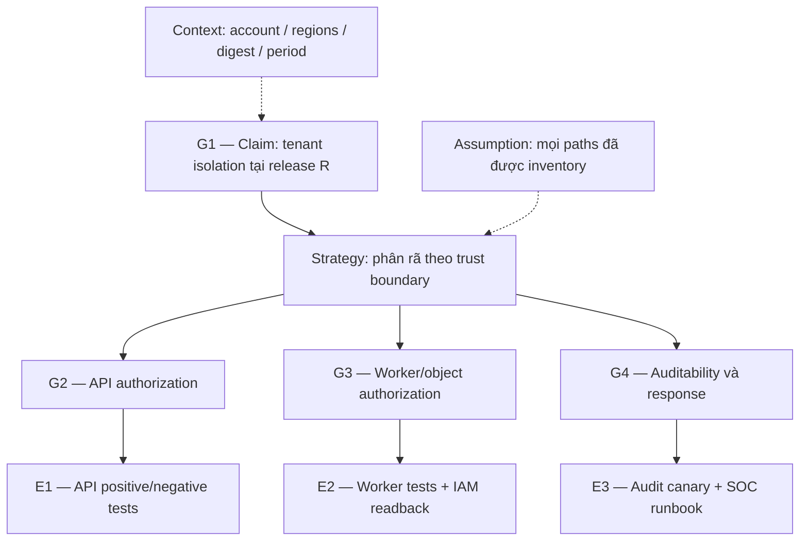
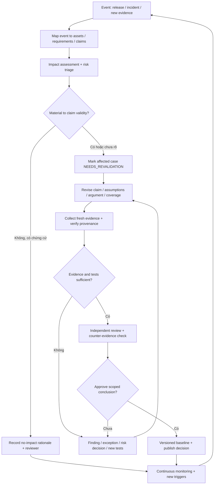
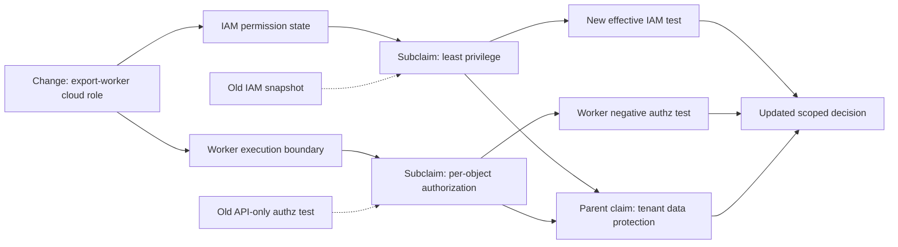
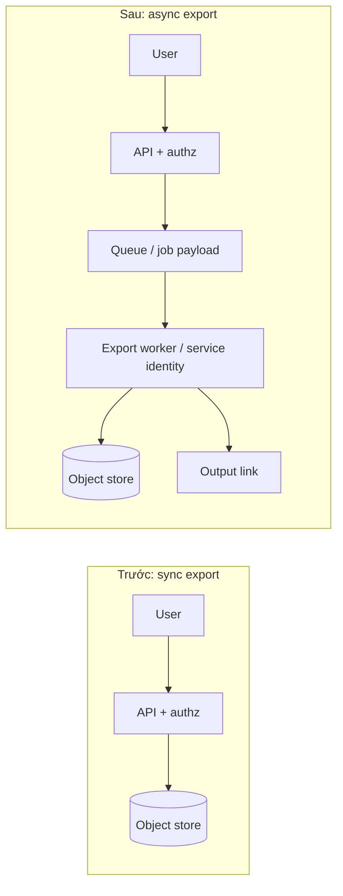
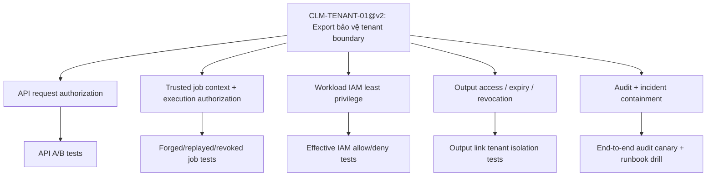
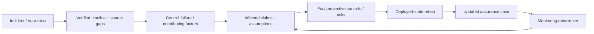

# Cập nhật assurance case

Một nền tảng SaaS quản lý tài liệu đã được đánh giá bảo mật trước khi ra mắt. Assurance case phiên bản 1.0 kết luận rằng các yêu cầu **phân tách dữ liệu theo tenant, quyền tối thiểu của workload, ghi nhật ký bảo mật và khả năng phục hồi** có bằng chứng phù hợp với phạm vi kiểm thử. Sau đó nhóm phát triển chuyển chức năng export từ xử lý đồng bộ trong API sang **queue và worker bất đồng bộ**, bổ sung cloud role cho worker và triển khai ở một vùng khác. Các test cũ vẫn hiển thị màu xanh; tài liệu assurance case không thay đổi.

Vấn đề là test cũ chỉ kiểm tra quyền tại API, trong khi worker giờ xử lý dữ liệu với service identity riêng. Kiểm chứng “user B không xuất được tài liệu tenant A” ở API **không tự chứng minh** worker từ chối một message chứa object ID trái quyền. Nhận định an toàn trước đó có thể đã **mất tính đại diện** dù không ai phát hiện một lỗ hổng mới. Nếu tiếp tục dùng kết luận “PASS” của phiên bản 1.0 để phê duyệt release mới, tổ chức đang đưa ra một **assurance claim rộng hơn bằng chứng hiện có**.

**Cập nhật assurance case (assurance case maintenance / evolution)** là hoạt động **đánh giá lại, sửa đổi, bổ sung và phê duyệt chuỗi lập luận có bằng chứng** mỗi khi thay đổi về hệ thống, rủi ro, yêu cầu, controls, nguồn evidence hoặc tri thức mới có thể ảnh hưởng đến mức tin cậy của một kết luận. Nó bao gồm phát hiện trigger, phân tích tác động lên claims–arguments–evidence, xác định bằng chứng còn hiệu lực hay đã lỗi thời, bổ sung test/kiểm chứng, xử lý phản chứng và findings, cập nhật residual risk, tạo baseline phiên bản mới và tiếp tục giám sát điều kiện làm claim mất hiệu lực.

Trong chương **Assurance case** của module **SECURITY_SECURITY_ASSURANCE**, mục đích không phải chỉ “sửa tài liệu cho khớp release”. Mục đích là **duy trì niềm tin có căn cứ** rằng hệ thống vẫn đáp ứng các mục tiêu bảo mật, từ phân tích rủi ro, security requirements và controls đến kiểm thử, audit và khắc phục phát hiện trong suốt phát triển và vận hành.

> **Nguyên tắc:** Một assurance case chỉ có giá trị **trong phạm vi, thời kỳ, trạng thái hệ thống, những giả định và nguồn bằng chứng đã được xác định**. Khi bất kỳ điều kiện nền tảng nào thay đổi, phải đánh giá lại phần liên quan trước khi tái sử dụng kết luận.

Bài viết này trình bày một quy trình cập nhật có thể thực hiện cho hệ thống phần mềm và cloud/SaaS, từ mô hình hóa claims đến change impact, evidence quality, CI/CD, quản trị rủi ro và phê duyệt. Mọi ID, dữ liệu, thời hạn và kết quả minh họa chỉ dành cho học tập, không phải hiện vật hay kết luận kiểm toán của một tổ chức cụ thể.

## 1. Vì sao assurance case cần được cập nhật?

Assurance case không phải giấy chứng nhận bất biến. Một claim có thể hợp lý ở mốc `T0` nhưng không còn đủ hỗ trợ ở `T1` do:

- Kiến trúc thay đổi và tạo **trust boundary** mới.
- Phạm vi tài sản, region, customer/tenant hoặc nhà cung cấp được mở rộng.
- Security objective hay business impact được phân loại lại.
- Một threat mới xuất hiện hoặc điều kiện khai thác thay đổi.
- Requirement, security policy, contract hoặc quy định áp dụng được cập nhật.
- Control bị cấu hình sai, drift, tắt, mất coverage hoặc thay owner.
- Một finding, incident hoặc near miss cho thấy assumption cũ không đúng.
- Test evidence chỉ gắn với build/image/config cũ.
- Tool kiểm thử lỗi, log source mất dữ liệu hoặc báo cáo đã quá thời hạn sử dụng.
- Vendor thay cách thực thi control, subprocessor hoặc phạm vi báo cáo.
- Risk exception hết hạn, control bù không còn hoạt động.
- Data retention làm một phần evidence không còn thể kiểm tra lại.
- Control được khắc phục, bổ sung kiểm thử hoặc có bằng chứng mới tốt hơn.
- Reviewer phát hiện causal reasoning sai, claim mơ hồ hoặc phản chứng chưa được xét.

Cập nhật assurance case có thể **làm tăng, giảm hoặc giữ nguyên mức tin cậy**. “Cập nhật” không đồng nghĩa “phải đổi trạng thái sang PASS”; nhiều cập nhật đúng đắn sẽ kết luận **NEEDS_REVALIDATION, INCOMPLETE, UNSUPPORTED hoặc RISK_ACCEPTED**.

### 1.1. Điều gì xảy ra nếu chỉ cập nhật vào kỳ audit?

Một deployment hôm nay có thể mở quyền IAM, nhưng kỳ audit tiếp theo sáu tháng sau mới xem lại. Trong khoảng thời gian đó, release gate, risk register và lãnh đạo có thể dựa trên kết luận cũ để quyết định triển khai hoặc mở rộng khách hàng. **Khoảng trống giữa thay đổi và tái đánh giá** chính là một nguồn false assurance.

Không nhất thiết chạy full audit sau mọi commit. Cần **phân tích tác động theo thay đổi** và đưa ra kiểm chứng tương xứng với risk; thay đổi thấp có thể chỉ cần revalidate evidence link, còn thay đổi trust boundary/privileged access thường cần test và review mới.

### 1.2. Những nhóm cập nhật thường gặp

| Loại | Ví dụ | Câu hỏi chính |
| --- | --- | --- |
| **System-driven** | Release mới, region mới, key rotation, IAM drift | Claim cũ còn đúng cho system version mới? |
| **Knowledge-driven** | Incident, phát hiện false negative, audit finding, threat mới | Lập luận trước đây thiếu hoặc sai điều gì? |
| **Assurance-driven** | Test mới, evidence mới, reviewer xác nhận control fix | Có thể hỗ trợ claim tốt hơn và đóng finding không? |
| **Requirement-driven** | Policy/contract yêu cầu audit log mới | Claim nào cần đổi nội dung hoặc bổ sung test? |
| **Context-driven** | Thay data sensitivity, tenant model, vendor | Assumptions/scope ban đầu còn phù hợp? |

Một sự kiện có thể thuộc nhiều loại. Ví dụ cloud migration là cả system change lẫn context change, có thể tạo risk mới và làm test cũ không còn đại diện.

## 2. Những thành phần phải hiểu trước khi cập nhật

Một assurance case thường có cấu trúc **Claim–Argument–Evidence (CAE)** hoặc được biểu diễn bằng các nút gần với **Goal Structuring Notation (GSN)**. Không nhất thiết dùng công cụ sơ đồ chuyên dụng; cần giữ mối quan hệ logic đủ rõ để reviewer hiểu vì sao bằng chứng hỗ trợ kết luận.

| Thành phần | Vai trò | Ví dụ |
| --- | --- | --- |
| **Claim / Goal** | Điều khẳng định cần hỗ trợ trong phạm vi | “Cross-tenant document reads bị từ chối trên release R” |
| **Argument / Strategy** | Lập luận cho thấy claims cấp dưới và evidence đủ để hỗ trợ claim lớn | “Mọi đường truy cập đều áp authorization tại trust boundaries” |
| **Subclaim** | Điều kiện nhỏ cần đúng | “Worker kiểm tra quyền trên object tại execution time” |
| **Evidence / Solution** | Test run, config readback, logs, audit review cụ thể | Negative A/B test trên worker image digest D |
| **Context** | Phiên bản, môi trường, kiến trúc, criteria và định nghĩa | Production region A, worker D, policy V |
| **Assumption** | Tiền đề cần đúng nhưng có thể chưa được chứng minh trực tiếp | “Mọi object reads đều đi qua service X” |
| **Justification** | Lý do chọn decomposition, phương pháp, mẫu hoặc quy tắc | Risk-based selection theo threat model |
| **Counter-evidence / defeater** | Thông tin thách thức claim hoặc lập luận | Incident cho thấy message replay bypass authz |
| **Residual risk / limitation** | Phần chưa kiểm hoặc không thể loại bỏ | DR region chưa chạy test tương đương |
| **Reviewer decision** | Kết luận có thẩm quyền tại thời điểm | Supported in scope; pending region B |

### 2.1. Claim không nên mơ hồ

**Mơ hồ:** “Hệ thống an toàn.”

**Rõ hơn:** “Trong production account `acct-prod-01` và vùng `region-a` với document API release `r42` và export-worker digest `sha256:<digest>`, các luồng đọc/xuất tài liệu đã được thử từ hai test tenants A/B có kiểm soát; luồng hợp lệ thành công và truy cập cross-tenant không có quyền bị từ chối tại API và worker; những đường chưa kiểm được ghi trong limitation.”

Kết luận rõ không phải bảo đảm tuyệt đối. Nó nói chính xác **assertion**, **phạm vi**, **bằng chứng** và **giới hạn**.

### 2.2. Lập luận không được chỉ là danh sách link

Một claim “tenant isolation đạt” kèm liên kết đến báo cáo SAST, một unit test và ảnh chụp IAM nhưng không giải thích các hiện vật kiểm tra **đường truy cập nào, trust boundary nào, điều kiện lỗi nào** là lập luận chưa đủ. Argument cần nêu:
1. Những điều kiện cần và mức đủ.
2. Các subclaims và lý do chúng bao phủ yêu cầu.
3. Vì sao evidence liên quan, có chất lượng và đúng phiên bản.
4. Những giả định nào được sử dụng.
5. Những phản chứng, known gaps và limitations nào còn tồn tại.

### 2.3. GSN là mô hình lập luận, không phải tiêu chuẩn đồng nhất cho mọi artifact

Trong GSN, các nút như Goal, Strategy, Context, Assumption, Justification và Solution giúp thể hiện reasoning. Dùng đúng phạm vi và semantics của phương pháp tổ chức chọn. Một sơ đồ Mermaid dưới đây chỉ là **minh họa quan hệ CAE theo phong cách GSN**, không tự là biểu diễn GSN chính thức hoặc đánh giá chuẩn.



Nếu một message worker có thể đi từ nguồn khác ngoài API, assumption “mọi paths đã được inventory” sai. Cần **mở lại lập luận**, không chỉ thêm một test vào nút E2 rồi giữ nguyên mọi kết luận.

## 3. Assurance case là cấu trúc sống có version và điều kiện hiệu lực

### 3.1. Baseline là gì?

**Assurance baseline** là tập hợp được quản trị bao gồm:
- Claim/subclaim IDs và nội dung được phê duyệt.
- Phiên bản kiến trúc, trust boundary và asset inventory.
- Security objectives, risk model và requirements versions.
- Control baseline, phạm vi IAM/network/logging.
- Test methodology, evidence types và coverage.
- Test results/config/artifact digests.
- Assumptions, exceptions, limitations, residual risks.
- Review/approval và ngày hiệu lực.
- Events hoặc thời hạn khiến cần đánh giá lại.

Baseline không nhất thiết là một file monolithic. Nó có thể là **manifest ký/kiểm tra tính toàn vẹn** liên kết nhiều hiện vật trong kho được phân quyền.

### 3.2. Phân biệt version của case và version của hệ thống

| Đối tượng | Ví dụ version | Ý nghĩa |
| --- | --- | --- |
| Application | `r42` | Phiên bản logic phục vụ nghiệp vụ |
| Container/workload | `sha256:<digest>` | Artifact thực tế được triển khai |
| Infrastructure | `iac-commit-xy` | Hạ tầng khai báo |
| Effective runtime | `iam-snapshot-2026...` | Cấu hình/quyền quan sát được |
| Security requirements | `sr-v3` | Điều kiện cần đáp ứng |
| Threat model | `tm-v5` | Threats và assumptions |
| Test suite | `authz-negative-v8` | Methodology và fixtures |
| Evidence | `EV-AUTH-091-r2` | Hiện vật cụ thể |
| Assurance case | `AC-ISOLATION-v2` | Argument/claim đã review |
| Assurance decision | `DEC-AC-022` | Kết luận tại mốc xác định |

Tăng `AC-ISOLATION-v2` không chứng minh image production đã cập nhật. Ngược lại, image mới được deploy không buộc mọi claim phải thay nội dung, nhưng **phải có quyết định impact/evidence applicability**.

### 3.3. Validity window

Một claim có thể có:
- **Effective from:** khi configuration/test được xác nhận.
- **Valid through:** thời gian/điều kiện còn phù hợp, không nên mặc định vô hạn.
- **Expiration/review by:** mốc bắt buộc xét lại theo policy.
- **Change triggers:** sự kiện làm claim cần revalidation ngay.
- **Scope binding:** môi trường, account, release và region.
- **Evidence freshness:** age và điều kiện còn đại diện của hiện vật.

Không nên gán một con số “30 ngày là đủ cho mọi evidence”. Một approval record cho thay đổi trong kỳ có thể giữ giá trị lịch sử; một IAM snapshot phản ánh hiện trạng có thể lỗi thời ngay sau khi policy đổi. **Tính hợp lệ phụ thuộc bản chất assertion**, không chỉ tuổi file.

## 4. Phân biệt cập nhật case, cập nhật evidence và cập nhật system

Khi có release mới, có ba hoạt động khác nhau:

1. **System change:** code/config/identity/data flow được sửa.
2. **Evidence refresh:** tạo test run, snapshot hoặc log record mới cho trạng thái đã thay.
3. **Argument/claim update:** đánh giá bằng chứng mới có hỗ trợ cùng khẳng định không, có cần chia lại claim hay thay context/assumption.

| Tình huống | Cần làm |
| --- | --- |
| Chỉ thay tài liệu diễn giải, không đổi claim/logic | Version case, review phạm vi và link |
| Thay cấu hình IAM production | Impact claims phụ thuộc quyền, effective readback và access tests |
| Thay test runner nhưng test logic giữ nguyên | Xác minh equivalence/provenance và evidence mới phù hợp |
| Threat model thêm đường tấn công async | Thêm subclaim/control tests và xem lại parent claim |
| Phát hiện test cũ false positive | Rút/đánh dấu evidence invalid, re-evaluate conclusions |
| Thay requirement do hợp đồng mới | Cập nhật criteria, scope, claims và control mapping |
| Khắc phục finding | Change refs + retest + reviewer decision, không chỉ đóng ticket |
| Bổ sung vendor mới | Xem shared responsibility, inherited controls, contract và evidence |
| Chỉ đổi tên file evidence | Bảo toàn identity/provenance và references, không coi là re-test |

### 4.1. Evidence refresh không tự chữa được argument gap

Nếu control requirement là bảo vệ dữ liệu cả API và worker, việc chạy thêm 100 unit tests ở API không chứng minh worker check quyền. Mở rộng số lượng evidence của một đường không thể che thiếu coverage ở đường khác.

### 4.2. Cập nhật không tự đồng nghĩa tăng confidence

Một kết quả scan rộng hơn có thể phát hiện lỗ hổng đã bị bỏ sót; confidence vào claim giảm. Đó là một **cải tiến về hiểu biết và tính trung thực**, dù dashboard có thêm FAIL.

## 5. Các trigger phải đánh giá lại assurance case

Một chương trình không thể phụ thuộc duy nhất vào người nhớ đọc case. Nên có **danh mục triggers**, mappings và owner cho việc đánh giá lại.

### 5.1. Nhóm trigger theo nguồn

| Nhóm | Trigger ví dụ | Mục có khả năng ảnh hưởng |
| --- | --- | --- |
| **Architecture** | API thêm queue, service mesh, tenant sharing | Trust boundaries, data-flow claims |
| **Identity/IAM** | Role grant, workload federation, break-glass | Least privilege và accountability |
| **Data protection** | New region, schema/classification, retention | Confidentiality, privacy, keys |
| **Application release** | Thay authz logic, session/token, export | Behavioral tests, artifact lineage |
| **Platform** | K8s admission/CNI/OS runtime change | Network isolation, runtime hardening |
| **Detection/logging** | Parser, SIEM source, log retention mất coverage | Auditability/IR evidence claims |
| **Recovery** | Backup, PITR, KMS, DR region change | RPO/RTO và restore assurance |
| **Third-party** | Vendor/subprocessor hoặc contract thay | Inherited/shared control claims |
| **Risk/threat** | Active exploit, risk scoring/asset criticality | Threat model và acceptance |
| **Assurance data** | Invalid test, false negative, stale report | Evidence support và confidence |
| **Operational incident** | Security incident hoặc near miss | Assumptions, preventive/detective claims |
| **Exception/governance** | Exception expiry, unowned control | Claim validity, residual risk |
| **Policy/requirements** | Bổ sung yêu cầu audit, encryption, authz | Goal content, criteria, argument coverage |

### 5.2. Không phải mọi trigger đều làm fail claim

Thay cấu hình logging có thể không ảnh hưởng trực tiếp claim về mã hóa dữ liệu at rest, nhưng có thể ảnh hưởng claim về auditability. **Impact analysis phải định hướng theo quan hệ**, tránh cả hai sai lầm:
- *underreaction:* không xét lại claim nào.
- *overreaction:* vô hiệu hóa mọi claim và kiểm thử lại toàn bộ hệ thống dù không liên quan.

### 5.3. Khi evidence conflict với kết luận cũ

Nếu một incident cho thấy user B đọc được tài liệu A, **phản chứng trực tiếp** đối với claim “mọi truy cập cross-tenant trái phép đều bị từ chối” cần được gắn ngay với claim liên quan và khởi động response theo mức rủi ro. Không chờ đến review sprint hoặc audit định kỳ mới gỡ nhãn PASS.

### 5.4. Định nghĩa trigger chính thức

Mỗi trigger có thể có:
- source event type, asset IDs và timestamp;
- mapping tới claims/controls;
- mức độ thay đổi (*materiality*) và điều kiện bắt buộc escalation;
- owner review/notification;
- target response/impact analysis deadline theo policy;
- evidence cần bổ sung;
- điều kiện đặt case thành `NEEDS_REVALIDATION` hoặc `UNSUPPORTED`;
- log của quyết định “không ảnh hưởng” kèm lý do.

## 6. Vòng đời cập nhật assurance case



### 6.1. Trạng thái case và ý nghĩa

| Status | Ý nghĩa đúng |
| --- | --- |
| `DRAFT` | Lập luận hoặc nội dung chưa được review |
| `IN_REVIEW` | Reviewer đang đánh giá claim/argument/evidence |
| `SUPPORTED_IN_SCOPE` | Kết luận có đủ cơ sở trong phạm vi và thời kỳ nêu |
| `SUPPORTED_WITH_LIMITATIONS` | Có cơ sở cho một phần được nêu, limitations rõ |
| `NEEDS_REVALIDATION` | Một change/trigger làm evidence applicability chưa được xác minh |
| `INCOMPLETE_EVIDENCE` | Thiếu nguồn/test cần cho claim đã nêu |
| `CHALLENGED_BY_EVIDENCE` | Có phản chứng cần điều tra hoặc làm giảm claim |
| `UNSUPPORTED` | Kết luận không thể được hỗ trợ theo criteria hiện tại |
| `RISK_ACCEPTED_TIME_BOUND` | Có residual risk được chấp nhận có hạn, không tương đương PASS |
| `SUPERSEDED` | Bản cũ được thay bằng baseline mới; giữ lịch sử |
| `RETIRED` | Claim không còn áp dụng do system/scope bị loại bỏ có căn cứ |

Đây là **mẫu workflow**, không phải taxonomy bắt buộc của một framework. Các quy tắc quyết định cần được thống nhất với risk/assurance owners. Một case `SUPPORTED_WITH_LIMITATIONS` có thể chưa đủ cho release gate trọng yếu tùy policy.

### 6.2. Phân biệt incident state và assurance state

Incident có thể `RESOLVED` khi service được khôi phục, nhưng claim về tenant isolation vẫn `NEEDS_REVALIDATION` cho tới khi fix được deploy/retest. Hai trạng thái phục vụ hai mục đích và không được đồng bộ thành PASS tự động.

### 6.3. Assured before vs assured after

Mọi bản cập nhật nên giữ:
- claim trước đây và bằng chứng lúc được chấp nhận;
- trigger làm cần xem xét;
- hành động điều tra/change;
- evidence mới và reviewer;
- conclusion sau cập nhật;
- phạm vi còn chưa kiểm;
- liên kết sang decision cũ và lý do supersede.

Lịch sử cho phép audit biết **tại sao ở thời điểm trước tổ chức tin điều gì**, thay vì chỉ thấy một file hiện tại đã sửa.

## 7. Phân tích tác động bằng đồ thị truy vết

Assurance case là một mạng phụ thuộc; chỉ đọc sơ đồ bằng mắt có thể bỏ sót các claim cấp cha hoặc evidence nhiều-nhiều.

### 7.1. Những nút và quan hệ cần theo dõi

- `Asset/Service/Region/Identity/DataFlow`.
- `Risk/Threat/AbuseCase`.
- `SecurityObjective/Requirement`.
- `Control/Policy/ConfigurationVersion`.
- `Claim/Subclaim/Argument/Assumption`.
- `TestCase/TestRun/ExpectedAssertion`.
- `Evidence/Source/CollectionPeriod`.
- `Finding/Exception/Remediation/Retest`.
- `Decision/Baseline/Approver`.

Ví dụ các cạnh:
- `requirement REQUIRES control`;
- `control IMPLEMENTED_BY asset`;
- `claim SUPPORTED_BY evidence`;
- `argument DEPENDS_ON subclaim`;
- `assumption VALID_FOR context`;
- `evidence GENERATED_FROM test run`;
- `finding CHALLENGES claim`;
- `change AFFECTS asset/requirement/control`.

### 7.2. Một change propagation minh họa



Đường nét đứt tới evidence cũ nhắc reviewer cần đánh giá **applicability**. Không được coi một evidence “cũ” là vô hiệu trong mọi trường hợp; chẳng hạn source code security requirement vẫn có thể dùng làm design evidence, nhưng **không còn đủ để chứng minh runtime effectiveness**.

### 7.3. Hệ quả lan truyền

Nếu subclaim G3 không còn đủ bằng chứng, parent claim G1 dựa vào G3 không thể giữ kết luận mạnh như trước **trừ khi argument có đường chứng minh thay thế hợp lệ**. Reviewer phải nêu điều kiện thay thế, không xóa nút G3 khỏi hình chỉ để đạt PASS.

### 7.4. Tránh “đồ thị đầy nhưng không có reasoning”

Tự động liên kết một requirement với hàng trăm scanner results không tự chứng minh đủ coverage. Mỗi cạnh hỗ trợ phải nêu:
- loại hỗ trợ (design, implementation, operating effectiveness);
- phạm vi/time;
- expected vs observed result;
- độ tin cậy và limitations;
- trường hợp/chủ đề **không** được evidence kiểm chứng.

## 8. Thuật toán phân tích change impact (minh họa)

Một tool nội bộ có thể hỗ trợ reviewer tìm các claim bị ảnh hưởng từ những asset/control thay đổi. Thuật toán không tự xác minh an toàn; nó chỉ **gợi ý phạm vi cần xem xét**.

### 8.1. Input và output

**Input:** change event, affected asset IDs, requirements và graph đã versioned; criticality/risk; mapping tới evidence/test.

**Output:** affected claims/subclaims, assumptions cần xem lại, evidence nghi lỗi thời, đề xuất test/reviewer, decision status sơ bộ cùng lý do và các mapping gaps.

**Bảo vệ quan trọng:** nếu một asset mới chưa có mapping, **không được kết luận không ảnh hưởng**. Phải ghi `UNMAPPED_CHANGE` và yêu cầu inventory/threat-model review.

### 8.2. Pseudocode

```text
function assessImpact(change, graph, currentBaseline):
    require authorized(change)
    affectedNodes = mapChangedAssetsAndRequirements(change, graph)

    if affectedNodes.empty:
        return NEEDS_REVIEW("unmapped change; cannot assert no impact")

    impactedClaims = reverseTraverseDependencies(affectedNodes, graph)
    impactedAssumptions = findAssumptions(impactedClaims, graph)
    candidateEvidence = findSupportingEvidence(impactedClaims, graph)

    for evidence in candidateEvidence:
        if evidence.scopeDoesNotMatch(change.targetScope) or
           evidence.versionNotRepresentative(change.newVersion) or
           evidence.sourceHealthUnknown or
           evidence.wasContradicted:
            markEvidenceApplicability(evidence, "REVIEW_REQUIRED")

    for claim in impactedClaims:
        markStatus(claim, "NEEDS_REVALIDATION")
        proposeTests(claim, expectedFailureModes, positiveAndNegative)
        recordRiskAndOwner(claim)

    return reviewPackage(
        changes = change,
        claims = impactedClaims,
        assumptions = impactedAssumptions,
        evidence = candidateEvidence,
        missingMappings = discoverCoverageGaps(change, graph)
    )

# Không tự chuyển NEEDS_REVALIDATION sang SUPPORTED_IN_SCOPE:
# chỉ reviewer có thẩm quyền quyết định sau khi có evidence/test phù hợp.
```

Pseudocode thể hiện logic mong muốn, **không phải chương trình có thể chạy trực tiếp**; các hàm tên mô tả cần được thiết kế, xác thực và phân quyền riêng. Với trường hợp incident đang diễn ra, phải kích hoạt IR process theo rủi ro thay vì chỉ tạo revalidation task.

### 8.3. False negative trong impact mapping

Graph có thể thiếu đường từ worker tới storage, tool cho rằng IAM change chỉ ảnh hưởng claim hạ tầng. Vì vậy kiểm kê tài sản và threat model là điều kiện quan trọng của assurance; có thể dùng **conservative fallback** khi mapping không đủ: tăng phạm vi review và giữ trạng thái chưa kết luận.

## 9. Cập nhật nội dung claim sau thay đổi

Không nên chỉ thay một con số release version trong tiêu đề.

### 9.1. Kiểm tra từng phần của claim

1. **Subject:** hệ thống/asset nào?
2. **Property:** security property chính xác là gì?
3. **Scope:** môi trường, region, tenant/data type và API/workflows?
4. **Condition:** giả định và operating conditions?
5. **Time/version:** thời kỳ, deployed artifact, config state?
6. **Acceptance:** điều kiện nào để coi được hỗ trợ?
7. **Evidence:** test/event/approval refs, source provenance?
8. **Limitations:** phần chưa thử và residual risks?
9. **Authority:** ai phê duyệt và khi nào?
10. **Invalidation:** sự kiện hoặc thay đổi nào làm cần re-review?

### 9.2. Ví dụ sửa claim

**Claim v1:** “Export API ngăn mọi truy cập cross-tenant.”

**Khi architecture thay đổi:** Async export worker có service identity và queue riêng.

**Claim v2:**
> “Ở release `r43` của production region A, luồng export gồm API→queue→worker→object store từ test tenants A/B kiểm tra authorization dựa trên identity/tenant đáng tin tại các boundary tương ứng và từ chối export trái quyền; test gồm job hợp lệ, object khác tenant, retry, forged payload và revoked access. Các đường ở DR region B chưa được thử và được ghi limitation. Evidence liên kết tới worker digest, IAM/config snapshot và test run.”

V2 cải thiện độ rõ và chỉ ra các test mới cần thiết. **Chưa thể gắn trạng thái SUPPORTED** cho V2 chỉ vì nội dung viết tốt hơn; cần có evidence.

### 9.3. Không thay đổi claim để “né” finding

Nếu v1 tuyên bố cả production và DR nhưng DR còn thiếu coverage, có thể sửa claim thành “production region A” **nếu scope thay đổi được phê duyệt và phần DR được báo rõ là gap/risk**. Không âm thầm cắt DR khỏi scope rồi tuyên bố toàn hệ thống đạt.

## 10. Đánh giá lại assumptions, contexts và justifications

Assurance case thường dựa trên tiền đề quan trọng nhưng không được kiểm trực tiếp trong mỗi test. Khi thay đổi, những tiền đề này dễ trở thành điểm yếu.

### 10.1. Assumption register

| Assumption ID | Nội dung | Rủi ro nếu sai | Trigger kiểm lại |
| --- | --- | --- | --- |
| `ASM-01` | Mọi object read đi qua authorization enforcement | Bypass qua worker/batch | Thêm endpoint/queue/worker |
| `ASM-02` | Workload IAM không mở rộng ngoài service scope | Credential blast radius | IAM policy, role binding change |
| `ASM-03` | Cloud audit logs bao phủ region/account production | Blind spot khi điều tra | New region, parser, collector |
| `ASM-04` | Backup giải mã được tại DR | Restore thất bại vì KMS | Key rotation/DR changes |
| `ASM-05` | Vendor xử lý dữ liệu trong vùng đã thỏa thuận | Data residency/privacy risk | Contract/subprocessor change |
| `ASM-06` | Test artifacts khớp deployed production image | False assurance của CI | Build/release pipeline change |
| `ASM-07` | Resource inventory bao phủ mọi tenant data paths | Không biết phạm vi phải bảo vệ | New storage/service/data flow |

### 10.2. Context không giống assumption

“Production gồm account A và region B tại ngày T” là **context được xác định/quan sát**; “Mọi đường object read đều đi qua component X” là **assumption cần chứng minh hoặc giới hạn**. Nếu assumption là security critical, cân nhắc chuyển nó thành **subclaim có evidence** thay vì để như giả định lâu dài.

### 10.3. Justification của phương pháp cũng có thể lỗi thời

Một tổ chức chọn sample 10 admin accounts vì tổng population chỉ có 12. Sau cloud expansion, population có 500 identities, dùng nguyên sample cũ mà không re-evaluate selection logic không còn đủ. Cần ghi khi nào lý do chọn phương pháp mất hiệu lực.

## 11. Evidence applicability: đúng hiện vật chưa chắc đúng kết luận

Khi cập nhật case, không chỉ hỏi “có evidence không?” mà phải hỏi “evidence **còn hỗ trợ claim sau thay đổi không?**”.

### 11.1. Các chiều kiểm chứng

| Chiều | Câu hỏi reviewer |
| --- | --- |
| **Relevance** | Evidence có kiểm đúng property và failure mode? |
| **Sufficiency** | Có đủ paths, populations, samples và negative cases? |
| **Reliability** | Nguồn, công cụ, collector và người thu đáng tin? |
| **Integrity** | Artifact có bảo toàn/chống chỉnh sửa không? |
| **Provenance** | Source system, query, test runner/version được xác định? |
| **Scope** | Đúng account, service, tenant, region, data class? |
| **Version** | Artifact/config/test version có khớp runtime? |
| **Temporal validity** | Thu lúc nào, đại diện kỳ nào, có drift sau đó không? |
| **Source health** | Log/scanner/test pipeline có chạy, có missing data? |
| **Counter-evidence** | Có kết quả/incident mâu thuẫn với kết luận? |
| **Reproducibility** | Reviewer được phép có thể tái dựng test và output? |
| **Confidentiality** | Việc lưu/chia sẻ evidence có tạo disclosure không? |

### 11.2. Trạng thái evidence nên tách khỏi claim

| Evidence status | Ý nghĩa |
| --- | --- |
| `VALID_FOR_SCOPE` | Hiện vật phù hợp phạm vi/điều kiện đã ghi |
| `REVIEW_REQUIRED` | Chưa biết applicability sau change |
| `STALE_FOR_CURRENT_STATE` | Hợp lệ lịch sử nhưng không đại diện hiện trạng |
| `INVALIDATED` | Phát hiện sai nguồn, hỏng, false positive hoặc mâu thuẫn nghiêm trọng |
| `SUPERSEDED` | Có phiên bản hiện vật mới thay thế theo policy |
| `MISSING_OR_UNAVAILABLE` | Không thể truy xuất trong kỳ đánh giá |
| `INCOMPLETE_COVERAGE` | Chỉ chứng minh một phần assertion |
| `CONTRADICTED` | Có evidence tin cậy thách thức nội dung |

Một screenshot cấu hình IAM của tháng trước có thể vẫn là evidence lịch sử hợp lệ cho audit của tháng đó, nhưng **STALE_FOR_CURRENT_STATE** khi chính sách đã thay. Không xóa lịch sử để tránh làm sai quá trình quyết định trước đó.

### 11.3. Tránh “đếm link” thành confidence

Tổ chức có 20 báo cáo của cùng một scanner sử dụng cùng inventory thiếu region B. Đây không phải 20 nguồn độc lập chứng minh coverage. Cần xét **dependency/correlation giữa sources**, sự thật về population, phương pháp và những failure modes chung.

### 11.4. Empty result không đồng nghĩa absence of risk

Nếu CI scanner bị lỗi authentication hoặc SIEM source bị tắt, query trả rỗng có thể chỉ phản ánh blind spot. Cần gắn trạng thái `SOURCE_UNHEALTHY`, thu thập lại evidence hoặc ghi known unknown; không duy trì claim “không có vulnerability” chỉ vì lần thu mới không thấy finding.

## 12. Phản chứng, defeaters và thay đổi tri thức

**Counter-evidence / defeater** là thông tin có thể đánh bại hoặc làm suy yếu một claim, lập luận hoặc giả định, ngay cả khi các evidence cũ vẫn tồn tại.

Ví dụ:
- Một negative test mới chứng minh cross-tenant access được ALLOW.
- Incident investigation cho thấy IAM change ngoài change management.
- Source health report xác nhận mất log nhiều giờ.
- Vendor report mới nêu exclusion của region mà case đã coi là được bao phủ.
- Một phương pháp kiểm thử có false negative do test fixture không hợp lệ.
- Một security requirement được tăng độ nghiêm ngặt sau risk review.

### 12.1. Hai loại thử thách thường gặp

- **Rebuttal:** kết luận trái với claim. Ví dụ có bằng chứng user B đọc được object A; claim “không có truy cập trái quyền” bị thách thức trực tiếp.
- **Undercutter:** evidence/argument không đáng tin hoặc không còn đại diện. Ví dụ negative test PASS vì test object không tồn tại; kết quả không chứng minh authorization deny.

Cả hai đều cần xử lý, nhưng hành động khác nhau. Rebuttal có thể đòi hỏi containment và remediation; undercutter có thể đòi hỏi sửa fixtures và chạy lại test để biết control thật sự thế nào.

### 12.2. Quy trình xử lý

1. Ghi event/finding, nguồn và độ tin cậy.
2. Xác định claims, assumptions và evidence liên quan.
3. Đánh giá có incident đang diễn ra cần response ngay không.
4. Đặt affected claims vào trạng thái bị thách thức hoặc thiếu evidence.
5. Thu bằng chứng độc lập, tái hiện trong phạm vi được phép.
6. Chỉnh sửa argument/control/test nếu nguồn phản chứng xác nhận.
7. Theo dõi remediation và verified retest.
8. Reviewer chấp nhận hoặc bác bỏ phản chứng bằng lý do cụ thể.
9. Phát hành phiên bản case/kết luận mới và ghi residual risks.
10. Cập nhật monitoring để phát hiện tái diễn.

**Không xóa một test FAIL khi test PASS mới xuất hiện.** Cần giải thích khác biệt version, môi trường, dữ liệu hoặc điều kiện.

## 13. Ưu tiên cập nhật assurance case theo rủi ro

Không phải mọi case có cùng ưu tiên. Đánh giá:
- Critical business capability và data classification.
- Tác động confidentiality/integrity/availability.
- Exposure, exploitability và current threat activity.
- Scope thay đổi: một tenant test hay mọi production region?
- Blast radius và privileged identities.
- Mức quan trọng của claim đối với release/contract/audit.
- Độ tin cậy và mức thiếu hụt evidence.
- Số lượng subclaims/controls phụ thuộc một giả định đang bị thách thức.
- Rủi ro khi tiếp tục sử dụng case cũ làm quyết định.
- Compensating controls đã có evidence hay chưa.
- Dependencies và thời gian thực hiện test/review.
- Legal/regulatory/contractual obligations được xác định cụ thể.

### 13.1. Điều cần làm khi critical claim không còn được hỗ trợ

Nếu claim về tenant confidentiality bị phản chứng trong production, không chờ hoàn tất bản sửa tài liệu để action. Nên:
1. Kích hoạt IR/containment hoặc escalation theo mức rủi ro.
2. Đánh dấu claim/release decision liên quan cần review khẩn.
3. Ghi scope và current evidence; bảo toàn bằng chứng cần thiết.
4. Đánh giá customer impact/residual risk với owner có thẩm quyền.
5. Sửa control, triển khai an toàn và xác minh.
6. Phê duyệt case mới hoặc hạn chế vận hành/tính năng nếu chưa thể chứng minh.

### 13.2. Evidence debt và assurance debt

**Evidence debt:** hiện vật cần có chưa đủ, quá cũ hoặc không reproducible.

**Argument debt:** claims/assumptions/coverage mapping chưa được cập nhật theo architecture/threat model.

**Control debt:** preventive/detective/recovery controls thực tế chưa đạt requirement.

Ba loại có thể liên quan nhưng không đồng nghĩa. Nếu chỉ chạy thêm tool để giảm evidence debt mà control sai, assurance chưa đạt.
## 14. Thiết kế verification plan khi claim thay đổi

Sau impact analysis, cần kế hoạch kiểm chứng các **security properties bị ảnh hưởng**, không chỉ lặp lại test cũ theo thói quen.

### 14.1. Từ failure mode tới test

| Change hoặc nghi vấn | Subclaim | Test/verification mới |
| --- | --- | --- |
| Export chuyển sang async worker | Worker không bypass business authorization | Positive tenant A và negative tenant B job tests |
| Worker role được cấp quyền storage mới | Workload tuân least privilege | Effective IAM readback, allowed/denied access test |
| Thêm production region B | Isolation và logging áp dụng cả region B | Deploy digest/config check + region-specific tests |
| Thay JWT validator | Chỉ token còn hiệu lực, đúng audience/issuer mới được chấp nhận | Expired/wrong-audience/revoked token tests |
| KMS key rotation | Dữ liệu đọc/khôi phục theo policy | Encrypt/decrypt, key access audit, restore drill |
| SIEM parser update | Detection source ghi đúng event semantics | Canary producer→collector→rule→alert |
| Cloud account migration | Audit và guardrails vẫn được enforce | Config/readback + API positive/negative tests |
| Bản sửa vulnerability | Exploit path không còn trong scope | Retest root mechanism trên deployed image/config |
| Thêm vendor xử lý dữ liệu | Data processing/notice/retention đúng requirement | Contract/evidence review + controlled integration test |
| Thay backup architecture | Recovery đáp ứng RPO/RTO và security | Measured restore + data integrity + authz tests |

### 14.2. Test có cùng “hình dạng” không tự đủ

Một test cũ có tên `testTenantIsolation` nhưng trước đây gọi API đồng bộ. Sau chuyển sang queue, test có thể vẫn chỉ xác nhận API trả 403 mà không thử worker nhận message trực tiếp. Cần đọc **assertions, setup, fixtures và actual system paths**, không chỉ tên hoặc số lượng test.

### 14.3. Positive/negative controls và failure-path

- **Positive:** request hợp lệ thành công, giúp chứng minh service/credential/resource thực sự hoạt động.
- **Negative:** request không có quyền bị từ chối vì policy, không phải do outage hoặc test object không tồn tại.
- **Boundary:** expired/revoked token, tenant khác, region khác, worker retry, replayed message.
- **Failure-path:** log collector ngừng, test engine lỗi, missing source, KMS unavailable.
- **Regression:** failure mode đã từng xảy ra không tái diễn trên build/config mục tiêu.
- **Effective-state check:** test run và policy readback gắn đúng production scope.
- **Longitudinal:** theo dõi drift hoặc recurrence sau một lần pass.

### 14.4. Test trong môi trường nào?

| Môi trường | Evidence có thể hỗ trợ | Giới hạn |
| --- | --- | --- |
| Unit/isolated component | Logic hoặc contract trong cấu hình test | Không chứng minh cloud IAM/runtime production |
| CI integration | Service interactions trên build xác định | Khác region/IAM/secret ở production |
| Staging | Hành vi gần production nếu baseline tương ứng | Cần đối chiếu khác biệt |
| Authorized production test | Effective controls trên asset thật trong scope | Phải tránh dữ liệu thật trái quyền và side effects |
| DR/backup environment | Khả năng phục hồi theo scenario | Không tự chứng minh primary region hoặc mọi disaster |
| Vendor independent report | Một số inherited controls theo phạm vi report | Customer-side configuration chưa được thử |

**Không chủ động khai thác hoặc truy cập dữ liệu khách hàng không được phép** để chứng minh negative test. Dùng test tenants, controlled resources và phê duyệt phù hợp.

## 15. Quy trình cập nhật từ phát hiện trigger đến approval

### Bước 1 — Tạo change/evidence event

Đăng ký event ID, loại sự kiện, timestamp, nguồn và người chịu trách nhiệm. Ví dụ:

- `CHG-071`: worker image `D2` thay `D1`.
- `IAM-027`: cloud role grants thay.
- `INC-014`: incident xác nhận replay job bypass quyền.
- `EVD-099`: test cũ bị phát hiện fixture sai.

Nếu incident đang diễn ra, ưu tiên IR và bảo toàn bằng chứng; case maintenance không thay xử lý khẩn cấp.

### Bước 2 — Xác định scope và tác động

Gắn event tới assets, controls, requirements, risk và claims. Kiểm graph coverage và tìm assumptions liên quan. Ghi những node chưa mapping hoặc unknowns.

### Bước 3 — Quyết định trạng thái tạm thời

- Không ảnh hưởng: ghi `NO_IMPACT_WITH_RATIONALE`, có reviewer và evidence.
- Ảnh hưởng chưa xác định: `NEEDS_REVALIDATION`.
- Phản chứng trực tiếp: `CHALLENGED_BY_EVIDENCE` hoặc `UNSUPPORTED` theo policy.
- Bằng chứng cũ không còn truy cập/không đúng: `INCOMPLETE_EVIDENCE`.
- Rủi ro chấp nhận có hạn: ghi riêng quyết định, không tạo PASS.

### Bước 4 — Cập nhật threat/requirement/argument

Nếu boundary/requirement đổi, sửa scope, thêm subclaims, loại assumption đã bị bác bỏ, bổ sung explanation và verification methods.

### Bước 5 — Thu evidence và test

Kiểm provenance, source health, representative config, fixtures, kết quả và logs. Không làm bằng chứng mới chỉ để “thay ngày” một tài liệu cũ.

### Bước 6 — Xem phản chứng và những khoảng trống

Reviewer đánh giá failed tests, missing paths, source errors, conflicting results và residual risks. Nếu chưa đủ, giữ trạng thái chưa được hỗ trợ và tạo findings/actions.

### Bước 7 — Phê duyệt quyết định mới

Người có thẩm quyền xác nhận:
- đúng phạm vi mục tiêu;
- argument và supporting evidence đủ;
- compensating controls/exception hợp lệ;
- conclusion không rộng hơn evidence;
- những điều kiện invalidate/review được ghi.

### Bước 8 — Version và publish

Bảo toàn baseline cũ, phát hành case mới có change log, references, approver và effective scope. Cập nhật nơi tham chiếu case trong release gate, audit, risk register và các report liên quan.

### Bước 9 — Monitor và học từ thay đổi

Cấu hình event/drift triggers, test reruns, evidence expiry và recurring-review cadence. Điều tra các trường hợp case cần mở lại liên tục để sửa nguyên nhân hệ thống, không chỉ sửa tài liệu.

## 16. Roles và separation of duties

| Vai trò | Trách nhiệm trong cập nhật | Quyết định không tự động thuộc vai trò |
| --- | --- | --- |
| **Service/product owner** | Xác định business scope và tác động thay đổi | Tự tuyên bố security PASS |
| **Security architect** | Cập nhật threat model, boundary và subclaims | Tự bác phản chứng không có evidence |
| **Control owner** | Vận hành control, xác nhận expected state | Tự duyệt closure critical nếu thiếu review |
| **Test/assurance engineer** | Thiết kế test, thu provenance/result | Thay thế quyết định risk owner |
| **SOC/IR** | Cung cấp incident/detection counter-evidence | Tự xóa findings sau khi đóng incident |
| **Platform/IAM/SRE** | Effective config, IAM/KMS/DR evidence | Dùng CI PASS thay runtime check |
| **Vendor owner** | Liên hệ provider, inherited control evidence | Giả định provider report bao phủ customer side |
| **Risk owner** | Chấp nhận residual risk có hạn khi được phép | Biến accepted risk thành verified fix |
| **Independent reviewer** | Kiểm claim–argument–evidence và closure | Sửa raw evidence để đạt mong muốn |
| **Assurance case custodian** | Version, lineage, trạng thái, publication | Thay verdict chuyên môn theo yêu cầu hành chính |
| **Legal/privacy/compliance** | Kiểm nghĩa vụ liên quan dữ liệu/hợp đồng | Kết luận mọi kỹ thuật đã an toàn |

### 16.1. Reviewer cần xác nhận điều gì?

Một reviewer không chỉ đọc báo cáo tổng hợp. Họ cần đủ quyền phù hợp để kiểm:
- case diff, claim version và trigger;
- requirements và assets trong scope;
- evidence links, timestamps, integrity/provenance;
- test setup, expected/actual outcomes;
- runtime/config matching;
- known unknowns, failed tests và exceptions;
- risk/impact đối với decision cần đưa ra.

### 16.2. Có thể dùng nhiều cấp phê duyệt

Một low-risk change chỉ đổi cách thu log nhưng không đổi semantics có thể cần peer review; một critical claim ảnh hưởng production customer data có thể cần security architect, assurance reviewer và risk owner. Quy trình phải **risk-based, được định nghĩa và có lịch sử**, không dùng số chữ ký làm thước đo an toàn.

## 17. Change management và CI/CD: cập nhật bằng chứng ở đúng release

Assurance case nên được liên kết với SDLC. Một pipeline có thể tự động thu bằng chứng nhưng **release approval không được suy từ chỉ một job PASS**.

### 17.1. Mapping change→control test

Ví dụ rule-as-code ở mức ý tưởng:

| Changed files/resources | Review/test đề xuất |
| --- | --- |
| `authz/**`, token validation | Tenant authorization, session/revocation tests |
| `queue/**`, `workers/**` | Async boundary/replay/idempotency tests |
| `iam/**`, role bindings | Least privilege effective readback |
| `network/**`, ingress/egress | Allowed/denied paths, public exposure |
| `logging/**`, SIEM parser | Audit canary, source health |
| `backup/**`, KMS/DR config | Restore, decrypt và integrity checks |
| `vendor/**`, data flow docs | Shared responsibility/privacy/contract review |
| `tests/**` | Test method equivalence, fixture validity |

Đây là **bảng gợi ý ảnh hưởng**, không phải quy tắc có thể chạy trực tiếp. Nếu thay đổi nằm ngoài đường dẫn đã mapping hoặc người dùng sửa một thư viện dùng chung, hệ thống phải có fallback review, không kết luận “no changes to security controls”.

### 17.2. Cấu trúc security evidence bundle

Một release có thể lưu:
- source commit và build/release artifact digest;
- IaC commit, effective infrastructure snapshot;
- test suite version, runner version, test IDs, outputs;
- dependency/vulnerability/SAST/DAST findings và coverage;
- IAM/network/authz positive-negative test results;
- logging source-health/canary;
- exceptions/risk acceptance refs;
- assurance impact analysis record;
- reviewer/release decision và limitations.

Không phải mọi release đều cần full physical restore hoặc pen test. Mức thử phải theo **security impact, risk và dependency**; những critical controls phải được kiểm đúng điều kiện được phê duyệt.

### 17.3. Trạng thái gate tránh false PASS

| Kết quả | Ý nghĩa |
| --- | --- |
| `PASS_FOR_SCOPE` | Các test/claims bắt buộc được chứng minh trong scope |
| `FAIL` | Có property bắt buộc không đạt |
| `INCOMPLETE` | Bằng chứng hoặc mapping thiếu |
| `NOT_RUN` | Test chưa chạy |
| `BLOCKED` | Test không thể thực hiện vì precondition/safety |
| `NEEDS_REVIEW` | Change ảnh hưởng claim hoặc risk yêu cầu đánh giá |
| `CONDITIONAL_APPROVAL` | Có ngoại lệ có thẩm quyền, phạm vi và hạn |
| `SUPERSEDED` | Gate result dành cho build/config cũ |

**Scanner error, missing logs, chưa có test hoặc test bị skip không được tự đổi thành PASS.**

### 17.4. Build vs deployed state

CI có thể xác minh `image digest A`, còn production deploy `image digest B` hoặc policy IAM khác. Cần link ***tested artifact → deployed artifact → effective runtime conditions***. Đó là điều kiện để claim release mới dựa trên test cũ hoặc cần retest.

### 17.5. Gắn thời điểm kiểm chứng

Một bundle được tạo lúc 09:00 trước deploy, nhưng IAM bị đổi lúc 09:15 sau deploy. Case nên lưu **timestamp và trigger**, giúp phát hiện evidence invalidation thay vì coi file CI đã lưu là sự thật hiện tại.

## 18. Case study kỹ thuật: tenant isolation sau khi thêm async worker

Xét một nền tảng SaaS có tenant A/B. Trước change, API đảm nhiệm kiểm quyền và trả tài liệu trực tiếp. Sau change, hệ thống dùng queue, worker và object storage để xuất bản kết quả.

### 18.1. Kiến trúc trước và sau



Thêm queue làm thay đổi những giả định:
- API kiểm quyền tại thời điểm tạo job, nhưng job có thể chạy muộn.
- Quyền của user có thể bị thu hồi trước lúc worker chạy.
- Message có thể replay, expire hoặc đến từ producer khác.
- Workload cloud identity có access scope khác user identity.
- Object storage access audit có thể chỉ ghi service principal, không đủ end-user context.
- Output link có vòng đời, TTL và scope riêng.
- Quy trình containment phải xét pending/in-flight jobs chứ không chỉ API.

### 18.2. Assurance baseline v1

**Claim `CLM-TENANT-01@v1`:** Khi user B gửi request tải tài liệu A không chia sẻ, API từ chối.

**Evidence:** API negative tests ở release `r42`, cloud gateway auth logs và review business authz logic.

**Limitation:** Đây là claim cho API synchronous path, chưa kiểm async worker vì chưa tồn tại.

### 18.3. Trigger

**Change event `CHG-ASYNC-042`:** `document-api` phát job vào queue, `export-worker` chạy bằng cloud service role `role-export` có object-store access.

**Impact:** Claim cấp cha về bảo vệ dữ liệu tenant cần xét lại. Evidence API v1 vẫn có ích cho API path nhưng **không đủ hỗ trợ toàn bộ export workflow v2**.

### 18.4. Security requirements cho state mới

| Requirement | Property |
| --- | --- |
| `SR-AUTH-01` | Chỉ principal có quyền mới có thể yêu cầu export object |
| `SR-AUTH-02` | Worker xác minh authorization tại execution boundary hoặc cơ chế delegated capability được thiết kế/bảo vệ đúng |
| `SR-IAM-03` | Worker service identity không có quyền ngoài resources cần thiết |
| `SR-JOB-04` | Job context bảo vệ chống tampering/replay/revocation failures |
| `SR-OBJ-05` | Output storage/link không làm lộ object ngoài tenant scope |
| `SR-LOG-06` | API→job→worker→object correlation có audit refs đủ kiểm tra |
| `SR-REC-07` | Có cách stop/revoke pending jobs và links trong incident |

Không nhất thiết worker luôn gọi một API “re-authorize” cụ thể: có thể dùng **capability token được ký, ràng buộc actor/resource/scope/TTL và kiểm soát revocation** nếu kiến trúc và threat model chứng minh phương pháp này đáp ứng property. Điều cần đảm bảo là **không tin payload do client tùy ý khai báo** và không bypass access boundaries.

### 18.5. Cập nhật decomposition



### 18.6. Verification matrix

| Test ID | Preconditions | Expected | Evidence |
| --- | --- | --- | --- |
| `AT-01` | User A sở hữu test object A | Authorized export succeeds | API + worker results |
| `AT-02` | User B hợp lệ, không có quyền object A | Deny cross-tenant request | API decision log |
| `AT-03` | Injected test job giả actor/tenant B có object A | Worker denies/does not create output | Worker authz audit + output check |
| `AT-04` | User A bị thu hồi quyền sau job enqueue | Execution respects approved revocation semantics | Job/identity timeline |
| `AT-05` | Worker role truy cập test bucket ngoài scope | Denied bởi effective IAM policy | Cloud access decision |
| `AT-06` | Worker xử lý lại job đã completed | Không duplicate output/unauthorized side effect | Idempotency result |
| `AT-07` | Unauthorized access thử output link | Deny, expiry và scope hoạt động | Storage/API authz |
| `AT-08` | Synthetic denied job | Log tới archive, correlation đúng | SIEM query/canary |
| `AT-09` | Chặn queue/worker theo runbook test | Pending work không tiếp tục tạo output | Controlled drill |

Đây là test plan **giả định**, không phải hướng dẫn tác động trái phép production. Cần sử dụng test tenants/test resources và yêu cầu phê duyệt phù hợp.

### 18.7. Nếu một test FAIL

Giả sử `AT-03` cho thấy worker tin `tenant_id` từ job payload rồi tạo output. Thao tác đúng:

1. Tạo finding, evidence và affected versions.
2. Đặt subclaim execution authorization thành `CHALLENGED_BY_EVIDENCE`.
3. Đánh giá parent claim confidentiality có còn hỗ trợ không.
4. Xử lý risk/containment cho luồng export đang chạy.
5. Sửa authorization contract và worker, kiểm tra IAM nếu cần.
6. Gắn fix với artifact/config và test runs.
7. Retest positive/negative/replay trên scope cần phê duyệt.
8. Reviewer xác minh và phát hành case phiên bản mới.
9. Theo dõi recurrence khi worker/dependency thay đổi.

Không xóa test FAIL hoặc tuyên bố “risk eliminated” chỉ vì API test vẫn PASS.

### 18.8. Nếu thiếu khả năng test region B

Có thể ghi kết luận:
> “Với release r43 và worker digest D2, các security invariants của export workflow đã được kiểm chứng trên production region A trong scope test A/B. Region B chưa được kiểm chứng; việc mở traffic sang region B phụ thuộc decision/gate riêng và evidence tương đương.”

**Đây là kết luận giới hạn có trách nhiệm**, thay vì kéo một PASS ở region A cho mọi nơi.

## 19. Cloud, platform và configuration assurance

Với cloud/containers, security claims phụ thuộc nhiều lớp state, không thể chỉ cập nhật source code.

### 19.1. Những thành phần thay đổi dễ làm case lỗi thời

| Lớp | Trigger | Evidence mới |
| --- | --- | --- |
| Organization/account | New account, SCP/organization policy | Effective guardrails và audit |
| IAM/identity federation | Role trust, MFA, workload identity | Allow/deny tests, role graph |
| Network | VPC/SG/NetworkPolicy/CNI/ingress | Effective allowed/blocked routes |
| Kubernetes | Admission, RBAC, service account, runtime | Enforcement tests, configs/logs |
| Container/host | OS patch, sandbox/runtime, seccomp | Runtime state + representative tests |
| KMS/secrets | Key grants, rotation, secret store | Authorized/unauthorized accesses |
| Data storage | Bucket ACL, DB roles, object lifecycle | Resource policies, authz, test objects |
| Logging | Cloud trail, parser, archive, retention | Synthetic end-to-end event + source health |
| DR | Cross-region replication, backup key, PITR | Restore tests và measured RPO/RTO |
| Supply chain | Dependency/artifact/registry/build | Provenance, scanner results, deploy digest |

### 19.2. Declared state ≠ effective state

Terraform plan hoặc Kubernetes manifest có thể chứa NetworkPolicy đúng, nhưng runtime CNI không enforce; một IAM policy trong repository có thể khác role hiện chạy; một logging config trong IaC có thể bị disable sau deploy. Cập nhật assurance case nên **gắn declared-state evidence với runtime readback và behavioral tests**.

### 19.3. Control inheritance có giới hạn

Một managed cloud provider có thể chứng minh security control của hạ tầng họ, nhưng khách hàng vẫn cần tự bảo vệ IAM permissions, bucket policy, audit configuration và encryption key settings theo shared responsibility. Cập nhật khi đổi provider/service tier phải rà lại những **inherited claims** và những **customer controls** không còn được cover.

## 20. Vendor và third-party assurance case dependencies

Một case có thể dựa vào report kiểm toán/attestation của nhà cung cấp. Khi họ đổi vùng, subprocessor hoặc chính sách logging, các claim inherited liên quan cần xét lại.

### 20.1. Các câu hỏi cần review

1. Report/chứng nhận có bao phủ đúng dịch vụ và plan?
2. Kỳ kiểm tra và thời điểm phát hành còn phù hợp?
3. Có exceptions/qualified findings nào liên quan claim?
4. Có complementary controls khách hàng phải thực hiện?
5. Có subprocessor/service nào bị carve-out?
6. Vendor thay security-relevant features hoặc data handling?
7. Có incident hoặc breach notice làm thay đổi confidence?
8. Có data residency/retention/privacy nghĩa vụ mới?
9. Có bằng chứng thay thế khi vendor không thể chia sẻ raw logs?
10. Có phương án exit và thu hồi keys/credentials nếu risk không thể chấp nhận?

### 20.2. Evidence giới hạn theo kỳ

Một audit report vendor năm trước có thể vẫn hữu ích để hiểu control design, nhưng không đủ chứng minh provider không có sự cố hoặc config khách hàng hiện tại vẫn đạt. Cần đánh giá **report period, scope, bridge evidence và changes**. Không tự suy rằng ISO/IEC 27001 hoặc SOC 2 report là chứng nhận hệ thống không còn vulnerability.

### 20.3. Đổi subprocessor có thể làm invalid claim dữ liệu

Nếu một processor chuyển lưu trữ từ region A sang B, claim về data residency cần xem:
- nghĩa vụ theo hợp đồng/law/privacy hiện hành;
- luồng data và backup/cache;
- subprocessor scope và quyền audit;
- retention/incident notification;
- technical controls thực tế và evidence.

Không chỉ thay tên vendor trong document, giữ nguyên mọi kết luận.

## 21. Incident response, findings và Lessons learned: đầu vào cho case evolution

Assurance case và incident management liên hệ chặt chẽ, nhưng không trùng nhau.

### 21.1. Luồng evidence



### 21.2. Incident resolved không tự làm claim được hỗ trợ

IR có thể đánh dấu incident `RESOLVED` sau containment và recovery, nhưng nếu regression tests ở đúng region chưa chạy, assurance claim về non-recurrence vẫn `NEEDS_REVALIDATION`. Phải có closure criteria riêng.

### 21.3. Bài học phải đi tới control và argument

Ví dụ sự cố log retention thiếu một region:
- **Finding:** SIEM không có events trong vùng mới.
- **Root condition:** region onboarding không có required audit source control.
- **Requirement:** mọi production region phải có nguồn IAM/object access phù hợp.
- **Preventive action:** IaC guardrail và onboarding checklist.
- **Detective action:** source-health canary.
- **Evidence:** region B effective logging + canary.
- **Assurance update:** chỉnh `auditability subclaim` và ghi giới hạn trước/sau fix.

Một tài liệu PIR có chữ “Lessons learned done” chưa chứng minh các bước trên đã hoạt động.

## 22. Quản trị bảo mật cho evidence và case repository

Assurance case chứa nhiều thông tin nhạy cảm: sơ đồ architecture, privilege mappings, security findings, incident evidence, customer data references và kế hoạch DR.

### 22.1. Principles

- **Classification:** đánh nhãn nội dung theo policy.
- **Least privilege:** người xem case không tự được xem toàn bộ raw evidence.
- **Separation of duties:** người sửa control không tự chỉnh verdict critical để bỏ finding.
- **Integrity:** versioned changes, protected branches hoặc append-only audit history.
- **Confidentiality:** mã hóa at rest/in transit, redaction, protected refs.
- **Retention:** thời gian lưu theo policy/legal obligations; tránh giữ PII vô thời hạn.
- **Traceability:** case→claim→evidence→reviewer rõ ràng.
- **Reproducibility:** source IDs, test run IDs, timestamps, digests.
- **Availability:** backup/restore case repository phù hợp BCP.
- **Auditability:** ai sửa claim, ai thay evidence, ai chấp nhận risk và lúc nào.
- **Trust:** chỉ sử dụng nguồn evidence đã kiểm provenance/đủ quyền.

### 22.2. Không đưa secrets vào tài liệu

Ví dụ **không** embed cloud credential, API token, private key, decrypted database backup, customer documents hoặc raw exploit details không cần thiết. Dùng ref tới evidence vault được phân quyền và ghi loại/độ tin cậy. Nếu evidence buộc phải chứa thông tin nhạy cảm, cần quy trình truy cập có kiểm soát.

### 22.3. Bảo toàn evidence history

Khi test mới thay test cũ, giữ metadata của artifact cũ, ghi `SUPERSEDED_BY` và lý do. Không overwrite file cùng tên khiến auditor không thể xác định bằng chứng nào đã được dùng cho quyết định ở thời điểm trước.

### 22.4. Định danh và ký số

Hash/digital signatures có thể giúp xác minh content integrity/provenance theo trust model, nhưng **không chứng minh nội dung đúng ngay từ lúc ký**. Cần kiểm nguồn, người ký/thu, quyền, timestamps, tool version và giới hạn.

## 23. Version control và change log của assurance case

### 23.1. Mỗi update record cần gì?

| Trường | Ý nghĩa |
| --- | --- |
| `change_id` | Event hoặc yêu cầu thay đổi khởi phát |
| `case_id + base_version` | Case gốc và baseline đang đánh giá |
| `new_version` | Phiên bản mới dự kiến/phê duyệt |
| `affected_claim_ids` | Những claim/subclaim bị ảnh hưởng |
| `changed_requirements/assumptions` | Nội dung lập luận thay đổi |
| `evidence_diff` | New, stale, invalidated, superseded artifacts |
| `test_plan + runs` | Cách kiểm và kết quả |
| `findings + risk_decisions` | Những sai lệch/giới hạn |
| `reviewer + approval_at` | Người phê duyệt và thời gian |
| `effective_scope/version` | Config/release/region mục tiêu |
| `invalidation_triggers` | Điều kiện cần mở lại |
| `publication_refs` | Nơi conclusion được dùng |

### 23.2. Ví dụ change log

| Version | Trigger | Change | Decision |
| --- | --- | --- | --- |
| `v1.0` | Initial sync release | API-only authz claim + tests | Supported cho sync path |
| `v1.1` | Async worker introduced | Bổ sung worker, job và IAM subclaims | Needs revalidation |
| `v1.2` | Negative worker test FAIL | Defeater + finding + containment | Unsupported với async path |
| `v1.3` | Fix deployed | Worker authz + IAM + logs retest | Supported trong region A có giới hạn |
| `v1.4` | Region B launch | Thêm scope và test tại B | Pending/conditional theo policy |

Các trạng thái là **minh họa**. Mốc version không thay thế evidence, và có thể cần một `decision ID` riêng cho từng approval.

### 23.3. Case diff có giá trị hơn “Updated on...”

Một bản diff nên trả lời:
- Claim nào thêm, bỏ hoặc thay phạm vi?
- Assumption nào bị bác bỏ?
- Argument nào được phân rã lại?
- Evidence nào lỗi thời hoặc bị phản chứng?
- Tests nào đã chạy lại và trên version nào?
- Risk/exceptions nào thay đổi?
- Ai đã xác nhận và tại sao?
- Mọi downstream report đã dùng conclusion cũ có được cập nhật chưa?

Một ghi chú “Updated assurance case on Nov 28” không đủ cho reviewer.

## 24. Chốt decision và quản trị residual risk

### 24.1. Decision taxonomy minh họa

| Kết luận | Điều kiện |
| --- | --- |
| `SUPPORTED_IN_SCOPE` | Argument đủ, controls cần thiết có evidence/test đạt, limitations rõ |
| `SUPPORTED_WITH_LIMITATIONS` | Có một phần kết luận có căn cứ, scope được giới hạn minh bạch |
| `NEEDS_REVALIDATION` | Trigger nhưng chưa đánh giá/test xong |
| `INCOMPLETE_EVIDENCE` | Thiếu source/method/coverage quan trọng |
| `UNSUPPORTED` | Claim hiện tại không được hỗ trợ hoặc có phản chứng xác nhận |
| `BLOCKED_FOR_RELEASE` | Bất kỳ điều kiện bắt buộc nào chưa đạt theo gate policy |
| `CONDITIONAL_RISK_APPROVAL` | Có ngoại lệ time-bound đúng thẩm quyền với control bù |
| `SUPERSEDED` | Quyết định cũ giữ để truy vết, không dùng như conclusion hiện tại |

Các trạng thái trên là **quy ước quản trị minh họa**, không phải tiêu chuẩn bắt buộc. Một claim về confidentiality bị xác nhận FAIL thường không được diễn giải là “supported with limitations” chỉ vì một thành phần khác PASS; cần nêu security property và policy.

### 24.2. Risk acceptance cần dữ liệu

Nếu một subclaim chưa đủ bằng chứng mà operation vẫn tiếp tục trong giới hạn được phép, cần ghi:
- risk scenario và ảnh hưởng;
- control/claim/asset scope;
- evidence gap và known unknowns;
- compensating control và test;
- risk owner/authority, approval/date;
- expiry/review triggers;
- action plan và escalation;
- điều kiện dừng/đổi hướng vận hành.

**Approval chấp nhận rủi ro là một quyết định, không phải bằng chứng control đã sửa.** Không đổi `UNSUPPORTED` thành `SUPPORTED` chỉ vì được chấp nhận.

### 24.3. Mức tin cậy và điều không thể khẳng định

Có thể diễn đạt confidence theo mức định tính (*high/medium/low*) nếu chính sách định nghĩa rõ, nhưng tránh số phần trăm tùy ý như “hệ thống an toàn 98%” từ tỷ lệ test PASS. Tỷ lệ test chỉ có ý nghĩa với **mẫu số, coverage, failure modes và nguồn được xác định**.

### 24.4. Đừng gọi mọi gap là vulnerability

Một missing audit evidence có thể khiến claim không thể kiểm chứng dù control đang hoạt động. Một negative test FAIL xác nhận authorization bypass là **control failure**. Cần phân loại evidence/assurance gap, actual control defect, risk exception và operational incident khác nhau để xử lý đúng.

## 25. Reviewer checklist cho từng bản cập nhật

Reviewer nên có khả năng xác nhận:

- [ ] Trigger và change event tồn tại, nguồn/timestamp đáng tin.
- [ ] Scope/asset inventory được cập nhật, phần không mapping được nêu.
- [ ] Security objective và criteria không bị cắt giảm im lặng.
- [ ] Claims và subclaims có IDs và bản diff.
- [ ] Context/assumptions/justifications đã được xem lại.
- [ ] Các thay đổi trust boundaries được model hóa.
- [ ] Supporting evidence đúng asset, period, region và version.
- [ ] Source health và provenance được xác minh.
- [ ] Tests có positive/negative/boundary/failure-path tương xứng.
- [ ] Test expected/actual, fixtures và environments rõ.
- [ ] Deploy digest/effective config khớp test evidence.
- [ ] Conflicting/failed evidence không bị xóa/che.
- [ ] Findings, incident và risk exceptions liên kết đúng claim.
- [ ] Risk owner phê duyệt các ngoại lệ trong thẩm quyền.
- [ ] Kết luận không rộng hơn evidence hoặc sample.
- [ ] Reviewer độc lập/peer review phù hợp risk.
- [ ] Version/baseline cũ được giữ với decision history.
- [ ] Có invalidation/monitoring triggers cho trạng thái mới.
- [ ] Downstream releases/reports không tái sử dụng verdict cũ sai phạm vi.

## 26. Mẫu hồ sơ assurance case cập nhật bằng YAML

Đây là **schema minh họa**, không phải chuẩn GSN, không phải cấu hình của tool assurance case và **không biểu thị evidence thật**. Tham chiếu đầy đủ thuộc tính raw evidence qua một kho được phân quyền.

```yaml
assurance_case_update:
  case_id: "AC-TENANT-ISOLATION-EXAMPLE"
  service: "SECURITY_SECURITY_ASSURANCE"
  module_chapter: "Assurance case"
  base_version: "1.0"
  proposed_version: "2.0"
  update_id: "AC-CHANGE-EXAMPLE-042"
  status: "needs-revalidation"

  triggers:
    - event_id: "CHG-ASYNC-042"
      event_type: "architecture-change"
      occurred_at: "<UTC-timestamp>"
      description: "Export moved to async worker with workload IAM"
      source_ref: "<approved-change-record>"

  scope:
    environments: ["production"]
    regions: ["region-a"]
    services: ["document-api", "export-worker", "object-storage"]
    test_tenants: ["tenant-A-test", "tenant-B-test"]
    tested_release: "<application-release>"
    worker_image_digest: "<sha256-digest>"
    iac_revision: "<iac-commit>"
    effective_config_ref: "<restricted-runtime-snapshot>"
    explicitly_excluded: ["DR region-b not yet verified"]

  requirements:
    security_objectives: ["OBJ-DATA-CONFIDENTIALITY"]
    risk_refs: ["RISK-CROSS-TENANT-01"]
    requirement_refs: ["SR-AUTH-01", "SR-AUTH-02", "SR-IAM-03"]
    control_baseline_ref: "<versioned-control-baseline>"
    threat_model_ref: "<updated-threat-model>"

  claims:
    - id: "CLM-TENANT-01"
      text: "Export workflow enforces authorized tenant/object access"
      status: "needs-revalidation"
      assumptions:
        - "All in-scope export producers are identified"
      argument_ref: "<argument-decomposition-v2>"
      subclaim_ids:
        - "CLM-API-AUTHZ"
        - "CLM-WORKER-AUTHZ"
        - "CLM-WORKLOAD-IAM"
        - "CLM-AUDITABILITY"
      limitations:
        - "region-b has not been independently tested"

  evidence:
    - id: "EV-API-AUTH-01"
      source_ref: "<protected-old-api-test>"
      previous_scope: "sync-api-only"
      applicability: "valid-for-api-subclaim-only"
      reviewer_note: "Cannot establish worker authorization"
    - id: "EV-WORKER-AUTH-02"
      source_ref: "<worker-positive-negative-run>"
      applicability: "<valid|needs-review|failed>"
      execution_context_ref: "<test-env-and-image-digest>"
      observed_at: "<UTC-timestamp>"
    - id: "EV-IAM-03"
      source_ref: "<effective-iam-allow-deny-results>"
      applicability: "<valid|needs-review|failed>"
      observed_at: "<UTC-timestamp>"

  counter_evidence:
    - ref: "<incident-or-negative-test-finding-if-any>"
      status: "<investigating|confirmed|dismissed-with-reason>"
      affected_claims: ["CLM-WORKER-AUTHZ"]

  actions:
    - id: "ACT-AUTHZ-01"
      finding_refs: ["<finding-if-applicable>"]
      owner: "<backend-owner>"
      due_at: "<UTC-date>"
      status: "<open|in-progress|deployed|verified>"
      acceptance_criteria:
        - "Authorized export succeeds for tenant A test object"
        - "Cross-tenant export is denied at worker"
        - "Retry/revoked request cannot bypass authorization"
        - "Production effective state matches tested artifact"
      verification_refs: ["<retest-run-id>"]

  risk:
    residual_risk_refs: ["<risk-id>"]
    exceptions: ["<approved-time-bound-exception-if-any>"]
    risk_owner: "<authorized-risk-owner>"

  decision:
    result: "<supported|limited|needs-review|unsupported|conditional>"
    evidence_reviewed_at: "<UTC-timestamp>"
    reviewer: "<authorized-independent-reviewer>"
    approved_by: "<appropriate-authority>"
    limitations: ["<unverified-path-or-region>"]
    reason: "<explicit-argument-for-decision>"
    supersedes_decision_ref: "<previous-decision-id>"
    valid_from: "<UTC-timestamp-if-approved>"
    revalidation_triggers:
      - "worker release or IAM role change"
      - "tenant data flow change"
      - "failed authz negative regression"
      - "logging source-health failure"

  evidence_management:
    vault_ref: "<restricted-evidence-vault>"
    manifest_integrity_ref: "<hash-or-signed-manifest>"
    retention_policy_ref: "<authorized-policy>"
    audit_history_ref: "<versioned-change-history>"
```

### 26.1. Mẫu minh họa không được điền giả thành kết quả thực

Các placeholders cần thay bằng artifact/version/evidence và reviewer thật. Không đặt `status: supported` chỉ để mẫu trông hoàn chỉnh. Phải liên kết test actual outputs và quyền/giới hạn của người đánh giá.

### 26.2. ID và referenced evidence phải có thể truy xuất

Một `evidence_ref` trỏ tới file đã xóa hoặc một report mà reviewer không có quyền đọc cần được ghi thành gap, không coi link tồn tại nghĩa là đủ. References nên có integrity metadata hoặc nguồn authoritative phù hợp.

### 26.3. Tham chiếu cũ vẫn có giá trị lịch sử

Evidence v1 không nhất thiết xóa bỏ; nó hỗ trợ giải thích quyết định trước và cho phép phân biệt phần API đã kiểm với phần worker mới. Hãy giữ provenance, scope và lý do giới hạn applicability.
## 27. Metrics cho chương trình cập nhật assurance case

Không nên đo hiệu quả chỉ bằng “bao nhiêu file case đã được cập nhật”. Cần kết hợp **coverage, freshness, lead time, chất lượng evidence, phát hiện gap và hiệu quả khắc phục**.

| Metric | Câu hỏi trả lời | Giới hạn cần công bố |
| --- | --- | --- |
| **Change-impact coverage** | Trong các thay đổi security-relevant, bao nhiêu change được map tới claims và review? | Nếu inventory/change ingestion thiếu, mẫu số không đầy đủ |
| **Claim freshness** | Những claims trọng yếu có evidence còn áp dụng cho runtime hiện tại không? | Evidence age không là tiêu chí duy nhất |
| **Time to invalidate** | Từ trigger tới khi case bị đánh dấu cần revalidation mất bao lâu? | Trigger detection lag ảnh hưởng |
| **Time to revalidate** | Từ phát hiện change đến conclusion đủ evidence mất bao lâu? | Nhanh không đồng nghĩa đúng |
| **Evidence completeness** | Các required paths/controls/test cases nào chưa có evidence? | Có file không đồng nghĩa đủ |
| **Mapping gap count** | Asset hoặc control change nào chưa mapping? | 0 mappings gaps không chứng minh inventory hoàn hảo |
| **Supported claim rate** | Bao nhiêu claims đạt trong scope kỳ này? | Mẫu số phải dựa trên critical scoped claims |
| **Critical unsupported claims** | Những yêu cầu trọng yếu nào chưa chứng minh hoặc đã fail? | Phải phân biệt FAIL với INCOMPLETE |
| **Open defeaters** | Bao nhiêu phản chứng đã xác nhận hoặc đang điều tra? | Số tăng có thể do detection tốt hơn |
| **Retest effectiveness** | Sau remediation, những failure modes nào được verified fixed? | Test có thể không bao phủ đường khác |
| **Repeat gaps/drift** | Có claim bị re-open vì cùng nguyên nhân? | Phụ thuộc monitoring coverage |
| **Risk acceptance exposure** | Các exceptions nào còn hiệu lực/quá hạn? | Accepted risk không là supported claim |
| **Review independence** | Những critical decisions có peer/independent verification? | Chữ ký không thay kiểm tra |
| **Downstream decision traceability** | Release/audit nào đang dùng đúng case version? | Link tồn tại không bảo đảm hiểu limitations |

### 27.1. Công thức coverage theo change event

\[
\text{Impact review coverage}
=
\frac{\text{Security-relevant changes có recorded impact decision}}
{\text{Tổng security-relevant changes được ghi nhận trong kỳ}}
\times 100\%
\]

Một event có quyết định `NO_IMPACT_WITH_RATIONALE` có thể nằm tử số nếu reviewer có đủ cơ sở; nhưng quyết định “no impact” mặc định khi mapping rỗng **không được tính**. Cần đánh giá liệu population changes đến từ CI, cloud audit, IdP, vendor notifications và operations có đầy đủ không.

### 27.2. Không gộp case statuses mơ hồ

Giả sử có **100 claim-scope-version assertions** bắt buộc:

| Kết luận minh họa | Số lượng | Ý nghĩa |
| --- | ---: | --- |
| `SUPPORTED_IN_SCOPE` | 62 | Có evidence đủ cho assertion đã ghi |
| `SUPPORTED_WITH_LIMITATIONS` | 11 | Phạm vi giới hạn cần được công bố |
| `NEEDS_REVALIDATION` | 12 | Có change đang chờ impact/test |
| `INCOMPLETE_EVIDENCE` | 9 | Thiếu chứng cứ |
| `UNSUPPORTED` | 4 | Có control/argument failure |
| `RISK_ACCEPTED_TIME_BOUND` | 2 | Có residual risk được duyệt |
| **Tổng** | **100** | Các nhóm minh họa không trùng nhau |

Đây là **số liệu giả định**, không phải báo cáo thật. Tỷ lệ 62% `SUPPORTED_IN_SCOPE` không phản ánh toàn bộ mức an toàn vì các claim có criticality khác nhau, có thể có scope gaps và một claim critical FAIL có thể chặn release bất chấp đa số claims PASS.

### 27.3. Evidence freshness theo sự kiện

Một testcase được chạy tuần trước trên digest D1 có thể lỗi thời khi production đổi digest D2 hôm nay; một tài liệu giải thích requirement có thể vẫn còn phù hợp nhiều tháng. Nên đo **độ tươi theo applicability trigger**:
- số claims có runtime/evidence version match;
- số claims có source health không xác định;
- số claims pending revalidation sau material changes;
- số claims dựa trên report đã quá chu kỳ hiệu lực;
- số claims có assumptions chưa được kiểm.

### 27.4. Metrics không nên tạo động cơ che lấp rủi ro

Nếu thưởng chỉ theo số claims PASS, team có thể thu hẹp scope, bỏ subclaims khó, sửa test fixtures hoặc chuyển finding thành exception. Cần kết hợp **negative finding transparency, missing coverage, reopened status, reviewer quality** và audit trail, không chỉ tỷ lệ xanh.

## 28. Reporting và downstream consumers của assurance case

Assurance case hiếm khi chỉ được đọc bởi một reviewer. Nó là đầu vào cho:
- release approval;
- product/security steering committee;
- audit và kiểm tra controls;
- incident/root-cause follow-up;
- third-party assurance;
- risk register/exception process;
- architecture review;
- regulatory/contractual response khi áp dụng;
- operations và continuous monitoring.

### 28.1. Release decision và audit decision có phạm vi khác nhau

Một release gate có thể hỏi “phiên bản R có đáp ứng security requirements cần thiết để deploy?”; một audit có thể hỏi “control vận hành trong cả kỳ có phù hợp policy không?”. **Một test point-in-time PASS không tự chứng minh period-of-time operating effectiveness**. Case phải có evidence gắn đúng loại assertion.

### 28.2. Mẫu status note cho lãnh đạo

> “Assurance case về export tenant isolation được cập nhật từ v1 lên v2 sau khi đưa async worker vào production. API subclaim đã có regression evidence trên release R43. Worker authorization và IAM đã retest trên region A với test tenants A/B. Region B còn chờ negative test; nguồn object-data audit ở B đang thiếu nên auditability subclaim giữ `INCOMPLETE_EVIDENCE`. Phạm vi được hỗ trợ không bao gồm region B. Risk owner đã nhận action và chưa có kết luận full-production assurance.”

Đây là **mẫu minh họa cách truyền đạt**, không phải tình trạng có thật. Nó mô tả rõ **đạt gì, thiếu gì, quyết định nào chưa thể đưa ra**; tránh một dấu tick “Security approved” gây hiểu nhầm.

### 28.3. Reporting theo cấp độ chi tiết

| Audience | Cần xem | Nên hạn chế |
| --- | --- | --- |
| Engineering | Claim diff, paths, failure modes, test IDs | Raw secret và dữ liệu khách hàng |
| AppSec/Architecture | Argument graph, assumptions, counter-evidence | Thông tin ngoài scope/người không cần biết |
| SRE/SOC | Effective config, logging, drift và revalidation triggers | Data không có quyền vận hành |
| Risk/Leadership | Supported/unsupported critical claims, actions và residual risks | Chi tiết khai thác không cần cho quyết định |
| Audit/Assurance | Provenance, versions, review evidence, limitations | Chỉ truy cập raw evidence khi được phép |
| Vendor/Customer | Những cam kết và bằng chứng liên quan hợp đồng | Nội dung của tenant hoặc vendor khác |

### 28.4. Khi phát hiện thông tin mới sau khi đã ký

Nếu sau khi case v2 được phê duyệt xuất hiện test FAIL ở region A, cần:
1. Đánh dấu affected claim/decision để không còn được tái sử dụng như đang đạt.
2. Thông báo đúng downstream consumers theo impact policy.
3. Ghi supplemental evidence và nguyên nhân phát hiện mới.
4. Bảo toàn bản case/decision cũ với timestamp.
5. Kích hoạt finding/incident/remediation phù hợp.
6. Phát hành decision/revision mới sau verification.
7. Không sửa âm thầm v2 như thể chưa từng có conclusion trước.

## 29. Anti-pattern khi cập nhật assurance case

| Sai lầm | Hậu quả | Cách cải thiện |
| --- | --- | --- |
| “Đã ký assurance case một lần, không cần xem lại” | Không phát hiện drift/threat mới | Change/incident triggers + review |
| Chỉ thay ngày ở footer | Evidence có thể sai version | Mapping, impact và proof refresh |
| Một claim “hệ thống an toàn” | Không có phạm vi để kiểm | Property, scope, context, limitations |
| Tăng số link evidence để tạo vẻ đầy đủ | Nhiều nguồn phụ thuộc cùng blind spot | Đánh giá independence/coverage |
| Test API PASS nên kết luận worker an toàn | Trust boundary bị bỏ qua | Data-flow threat model + worker tests |
| Không có mapping nên cho rằng không ảnh hưởng | False negative impact analysis | Conservative fallback + inventory review |
| Evidence đã hết hạn vẫn hiện xanh | Claim không còn đại diện | Validity window/trigger-based expiry |
| Screenshot staging thay production runtime | Scope mismatch | Digest/config match + approved tests |
| Merge PR là verified fixed | Control chưa triển khai | Effective-state readback + retest |
| Scanner “0 findings” dù source lỗi | Blind spot bị coi an toàn | Source-health và INCOMPLETE |
| Không giữ test FAIL sau khi có PASS mới | Xóa lịch sử phản chứng | Reconcile, supersede with rationale |
| Không tách assumption khỏi fact | Lập luận phụ thuộc tiền đề sai | Assumption register và test critical assumptions |
| Tạo risk exception rồi coi control đã fix | Che residual risk | Time-bound risk decision riêng |
| Đổi claim hẹp đi để né finding | Báo cáo sai scope | Scope approval và gap disclosure |
| Một test trên region A áp dụng region B | Không biết DR/customer region | Region-specific/representative evidence |
| Vendor có chứng nhận nên mọi controls đạt | Shared-responsibility gap | Scope report, customer config tests |
| Không phân biệt claim v1/v2 | Không tái dựng được decision | Versioned baseline, IDs, diff |
| Người sửa control tự đóng critical claim | Thiếu independent review | Separation of duties |
| Hardcode secrets vào case/evidence bundle | Tạo lộ thông tin thứ cấp | Vault refs, minimization, RBAC |
| “Confidence 99%” từ tests green | Chỉ số không có mẫu số/threat model | Scoped qualitative assessment |
| Không quản trị downstream reports | Decision cũ tiếp tục được dùng | Notify/deprecate/supersession |
| Chỉ đặt cron re-evaluate mà không bắt events | Material changes lọt giữa kỳ | Event-driven + periodic reviews |
| Reviewer chỉ xem summary, không xem failed tests | Không thấy counter-evidence | Evidence/defeater checklist |
| Ghi UNKNOWN thành PASS để kịp release | False assurance | NOT_RUN/INCOMPLETE và gate policy |
| Case version thay nhưng risk register không đổi | Residual risks bị mất | Linked governance lifecycle |

## 30. Kịch bản vận dụng và hướng giải

### Tình huống A — Đổi container digest nhưng test cũ xanh

CI test âm tính cho tenant isolation đạt trên image D1, production dùng D2 sau hotfix. Assurance case còn ghi `SUPPORTED_IN_SCOPE` cho D1 và được dùng duyệt D2. Đúng không?

**Chưa đủ.** Cần impact analysis cho hotfix, đối chiếu D1/D2 và test applicability. Nếu property có thể bị ảnh hưởng, retest/verify D2 hoặc giữ `NEEDS_REVALIDATION`. Không suy từ commit message “hotfix only” ra không thay đổi security.

### Tình huống B — IAM policy thay nhưng không cập nhật case

Cloud admin mở rộng `role-export` để đọc thêm bucket theo yêu cầu kỹ thuật; tài liệu case vẫn có claim least privilege. Cần làm gì?

Ghi change event, đánh giá role scopes, asset sensitivity, lập luận và effective policy. Chạy allowed/denied tests; nếu quyền vượt requirement, ghi finding, remediation và đánh dấu claim tương ứng không được hỗ trợ.

### Tình huống C — Một new region ngoài graph

Tổ chức thêm region B mà asset inventory/tracing chỉ có region A. Tool impact trả “0 affected claims”. Có thể đóng task?

**Không.** Zero mapping có thể là gap. Ghi `UNMAPPED_CHANGE`, cập nhật inventory/graph, assess inherited controls, logging/IAM/DR/test tại B rồi mới quyết định.

### Tình huống D — Incident chứng minh authorization bypass

Một report xác minh user B đọc được document A qua async worker. API negative tests vẫn PASS. Parent confidentiality claim còn supported?

**Không thể giữ conclusion toàn diện như cũ.** Phải xử lý incident, link counter-evidence, xem lại argument và controls, fix/retest end-to-end rồi mới hỗ trợ lại claim có scope.

### Tình huống E — Negative test PASS vì service down

Test “B không tải document A” trả 503, pipeline ghi PASS vì không có content trả về. Có phải evidence hợp lệ?

**Không.** Test thiếu positive control và expected deny semantics. Cần kiểm hệ thống hoạt động, resource có thật, account hợp lệ, rồi khẳng định denial xuất phát từ authorization.

### Tình huống F — Report vendor hết kỳ

Một vendor attestation bao gồm service từ tháng trước nhưng vendor vừa đổi subprocessor và nơi lưu dữ liệu. Còn đủ hỗ trợ claim privacy?

**Chưa thể tự kết luận.** Đánh giá scope/time, changes, contract/data flow và evidence bổ sung. Những claims liên quan cần revalidation.

### Tình huống G — Phát hiện scanner false negative

Tool vulnerability scan bỏ sót một path do collector không có quyền. Những claims dựa trên kết quả không finding phải xử lý thế nào?

Đánh dấu evidence bị ảnh hưởng `INCOMPLETE_COVERAGE` hoặc `INVALIDATED` tùy trường hợp, sửa quyền/inventory, scan lại, đánh giá thay đổi kết luận và ghi coverage gap.

### Tình huống H — Risk được chấp nhận, control chưa sửa

Risk owner cho phép tạm vận hành một legacy worker có quyền rộng, có control bù và ngày hết hạn. Case có được cập nhật thành `SUPPORTED_IN_SCOPE` không?

**Không chỉ vì approval.** Record đúng risk acceptance, limitation, expiry và monitoring; security property chưa được chứng minh phải giữ trạng thái thích hợp.

### Tình huống I — Test mới và cũ mâu thuẫn

Test cũ cho biết export DENY, test mới cho biết ALLOW. Người phát triển muốn giữ chỉ report mới nhất PASS trong case. Cần gì?

Phải đối chiếu versions, fixtures, conditions, timing và sources. Giữ phản chứng và lịch sử, đánh giá claim theo evidence đáng tin; không lựa chọn kết quả theo mong muốn.

### Tình huống J — Cùng tên test nhưng khác assertions

`testExportSecurity` trước đây kiểm API trả 403, sau này chỉ kiểm job được đưa vào queue thành công. Dashboard vẫn tính cùng một test. Rủi ro?

**Semantic drift của test.** Cần version test methodology, expected assertions, compare coverage và cập nhật mapping; tên test không đủ chứng minh tương đương.

### Tình huống K — Thay RPO/RTO của business

Business impact analysis mới yêu cầu RPO chặt hơn, nhưng restore test cũ đạt mục tiêu cũ. Assurance case hiện tại có đạt yêu cầu mới không?

**Không tự động.** Cập nhật recovery requirement, review backup/PITR design và diễn tập theo tiêu chí mới; ghi gaps và risk trong thời gian chuyển tiếp.

### Tình huống L — Case có hàng trăm evidence links

Một claim được gắn 100 scan reports đều từ cùng scanner chạy với inventory thiếu cluster DR. Confidence có cao hơn 1 report không?

Không tương xứng. Cần xem independence, coverage và failure modes. Nhiều outputs cùng blind spot không chứng minh DR cluster.

### Tình huống M — Bỏ phần DR khỏi claim mà không báo

Release gate yêu cầu assurance cho production và DR. Team sửa scope claim chỉ còn primary region vì DR thiếu evidence, vẫn báo “all production secure”. Đúng?

**Không.** Scope change phải có approval; DR coverage gap được báo và có risk decision/gate riêng. Không cắt giảm âm thầm.

### Tình huống N — Case approved nhưng không có reviewer history

Một kết luận SUPPORTED được ghi trong wiki nhưng không biết ai phê duyệt, vào lúc nào, dựa trên những tests nào. Có dùng làm bằng chứng assurance mạnh không?

**Không đủ provenance/authority.** Cần case version, reviewer/approval, evidence manifest và scope; nếu không thể khôi phục, ghi assurance gap và re-review.

### Tình huống O — New control sau incident

IR team thêm source-health canary và regression test cho logging pipeline. Bằng chứng mới tác động assurance thế nào?

Cập nhật detection/auditability subclaims, linked evidence và response procedures; chạy canary ở đúng regions, xem periods chưa quan sát được và residual gaps. Có test mới không tự xóa lịch sử blind spot.

### Tình huống P — Một test trên staging nhưng runtime drift production

IaC manifest áp deny egress, test staging PASS, production CNI không enforce NetworkPolicy. Security claim về egress đạt?

**Không.** Declared state và staging không thay runtime enforcement. Cần fix platform, kiểm tra effective network paths rồi retest.

### Tình huống Q — Case không được xem lại sau vendor incident

Provider gửi notice về compromise có thể ảnh hưởng audit logs. Tổ chức vẫn dùng provider attestation cũ để chứng minh log integrity. Cần gì?

Đánh giá incident scope và evidence reliability, yêu cầu provider reports phù hợp quyền, xem archive integrity, ghi counter-evidence/gap và cập nhật assurance decision.

### Tình huống R — Các thay đổi chỉ được audit cuối năm

Trong sáu tháng có nhiều IAM role changes và SIEM parser upgrades, nhưng case chỉ được review trước khi audit năm. Điều gì cần cải thiện?

Thiết lập event-driven impact assessment, automation source health và risk-based review cadence; đừng chỉ phụ thuộc vào cuộc kiểm tra định kỳ.

### Tình huống S — Reviewer không thấy raw customer data

Một reviewer cần chứng minh isolation nhưng không được phép xem production customer documents. Có thể kiểm chứng không?

**Có thể, trong phạm vi phù hợp**, qua test tenant objects, authz decisions, sanitized metadata, controlled queries và protected evidence refs. Không mở rộng quyền truy cập trái phép vì cần assurance.

### Tình huống T — Case v2 approved rồi xuất hiện bằng chứng mới

Sau khi case v2 được ký, monitoring phát hiện worker role drift làm một negative test FAIL. Có nên sửa thẳng file v2 và giữ chữ ký cũ?

**Không.** Tạo event/counter-evidence, invalidate affected conclusion, preserve version history, sửa control, retest và phê duyệt revision/decision mới. Thông báo các downstream consumers có thể dựa vào kết luận cũ.

## 31. Checklist tổng hợp cho cập nhật assurance case

- [ ] Có assurance case ID, baseline version và owner.
- [ ] Claim nêu rõ security property, asset, environment, region, version và period.
- [ ] Có traceability tới risk/security objectives/requirements và controls.
- [ ] Context/assumptions/justifications được ghi và có review triggers.
- [ ] Các subclaims bao phủ những trust boundaries quan trọng.
- [ ] Graph và asset inventory được cập nhật khi topology thay đổi.
- [ ] Trigger sources gồm release, IAM, network, logging, DR, vendor, incident, risk.
- [ ] Mọi trigger tạo event ID, timestamp, scope và người chịu trách nhiệm.
- [ ] Unmapped changes không tự được coi no impact.
- [ ] Change-impact analysis tìm downstream/parent claims.
- [ ] Affected claims được đưa vào trạng thái cần review trước khi dùng quyết định mới.
- [ ] Có phương pháp xác định evidence còn applicability hoặc stale.
- [ ] Test methodology và fixtures được versioned.
- [ ] Evidence gắn source, timestamps, environment, artifact/config digest.
- [ ] Positive/negative/boundary/failure-path tests tương xứng với risk.
- [ ] Có reviewer xác nhận behavior và effective state đúng phạm vi.
- [ ] Contradictory/failed evidence và known unknowns không bị che.
- [ ] Findings và incidents có links tới claims, argument failures.
- [ ] Các corrective actions có owner, acceptance criteria và deployed-state retest.
- [ ] Risk acceptance được ký đúng thẩm quyền, có hạn và control bù.
- [ ] Vendor inherited controls có report scope và customer-side test.
- [ ] Evidence được bảo vệ riêng, tối thiểu hóa dữ liệu nhạy cảm.
- [ ] Không lưu secret, raw private key hoặc customer content trong case công khai.
- [ ] Case version, decision version và production release version được phân biệt.
- [ ] Previous versions và reviewer/audit history được bảo toàn.
- [ ] Decision mới nói rõ supported, unsupported, conditional, incomplete hoặc revalidation.
- [ ] Release gate xử lý test error/missing evidence là không đủ, không đổi thành PASS.
- [ ] Phê duyệt độc lập/peer review theo criticality.
- [ ] Downstream audit/release/risk reports được cập nhật khi case superseded.
- [ ] Có monitor/drift/expiry/recheck trigger sau approval.
- [ ] Metrics có mẫu số, coverage và data quality.
- [ ] Security incident chủ động được xử lý theo IR, không chờ sửa case.
- [ ] Assurance claim không rộng hơn bằng chứng và limitations đã công bố.

## 32. Kết luận

**Cập nhật assurance case** không chỉ là sửa một biểu đồ hoặc thay ngày phát hành. Đó là quá trình **duy trì tính hợp lệ của lập luận an ninh khi hệ thống và hiểu biết về rủi ro thay đổi**: phát hiện trigger, xác định phạm vi bị ảnh hưởng, kiểm tra lại assumptions và claims, đánh giá evidence applicability, thu bằng chứng mới, xử lý phản chứng và findings, phê duyệt kết luận có giới hạn và giám sát những điều kiện làm nó lỗi thời.

Trong **SECURITY_SECURITY_ASSURANCE**, điểm trọng tâm là kết nối **risk → requirement → control → Claim–Argument–Evidence → test/audit → remediation → retest → residual-risk decision**. Một case cũ có thể là bằng chứng lịch sử tốt, nhưng không tự hỗ trợ phiên bản mới, region mới hoặc trust boundary mới. Đặc biệt, **CI PASS không đồng nghĩa production control có hiệu lực**, nhiều evidence links không đồng nghĩa đủ coverage, và risk acceptance không biến một finding thành verified fix.

Một chương trình assurance có thể tin cậy cần **đồ thị truy vết có owner, versioned baselines, quality gates cho bằng chứng, khả năng phát hiện change/drift, reviewer independence và trách nhiệm cập nhật downstream decisions**. Các kết luận phải nói rõ hệ thống nào, dữ liệu nào, thời điểm nào và điều gì chưa được chứng minh.

**Một assurance case được cập nhật tốt không phải case luôn giữ màu xanh, mà là case phản ánh trung thực mức độ bằng chứng hiện tại: chỉ ra chính xác điều được hỗ trợ, điều bị phản chứng, điều chưa biết, ai đang khắc phục và điều kiện nào phải được kiểm chứng trước khi tổ chức tiếp tục tin vào kết luận đó.**


