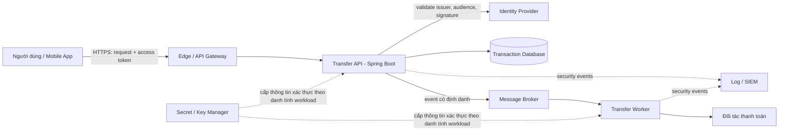
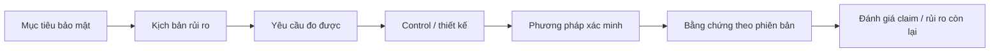
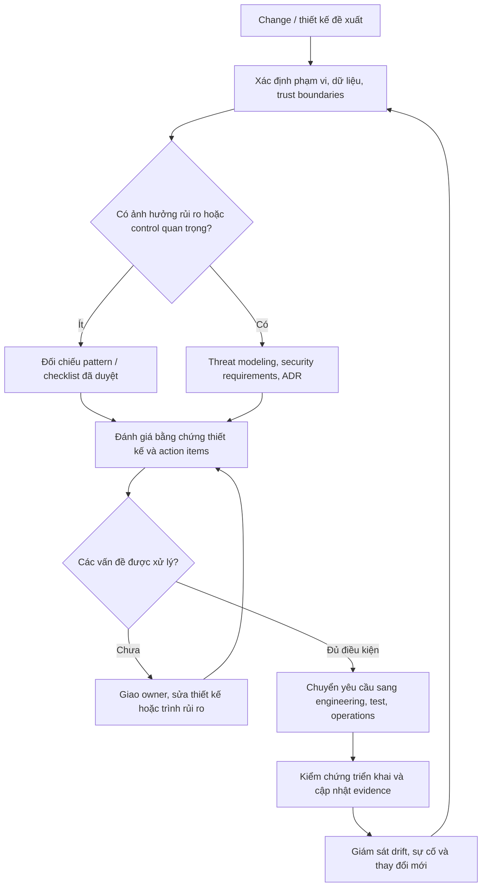

# Security architect: Vai trò và trách nhiệm trong security assurance

## 1. Mục tiêu học tập

Sau bài học, người học có thể:

1. Giải thích **Security Architect** làm gì, chịu trách nhiệm về những quyết định nào và ranh giới với các vai trò kỹ thuật, bảo mật và quản trị khác.
2. Áp dụng tư duy kiến trúc bảo mật theo rủi ro: nhận diện tài sản, ranh giới tin cậy, luồng dữ liệu, mối đe dọa và các biện pháp kiểm soát.
3. Chuyển mục tiêu bảo mật thành **yêu cầu kiến trúc có thể kiểm chứng**, thiết kế controls cùng cơ sở lựa chọn và phương án thay thế.
4. Tạo các hiện vật cốt lõi: threat model, security architecture diagram, control mapping, architecture decision record (ADR), kế hoạch kiểm chứng và hồ sơ ngoại lệ.
5. Phối hợp với engineering, AppSec, platform, risk owner, kiểm thử và audit để bảo đảm thiết kế được hiện thực hóa và có bằng chứng phù hợp.
6. Thực hành đánh giá kiến trúc một dịch vụ Java/Spring Boot có API, cơ sở dữ liệu, message broker và phụ thuộc bên ngoài.

Bài học thuộc chương **Vai trò và trách nhiệm** của module **SECURITY_SECURITY_ASSURANCE**. Mục tiêu của module là xây dựng cách đánh giá **có bằng chứng** rằng hệ thống đáp ứng các mục tiêu bảo mật, xuyên suốt phân tích rủi ro, yêu cầu, security controls, kiểm thử, audit và khắc phục. Vì vậy, công việc của Security Architect không dừng ở bản vẽ; kiến trúc cần tạo ra các quyết định và yêu cầu đủ rõ để nhóm khác có thể **triển khai, kiểm chứng, giám sát và đánh giá lại**.

## 2. Security Architect là ai?

**Security Architect (kiến trúc sư bảo mật)** là vai trò thiết kế và định hướng những cấu trúc, nguyên tắc và cơ chế bảo vệ ở mức hệ thống hoặc tập hợp hệ thống. Họ cân nhắc mục tiêu kinh doanh, mối đe dọa, mô hình tin cậy, rủi ro, yêu cầu tuân thủ, khả năng vận hành và chi phí để lựa chọn cách thiết kế phù hợp.

Một Security Architect thường phải trả lời:

- **Bảo vệ gì?** Tài sản, dữ liệu, danh tính, giao dịch và tính sẵn sàng nào quan trọng?
- **Chống lại điều gì?** Kịch bản lạm dụng, điểm xâm nhập, phụ thuộc và điều kiện thất bại nào đáng quan tâm?
- **Thiết kế như thế nào?** Trust boundary, phân quyền, mã hóa, phân vùng mạng, logging, phục hồi, chuỗi cung ứng phần mềm được đặt ở đâu?
- **Chứng minh bằng cách nào?** Control nào cần thiết, có thể kiểm thử bằng phương pháp gì, và hiện vật nào đủ sức hỗ trợ kết luận?
- **Duy trì thế nào?** Ai sở hữu control, thay đổi nào phải review lại, và làm gì khi thiết kế thực tế lệch khỏi kiến trúc được duyệt?

Security Architect có thể phụ trách **kiến trúc nền tảng toàn doanh nghiệp**, **kiến trúc giải pháp cho một sản phẩm**, hoặc **kiến trúc bảo mật ứng dụng/cloud**. Phạm vi khác nhau nhưng nguyên tắc chung là đưa rủi ro và khả năng kiểm chứng vào **quyết định thiết kế** trước khi lỗi trở nên khó sửa trong triển khai và vận hành.

### 2.1. Không nhầm với những vai trò khác

| Vai trò | Trọng tâm chính | Liên hệ với Security Architect |
| --- | --- | --- |
| Enterprise Architect | Kiến trúc năng lực và hệ thống của tổ chức | Phối hợp để bảo mật phù hợp với chiến lược và cấu trúc tổng thể |
| Solution/Software Architect | Thiết kế giải pháp đáp ứng yêu cầu chức năng, chất lượng và tích hợp | Cùng ra quyết định về boundaries, API, luồng dữ liệu và các đánh đổi |
| **Security Architect** | Thiết kế cấu trúc bảo vệ và yêu cầu kiểm chứng theo rủi ro | Chỉ rõ controls, giới hạn, quyết định kiến trúc và bằng chứng cần có |
| Security Engineer/AppSec Engineer | Xây hoặc hỗ trợ hiện thực hóa security controls; tư vấn secure coding | Phản hồi tính khả thi, hiện thực hóa và kiểm tra chi tiết |
| Cloud/Platform Engineer | Thiết kế, triển khai và vận hành môi trường, IAM, CI/CD, network | Đảm bảo baseline và kiến trúc đề xuất hoạt động trong hạ tầng thật |
| QA/Security Tester/Assessor | Xây dựng và thực thi kiểm thử, đánh giá hiệu quả controls | Cung cấp bằng chứng độc lập hoặc có khả năng kiểm tra lại |
| CISO/Security Leadership | Chiến lược, chính sách, năng lực, ưu tiên và giám sát rủi ro | Đặt yêu cầu quản trị và hỗ trợ giải quyết xung đột thiết kế |
| Service/Risk Owner | Sở hữu sản phẩm/rủi ro, quyết định phương án xử lý trong thẩm quyền | Chấp nhận hoặc trình cấp có thẩm quyền phần rủi ro còn lại |
| Auditor | Đánh giá độc lập theo phạm vi và tiêu chí audit | Có thể kiểm tra các quyết định, hồ sơ và hiệu quả controls |

**Security Architect không mặc nhiên là người có quyền chấp nhận rủi ro còn lại hoặc ký xác nhận mọi kiểm thử đạt.** Quyền đó phải được phân định theo chính sách quản trị. Kiến trúc sư có trách nhiệm trình bày rủi ro, giải pháp, giới hạn và đề xuất có cơ sở; người sở hữu rủi ro chịu trách nhiệm quyết định trong phạm vi thẩm quyền.

## 3. Trách nhiệm cốt lõi và đầu ra mong đợi

Vai trò kiến trúc nên được mô tả qua **đầu ra có thể sử dụng được** chứ không chỉ qua số cuộc họp review.

| Trách nhiệm | Security Architect thực hiện | Đầu ra có thể kiểm tra |
| --- | --- | --- |
| Hiểu hệ thống và bối cảnh rủi ro | Xác định tài sản, luồng dữ liệu, actors, trust boundaries, phụ thuộc | Context diagram, data-flow diagram, assumptions |
| Threat modeling | Phân tích kịch bản tấn công, điều kiện khai thác, hậu quả | Threat model, danh sách kịch bản và mối liên hệ đến rủi ro |
| Xác định security requirements | Chuyển mục tiêu/rủi ro thành các yêu cầu kiến trúc | Requirement IDs, tiêu chí chấp nhận, mapping |
| Thiết kế controls | Đề xuất bảo vệ phân lớp, phân quyền, bảo vệ dữ liệu, giám sát | Security architecture, control specifications, patterns |
| Quyết định đánh đổi | So sánh phương án về rủi ro, chi phí, độ phức tạp, vận hành | ADR có rationale, assumptions, alternatives |
| Review thay đổi | Kiểm tra thiết kế của API, data flow, identity, hạ tầng và tích hợp | Review record, findings, action owners |
| Hỗ trợ assurance | Chỉ ra claim, bằng chứng và test cần thiết để xác minh thiết kế | Control-to-evidence matrix, acceptance criteria |
| Chuyển giao triển khai | Phối hợp xác định owner và yêu cầu kỹ thuật cho các nhóm | Danh sách tasks, thiết kế đã duyệt, vận hành controls |
| Theo dõi độ lệch kiến trúc | Kiểm tra thiết kế và hiện trạng production còn phù hợp không | Architectural risk register, drift findings, reassessment |
| Hỗ trợ xử lý sự cố | Phân tích nguyên nhân ở cấp trust boundary và control design | Kiến nghị thay đổi kiến trúc, ADR bổ sung, retest scope |

Security Architect có thể trực tiếp viết prototype, rule hoặc code minh họa để giảm rủi ro hiểu sai. Tuy nhiên, **hiệu quả của vai trò được đo bằng chất lượng quyết định kiến trúc và mức độ controls vận hành đúng**, không phải số lượng sơ đồ hoặc slide.

## 4. Security Architect tham gia khi nào trong vòng đời assurance?

Thiết kế bảo mật tốt cần xuất hiện từ lúc lập yêu cầu và được cập nhật khi hệ thống thay đổi.

| Thời điểm | Việc làm của Security Architect | Bằng chứng hoặc artefact |
| --- | --- | --- |
| Khởi tạo sản phẩm | Xác định phạm vi, tài sản quan trọng, giả định và ranh giới hệ thống | Context diagram, asset inventory, scope |
| Phân tích rủi ro | Tham gia threat modeling, xác định đường tấn công và điểm kiểm soát | Threat scenarios, risk mapping |
| Đề xuất giải pháp | Chọn identity model, data protection, network/service boundaries, resiliency | Security architecture, ADRs |
| Lập kế hoạch assurance | Thiết kế yêu cầu có thể kiểm chứng và tiêu chí đánh giá control | Requirement/control/evidence matrix |
| Trong phát triển | Review các PR thay đổi nhạy cảm, tư vấn triển khai, cập nhật ADR khi cần | Design review, change log, findings |
| Kiểm thử và audit | Giải thích giả định thiết kế, chỉ ra test bao phủ/trống, hỗ trợ đối chiếu bằng chứng | Evidence references, review comments |
| Trước phát hành | Đối chiếu kiến trúc đã duyệt với build, cấu hình và phát hiện tồn đọng | Conformance review, residual-risk advice |
| Trong vận hành | Đánh giá drift, sự cố, thay đổi dependency, permission và topology | Reassessment, updated design/evidence |
| Khi kết thúc hệ thống | Thiết kế ngừng tích hợp, thu hồi quyền, bảo quản/xóa dữ liệu và khóa | Decommissioning controls, verification |

Kiến trúc sư **không thể xác nhận hệ thống đạt assurance chỉ từ thiết kế**. Một sơ đồ có control “AuthZ” không chứng minh API production thực sự kiểm tra phân quyền đối tượng. Phải có bằng chứng triển khai và kiểm thử tương ứng.

## 5. Đầu tiên: hiểu bối cảnh và vẽ ranh giới tin cậy

Một lỗi kiến trúc bảo mật thường bắt nguồn từ **giả định sai về nguồn dữ liệu và bên được tin cậy**. Vì vậy, trước khi chọn công nghệ, cần vẽ hệ thống và hỏi dữ liệu, danh tính, quyền hạn di chuyển qua ranh giới nào.

Ví dụ kiến trúc một dịch vụ chuyển tiền xây dựng bằng Spring Boot:



Sơ đồ dùng để thảo luận kiến trúc; mũi tên “validate” không có nghĩa mọi hệ thống đều phải gọi Identity Provider theo mạng cho từng request. Với token có thể tự kiểm tra chữ ký, API có thể xác minh theo khóa công khai và metadata tin cậy được quản lý, đồng thời cần chính sách cập nhật khóa và thời gian hiệu lực.

Các vùng cần xác định rõ gồm:

- **Vùng không tin cậy:** client, input từ internet, webhook, dữ liệu gửi từ bên ngoài.
- **Ranh giới định danh:** gateway và backend xác định caller, tenant, scope, role, service identity như thế nào.
- **Ranh giới dịch vụ:** API tới worker, database, broker; backend không được mặc nhiên tin mọi dữ liệu đến từ mạng nội bộ.
- **Ranh giới sở hữu dữ liệu:** tài khoản của người dùng A/B, tenant X/Y, dữ liệu nhạy cảm và khóa.
- **Ranh giới đối tác:** thông tin kết nối, hợp đồng bảo mật, xác minh webhook, timeout và cơ chế chống replay.
- **Ranh giới quản trị:** ai có thể thay đổi IAM, pipeline, secret, cấu hình và log.

Đối với từng luồng, Security Architect nên ghi lại **định danh nào được dùng, trust được thiết lập bởi cơ chế gì, những thuộc tính nào là nguồn sự thật, và điều gì xảy ra khi một bước thất bại**.

## 6. Phân tích mối đe dọa theo cấu trúc

**Threat modeling** là hoạt động nhận diện và ưu tiên kịch bản có thể làm thất bại mục tiêu bảo mật. Security Architect thường dẫn dắt hoặc hỗ trợ hoạt động này cùng chủ sở hữu sản phẩm, developers, AppSec, vận hành và người hiểu nghiệp vụ.

Quy trình thực hành:

1. **Xác định mục tiêu và tài sản:** tiền, dữ liệu cá nhân, token, trạng thái giao dịch, khả năng phục hồi.
2. **Lập data flow và trust boundaries:** request từ client, event broker, các luồng xác thực, webhook đối tác.
3. **Xác định tác nhân và năng lực:** người dùng thông thường, kẻ sở hữu token bị lộ, service account bị chiếm, nội gián có quyền.
4. **Đặt kịch bản:** giả mạo danh tính, đọc dữ liệu không thuộc quyền, thay đổi event, tạo giao dịch đôi, tắt logging.
5. **Đánh giá rủi ro:** khả năng xảy ra, tác động, điều kiện thực tế và controls hiện có.
6. **Đề xuất giảm thiểu:** sửa cấu trúc, bổ sung control, thay đổi boundary hoặc loại bỏ chức năng có rủi ro quá cao.
7. **Gắn yêu cầu và cách kiểm chứng:** tạo ID, owner và điều kiện có thể kiểm thử.
8. **Tái đánh giá theo thay đổi:** khi xuất hiện actor, data flow hoặc trust boundary mới.

STRIDE là một công cụ gợi câu hỏi, không phải checklist bảo đảm đầy đủ:

| STRIDE | Câu hỏi trong kiến trúc chuyển tiền | Ví dụ control |
| --- | --- | --- |
| Spoofing — giả mạo | Client hoặc worker có thể giả là chủ thể khác không? | Xác thực token, workload identity, mTLS theo yêu cầu |
| Tampering — sửa đổi | Event và tham số giao dịch có thể bị thay đổi trái phép không? | Kiểm tra quyền, ràng buộc dữ liệu, bảo vệ integrity |
| Repudiation — phủ nhận | Có thể biết ai khởi tạo, sửa và phê duyệt lệnh không? | Audit log nhất quán, đồng bộ thời gian, correlation ID |
| Information disclosure — lộ thông tin | API/log/error có làm lộ số dư, PII, secret không? | Least privilege, masking, phân loại dữ liệu, mã hóa |
| Denial of Service — gián đoạn | Tải cao hoặc phụ thuộc lỗi làm sập toàn bộ dịch vụ? | Rate limiting, queue bounds, timeout, circuit breaker, capacity |
| Elevation of privilege — leo thang quyền | Người dùng/worker có thể vượt quyền phân công? | Object-level authorization, deny by default, scope và IAM tối thiểu |

Không nên dừng ở “API đã có JWT nên an toàn”. JWT chỉ giải quyết một phần của xác thực và truyền thuộc tính; **kiểm tra quyền thao tác trên đối tượng cụ thể** vẫn phải được thiết kế và kiểm chứng.

### 6.1. Mẫu kịch bản threat model

| Trường | Ví dụ |
| --- | --- |
| ID | TM-TRANSFER-01 |
| Tài sản | Tài khoản nguồn và giao dịch |
| Actor | Người dùng đã xác thực nhưng không sở hữu tài khoản |
| Điểm vào | `POST /api/transfers` |
| Tiền điều kiện | Actor biết hoặc đoán được accountId của người khác |
| Đường tấn công | Gửi accountId trái quyền; API chỉ kiểm tra token hợp lệ |
| Tác động | Tạo giao dịch trái phép, rò rỉ thông tin tài khoản |
| Yêu cầu | REQ-AUTHZ-01: xác minh quyền trên tài khoản nguồn phía server |
| Control | CTRL-AUTHZ-01: kiểm tra quyền từng đối tượng ở service boundary |
| Verification | Test user A/B, token thiếu scope, quyền bị thu hồi, đường gọi gián tiếp |
| Rủi ro còn lại | Phụ thuộc vào cơ chế ánh xạ quyền và khả năng đồng bộ thu hồi |
| Owner | Service/Risk Owner phối hợp Engineering và Security |

Kịch bản có giá trị khi **có thể lần ngược từ phát hiện hoặc kiểm thử tới chính nó**.

## 7. Chuyển từ rủi ro sang yêu cầu bảo mật và controls

Security Architect phải biến các câu nói mơ hồ như “bảo mật dữ liệu” hoặc “API an toàn” thành những yêu cầu có thể thiết kế, triển khai, kiểm thử và giám sát.

Mạch liên kết thường dùng:



Ví dụ ma trận truy vết:

| Rủi ro | Requirement | Thiết kế control | Bằng chứng đề xuất |
| --- | --- | --- | --- |
| R-01: truy cập trái quyền tài khoản | REQ-01: tất cả thao tác tài khoản phải xác thực và phân quyền trên đối tượng | AuthN tại boundary, AuthZ tại service layer, deny by default | Review route/service mapping, negative tests người dùng A/B |
| R-02: lộ token hoặc bí mật | REQ-02: bí mật không được lưu trong mã hoặc log; workload có quyền tối thiểu | Managed secret store, short-lived credentials, hạn chế IAM | IaC review, secret scan, kiểm tra quyền runtime và luân chuyển |
| R-03: xử lý event lặp | REQ-03: một lệnh nghiệp vụ không được gây tác động tài chính trùng | Idempotency key, transaction boundary và duplicate handling | Integration tests retry, concurrency, failure injection |
| R-04: thao tác trái phép không bị phát hiện | REQ-04: sự kiện nhạy cảm và lỗi phân quyền phải có khả năng điều tra | Security event schema, centralized logs, alerts, correlation | Kiểm tra log thực tế, mô phỏng cảnh báo, diễn tập triage |
| R-05: mất dịch vụ vì phụ thuộc lỗi | REQ-05: hệ thống có cơ chế degrade/restore phù hợp mục tiêu | Timeout, bounded retry, circuit breaker, backup/restore | Resilience tests, restore exercise, operational runbook |

**Requirement tốt** nêu được đối tượng, điều kiện, kỳ vọng và ranh giới. Ví dụ: “Khi người dùng không có quyền sử dụng tài khoản nguồn, API phải từ chối giao dịch trước khi thay đổi dữ liệu hoặc phát event” dễ kiểm chứng hơn “phân quyền tốt”.

Thiết kế phải chỉ rõ cả **failure behavior**. Nếu secret store, identity provider hay broker mất kết nối, hệ thống fail closed hay degrade, đâu là thao tác được phép tiếp tục, và cần bằng chứng nào để tin rằng hoạt động thất bại không làm mất toàn vẹn giao dịch.

## 8. Nguyên tắc thiết kế Security Architect cần sử dụng

Không có một mô hình nào phù hợp mọi hệ thống. Những nguyên tắc sau giúp tạo phương án có thể giải thích và kiểm chứng:

| Nguyên tắc | Ý nghĩa khi thiết kế | Cách kiểm tra |
| --- | --- | --- |
| Least privilege | Danh tính chỉ có quyền cần thiết cho công việc | Review IAM, thử quyền ngoài phạm vi |
| Deny by default | Không có quyền rõ ràng thì từ chối | Negative authorization tests |
| Defense in depth | Một control thất bại không làm sụp mọi lớp bảo vệ | Phân tích kịch bản bypass và kiểm tra các lớp |
| Separation of duties | Tách người tạo, duyệt và vận hành thay đổi nhạy cảm khi phù hợp | Review quyền và audit trail |
| Secure by design/default | Cấu hình an toàn là hành vi mặc định | Kiểm tra cấu hình triển khai ban đầu, negative tests |
| Minimize attack surface | Hạn chế endpoint, quyền, protocol, dữ liệu không cần thiết | Asset/endpoint inventory, network policies |
| Assume compromise | Thiết kế giới hạn tác động khi một danh tính/host bị chiếm | Phân đoạn quyền, rotation, containment exercise |
| Explicit trust boundaries | Xác nhận identity, authorization, data integrity tại nơi cần | Data flow review và test qua boundary |
| Observability and recoverability | Phát hiện sai lệch và phục hồi trong điều kiện thực | Thử cảnh báo, backup/restore, incident tabletop |
| Testability | Mọi control quan trọng có cách kiểm tra hiệu quả | Acceptance criteria và evidence mapping |

Một điểm cần cân bằng: thêm nhiều lớp kiểm soát có thể tăng độ phức tạp và làm hệ thống khó vận hành. Security Architect phải trình bày **lợi ích giảm rủi ro, chi phí vận hành và các điều kiện sử dụng** khi chọn phương án.

## 9. Thiết kế Identity, Authentication và Authorization

Ba vấn đề phải được tách bạch:

- **Identity:** chủ thể nào đang yêu cầu, danh tính đó thuộc người dùng, máy, service hay tenant nào?
- **Authentication (AuthN):** có bằng chứng hợp lệ rằng chủ thể đúng với danh tính đã khai báo không?
- **Authorization (AuthZ):** chủ thể đó được phép làm hành động cụ thể trên tài nguyên này trong ngữ cảnh này không?

Đối với API Java/Spring Boot, Security Architect cần quyết định:

1. Ai phát hành token, API xác minh chữ ký, issuer, audience, thời hạn và trạng thái thu hồi theo mô hình nào?
2. Ranh giới nào dùng user identity, ranh giới nào dùng service/workload identity?
3. Quyền là RBAC, ABAC, ownership, relationship-based hay kết hợp?
4. Có bao nhiêu endpoint nhạy cảm, và có đường đi nào bỏ qua kiểm tra quyền?
5. Dữ liệu nguồn xác định quyền là gì và cập nhật quyền khi thay đổi/thu hồi ra sao?
6. Làm gì nếu hệ thống tra cứu quyền không hoạt động?
7. Những hành động nào phải ghi security event, tăng mức xác minh hoặc có phê duyệt bổ sung?

### 9.1. Ví dụ: kiểm tra quyền trên tài khoản nguồn

**Sai lầm thiết kế:** client truyền `accountId` và backend chỉ xác minh access token hợp lệ, sau đó dùng `accountId` để chuyển tiền. Người dùng đã đăng nhập có thể đoán tài khoản khác và gọi API.

**Yêu cầu kiến trúc đúng:** backend phải xác định caller từ danh tính **đã được xác thực**, truy vấn quan hệ quyền với tài khoản nguồn tại điểm thực thi nghiệp vụ và từ chối trước mọi thay đổi trạng thái.

Pseudocode minh họa, không phải đoạn triển khai hoàn chỉnh:

```java
public TransferResult createTransfer(
    AuthenticatedPrincipal principal,
    TransferCommand command
) {
    Account source = accountRepository.getById(command.sourceAccountId());

    if (!authorizationService.canTransferFrom(
            principal.subjectId(), source.id(), command.amount())) {
        securityEvents.recordDeniedTransfer(
            principal.subjectId(), source.id());
        throw new AccessDeniedException("Transfer not permitted");
    }

    return transferService.executeIdempotently(command, principal.subjectId());
}
```

Security Architect không cần quy định chính xác tên class hoặc method, nhưng phải yêu cầu **điểm kiểm tra phân quyền không thể bị bypass** qua API khác, batch job hoặc message consumer. Policy cần được thiết kế nhất quán với mô hình nghiệp vụ và hỗ trợ kiểm thử riêng.

Bằng chứng hợp lý: review thiết kế luồng dữ liệu, review các entry point, integration test cho chủ tài khoản và người không có quyền, test sau khi thu hồi quyền, test đường gọi qua worker, bằng chứng cấu hình trên release candidate.

### 9.2. Phân quyền trong hệ thống multi-tenant

Với SaaS nhiều khách hàng, cần xem tenant là một ranh giới dữ liệu quan trọng:

- Xác minh tenant từ nguồn identity tin cậy; không tin header hoặc parameter tùy ý từ client.
- Mọi truy vấn nhạy cảm cần lọc/kiểm tra tài nguyên thuộc đúng tenant.
- Service account liên tenant có quyền và lý do sử dụng đặc biệt, được ghi nhận và review.
- Cache keys, object storage paths, search indexes và event subscriptions phải duy trì tenant isolation.
- Test đủ kịch bản cross-tenant, bao gồm bulk API, export, background job và log.

Một control ở API gateway có thể không đủ nếu worker hoặc backend nội bộ vẫn cho phép truy xuất trực tiếp dữ liệu tenant khác.

## 10. Bảo vệ dữ liệu và thiết kế mật mã

Security Architect phải gắn **phân loại dữ liệu và data lifecycle** vào quyết định kiến trúc:

| Giai đoạn dữ liệu | Câu hỏi thiết kế | Ví dụ controls/evidence |
| --- | --- | --- |
| Thu thập | Có cần dữ liệu này không? Nhập qua kênh nào? | Data minimization, input validation, TLS review |
| Truyền | Có qua vùng không tin cậy hoặc đối tác không? | TLS/mTLS theo nhu cầu, certificate validation, network review |
| Xử lý | Ai được xem dữ liệu rõ, xử lý ở đâu? | RBAC/ABAC, process isolation, access logs |
| Lưu trữ | Có ràng buộc về mã hóa, quyền truy cập, backup không? | Encryption at rest, IAM, key inventory, storage tests |
| Ghi log/giám sát | Log có vô tình chứa token, mật khẩu, PII không? | Structured logging, masking tests, log access policy |
| Chia sẻ | Nhà cung cấp/bên thứ ba được xem phần nào? | Data flow review, hợp đồng và kiểm tra quyền |
| Lưu giữ/xóa | Khi nào cần xóa, có còn bản sao ở backup không? | Retention schedule, delete verification, backup policy |
| Khôi phục/ngừng hệ thống | Phục hồi có giữ được bảo mật và tính toàn vẹn? | Restore drill, key recovery, secure decommissioning |

Cần phân biệt **mã hóa** với **quản lý khóa**. Mã hóa dữ liệu nhưng đặt khóa trong cùng repository hoặc cấp quyền giải mã cho tất cả workload có thể không làm giảm rủi ro đủ mức.

Các quyết định cần nêu rõ: hệ thống hoặc dịch vụ nào giữ khóa; ai được phép sử dụng, luân chuyển và thu hồi; cách quản lý chứng chỉ; điều kiện truy cập plaintext; phương án dự phòng và khả năng khôi phục khóa. Thuật toán và cấu hình cụ thể phải dựa trên chuẩn hiện hành cùng khả năng hỗ trợ của nền tảng, tránh tự thiết kế thuật toán mật mã.

**Bằng chứng assurance:** cấu hình mã hóa trên môi trường mục tiêu, review quyền sử dụng khóa, kiểm thử không lộ dữ liệu qua lỗi/log, bằng chứng rotation và khôi phục thích hợp.

## 11. Bảo mật service-to-service, cloud và mạng

Một hệ thống microservices có thể dùng network segmentation, private networking hoặc service mesh, nhưng **nằm trong private network không đồng nghĩa mọi service đều đáng tin**.

Security Architect xem xét:

- **Workload identity:** xác định service gọi bằng danh tính riêng, quản lý vòng đời chứng chỉ/token.
- **Authentication và authorization nội bộ:** giới hạn service nào được gọi endpoint nào; không dựa duy nhất vào IP.
- **Network policies:** chỉ mở luồng cần thiết, có ingress/egress controls, tránh giao tiếp mặc định không giới hạn.
- **Infrastructure as Code:** policies, identity permissions, storage và endpoint được review, kiểm tra trước triển khai.
- **Zero Trust principles:** kiểm tra danh tính, quyền và ngữ cảnh ở từng ranh giới phù hợp; tránh hiểu nhầm “Zero Trust” là chỉ cần một sản phẩm.
- **Resilience:** timeout, retry, circuit breaker, bulkhead, idempotency, giới hạn độ dài queue, backpressure.
- **Operational access:** đường truy cập đặc quyền, tài khoản break-glass, thao tác khẩn cấp và audit log.

Một mẫu đánh đổi: service mesh có thể chuẩn hóa mTLS và một phần policy, nhưng làm tăng thành phần cần vận hành và cập nhật. Nếu tổ chức nhỏ chưa có năng lực quản lý mesh, giải pháp dựa trên nền tảng hiện có, identity và policy rõ ràng có thể phù hợp hơn. Quyết định cần ghi **risk reduction, overhead, failure modes và trách nhiệm vận hành**.

## 12. Secrets, dependency và software supply chain

Kiến trúc bảo mật cũng bao phủ nguồn gốc và cách vận hành phần mềm:

- **Secrets:** không lưu key/password trong mã, image hoặc log; dùng cơ chế quản lý bí mật phù hợp, cấp quyền tối thiểu, có rotation và revocation.
- **Dependency:** xác định thành phần, nguồn phân phối, cơ chế cập nhật, đánh giá lỗ hổng có liên quan và phạm vi tác động.
- **Build artifact:** liên kết source, pipeline, version, dependency, artifact được đưa lên production; hạn chế quyền sửa release.
- **CI/CD:** phân quyền nhánh và môi trường, kiểm tra secret/IaC/dependencies, bảo vệ thông tin xác thực pipeline.
- **Provenance và SBOM:** sử dụng khi phù hợp để hiểu thành phần và nguồn gốc; bản thân SBOM không xác nhận code không có lỗ hổng.
- **Third party:** đánh giá phụ thuộc vào IdP, cloud, payment provider và các nghĩa vụ quản trị rủi ro liên quan.

Security Architect không nhất thiết vận hành mọi scanner; họ quyết định **mô hình tin cậy của chuỗi cung ứng và bằng chứng tối thiểu cần yêu cầu từ pipeline, nhà cung cấp và đội triển khai**.

## 13. Khả năng giám sát, phát hiện, ứng phó và phục hồi

Một control ngăn chặn có thể thất bại. Kiến trúc cần dự kiến khả năng **phát hiện, ứng phó và phục hồi**, không chỉ blocking:

1. Xác định sự kiện bảo mật cần phát ra: đăng nhập, thay đổi quyền, truy cập bị từ chối, thao tác nhạy cảm, sử dụng đặc quyền, thay secret.
2. Thiết kế correlation IDs và chuỗi sự kiện để điều tra một giao dịch qua API, broker, worker và đối tác.
3. Loại bỏ dữ liệu bí mật khỏi log; quy định ai có quyền truy cập, chỉnh sửa và thời gian lưu.
4. Thiết kế cảnh báo dựa trên tình huống có tác động thay vì chỉ số lượng log.
5. Phân tích hành vi khi giám sát lỗi: hệ thống có tiếp tục xử lý mà mất dấu vết không, và việc này được chấp nhận trong điều kiện nào?
6. Thiết kế cách cô lập, thu hồi credential, vô hiệu hóa tính năng và chuyển sang chế độ an toàn.
7. Đặt yêu cầu sao lưu, khôi phục, RTO/RPO theo mục tiêu của dịch vụ và kiểm chứng bằng diễn tập.

Ví dụ: hệ thống chuyển tiền có log nhận request nhưng không truyền cùng `transactionId` tới worker. Một giao dịch sai có thể được phát hiện, nhưng khó xác định nguồn gốc. Security Architect cần thiết kế **traceability across components**, chuẩn hóa event schema và buộc kiểm thử chuỗi log trong luồng end-to-end.

**Assurance ở đây cần kiểm thử hành vi**, không chỉ xác nhận “đã cấu hình logging”. Có thể tạo sự kiện thử, quan sát đường đi đến hệ thống giám sát, đo khả năng triage và xác nhận quy trình phản hồi.

## 14. Kiến trúc là một lập luận có thể kiểm chứng

Bản vẽ thể hiện **ý định** thiết kế. Assurance cần chứng minh ý định đó thành hiện thực theo một phiên bản xác định.

Security Architect đóng góp vào hồ sơ **Claim – Argument – Evidence**:

- **Claim:** yêu cầu bảo mật được kỳ vọng, ví dụ “Mọi giao dịch chỉ có thể được tạo bởi chủ thể được ủy quyền”.
- **Argument:** luận điểm thiết kế: identity được xác minh tại ingress; quyền được kiểm tra tại nghiệp vụ; không có đường đi hợp lệ bypass; event được gắn định danh.
- **Evidence cần có:** review threat model, security requirements, code/config review, integration tests A/B, negative tests, deployment configuration và log hành vi.
- **Assumptions/limits:** token model, tính đúng của dữ liệu quyền, môi trường và phiên bản được thử, service phụ thuộc.
- **Residual risk:** các trường hợp chưa kiểm tra hoặc phát hiện còn mở, kèm người có quyền quyết định.

Ví dụ:

| Claim | Kiến trúc hỗ trợ | Bằng chứng bổ sung từ đội khác | Nếu bằng chứng không đạt |
| --- | --- | --- | --- |
| Chỉ người có quyền mới chuyển tiền | AuthN tại entry, AuthZ theo account tại service | Integration test, review code thực tế và production policy | Mở finding; sửa và retest; đánh giá rủi ro còn lại |
| Không ghi nợ trùng do redelivery | Idempotency và transactional boundary | Test retry đồng thời, failover và đối soát | Xem lại kiến trúc giao dịch và release gate |
| Bí mật không lộ qua pipeline/log | Secrets qua managed store, RBAC, logging policy | Secret scan, IAM review, runtime checks | Khắc phục, rotation nếu cần, đánh giá ảnh hưởng |
| Có khả năng điều tra thao tác nhạy cảm | Event schema + correlation + central log | Thử sự kiện, audit logs, tabletop | Cập nhật thiết kế logging, kiểm tra lại alert/runbook |

Khi assessor phát hiện lỗi, kiến trúc sư phải trả lời một câu hỏi quan trọng: **đây là sai lệch triển khai so với thiết kế, hay bản thân quyết định thiết kế không đủ để kiểm soát rủi ro?** Cách xử lý khác nhau. Với sai lệch triển khai, khắc phục code/config và retest. Với thiếu sót thiết kế, cần cập nhật threat model, requirements, ADR, phạm vi controls và kế hoạch thử.

## 15. Các hiện vật cần lưu và ví dụ ADR

Một bộ hồ sơ kiến trúc bảo mật khả dụng thường gồm:

| Hiện vật | Nội dung tối thiểu | Lý do cần cho assurance |
| --- | --- | --- |
| Context & data-flow diagrams | Components, actors, entry points, dữ liệu, trust boundaries | Xác định điều gì nằm trong phạm vi claim |
| Threat model & risk mapping | Kịch bản, giả định, mức ưu tiên, owner | Tránh kiểm thử những thứ dễ đo nhưng bỏ quên rủi ro chính |
| Security requirements | ID, mô tả, tiêu chí đạt, mức ưu tiên | Chuyển mục tiêu trừu tượng thành yêu cầu có thể test |
| Security control design | Vị trí, logic, failure behavior, owner | Bảo đảm các nhóm hiểu cần triển khai gì |
| Architecture Decision Record (ADR) | Bối cảnh, lựa chọn, phương án khác, rủi ro, tác động | Cho phép truy nguyên tại sao chọn giải pháp |
| Assurance/verification mapping | Claim, evidence type, test, phiên bản, giới hạn | Hỗ trợ assessor xây kế hoạch và kết luận |
| Architecture review findings | Vấn đề, tác động, owner, hành động, trạng thái | Tránh “đã review” nhưng không ai sửa |
| Deployment conformance evidence | Bằng chứng code/cấu hình phù hợp thiết kế đã duyệt | Phân biệt thiết kế với hệ thống đang chạy |
| Operational handover | Monitoring, alerts, rotation, recovery, triggers | Duy trì control sau phát hành |

### 15.1. Mẫu Architecture Decision Record (ADR)

ADR sau là ví dụ minh họa và **không có giá trị phê duyệt cho một dự án thật**:

```yaml
id: ADR-SEC-012
title: "Object-level authorization for transfer accounts"
status: proposed
scope:
  service: transfer-api
  data: [account, transfer]
  version: "<target-release>"
context:
  goal: "Ngăn người dùng thao tác trên tài khoản không có quyền"
  risks: [R-01]
  assumptions:
    - "API có danh tính caller đã xác thực"
    - "Dữ liệu quan hệ quyền với tài khoản đáng tin cậy"
alternatives:
  - option: "Chỉ kiểm tra quyền tại API Gateway"
    limitation: "Không đủ ngữ cảnh quyền trên từng account"
  - option: "Kiểm tra quyền tại service layer"
    advantage: "Có thể đánh giá chủ thể, tài nguyên và ngữ cảnh nghiệp vụ"
decision: "Kiểm tra quyền tại service layer với deny-by-default"
controls: [CTRL-AUTHZ-01]
requirements: [REQ-AUTHZ-01]
failure_behavior: "Từ chối nếu không xác minh được quyền"
verification:
  - "Review tất cả đường tạo giao dịch"
  - "Integration test đúng quyền và trái quyền"
  - "Test thu hồi quyền và đường background processing"
evidence_location: "<protected-artifact-link>"
operational_owner: "<role-or-team>"
architect_reviewer: "<role-or-id>"
risk_owner: "<role-or-id>"
tradeoffs:
  - "Có thêm bước truy vấn policy; cần đo độ trễ và cache invalidation"
reassessment_triggers:
  - "Có luồng tạo giao dịch mới"
  - "Thay đổi nguồn dữ liệu phân quyền hoặc tenant model"
```

ADR không nên chỉ viết “chọn X vì X an toàn hơn”. Cần giải thích **vì sao rủi ro cụ thể được giảm**, điều kiện nào khiến quyết định hết phù hợp, và ai chịu trách nhiệm kiểm tra những điều kiện đó.

### 15.2. Mẫu bảng review kiến trúc

| Mục | Câu hỏi review | Kết quả kỳ vọng |
| --- | --- | --- |
| Scope | Có sơ đồ phiên bản hiện tại và ranh giới phụ thuộc không? | Đủ thành phần, luồng dữ liệu và owner |
| Identity | Có điểm xác minh caller ở mọi entry point không? | AuthN model, test và failure behavior |
| Authorization | Quyền trên tài nguyên có bị bypass qua background/internal API? | Policy và negative tests xuyên các đường đi |
| Data protection | Dữ liệu nhạy cảm có thể vào log/cache/export ngoài dự kiến không? | Data classification, masking, access rules |
| Secrets and keys | Có quyền tối thiểu, rotation, revocation, audit? | Secret/key policy, IAM evidence |
| Availability | Có cách xử lý timeout/retry/failover an toàn không? | Failure scenarios, RTO/RPO, resilience tests |
| Detection | Có đủ event để phát hiện/điều tra lạm dụng không? | Event schema, alert tests và runbooks |
| Supply chain | Có kiểm soát artifact/dependencies/deploy permissions? | CI/CD controls, provenance theo nhu cầu |
| Assurance | Mỗi claim quan trọng có phương pháp kiểm chứng phù hợp chưa? | Traceability matrix và evidence plan |

## 16. Phối hợp và phân quyền trong nhóm

Security Architect thành công khi giúp các bên có đủ thông tin để **ra quyết định và thực hiện**, không khi mọi ticket đều phải chờ một cá nhân phê duyệt.

Ví dụ ma trận RACI đơn giản; **R** = thực hiện, **A** = chịu trách nhiệm cuối trong phạm vi công việc, **C** = tham vấn, **I** = thông báo. Đây là mẫu minh họa cần điều chỉnh theo quyền hạn thật của tổ chức.

| Hoạt động | Security Architect | Solution Architect/Engineering Lead | AppSec/Assessor | Platform/Operations | Service/Risk Owner |
| --- | --- | --- | --- | --- | --- |
| Threat model cho thay đổi lớn | **R** | C | C | C | **A** |
| Thiết kế control và ghi ADR | **R** | **A** | C | C | I |
| Triển khai control trong code | C | **A/R** | C | C | I |
| Triển khai IAM, network, secrets | C | C | C | **A/R** | I |
| Kiểm thử hiệu lực control | C | C | **A/R** | C | I |
| Khắc phục phát hiện của sản phẩm | C | **R** | C | C | **A** |
| Chấp nhận rủi ro còn lại | C | C | C | C | **A/R** |
| Đánh giá lại sau thay đổi kiến trúc | **R** | C | C | C | **A** |

Không để nhãn RACI làm lu mờ phân quyền: có tình huống bộ phận kiểm thử/assessor cần độc lập; thẩm quyền phê duyệt release hay chấp nhận rủi ro có thể ở cấp khác theo policy. Security Architect vẫn phải **escalate** khi phát hiện rủi ro vượt ngưỡng.

### 16.1. Phối hợp bằng câu hỏi cụ thể

- **Với Product/Business Owner:** Tác động nếu kiểm soát thất bại là gì? Người dùng nào được phép làm gì? Điều kiện không thể thỏa hiệp?
- **Với Software/Solution Architect:** Đâu là boundaries mới? Vì sao chọn đồng bộ/bất đồng bộ? Những đường đi nào tránh được control?
- **Với Engineering:** Yêu cầu nào gây khó triển khai? Làm sao thiết kế fail closed và test các trường hợp lỗi?
- **Với Platform/SRE:** Cấu hình production, identity và network thực tế có khớp ADR? Ai vận hành rotation, alerts và restore?
- **Với AppSec/Assessor:** Test hiện tại chứng minh được claim nào? Chỗ nào thiếu negative tests hoặc phụ thuộc vào giả định?
- **Với Risk Owner/CISO:** Rủi ro còn lại và đánh đổi có được trình bày đủ rõ để quyết định không?
- **Với Audit:** Nguồn gốc bằng chứng, ranh giới áp dụng và hồ sơ quyết định có thể kiểm tra lại không?

## 17. Review kiến trúc theo mức rủi ro và ngưỡng thay đổi

Review hiệu quả nên có **điểm kích hoạt**, đầu vào chuẩn và đầu ra cụ thể; không nên biến thành một buổi họp ký tên hình thức.

### 17.1. Khi nào bắt buộc xem lại?

- Thêm hoặc thay đổi cơ chế xác thực, phân quyền, tenant isolation.
- Tạo entry point mới, API mới, webhook hay luồng dữ liệu ra bên ngoài.
- Chuyển dữ liệu nhạy cảm sang dịch vụ, cloud account, đối tác hoặc khu vực mới.
- Đổi cơ chế lưu giữ/mã hóa/khóa, secrets, network policy, privileged access.
- Thay đổi retry, queueing, transaction boundary, backup/restore của chức năng trọng yếu.
- Có sự cố, lỗ hổng mới liên quan kiến trúc hoặc phát hiện cho thấy một control thất bại.
- Đổi phụ thuộc quan trọng: Identity Provider, message broker, payment provider hoặc nhà cung cấp vận hành.
- Có bằng chứng production drift so với thiết kế đã được review.

Với thay đổi nhỏ không ảnh hưởng trust boundary hay control trọng yếu, nhóm có thể dùng pattern được duyệt và review gọn hơn. Với thay đổi tác động lớn, cần threat model và review sâu.

### 17.2. Quy trình review mẫu



Kết quả review cần ghi ngày, phiên bản thiết kế, những claim đã xem, điều kiện, phát hiện, người sửa và mốc kiểm chứng lại. “Approved” mà không có scope và điều kiện có thể dẫn tới hiểu nhầm phê duyệt vĩnh viễn.

### 17.3. Quyền phản biện và ngoại lệ

Khi có bất đồng, kiến trúc sư trình bày phương án, rủi ro, tính khả thi và bằng chứng. Nếu chủ sở hữu sản phẩm muốn đi ngược khuyến nghị, quyết định phải qua **cơ chế chấp nhận rủi ro đúng thẩm quyền**, kèm thời hạn và kiểm soát bù trừ khi phù hợp. Security Architect không tự xóa phát hiện khỏi hồ sơ chỉ vì deadline thay đổi.

## 18. Case study: Thiết kế và assurance cho nền tảng chuyển tiền

### 18.1. Tình huống

Nhóm phát triển hệ thống Java/Spring Boot cho người dùng tạo và theo dõi lệnh chuyển tiền. API công khai nhận lệnh, lưu giao dịch vào database và gửi event sang worker; worker liên hệ đối tác thanh toán. Phiên bản mới cho phép **chuyển tiền định kỳ**.

Các yêu cầu nghiệp vụ:

- Chỉ chủ tài khoản hoặc người được ủy quyền được lập, sửa, hủy lịch chuyển.
- Một lịch chỉ thực hiện một lần tại thời điểm dự kiến, ngay cả khi broker phát lại event.
- Mọi thay đổi lịch chuyển có khả năng truy vết để điều tra.
- Sự cố đối tác không làm mất trạng thái hoặc lặp giao dịch trái phép.

### 18.2. Security Architect xác định trust boundaries

- Client → API: dữ liệu không tin cậy; cần AuthN, input validation và AuthZ theo tài khoản.
- API → database: quyền ghi và trạng thái giao dịch; cần integrity và transaction boundaries.
- API → broker → worker: message có thể trễ, lặp hoặc sai thứ tự; cần idempotency, validation và service identity.
- Worker → đối tác: liên kết ngoài tổ chức; cần xác thực đối tác, timeout và cơ chế đối soát.
- Service → logging: log đủ phục vụ điều tra nhưng tránh tiết lộ secret hoặc PII.

### 18.3. Chọn controls và các điều kiện kiểm chứng

| ID | Quyết định kiến trúc | Điều kiện kiểm chứng | Trách nhiệm triển khai |
| --- | --- | --- | --- |
| SEC-01 | AuthZ ở service layer cho mọi thao tác lịch | A chỉ sửa lịch của A; B bị từ chối, kể cả qua batch/API phụ | Engineering |
| SEC-02 | Dùng idempotency theo business operation, không chỉ theo request HTTP | Retry, duplicate event và chạy song song không tạo tác động tài chính đôi | Backend/DB/Worker |
| SEC-03 | Correlation ID xuyên request → event → worker → đối tác | Có thể tái dựng chuỗi sự kiện một giao dịch từ log mà không lộ bí mật | Engineering/SRE |
| SEC-04 | Workload identity và quyền tối thiểu cho worker | Worker không thể sửa tài khoản người dùng ngoài phạm vi công việc | Platform/Security |
| SEC-05 | Timeout/retry có giới hạn và cơ chế đối soát | Khi đối tác timeout, hệ thống ghi trạng thái chưa chắc chắn, tránh tái thực hiện không kiểm soát | Engineering/Operations |
| SEC-06 | Security regression trong pipeline và review config target | Test và scan gắn đúng build/commit; cấu hình mục tiêu không bỏ qua controls | Engineering/QA/Platform |

**Điểm khó thiết kế:** idempotency không tự giải quyết toàn bộ rủi ro “exactly once” với dịch vụ bên ngoài. Security Architect cần phân tích transaction boundary, khả năng retry, duplicate suppression, reconciliation và hành vi khi không thể xác định đối tác đã thực hiện giao dịch hay chưa. Claim phải được phát biểu đúng với mức hệ thống có thể chứng minh.

### 18.4. Phát hiện trong kiểm thử

Assessor phát hiện rằng hai event cùng idempotency key, xử lý bởi hai worker đồng thời, đôi khi vẫn tạo hai lệnh gửi đối tác. Kết quả này cho thấy:

1. **Claim** “không gửi lặp lệnh thanh toán” chưa được hỗ trợ trong kịch bản concurrency.
2. Thiết kế cần đánh giá liệu kiểm tra duplicate là thao tác atomic hoặc được ràng buộc bởi cơ chế nhất quán phù hợp.
3. Engineering sửa triển khai; Security Architect cập nhật ADR và mô hình lỗi nếu quyết định kiến trúc thay đổi.
4. QA/AppSec thử lại bằng tình huống race/retry trên build mục tiêu và lưu bằng chứng.
5. Service/Risk Owner đánh giá rủi ro còn lại; release gate quyết định theo ngưỡng và thẩm quyền.

Nếu phát hiện là lỗi cài đặt thuần túy, ADR có thể không cần thay đổi lớn. Nếu kiến trúc không thể đáp ứng yêu cầu dưới điều kiện lỗi, cần xem lại kiến trúc trước khi cho phép tiếp tục.

### 18.5. Điều gì xảy ra sau phát hành?

Giả sử đối tác thanh toán cập nhật API phản hồi timeout không xác định trạng thái thực hiện. Security Architect cùng chủ sở hữu dịch vụ phải **đánh giá lại giả định về retry và đối soát**. Bằng chứng cũ về API đối tác có thể không còn đủ cho claim liên quan tính toàn vẹn giao dịch.

Đây là nhiệm vụ lâu dài của vai trò kiến trúc trong **security assurance liên tục**, không phải phần việc kết thúc khi bản thiết kế được ký.

## 19. Tiêu chí đánh giá chất lượng công việc Security Architect

Không nên đo vai trò kiến trúc chỉ bằng số ADR hoặc số cuộc họp. Những tín hiệu hữu ích hơn gồm:

| Chỉ số/tín hiệu | Giá trị | Cách tránh hiểu sai |
| --- | --- | --- |
| Rủi ro quan trọng có kiến trúc xử lý và owner | Khả năng chuyển threat scenario thành biện pháp có trách nhiệm | Có ADR chưa chứng minh control đã chạy đúng |
| Control có yêu cầu và test/evidence tương ứng | Khả năng kiểm chứng ngay từ thiết kế | Test được liệt kê có thể chưa được chạy hoặc thiếu độ phủ |
| Review trước thay đổi trust boundary | Đưa quyết định bảo mật vào đúng thời điểm | “100% đã review” vẫn có thể là review hình thức |
| Số phát hiện tái diễn do lỗi thiết kế | Phát hiện pattern hoặc giả định yếu cần sửa từ gốc | Đếm đúng nguyên nhân; đừng đổ mọi lỗi code cho kiến trúc |
| Độ lệch từ kiến trúc đến production | Khả năng triển khai và duy trì conformance | Cần kiểm tra thực tế, không dựa vào sơ đồ |
| Thời gian xử lý quyết định kiến trúc rủi ro cao | Khả năng hỗ trợ delivery mà vẫn giữ chuẩn bảo mật | Không đánh đổi chất lượng bằng cách phê duyệt quá nhanh |
| Trigger reassessment được xử lý | Khả năng duy trì hiệu lực của assurance | Phải tính cả mức rủi ro và phạm vi thay đổi |

Đặc điểm của một Security Architect hiệu quả:

- **Biết giải thích trade-off** cho cả kỹ thuật và nghiệp vụ; không chỉ nói “không an toàn”.
- **Gắn mỗi khuyến nghị vào rủi ro và mục tiêu**; có cách chứng minh control hoạt động.
- **Đưa ra pattern dùng lại được** khi nhiều nhóm có tình huống giống nhau, nhưng không áp một khuôn cho mọi rủi ro.
- **Thực tế về vận hành:** ai xoay khóa, phản hồi cảnh báo, khôi phục và cập nhật policy?
- **Giữ vững tính minh bạch:** nêu rõ giới hạn, chưa kiểm chứng, phụ thuộc và quyền chấp nhận rủi ro.
- **Phối hợp hiệu quả:** giúp developer hiểu yêu cầu, assessor biết cần kiểm chứng gì và owner có thể ra quyết định.

## 20. Những lỗi thường gặp và cách cải thiện

| Lỗi | Hệ quả | Cách cải thiện |
| --- | --- | --- |
| Chỉ vẽ kiến trúc ở mức khái niệm | Không biết mỗi control ở đâu và ai triển khai | Gắn trust boundary, control ID, owner và acceptance criteria |
| Tin toàn bộ lưu lượng trong private network | Service bị chiếm có thể di chuyển ngang và gọi quyền rộng | Workload identity, service authorization và network segmentation phù hợp |
| Chỉ kiểm tra role, bỏ qua quyền trên đối tượng | IDOR/BOLA và rò rỉ dữ liệu | Thiết kế AuthZ theo tài nguyên và negative tests |
| Bỏ qua các luồng ngoài HTTP | Worker, event hoặc batch job bypass controls | Review tất cả entry point và trust boundaries |
| Coi mã hóa là đủ | Khóa, plaintext, log hoặc quyền giải mã vẫn rủi ro | Thiết kế toàn bộ data/key lifecycle |
| Dùng pentest một lần làm bằng chứng vĩnh viễn | Thiết kế thay đổi nhưng kết luận cũ vẫn được dùng | Gắn evidence vào build/scope, xác định trigger reassessment |
| Phê duyệt ADR nhưng không xem cấu hình thực tế | Kiến trúc và production khác nhau | Conformance review, IaC và runtime checks |
| Không thiết kế failure behavior | Mất phụ thuộc gây fail-open hoặc dữ liệu không toàn vẹn | Phân tích timeout, retry, failover và chứng minh bằng test |
| Không chỉ định owner cho controls | Không ai duy trì rotation, logging, remediation | RACI, handover và runbook cho mỗi control quan trọng |
| Coi reviewer là risk owner | Vượt thẩm quyền và thiếu trách nhiệm giải trình | Tách đánh giá chuyên môn khỏi quyết định chấp nhận rủi ro |

## 21. Checklist thực hành cho một kiến trúc mới

Trước khi chuyển thiết kế sang phát triển, Security Architect nên kiểm tra:

- [ ] Đã mô tả mục tiêu nghiệp vụ và các mục tiêu bảo mật quan trọng?
- [ ] Đã xác định tài sản, actors, trust boundaries, data flows và các bên phụ thuộc?
- [ ] Đã phân tích những kịch bản tấn công có hậu quả đáng kể và giao risk owner?
- [ ] Mỗi kịch bản ưu tiên cao đã có requirement, control và tiêu chí kiểm chứng?
- [ ] Identity và quyền trên từng tài nguyên có được đánh giá tại nơi đáng tin cậy?
- [ ] Các luồng worker, batch, event, webhook và quản trị có cùng mức bảo vệ cần thiết?
- [ ] Data lifecycle, secrets và key management đã được mô tả?
- [ ] Đã phân tích tình huống lỗi: timeout, retry, failover, queue duplicate, mất quyền hoặc mất kết nối?
- [ ] Có logging, giám sát, ứng phó và phương án phục hồi theo rủi ro?
- [ ] Các quyết định trade-off đã được ghi ADR với phương án thay thế, assumptions và owner?
- [ ] Có bằng chứng cần thu thập để assessor kiểm chứng claim; ai cung cấp, ai xem xét?
- [ ] Đã xác định trigger khiến review/assurance phải làm lại sau thay đổi hoặc sự cố?
- [ ] Các phát hiện và ngoại lệ được trình đúng cấp có thẩm quyền, có thời hạn và bước retest?

Đây là checklist khởi đầu. Nó không thay thế threat modeling chi tiết hoặc chính sách tổ chức cho hệ thống có rủi ro đặc biệt.

## 22. Bài tập vận dụng

**Bài 1 – Trust boundaries.** Một ứng dụng thương mại điện tử chuyển từ monolith sang API và các microservices cho thanh toán, kho, vận chuyển. Vẽ sơ đồ luồng dữ liệu, chỉ rõ tối thiểu bốn trust boundaries và nêu nơi cần AuthN/AuthZ, bảo vệ dữ liệu và kiểm tra event integrity.

**Bài 2 – Requirement và evidence.** Với kịch bản người dùng A đoán ID đơn hàng của B, hãy tạo một chuỗi đầy đủ: threat scenario → risk → requirement → control → positive/negative tests → loại bằng chứng → giới hạn claim. Giải thích vì sao test trả HTTP 403 một lần có thể chưa đủ.

**Bài 3 – ADR.** So sánh hai phương án phân quyền: chỉ tại API gateway và tại service layer kết hợp gateway. Ghi ADR với assumptions, trade-offs, quyết định, owner và điều kiện review lại.

**Bài 4 – Failure modes.** Một worker có cơ chế retry khi gọi đối tác thanh toán nhưng không có cơ chế đối soát kết quả sau timeout. Hãy mô tả ít nhất ba tình huống có thể gây hại, đề xuất controls và phương pháp kiểm chứng cho từng tình huống.

**Bài 5 – Vai trò và thẩm quyền.** Sau khi pentest phát hiện lỗ hổng nghiêm trọng, CTO muốn phát hành vì đã trễ hạn. Nêu Security Architect phải chuẩn bị những dữ liệu, khuyến nghị và bằng chứng nào; ai cần tham gia quyết định, ai chịu trách nhiệm sửa và ai xác nhận lại hiệu lực control.

**Bài 6 – Assurance liên tục.** Công ty thay đổi nhà cung cấp Identity Provider. Những kiến trúc, assumptions, claims, tests và runbooks nào cần review? Thiết kế điều kiện để biết kết luận assurance cũ còn hợp lệ ở đâu.

## 23. Kết luận

**Security Architect là người kết nối rủi ro và mục tiêu bảo mật với các quyết định thiết kế có thể triển khai, kiểm chứng và duy trì.** Họ không chỉ chọn giải pháp kỹ thuật; họ xác định ranh giới tin cậy, lý do dùng controls, hành vi khi thất bại, giả định, trade-offs và những bằng chứng cần có để đánh giá hiệu quả.

Trong chương trình **SECURITY_SECURITY_ASSURANCE**, đóng góp quan trọng nhất của Security Architect là tạo được chuỗi liên kết **mục tiêu → rủi ro → yêu cầu → quyết định kiến trúc → control → kiểm chứng → bằng chứng → đánh giá lại**. Khi chuỗi này rõ ràng, các nhóm phát triển, vận hành, kiểm thử, audit và người sở hữu rủi ro có thể cùng trả lời: *hệ thống đã chứng minh được điều gì, còn thiếu điều gì và cần thay đổi ở đâu để tăng mức bảo đảm bảo mật?*
