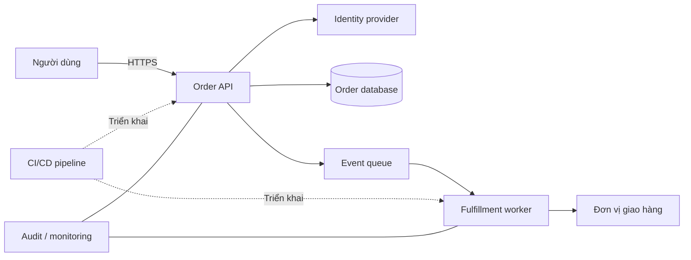
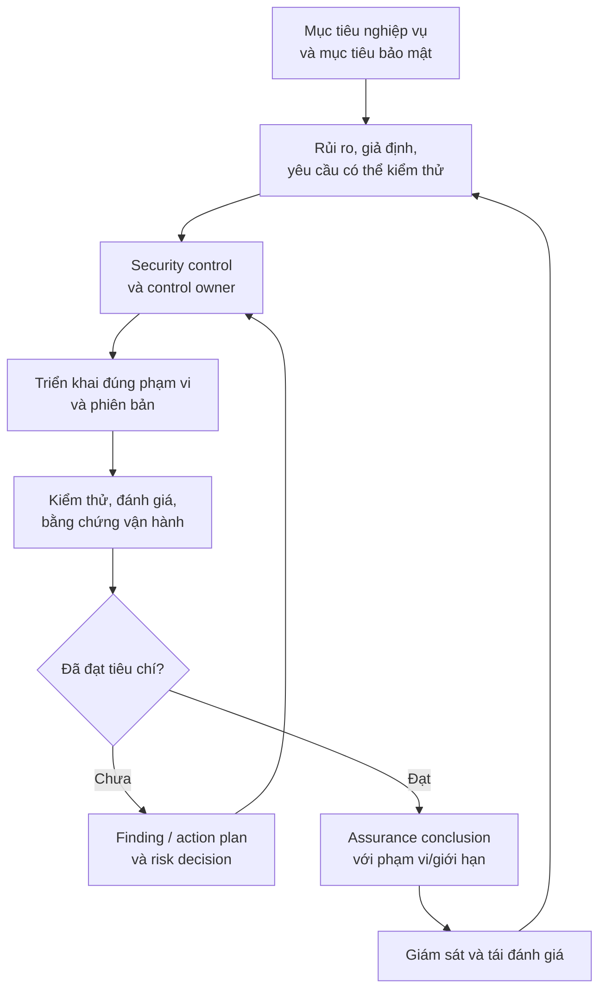

# System owner: trách nhiệm sở hữu hệ thống trong security assurance

## Mục tiêu học tập

Sau bài học, người học có thể:

1. Giải thích **system owner (chủ sở hữu hệ thống)** chịu trách nhiệm về điều gì trong vòng đời hệ thống và vì sao vai trò này quan trọng đối với bảo mật.
2. Phân biệt system owner với business owner, product owner, data owner, risk owner, control owner, đội phát triển, đội vận hành, security assurance và kiểm toán.
3. Xác định phạm vi hệ thống, các phụ thuộc, ranh giới tin cậy và bằng chứng cần có trước khi đưa ra khẳng định về trạng thái bảo mật.
4. Tổ chức trách nhiệm từ yêu cầu bảo mật, đánh giá rủi ro và thiết kế security controls đến kiểm thử, triển khai, giám sát, audit và khắc phục phát hiện.
5. Xử lý đúng các trường hợp đa đội, dùng dịch vụ đám mây, thuê ngoài, thay đổi người sở hữu và quyết định chấp nhận rủi ro vượt thẩm quyền.

Trong module **SECURITY_SECURITY_ASSURANCE**, mục tiêu là **đánh giá có bằng chứng** rằng hệ thống đáp ứng các mục tiêu bảo mật. System owner đóng vai trò kết nối hoạt động kỹ thuật với trách nhiệm quản trị: bảo đảm có phạm vi đánh giá rõ ràng, các yêu cầu và kiểm soát được giao người thực hiện, bằng chứng được thu thập và các khoảng trống được xử lý trong cả phát triển lẫn vận hành.

## 1. System owner là ai?

**System owner** là cá nhân hoặc vai trò được tổ chức chính thức giao **trách nhiệm giải trình về một hệ thống xác định** trong suốt vòng đời mà tổ chức quản lý hệ thống đó. Tùy cơ cấu, tên chức danh có thể là application owner, service owner, IT system owner hoặc platform owner; điều cần quan tâm là **phạm vi trách nhiệm và thẩm quyền được ghi nhận**, không phải tên gọi.

Ở góc độ security assurance, system owner phải có khả năng trả lời:

- Hệ thống mình sở hữu là hệ thống nào, phục vụ mục tiêu gì và những thành phần nào thuộc phạm vi?
- Hệ thống xử lý thông tin gì, mức nhạy cảm ra sao, kết nối tới bên nào và phụ thuộc những dịch vụ nào?
- Mục tiêu bảo mật và yêu cầu áp dụng là gì? Ai chịu trách nhiệm triển khai từng **security control**?
- Có bằng chứng nào chứng minh kiểm soát đã được triển khai đúng và **hoạt động hiệu quả** trên phiên bản/môi trường đang chạy?
- Còn rủi ro, lỗ hổng, phát hiện audit, ngoại lệ và phụ thuộc nào chưa xử lý? Ai quyết định và khi nào phải xem xét lại?
- Khi hệ thống thay đổi, xảy ra sự cố hoặc ngừng sử dụng, ai điều phối và bảo đảm các nghĩa vụ bảo mật tiếp tục được thực hiện?

**Điểm cốt lõi:** System owner **chịu trách nhiệm về khả năng quản trị và chứng minh trạng thái an toàn của hệ thống trong phạm vi được giao**. Vai trò này không đòi hỏi tự viết mọi dòng mã, vận hành mọi máy chủ hay tự thực hiện tất cả bài kiểm thử.

### 1.1. “Sở hữu” là trách nhiệm giải trình, không nhất thiết là quyền sở hữu pháp lý

Một doanh nghiệp có thể thuê hạ tầng, dùng SaaS hoặc thuê nhà thầu phát triển nhưng vẫn cần một **system owner nội bộ** cho hệ thống phục vụ hoạt động của mình. Chủ sở hữu phải biết phần nào do bên cung cấp kiểm soát, phần nào do tổ chức tự kiểm soát, và căn cứ nào có thể dùng để kiểm chứng cam kết của các bên.

Tương tự, system owner có thể giao việc cho team vận hành hoặc control owner, nhưng cần theo dõi kết quả và bảo đảm lỗ hổng không bị bỏ quên giữa các nhóm.

### 1.2. Bốn loại trách nhiệm chính

| Nhóm trách nhiệm | Câu hỏi mà system owner phải trả lời | Kết quả mong đợi |
|---|---|---|
| **Phạm vi và tài sản** | Hệ thống gồm gì, ai dùng, dữ liệu đi đâu, phụ thuộc ai? | Bản mô tả hệ thống, inventory, sơ đồ luồng dữ liệu và ranh giới |
| **Yêu cầu và biện pháp** | Các mục tiêu bảo mật nào áp dụng, ai hiện thực hóa chúng? | Danh sách yêu cầu, security controls, phân vai, kế hoạch kiểm tra |
| **Bằng chứng và rủi ro** | Những kiểm soát nào thực sự hoạt động và khoảng trống nào còn tồn tại? | Kết quả kiểm thử, audit, risk register, danh sách phát hiện |
| **Vòng đời và thay đổi** | Khi phát hành, có sự cố hoặc ngừng vận hành, ai xử lý? | Biên bản review, hồ sơ triển khai, kế hoạch ứng phó, bàn giao/retirement |

## 2. Phân biệt system owner với các vai trò liên quan

Trong thực tế, một người có thể kiêm nhiều vai trò, nhưng **trách nhiệm phải được phân định theo từng quyết định và hoạt động**. Bảng sau là mô hình minh họa; tổ chức có thể phân chia khác nếu quyền hạn và trách nhiệm vẫn nhất quán.

| Vai trò | Đối tượng chịu trách nhiệm chính | Mối liên hệ với system owner |
|---|---|---|
| **System owner** | Vòng đời và trạng thái quản trị của **một hệ thống xác định** | Điều phối tổng thể yêu cầu, triển khai, bằng chứng và khắc phục |
| **Business owner** | Kết quả, giá trị và mục tiêu nghiệp vụ | Xác định tác động nghiệp vụ và ưu tiên; có thể đồng thời là system owner |
| **Product owner** | Giá trị sản phẩm, backlog, phạm vi tính năng | Đưa yêu cầu bảo mật vào ưu tiên sản phẩm và tiêu chí nghiệm thu |
| **Information / data owner** | Mục đích sử dụng, phân loại, quyền truy cập và vòng đời dữ liệu | Xác định mức bảo vệ mà hệ thống phải đáp ứng |
| **Risk owner** | Việc quản lý và quyết định xử lý **một rủi ro cụ thể** ảnh hưởng đến mục tiêu được giao | Có thể khác system owner; phối hợp đánh giá rủi ro còn lại |
| **Control owner** | Thiết kế/vận hành/bằng chứng của **một kiểm soát** | Cung cấp trạng thái và bằng chứng để system owner tổng hợp |
| **Engineering / DevOps / Operations** | Thực hiện xây dựng, triển khai, cấu hình, vận hành và ứng phó theo phân công | Đảm nhiệm nhiều hoạt động thực thi và khắc phục |
| **Security / GRC / Assurance** | Phương pháp đánh giá, tư vấn, kiểm tra và xác nhận theo nhiệm vụ | Cung cấp tiêu chí và đánh giá; có thể cần mức độc lập nhất định |
| **Internal audit** | Đánh giá độc lập các hoạt động quản trị và kiểm soát | Kiểm tra kết luận và bằng chứng của các bên chịu trách nhiệm |
| **Người có thẩm quyền chấp nhận rủi ro** | Quyết định chấp nhận rủi ro còn lại trong giới hạn được ủy quyền | Có thể là system owner, risk owner hoặc lãnh đạo cấp cao hơn |

**Tình huống dễ nhầm:** Một team Infrastructure vận hành cơ sở dữ liệu cho nhiều sản phẩm. Team này có thể là **control owner** của sao lưu và phân quyền DB dùng chung. Điều đó không có nghĩa trưởng nhóm Infrastructure tự động là **system owner** của mọi sản phẩm sử dụng cơ sở dữ liệu.

**Tình huống dễ nhầm khác:** Một system owner nhận kết quả kiểm thử xâm nhập có phát hiện nghiêm trọng. Họ phải bảo đảm có người xử lý, đánh giá tác động, báo cáo và chuyển cấp đúng lúc. Nhưng nếu chính sách yêu cầu hội đồng rủi ro phê duyệt mức rủi ro cao thì system owner **không tự có quyền chấp nhận** phát hiện chỉ vì hệ thống nằm trong phạm vi mình sở hữu.

## 3. Xác định phạm vi và bổ nhiệm system owner

Trước khi yêu cầu ai đó “chịu trách nhiệm bảo mật hệ thống”, tổ chức phải định nghĩa chính xác **hệ thống** được nhắc đến.

### 3.1. Hồ sơ định danh hệ thống cần có

Một hồ sơ tối thiểu nên ghi nhận:

| Trường thông tin | Ý nghĩa và ví dụ |
|---|---|
| **System ID, tên và mô tả** | `SYS-ORDER-01` – hệ thống quản lý đơn hàng |
| **Mục tiêu nghiệp vụ và mức quan trọng** | Nhận đơn, cập nhật trạng thái, gửi sự kiện giao hàng; tác động nếu sai/hỏng |
| **System owner và người thay thế** | Chức danh, cá nhân đang đảm nhiệm, đơn vị, kênh liên hệ và cơ chế bàn giao |
| **Phạm vi thành phần** | Frontend, API, DB, hàng đợi, job nền, cấu hình, pipeline và môi trường liên quan |
| **Dữ liệu và phân loại** | Đơn hàng, thông tin khách, địa chỉ giao hàng, lịch sử thao tác |
| **Các ranh giới tin cậy** | Người dùng → API, API → DB, dịch vụ nội bộ → vendor, pipeline → production |
| **Phụ thuộc và bên thứ ba** | Cloud, payment gateway, SMS provider, identity provider, kho dữ liệu |
| **Môi trường / vùng triển khai** | Development, test, staging, production; khu vực lưu trữ/vận hành |
| **Yêu cầu và nghĩa vụ** | Quy tắc truy cập, lưu giữ dữ liệu, khôi phục, ghi log, nghĩa vụ hợp đồng |
| **Các đầu mối khác** | Business owner, data owner, risk owner, control owners, đội on-call |
| **Lịch xem xét** | Ngày review gần nhất, ngày dự kiến review và sự kiện kích hoạt kiểm tra lại |

Định danh và phạm vi chính xác là điều kiện để kết luận có giá trị. Nếu kiểm thử chỉ bao phủ API phiên bản 2, không được lấy kết quả đó làm bằng chứng rằng toàn bộ hệ thống và luồng batch phiên bản 1 cũng an toàn.

### 3.2. Phạm vi sở hữu và ranh giới tin cậy

Xét hệ thống quản lý đơn hàng có kiến trúc đơn giản:



System owner cần biết ai chịu trách nhiệm đối với:

1. **Quy tắc nghiệp vụ tại API:** Không đổi người nhận hàng sau khi đơn đã khóa, trừ khi có quy trình cho phép.
2. **Phân quyền:** Người dùng chỉ thay đổi đơn hàng của mình; tài khoản nhân viên được giới hạn theo chức năng.
3. **Truyền sự kiện:** Sự kiện gửi sang kho hoặc đối tác không làm đơn giao hai lần khi bị xử lý lặp.
4. **Dữ liệu và khôi phục:** Bản sao lưu, truy cập DB, retention và đối chiếu sau khi khôi phục.
5. **Chuỗi cung ứng phần mềm:** Quyền sửa pipeline, dependency, artifact, môi trường triển khai.
6. **Ghi log và theo dõi:** Có bằng chứng truy vết thay đổi trạng thái và phát hiện lỗi.
7. **Nhà cung cấp:** Khả năng kiểm tra nghĩa vụ bảo mật, SLA, thông báo sự cố và chia sẻ bằng chứng.

Không nhất thiết mọi thành phần đều có cùng chủ sở hữu. Có thể có **system owner chính của Order Management** và **system owner riêng của nền tảng Identity** hoặc platform dùng chung. Mối quan hệ phụ thuộc phải được ghi rõ: ai cung cấp kiểm soát nào, ai phụ thuộc vào kết quả, và ai chịu trách nhiệm khi có khoảng trống.

### 3.3. Quy tắc bổ nhiệm và chuyển giao

Người được bổ nhiệm nên:

- Hiểu hệ thống và những hậu quả chính khi hệ thống bị xâm phạm, thay đổi sai hoặc gián đoạn.
- Có khả năng điều phối những đội cung cấp dịch vụ cho hệ thống.
- Có quyền đề xuất nguồn lực, ưu tiên xử lý và đưa vấn đề lên cấp quyết định phù hợp.
- Có kênh nhận thông tin về thay đổi, lỗ hổng, sự cố, kết quả kiểm thử và phát hiện kiểm toán.
- Được ghi nhận bằng vai trò/chức danh **và người đang đảm nhiệm**, có người thay thế khi nghỉ phép hoặc chuyển công tác.

Khi chuyển giao, cần kiểm đếm **các rủi ro mở, ngoại lệ còn hiệu lực, kiểm soát không đạt, phát hiện quá hạn, sự cố đang xử lý, tài sản/phụ thuộc và các quyết định đang chờ**. Việc chỉ thay tên người trên inventory mà không bàn giao nghĩa vụ và bằng chứng sẽ tạo ra khoảng trống trách nhiệm.

## 4. Trách nhiệm của system owner theo vòng đời hệ thống

Vai trò này tồn tại từ khi hệ thống được hình thành đến khi dữ liệu, quyền truy cập và hạ tầng được xử lý xong lúc ngừng sử dụng.

| Giai đoạn | Việc system owner cần bảo đảm | Bằng chứng tiêu biểu |
|---|---|---|
| **Khởi tạo / mua sắm** | Có mục tiêu, ranh giới, người sở hữu, phân loại dữ liệu, đánh giá rủi ro sơ bộ và trách nhiệm nhà cung cấp | Hồ sơ hệ thống, yêu cầu ban đầu, risk assessment, hồ sơ lựa chọn vendor |
| **Thiết kế** | Có yêu cầu bảo mật, threat modeling, quyết định kiến trúc và danh sách kiểm soát có người sở hữu | Sơ đồ luồng dữ liệu, threat model, bản thiết kế, control matrix |
| **Phát triển / tích hợp** | Yêu cầu đi vào backlog, coding standards, review, kiểm thử và xử lý findings | Pull request, kết quả SAST/SCA, unit/integration test, ticket |
| **Kiểm thử / chuẩn bị phát hành** | Có tiêu chí đạt, kiểm tra security controls, bằng chứng đúng phiên bản; rủi ro còn lại được đánh giá | Kết quả security test, bản tổng hợp findings, hồ sơ release |
| **Triển khai** | Artifact, cấu hình, quyền và môi trường khớp bản được phê duyệt; có rollback phù hợp | Commit/build ID, deployment record, change approval, checklist |
| **Vận hành** | Có người trực, giám sát, sao lưu/khôi phục, quản lý quyền, patching và xử lý sự cố | Alert/log, báo cáo access review, patch status, restore test |
| **Thay đổi lớn** | Đánh giá lại rủi ro, phụ thuộc, data flow, kiểm soát và phạm vi kiểm thử | Change record, threat model cập nhật, regression test |
| **Ngừng sử dụng** | Thu hồi quyền, thu hồi khóa/tài khoản, lưu trữ hoặc xóa dữ liệu theo nghĩa vụ và chấm dứt phụ thuộc | Decommission checklist, biên bản xóa/chuyển dữ liệu, xác nhận tắt dịch vụ |

**Lưu ý:** System owner chịu trách nhiệm **bảo đảm hoạt động được thực hiện và có bằng chứng**, còn người trực tiếp thực hiện có thể là engineering, QA, operations, bên cung cấp hoặc bộ phận security.

### 4.1. Trước khi triển khai: điều kiện đưa vào vận hành

Đối với một bản phát hành quan trọng, system owner nên xác nhận ít nhất:

1. Phạm vi thay đổi và các tài sản bị ảnh hưởng đã được xác định.
2. Yêu cầu bảo mật quan trọng có test case và tiêu chí đạt rõ ràng.
3. Kiểm tra quyền, dữ liệu đầu vào, toàn vẹn giao dịch, secrets, logging và khôi phục được thực hiện tương ứng với rủi ro.
4. Những phát hiện chưa xử lý được đánh giá, có chủ thể chịu trách nhiệm, thời hạn và quyết định đúng thẩm quyền.
5. Bản build thực tế được liên kết với mã nguồn, cấu hình, bằng chứng kiểm thử và bản sẽ triển khai.
6. Có phương án giám sát, rollback và liên hệ khi phát hiện sự cố.

Điều kiện phát hành phải được tổ chức quy định dựa trên **mức rủi ro và tính trọng yếu**. Không phải hệ thống nào cũng phải dùng cùng một bộ công cụ hay số lượng kiểm thử; nhưng không được coi “pipeline màu xanh” là bằng chứng đủ khi các yêu cầu trọng yếu chưa được kiểm chứng.

### 4.2. Trong vận hành: kiểm soát có thể mất hiệu lực

Một kiểm soát đạt trong môi trường test vẫn có thể không hoạt động trong production do cấu hình khác, tài khoản được cấp thêm quyền, phiên bản mới, data flow mới hoặc nhà cung cấp thay đổi hành vi.

System owner cần duy trì cơ chế để biết khi nào phải xem xét lại:

- Có thay đổi lớn về kiến trúc, dữ liệu, API, đối tác, sản lượng hoặc mô hình phân quyền.
- Xuất hiện lỗ hổng mới liên quan dependency hoặc thiết bị/hạ tầng đang dùng.
- Một control owner báo không còn giám sát hoặc không đáp ứng cam kết.
- Dịch vụ gặp sự cố, khôi phục thất bại, mất log hoặc phát hiện sai lệch dữ liệu.
- Ngoại lệ hết hạn, findings quá hạn hoặc chủ thể quản lý thành phần thay đổi.
- Có yêu cầu pháp lý, hợp đồng hoặc chính sách nội bộ mới áp dụng.

## 5. Ma trận RACI cho security assurance của hệ thống

**RACI**: **R** (*Responsible*) là người thực hiện; **A** (*Accountable*) là người chịu trách nhiệm cuối cùng cho một hoạt động; **C** (*Consulted*) được tham vấn; **I** (*Informed*) được thông báo. Ma trận dưới đây chỉ là **minh họa**, cần điều chỉnh theo quy chế của từng tổ chức.

| Hoạt động | System owner | Risk / business owner | Control / engineering owner | Security assurance | Cấp phê duyệt |
|---|---|---|---|---|---|
| Duy trì inventory, phạm vi hệ thống và đầu mối | **A/R** | C | R | C | I |
| Xác định mục tiêu bảo mật dựa trên tác động nghiệp vụ | R | **A** | C | C | I |
| Thiết kế và hiện thực hóa kiểm soát kỹ thuật | A | C | **R** | C | I |
| Tổ chức thu thập và liên kết bằng chứng toàn hệ thống | **A/R** | C | R | R/C | I |
| Thực hiện đánh giá chuyên môn/kiểm thử được giao | C | I | R | **A/R** | I |
| Đánh giá tác động và đề xuất xử lý một rủi ro cụ thể | R/C | **A/R** | C | C | I |
| Phê duyệt chấp nhận rủi ro vượt hạn mức được giao | R/C | R | C | C | **A** |
| Theo dõi triển khai hành động sửa lỗi ở các team | **A** | C | **R** | C | I |
| Điều phối bảo mật khi thay đổi/retirement hệ thống | **A/R** | C | R | C | I |

**Đọc ma trận đúng cách:** Một activity nên có **đầu mối A rõ ràng**. Cột system owner có thể là A khi chịu trách nhiệm quản trị thay đổi hoặc hoàn thiện bằng chứng; họ **không mặc nhiên** là A cho quyết định chấp nhận một rủi ro cụ thể nếu chính sách trao quyền cho risk owner hay cấp lãnh đạo khác. Kiểm thử độc lập cũng có thể do bộ phận assurance hoặc audit chịu trách nhiệm theo cơ chế riêng.

### 5.1. Khi hai system owners cùng phụ thuộc một control

Ví dụ Order API và Billing API cùng sử dụng dịch vụ Identity. Chủ sở hữu Identity có thể cung cấp bằng chứng về **MFA, quản lý khóa và khả năng sẵn sàng** của nền tảng. Tuy nhiên, chủ sở hữu Order API vẫn cần bằng chứng rằng **phân quyền đến từng đơn hàng** được áp dụng tại Order API. Bằng chứng MFA của Identity không chứng minh Order API không có lỗi IDOR.

Một cách phân ranh giới:

| Kiểm soát | Owner trực tiếp | Người tiêu thụ bằng chứng | Điểm phải xác minh thêm |
|---|---|---|---|
| MFA cho tài khoản quản trị nền tảng | Identity control owner | Order system owner | Tài khoản truy cập Order có thực sự thuộc phạm vi bắt buộc MFA? |
| Kiểm tra quyền truy cập đơn hàng | Order API control owner | Order system owner | Kiểm thử thay ID đơn của người dùng khác |
| Sao lưu DB dùng chung | Database platform owner | Order system owner | Có khôi phục được **dữ liệu Order** với mục tiêu RPO/RTO đã thống nhất? |
| Logging tập trung | Observability owner | Order system owner | Log nghiệp vụ có đầy đủ trường, được chuyển đến kho và có thể truy xuất? |

## 6. Từ mục tiêu bảo mật đến bằng chứng hệ thống

Muốn đưa ra kết luận assurance, system owner cần phối hợp xây dựng **chuỗi truy vết**:



### 6.1. Ví dụ: một yêu cầu, nhiều loại bằng chứng

Giả sử mục tiêu của Order Management là: **người dùng không được xem hoặc sửa đơn hàng của người khác**.

| Thành phần truy vết | Ví dụ cụ thể |
|---|---|
| **Mục tiêu bảo mật** | Tính bí mật và toàn vẹn của đơn hàng theo quyền sở hữu |
| **Rủi ro** | Người dùng thay `orderId` trên API và truy cập đơn không thuộc mình |
| **Yêu cầu SEC-ORDER-01** | Mọi thao tác đọc/sửa đơn phải xác minh quyền đối với đúng đối tượng ở phía server |
| **Control** | Policy kiểm tra quan hệ giữa authenticated subject và order owner |
| **Control owner** | Order API Engineering Lead |
| **Bằng chứng thiết kế** | Sơ đồ API, chính sách phân quyền, review mô hình quyền |
| **Bằng chứng kiểm thử** | Test đọc/sửa đơn thuộc người khác trả từ chối; không có thay đổi dữ liệu |
| **Bằng chứng triển khai** | Build ID, commit, cấu hình và môi trường chứa phiên bản đã được kiểm thử |
| **Bằng chứng vận hành** | Log quyết định từ chối, cảnh báo hành vi truy cập bất thường, đánh giá quyền định kỳ |
| **Giới hạn kết luận** | Kiểm thử này chưa bảo đảm tính đúng đắn của mọi luồng xuất báo cáo hay batch; cần scope riêng |

Đây là điểm phân biệt giữa **control exists** (có biện pháp), **control implemented** (đã triển khai) và **control effective** (đã chứng minh hiệu quả đối với trường hợp đe dọa trong phạm vi). System owner cần tránh thay thế bằng chứng hiệu quả bằng lời khẳng định từ nhóm triển khai.

### 6.2. Các loại bằng chứng thường cần

**Bằng chứng về thiết kế:** System context diagram, data-flow diagram, threat model, phân loại dữ liệu, yêu cầu bảo mật, đánh giá rủi ro, thiết kế access control, mã kiểm soát được review.

**Bằng chứng về triển khai:** Pull request, commit hash, bản build, artifact digest, thay đổi cấu hình, migration, change request, bản ghi triển khai và phê duyệt theo chính sách.

**Bằng chứng về hiệu quả:** Integration/security test, báo cáo pentest có phạm vi rõ, kết quả kiểm tra quyền, thử failover/restore, kết quả phân tích lỗ hổng, thử phát hiện và ứng phó sự cố, hoạt động đối soát.

**Bằng chứng về vận hành:** Access review, alert history, ticket sự cố, báo cáo patch, log kiểm toán, báo cáo nhà cung cấp, giám sát SLA/SLO, cuộc họp review risk register.

Mỗi bằng chứng cần trả lời được **kiểm soát nào**, **đối tượng nào**, **phiên bản/môi trường nào**, **khi nào**, **ai thực hiện/đánh giá**, **kết quả gì** và **giới hạn ở đâu**. Bằng chứng phải được bảo vệ khỏi sửa/xóa ngoài quyền và được lưu theo chính sách, không ghi thừa bí mật hoặc dữ liệu cá nhân.

### 6.3. Mẫu hồ sơ assurance cho system owner

Mẫu YAML dưới đây **chỉ minh họa cấu trúc thông tin**, không phải cấu hình công cụ hay mẫu bắt buộc theo một tiêu chuẩn cụ thể:

```yaml
system:
  id: SYS-ORDER-01
  name: Order Management
  owner:
    role: Head of Commerce Platform
    responsiblePersonId: employee-042
  environments:
    - production
    - staging
  dataClassification: confidential
  criticalDependencies:
    - Identity Service
    - Order Database
    - Shipping Provider

assurance:
  releaseId: order-2026-11-rc2
  assessedAt: 2026-11-27
  scope:
    - Order API v2
    - Fulfillment Worker v3
  controls:
    - id: SEC-ORDER-01
      objective: Deny access to orders owned by other users
      controlOwner: Order API Lead
      status: verified
      evidence:
        - security-test-ORDER-01-run-84
        - deploy-record-order-rc2
    - id: SEC-ORDER-02
      objective: Prevent duplicate fulfillment from message replay
      controlOwner: Fulfillment Lead
      status: open-finding
      evidence:
        - replay-test-run-19
      findingId: FIND-ORDER-012
  assessmentLimitations:
    - Legacy batch importer is out of scope
  nextReview: 2026-12-12
```

Trạng thái `verified` chỉ có ý nghĩa khi **tiêu chí xác minh đã được định nghĩa** và liên kết bằng chứng thực tế. Mục `open-finding` cần có đầu mối, mức rủi ro, kế hoạch xử lý và theo dõi tới khi tái kiểm chứng. System owner không nên cho phép một báo cáo “đạt chung” che khuất các giới hạn scope hoặc kiểm soát quan trọng chưa đạt.

## 7. Security controls và trách nhiệm điều phối

System owner nên có danh mục những kiểm soát áp dụng cho hệ thống, nhưng **không cần tự làm owner của mọi kiểm soát**. Ví dụ cho một hệ thống API xử lý dữ liệu khách hàng:

| Mục tiêu | Kiểm soát tiêu biểu | Control owner có thể phù hợp | Bằng chứng system owner cần nhận |
|---|---|---|---|
| Đúng người được truy cập | Authentication, authorization ở API, access review | IAM + API team | Chính sách quyền, kiểm thử IDOR, báo cáo review |
| Dữ liệu không bị lộ | Phân loại, mã hóa đường truyền/lưu trữ, hạn chế truy cập | Data owner + platform | Cấu hình, kết quả kiểm tra phạm vi bảo vệ |
| Dữ liệu không bị sửa sai | Transaction, ràng buộc dữ liệu, kiểm soát trạng thái, chống replay | Backend + DB team | Test trạng thái bất hợp lệ, concurrency, replay |
| Dịch vụ có thể phục hồi | Backup, restore, failover, runbook | SRE / database owner | Kết quả restore test, RPO/RTO đạt được |
| Có thể điều tra sự cố | Audit log, giám sát, cảnh báo, lưu vết | Application + observability | Log mẫu, tình trạng forwarding, thử cảnh báo |
| Phát hành có kiểm soát | Review, SAST/SCA phù hợp, bảo vệ pipeline, artifact integrity | Engineering + DevSecOps | PR, kết quả scan đã xử lý, build/deploy record |
| Secrets/keys được quản lý | Secret store, phân quyền, rotation, quy trình thu hồi | Platform/Security engineering | Cấu hình quyền, kiểm tra rotation/revocation |
| Rủi ro vendor được theo dõi | Phân vai trách nhiệm, hợp đồng, báo cáo assurance, xử lý sự cố | Vendor manager / service owner | Ma trận trách nhiệm, báo cáo nhà cung cấp, ticket follow-up |

Các biện pháp và loại chứng cứ trên là **ví dụ lựa chọn theo rủi ro**. Không phải mọi hệ thống đều cần cùng một triển khai MFA, mTLS, HSM, SAST, pentest hay tần suất backup. Điều quan trọng là xác định rõ **yêu cầu nào áp dụng, vì sao, ai thực hiện, cách xác minh và cách đánh giá phần rủi ro còn lại**.

## 8. Hợp tác với security assurance và kiểm toán

### 8.1. Khi nhận kết quả kiểm thử hoặc finding

Một finding hữu ích cần có: **điều kiện gây lỗi, phạm vi, tài sản/tính năng bị ảnh hưởng, khả năng khai thác, tác động, cách tái hiện hoặc bằng chứng, mức nghiêm trọng, cách xử lý đề xuất**. System owner cần:

1. Xác nhận finding liên quan đúng hệ thống, phiên bản và dữ liệu mà mình quản lý.
2. Làm rõ tác động nghiệp vụ cùng business/risk owner; đánh giá những hệ thống liên kết cũng có thể chịu ảnh hưởng.
3. Phân công **action owner** có đủ năng lực, hạn xử lý và tiêu chí xác minh.
4. Phối hợp ưu tiên nguồn lực hoặc áp dụng kiểm soát bù trừ khi cần.
5. Theo dõi tiến độ và nhận bằng chứng khắc phục trên đúng môi trường.
6. Yêu cầu **retest** hoặc xác nhận độc lập theo chính sách trước khi đóng finding.
7. Cập nhật risk register và chuyển cấp nếu rủi ro vượt ngưỡng hoặc thời hạn.

Việc team kỹ thuật đóng ticket sau khi merge code **chưa đủ** chứng minh finding đã được khắc phục. Có thể bản sửa chưa được triển khai, không bao phủ tất cả luồng gọi, hoặc xuất hiện đường khai thác khác.

### 8.2. Khi một kiểm soát do nhà cung cấp vận hành

Ví dụ hệ thống sử dụng dịch vụ database managed trên cloud. Nhà cung cấp có thể chịu trách nhiệm bảo mật hạ tầng vật lý và một số lớp nền tảng theo hợp đồng; doanh nghiệp vẫn phải quản lý cấu hình IAM, quyền truy cập ứng dụng, phân loại dữ liệu, chính sách backup và hành vi truy cập trong phạm vi của mình.

System owner phải yêu cầu **mô hình phân chia trách nhiệm cụ thể** cho dịch vụ đang sử dụng, không chỉ viện dẫn khẩu hiệu “shared responsibility”. Với kiểm soát do vendor sở hữu, evidence có thể là báo cáo assurance, kết quả đánh giá vendor, mô tả kiểm soát, SLA hoặc log xuất từ dịch vụ. Cần xem **phạm vi, thời gian hiệu lực, ngoại lệ và khả năng áp dụng** vào hệ thống hiện tại.

Nếu vendor không cung cấp bằng chứng đủ tin cậy, cần ghi nhận **khoảng trống assurance**, xem xét kiểm soát bổ sung hoặc đưa rủi ro đến người có thẩm quyền. Không đánh đồng việc ký hợp đồng với chứng minh security objective đã được đáp ứng.

### 8.3. Khi có audit độc lập

System owner có trách nhiệm phối hợp cung cấp hồ sơ đã được kiểm soát phiên bản, giải thích ranh giới hệ thống, nêu rõ người sở hữu từng security control và theo dõi phát hiện kiểm toán. Bộ phận audit phải duy trì quyền đưa ra kết luận độc lập; system owner không được tự loại bỏ finding, viết lại kết luận kiểm toán hoặc tạo chứng cứ bù không có căn cứ.

## 9. Quản lý rủi ro, ngoại lệ và quyền ra quyết định

**System owner không đương nhiên là risk owner của mọi rủi ro liên quan đến hệ thống**, cũng không đương nhiên là người được phép chấp nhận rủi ro. Chức danh có thể trùng nhau ở tổ chức nhỏ, nhưng từng quyết định vẫn phải theo giới hạn ủy quyền.

| Việc xảy ra | Trách nhiệm của system owner | Quyền quyết định cần xác nhận |
|---|---|---|
| Có lỗ hổng mới | Xác định phạm vi, yêu cầu đánh giá, phân công hành động, theo dõi | Ai xếp mức ưu tiên; ai cấp nguồn lực |
| Control không đạt trước release | Ghi rõ bằng chứng thiếu, hệ quả, phương án giảm/dừng/giới hạn release | Ai được phép ký release hoặc cho phép ngoại lệ |
| Cần trì hoãn vá vì phụ thuộc vendor | Đề xuất kiểm soát bù trừ, kế hoạch thời hạn, theo dõi vendor | Ai chấp nhận rủi ro còn lại và trong bao lâu |
| Có sự cố bảo mật | Kích hoạt quy trình ứng phó, phối hợp khôi phục, lưu chứng cứ | Ai chỉ huy incident, phê duyệt thông báo và khôi phục |
| Nghỉ việc/chuyển team | Bàn giao inventory, quyền, risk register, findings, ngoại lệ | Ai bổ nhiệm người sở hữu mới |

### 9.1. Hồ sơ chấp nhận rủi ro phải có

Nếu xử lý ngay không khả thi, system owner có thể **đề xuất** ngoại lệ, với các thông tin:

- Mô tả rủi ro theo **nguyên nhân – sự kiện – tác động**, tài sản và mục tiêu bị ảnh hưởng.
- Đánh giá rủi ro **hiện tại**, kiểm soát đang hoạt động và bằng chứng về hiệu quả; phân biệt với mức mục tiêu *sau khi* dự kiến sửa lỗi.
- Phạm vi và môi trường áp dụng ngoại lệ, các thành phần **không** được bao phủ.
- Các lựa chọn đã cân nhắc: sửa, giảm phạm vi, dừng phát hành, kiểm soát bù trừ, chuyển đổi dịch vụ.
- Chủ thể chấp nhận rủi ro **đúng thẩm quyền**, căn cứ phê duyệt và yêu cầu tham vấn (nếu có).
- Thời hạn hiệu lực, điều kiện phải tái đánh giá và hành động theo dõi.

**Không phải mọi rủi ro đều có thể được chấp nhận bằng một chữ ký nội bộ**. Yêu cầu pháp lý hoặc nghĩa vụ bắt buộc không thể được miễn trừ nếu không có cơ chế được phép. Khi mức rủi ro vượt thẩm quyền của system owner, phải chuyển cấp và giữ nguyên trạng thái rủi ro cho đến khi có quyết định hợp lệ.

## 10. Khi có sự cố: trách nhiệm hệ thống và bằng chứng

Giả sử Order Management ghi nhận nhiều đơn hàng chuyển trạng thái sang `SHIPPED` dù dịch vụ vận chuyển không xác nhận nhận hàng. System owner cần phối hợp với incident commander hoặc người phụ trách sự cố theo quy trình:

1. **Xác định phạm vi:** Các đơn, khoảng thời gian, phiên bản, data flow và hệ thống phụ thuộc bị ảnh hưởng.
2. **Giảm tác động:** Theo quyền hạn được giao, tạm dừng luồng lỗi, chặn xử lý tiếp, áp dụng kiểm soát tạm thời.
3. **Giữ chứng cứ:** Log sự kiện, bản ghi thay đổi, trạng thái hàng đợi, thông tin triển khai, cấu hình và thời điểm; giới hạn người được truy cập chứng cứ.
4. **Khôi phục và xác minh:** Đối soát với nhà vận chuyển, sửa trạng thái theo quy trình có phê duyệt, xác minh xử lý lặp/đến sai thứ tự.
5. **Đánh giá nguyên nhân gốc:** Phân biệt lỗi nghiệp vụ, lỗi đồng thời, sự kiện trùng, lỗi vendor và xâm nhập có chủ đích.
6. **Khắc phục lâu dài:** Bổ sung kiểm tra trạng thái, idempotency hoặc giám sát cần thiết; test hồi quy và xác minh trên bản triển khai.
7. **Cập nhật assurance:** Gắn incident và test mới vào yêu cầu/kiểm soát, đánh giá lại rủi ro, cập nhật runbook, kiểm tra hệ thống liên quan.

System owner cần bảo đảm các bước hoàn tất và có đầu mối, **không tự thay thế vai trò điều hành sự cố, pháp chế hay truyền thông** nếu tổ chức đã giao những quyền quyết định này cho bộ phận khác.

## 11. Tình huống tổng hợp: API đã được kiểm thử nhưng bản production khác cấu hình

Một ứng dụng bán hàng có Order API, database managed và dịch vụ Identity. Team QA đã kiểm thử và kết luận người dùng không thể đọc đơn hàng của người khác trên môi trường staging. Sau phát hành, một feature flag trên production bật đường API cũ không thực hiện cùng cơ chế kiểm tra đối tượng; hệ thống chưa có cảnh báo cho các truy cập bất thường.

### 11.1. Vấn đề nằm ở đâu?

- **Mục tiêu bảo mật:** Mọi truy cập đơn hàng phải kiểm tra quyền ở phía server, kể cả đường API cũ và feature flag.
- **Khoảng trống đánh giá:** Bài kiểm thử trước phát hành chỉ bao phủ cấu hình staging và tuyến API mới.
- **Khoảng trống điều phối:** Bản deploy và cấu hình production chưa được đối chiếu với phạm vi kết luận assurance.
- **Rủi ro còn lại:** Một nhóm người dùng có thể khai thác đường API cũ để xem dữ liệu ngoài thẩm quyền.

### 11.2. System owner phải tổ chức phản ứng gì?

| Bước | Việc cần làm | Bằng chứng hoàn tất |
|---|---|---|
| Xác nhận phạm vi | Kiểm tra những đường API và feature flag đang bật trong production | Bản inventory tuyến API, cấu hình và deployment record |
| Giảm rủi ro ngay | Tắt tuyến cũ hoặc chặn truy cập nếu được phép; áp dụng biện pháp khẩn cấp phù hợp | Change record, cấu hình thực tế, xác nhận không còn truy cập |
| Phân công xử lý | Giao API owner khắc phục phân quyền và DevOps bổ sung kiểm tra drift | Ticket có owner, hạn, tiêu chí đạt |
| Kiểm chứng | Test IDOR trên cả tuyến mới/cũ với cấu hình sản xuất hoặc môi trường tương đương được kiểm soát | Test report gắn commit/build/config và môi trường |
| Cập nhật assurance | Điều chỉnh scope, tiêu chí release và đánh giá rủi ro còn lại | Risk register, biên bản review và quyết định đúng thẩm quyền |
| Theo dõi sau sửa | Bổ sung log/cảnh báo, giám sát hành vi và tái đánh giá sau thay đổi | Dashboard, rule cảnh báo, kết quả thử cảnh báo |

Không thể dùng lại một kết quả **“staging passed”** như bằng chứng đầy đủ cho production nếu đường chạy và cấu hình khác nhau. Đồng thời, system owner phải phối hợp bên đánh giá để xác định phần nào của kết luận trước đó còn hiệu lực và phần nào cần kiểm tra bổ sung.

### 11.3. Tại sao đây là vấn đề quản trị, không chỉ là bug?

Bug nằm ở cơ chế kiểm tra quyền, nhưng hậu quả kéo dài vì **không có sự liên kết đầy đủ giữa phạm vi kiểm thử, cấu hình triển khai, người chịu trách nhiệm kiểm soát và quyền quyết định phát hành**. System owner cần sửa cách phối hợp, ghi nhận và kiểm chứng để vấn đề tương tự không tái diễn.

## 12. Chỉ số và nhịp theo dõi

Các chỉ số sau giúp system owner nhận biết **trạng thái trách nhiệm và chất lượng assurance**, thay vì chỉ đếm số ticket:

| Chỉ số | Cách dùng |
|---|---|
| **Tỷ lệ thành phần quan trọng có owner và dependency rõ ràng** | Phát hiện vùng không ai chịu trách nhiệm khi có lỗ hổng/sự cố |
| **Tỷ lệ yêu cầu bảo mật trọng yếu có test và evidence gắn phiên bản** | Phát hiện tuyên bố “đã đạt” thiếu căn cứ trên bản đang chạy |
| **Finding nghiêm trọng quá hạn / chưa retest** | Chuyển cấp và điều phối khắc phục đúng ưu tiên |
| **Ngoại lệ sắp hết hạn hoặc không có owner** | Buộc xem xét lại, ngăn ngoại lệ tồn tại vô thời hạn |
| **Thời gian từ phát hiện đến triage/khắc phục/xác minh** | Đánh giá khả năng phối hợp khi xử lý vấn đề |
| **Tỷ lệ restore test đạt mục tiêu đã định** | Phân biệt “có backup” với “có thể phục hồi” |
| **Tỷ lệ change/release có đầy đủ bằng chứng kiểm tra bắt buộc** | Phát hiện lỗ hổng quản trị trong chuỗi phát hành |
| **Số lần phát hiện cấu hình lệch so với thiết kế được duyệt** | Hỗ trợ ưu tiên rà soát drift và kiểm soát triển khai |

Nên quy định **định nghĩa, nguồn dữ liệu, người chịu trách nhiệm, ngưỡng cảnh báo và cách xử lý khi vượt ngưỡng**. Một chỉ số đẹp không tự chứng minh hệ thống an toàn: số cảnh báo giảm có thể vì kiểm soát hiệu quả hơn, hoặc vì bộ thu log bị tắt.

Nhịp xem xét phụ thuộc độ trọng yếu: một thay đổi lớn hoặc sự cố nên kích hoạt đánh giá lại ngay; còn inventory, quyền, findings và bằng chứng vận hành được xem xét theo chu kỳ tổ chức quy định. Các mức thời gian cụ thể cần xuất phát từ rủi ro và cam kết thực tế, không lấy ví dụ học tập làm chuẩn chung.

## 13. Bài tập áp dụng

### Bài tập 1 — Xác định system owner và ranh giới

Một công ty sử dụng nền tảng bán hàng chạy trên cloud, đăng nhập qua Identity SaaS và giao hàng qua đối tác. Team Product quyết định tính năng, team Backend xây API, team SRE vận hành production, team Security thực hiện đánh giá.

**Yêu cầu:** Chọn một vai trò phù hợp làm system owner nội bộ; xác định ba control owners và hai bằng chứng cần lấy từ nhà cung cấp. Giải thích vì sao người vận hành cloud hoặc người thực hiện pentest không tự động là system owner.

**Gợi ý:** Bắt đầu từ người được giao trách nhiệm tổng thể đối với hệ thống trong tổ chức, có kênh điều phối các team và có quyền chuyển cấp. Phân biệt kiểm soát API, IAM, sao lưu/khôi phục với trách nhiệm quản trị toàn hệ thống.

### Bài tập 2 — RACI và giới hạn quyết định

Security test phát hiện API có lỗi truy cập đơn hàng ngoài quyền. Engineering muốn trì hoãn sửa hai tháng để kịp phát hành; rủi ro được đánh giá **Cao** và system owner chỉ được phê duyệt ngoại lệ **Thấp** theo chính sách.

**Yêu cầu:** Gán người thực hiện phân tích, người lên kế hoạch khắc phục, người đánh giá lại rủi ro và người có thẩm quyền chấp nhận ngoại lệ. Mô tả một quyết định phát hành hợp lệ hoặc lý do phải tạm dừng.

**Gợi ý:** System owner tổ chức xử lý và đưa vấn đề lên cấp có thẩm quyền; việc “đồng ý của team kỹ thuật” không thay thế chấp nhận rủi ro theo chính sách.

### Bài tập 3 — Kiểm tra chất lượng bằng chứng

Một release ticket ghi `SEC-ORDER-01: PASS` và đính kèm ảnh chụp pipeline màu xanh. Sau đó auditor hỏi: “Đã kiểm tra đường API cũ trên production chưa?”.

**Yêu cầu:** Liệt kê ít nhất sáu trường thông tin và bằng chứng còn thiếu để trả lời auditor một cách có thể kiểm tra lại.

**Gợi ý:** Cần phân biệt test case, đối tượng/đường API, commit/build, feature flag/cấu hình, môi trường, thời gian chạy, kết quả cụ thể, review, control owner và giới hạn phạm vi.

## 14. Checklist dành cho system owner

Trước khi xác nhận trạng thái hệ thống, hãy tự hỏi:

- **Phạm vi:** Inventory, data flows, dependencies, môi trường và owner đã cập nhật chưa?
- **Mục tiêu:** Có biết rõ mục tiêu bí mật, toàn vẹn, sẵn sàng và các yêu cầu đặc thù hệ thống không?
- **Phân vai:** Mỗi control, finding, sự cố và hành động khắc phục có người chịu trách nhiệm cụ thể không?
- **Hiệu quả:** Có bằng chứng cho phiên bản **đang chạy**, thể hiện kiểm soát thực sự bảo vệ đúng rủi ro và đúng phạm vi không?
- **Rủi ro:** Những phát hiện còn mở đã được đánh giá, theo dõi và chuyển cấp đúng thẩm quyền chưa?
- **Ngoại lệ:** Quyết định chấp nhận rủi ro có căn cứ, phạm vi, điều kiện và ngày hết hạn không?
- **Vận hành:** Giám sát, log, quản lý quyền, khôi phục và ứng phó sự cố có hoạt động và được kiểm tra không?
- **Thay đổi:** Release, thay đổi kiến trúc, vendor hoặc người sở hữu có kích hoạt rà soát và bàn giao đầy đủ không?
- **Audit:** Có thể truy vết **mục tiêu → rủi ro → yêu cầu → control → kiểm thử/bằng chứng → finding/khắc phục → kết luận** không?

System owner là đầu mối duy trì **trách nhiệm giải trình xuyên suốt vòng đời của hệ thống**. Đối với security assurance, giá trị thực tế của vai trò này thể hiện ở việc mọi mục tiêu bảo mật quan trọng đều có người chịu trách nhiệm, mọi kết luận có phạm vi và bằng chứng rõ ràng, và mọi phát hiện đều có đường xử lý đến khi được kiểm chứng lại.
