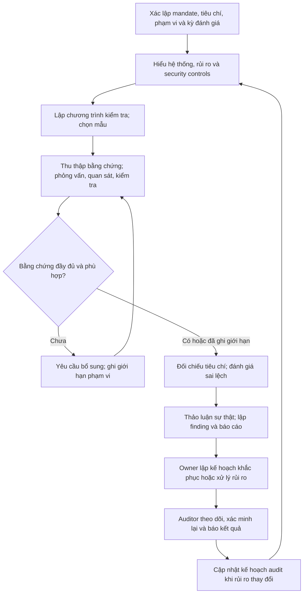

# Auditor: vai trò kiểm toán viên trong security assurance

Một hệ thống đã có cơ chế phân quyền quản trị, quy trình duyệt cấp quyền và dashboard báo cáo mọi bài kiểm thử đều thành công. Người quản lý hỏi: **“Có bằng chứng nào cho thấy chỉ những người được phê duyệt mới thực sự có quyền quản trị trong suốt quý vừa qua?”**

Nhóm phát triển có thể đưa ra mã nguồn và test; nhóm vận hành có thể đưa cấu hình tài khoản; Security có thể cung cấp chính sách. Nhưng để trả lời đáng tin cậy, phải có người **xác định tiêu chí, kiểm tra độ đầy đủ và độ tin cậy của bằng chứng, đánh giá các sai lệch và phát hành kết luận với phạm vi, giới hạn rõ ràng**. Đó là trách nhiệm cốt lõi của **auditor (kiểm toán viên)**.

Trong module `SECURITY_SECURITY_ASSURANCE`, auditor góp phần xây dựng niềm tin có bằng chứng rằng hệ thống đáp ứng mục tiêu bảo mật. Kết quả kiểm toán nối từ **rủi ro → yêu cầu → security controls → hoạt động kiểm chứng → phát hiện → hành động khắc phục và đánh giá lại**, để assurance tiếp tục trong phát triển và vận hành.

> **Điểm cốt lõi:** Auditor không bảo đảm hệ thống an toàn tuyệt đối. Auditor đưa ra **kết luận dựa trên bằng chứng đủ và phù hợp** cho một phạm vi, tiêu chí, giai đoạn và mức độ bảo đảm được xác định.

## 1. Auditor là ai và đóng vai trò gì?

**Auditor** là người thực hiện hoạt động kiểm toán có phương pháp nhằm đánh giá đối tượng được kiểm toán theo **tiêu chí được xác định trước**. Đối tượng có thể là một hệ thống thông tin, nhóm security controls, quy trình phát triển phần mềm, việc vận hành dịch vụ, chương trình quản lý rủi ro hoặc hồ sơ tuân thủ.

Trong security assurance, auditor cần giải quyết các câu hỏi:

- **Tiêu chí là gì?** Chính sách nội bộ, yêu cầu bảo mật, điều khoản hợp đồng, tiêu chuẩn hoặc mục tiêu kiểm soát cụ thể.
- **Đối tượng và kỳ đánh giá là gì?** Ứng dụng/đội ngũ/môi trường nào và thời gian nào được xét?
- **Control có được thiết kế phù hợp không?** Nếu triển khai đúng thiết kế, liệu control có thể giảm rủi ro đến mức kỳ vọng?
- **Control đã được triển khai và vận hành như thế nào?** Có bằng chứng control thực sự hoạt động theo tiêu chí trong kỳ đánh giá?
- **Có sai lệch hoặc thiếu bằng chứng nào?** Sai lệch ảnh hưởng đến mục tiêu bảo mật và kết luận ra sao?
- **Ai chịu trách nhiệm khắc phục, khi nào cần xác minh lại?**

Auditor cần hiểu kỹ thuật đủ để đánh giá luận cứ và bằng chứng, nhưng không mặc định phải tự viết code, tự triển khai hạ tầng hay tự vận hành mọi security control. Khi kỹ thuật nằm ngoài năng lực, auditor cần sử dụng chuyên gia phù hợp, xem xét năng lực và tính khách quan của họ, đồng thời làm rõ mức độ dựa vào kết quả của chuyên gia.

### Các loại auditor thường gặp

| Loại | Ví dụ vai trò | Điều cần lưu ý |
|---|---|---|
| **Internal auditor** (kiểm toán nội bộ) | Đánh giá việc áp dụng chính sách phân quyền, quản lý thay đổi và xử lý lỗ hổng trong tổ chức | Cần vị thế và cơ chế báo cáo hỗ trợ tính độc lập đối với hoạt động được kiểm toán |
| **External auditor** (kiểm toán bên ngoài) | Đánh giá theo hợp đồng, yêu cầu khách hàng hoặc một khuôn khổ bảo đảm cụ thể | Phạm vi, mức bảo đảm và hình thức báo cáo phụ thuộc engagement |
| **Supplier / third-party auditor** | Đánh giá nhà cung cấp, chuỗi cung ứng hoặc đơn vị xử lý dữ liệu | Quyền tiếp cận bằng chứng, hợp đồng, phạm vi phụ thuộc và bảo mật dữ liệu cần được xác định |
| **Technical auditor / IT auditor** | Kiểm tra access control, nhật ký, thay đổi cấu hình, pipeline, quản lý secret hoặc recovery | Phải hiểu cơ chế kỹ thuật và cách kiểm chứng control hoạt động trong hệ thống thực |

Một tổ chức có thể tham khảo **ISO 19011** cho hướng dẫn quản lý và thực hiện audit hệ thống quản lý, **ISO/IEC 27001** cho yêu cầu của hệ thống quản lý an toàn thông tin, hoặc **NIST SP 800-53A** cho cách đánh giá security/privacy controls. Mỗi engagement phải chỉ rõ **tiêu chí, phiên bản tài liệu, phạm vi và phương pháp áp dụng**; không phải mọi cuộc audit đều là kiểm toán chứng nhận theo một tiêu chuẩn.

## 2. Ranh giới trách nhiệm của auditor

Để kết luận có giá trị, phải phân biệt vai trò **thực thi control**, **quản lý rủi ro** và **đánh giá control**.

| Hoạt động | Auditor chịu trách nhiệm | Chủ thể khác thường chịu trách nhiệm |
|---|---|---|
| Xác định mục tiêu/phạm vi/tiêu chí audit | Thiết kế kế hoạch và phương pháp đánh giá, thống nhất quy trình với các bên | Chủ sở hữu hệ thống làm rõ ranh giới, chính sách và tài sản |
| Kiểm tra chất lượng security controls | Rà soát thiết kế, chọn mẫu, phỏng vấn, đối chiếu cấu hình/log, thực hiện hoặc giám sát thủ tục kiểm tra | Developer/Platform/Ops thiết kế, triển khai, vận hành control |
| Ghi nhận phát hiện | Mô tả điều kiện thực tế, tiêu chí chưa đạt, bằng chứng, tác động/rủi ro và giới hạn | Chủ sở hữu control cung cấp phản hồi, nguyên nhân và kế hoạch sửa |
| Đề xuất cải tiến | Nêu thiếu sót cần giải quyết, khuyến nghị phù hợp và ưu tiên xem xét | Nhóm chịu trách nhiệm hệ thống chọn/triển khai giải pháp |
| Xác minh hành động khắc phục | Kiểm tra lại bằng chứng và xác nhận trạng thái theo tiêu chí | Chủ sở hữu finding sửa lỗi và cung cấp bằng chứng sau sửa |
| Chấp nhận rủi ro còn lại | Kiểm tra tính hợp lệ của quy trình, cơ sở và thẩm quyền phê duyệt; nêu trong báo cáo khi liên quan | Risk owner hoặc cấp có thẩm quyền quyết định chấp nhận |
| Phê duyệt release, vận hành sản phẩm | Đánh giá bằng chứng khi được giao; đưa kết luận/khuyến nghị | Product, engineering, vận hành hoặc cơ quan quản trị có thẩm quyền quyết định |

**Auditor không được đánh đồng với security engineer, pentester, compliance officer hoặc risk owner.** Vai trò có thể phối hợp, nhưng chức năng khác nhau:

- **Security engineer / developer** thiết kế và đưa control vào hoạt động.
- **Pentester** chủ yếu tìm cách khai thác điểm yếu trong phạm vi kiểm thử; kết quả pentest là một nguồn bằng chứng cho audit.
- **Compliance officer** theo dõi việc đáp ứng yêu cầu và quy trình tuân thủ trong hoạt động thường xuyên.
- **Risk owner** quyết định cách xử lý rủi ro trong thẩm quyền.
- **Auditor** đánh giá khách quan điều kiện, bằng chứng và sự phù hợp so với tiêu chí; nêu rõ phát hiện và giới hạn kết luận.

Phân công trong thực tế có thể khác, nhưng **người tự triển khai control rồi tự audit để đưa kết luận độc lập về control đó** tạo ra nguy cơ thiên lệch đáng kể. Cần biện pháp bảo vệ tính khách quan hoặc phân tách người thực hiện và người đánh giá tùy mức rủi ro cùng quy định của tổ chức.

## 3. Nền tảng nghề nghiệp: độc lập, khách quan, năng lực và bảo mật thông tin

Auditor có thể đưa ra kết luận sai nếu chịu áp lực phải “cho qua” một finding, chỉ nhận bằng chứng được chọn sẵn hoặc dựa vào lời nói mà không đối chiếu nguồn gốc.

Các nguyên tắc thực hành:

| Nguyên tắc | Hành vi có thể quan sát |
|---|---|
| **Độc lập và tránh xung đột lợi ích** | Khai báo khi auditor từng thiết kế/vận hành control đang kiểm toán; sắp xếp reviewer khác nếu cần |
| **Khách quan và công bằng** | Áp dụng tiêu chí nhất quán, ghi cả bằng chứng phù hợp và bằng chứng trái chiều; cho bên được kiểm toán cơ hội làm rõ |
| **Dựa trên bằng chứng** | Kết luận liên kết với tài liệu gốc, test, hệ thống ghi nhận hoặc quan sát có thể kiểm tra |
| **Năng lực chuyên môn** | Hiểu rủi ro, control, hệ thống và giới hạn của phương pháp đánh giá; mời chuyên gia khi cần |
| **Bảo mật thông tin** | Chỉ truy cập dữ liệu cần thiết; hạn chế sao chép secret, thông tin cá nhân; quản lý lưu giữ và chia sẻ hồ sơ |
| **Chính trực** | Không bỏ qua sai lệch do áp lực deadline hoặc quan hệ; sửa báo cáo khi có bằng chứng mới |
| **Cẩn trọng nghề nghiệp** | Phân biệt điều đã quan sát, giả định, suy luận và kết luận; không khẳng định quá độ bao phủ |

Đặc biệt, độc lập **không có nghĩa auditor hoàn toàn không tương tác với nhóm kỹ thuật**. Phỏng vấn, walkthrough và xác nhận sự thật là cần thiết. Điều quan trọng là auditor vẫn chủ động chọn thủ tục, đánh giá tính đầy đủ của dữ liệu và giữ quyền nêu ngoại lệ khi bằng chứng không đủ.

Ví dụ: khi nhóm phát triển chỉ gửi ảnh chụp màn hình “SAST passed”, auditor có thể hỏi kết quả thuộc commit nào, rule set nào, phạm vi quét nào, những cảnh báo nào đã bị suppress và bản build production có đúng commit đó không. Những câu hỏi này giúp đánh giá **khả năng tin cậy của bằng chứng**, không nhằm “bắt lỗi” cá nhân.

## 4. Các đầu vào và đầu ra auditor cần quản lý

Một cuộc audit tốt có **điểm bắt đầu**, **tiêu chí quyết định** và **đầu ra truy vết được**.

| Nhóm | Thành phần thường gặp | Mục đích |
|---|---|---|
| **Đầu vào quản trị** | Audit charter/mandate, mục tiêu đánh giá, phạm vi, kỳ đánh giá, chính sách áp dụng | Xác lập quyền, trách nhiệm và giới hạn |
| **Đầu vào rủi ro** | Risk register, threat model, dữ liệu sự cố, thay đổi trọng yếu, kết quả audit trước | Chọn nội dung quan trọng và điểm cần kiểm tra sâu |
| **Đầu vào về hệ thống** | Sơ đồ kiến trúc, tài sản, luồng dữ liệu, inventory, control owners | Biết control nằm ở đâu và liên kết với mục tiêu nào |
| **Đầu vào bằng chứng** | Cấu hình, log, ticket, review, CI reports, biên bản phê duyệt, kết quả kiểm thử | Kiểm tra thiết kế và hoạt động thực tế |
| **Đầu ra làm việc** | Audit plan, tiêu chí/test procedures, chọn mẫu, working papers, các ngoại lệ tạm thời | Tái hiện được cách kiểm tra và suy luận |
| **Đầu ra quản trị** | Finding, kết luận, báo cáo audit, action plan và kết quả follow-up | Hỗ trợ quyết định, khắc phục và cải thiện assurance |

**Working papers (hồ sơ làm việc)** là bản ghi audit mô tả: mục đích kiểm tra, tiêu chí, đối tượng, nguồn dữ liệu, cách chọn mẫu, thao tác xác minh, kết quả và người rà soát. Nội dung đủ rõ để một người đánh giá có năng lực có thể hiểu vì sao auditor đi đến kết luận.

Không phải cuộc audit nào cũng yêu cầu lưu bản sao toàn bộ dữ liệu nhạy cảm. Đôi khi chỉ cần tham chiếu có kiểm soát tới dữ liệu gốc, kết quả truy vấn đã che định danh hoặc metadata/hashes được quản lý phù hợp với chính sách lưu trữ.

## 5. Quy trình audit trong chương trình security assurance



### Bước 1 — Lập kế hoạch theo rủi ro

Auditor xác định **đối tượng được kiểm toán**, các mục tiêu bảo mật liên quan (confidentiality, integrity, availability, authenticity...), tiêu chí đánh giá và khoảng thời gian. Ví dụ:

- **Đối tượng:** `order-service` và cơ chế cấp quyền quản trị tại production.
- **Mục tiêu:** xác định có bằng chứng rằng quyền `ADMIN` chỉ được cấp và duy trì khi có phê duyệt hợp lệ.
- **Kỳ đánh giá:** một quý xác định, chẳng hạn 01/07–30/09 của năm đang đánh giá.
- **Tiêu chí:** chính sách nội bộ yêu cầu có phê duyệt trước khi cấp quyền và rà soát định kỳ.
- **Ranh giới:** quyền trong IdP và trong ứng dụng; không suy diễn sang toàn bộ hệ thống của tổ chức.

Kế hoạch cần nêu hệ thống có khả năng ảnh hưởng tới kết luận: nhà cung cấp IAM, ứng dụng tiêu thụ role, nhóm quản trị hạ tầng, cách đồng bộ quyền và các luồng cấp quyền khẩn cấp.

### Bước 2 — Hiểu control và thiết kế thủ tục kiểm tra

Nên phân biệt hai lớp đánh giá:

1. **Design effectiveness (hiệu lực thiết kế):** nếu quy trình/phần mềm vận hành đúng như thiết kế, liệu control có thể giải quyết rủi ro? Ví dụ: mọi yêu cầu cấp quyền admin đều phải đi qua phê duyệt của người không phải người yêu cầu.
2. **Operating effectiveness (hiệu lực vận hành):** trong khoảng thời gian cần đánh giá, có bằng chứng control **đã thực hiện đúng và nhất quán**? Ví dụ: các sự kiện cấp quyền thực tế có phê duyệt đi kèm, ngoại lệ được kiểm soát và các quyền đã hết hạn được thu hồi.

Một chính sách được ký duyệt là **bằng chứng của thiết kế/quản trị**, không tự chứng minh mọi trường hợp cấp quyền trong quý đều thực hiện đúng. Ngược lại, một test API hiện tại thành công không tự chứng minh control đã hoạt động suốt ba tháng trước.

Auditor thường kết hợp **inquiry** (phỏng vấn), **observation** (quan sát), **inspection** (kiểm tra hồ sơ/cấu hình) và **reperformance** (thực hiện lại một bước kiểm tra) tùy mục tiêu. Chỉ phỏng vấn mà không có bằng chứng đối chiếu thường chưa đủ mạnh để kết luận hiệu lực vận hành.

### Bước 3 — Thu thập và xác minh nguồn bằng chứng

Một yêu cầu bằng chứng nên có các thuộc tính: **tên dữ liệu cần lấy, phạm vi, chủ sở hữu, nguồn, thời gian xuất, định dạng và quyền truy cập**. Khi có thể, auditor kiểm chứng tính đầy đủ của danh sách gốc: danh sách tài khoản từ hệ thống quản trị, tổng số sự kiện, kỳ xuất log và cách ánh xạ ID với người sử dụng.

Cần chú ý hai thuộc tính:

- **Sufficiency (đủ):** lượng bằng chứng và độ bao phủ có thích hợp với rủi ro và kết luận không?
- **Appropriateness (phù hợp/đáng tin):** bằng chứng có liên quan và đủ tin cậy không? Nguồn do hệ thống tự sinh, quyền sửa log, timestamps, công cụ xuất và quá trình chuyển giao có thể ảnh hưởng độ tin cậy.

Số lượng lớn ảnh chụp màn hình không bù được một bộ dữ liệu thiếu nguồn gốc hoặc thiếu các sự kiện đã thất bại. Các chứng từ quan trọng có thể cần đối chiếu từ **hai nguồn độc lập tương đối**, chẳng hạn thay đổi quyền trong IAM và ticket phê duyệt của hệ thống quản lý thay đổi.

### Bước 4 — Phân tích, đối thoại và lập finding

Auditor phải tách **sự thật đã thấy** khỏi **giải thích nguyên nhân** và **tác động tiềm tàng**. Khi phát hiện sai lệch, nên thảo luận với control owner để xác nhận ngữ cảnh và loại bỏ hiểu nhầm kỹ thuật, nhưng không thay đổi kết luận chỉ vì bên được kiểm toán muốn báo cáo “xanh”.

### Bước 5 — Báo cáo và theo dõi khắc phục

Báo cáo phải giúp người quản lý quyết định được: vấn đề gì, ở đâu, nghiêm trọng ra sao, căn cứ nào, ai xử lý và mốc xác minh tiếp theo. Khi owner triển khai bản sửa hoặc thay đổi quy trình, auditor xem xét **bằng chứng sau sửa**, thay vì chỉ kiểm tra trạng thái ticket đã chuyển thành `Done`.

## 6. Đánh giá security controls: thiết kế, triển khai, vận hành

Ví dụ với các control trong hệ thống Java/Spring Boot:

| Security control | Bằng chứng thiết kế | Bằng chứng triển khai | Bằng chứng vận hành |
|---|---|---|---|
| **Phân quyền API** | Yêu cầu role/object-level authorization và sơ đồ luồng truy cập | Policy trong service, rule trong gateway, cấu hình bảo mật | Kết quả integration test, log truy cập bị từ chối, review thay đổi quyền |
| **Quản lý secret** | Quy định lưu secret, truy cập và rotation | KMS/secret manager, policy IAM, cấu hình deployment | Log truy cập và rotation thực tế, rà soát secret bị lộ |
| **Secure SDLC** | Tiêu chí review/threat modeling và kiểm tra dependency | Quy tắc branch protection, pipeline scan, template PR | PR thực tế, kết quả CI, finding và hồ sơ triage |
| **Giám sát và phản ứng** | Yêu cầu audit log, cảnh báo, quy trình sự cố | Log pipeline và rule cảnh báo | Sự kiện nhận/triage cảnh báo, kết quả diễn tập hoặc điều tra |
| **Sao lưu và phục hồi** | Mục tiêu RPO/RTO và quy trình restore | Backup job, retention, quyền trên backup | Bản ghi backup và kết quả restore test trong kỳ |
| **Thay đổi cấu hình** | Chính sách phê duyệt thay đổi production | Infrastructure as Code, quy trình release | Change request, approval, deployment log, đối chiếu bản thực tế |

Auditor không thể kết luận control vận hành hiệu quả chỉ từ một trạng thái cấu hình tại thời điểm hiện tại. Nếu kiểm tra một quý, phải xem bằng chứng phù hợp **toàn kỳ hoặc khoảng thời gian được nêu rõ**.

### Ma trận truy vết: claim, control và thủ tục audit

```mermaid
flowchart LR
    A["RISK-AC-01: Cấp quyền ADMIN trái phép"] --> B["REQ-AC-01: Cấp quyền phải được phê duyệt"]
    B --> C["CTRL-AC-01: IAM + workflow phê duyệt"]
    C --> D["AUD-TEST-01: Đối chiếu cấp quyền với approval"]
    D --> E["Evidence: IAM log + tickets + export metadata"]
    E --> F["Kết luận trong kỳ và finding nếu có"]
    F --> G["Owner sửa quy trình/control"]
    G --> H["Auditor kiểm chứng hành động khắc phục"]
```



Nếu không thể nối một finding với rủi ro hoặc yêu cầu cụ thể, auditor nên làm rõ **tiêu chí nào bị vi phạm** trước khi nâng nó thành phát hiện chính thức.

## 7. Ví dụ xuyên suốt: audit quyền quản trị hệ thống

Giả sử chính sách của một nền tảng nội bộ quy định:

- **CTRL-PRIV-01:** quyền quản trị chỉ được cấp sau khi người có thẩm quyền phê duyệt.
- **CTRL-PRIV-02:** quyền quản trị tạm thời phải được thu hồi khi hết hiệu lực.
- **CTRL-PRIV-03:** chủ sở hữu hệ thống phải rà soát danh sách người có quyền theo chu kỳ quy định.
- **CTRL-PRIV-04:** việc cấp/thu hồi quyền phải tạo log phục vụ điều tra.

Các tiêu chí này là **chính sách giả định của ví dụ**, không phải quy tắc pháp luật chung cho mọi hệ thống.

### 7.1. Xác định population, cách chọn mẫu và thủ tục

**Population** là toàn bộ tập đối tượng cần đánh giá, ví dụ tất cả **sự kiện cấp quyền ADMIN trong quý**. Trước khi chọn mẫu, auditor phải kiểm tra danh sách này có thực sự đầy đủ hay không. Chỉ lấy “danh sách người đang có ADMIN” tại ngày cuối quý sẽ **bỏ sót các tài khoản được cấp rồi thu hồi trong kỳ**.

Với population có 200 sự kiện, auditor có thể lựa chọn:

- Kiểm tra tự động **toàn bộ** sự kiện nếu dữ liệu đủ tin cậy và quy tắc đối chiếu rõ ràng.
- Chọn mẫu **theo rủi ro**, ưu tiên tài khoản đặc quyền cao, cấp quyền ngoài giờ, cấp quyền khẩn cấp, tài khoản dịch vụ hoặc sự kiện có lịch sử sai lệch.
- Chọn mẫu **ngẫu nhiên** theo phương pháp định sẵn, sau khi có danh sách đầy đủ; ghi nguồn, số lượng, cách chọn và hạn chế suy luận.

Nếu chọn **20/200 sự kiện** và thấy 2 sự kiện thiếu approval, kết luận được là **2 sai lệch trong 20 mẫu đã kiểm tra**. Không tự suy ra “10% toàn hệ thống vi phạm” với độ tin cậy thống kê xác định nếu chưa thiết kế lấy mẫu thống kê phù hợp. Với hai sai lệch, auditor cần đánh giá lại mức rủi ro, cân nhắc mở rộng mẫu hoặc kiểm tra toàn bộ population.

### 7.2. Đối chiếu các nguồn độc lập

Giả định hệ thống có cấu trúc dữ liệu như sau:

| Nguồn | Trường cần đối chiếu | Rủi ro cần xem |
|---|---|---|
| IAM change log | `event_id`, `principal_id`, `role`, `granted_at`, `granted_by` | Log thiếu kỳ, thiếu loại thao tác hoặc có quyền sửa lịch sử |
| Approval workflow | `request_id`, `principal_id`, `role`, `approved_at`, `approver`, `status` | Approval tạo sau sự kiện, approve sai người, thông tin không khớp |
| Access inventory | `principal_id`, `role`, `enabled`, `scope` | Không phản ánh quyền đã thu hồi, quyền kế thừa hoặc group membership |
| Application log | Thao tác nhạy cảm, principal, timestamp, request ID | Thiếu sự kiện hoặc không biết có log đầy đủ không |

Một truy vấn **minh họa để định hướng thủ tục** (tên bảng/cột giả định, không thể dùng nguyên trạng trên mọi hệ thống):

```sql
-- Chỉ đọc dữ liệu; kiểm tra phạm vi kỳ đánh giá và quyền truy cập trước khi chạy.
SELECT
    g.event_id,
    g.principal_id,
    g.granted_at,
    a.request_id,
    a.approved_at,
    a.status
FROM iam_role_grants AS g
LEFT JOIN access_approvals AS a
    ON a.request_id = g.approval_request_id
   AND a.principal_id = g.principal_id
   AND a.role_name = g.role_name
WHERE g.role_name = 'ADMIN'
  AND g.granted_at >= :period_start
  AND g.granted_at < :period_end;
```

Khi đánh giá kết quả, auditor kiểm tra **approval tồn tại, đúng người/role/phạm vi, được phê duyệt trước `granted_at`, người phê duyệt có thẩm quyền** và khớp với chính sách ngoại lệ nếu là cấp quyền khẩn cấp.

**Giới hạn của truy vấn:** truy vấn không thể tự chứng minh rằng bảng audit đầy đủ và không bị sửa; không bao phủ quyền kế thừa qua group, role ngoài hệ thống IAM, sai múi giờ hoặc việc identity đổi định danh. Những giới hạn ấy phải được kiểm tra riêng hoặc ghi vào kết luận.

### 7.3. Viết một finding có thể hành động

Giả sử auditor xác minh 2 trong 20 sự kiện được chọn **không có phê duyệt hợp lệ tại thời điểm cấp quyền**. Có thể lập finding như sau:

```yaml
finding_id: "F-PRIV-2026-01"
audit_area: "Privileged access management"
scope: "Application A, production, assessed quarter"
criterion: "CTRL-PRIV-01: approve before grant"
condition: "2 of 20 sampled ADMIN grants lacked valid prior approval"
evidence_refs:
  - "<restricted-iam-log-export-reference>"
  - "<approval-workflow-query-reference>"
risk: "Unauthorized or unreviewed privileged access"
severity: "<determine-with-risk-methodology>"
possible_root_cause: "<to-be-confirmed-with-control-owner>"
control_owner: "<application-or-iam-owner>"
corrective_action: "<owner-proposed-plan>"
target_date: "<approved-date>"
status: "OPEN"
verification: "<pending-retest>"
limitations:
  - "Finding based on sample; full population impact not yet determined"
```

Để báo cáo khách quan, auditor nên dùng cấu trúc:

| Thành phần | Câu hỏi cần trả lời |
|---|---|
| **Criteria** | Điều gì theo tiêu chí lẽ ra phải xảy ra? |
| **Condition** | Thực tế đã phát hiện điều gì? |
| **Evidence** | Hồ sơ và phép đối chiếu nào chứng minh condition? |
| **Cause** | Vì sao xảy ra, đã được xác nhận hay chỉ là giả thuyết? |
| **Effect/Risk** | Tác động thực tế và rủi ro có thể xảy ra là gì? |
| **Recommendation** | Hướng khắc phục hoặc mục tiêu cải tiến nào nên xem xét? |
| **Owner/Timeline** | Ai chịu trách nhiệm sửa, thời điểm cam kết? |
| **Verification** | Bằng chứng và tiêu chí nào dùng để xác nhận vấn đề được xử lý? |

Điều quan trọng là phân biệt **quan sát đã được xác nhận** (“không tìm thấy phê duyệt hợp lệ trong các nguồn đã đối chiếu”) với **diễn giải cần kiểm chứng** (“không ai phê duyệt”). Nếu hệ thống phê duyệt khác chưa được thu thập, auditor cần xác minh thêm trước khi khẳng định sai phạm.

### 7.4. Khắc phục và xác minh lại

Control owner có thể khắc phục bằng cách ràng buộc thao tác cấp quyền với approval ID đã hợp lệ, từ chối nếu chưa phê duyệt, cải thiện quy trình cấp quyền khẩn cấp, thêm kiểm tra định kỳ và rà soát các quyền đã tồn tại.

Auditor xác minh sau khắc phục bằng **mẫu hoặc tập sự kiện phát sinh sau thay đổi**, kiểm tra cấu hình triển khai và các trường hợp không có approval. Một PR đã merge hoặc ticket chuyển `FIXED` **không đủ** để khẳng định control đã hoạt động ổn định. Kết quả có thể là:

- **Remediated and verified:** đã có bằng chứng control cải thiện và sai lệch được xử lý trong phạm vi kiểm tra.
- **Action implemented, effectiveness pending:** đã triển khai nhưng chưa đủ thời gian/dữ liệu để kiểm tra hiệu lực vận hành.
- **Still open:** sai lệch còn tồn tại hoặc bằng chứng chưa đủ.
- **Risk accepted by authorized owner:** có quyết định chấp nhận rủi ro theo thẩm quyền; điều này **không có nghĩa kết quả audit đã “đạt”**.

## 8. Cách auditor đánh giá chất lượng bằng chứng

Bằng chứng tốt không chỉ có “dấu PASS”. Cần xem **liên quan, đầy đủ, đáng tin, hiện hành và tái kiểm tra được**.

| Bằng chứng | Hỗ trợ được gì? | Giới hạn cần đặt câu hỏi |
|---|---|---|
| **Policy được phê duyệt** | Thiết kế/quy định mong muốn | Có được áp dụng cho hệ thống và toàn kỳ không? |
| **Ảnh chụp cấu hình** | Trạng thái một thời điểm | Cấu hình có thuộc production? Có thay đổi sau đó? |
| **Unit test PASS** | Một số hành vi logic ở bản test | Có áp dụng ở mọi đường gọi thực tế không? |
| **Integration test PASS** | Hành vi một luồng và môi trường | Test có tương ứng bản production và đúng tenant không? |
| **Penetration test** | Điểm yếu tìm được trong phạm vi/điều kiện kiểm tra | Không tìm thấy lỗ hổng không chứng minh không có lỗ hổng |
| **Log hệ thống** | Sự kiện vận hành đã ghi lại | Có đồng bộ giờ, đủ thời hạn, chống sửa/xóa và chứa đủ loại sự kiện? |
| **Ticket phê duyệt** | Quyết định qua workflow | Quyền đã cấp có đúng người, role, phạm vi và thời điểm không? |
| **Incident / finding record** | Cách sự cố được ghi nhận và xử lý | Có bằng chứng retest, hiệu quả sau sửa và residual risk không? |

Nếu bằng chứng không đủ, auditor có thể **mở rộng thủ tục**, yêu cầu bổ sung, ghi giới hạn phạm vi hoặc đưa kết luận chưa thể xác định theo cách báo cáo được áp dụng. Không thể suy ra `PASS` chỉ vì người được kiểm toán nói chưa từng có sự cố.

Auditor cần bảo vệ bằng chứng bằng nguyên tắc **ít quyền nhất, truy cập có mục đích, lưu giữ theo chính sách và loại bỏ hoặc che thông tin nhạy cảm**. Khi sao chép log hoặc dữ liệu cá nhân, lưu ý vùng pháp lý, hợp đồng và hạn chế chia sẻ; tham chiếu tới hồ sơ gốc có thể phù hợp hơn so với tạo nhiều bản sao.

## 9. Phân biệt audit finding, risk, incident và recommendation

| Thuật ngữ | Ý nghĩa | Trách nhiệm auditor |
|---|---|---|
| **Finding** | Sai lệch hoặc nhận định có cơ sở từ so sánh bằng chứng với tiêu chí | Mô tả đúng phạm vi, điều kiện, căn cứ và tác động |
| **Risk** | Tình huống không chắc chắn có thể gây tác động đến mục tiêu | Làm rõ tác động tiềm tàng, tham chiếu phương pháp đánh giá |
| **Incident** | Sự kiện đã hoặc có thể gây ảnh hưởng bảo mật theo tiêu chí xử lý sự cố | Thông báo theo quy trình khẩn cấp; không tự biến toàn bộ audit thành điều tra forensics |
| **Recommendation** | Hướng hành động đề xuất để cải thiện control | Gắn với finding/điều kiện; tránh tự làm owner thay bên được audit |
| **Management action plan** | Cam kết giải quyết nguyên nhân, biện pháp, owner, thời hạn | Kiểm tra kế hoạch đủ rõ, khả thi về mặt kiểm chứng và có người theo dõi |
| **Risk acceptance** | Quyết định có thẩm quyền chấp nhận rủi ro còn lại với điều kiện phù hợp | Xác nhận thẩm quyền, thời hạn và tính truy xuất, giữ nguyên sự thật của finding |

Độ nghiêm trọng của finding cần xét **khả năng xảy ra, mức ảnh hưởng, khả năng khai thác, mức phơi lộ, control bù đắp và phạm vi bị ảnh hưởng** theo phương pháp nhất quán của tổ chức. Không nên tự gắn mọi phát hiện thiếu giấy tờ là “Critical”, cũng không hạ mức độ một lỗ hổng phân quyền vì chưa quan sát thấy kẻ tấn công.

Khi phát hiện dấu hiệu đang bị xâm nhập hoặc rủi ro khẩn cấp, auditor cần **escalate ngay theo quy trình** cho chủ sở hữu hệ thống và Incident Response. Chu trình viết báo cáo định kỳ không được làm chậm xử lý nguy cơ cấp bách.

## 10. Viết báo cáo audit để quyết định được

Báo cáo audit có ích khi người nhận có thể nhìn thấy **kết luận và giới hạn trước**, sau đó truy vết tới tiêu chí và bằng chứng.

Một cấu trúc gợi ý:

1. **Mục tiêu, tiêu chí, phạm vi và kỳ audit:** các hệ thống, môi trường, thời gian và khuôn khổ đánh giá.
2. **Phương pháp và giới hạn:** loại thủ tục, quy mô/cách chọn mẫu, phần không đủ dữ liệu, yếu tố dựa vào bên thứ ba.
3. **Kết luận tổng thể:** những control đã có bằng chứng đạt, chưa đạt hoặc chưa đủ bằng chứng; tránh diễn đạt vượt phạm vi.
4. **Findings ưu tiên:** tiêu chí, điều kiện, rủi ro, bằng chứng, mức ưu tiên và nguyên nhân khi được xác nhận.
5. **Phản hồi management:** giải trình, owner, kế hoạch hành động, thời hạn và quyết định rủi ro còn lại.
6. **Follow-up:** cách xác minh hiệu lực sau sửa, người nhận và mốc cập nhật tiếp theo.

Ví dụ diễn đạt thận trọng:

> Trong phạm vi kiểm tra quyền `ADMIN` của Application A cho quý đã xác định, quy trình phê duyệt đã được mô tả và triển khai. Tuy nhiên, 2 trong 20 sự kiện cấp quyền được chọn chưa có bằng chứng phê duyệt hợp lệ trước thời điểm cấp. Việc xem xét toàn bộ 200 sự kiện và hiệu lực vận hành sau biện pháp khắc phục vẫn đang tiếp tục; kết luận không mở rộng sang các hệ thống khác.

Tránh câu “Application A đạt 90% an toàn” vì 18/20 mẫu có approval **không phải thước đo an toàn tổng thể** và không đủ để suy diễn tỷ lệ đạt trong population khi chưa có phương pháp thống kê thích hợp.

## 11. Phối hợp với nhóm phát triển, Security, Operations và Risk Owner

Auditor cần hợp tác nhưng vẫn giữ quyền đánh giá độc lập.

| Bên phối hợp | Auditor cần trao đổi | Kết quả mong đợi |
|---|---|---|
| **Developer / Tech Lead** | Luồng dữ liệu, logic authorization, test, PR, security requirements và các đường có thể bypass | Hiểu thực tế triển khai và liên kết code với claim |
| **AppSec / Security Assurance** | Threat model, control catalog, mức rủi ro, kết quả scan, pentest, chính sách | Chọn thủ tục trọng yếu và đánh giá độ mạnh bằng chứng |
| **Platform / Operations** | IAM, secret store, network policy, deployment, logging, backup/restore | Kiểm tra vận hành control theo thời gian |
| **Product / Business Owner** | Tài sản, tác động, quy trình nghiệp vụ, ưu tiên thay đổi | Đặt phát hiện vào ngữ cảnh tác động |
| **Risk Owner / Governance** | Khẩu vị rủi ro, thẩm quyền phê duyệt ngoại lệ, thời hạn xem lại | Đánh giá tính hợp lệ của quyết định xử lý rủi ro |
| **Incident Response / SOC** | Dấu hiệu bất thường, dữ liệu sự cố, bài học khắc phục | Phát hiện có được theo dõi và phản ứng kịp thời không? |

Một auditor hiệu quả **không viết sẵn kết luận trước khi thu thập chứng cứ**, cũng không né trao đổi với người nắm hệ thống. Họ giải thích tiêu chí và thủ tục rõ ràng, xác nhận sai lệch bằng ngữ cảnh đầy đủ, tôn trọng dữ liệu được bảo vệ và báo cáo phát hiện mà không quy chụp động cơ cá nhân.

## 12. Auditor trong assurance liên tục và DevSecOps

Audit theo quý hoặc theo năm vẫn hữu ích, nhưng trong môi trường phát hành nhiều lần mỗi ngày, bằng chứng có thể trở nên lỗi thời nhanh. Auditor nên cùng các nhóm xây cơ chế **continuous auditing/continuous monitoring có kiểm soát**, phù hợp mức rủi ro và mức độc lập cần thiết.

Ví dụ:

- **CI/CD:** pipeline lưu test report, code review, SAST/SCA, kết quả kiểm tra cấu hình theo commit và build ID.
- **Deployment:** hệ thống lưu ai phê duyệt, artefact nào được phát hành, cấu hình nào áp dụng và việc rollback.
- **Access governance:** nguồn danh sách quyền, event cấp/thu hồi, approval và kết quả rà soát định kỳ có thể truy xuất.
- **Vulnerability management:** ticket có mức độ rủi ro, chủ sở hữu, ngày đến hạn, bằng chứng sửa và retest.
- **Security operations:** log, alert, incident và kết quả diễn tập recovery được giữ theo chính sách.
- **Change trigger:** phát hiện mở rộng quyền, đổi trust boundary, thay kho secret hoặc thay đổi nhà cung cấp làm phát sinh nhu cầu đánh giá lại.

Continuous auditing **không đồng nghĩa máy quét tự tạo ra kết luận độc lập**. Auditor vẫn cần xem tính đúng của rule, độ bao phủ của nguồn dữ liệu, quyền quản trị pipeline, các ngoại lệ bị suppress, thời hạn lưu hồ sơ và cách kết quả tự động được triage.

Một số chỉ báo hữu ích: tỷ lệ control rủi ro cao có evidence còn hiệu lực, tỷ lệ phát hiện quá hạn, tỷ lệ hồ sơ audit có nguồn gốc/phiên bản rõ ràng, thời gian xác minh remediation và số ngoại lệ hết hạn. Những chỉ số này đo **quản trị và độ bao phủ bằng chứng**, không đo trực tiếp “phần trăm hệ thống an toàn”.

### Ví dụ trigger đánh giá lại

| Sự kiện | Auditor cần xem xét |
|---|---|
| Thêm endpoint xuất dữ liệu khách hàng | Yêu cầu bảo mật, authorization, log và kiểm thử luồng mới có nằm trong claim cũ không? |
| Thay công cụ IAM hoặc sơ đồ role | Bằng chứng phê duyệt/cấp quyền có còn đối chiếu được không? |
| Rotate khóa ký JWT hoặc chứng chỉ dịch vụ | Trust anchor, cấu hình và khả năng hồi quy xác thực |
| Đổi pipeline CI hoặc rule suppress | Test/scan report có còn đáng tin, gate có bị bypass không? |
| Phát hiện lỗ hổng quan trọng hoặc incident | Control nào thất bại, phạm vi ảnh hưởng, evidence sau khắc phục |
| Đưa nhà cung cấp mới vào đường dữ liệu | Trách nhiệm bảo mật và bằng chứng từ bên thứ ba có đầy đủ không? |

## 13. Sai lầm auditor cần tránh

| Sai lầm | Vì sao sai | Cách thực hành tốt hơn |
|---|---|---|
| **Đồng nhất compliance với an toàn tuyệt đối** | Tiêu chí có giới hạn, rủi ro mới vẫn xuất hiện | Kết luận theo phạm vi, thời gian, tiêu chí và residual risk |
| **Kiểm tra giấy tờ nhưng không kiểm tra vận hành** | Chính sách tồn tại chưa chứng minh control hoạt động | Xem cấu hình và bằng chứng hoạt động trong kỳ |
| **Nhận danh sách chọn sẵn mà không xác nhận population** | Mẫu có thể bỏ sót các sự kiện bất lợi | Đối chiếu nguồn, tổng số, tính toàn vẹn và cách xuất dữ liệu |
| **Coi ảnh chụp PASS là đủ** | Thiếu commit, thời gian, môi trường, dữ liệu gốc | Yêu cầu test report, artefact ID, rule version và liên kết gốc |
| **Tuyên bố kết quả vượt độ bao phủ của mẫu** | Không có cơ sở suy ra tính đúng của mọi trường hợp | Nêu đúng số mẫu và giới hạn suy luận |
| **Chấp nhận lời giải thích mà không kiểm chứng** | Sự thật và giải thích có thể khác nhau | Lưu lý do, thử đối chiếu với nguồn độc lập |
| **Tự sửa control rồi tự đánh giá độc lập** | Xung đột lợi ích và nguy cơ thiên lệch | Phân tách vai trò hoặc áp dụng biện pháp bảo vệ độc lập |
| **Đóng finding khi owner nói đã sửa** | Không chứng minh hiệu lực sau thay đổi | Kiểm chứng lại theo tiêu chí và môi trường phù hợp |
| **Thu thập quá nhiều dữ liệu nhạy cảm** | Tăng nguy cơ lộ hoặc vi phạm quy định lưu trữ | Giảm dữ liệu, phân quyền, che thông tin và đặt retention rõ ràng |
| **Bỏ qua phát hiện khẩn cấp đến kỳ báo cáo** | Có thể kéo dài rủi ro đang bị khai thác | Escalate theo quy trình khi nhận diện nguy cơ nghiêm trọng |

## 14. Checklist dành cho auditor

Trước khi kết thúc một cuộc audit, auditor có thể tự rà soát:

- [ ] Có mandate/quyền thực hiện, mục tiêu, tiêu chí và phạm vi đánh giá rõ ràng.
- [ ] Có xác định kỳ đánh giá, môi trường, hệ thống, tài sản và rủi ro ưu tiên.
- [ ] Có đánh giá độc lập/xung đột lợi ích và bố trí reviewer thích hợp.
- [ ] Có phân biệt design effectiveness với operating effectiveness.
- [ ] Đã kiểm tra độ đầy đủ của population trước khi chọn mẫu.
- [ ] Đã ghi phương pháp chọn mẫu, thủ tục kiểm tra, tiêu chí đạt và giới hạn suy luận.
- [ ] Evidence có nguồn gốc, thời điểm, phiên bản/môi trường, kết quả và bảo vệ thông tin nhạy cảm.
- [ ] Các kết luận/finding liên kết được với tiêu chí, bằng chứng và rủi ro.
- [ ] Đã trao đổi để xác nhận sự thật với control owner, ghi lại bất đồng nếu còn.
- [ ] Báo cáo có phạm vi, giới hạn, finding, mức ưu tiên, owner và thời hạn xử lý.
- [ ] Có cách kiểm chứng remediation và cập nhật trạng thái, không tự coi ticket đóng là đã hết rủi ro.
- [ ] Có trigger tái đánh giá khi rủi ro, hệ thống hoặc yêu cầu thay đổi.

**Ghi nhớ:** Trong security assurance, auditor là người **kiểm tra độc lập, khách quan và có phương pháp xem bằng chứng hỗ trợ kết luận bảo mật đến đâu**. Giá trị của auditor nằm ở việc xác định rõ tiêu chí, kiểm chứng thiết kế và vận hành controls, báo cáo sai lệch dựa trên sự thật và xác nhận hành động khắc phục — qua đó giúp tổ chức ra quyết định với **mức độ tin cậy được chứng minh**, thay vì dựa vào tuyên bố “hệ thống đã an toàn”.
