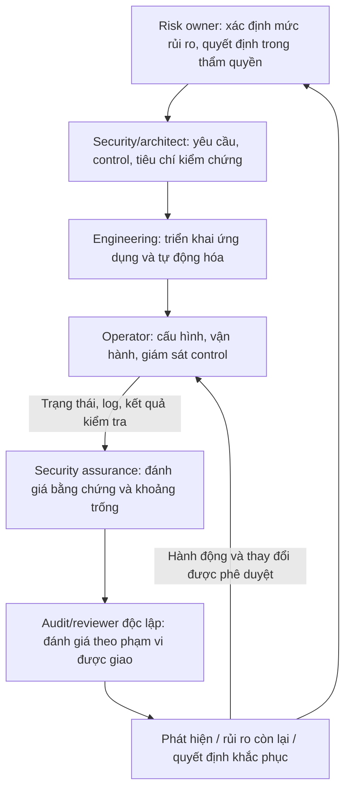
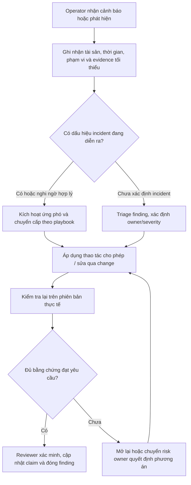

# Operator

## Mục tiêu học tập

Sau bài này, bạn có thể:

- Giải thích **Operator** là ai trong mô hình vai trò và trách nhiệm của một chương trình **security assurance**, phân biệt trách nhiệm vận hành với trách nhiệm thiết kế, sở hữu rủi ro và đánh giá độc lập.
- Xác định những **security controls** mà Operator phải triển khai, giám sát, duy trì và cung cấp bằng chứng trong môi trường thực tế.
- Diễn giải một vòng vận hành an toàn từ **baseline → thay đổi có kiểm soát → giám sát → phát hiện → ứng phó/khắc phục → xác minh → cập nhật bằng chứng**.
- Xây dựng bảng phân công trách nhiệm, quy trình chuyển cấp và bộ hồ sơ chứng cứ để hỗ trợ kiểm thử, audit và ra quyết định rủi ro.
- Phân tích tình huống của dịch vụ Java/Spring Boot, nhận diện khi nào Operator được tự xử lý theo runbook và khi nào phải chuyển cho người có thẩm quyền.

## 1. Operator là vai trò gì?

Trong ngữ cảnh **vận hành hệ thống**, *Operator* là người hoặc nhóm **thực hiện và duy trì hoạt động hằng ngày của hệ thống đã triển khai**: cấu hình môi trường, theo dõi trạng thái, triển khai thay đổi được phê duyệt, phản ứng với cảnh báo và bảo đảm các cơ chế bảo vệ hoạt động như thiết kế. Operator có thể thuộc đội vận hành hạ tầng, platform engineering, DevOps, SRE, vận hành cloud hoặc nhóm quản trị dịch vụ, tùy cách tổ chức.

Trong module **SECURITY_SECURITY_ASSURANCE**, mục tiêu là xây dựng niềm tin **có bằng chứng** rằng hệ thống đáp ứng mục tiêu bảo mật. Operator vì vậy không chỉ “giữ hệ thống chạy”, mà còn:

1. **Thực thi** các security controls trong môi trường mà mình phụ trách.
2. **Phát hiện và ghi nhận** khi control sai lệch, bị vô hiệu hóa, hết hiệu lực hoặc vận hành không đạt ngưỡng yêu cầu.
3. **Cung cấp chứng cứ vận hành** gắn với phiên bản, môi trường, thời điểm và người thực hiện.
4. **Chuyển cấp** những vấn đề vượt thẩm quyền hoặc có rủi ro đáng kể.
5. **Khắc phục và hỗ trợ kiểm chứng** sau khi thay đổi, xử lý sự cố hay phát hiện audit.

Ví dụ: nhóm phát triển ứng dụng Java đã cấu hình bắt buộc HTTPS và phân quyền theo vai trò. Khi triển khai, một ingress có thể vô tình mở cổng HTTP hoặc cho phép đường truy cập không đi qua cơ chế xác thực đã định. Operator cần phát hiện sai lệch so với baseline, xử lý theo quy trình thay đổi, và giữ bằng chứng cho thấy **môi trường thực sự chạy** tuân thủ yêu cầu.

**Điểm cần nhớ:** Operator có trách nhiệm đối với **phần hệ thống và control được giao**, không mặc nhiên là người quyết định yêu cầu bảo mật, chấp nhận mọi rủi ro còn lại hay tự xác nhận độc lập rằng toàn bộ hệ thống an toàn.

### 1.1. “Operator” không chỉ có một chức danh

| Cách gọi trong thực tế | Trọng tâm thường gặp | Liên hệ với security assurance |
| --- | --- | --- |
| **Infrastructure/Cloud Operator** | Máy chủ, mạng, tài nguyên cloud, quyền truy cập hạ tầng, backup. | Cung cấp bằng chứng hardening, cấu hình, IAM, thay đổi và khôi phục. |
| **Platform/Kubernetes Operator** | Cluster, namespace, workload, chính sách triển khai và giám sát. | Chứng minh ràng buộc triển khai, image, cấu hình runtime và phát hiện drift. |
| **Application Operator** | Vận hành ứng dụng, cấu hình môi trường, release, giám sát lỗi. | Chứng minh endpoint, secret, logging và security config hoạt động trong môi trường phát hành. |
| **SRE/On-call Operator** | Khả dụng, khả năng phục hồi, phản ứng cảnh báo, vận hành theo SLO. | Cung cấp bằng chứng về giám sát, ứng phó, diễn tập và tính sẵn sàng. |
| **SOC Analyst/Security Operator** | Giám sát tín hiệu an ninh, triage, điều tra và điều phối ứng phó. | Cung cấp bằng chứng phát hiện, điều tra, xử lý và chuyển cấp sự kiện bảo mật. |

Những vai trò này có thể là **một người trong đội nhỏ** hoặc **nhiều nhóm riêng biệt**. Sự phân chia phải được ghi trong quy trình và bảng phân quyền thực tế; tên chức danh tự nó không chứng minh ai đang chịu trách nhiệm.

## 2. Operator đứng ở đâu trong chuỗi security assurance?

Security assurance bắt đầu từ **rủi ro và mục tiêu bảo mật**, chuyển thành **yêu cầu và security controls**, sau đó thu thập bằng chứng từ kiểm thử, review, vận hành và audit. Operator đóng vai trò quan trọng ở đoạn **control đang vận hành** và **bằng chứng từ môi trường thực tế**.



| Vai trò | Quyết định/trách nhiệm điển hình | Điều không nên suy diễn |
| --- | --- | --- |
| **Service owner** | Chịu trách nhiệm kết quả vận hành và yêu cầu của dịch vụ; ưu tiên nguồn lực sửa lỗi. | Luôn là người trực tiếp thực hiện mọi thao tác kỹ thuật. |
| **Security architect / control owner** | Thiết kế hoặc sở hữu yêu cầu control và tiêu chí đánh giá tương ứng. | Có thể tự biết cấu hình production đang đúng mà không cần bằng chứng thực tế. |
| **Developer/engineering** | Xây ứng dụng, sửa mã và test các thuộc tính security thuộc phần việc. | Test thành công trong CI đồng nghĩa cấu hình production đúng. |
| **Operator** | Duy trì baseline, thực hiện thay đổi, giám sát, xử lý tác nghiệp, lưu chứng cứ. | Có quyền tự chấp nhận rủi ro vượt thẩm quyền hoặc tự bỏ qua control. |
| **SOC / incident response** | Phân tích cảnh báo, điều tra và điều phối sự cố theo playbook. | Mọi cảnh báo là một incident đã được xác nhận. |
| **Assurance reviewer / internal audit** | Đánh giá chất lượng bằng chứng, hiệu quả kiểm soát và các sai lệch. | Chỉ cần tin vào lời khẳng định “đã cấu hình đúng” từ bên vận hành. |
| **Risk owner** | Quyết định cách xử lý rủi ro còn lại theo thẩm quyền và chính sách. | Có thể bỏ qua nghĩa vụ bắt buộc hoặc miễn mọi kiểm chứng chỉ bằng một email. |

Việc **phân tách người thay đổi** và **người phê duyệt hoặc kiểm chứng** cần tương xứng với độ nhạy của tài sản. Đối với môi trường nhỏ, có thể không đủ nhân sự tách biệt hoàn toàn, khi đó tổ chức nên dùng review bù trừ, nhật ký không dễ sửa và giám sát độc lập phù hợp.

## 3. Những nhóm trách nhiệm cốt lõi của Operator

### 3.1. Duy trì cấu hình chuẩn (secure baseline)

Baseline là trạng thái cấu hình **được phê duyệt** cho môi trường, ứng dụng và hạ tầng: phiên bản phần mềm, tính năng bảo mật, quyền, cấu hình mạng, log, dữ liệu và yêu cầu phục hồi. Operator cần biết **nguồn chuẩn**, **phạm vi áp dụng** và **cách phát hiện sai lệch (configuration drift)**.

Ví dụ:

- Các endpoint quản trị không được phơi bày công khai ngoài phạm vi cho phép.
- Workload chạy với quyền tối thiểu phù hợp, không tự động cấp đặc quyền quản trị cho tài khoản chạy ứng dụng.
- Những biến cấu hình nhạy cảm được lấy từ kho secrets được tổ chức chấp thuận.
- Chính sách ingress, TLS và network access tương ứng với sơ đồ luồng dữ liệu được duyệt.
- Log security và dữ liệu audit gửi đến nơi tập trung đã kiểm soát quyền, đồng hồ đồng bộ và thời hạn lưu giữ theo chính sách.

Operator phải phân biệt **lệnh đã chạy thành công** với **trạng thái cuối cùng phù hợp baseline**. Một công cụ IaC báo `apply success` chưa đủ nếu resource bị sửa ngoài IaC hoặc cấu hình runtime thực tế có khác biệt.

### 3.2. Vận hành quyền truy cập và bí mật

Các hoạt động thường gặp gồm tạo/thu hồi quyền vận hành theo yêu cầu được phê duyệt, kiểm tra tài khoản đặc quyền, quản lý vòng đời secrets và phối hợp xoay khóa khi có nguy cơ lộ.

Nguyên tắc áp dụng:

- **Least privilege:** chỉ cấp quyền cần cho vai trò, tài sản và khoảng thời gian cần thiết.
- **Separation of duties:** không cho một người tự phê duyệt mọi thay đổi nhạy cảm do chính mình đề xuất khi yêu cầu kiểm soát đòi hỏi kiểm tra độc lập.
- **Time-bound access:** quyền khẩn cấp hoặc đặc quyền tạm thời phải có thời hạn, lý do và truy vết.
- **Joiner–mover–leaver:** quyền cần được điều chỉnh khi nhân sự gia nhập, đổi việc hoặc rời tổ chức.
- **Secret handling:** không chép password, token hoặc private key vào ticket, log, command history hoặc báo cáo audit rộng quyền.

**Bằng chứng:** phiếu yêu cầu và phê duyệt quyền, snapshot chính sách IAM, lịch sử cấp/thu hồi, kết quả kiểm tra quyền định kỳ, bản ghi xoay khóa hoặc revocation. Không cần đính kèm **giá trị bí mật** để chứng minh đã xoay khóa.

### 3.3. Quản lý bản vá, dependency và cấu hình bảo vệ

Khi xuất hiện CVE hay cảnh báo cấu hình, Operator cần xác định **dịch vụ thực sự sử dụng thành phần nào**, phạm vi ảnh hưởng và đầu mối chịu trách nhiệm. Với thư viện Java, đội phát triển thường sửa dependency và kiểm thử tương thích; Operator phối hợp lập lịch phát hành, triển khai, quan sát và xác minh bản vá đã chạy.

Đừng kết luận đã khắc phục chỉ vì thư viện được sửa trong nhánh mã nguồn. Bằng chứng có thể cần:

- Phiên bản image hoặc artifact đã được build, ký/xác minh theo cơ chế nội bộ (nếu có).
- Hồ sơ phê duyệt thay đổi và kết quả CI/security test.
- Phiên bản triển khai **thực tế** trên từng môi trường, kể cả instance còn chạy phiên bản cũ.
- Kết quả quét/kiểm thử lại và trạng thái rủi ro còn lại.

### 3.4. Giám sát, cảnh báo và điều tra bước đầu

Operator chịu trách nhiệm **nhận đúng tín hiệu** và phản ứng theo playbook. Những cảnh báo thường gặp: tăng bất thường số lần xác thực thất bại, thay đổi IAM ngoài change ticket, log security ngừng gửi, cấu hình firewall bị mở rộng, ứng dụng sụt khả dụng sau khi chỉnh chính sách, hay chứng chỉ gần hết hạn.

Một cảnh báo có ý nghĩa phải chỉ rõ:

1. Tài sản/môi trường bị ảnh hưởng và điều kiện kích hoạt.
2. Mức ưu tiên hoặc tiêu chí để đánh giá mức độ.
3. Người/nhóm được phân công xử lý và người dự phòng.
4. Runbook hoặc tuyến chuyển cấp nếu cần.
5. Trường dữ liệu và nơi giữ evidence để người khác kiểm chứng.

Không tự động xem mọi tín hiệu bất thường là đã xảy ra vi phạm. Operator ghi lại nhận định ban đầu, **sự thật đã quan sát**, **giả thuyết đang kiểm tra** và những giới hạn của dữ liệu hiện có.

### 3.5. Backup, phục hồi và tính sẵn sàng

Với mục tiêu **availability** và **integrity**, Operator cần duy trì backup, giới hạn quyền truy cập bản sao lưu, giám sát việc tạo bản sao và **diễn tập phục hồi** theo mục tiêu nghiệp vụ. Chỉ có dòng log “backup job completed” chưa chứng minh backup có thể phục hồi, dữ liệu đầy đủ hoặc đáp ứng RPO/RTO đã đặt.

**Bằng chứng:** cấu hình backup được phê duyệt, thời gian và trạng thái chạy, kết quả kiểm tra restore trên môi trường phù hợp, RPO/RTO đo được, lỗi và hành động khắc phục. Khi kiểm thử restore, dùng dữ liệu thử hoặc có biện pháp bảo vệ dữ liệu cá nhân theo chính sách.

### 3.6. Quản lý nhật ký và dữ liệu phục vụ audit

Operator cần vận hành đường thu thập sự kiện: độ bao phủ của log, đồng bộ thời gian, quyền đọc, thời hạn lưu, chống thay đổi trái phép theo yêu cầu và khả năng tìm lại theo mã yêu cầu. Nên tránh ghi dữ liệu nhạy cảm không cần thiết như credential, authorization header hoặc request body chứa dữ liệu cá nhân.

Ví dụ, để chứng minh `SEC-LOG-01: thao tác thay quyền quản trị được ghi nhận`, cần kiểm tra có **sự kiện thực sự được tạo, chuyển đến hệ thống log, truy vấn được và bị giới hạn truy cập**, thay vì chỉ đưa ảnh chụp một checkbox “logging enabled”.

## 4. Công việc Operator trong các thời điểm khác nhau

| Thời điểm | Hoạt động chính | Đầu ra làm bằng chứng |
| --- | --- | --- |
| **Trước triển khai** | So sánh thay đổi với baseline, xác minh approval, chuẩn bị rollback, đánh giá tác động tới quyền và log. | Change record, phiên bản artifact, kết quả pre-deploy check, phương án rollback. |
| **Trong triển khai** | Thực hiện change đúng phạm vi, theo dõi các tín hiệu an toàn và tính sẵn sàng, ghi thời gian. | Deployment record, event của hệ thống, nhật ký thực thi được phép lưu. |
| **Ngay sau triển khai** | Kiểm chứng phiên bản, kết nối bảo mật, endpoint/permission quan trọng và telemetry. | Kết quả post-deploy verification, ảnh chụp trạng thái cấu hình có thời điểm. |
| **Vận hành liên tục** | Theo dõi alert, đối chiếu drift, kiểm tra secrets, IAM, backup, certificate, vulnerability. | Báo cáo health/security checks, drift findings, audit trail. |
| **Khi có phát hiện** | Phân loại, bảo vệ chứng cứ, áp dụng runbook, chuyển cấp, hỗ trợ sửa và xác minh. | Ticket, incident timeline, evidence links, re-test, quyết định rủi ro. |
| **Theo kỳ** | Review quyền, thử phục hồi, rà soát exception và nợ bảo mật, báo cáo xu hướng. | Kết quả review, bản ghi diễn tập, báo cáo assurance, biên bản quyết định. |

Đường dây thời gian này giúp phân biệt **điều kiện trước khi đưa control vào vận hành** với **chứng minh control vẫn hoạt động sau nhiều lần thay đổi**.

## 5. Giao việc rõ ràng bằng RACI và quyền quyết định

RACI biểu diễn bốn nhóm trách nhiệm: **R (Responsible)** – thực hiện; **A (Accountable)** – chịu trách nhiệm cuối cùng về kết quả công việc; **C (Consulted)** – được tham vấn; **I (Informed)** – được thông báo. Ma trận dưới đây là **ví dụ** với các vai trò gộp để dễ học, không phải cơ cấu bắt buộc.

| Hoạt động | Operator | Service owner | Security team | Assurance reviewer | Risk owner |
| --- | --- | --- | --- | --- | --- |
| Kiểm tra drift cấu hình runtime và tạo finding | **R** | **A** | C | I | I khi vượt ngưỡng |
| Thực hiện thay đổi hạ tầng đã được phê duyệt | **R** | **A** | C khi tác động security | I | I khi liên quan rủi ro cao |
| Xác định yêu cầu và ngưỡng security cho control vận hành | C | C | **A/R** | C | I |
| Điều tra bước đầu cảnh báo hạ tầng | **R** | **A** | C hoặc R theo playbook | I | I khi cần |
| Chuẩn bị evidence vận hành cho audit | **R** | **A** | C | C (xác định yêu cầu kiểm chứng) | I |
| Đánh giá độc lập hiệu lực control được giao | C (cung cấp chứng cứ) | C | C | **A/R** | I |
| Chấp nhận rủi ro còn lại trong thẩm quyền | C | C | C | I | **A/R** |

Một nhiệm vụ cụ thể cần có **một chủ thể Accountable được xác định rõ** và có người dự phòng khi cần. Nếu tổ chức chia trách nhiệm theo tài sản, ma trận phải áp dụng **từng control** chứ không chỉ từng phòng ban. Ví dụ, thao tác thay network policy và việc chấp nhận rủi ro nghiệp vụ của một ngoại lệ firewall thuộc những quyền khác nhau.

### 5.1. Operator được quyết định gì?

**Có thể chủ động theo runbook đã phê duyệt:** xác minh alert, khôi phục một thành phần bằng thao tác chuẩn, cô lập workload theo quy trình đã định, thu thập telemetry được phép, rollback trong các điều kiện trigger đã được duyệt.

**Cần phê duyệt/chuyển cấp theo chính sách:** thay đổi ngoài baseline, vô hiệu hóa logging, tạm bỏ yêu cầu xác thực, cấp quyền quản trị ngoài quy trình thường, thay đổi retention, thông báo cho bên ngoài, chấp nhận một rủi ro vượt ngưỡng. Ngoại lệ khẩn cấp (break-glass) phải có điều kiện kích hoạt, dấu vết và đánh giá hậu kiểm.

**Không được suy ra:** một người có quyền thao tác production thì mặc nhiên có thẩm quyền phê duyệt thay đổi hay tuyên bố sản phẩm “đã đáp ứng toàn bộ yêu cầu bảo mật”.

## 6. Operator và bằng chứng security assurance

Một chương trình assurance cần trả lời: **Yêu cầu gì? Control nào? Ai vận hành? Làm sao biết control thực sự hoạt động? Đã kiểm tra phiên bản/môi trường nào?** Operator tạo hoặc cung cấp phần lớn bằng chứng runtime.

### 6.1. Liên kết rủi ro, yêu cầu, control và bằng chứng

Xét dịch vụ Java/Spring Boot cung cấp API tiến độ học tập:

| Thành phần | Nội dung minh họa |
| --- | --- |
| Rủi ro | Kẻ tấn công hoặc người dùng không được phép truy cập chức năng quản trị, dữ liệu học viên qua cấu hình runtime sai. |
| Yêu cầu `SEC-OPS-01` | Chỉ các endpoint quản trị được phê duyệt mới có thể truy cập qua kênh và nhóm chủ thể cho phép. |
| Control thiết kế | Chính sách ingress, xác thực/ủy quyền ở ứng dụng và phạm vi exposure của Actuator. |
| Phần việc Developer | Định nghĩa endpoint, áp dụng Spring Security, viết test ứng dụng. |
| Phần việc Operator | Triển khai đúng cấu hình, kiểm tra ingress/exposure trên runtime, giám sát drift, ghi evidence. |
| Claim | “Ở phiên bản và môi trường X, endpoint quản trị không phơi bày ngoài phạm vi được phê duyệt.” |
| Evidence | Kết quả quan sát routing thực tế, cấu hình đã triển khai, test cho phép/từ chối, log giám sát và bản build/commit. |
| Trigger tái đánh giá | Đổi ingress, thay đường đi mạng, nâng cấp Spring Boot/Security hoặc thêm Actuator endpoint. |

Một cấu hình ứng dụng **minh họa** có thể giới hạn những Actuator endpoint được expose qua HTTP:

```yaml
management:
  endpoints:
    web:
      exposure:
        include: "health,info"
  endpoint:
    health:
      show-details: "never"
```

Đây là **một control ở tầng ứng dụng**, chưa chứng minh ingress, network policy, access control hoặc các API quản trị khác đã an toàn. Operator cần đối chiếu cấu hình **đang chạy**; đồng thời người thiết kế bảo mật phải quyết định endpoint nào được phép xuất hiện trong từng môi trường.

### 6.2. Claim – Argument – Evidence cho Operator

**Claim:** “Trên build `release-X` trong production, chỉ có các Actuator endpoint đã phê duyệt được expose; truy cập từ bên ngoài vùng quản trị không thể đọc dữ liệu quản trị nhạy cảm.”

**Argument:**

1. Cấu hình được kiểm soát qua pipeline và nguồn cấu hình được duyệt.
2. Chính sách network/ingress chỉ cho phép tuyến và nguồn truy cập đúng phạm vi.
3. Kiểm thử sau triển khai xác nhận endpoint được phép hoạt động, endpoint không được phép bị từ chối và runtime khớp baseline.
4. Giám sát thay đổi và định kỳ kiểm tra drift để phát hiện trạng thái sai lệch sau khi phát hành.

**Evidence:** định danh build, diff cấu hình đã phê duyệt, trạng thái runtime, kết quả request test từ các vùng mạng phù hợp, ticket/approval, nhật ký deploy, kết quả drift scan và hồ sơ reviewer đánh giá.

**Giới hạn:** không thể dựa vào một lần test staging để khẳng định production hoặc các release tương lai đều đáp ứng. Các kết quả cũng cần phân biệt `401/403` do chính sách bảo vệ với `404` do endpoint không được expose; mã trả về đơn lẻ chỉ có ý nghĩa khi biết đường request, cấu hình và phạm vi test.

### 6.3. Hồ sơ evidence nên chứa gì?

```yaml
control_id: SEC-OPS-01
claim: "Runtime chỉ expose các endpoint quản trị được phê duyệt"
system: "learning-platform"
environment: "production"
release: "release-X"
observed_at: "<timestamp>"
operator_role: "platform-operator"
approval_ref: "change/<approved-id>"
baseline_ref: "baseline/<revision>"
checks:
  - test: "approved endpoint accessible from allowed route"
    result: "PASS" # Chỉ dùng khi có kết quả thật
    evidence_ref: "secure-artifacts/<test-run>/allowed-route"
  - test: "restricted endpoint denied from external route"
    result: "PASS"
    evidence_ref: "secure-artifacts/<test-run>/restricted-route"
drift_check_ref: "secure-artifacts/<drift-run>"
open_findings: []
reassess_when:
  - "Ingress, Spring Boot hoặc security config thay đổi"
```

Mọi ID, thời gian và kết quả trên chỉ là **placeholder minh họa cấu trúc**. Trong hệ thống thật, evidence phải trỏ tới artifact tồn tại và truy cập được theo phân quyền. Khi thu thập, tránh đính kèm secret hay dữ liệu người dùng thô. **Báo cáo tự khai “đã đúng” không thay thế kết quả kiểm chứng có thể lặp lại.**

## 7. Runbook vận hành có thể kiểm chứng

**Runbook** là quy trình đã được phê duyệt để Operator thực hiện một tác vụ an toàn, nhất quán. Một runbook tốt cho security assurance nên có:

1. **Mục đích và control liên quan:** ví dụ `SEC-OPS-01` – giới hạn endpoint quản trị.
2. **Phạm vi và điều kiện khởi động:** môi trường, dịch vụ, trigger từ cảnh báo hoặc thay đổi.
3. **Điều kiện tiên quyết:** quyền tối thiểu, ticket/approval, người trực, công cụ truy cập được cấp.
4. **Các bước quan sát trước khi sửa:** kiểm tra trạng thái và lấy thông tin cần thiết.
5. **Các bước thay đổi được cho phép:** thực hiện, rollback, checkpoint và khi nào phải dừng/chuyển cấp.
6. **Tiêu chí chấp nhận:** phép kiểm sau thay đổi phải đạt và được ghi lại.
7. **Xử lý lỗi:** chủ phản hồi, cách giữ hệ thống an toàn, cách chuyển cấp.
8. **Bằng chứng:** nơi lưu report, mã triển khai, thời gian, người thao tác và kết quả review.

### 7.1. Ví dụ: phát hiện cấu hình Actuator mở rộng bất thường

**Tình huống:** sau khi nâng cấp dịch vụ `progress-api`, Operator thấy ingress cho phép truy cập một endpoint quản trị không nằm trong danh mục được phê duyệt. Operator cần tìm nguyên nhân và giữ hệ thống trong phạm vi bảo vệ. Đây là bài học về **quy trình kiểm tra**, không phải chỉ dẫn áp dụng trực tiếp lên production bất kỳ.

**Runbook minh họa:**

1. Mở ticket, ghi thời điểm, dịch vụ, môi trường, trigger và ảnh hưởng quan sát được. Nếu nghi ngờ có khai thác hoặc dữ liệu bị lộ, kích hoạt đường dây ứng phó sự cố.
2. Đối chiếu baseline/approval với đường route và cấu hình Actuator của bản đang triển khai. Kiểm tra cả cấu hình runtime và layer reverse proxy/ingress.
3. Xác định sai lệch: endpoint nào được truy cập, từ vùng nào, có cần xác thực hay không, có để lộ thông tin nhạy cảm không. Chỉ kiểm tra trong phạm vi được ủy quyền, không tải dữ liệu không cần thiết.
4. Với thao tác đã được phép trong runbook, hạn chế đường truy cập có rủi ro hoặc rollback về bản đã phê duyệt; các thay đổi ngoài phạm vi phải được phê duyệt hoặc chuyển cấp.
5. Chạy lại phép kiểm cho nguồn truy cập được phép và nguồn bị cấm; ghi kết quả, build, môi trường, configuration revision và thời điểm.
6. Review nguyên nhân gốc: cấu hình trong Git, Helm values, tham số deploy, policy drift hay thao tác thủ công. Bổ sung guardrail/test phù hợp để ngăn tái diễn.
7. Chuyển evidence cho người có quyền xác minh, cập nhật finding và chỉ đóng khi tiêu chí được đáp ứng.

**Điểm đặc biệt:** nếu một nguồn truy cập từ bên ngoài nhận `403`, cần xác minh lệnh kiểm tra thực sự đi qua đường mạng dự kiến và xác thực/ủy quyền đang hoạt động. Một lần request thất bại do DNS hoặc timeout **không chứng minh** quyền truy cập đã bị ngăn đúng cách.

### 7.2. Kiểm tra trạng thái đọc-only trước khi thay đổi

Trong nền tảng có Kubernetes, Operator có thể dùng các lệnh **chỉ đọc trạng thái** theo quyền nội bộ, chẳng hạn:

```bash
# Ví dụ minh họa: chỉ xem metadata và trạng thái của workload.
kubectl -n learning-prod get deployment progress-api
kubectl -n learning-prod rollout status deployment/progress-api --timeout=30s
kubectl -n learning-prod get ingress
```

Những lệnh này không chứng minh các mục tiêu security đã đạt; chúng chỉ cung cấp một phần **ngữ cảnh quan sát**. Muốn đánh giá bảo vệ đường truy cập còn cần cấu hình ingress, policy, identity, kết quả thử request và baseline tương ứng. Đừng vô tình dump cấu hình chứa secret hoặc dữ liệu cá nhân vào log CI/ticket.

## 8. Phản ứng với phát hiện, sự cố và rủi ro còn lại

Operator thường là một trong những người đầu tiên thấy cảnh báo, nhưng phải phân biệt:

- **Event:** dấu hiệu hoặc sự kiện cần đánh giá, chưa chắc có tác động security.
- **Finding/vulnerability:** sai lệch control hoặc điểm yếu có thể gây rủi ro, được phát hiện qua review, test, scan hay audit.
- **Incident:** sự kiện đã được đánh giá là sự cố theo tiêu chí tổ chức; có thể đòi hỏi điều phối ứng phó, bảo toàn chứng cứ và nghĩa vụ thông báo.
- **Residual risk / exception:** rủi ro còn lại hoặc việc tạm không đáp ứng control được xử lý bằng quyết định có thẩm quyền, theo thời hạn và điều kiện cụ thể.



### 8.1. Quy tắc chuyển cấp cần có điều kiện rõ

Các trigger nên được quy định trước. Ví dụ:

- Có dấu hiệu thực tế về truy cập trái phép, lộ dữ liệu nhạy cảm hoặc gián đoạn nghiêm trọng.
- Một secret sản xuất bị nghi lộ; cần phối hợp thu hồi/xoay khóa theo runbook, bảo vệ chứng cứ và kiểm tra phạm vi.
- Security control trọng yếu bị tắt, log audit bị mất hoặc cơ chế xác thực không hoạt động.
- Operator không có thẩm quyền thay đổi, thiếu người phê duyệt, hoặc thao tác dự kiến có thể làm mất chứng cứ.
- Owner không phản hồi, cảnh báo quá hạn hoặc rủi ro vượt ngưỡng đơn vị vận hành.
- Có khả năng phải thông báo cho khách hàng, đối tác hoặc cơ quan có thẩm quyền theo nghĩa vụ áp dụng.

Mốc thời gian xác nhận, khắc phục và cập nhật phải được thống nhất theo **mức độ rủi ro và lịch trực thực tế**. Chẳng hạn, một tổ chức có thể quy định cảnh báo Critical cần được xác nhận trong 15 phút, nhưng đó chỉ là **ví dụ nội bộ**, không phải chuẩn chung hay thời hạn pháp lý cho mọi tình huống.

**Operator có thể áp dụng hành động khẩn cấp đã được phê duyệt trong playbook**, nhưng không nên tự suy ra rằng có thể che giấu sự cố, xóa bằng chứng, bỏ qua bộ phận pháp chế hoặc chấp nhận rủi ro vượt thẩm quyền.

## 9. Phân tách nhiệm vụ và kiểm chứng độc lập

Giả sử một Operator được quyền sửa network rule và tự đánh dấu “đã đạt” trong dashboard. Nếu không có audit trail hoặc phép kiểm do nguồn tin cậy khác thực hiện, hệ thống assurance phụ thuộc vào một lời khai của chính người sửa.

Tùy mức rủi ro, có thể áp dụng:

| Cách kiểm soát | Mục tiêu | Bằng chứng |
| --- | --- | --- |
| **Review/approval trước thay đổi** | Ngăn thay đổi rủi ro vượt quyền. | Change request, phạm vi, người duyệt, lý do. |
| **Policy-as-code / pipeline gate** | Chặn cấu hình không phù hợp baseline được phát hành. | Kết quả chính sách trên commit/build, cấu hình rule. |
| **Audit log độc lập** | Có dấu vết ai thay đổi gì, khi nào, qua công cụ nào. | Log tập trung có kiểm soát quyền, hồ sơ tham chiếu. |
| **Post-deploy verification** | Kiểm tra trạng thái chạy thật đúng yêu cầu. | Test từ điều kiện/đường truy cập phù hợp, bản build/môi trường. |
| **Independent review** | Giảm nguy cơ tự xác nhận công việc hoặc bỏ sót phạm vi. | Kết luận reviewer, các câu hỏi và bằng chứng được đánh giá. |
| **Periodic access/config review** | Phát hiện quyền hoặc cấu hình trôi theo thời gian. | Kết quả rà soát, ngoại lệ, remediation ticket. |

Nếu cùng một cá nhân phải thực hiện nhiều nhiệm vụ do quy mô đội nhỏ, nên có **bù trừ kiểm soát**: review của người khác theo lịch, cảnh báo thay đổi đặc quyền, audit trail có tính toàn vẹn, hoặc đối chiếu tự động từ hệ thống không do một người kiểm soát toàn bộ.

Chủ thể có trách nhiệm **chấp nhận rủi ro còn lại** phải được nêu rõ theo chính sách. Việc đổi trạng thái `Accepted` trong ticket chỉ là thao tác quản trị hồ sơ khi đã có phê duyệt hợp lệ; nó không phải quyết định được mặc định trao cho Operator.

## 10. Quản lý bằng chứng để kiểm thử và audit có thể xác minh

Security assurance cần kết nối **yêu cầu → control → kết quả vận hành → đánh giá → hành động khắc phục**. Bằng chứng tốt phải có:

1. **Tính liên quan:** chứng minh đúng yêu cầu; ví dụ backup job không chứng minh API phân quyền đúng.
2. **Tính xác thực:** nguồn thu thập đáng tin, có dấu thời gian, gắn với môi trường và phiên bản.
3. **Tính toàn vẹn:** hạn chế chỉnh sửa trái phép; biết ai thêm, thay hay phê duyệt.
4. **Tính bao phủ:** có cả trường hợp đạt, thất bại, ngoại lệ và đường đi bị bỏ sót.
5. **Khả năng lặp lại:** lưu đủ điều kiện để chạy phép kiểm hoặc xem lại việc đánh giá.
6. **Độ mới:** bản ghi còn phản ánh hệ thống sau thay đổi gần nhất liên quan đến control.
7. **Bảo mật dữ liệu:** không làm phát sinh nguy cơ mới do đưa token, log người dùng hoặc cấu hình bí mật vào báo cáo.

### 10.1. Những bằng chứng cần giữ cho các control vận hành

| Control | Tuyên bố cần đánh giá | Evidence Operator có thể cung cấp |
| --- | --- | --- |
| `SEC-IAM-01` | Quyền production được cấp, xem xét và thu hồi theo phê duyệt. | Hồ sơ request/approval, snapshot role assignment, lịch sử revoke, access review. |
| `SEC-CONF-01` | Cấu hình runtime tuân thủ baseline được duyệt. | Baseline revision, kết quả drift scan, deployment manifest và runtime snapshot có timestamp. |
| `SEC-LOG-01` | Sự kiện security trọng yếu được tạo và truy vấn được trong phạm vi lưu giữ. | Test log end-to-end, độ trễ thu thập, retention config, kiểm tra quyền. |
| `SEC-SEC-01` | Secrets được bảo vệ và thay thế khi đến hạn hoặc khi nghi lộ. | Metadata secret versions, ticket rotation, log re-deploy/test sử dụng khóa mới; không lưu giá trị khóa. |
| `SEC-BAK-01` | Dữ liệu có thể phục hồi theo các mục tiêu đã đặt. | Kết quả restore drill, mức RPO/RTO đã đo, các lỗi và hành động sửa. |
| `SEC-PATCH-01` | Thành phần có lỗ hổng đã được xử lý theo ưu tiên rủi ro. | Bản build/version deploy, scan lại, ticket và exception đúng thẩm quyền. |

Một bảng kiểm vận hành có thể ghi như sau:

```text
Control: SEC-CONF-01
System/environment: progress-api / production
Baseline revision: <approved-revision>
Deployment revision: <running-revision>
Observed at: <timestamp>
Check: ingress, workload privilege, log sink, secret reference
Result: PASS | FAIL | INSUFFICIENT_EVIDENCE
Finding refs: <ticket-or-none>
Evidence refs: <protected-artifacts>
Operator: <role/account>
Reviewer: <role/account, when applicable>
Recheck trigger: config or architecture changes
```

Không nên dùng `PASS` khi chưa chạy kiểm chứng thực tế. Nếu công cụ không thể kết nối với môi trường, kết quả nên là **`INSUFFICIENT_EVIDENCE`**, đi kèm thời gian, nguyên nhân và người phụ trách; trạng thái đó không đồng nghĩa control sai hoặc đúng.

## 11. Chỉ số theo dõi hiệu quả vận hành security controls

Chỉ số giúp nhóm biết những **khoảng trống assurance** và những control không ổn định:

| Chỉ số | Câu hỏi quản trị | Diễn giải cần thận trọng |
| --- | --- | --- |
| Tỷ lệ control trọng yếu có evidence runtime còn hiệu lực | Các yêu cầu quan trọng đã được kiểm chứng trong môi trường liên quan chưa? | Evidence “có file” chưa bảo đảm nội dung đủ tốt. |
| Thời gian từ phát hiện drift tới xác nhận | Cảnh báo có đến người chịu trách nhiệm? | Xác nhận nhanh không có nghĩa đã khắc phục. |
| Thời gian tới khắc phục được xác minh | Lỗ hổng/config sai kéo dài bao lâu? | Chỉ nên tính là đã sửa khi re-test đạt. |
| Số phát hiện quá hạn theo mức rủi ro | Control nào đang cần ưu tiên nguồn lực? | Không nên hạ severity để làm đẹp báo cáo. |
| Tỷ lệ thay đổi có approval và post-deploy check | Quy trình thay đổi có được tuân thủ? | Một ticket approved không bảo đảm runtime đúng. |
| Tỷ lệ diễn tập restore đạt RPO/RTO | Backup có khôi phục được trong điều kiện thử? | Phải nêu rõ hệ thống, dữ liệu và giới hạn kiểm thử. |
| Tỷ lệ quyền đặc quyền quá hạn | Quyền tạm thời có thực sự được thu hồi? | Cần xác minh trên hệ thống nguồn, không chỉ từ danh sách yêu cầu. |
| Số exception sắp hết hạn | Quyết định chấp nhận rủi ro có được xem xét lại đúng lịch? | Ít exception có thể do không ghi nhận đầy đủ. |

Những chỉ số này hỗ trợ ra quyết định; **không có một KPI duy nhất chứng minh hệ thống an toàn**. Cần đối chiếu với loại tài sản, mức độ rủi ro, phạm vi hoạt động và độ tin cậy của công cụ thu thập.

## 12. Tình huống thực hành: sai lệch cấu hình trên hệ thống Java

**Bối cảnh:** nền tảng học tập chạy `progress-api` (Java/Spring Boot) trên Kubernetes. Theo baseline, ứng dụng chỉ expose Actuator `health,info` qua mạng được phép. Sau một đợt phát hành, công cụ giám sát phát hiện rằng một endpoint Actuator bổ sung có thể được truy cập qua ingress công khai. Một bảng kiểm deploy vẫn hiển thị trạng thái “thành công”. Ở thời điểm phát hiện, chưa có bằng chứng chứng minh có người ngoài thực sự truy cập dữ liệu nhạy cảm.

### 12.1. Cách Operator xử lý có trách nhiệm

**1. Ghi nhận và bảo toàn ngữ cảnh.** Tạo finding gắn với service, môi trường, release, thời điểm, đường truy cập, baseline và kết quả quan sát hợp lệ. Hạn chế đưa dữ liệu nhạy cảm vào ticket; dẫn link đến artifact được bảo vệ.

**2. Triage theo rủi ro.** Xác minh mức độ tiếp xúc, endpoint nào bị ảnh hưởng, cần xác thực hay không, dữ liệu có thể bị lộ và có dấu hiệu truy cập thực tế không. Nếu có cơ sở nghi ngờ incident, kích hoạt playbook ứng phó.

**3. Chuyển cấp đúng thẩm quyền.** Thông báo service owner, security team và trực incident khi đạt ngưỡng. Nếu việc cô lập hoặc rollback nằm trong runbook đã duyệt, thực hiện theo điều kiện; các thao tác ngoài phạm vi được chuyển tới người phê duyệt thích hợp.

**4. Sửa nguyên nhân.** Kiểm tra thay đổi trong cấu hình ứng dụng, ingress, pipeline hoặc quyền thao tác. Cập nhật theo quy trình change, bảo đảm các môi trường bị ảnh hưởng đều được xử lý. Nhờ developer sửa code nếu vấn đề nằm trong ứng dụng.

**5. Kiểm chứng.** Chạy phép kiểm từ đường công khai và vùng quản trị được phép, đối chiếu kết quả với tiêu chí, kiểm tra runtime revision và drift. Lưu kết quả gắn với phiên bản đã sửa.

**6. Đóng finding có xác minh.** Chuyển bằng chứng cho reviewer có thẩm quyền; chỉ đánh dấu `Verified/Closed` khi tiêu chí phù hợp. Trường hợp còn exception phải có quyết định, biện pháp tạm thời, owner và hạn xem lại.

**7. Cải tiến liên tục.** Thêm test chặn expose endpoint ngoài allowlist trong pipeline, kiểm tra drift sau mỗi release, kiểm tra rằng kênh cảnh báo đến đúng người; cập nhật claim và evidence của `SEC-OPS-01`.

### 12.2. Câu hỏi tự luyện

1. Những quyết định nào Operator có thể tự thực hiện theo runbook và quyết định nào cần chủ dịch vụ, security team hoặc risk owner phê duyệt?
2. Vì sao “pipeline deploy success” **không** đủ làm bằng chứng rằng endpoint quản trị được bảo vệ?
3. Viết một **claim** cụ thể về phạm vi exposure của endpoint và đề xuất ít nhất bốn evidence để hỗ trợ.
4. Nếu người vận hành sửa Helm values nhưng production vẫn còn một pod phiên bản cũ, có thể đóng finding chưa? Cần kiểm tra điều gì?
5. Nếu kiểm thử từ mạng công khai nhận `timeout`, có thể kết luận security control đạt chưa? Vì sao?
6. Một nhóm nhỏ có chỉ một Operator trực production cần thiết kế cơ chế kiểm chứng độc lập hoặc kiểm soát bù trừ thế nào?

**Gợi ý đối chiếu:** Operator chịu trách nhiệm quan sát runtime và điều phối sửa theo quyền được cấp. Bằng chứng cần đối chiếu yêu cầu với chính sách ingress, cấu hình Spring Boot, bản release thực tế trên mọi instance liên quan, test từ các điều kiện mạng đúng và log/record của thay đổi. `timeout` chỉ nói đường thử thất bại ở thời điểm đó, không chứng minh cơ chế từ chối đúng. Không đóng finding khi còn instance cũ hoặc thiếu xác minh. Đối với thay đổi nhạy cảm, nên có phê duyệt, audit trail và reviewer hoặc guardrail độc lập phù hợp rủi ro.

## 13. Những ngộ nhận cần tránh

| Ngộ nhận | Cách hiểu đúng |
| --- | --- |
| “Operator chỉ cần duy trì uptime.” | Vận hành security control, phát hiện drift, xử lý và cung cấp evidence cũng là trách nhiệm đã phân công. |
| “Đã có thiết kế bảo mật thì production chắc chắn an toàn.” | Cấu hình, quyền, mạng, version và hành vi thực tế có thể khác thiết kế. |
| “CI chạy xanh nên control runtime đạt.” | CI hỗ trợ kiểm chứng trong phạm vi của nó; phải kiểm tra cả môi trường triển khai. |
| “Operator có quyền production nên được tự chấp nhận rủi ro.” | Quyền thao tác và thẩm quyền chấp nhận rủi ro là hai trách nhiệm khác nhau. |
| “Đã merge bản sửa nghĩa là finding được đóng.” | Phải chứng minh đã triển khai đúng và re-test đạt theo phạm vi yêu cầu. |
| “Có nhiều log là có assurance mạnh.” | Log cần chứng minh đúng claim, đáng tin, bảo vệ phù hợp và có thể truy vết. |
| “Backup thành công nghĩa là chắc chắn khôi phục được.” | Cần kiểm tra restore và đo mục tiêu phục hồi trong bối cảnh cụ thể. |
| “Không có cảnh báo nghĩa là hệ thống không có vấn đề.” | Có thể thiếu độ bao phủ, log không hoạt động hoặc rule phát hiện chưa phù hợp. |

## Tổng kết

**Operator** là người đưa các security controls từ thiết kế vào **trạng thái hoạt động có thể quan sát và kiểm chứng**. Trong chương trình security assurance, Operator chịu trách nhiệm vận hành theo baseline, quản lý thay đổi và quyền trong phạm vi được giao, phát hiện sai lệch, hỗ trợ xử lý sự cố và cung cấp bằng chứng trên môi trường thực tế. Giá trị của vai trò này nằm ở khả năng khép kín chu trình **rủi ro → yêu cầu → control đang vận hành → bằng chứng → phát hiện → khắc phục → kiểm chứng lại**, đồng thời biết phân biệt trách nhiệm thao tác với quyền phê duyệt, chấp nhận rủi ro và đánh giá độc lập.
