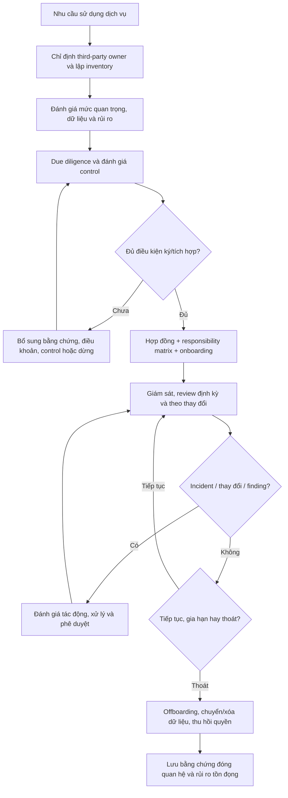
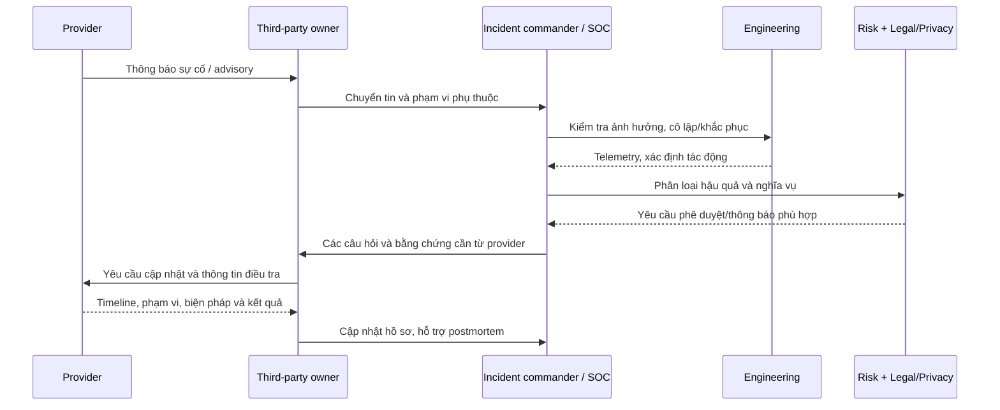

# Third-party owner: chủ sở hữu quan hệ bên thứ ba trong Security Assurance

## 1. Third-party owner là ai và chịu trách nhiệm về điều gì?

Trong chương **Vai trò và trách nhiệm** của module **SECURITY_SECURITY_ASSURANCE**, **third-party owner** là người hoặc vai trò **ở phía tổ chức sử dụng dịch vụ** được giao chịu trách nhiệm quản lý một quan hệ với nhà cung cấp/bên thứ ba trong suốt vòng đời của quan hệ đó. Người này giúp bảo đảm các rủi ro do phụ thuộc bên ngoài được nhận diện, có người chịu trách nhiệm, có biện pháp kiểm soát và có **bằng chứng** để xác định các mục tiêu bảo mật liên quan đang được đáp ứng.

Tên gọi thực tế có thể là *vendor owner*, *supplier relationship owner*, *service relationship owner* hoặc một chức danh nội bộ khác. Không phải tổ chức nào cũng dùng đúng tên “third-party owner”; quan trọng là **trách nhiệm và thẩm quyền được xác định bằng văn bản**.

Trong một nền tảng học tập Java/Spring Boot, hệ thống có thể dùng nhà cung cấp dịch vụ thanh toán, dịch vụ định danh, email/SMS, nền tảng CI/CD, cloud, CDN hoặc SaaS hỗ trợ khách hàng. Mỗi quan hệ có thể tạo ra rủi ro về dữ liệu học viên, quyền truy cập, tính toàn vẹn giao dịch, tính sẵn sàng và chuỗi cung ứng. Third-party owner là **đầu mối nội bộ** bảo đảm không có khoảng trống quản trị khi công việc được giao một phần cho nhà cung cấp.

Một third-party owner thường phải có khả năng trả lời:

1. **Dùng bên thứ ba để làm gì?** Dịch vụ nào, dữ liệu nào, luồng kết nối và người dùng nào phụ thuộc vào họ?
2. **Rủi ro nào phát sinh?** Nếu họ gặp sự cố, lộ dữ liệu, thay đổi tính năng hoặc dừng dịch vụ, hệ thống và người học chịu hậu quả gì?
3. **Ai làm gì?** Nhà cung cấp, đội ứng dụng, đội hạ tầng, security, pháp chế và risk owner chịu những control nào?
4. **Có bằng chứng gì?** Đã đánh giá năng lực và hiệu lực control của nhà cung cấp đến đâu, trong phạm vi và thời hạn nào?
5. **Khi có vấn đề ai quyết định?** Ai khắc phục, ai được chấp nhận rủi ro, ai phê duyệt tiếp tục sử dụng, ai có quyền tạm dừng tích hợp?
6. **Khi kết thúc quan hệ làm gì?** Làm sao thu hồi quyền, di chuyển dữ liệu, xóa dữ liệu đúng cam kết và duy trì hoạt động?

> **Điểm cốt lõi:** Thuê một dịch vụ bên ngoài có thể chuyển giao một số hoạt động vận hành nhưng không tự động chuyển hết trách nhiệm quản trị rủi ro, nghĩa vụ bảo vệ dữ liệu và trách nhiệm đối với người dùng của tổ chức.

### Kết quả học tập

Sau bài này, người học có thể mô tả nhiệm vụ của third-party owner, lập ma trận trách nhiệm chia sẻ, tổ chức due diligence, xác định mức assurance và bằng chứng cần thu, xử lý ngoại lệ, lập kế hoạch giám sát và kết thúc quan hệ an toàn.

## 2. Phạm vi trách nhiệm: third-party owner khác các vai trò liên quan thế nào?

**Third-party owner thường là vai trò nội bộ của khách hàng**, không phải chủ sở hữu pháp lý của công ty cung cấp dịch vụ. Người phụ trách quan hệ phía nhà cung cấp có thể được gọi là *vendor account manager* hoặc *vendor service owner*; họ là một **đầu mối phía đối tác**, khác với owner nội bộ.

| Vai trò | Trách nhiệm điển hình | Ranh giới quan trọng |
| --- | --- | --- |
| **Third-party owner (nội bộ)** | Quản lý quan hệ, danh mục phụ thuộc, tình trạng đánh giá, hành động tồn đọng, phối hợp hợp đồng, giám sát hiệu lực và kế hoạch thoát. | Không mặc nhiên có quyền tự chấp nhận mọi rủi ro hoặc thay thế chuyên gia đánh giá. |
| **Business/service owner** | Chịu trách nhiệm kết quả nghiệp vụ và mức dịch vụ mà hệ thống cần cung cấp. | Có thể đồng thời là third-party owner nếu được phân công, nhưng hai trách nhiệm cần được ghi rõ. |
| **Risk owner** | Có thẩm quyền và trách nhiệm quản lý rủi ro cụ thể, quyết định phương án xử lý/chấp nhận trong giới hạn được giao. | Quyền chấp nhận rủi ro không tự phát sinh chỉ vì một người quản lý hợp đồng. |
| **Control owner (nội bộ)** | Triển khai, vận hành và cung cấp bằng chứng về control thuộc trách nhiệm tổ chức. | Không thể đổ mọi thất bại tích hợp cho nhà cung cấp. |
| **Supplier/vendor control owner** | Chịu trách nhiệm những control mà nhà cung cấp cam kết thực hiện trong dịch vụ của họ. | Phải có điều khoản, báo cáo và kênh trao đổi thích hợp để kiểm chứng cam kết. |
| **Security assessor / TPRM / GRC** | Xác định phương pháp đánh giá, kiểm tra bằng chứng, ghi finding và đề xuất mức rủi ro. | Người đánh giá không tự quyết định chấp nhận rủi ro nghiệp vụ ngoài thẩm quyền. |
| **Procurement / contract owner** | Đàm phán, ký kết, theo dõi hợp đồng, gia hạn và quyền sử dụng theo quy trình tổ chức. | Ký hợp đồng không đồng nghĩa đã hoàn tất security due diligence. |
| **Legal/privacy officer** | Xem xét nghĩa vụ hợp đồng, bảo vệ dữ liệu, lưu giữ, chuyển dữ liệu và thông báo khi cần. | Không thay thế kiểm thử kỹ thuật hoặc xác minh cấu hình tích hợp. |
| **Incident commander / SOC** | Điều phối phát hiện, phân loại, ứng cứu và thông tin khi sự cố diễn ra. | Third-party owner phối hợp, cung cấp đầu mối và phạm vi phụ thuộc; không tự thay thế quy trình ứng cứu. |

**Một người có thể kiêm nhiều vai trò** ở tổ chức nhỏ. Dù vậy, tài liệu quyết định phải chỉ ra người nào **chịu trách nhiệm cuối cùng** cho từng rủi ro, ai đánh giá bằng chứng và ai được phê duyệt ngoại lệ. Đối với kết luận assurance quan trọng, việc kiểm tra độc lập hoặc review chéo có thể cần thiết để hạn chế xung đột lợi ích.

### Third-party owner không phải “người làm tất cả”

Một owner có thể điều phối việc lấy báo cáo SOC 2, nhưng nhóm security/assurance cần đọc **phạm vi và ngoại lệ của báo cáo**. Owner có thể theo dõi điều khoản thông báo sự cố, nhưng pháp chế và bộ phận phụ trách bảo vệ dữ liệu cần xác định **nghĩa vụ thông báo**; đội ứng cứu triển khai hành động kỹ thuật. Owner có thể đề xuất chấp nhận một finding của nhà cung cấp, nhưng **risk owner có thẩm quyền** mới quyết định trong giới hạn chính sách.

## 3. Trách nhiệm chia sẻ: ai sở hữu từng biện pháp kiểm soát?

**Shared responsibility** mô tả việc phân chia các hoạt động bảo mật giữa nhà cung cấp và bên sử dụng. Ranh giới thay đổi theo mô hình:

| Mô hình/quan hệ | Nhà cung cấp thường chịu trách nhiệm | Tổ chức sử dụng thường chịu trách nhiệm |
| --- | --- | --- |
| **SaaS quản lý học viên** | Vận hành ứng dụng SaaS, bảo mật hạ tầng cung cấp, một phần logging/backup theo hợp đồng. | Cấp và thu hồi quyền, cấu hình tenant, dữ liệu nhập, tích hợp SSO, chọn retention, kiểm tra hoạt động thực. |
| **Cloud IaaS** | Bảo vệ hạ tầng vật lý và các dịch vụ nền được cam kết. | Hệ điều hành/ứng dụng do mình quản lý, IAM, mạng, mã hóa và cấu hình tài nguyên theo loại dịch vụ. |
| **Payment provider** | Xử lý giao dịch và dữ liệu trong phạm vi dịch vụ thanh toán đã cam kết. | Bảo mật backend tích hợp, xác minh webhook, lưu khóa an toàn, xác nhận kết quả thanh toán và xử lý dữ liệu trong hệ thống của mình. |
| **Identity provider (IdP)** | Cơ chế xác thực do họ cung cấp và vận hành trong phạm vi hợp đồng. | Cấu hình ứng dụng OIDC/SAML, kiểm tra token/claims, mapping quyền, provisioning/deprovisioning và quản lý phiên. |
| **CI/CD hoặc code-hosting SaaS** | Dịch vụ nền, hạ tầng và tính năng bảo mật SaaS. | Quyền repo, branch protection, secret, runner, token truy cập, release approval, tính toàn vẹn artifact. |

Các ví dụ là **định hướng**, không phải một ma trận áp dụng cho mọi hợp đồng. Đối với từng dịch vụ, phải đọc tài liệu mô hình trách nhiệm và điều khoản thực tế.

Một lỗi phổ biến là nhầm câu “nhà cung cấp chịu trách nhiệm bảo mật cloud” thành “mọi cấu hình tenant của chúng ta đã an toàn”. Nếu nhà cung cấp có chứng nhận mạnh nhưng tài khoản tích hợp của khách hàng được cấp quyền quá rộng, **rủi ro vẫn tồn tại ở phía khách hàng**.

### Mẫu control ownership

| Control ID | Mục tiêu | Nhà cung cấp | Tổ chức sử dụng | Bằng chứng |
| --- | --- | --- | --- | --- |
| `CTRL-EXT-01` | Dữ liệu được bảo vệ trong hạ tầng dịch vụ | Triển khai cơ chế trong phạm vi dịch vụ | Chọn cấu hình, phân loại dữ liệu, kiểm tra quyền truy cập | Báo cáo/khẳng định có phạm vi + cấu hình tenant |
| `CTRL-EXT-02` | Chỉ người đủ quyền được truy cập hệ thống | Cung cấp tính năng IAM/SSO và log theo hợp đồng | Thiết kế role, cấp/thu hồi quyền, review định kỳ | Export quyền đã kiểm duyệt, access review |
| `CTRL-EXT-03` | Sự cố được phát hiện và thông báo kịp thời | Phát hiện/ứng cứu sự cố thuộc phạm vi cung cấp | Nhận thông báo, đánh giá tác động, ứng cứu ở hệ thống nội bộ | Incident contact, quy trình diễn tập, mẫu ticket |
| `CTRL-EXT-04` | Khôi phục dịch vụ và dữ liệu theo mục tiêu | Cung cấp khả năng dự phòng/khôi phục đã cam kết | Định nghĩa nhu cầu RTO/RPO, kiểm chứng khôi phục luồng nghiệp vụ | Cam kết dịch vụ + kết quả diễn tập/failover phù hợp |
| `CTRL-EXT-05` | Quyết định sử dụng nhà cung cấp còn hiệu lực | Cung cấp thông tin thay đổi và evidence theo thỏa thuận | Theo dõi hết hạn evidence, finding và đánh giá lại | Risk register, review/approval record |

Nếu một control **không có owner**, đó là khoảng trống cần xử lý; không thể chỉ ghi “shared” mà thiếu mô tả thao tác của mỗi bên.

## 4. Third-party owner tham gia toàn bộ vòng đời

Mối quan hệ với bên thứ ba cần có điểm kiểm soát từ trước khi tích hợp đến sau khi chấm dứt:



| Giai đoạn | Third-party owner cần bảo đảm | Đầu ra tối thiểu |
| --- | --- | --- |
| **Đề xuất** | Dịch vụ có nhu cầu, owner, phạm vi xử lý dữ liệu và hệ thống phụ thuộc. | Inventory entry, business use case, sơ đồ luồng dữ liệu. |
| **Phân loại** | Có đánh giá criticality, rủi ro, nghĩa vụ và mức kiểm tra cần thiết. | Risk tier, chủ sở hữu rủi ro, kế hoạch assurance. |
| **Due diligence** | Có đủ tài liệu, bằng chứng, câu trả lời và finding để quyết định. | Assessment report, evidence references, treatment plan. |
| **Hợp đồng/onboarding** | Cam kết bảo mật, trách nhiệm, quyền audit, incident, dữ liệu, exit và cấu hình đã được rà soát. | Contract references, RACI, cấu hình tích hợp và test. |
| **Vận hành** | Sự cố, thay đổi, chứng cứ hết hạn và control drift được theo dõi. | Review log, KRI/KPI, finding tracker, reassessment. |
| **Gia hạn/thay đổi** | Các giả định cũ còn đúng và rủi ro mới đã được xét. | Quyết định renewal/change, risk acceptance nếu cần. |
| **Kết thúc** | Dữ liệu và quyền được xử lý; phương án thay thế và bằng chứng đóng quan hệ đầy đủ. | Exit checklist, deletion/return evidence, revocation test. |

Owner **không tự tạo ra** báo cáo hoặc câu trả lời của nhà cung cấp; họ chịu trách nhiệm khiến việc thu thập, đánh giá và theo dõi có đầu mối rõ ràng.

## 5. Lập danh mục và phân loại mức quan trọng của bên thứ ba

Không thể bảo đảm những quan hệ chưa biết đang tồn tại. Third-party owner nên duy trì **third-party inventory** với ít nhất: tên đơn vị/dịch vụ, mục đích, hệ thống tích hợp, dữ liệu trao đổi, vùng xử lý, loại truy cập, đầu mối nội bộ và phía đối tác, hợp đồng, phụ thuộc và thời điểm đánh giá.

Một quan hệ có thể không truy cập dữ liệu cá nhân nhưng vẫn **rất quan trọng** nếu ảnh hưởng đến pipeline phát hành, IAM, khóa ký hoặc khả năng phục hồi dịch vụ.

### Tiêu chí phân loại

| Chiều phân loại | Câu hỏi | Ví dụ tác động |
| --- | --- | --- |
| **Dữ liệu** | Nhà cung cấp có lưu, xử lý, xem hoặc truyền dữ liệu học viên, điểm số, thông tin thanh toán không? | Rò rỉ dữ liệu nhạy cảm, nghĩa vụ thông báo. |
| **Quyền truy cập** | Có admin, production access, token, webhook secret, IAM trust hoặc quyền đọc repo không? | Lộ hoặc lạm dụng quyền đặc biệt. |
| **Tính sẵn sàng** | Nếu nhà cung cấp dừng 1 giờ/1 ngày, hoạt động nào bị ảnh hưởng? | Không đăng nhập được trong kỳ thi. |
| **Tính toàn vẹn** | Kết quả từ bên thứ ba có kích hoạt ghi dữ liệu quan trọng? | Callback giả khiến đơn hàng bị đánh dấu “đã thanh toán”. |
| **Mức kết nối** | Tích hợp ở runtime, build pipeline hay thủ công? Có khả năng lan truyền lỗi không? | Secret rò từ CI có thể ảnh hưởng production. |
| **Tập trung phụ thuộc** | Có nhiều dịch vụ quan trọng dựa vào một provider/region không? | Sự cố đơn lẻ gây gián đoạn dây chuyền. |
| **Thay thế/thoát** | Có export dữ liệu, failover hoặc phương án chuyển đổi không? | Khóa chặt nhà cung cấp, thời gian phục hồi kéo dài. |
| **Fourth parties** | Bên thứ ba có phụ thuộc nhà thầu phụ trọng yếu nào? | Rủi ro lan truyền và thiếu khả năng quan sát. |
| **Pháp lý/hợp đồng** | Có yêu cầu về vị trí xử lý, lưu trữ, kiểm toán, thông báo, nhà thầu phụ? | Nghĩa vụ không đáp ứng dù kỹ thuật hoạt động. |

### Ví dụ ba mức ưu tiên nội bộ

| Tier minh họa | Đặc trưng | Cường độ assurance gợi ý |
| --- | --- | --- |
| **T1 – trọng yếu** | Dịch vụ chạm dữ liệu nhạy cảm, quyền đặc quyền hoặc quy trình thi/thanh toán không thể gián đoạn. | Đánh giá trước tích hợp sâu, bằng chứng có phạm vi, rà soát kỹ thuật và hợp đồng, giám sát thường xuyên, exit plan có thử nghiệm. |
| **T2 – quan trọng** | Ảnh hưởng vận hành hoặc dữ liệu có giới hạn; có thể thay thế/giảm thiểu với nỗ lực hợp lý. | Due diligence có hệ thống, kiểm tra control và minh chứng phù hợp, review theo chu kỳ và trigger. |
| **T3 – hạn chế** | Ít dữ liệu hoặc quyền, tác động gián đoạn thấp, phạm vi sử dụng nhỏ. | Kiểm tra cơ bản, kiểm soát danh mục, điều khoản tối thiểu, review khi thay đổi. |

Đây là **thang minh họa**, không phải mức bắt buộc trong một tiêu chuẩn cụ thể. Tổ chức cần định nghĩa tiêu chí, người phê duyệt và tần suất đánh giá; **không** tự gán một tier cho mọi dịch vụ chỉ từ tên nhà cung cấp. Một provider có thể cung cấp nhiều sản phẩm với **phạm vi, rủi ro và bằng chứng khác nhau**.

## 6. Due diligence: thẩm định trước khi trao quyền hoặc dữ liệu

**Third-party due diligence** là hoạt động thu thập và đánh giá thông tin nhằm xác định liệu nhà cung cấp, dịch vụ và cách tích hợp có đáp ứng yêu cầu bảo mật tương ứng với rủi ro hay không. Owner điều phối đánh giá, security assessor đánh giá kỹ thuật và quality of evidence, còn pháp chế/privacy xem xét nghĩa vụ liên quan.

### Những câu hỏi kiểm tra quan trọng

| Chủ đề | Câu hỏi thực tế | Bằng chứng có thể yêu cầu |
| --- | --- | --- |
| **Phạm vi dịch vụ và dữ liệu** | Dữ liệu gì được gửi, lưu ở đâu, lưu bao lâu, ai có thể truy cập? | Data flow, data inventory, security architecture, data handling policy. |
| **IAM** | Có MFA cho admin, least privilege, review quyền và thu hồi tài khoản không? | Mô tả IAM, control test/review, cấu hình tenant phía khách hàng. |
| **Mã hóa và quản lý khóa** | Dữ liệu được bảo vệ khi truyền/lưu như thế nào? Khóa do ai sở hữu? | Thiết kế/kiểm soát mã hóa, cam kết quản lý khóa, cấu hình đã duyệt. |
| **Phát triển an toàn** | Có SDLC, review mã, scan phụ thuộc, vá lỗ hổng theo mức nguy hiểm không? | Chính sách phát triển, kết quả assessment, quy trình vulnerability remediation. |
| **Incident response** | Phát hiện, phân loại, thông báo và hỗ trợ điều tra khi sự cố ra sao? | IR policy, trách nhiệm liên hệ, điều khoản thông báo, kết quả diễn tập phù hợp. |
| **Resilience/DR** | Dịch vụ khôi phục thế nào? Có backup, failover, thực hành restore không? | BCP/DR plan, kết quả thử nghiệm có phạm vi, SLA/SLO, RTO/RPO cam kết nếu có. |
| **Subprocessors/fourth parties** | Bên thứ ba phụ thuộc ai, dữ liệu có được chuyển tiếp, có quy trình thông báo thay đổi không? | Danh sách nhà thầu phụ, điều khoản flow-down, tài liệu kiểm soát. |
| **Audit/compliance** | Báo cáo độc lập có áp dụng đúng dịch vụ, vùng và kỳ đánh giá không? | SOC 2 report, chứng nhận ISO/IEC 27001 có scope, thư giải trình phạm vi/ngoại lệ. |
| **Exit/portability** | Có thể xuất, chuyển, khôi phục và xóa dữ liệu theo hạn không? | Điều khoản exit, export format, retention/deletion policy, thử nghiệm nếu trọng yếu. |
| **Thay đổi dịch vụ** | Bên cung cấp thông báo thay đổi về API, vùng xử lý, kiểm soát, hạ tầng, điều khoản thế nào? | Change notification terms, release/security advisory process. |

### Đọc bằng chứng đúng phạm vi

Không nên coi tài liệu đánh giá độc lập là “con dấu an toàn tuyệt đối”:

- **SOC 2 Type 1** thường là báo cáo về thiết kế control tại một thời điểm theo phạm vi. **SOC 2 Type 2** đánh giá thiết kế và hiệu lực vận hành của control trong **một khoảng thời gian** xác định. Cần xem hệ thống được bao phủ, tiêu chí, ý kiến kiểm toán, ngoại lệ, đơn vị phụ trợ bị loại trừ và **complementary user entity controls (CUECs)** mà khách hàng phải thực hiện.
- **Chứng nhận ISO/IEC 27001** phản ánh hệ thống quản lý an toàn thông tin được chứng nhận **trong phạm vi ghi trên chứng chỉ**, không mặc nhiên là chứng nhận bảo mật từng API hoặc một cuộc penetration test cho ứng dụng của khách hàng.
- **Pentest report** cần nêu phạm vi, ngày, phiên bản, phương pháp, finding và tình trạng retest. Bản tóm tắt “không có Critical” không đủ nếu các endpoint quan trọng bị loại trừ.
- **Questionnaire tự khai** là một nguồn thông tin hữu ích nhưng có độ độc lập khác với đánh giá bên ngoài. Cần đối chiếu câu trả lời với evidence có thể kiểm tra.

Thông tin có thể được cung cấp theo cơ chế bảo mật, bản rút gọn hoặc chỉ cho phép xem trong data room. Owner cần **ghi rõ bằng chứng nào đã thực sự được đánh giá** và hạn chế quyền truy cập hồ sơ theo hợp đồng.

### Cách xử lý khi nhà cung cấp không cung cấp đủ tài liệu

Thiếu báo cáo không tự động chứng minh nhà cung cấp có lỗi, nhưng làm tăng **độ bất định của kết luận assurance**. Có thể đề xuất bằng chứng thay thế: buổi walkthrough control, chứng chỉ có scope, biên bản kiểm toán rút gọn, đánh giá tập trung vào control quan trọng, hợp đồng bổ sung điều khoản kiểm chứng, hoặc giảm quyền/khoanh vùng dữ liệu. Nếu không đủ căn cứ cho rủi ro cao, cần escalation hoặc chọn nhà cung cấp khác.

## 7. Hợp đồng, yêu cầu bảo mật và quyền có bằng chứng

Third-party owner phối hợp procurement, legal, security và data/privacy để bảo đảm **những gì cần kiểm soát có thể được yêu cầu và xác minh theo hợp đồng**. Hợp đồng phải gắn với loại dịch vụ, mức độ rủi ro và yêu cầu bắt buộc; bảng dưới là **chủ đề cần xem xét**, không phải mẫu điều khoản pháp lý áp dụng nguyên văn.

| Chủ đề thỏa thuận | Ý nghĩa assurance | Nội dung cần làm rõ |
| --- | --- | --- |
| **Service scope & SLA/SLO** | Xác định dịch vụ và chất lượng cam kết. | Ranh giới dịch vụ, chỉ tiêu đo, bảo trì, báo cáo, hỗ trợ. |
| **Data handling/DPA** | Làm rõ cách xử lý và bảo vệ dữ liệu. | Mục đích, loại dữ liệu, vai trò pháp lý, lưu giữ, xử lý nhà thầu phụ, trả/xóa dữ liệu. |
| **Access & security controls** | Có yêu cầu cụ thể về các kiểm soát thiết yếu. | IAM, mã hóa, logging, phân quyền, kiểm soát nhân sự và lỗ hổng theo phạm vi. |
| **Security incident notification** | Khách hàng có cơ sở phản ứng đúng hạn. | Đầu mối, trigger thông báo, thời hạn đã thỏa thuận, nội dung/tần suất cập nhật, hỗ trợ điều tra. |
| **Audit/assessment rights** | Có cơ chế yêu cầu evidence đáng tin. | Quyền xem báo cáo, đánh giá bổ sung, điều kiện bảo mật thông tin, xử lý finding. |
| **Change & subprocessor notice** | Phát hiện thay đổi ảnh hưởng đến giả định rủi ro. | Thông báo đổi nhà thầu phụ, khu vực xử lý, control trọng yếu, kiến trúc/tính năng. |
| **Business continuity and disaster recovery** | Kiểm tra khả năng tiếp tục/khôi phục dịch vụ. | Mục tiêu RTO/RPO phù hợp, thử nghiệm, phương án đối với lỗi diện rộng. |
| **Vulnerability remediation** | Theo dõi xử lý lỗi quan trọng. | Phân loại, thời hạn theo rủi ro, thông báo finding, bằng chứng retest. |
| **Termination/exit** | Giảm nguy cơ khóa nhà cung cấp và dữ liệu tồn đọng. | Export format, thời hạn hỗ trợ chuyển đổi, xác nhận xóa/giữ lại theo nghĩa vụ. |
| **Liability/insurance** | Phân bổ một số hệ quả tài chính/contractual. | Không xem điều khoản bồi thường là thay thế control kỹ thuật hoặc nghĩa vụ pháp lý. |

**SLA (Service Level Agreement)** quy định mức dịch vụ được cam kết; **RTO (Recovery Time Objective)** là mục tiêu thời gian khôi phục hoạt động; **RPO (Recovery Point Objective)** là mức mất dữ liệu theo thời gian mà hệ thống chịu được. Ba khái niệm khác nhau. Ví dụ, cam kết “uptime 99,9%” chưa tự chứng minh hệ thống phục hồi bài thi sau mất dữ liệu đúng RPO.

Thời hạn thông báo sự cố **không có một con số chung cho mọi nhà cung cấp**. Phải đối chiếu nghĩa vụ áp dụng theo pháp luật, hợp đồng và chính sách tổ chức, xác định đồng hồ thời gian bắt đầu khi nào và ai là người tiếp nhận. Chỉ lưu địa chỉ email hỗ trợ chung mà chưa kiểm tra quy trình escalations là chưa đủ cho dịch vụ trọng yếu.

## 8. Assurance claim, evidence và finding đối với nhà cung cấp

Một yêu cầu bảo mật cần có **tuyên bố có thể kiểm tra (claim)** và bằng chứng có phạm vi. Third-party owner nên thống nhất cách truy vết:

```text
Asset / Business objective
  -> Third-party risk scenario
  -> Security requirement
  -> Shared-responsibility control
  -> Assessment procedure
  -> Evidence (provider + customer)
  -> Finding / residual risk / decision
  -> Reassessment trigger
```

Ví dụ:

| Risk ID / Claim | Control và bên thực hiện | Bằng chứng cần | Giới hạn phải đánh giá |
| --- | --- | --- | --- |
| `TP-RISK-01`: chỉ tài khoản được phép xem hồ sơ học viên | Provider bảo vệ chức năng SaaS; khách hàng cấp/review role và SSO | Provider assessment có scope; export role tenant; access review; negative test | Báo cáo provider không chứng minh cấu hình tenant khách hàng đúng. |
| `TP-RISK-02`: callback thanh toán không thể tự tạo giao dịch giả | Provider phát hành thông điệp theo cơ chế xác thực; backend xác minh và chống replay | Tài liệu giao thức, integration test, webhook verification, log đã ẩn dữ liệu | Test staging không tự chứng minh khóa/config production chính xác. |
| `TP-RISK-03`: khi IdP gián đoạn, hoạt động quan trọng được xử lý theo mục tiêu | Provider chịu resiliency đã cam kết; khách hàng thiết kế phiên, retry/fallback đúng rủi ro | SLA, BCP/DR evidence, test phục hồi ứng dụng | Provider uptime không bảo đảm toàn bộ chức năng ứng dụng hoạt động. |
| `TP-RISK-04`: token CI không cấp quyền quá mức | Provider cung cấp IAM/repo settings; khách hàng quản lý scope, rotation, branch protection | Policy/config snapshot, access review, kiểm thử pipeline | Chứng chỉ provider không thay việc kiểm quyền của service account. |

### Đánh giá độ tin cậy của evidence

Third-party owner cần yêu cầu assessor ghi rõ:

1. **Phù hợp scope:** bằng chứng áp dụng đúng sản phẩm, dịch vụ, data center/region, tenant, control và khoảng thời gian?
2. **Nguồn gốc:** do nhà cung cấp tự khai, bên thứ ba độc lập hay kiểm thử trực tiếp của khách hàng? Có xác định được người/công cụ và phương pháp?
3. **Tính đầy đủ:** đã xem các ngoại lệ, control không áp dụng, giới hạn, CUECs và trách nhiệm chưa được giao?
4. **Tính cập nhật:** nhà cung cấp có thay đổi kiến trúc, sở hữu, nhà thầu phụ, vùng dữ liệu hoặc có incident sau thời điểm evidence?
5. **Kết quả:** control đạt yêu cầu, chưa đủ bằng chứng hay có finding cần khắc phục?
6. **An toàn lưu trữ:** báo cáo nhạy cảm được cấp quyền và thời hạn giữ theo hợp đồng; không đưa secrets hoặc dữ liệu thực vào ticket công khai.

**Finding** cần có điều kiện quan sát, tiêu chí bị vi phạm, evidence, tác động, owner, due date và phương án xử lý. Không tự chuyển finding thành `FIXED` vì nhà cung cấp nói “đã triển khai”; cần **retest hoặc bằng chứng đóng phù hợp**. Nếu chỉ nhận được thư xác nhận, ghi rõ đó là loại bằng chứng nào và giới hạn tin cậy.

## 9. Ma trận RACI minh họa cho Third-party Security Assurance

RACI dùng **R = Responsible** (thực hiện), **A = Accountable** (chịu trách nhiệm cuối cùng theo thẩm quyền), **C = Consulted** (tham vấn), **I = Informed** (được thông báo). Bảng dưới phân vai **phía khách hàng**; trách nhiệm của nhà cung cấp phải có trong hợp đồng và shared-responsibility matrix riêng.

| Hoạt động | Third-party owner | Risk owner | Security/TPRM assessor | Procurement/Legal | Engineering/Control owner | Incident commander |
| --- | :---: | :---: | :---: | :---: | :---: | :---: |
| Xác định nhu cầu, inventory và phạm vi tích hợp | **A/R** | C | C | I | R | I |
| Đề xuất tier và thu thập thông tin rủi ro | **R** | **A** | R | C | C | I |
| Đánh giá bằng chứng bảo mật của provider | C | I | **A/R** | C | C | I |
| Thống nhất yêu cầu bảo mật trong hợp đồng | **R** | C | C | **A/R** | C | I |
| Triển khai và kiểm thử control ở phía khách hàng | C | I | C | I | **A/R** | I |
| Quyết định chấp nhận residual risk trong thẩm quyền | C | **A/R** | C | C | C | I |
| Theo dõi finding, review và escalation định kỳ | **A/R** | C | R | C | R | I |
| Xử lý sự cố bảo mật liên quan provider | **R** phối hợp | C | C | C | R | **A/R** |
| Tổ chức chuyển đổi/thu hồi khi kết thúc hợp đồng | **A/R** | C | C | R | R | C |

Ở những hàng có hơn một vai trò **R**, hãy chỉ rõ owner đầu mối và cách phối hợp. Trong hàng ứng cứu sự cố, **incident commander** chịu trách nhiệm điều phối cuối cùng; third-party owner là đầu mối làm việc với provider, còn engineering thực hiện các hành động kỹ thuật được giao. Tổ chức có thể bổ sung privacy/data owner hoặc lãnh đạo phê duyệt khi quy trình yêu cầu.

## 10. Giám sát liên tục và đánh giá lại khi thay đổi

Một đánh giá đạt trước khi ký hợp đồng không chứng minh dịch vụ sẽ luôn đáp ứng yêu cầu. Third-party owner cần duy trì **continuous third-party assurance**:

| Hoạt động | Câu hỏi cần theo dõi | Bằng chứng/đầu ra |
| --- | --- | --- |
| **Review định kỳ theo tier** | Mức rủi ro và control đã đánh giá còn hiệu lực? | Assessment update, risk register, approval record. |
| **Theo dõi evidence hết hạn** | Báo cáo SOC 2/ISO và các cam kết còn đúng kỳ, scope và trạng thái? | Evidence register, ngày hết hạn/kỳ báo cáo, yêu cầu bổ sung. |
| **Security advisories** | Có vulnerability, incident, thay đổi về sản phẩm đang sử dụng? | Advisory triage, impact assessment, finding/action. |
| **Service health & SLA** | Sẵn sàng, lỗi, latency, hỗ trợ sự cố có đáp ứng nhu cầu nghiệp vụ? | SLI/SLO, báo cáo uptime, ticket support, postmortem. |
| **Access and integrations** | API key/token có được xoay vòng? Role/tài khoản có quyền cần thiết? | Secrets inventory, access review, config snapshot. |
| **Change/subprocessor notifications** | Provider thêm đối tác, đổi vùng dữ liệu hoặc endpoint, thay điều khoản? | Change record, dependency analysis, quyết định chấp nhận. |
| **Control testing** | Các control của khách hàng khi tích hợp còn hoạt động? | CI tests, webhook auth tests, restore/failover tests. |
| **Findings/exceptions** | Hạn sửa hoặc ngoại lệ có bị trễ? Có bằng chứng retest? | Remediation tracker, exception review. |
| **Concentration risk** | Một provider hoặc region có trở thành điểm lỗi chung cho nhiều dịch vụ? | Dependency map, continuity scenario, phương án thay thế. |

### Trigger cần đánh giá ngoài chu kỳ

- Nhà cung cấp công bố sự cố bảo mật, vi phạm dữ liệu hoặc thay đổi bảo mật trọng yếu.
- Thay đổi nơi lưu/luồng dữ liệu, nhà thầu phụ, ownership, quyền truy cập hoặc cơ chế xác thực.
- Ứng dụng bổ sung luồng dữ liệu nhạy cảm, chuyển từ sandbox sang production, mở rộng lượng người dùng.
- Thay đổi SDK/API/phiên bản, signing key, chứng chỉ hoặc policy có thể ảnh hưởng tính toàn vẹn tích hợp.
- SLA liên tục không đạt, failover thất bại, incident gần xảy ra hoặc phát hiện không đáp ứng mục tiêu RTO/RPO.
- Đơn vị cung cấp dừng sản phẩm, thay điều khoản hoặc không thể cung cấp bằng chứng theo hợp đồng.
- Finding nghiêm trọng không được sửa đúng hạn hoặc ngoại lệ sắp/hết hiệu lực.

Một trigger không mặc nhiên yêu cầu thực hiện **lại toàn bộ audit**; trước tiên xác định **claim/control nào bị ảnh hưởng**, mức rủi ro mới và bằng chứng cần bổ sung.

## 11. Quản lý fourth-party và rủi ro tập trung

**Fourth party** là nhà cung cấp/đơn vị phụ thuộc của chính third party có thể ảnh hưởng đến dịch vụ đang sử dụng. Ví dụ, dịch vụ email/SaaS có thể dùng một cloud region, CDN hoặc đơn vị xử lý dữ liệu khác. Tổ chức thường không ký hợp đồng trực tiếp với fourth party nhưng vẫn có thể chịu hậu quả khi fourth party gặp sự cố.

Third-party owner cần phối hợp để:

- Hiểu **nhà thầu phụ trọng yếu**, luồng dữ liệu chuyển tiếp, trách nhiệm và điều khoản thông báo/kiểm soát nhà thầu phụ.
- Ghi các phụ thuộc có khả năng gây **single point of failure** hoặc làm thất bại RTO/RPO.
- Kiểm tra liệu bằng chứng của provider có **loại trừ** control của nhà thầu phụ (ví dụ phương pháp carve-out trong báo cáo kiểm toán) và control nào khách hàng phải tự thực hiện.
- Đánh giá **concentration risk**: nhiều chức năng cùng dùng một IdP, cloud account, CI provider hoặc khu vực hạ tầng.
- Chuẩn bị phương án giảm phụ thuộc, graceful degradation, chuyển tiếp dịch vụ hoặc dự phòng **tương xứng mức rủi ro**.

Không phải lúc nào cũng yêu cầu biết mọi nhà thầu phụ ở tầng sâu. Với dịch vụ trọng yếu hoặc dữ liệu nhạy cảm, cần tập trung vào **những phụ thuộc có thể làm thay đổi rủi ro và trách nhiệm** và mức thông tin thực sự được hợp đồng cho phép thu thập.

## 12. Khi nhà cung cấp gặp sự cố: ai làm gì?

Một sự cố từ provider có thể trở thành sự cố của tổ chức sử dụng nếu ảnh hưởng đến bảo mật, dữ liệu hoặc khả năng cung cấp dịch vụ. Third-party owner là **đầu mối điều phối quan hệ và bằng chứng**, đồng thời kích hoạt quy trình incident response của tổ chức.



### Checklist điều phối ban đầu

1. **Xác thực nguồn thông báo:** tránh tin vào email/phishing không kiểm tra; dùng kênh hỗ trợ/sự cố đã xác định trong hợp đồng.
2. **Ghi thời điểm và phạm vi:** provider nào, dịch vụ/vùng nào, loại dữ liệu, API, tenant nào, thời điểm bắt đầu và trạng thái hiện tại.
3. **Kích hoạt incident process:** chuyển cho SOC/incident commander để phân loại và quyết định cách ứng cứu.
4. **Hỗ trợ giảm tác động:** cùng engineering xem xét khóa/thu hồi token, hạn chế kết nối, failover, chuyển chế độ hoạt động an toàn hoặc tạm dừng đồng bộ.
5. **Đánh giá nghĩa vụ:** legal/privacy xác định thời hạn và đối tượng thông báo áp dụng; third-party owner theo dõi bên cung cấp thực hiện cam kết.
6. **Thu thập bằng chứng:** timeline, phạm vi tác động, log cần thiết và được phép chia sẻ, root cause, hành động sửa và retest.
7. **Kết thúc có kiểm chứng:** xác minh control, cập nhật risk register, hợp đồng/architecture hoặc yêu cầu bảo vệ nếu thiếu.

Không nên tự động chuyển toàn bộ log chứa dữ liệu học viên sang nhà cung cấp nếu chưa xác định mục đích, quyền truy cập và kênh trao đổi phù hợp. Không suy đoán số lượng bản ghi bị ảnh hưởng khi nhà cung cấp chưa cung cấp bằng chứng.

## 13. Offboarding: kết thúc quan hệ nhưng không để lại rủi ro

Offboarding có thể diễn ra khi hợp đồng hết hạn, dịch vụ không đạt yêu cầu, có nhà cung cấp thay thế hoặc công ty sáp nhập. Third-party owner phải chuẩn bị **exit plan từ giai đoạn onboarding**, đặc biệt với dịch vụ trọng yếu.

| Công việc | Rủi ro nếu bỏ sót | Evidence đóng quan hệ |
| --- | --- | --- |
| **Inventory dữ liệu** | Bỏ quên bản sao, backup, file export hoặc dữ liệu trong nhà thầu phụ. | Data inventory, retention/deletion request, xác nhận theo điều khoản. |
| **Dữ liệu trả về/di chuyển** | Mất tính toàn vẹn hoặc khả năng truy cập dữ liệu học viên, giao dịch, audit. | Biên bản export/migration, checksum/đối soát, kiểm tra khả năng sử dụng. |
| **Thu hồi quyền** | Token, service account, SSO trust hoặc quyền hỗ trợ tồn tại sau khi chấm dứt. | Revocation records, access review, test endpoint/credential. |
| **Xóa/giữ dữ liệu hợp lệ** | Lưu quá hạn hoặc xóa trái nghĩa vụ lưu giữ. | Yêu cầu và xác nhận xử lý, ngoại lệ lưu giữ, owner theo dõi. |
| **Chuyển dịch vụ/fallback** | Gián đoạn thanh toán, đăng nhập, gửi email, phát hành bản build. | Cutover checklist, rollback test, kết quả nghiệm thu. |
| **Log, audit và chứng cứ** | Không đủ dữ liệu điều tra tranh chấp/sự cố phát sinh sau này. | Retention plan, vị trí lưu evidence được phép. |
| **Đóng hợp đồng/finding** | Nghĩa vụ hỗ trợ, bản vá hoặc hoàn trả bị bỏ trống. | Contract closure, outstanding actions, risk decision cuối. |

**Một email “chúng tôi đã xóa dữ liệu” không tự chứng minh mọi dữ liệu đã được xóa** nếu hợp đồng còn quyền lưu backup hoặc nhà thầu phụ chưa hết thời gian retention. Cần đánh giá phạm vi, thời hạn, ngoại lệ và loại bằng chứng có thể thu thập theo mô hình dịch vụ.

Với hệ thống có chức năng xác thực, tuyệt đối không ngắt IdP trước khi đã xác minh phương án đăng nhập và khôi phục tài khoản; với nhà cung cấp thanh toán, cần xem đối soát, hoàn tiền, dispute và lưu chứng từ hợp pháp sau chuyển đổi.

## 14. Ví dụ xuyên suốt: third-party owner của cổng thanh toán

Giả sử nền tảng học tập Spring Boot thuê một **payment provider** để thu học phí. Dịch vụ `payment-service` tạo yêu cầu thanh toán, nhận webhook và cập nhật trạng thái đơn hàng; ứng dụng lưu dữ liệu đơn hàng của học viên, trong khi provider xử lý giao dịch theo phạm vi thỏa thuận.

### Kịch bản rủi ro và ranh giới

| ID | Kịch bản | Trách nhiệm nhà cung cấp | Trách nhiệm nền tảng học tập |
| --- | --- | --- | --- |
| `RISK-PAY-01` | Webhook giả làm đơn hàng được đánh dấu đã thanh toán. | Cung cấp cơ chế xác thực webhook/signature và tài liệu đổi khóa. | Xác minh signature đúng phiên bản, chống replay, idempotency, đối soát số tiền và mã đơn hàng. |
| `RISK-PAY-02` | Token/API secret của tích hợp bị lộ. | Cơ chế credential/rotation/revocation và thông báo theo cam kết. | Lưu secrets an toàn, giới hạn scope, xoay vòng và giám sát credential. |
| `RISK-PAY-03` | Provider gián đoạn vào thời điểm học viên đăng ký khóa học. | Khả năng phục hồi, SLA, kênh hỗ trợ và tình trạng dịch vụ. | Trạng thái “chờ xác nhận”, retry có giới hạn, tránh thu tiền/lập đơn trùng, thông báo phù hợp. |
| `RISK-PAY-04` | Provider xử lý dữ liệu ngoài phạm vi đã thỏa thuận. | Tuân thủ giới hạn xử lý dữ liệu theo nghĩa vụ/điều khoản. | Chỉ gửi dữ liệu cần thiết, quản lý hợp đồng và đánh giá vùng lưu dữ liệu. |
| `RISK-PAY-05` | Provider hoặc subprocessor thay đổi mà không được đánh giá. | Thông báo theo thỏa thuận và duy trì control. | Đánh giá tác động, cập nhật inventory và yêu cầu evidence. |

### Vai trò owner trong chuỗi công việc

1. **Trước tích hợp:** third-party owner ghi use case, luồng dữ liệu, tier, contract owner, risk owner; phối hợp security đánh giá evidence và engineering thiết kế ranh giới quyền.
2. **Khi phát triển:** engineering kiểm tra webhook, đơn hàng, refund, idempotency và quản lý secrets; assessor xác minh kịch bản; third-party owner theo dõi finding cần trả lời từ provider.
3. **Trước phát hành:** third-party owner xác nhận hồ sơ due diligence, hợp đồng, provider contact, điều kiện release, mọi ngoại lệ có thẩm quyền; người phê duyệt release quyết định theo quy trình.
4. **Khi vận hành:** theo dõi sự cố, tỷ lệ webhook lỗi, thay đổi API, chứng cứ và tình trạng provider; escalation khi cần.
5. **Khi chuyển cổng:** tổ chức đối soát giao dịch, hoàn tiền, dữ liệu cần giữ, kiểm thử chuyển dịch vụ, thu hồi credential và nhận xác nhận dữ liệu theo hợp đồng.

### Ví dụ yêu cầu và ca kiểm thử

| Requirement | Acceptance criteria | Evidence |
| --- | --- | --- |
| `REQ-PAY-01`: không tin webhook chưa xác thực | Signature không hợp lệ/hết hạn hoặc thông điệp lặp bị từ chối theo giao thức provider; không tạo cập nhật trái phép | Integration test report, mẫu log ẩn dữ liệu, review validator |
| `REQ-PAY-02`: trạng thái thanh toán phải khớp giao dịch | Cập nhật chỉ sau khi xác minh định danh giao dịch, đơn hàng, số tiền và trạng thái theo giao thức | Test case sai số tiền, sai order ID, duplicate event; đối soát |
| `REQ-PAY-03`: secrets không lộ | Không hard-code vào source/log; scope tối thiểu, rotation được thử nghiệm | Secret scanning, configuration review, rotation record |
| `REQ-PAY-04`: gián đoạn không làm mất quyền lợi học viên | Trạng thái chưa xác nhận được giữ nhất quán, retry có giới hạn, không cấp quyền khóa học trước khi xác minh thanh toán | Chaos/failure scenario, recovery test, monitoring |
| `REQ-PAY-05`: trách nhiệm thông báo và liên hệ rõ ràng | Có kênh tiếp nhận, người trực và thời hạn phản hồi theo hợp đồng | Contract reference, incident contact exercise |

Một đoạn mã cấu trúc minh họa cho **phân tách kiểm chứng webhook và cập nhật trạng thái** trong Java:

```java
public void handlePaymentWebhook(
        byte[] rawBody, String signatureHeader) {
    // Bộ kiểm chứng phải tuân theo chính xác giao thức của provider,
    // kiểm tra thời gian/nonce khi giao thức yêu cầu và chống replay.
    VerifiedPaymentEvent event =
        paymentWebhookVerifier.verify(rawBody, signatureHeader);

    // Dịch vụ nghiệp vụ phải đối soát order, currency, amount, trạng thái
    // và xử lý idempotent trước khi cấp quyền truy cập khóa học.
    paymentApplicationService.applyVerifiedEvent(event);
}
```

`paymentWebhookVerifier` và `VerifiedPaymentEvent` là **giao diện/kiểu minh họa**, không phải API sẵn có của Java hay một SDK cụ thể. Không được tin thông tin thanh toán chỉ vì request đến endpoint webhook; phải làm đúng tài liệu xác thực của provider được chọn và xem xét cả vấn đề **replay, thứ tự event, concurrency, duplicate delivery và rollback**. Third-party owner chịu trách nhiệm điều phối để các control được giao và **bằng chứng đủ**, không nhất thiết là người viết code validator.

### Khi finding được phát hiện

Giả sử assessor tái hiện trường hợp webhook giả có signature sai nhưng vẫn chuyển đơn hàng sang `PAID`. Đây là finding về control ở **phía khách hàng**. Third-party owner:

- Xác nhận ảnh hưởng và owner xử lý với engineering/incident process; không đẩy mặc định cho provider.
- Phối hợp xác minh tài liệu xác thực webhook, đặc điểm khóa, điều kiện timeout và hợp đồng hỗ trợ từ provider.
- Theo dõi finding, rủi ro, hạn xử lý, bộ test âm tính và bằng chứng retest trên build dự kiến triển khai.
- Chuyển cho risk owner/người phê duyệt release nếu cần quyết định ngừng tính năng, ngoại lệ hay phương án tạm.
- Đảm bảo các thay đổi provider có thể làm thay đổi validator được đưa vào trigger đánh giá lại.

Kết luận “provider đã qua SOC 2” **không chứng minh** phần xác minh webhook của ứng dụng khách hàng hoạt động đúng. Đây là ví dụ rõ nhất cho việc **thanh kiểm chứng theo ranh giới trách nhiệm**.

## 15. Mẫu hồ sơ third-party owner và quyết định assurance

Một bản ghi có thể nằm trong hệ thống TPRM, CMDB, risk register hoặc GRC platform. Mẫu YAML dưới đây minh họa **nội dung quản trị**, không phải schema bắt buộc của dự án:

```yaml
thirdPartyId: TP-PAY-001
providerName: "<provider-name>"
serviceName: "payment-gateway"
businessPurpose: "Thu học phí và đối soát giao dịch"

ownership:
  thirdPartyOwnerRole: "payments-product-owner"
  businessOwnerRole: "learning-commerce-owner"
  riskOwnerRole: "commerce-risk-owner"
  contractOwnerRole: "procurement-contract-owner"
  securityAssessorRole: "third-party-security-assessor"
  technicalControlOwnerRole: "payment-platform-team"

serviceContext:
  tierScheme: "INTERNAL_EXAMPLE_T1_T3"
  tier: T1
  environments:
    - production
  integrations:
    - "payment-service outbound API"
    - "payment-service incoming webhook"
  dataCategories:
    - "payment-order-reference"
    - "student-contact-metadata-if-required"
  sourceOfDataFlowDiagram: "<artifact-reference>"
  contractReference: "<contract-id>"
  responsibilityMatrixReference: "<document-id>"

risk:
  riskIds:
    - RISK-PAY-01
    - RISK-PAY-02
    - RISK-PAY-03
  riskAssessmentReference: "<assessment-id>"
  residualRiskDecisionReference: "<approval-id>"

assurance:
  claims:
    - "CLAIM-PAY-WEBHOOK-AUTH"
    - "CLAIM-PAY-RESILIENCE"
  providerEvidence:
    - artifact: "<provider-assessment-reference>"
      scope: "service/product and evaluation period"
      validUntil: "<review-due-date>"
  customerEvidence:
    - artifact: "<integration-test-build-id>"
      scope: "webhook and payment state transitions"
  gaps:
    - id: "FIND-PAY-07"
      ownerRole: "payment-platform-team"
      dueDate: "<ISO-8601-date>"
      status: "OPEN"

monitoring:
  reviewDueDate: "<ISO-8601-date>"
  reassessmentTriggers:
    - "Provider incident or material security advisory"
    - "Webhook signature/SDK/API change"
    - "Change in payment data categories or storage region"
    - "Contract renewal or critical finding overdue"
  providerIncidentContactReference: "<restricted-contact-record>"

exit:
  exitPlanReference: "<exit-plan-id>"
  dataExportAndDeletionRequirements: "<contract-clause-ref>"
  credentialRevocationOwnerRole: "payment-platform-team"
  lastExerciseReference: "<exercise-id-or-not-yet-tested>"
```

Trường `validUntil` là **mốc nội bộ dự kiến rà soát bằng chứng**, không tự động là ngày hết hiệu lực pháp lý của một chứng chỉ. Tài liệu hợp đồng và số liên lạc khẩn cấp có thể chứa thông tin nhạy cảm, vì vậy lưu qua **tham chiếu có phân quyền** thay vì sao chép vào repository công khai.

### Mẫu decision record ngắn

> **Decision TP-2026-017:** Tiếp tục tích hợp payment provider cho chức năng thanh toán production bản release X sau khi bộ kiểm chứng webhook và kiểm thử đối soát đạt. Phạm vi: service A, region B, luồng tạo thanh toán và nhận webhook. Evidence: report build X, review security Y, provider assessment Z trong kỳ được xem xét. Chưa đủ bằng chứng kiểm chứng khôi phục sau gián đoạn dài; action giao cho platform team trước ngày D. Risk owner phê duyệt mức rủi ro còn lại theo hồ sơ R, có điều kiện theo dõi SLA và đánh giá lại khi provider thay API hoặc có incident. Third-party owner: vai trò O. 

Quyết định như vậy cho người đánh giá sau này thấy **ai, vì sao, trong phạm vi nào và dựa trên bằng chứng gì**. Những thông tin chưa có phải ghi nhận rõ, không bịa ra trạng thái `PASS`.

## 16. Chỉ số giúp owner nhìn thấy rủi ro và khoảng trống assurance

**KPI** phản ánh mức độ thực hiện công việc; **KRI** phản ánh mức phơi lộ hoặc xu hướng rủi ro. Có thể dùng cùng dữ liệu theo những mục đích khác nhau, nhưng phải nêu rõ định nghĩa.

| Chỉ số | Ý nghĩa | Cảnh báo diễn giải |
| --- | --- | --- |
| Tỷ lệ bên thứ ba trọng yếu có owner và tier được phê duyệt | Mức phủ quản trị quan hệ. | Có owner trên giấy chưa chứng minh control hoạt động. |
| Tỷ lệ đối tác trọng yếu có assessment còn phù hợp scope/chu kỳ | Đo độ bao phủ assurance định kỳ. | Report còn trong năm nhưng đã đổi sản phẩm/region vẫn có thể không phù hợp. |
| Số finding nghiêm trọng/quá hạn theo tier | Nhận biết tồn đọng cần escalation. | Đếm finding không nói hết tác động; phải xem criticality. |
| Tỷ lệ ngoại lệ quá hạn hoặc thiếu phê duyệt | Rủi ro được chấp nhận nhưng thiếu kiểm soát. | Ngoại lệ được ký không làm giảm rủi ro. |
| Số provider gây gián đoạn vượt mục tiêu dịch vụ | Tín hiệu về dependency/resilience. | Cần phân biệt lỗi nhà cung cấp và lỗi tích hợp bên khách hàng. |
| Thời gian từ thông báo incident đến đánh giá tác động nội bộ | Đo năng lực tiếp nhận và phối hợp. | Thời gian ngắn nhưng phân loại sai có thể không hữu ích. |
| Tỷ lệ quan hệ T1 có exit plan được kiểm thử phù hợp | Đo khả năng giảm khóa nhà cung cấp. | Tài liệu kế hoạch chưa đủ nếu chưa thử export/restore. |
| Số thay đổi provider trọng yếu chưa được impact assessment | Chỉ báo nguy cơ bằng chứng cũ mất hiệu lực. | Phải định nghĩa thế nào là “trọng yếu”. |

Ví dụ, “100% third parties có chứng chỉ ISO” **không phải** chỉ số assurance tốt nếu chứng chỉ không bao trùm dịch vụ đang dùng hoặc cấu hình khách hàng chưa được kiểm chứng. Cần ưu tiên **evidence có giá trị cho claim quan trọng** hơn số lượng tài liệu thu gom.

## 17. Sai lầm thường gặp và cách sửa

| Sai lầm | Hệ quả | Cách xử lý |
| --- | --- | --- |
| “Nhà cung cấp lớn nên không cần đánh giá.” | Bỏ sót phạm vi, nghĩa vụ và cấu hình của chính khách hàng. | Phân loại rủi ro theo dịch vụ, dữ liệu và cách tích hợp. |
| “Third-party owner là người của nhà cung cấp.” | Không có đầu mối nội bộ chịu trách nhiệm. | Chỉ định owner của tổ chức sử dụng và một đầu mối provider riêng. |
| “Ký hợp đồng là hoàn thành security assurance.” | Thiếu kiểm chứng control và residual risk. | Liên kết requirement, evidence, finding và phê duyệt. |
| “SOC 2/ISO chứng minh mọi hệ thống tích hợp đã an toàn.” | Nhầm phạm vi và bỏ qua user entity controls. | Đọc scope, ngoại lệ, kỳ báo cáo, CUECs và kiểm tra phía khách hàng. |
| “Có SLA uptime nên chắc chắn không mất dữ liệu.” | Bỏ qua RPO, backup và restore. | Xác định mục tiêu dữ liệu/khôi phục và kiểm chứng theo rủi ro. |
| “Provider chịu trách nhiệm mọi sự cố liên quan API.” | Khuyết owner cho authorization, secret hoặc webhook ở phía khách hàng. | Lập shared-responsibility matrix theo control. |
| “Được đánh giá một lần có thể dùng mãi.” | Bằng chứng lỗi thời sau thay đổi/sự cố. | Đặt cadence và trigger đánh giá lại. |
| “Nhà cung cấp hứa đã sửa nên đóng finding.” | Không có bằng chứng hiệu lực fix. | Yêu cầu retest/attestation phù hợp và ghi giới hạn. |
| “Chấm dứt hợp đồng xong là xóa mọi tài khoản.” | Dữ liệu, khóa, tích hợp và subprocessor vẫn còn. | Kế hoạch offboarding có kiểm chứng từng bước. |
| “Một owner có thể chấp nhận mọi rủi ro vì quản lý dịch vụ.” | Quyết định vượt thẩm quyền, thiếu escalation. | Xác định risk owner và ma trận phê duyệt. |

## 18. Tình huống thực hành và câu hỏi tự kiểm tra

### Tình huống 1: Có báo cáo SOC 2 nhưng chưa có kiểm tra tenant

Một SaaS quản lý lớp học cung cấp SOC 2 Type 2 không có ngoại lệ đáng kể trong phạm vi được báo cáo. Tuy nhiên, đội nội bộ cho phép nhiều tài khoản học viên quyền xem danh sách lớp khác.

**Câu hỏi:** Third-party owner nên báo cáo trạng thái assurance như thế nào?

**Định hướng:** Không tuyên bố mục tiêu bảo mật đã đạt. Cần phân biệt control của provider với cấu hình và phân quyền của khách hàng. Mở finding phía nội bộ, xác định owner xử lý, test quyền theo tenant và đối chiếu CUECs/trách nhiệm chia sẻ.

### Tình huống 2: Provider thay vùng xử lý dữ liệu

Nhà cung cấp thông báo thay đổi region lưu dữ liệu người học trong kỳ gia hạn, trong khi hợp đồng cũ và đánh giá ban đầu dựa trên region khác.

**Câu hỏi:** Có tự động gia hạn vì chứng nhận vẫn còn hiệu lực không?

**Định hướng:** Không. Owner phối hợp privacy/legal, security và business/risk owner đánh giá lại nơi xử lý dữ liệu, nhà thầu phụ, điều khoản, sơ đồ dữ liệu, nghĩa vụ và evidence phù hợp trước khi phê duyệt thay đổi.

### Tình huống 3: Đối tác không cung cấp báo cáo đầy đủ

Một provider IdP chỉ cho xem bản tóm tắt assessment, trong khi hệ thống phụ thuộc vào nó để đăng nhập lúc thi trực tuyến.

**Câu hỏi:** Thiếu báo cáo nghĩa là provider chắc chắn không an toàn?

**Định hướng:** Không thể kết luận như vậy. Tuy nhiên có khoảng trống assurance. Cần tìm evidence thay thế có thể kiểm tra, kết hợp test failover/session, xác định rủi ro phụ thuộc và escalation nếu bằng chứng không đủ cho criticality.

### Tình huống 4: Provider gặp sự cố nhưng khách hàng chỉ nhận thông báo qua email

Email chung thông báo rò rỉ credential; third-party owner biết tin nhưng chưa rõ token tích hợp nào bị ảnh hưởng.

**Câu hỏi:** Có thể chờ báo cáo root cause cuối cùng mới hành động không?

**Định hướng:** Cần xác thực thông tin và kích hoạt quy trình ứng cứu, xác định credential, phạm vi quyền, khả năng thu hồi/rotation, giám sát hoạt động bất thường và phối hợp provider ngay theo mức độ ảnh hưởng. Root cause cuối cùng giúp hoàn thiện điều tra và kiểm chứng xử lý, không phải điều kiện để bắt đầu giảm tác động.

### Tình huống 5: Hết hợp đồng nhưng còn token CI

Đội phát triển chuyển repo sang nền tảng mới; hợp đồng cũ đã đóng, nhưng một deploy token cũ vẫn có quyền đọc repository và access logs chưa được kiểm tra.

**Câu hỏi:** Trách nhiệm nào của third-party owner còn chưa xong?

**Định hướng:** Tổ chức việc thu hồi token, đóng trust/SSO, kiểm tra các quyền còn tồn tại, lưu bằng chứng revocation và bảo đảm dữ liệu được export/xóa hoặc lưu giữ đúng nghĩa vụ; phối hợp engineering và security xác minh.

## 19. Checklist giao việc cho Third-party owner

Trước khi ký hợp đồng, tích hợp, gia hạn hoặc đóng quan hệ, kiểm tra:

1. **Ownership:** Có third-party owner, risk owner, technical control owner, người ký hợp đồng và liên hệ provider rõ ràng chưa?
2. **Scope:** Tên dịch vụ, sản phẩm, môi trường, data flow, privilege, vùng xử lý, phụ thuộc và bên sử dụng đã được xác định chưa?
3. **Criticality:** Tier có cơ sở về dữ liệu, tác động, availability, concentration và điều kiện thoát chưa?
4. **Requirements:** Mục tiêu, tiêu chí bảo mật, control của provider và customer có owner rõ chưa?
5. **Due diligence:** Đã xem evidence **đúng phạm vi, kỳ đánh giá**, ngoại lệ và CUECs? Có bằng chứng thay thế nếu thiếu?
6. **Contract:** Điều khoản bảo mật, thông báo incident, quyền đánh giá, nhà thầu phụ, xử lý dữ liệu và exit đáp ứng nhu cầu chưa?
7. **Integration:** Đã kiểm thử quyền, webhook/token, idempotency, dữ liệu nhạy cảm và failure modes tương ứng chưa?
8. **Decision:** Finding, residual risk và điều kiện chưa đạt có quyết định đúng thẩm quyền, hạn xử lý và bằng chứng không?
9. **Operations:** Có cadence review, contact/escalation, KRI/SLA, trigger thay đổi và nơi lưu evidence được bảo vệ chưa?
10. **Exit:** Có phương án chuyển dữ liệu, thu hồi quyền, kiểm tra xóa/giữ dữ liệu và kiểm thử cutover phù hợp chưa?

Third-party owner làm tốt khi **không có rủi ro hoặc control nào bị thất lạc vì nằm giữa hai tổ chức**. Thành công được thể hiện bằng danh mục quan hệ rõ ràng, trách nhiệm cụ thể, đánh giá có bằng chứng, quyết định rủi ro có thẩm quyền, xử lý finding đến khi xác minh và khả năng duy trì/thoát quan hệ an toàn.

### Khung tham khảo để học tiếp

- **NIST Cybersecurity Framework (CSF) 2.0, phần Govern/Supply Chain Risk Management:** kết nối trách nhiệm quản trị với quản lý rủi ro chuỗi cung ứng.
- **NIST SP 800-161:** thực hành quản lý rủi ro chuỗi cung ứng an ninh mạng.
- **NIST SP 800-53 và SP 800-53A:** danh mục security/privacy control cùng phương pháp đánh giá control.
- **ISO/IEC 27001 và ISO/IEC 27002:** hệ thống quản lý an toàn thông tin và các biện pháp kiểm soát, bao gồm quan hệ nhà cung cấp theo phạm vi áp dụng.
- **ISO/IEC 27036:** hướng dẫn an toàn thông tin trong quan hệ nhà cung cấp.
- **ISO/IEC 27017 và 27018:** hướng dẫn kiểm soát cloud và bảo vệ dữ liệu cá nhân trong một số bối cảnh cloud.
- **SOC 2 reporting:** báo cáo về control của tổ chức cung cấp dịch vụ theo scope, tiêu chí, kỳ đánh giá và phương pháp được xác định.
- **OWASP ASVS và OWASP Web Security Testing Guide:** hỗ trợ xây yêu cầu và kiểm thử các control tích hợp ứng dụng web/API.

Khi dùng các tài liệu này cho hồ sơ chính thức, cần kiểm tra **phiên bản, điều khoản, phạm vi áp dụng và nghĩa vụ của tổ chức**. Các tier, ma trận RACI, biểu mẫu và tình huống trong bài là **minh họa phục vụ học tập**, không thay cho hợp đồng hoặc chính sách đã được phê duyệt.
