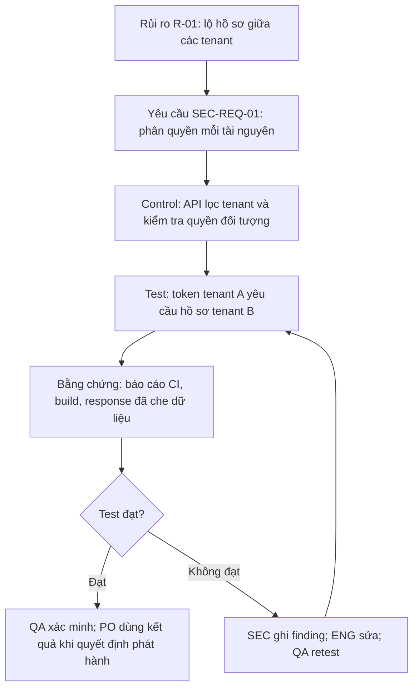

# Ma trận RACI trong Security Assurance: phân định vai trò và trách nhiệm

## 1. Vì sao Security Assurance cần ma trận RACI?

Một chương trình bảo mật có thể định nghĩa mục tiêu rõ ràng, có security controls, kiểm thử và báo cáo audit, nhưng vẫn thất bại nếu không ai chịu trách nhiệm cuối cùng khi phát hiện rủi ro. Chẳng hạn, nhóm kỹ thuật cho rằng bộ phận bảo mật sẽ phê duyệt việc đưa hệ thống lên production; bộ phận bảo mật cho rằng product owner phải chấp nhận phần rủi ro còn lại; đội kiểm thử đã báo lỗi nhưng không biết ai có quyền dừng phát hành.

**Ma trận RACI** là công cụ xác định ai **thực hiện**, ai **chịu trách nhiệm giải trình cuối cùng**, ai cần được **tham vấn** và ai cần được **thông báo** cho từng hoạt động hoặc quyết định. RACI giúp biến các lời hứa “security là trách nhiệm chung” thành trách nhiệm cụ thể, có người ra quyết định, bằng chứng hoàn thành và cơ chế chuyển cấp.

Trong chương **Vai trò và trách nhiệm** của module **SECURITY_SECURITY_ASSURANCE**, RACI phục vụ mục tiêu học tập xuyên suốt: **xây dựng cách đánh giá có bằng chứng rằng hệ thống đáp ứng mục tiêu bảo mật**, từ phân tích rủi ro, yêu cầu, thiết kế và vận hành security controls cho đến kiểm thử, audit và khắc phục phát hiện. Phân công RACI phải hỗ trợ vòng lặp security assurance liên tục trong phát triển và vận hành, thay vì chỉ là bảng tên đặt trong tài liệu dự án.

**Sau bài học, người học có thể:**

1. Phân biệt chính xác bốn ký hiệu R, A, C, I và nhận biết các cách dùng sai.
2. Thiết kế ma trận RACI cho chuỗi công việc security assurance, từ quản trị rủi ro đến kiểm thử, xử lý phát hiện và rà soát lãnh đạo.
3. Phân định người sở hữu rủi ro, người triển khai kiểm soát, người xác minh và người phê duyệt; tránh xung đột lợi ích.
4. Gắn trách nhiệm với tiêu chí chấp nhận và bằng chứng cụ thể để audit được.
5. Xử lý ngoại lệ, thay đổi tổ chức, thuê ngoài và tình huống rủi ro vượt thẩm quyền.

## 2. Hiểu đúng R, A, C, I

| Ký hiệu | Tên tiếng Anh | Ý nghĩa thực tế | Câu hỏi kiểm tra |
| --- | --- | --- | --- |
| **R** | **Responsible** | Cá nhân hoặc nhóm trực tiếp thực hiện công việc, tạo ra kết quả hoặc bằng chứng được giao. | Ai thực sự phân tích, thiết kế, triển khai, kiểm thử hoặc xử lý? |
| **A** | **Accountable** | Chủ thể chịu trách nhiệm giải trình cuối cùng về kết quả của **một hoạt động/quyết định**, có quyền xác nhận hoàn thành hoặc quyết định trong phạm vi được ủy quyền. | Ai phải trả lời nếu kết quả sai hoặc không hoàn thành? |
| **C** | **Consulted** | Bên có chuyên môn hoặc lợi ích liên quan được hỏi ý kiến **trước** khi quyết định hay thực hiện bước cần thiết; trao đổi hai chiều. | Ai phải góp ý trước khi chốt vì thông tin của họ có thể thay đổi quyết định? |
| **I** | **Informed** | Bên cần nhận thông tin phù hợp về tiến độ, thay đổi hoặc kết quả; trao đổi chủ yếu một chiều. | Ai cần biết kết quả để thực hiện trách nhiệm của họ? |

### 2.1. Phân biệt Responsible và Accountable

Ví dụ, kỹ sư sửa một lỗi phân quyền tại API (**R**), trong khi trưởng nhóm engineering chịu trách nhiệm bảo đảm giải pháp đã được triển khai và đáp ứng cam kết của nhóm (**A**). Security có thể được tham vấn về thiết kế (**C**); product owner được thông báo về tiến độ (**I**) nếu quyết định nghiệp vụ đã được xác định từ trước.

Ở một **hoạt động khác**, product owner có thể là **A** đối với việc quyết định chấp nhận phần rủi ro còn lại và cho phép phát hành trong thẩm quyền, còn trưởng nhóm engineering là **R** đối với việc chuẩn bị phương án và điều kiện phát hành. Việc trưởng nhóm engineering là A của hoạt động *triển khai* không tự trao cho họ quyền *chấp nhận rủi ro kinh doanh*.

Trong bài này dùng các quy tắc thiết kế RACI sau:

- **Mỗi hàng có đúng một A** để tránh mơ hồ về trách nhiệm cuối cùng; nếu hai bộ phận đều muốn là A, nên tách công việc thành hai quyết định có đầu ra rõ ràng.
- **Mỗi hàng có ít nhất một R** để chắc chắn có người thực hiện. Có thể có nhiều R khi công việc thật sự cần phối hợp.
- **A và R có thể ở cùng một vai trò** (ghi `A/R`) đối với hoạt động nhỏ; khi rủi ro cao, cần xét tách người thực hiện và người phê duyệt/xác minh.
- **A phải có thẩm quyền tương ứng** với quyết định và nguồn lực; không gán A chỉ vì người đó là người dễ liên hệ nhất.
- **C và I chỉ xuất hiện khi cần thiết**; tham vấn mọi người ở mọi bước có thể làm tắc quyết định mà không tăng bảo đảm.

Các nguyên tắc trên là quy ước thiết kế để ma trận dễ kiểm soát. Tổ chức có thể sử dụng biến thể khác, nhưng phải quy định rõ ý nghĩa, cách phê duyệt và đường chuyển cấp.

### 2.2. RACI không phải RBAC hay sơ đồ tổ chức

**RACI là ma trận trách nhiệm đối với quy trình và quyết định.** **RBAC (Role-Based Access Control)** là mô hình cấp quyền kỹ thuật trong ứng dụng hoặc hạ tầng.

Một kỹ sư được đánh dấu **R** cho việc kiểm tra cấu hình production không có nghĩa họ tự động có quyền đọc mọi dữ liệu khách hàng. Ngược lại, một người có quyền kỹ thuật trong IAM không đương nhiên là **A** cho rủi ro do hệ thống gây ra. Quyền thực cấp phải tuân thủ chính sách truy cập, nguyên tắc tối thiểu cần thiết và phân tách nhiệm vụ.

Tương tự, RACI ghi theo **vai trò/chức năng** để ổn định khi đổi nhân sự. Mỗi vai trò vẫn phải ánh xạ đến **người hoặc nhóm thực tế có thể liên hệ**, nhất là khi xử lý sự cố ngoài giờ.

## 3. Xác lập phạm vi và các vai trò trước khi lập bảng

Giả sử một doanh nghiệp vận hành **nền tảng SaaS quản lý hồ sơ nhân sự đa tenant**, có API, cơ sở dữ liệu, tệp xuất, hệ thống audit log và backup. Các yêu cầu cốt lõi gồm:

- **Tính bí mật:** người thuộc tenant A không được xem hồ sơ tenant B; trường lương chỉ hiện với người được phép.
- **Tính toàn vẹn:** thay đổi tài khoản nhận lương cần đúng quyền và quy trình phê duyệt.
- **Tính sẵn sàng:** các dịch vụ quan trọng cần mức khôi phục được phê duyệt từ nhu cầu kinh doanh.
- **Truy vết:** hoạt động thay đổi hoặc truy cập nhạy cảm phải có bằng chứng đủ tin cậy để điều tra, nhưng log không được tạo thêm đường lộ dữ liệu.

Trong bối cảnh này, ta dùng bảy **vai trò chức năng** (tên gọi của tổ chức thực tế có thể khác):

| Viết tắt | Vai trò | Thẩm quyền và phạm vi chính |
| --- | --- | --- |
| **LD** | Lãnh đạo có thẩm quyền / ban điều hành | Phê duyệt khẩu vị rủi ro, định hướng, nguồn lực và ngoại lệ được chuyển cấp vượt phạm vi sản phẩm. |
| **PO** | Product owner / business risk owner | Sở hữu mục tiêu nghiệp vụ, tác động đối với khách hàng và quyết định xử lý rủi ro thuộc phạm vi được giao. |
| **SEC** | Security lead / chức năng Security-GRC | Xác lập phương pháp, hỗ trợ đánh giá rủi ro, yêu cầu bảo mật, đối chiếu kiểm soát với bằng chứng và tổng hợp phát hiện. |
| **ENG** | Engineering lead và nhóm phát triển | Thiết kế, triển khai và duy trì các kiểm soát trong ứng dụng; chịu trách nhiệm kỹ thuật đối với thay đổi. |
| **QA** | Security testing / QA độc lập với việc viết thay đổi khi phù hợp | Thiết kế, chạy, kiểm tra lại các ca kiểm thử và lưu bằng chứng xác minh hành vi. |
| **OPS** | SRE/SOC/vận hành | Vận hành giám sát, hạ tầng, cấu hình runtime, sự cố, backup và diễn tập khôi phục. |
| **AUD** | Kiểm toán nội bộ hoặc chức năng đánh giá độc lập | Đánh giá theo phạm vi, tiêu chí, bằng chứng; đưa ra phát hiện và theo dõi khuyến nghị theo nhiệm vụ kiểm toán. |

**Lưu ý:** đây là các vai trò minh họa cho bài học, không phải một cơ cấu nhân sự bắt buộc. Trong tổ chức nhỏ, một người có thể giữ nhiều chức năng nhưng phải **bù đắp xung đột lợi ích bằng kiểm tra hoặc phê duyệt độc lập**. Ví dụ, người vừa viết code vừa tự xác nhận đóng một lỗi nghiêm trọng mà không có review khác là một điểm yếu assurance.

Trước khi gán RACI, cần xác định rõ **ranh giới quy trình**: rà soát yêu cầu, lập mô hình rủi ro, thiết kế kiểm soát, phát triển, kiểm thử, phê duyệt phát hành, giám sát vận hành, audit, khắc phục và rà soát quản trị. Ma trận chỉ hữu ích nếu các hàng nêu **hoạt động hoặc quyết định có đầu ra kiểm tra được**, thay vì những cụm quá rộng như “bảo mật hệ thống”.

## 4. Ma trận RACI mẫu cho vòng đời Security Assurance

Trong bảng này:

- `A/R` nghĩa là cùng một vai trò vừa chịu trách nhiệm cuối cùng vừa trực tiếp thực hiện; đó vẫn chỉ là **một A**.
- `—` nghĩa là không có phân công RACI bắt buộc trong hoạt động ấy; các thông báo khác có thể thực hiện qua quy trình chung.
- “Rủi ro thuộc thẩm quyền sản phẩm” và “ngoại lệ vượt thẩm quyền” được tách thành **hai hàng** để rõ cấp quyết định.

| Hoạt động / quyết định | LD | PO | SEC | ENG | QA | OPS | AUD |
| --- | :---: | :---: | :---: | :---: | :---: | :---: | :---: |
| **01. Phê duyệt khẩu vị rủi ro và giới hạn chấp nhận** | **A** | C | **R** | I | I | C | I |
| **02. Kiểm kê tài sản, phân loại dữ liệu** | I | **A** | C | **R** | I | R | I |
| **03. Threat modeling, đánh giá kịch bản rủi ro** | I | **A** | **R** | R | C | C | I |
| **04. Phê duyệt yêu cầu bảo mật có thể kiểm thử** | I | **A** | **R** | C | C | C | I |
| **05. Thiết kế security controls và ánh xạ yêu cầu** | I | C | **R** | **A** | C | R | I |
| **06. Triển khai kiểm soát ứng dụng và hạ tầng** | I | I | C | **A/R** | C | R | I |
| **07. Thiết kế/chạy kiểm thử bảo mật theo yêu cầu** | I | I | C | R | **A/R** | C | I |
| **08. Đối chiếu bằng chứng, ghi nhận finding** | I | C | **A** | C | **R** | R | I |
| **09. Quyết định phương án xử lý rủi ro thuộc thẩm quyền sản phẩm** | C | **A** | **R** | R | C | C | I |
| **10. Khắc phục lỗi kiểm soát đã phát hiện** | I | I | C | **A/R** | C | R | I |
| **11. Retest và xác minh kỹ thuật việc khắc phục** | I | I | C | R | **A/R** | C | I |
| **12. Quyết định phát hành trong phạm vi thẩm quyền** | I | **A** | C | **R** | C | C | I |
| **13. Giám sát kiểm soát và phản ứng vận hành thường ngày** | I | I | C | R | I | **A/R** | I |
| **14. Thực hiện cuộc kiểm toán độc lập theo kế hoạch** | I | C | C | C | C | C | **A/R** |
| **15. Rà soát quản trị, điều chỉnh ưu tiên/nguồn lực** | **A** | **R** | **R** | C | C | C | C |
| **16. Quyết định ngoại lệ vượt thẩm quyền sản phẩm** | **A** | **R** | **R** | C | C | C | I |

### 4.1. Cách đọc một số hàng quan trọng

**Hàng 03 – Threat modeling và đánh giá rủi ro:** PO là A vì chịu trách nhiệm về tác động kinh doanh của phạm vi sản phẩm; SEC và ENG là R vì cùng xây dựng kịch bản, kiểm tra đường dữ liệu, điểm yếu và các kiểm soát hiện có. QA và OPS góp ý các trường hợp có thể kiểm thử và các nguy cơ vận hành. Việc chấm điểm và chủ sở hữu rủi ro cụ thể phải được ghi trong **risk register**, không chỉ suy từ bảng RACI.

**Hàng 05 và 06 – Thiết kế, triển khai controls:** ENG là A cho đầu ra kỹ thuật; SEC đưa ra hoặc kiểm tra yêu cầu bảo mật, OPS tham gia các thành phần hạ tầng/runtime. Sự phân công này không khiến ENG trở thành người có quyền chấp nhận rủi ro kinh doanh còn lại.

**Hàng 07 và 11 – Kiểm thử và retest:** QA là A/R của chất lượng và kết quả hoạt động kiểm thử; ENG cung cấp bản sửa, dữ liệu kỹ thuật và phối hợp tái hiện. **QA xác minh hành vi** không đồng nghĩa với **PO chấp nhận rủi ro** hoặc **LD phê duyệt ngoại lệ**.

**Hàng 08 – Ghi nhận phát hiện:** SEC là A đối với chất lượng hồ sơ finding và trạng thái đánh giá assurance; QA/OPS cung cấp bằng chứng hoặc thực hiện xác minh. Không được đóng finding chỉ vì một người đã chuyển ticket sang “Done”.

**Hàng 12 – Phát hành:** PO quyết định dựa trên bằng chứng, mức rủi ro và thẩm quyền; ENG chuẩn bị bản phát hành và phương án triển khai. Nếu phát hiện vi phạm một nghĩa vụ bắt buộc hoặc rủi ro vượt ngưỡng, **phải kích hoạt quy trình chuyển cấp**, không coi chữ A của PO là quyền bỏ qua mọi giới hạn.

**Hàng 14 – Kiểm toán:** AUD là A/R đối với việc thực hiện cuộc audit và phát hành kết luận kiểm toán, với sự độc lập cần thiết đối với các kiểm soát được đánh giá. Đó **không phải** là việc chuyển trách nhiệm vận hành hoặc sở hữu rủi ro của tổ chức sang auditor.

### 4.2. Không có ma trận RACI “chuẩn” dùng nguyên xi cho mọi công ty

Mẫu trên là **đề xuất học tập**. Một tổ chức có thể đặt A của thiết kế kiểm soát tại security architecture, hoặc A của kiểm thử tại một test lead độc lập; nhóm sản phẩm khác có thể tách data owner và risk owner. Điều bắt buộc về mặt quản trị là **định nghĩa rõ thẩm quyền và cơ chế giải trình**, không phải giữ nguyên ký hiệu từ ví dụ.

Nếu một hàng chứa hai A do hai cấp quản trị khác nhau, hãy tách các quyết định. Ví dụ “phê duyệt triển khai” và “chấp nhận ngoại lệ vượt ngưỡng” cần hai tiêu chí và hai người ra quyết định phù hợp. Nếu một tổ chức quy định các cấp đồng phê duyệt, phải diễn tả quy tắc đó **ngoài** RACI bằng cơ chế phê duyệt rõ ràng, tránh đánh đồng hai vai trò A trong cùng một hàng.

## 5. Nối RACI với bằng chứng Security Assurance

RACI xác định **ai** chịu trách nhiệm; assurance còn cần biết **đã chứng minh điều gì, bằng cách nào và trên bản triển khai nào**. Mỗi hoạt động chính nên có một “hợp đồng đầu ra” bao gồm tiêu chí chấp nhận và chứng cứ:

| Hoạt động | Đầu ra tối thiểu | Bằng chứng/tiêu chí hoàn tất | Người đưa ra kết luận theo RACI |
| --- | --- | --- | --- |
| Kiểm kê và phân loại | Danh sách tài sản, chủ sở hữu, mức nhạy cảm và luồng dữ liệu | Kiểm kê có thời điểm/phiên bản; các tài sản trọng yếu được đối chiếu với hệ thống thực | PO (A), ENG/OPS (R) |
| Đánh giá rủi ro | Risk register: tài sản, kịch bản, tác động, khả năng, kiểm soát hiện có | Ghi giả định, mức tin cậy, bằng chứng và người sở hữu từng rủi ro | PO (A), SEC/ENG (R) |
| Yêu cầu bảo mật | Danh sách yêu cầu đo được, liên kết rủi ro | Có tiêu chí pass/fail, API/luồng dữ liệu áp dụng, người phê duyệt | PO (A), SEC (R) |
| Thiết kế/triển khai controls | Thiết kế, policy, code, cấu hình, thay đổi được review | Liên kết yêu cầu đến commit/IaC và môi trường; review quyền tối thiểu | ENG (A), ENG/OPS (R) |
| Kiểm thử | Test case, dữ liệu thử, kết quả pass/fail | Báo cáo theo build, thời gian, môi trường; ca âm về truy cập sai vai trò/tenant | QA (A/R) |
| Đánh giá finding | Finding ID, mức độ, ảnh hưởng, hướng xử lý | Bằng chứng tái hiện an toàn; liên kết rủi ro/yêu cầu/control | SEC (A), QA/OPS (R) |
| Khắc phục và retest | Bản sửa và kết quả xác minh | Test tái hiện lỗi ban đầu không còn thất bại, kiểm tra regression và nơi triển khai | ENG (A của fix), QA (A của retest) |
| Quyết định phát hành/rủi ro | Biên bản/record phê duyệt, ngoại lệ nếu có | Kết quả test, finding mở, rủi ro còn lại, thẩm quyền và điều kiện quyết định | PO hoặc LD theo cấp quyết định (A) |
| Audit/rà soát quản trị | Audit report, biên bản quyết định, action | Tiêu chí đánh giá, evidence ref, người phê duyệt, người thực hiện, hạn và xác minh đóng | AUD hoặc LD tương ứng (A) |

### 5.1. Một chuỗi truy vết cụ thể

Xét yêu cầu “Người dùng tenant A không được xem hồ sơ tenant B”:



Ở mỗi điểm, RACI trả lời câu hỏi khác nhau: **SEC** chuẩn bị yêu cầu và đối chiếu chứng cứ, **ENG** triển khai kiểm soát, **QA** thực hiện và xác minh ca kiểm thử, **PO** quyết định trong thẩm quyền sau khi xem phần rủi ro còn lại. Nếu thiếu quyền quyết định ở bước cuối, chuỗi bằng chứng chưa tạo thành một kết luận quản trị có trách nhiệm.

### 5.2. Metadata nên có trong hồ sơ bằng chứng

- **Yêu cầu và rủi ro liên quan:** `requirement_id`, `risk_id`, `control_id`.
- **Người thực hiện và trách nhiệm:** vai trò R/A được ánh xạ đến người/nhóm thật ở thời điểm thực hiện.
- **Ngữ cảnh kiểm tra:** commit/build, môi trường, cấu hình, tenant thử nghiệm, thời điểm.
- **Đầu ra:** kết quả mong đợi, kết quả thực tế, phạm vi chưa bao phủ, finding nếu có.
- **Phê duyệt/xác minh:** vai trò có thẩm quyền, thời gian, quyết định và bằng chứng đóng.
- **Tính an toàn:** không đưa token thật, mật khẩu, khóa hoặc dữ liệu cá nhân đầy đủ vào report, ticket hay log.

Ví dụ mẫu record để gắn trách nhiệm với một hoạt động, **không phải cấu hình IAM cấp quyền cho hệ thống**:

```yaml
activity_id: SEC-ACT-TEST-017
title: "Kiểm thử phân quyền API xuất hồ sơ"
scope: "API /exports của SaaS đa tenant"
requirement_refs:
  - SEC-REQ-01
risk_refs:
  - R-01
raci:
  accountable_role: QA
  responsible_roles:
    - QA
    - ENG
  consulted_roles:
    - SEC
    - OPS
  informed_roles:
    - PO
acceptance_criteria:
  - "Token tenant A không đọc được dữ liệu tenant B"
  - "Phản hồi và log không tiết lộ nội dung thuộc tenant khác"
evidence_required:
  - "Test report gắn build, môi trường, thời gian"
  - "Kết quả test âm và trường hợp người dùng hợp lệ"
status: "Pending verification"
```

Record trên giúp hệ thống ticket hoặc test management truy nguyên trách nhiệm. Khi triển khai thật cần lưu **người được chỉ định**, hạn và tham chiếu bằng chứng trong hệ thống có phân quyền; chỉ định tên vai trò mà không có đầu mối thực tế sẽ khiến quá trình chuyển giao dễ bị tắc.

## 6. Tình huống thực tế: lỗi BOLA trong endpoint xuất dữ liệu

Một bản phát hành mới cho phép HR tải danh sách hồ sơ nhân sự dưới dạng CSV. QA dùng token của tenant A và yêu cầu endpoint xuất dữ liệu tenant B bằng cách thay ID. Server trả về dữ liệu của tenant B. Đây là tình huống **Broken Object-Level Authorization (BOLA)**: dữ liệu bị tiết lộ do kiểm tra quyền trên tài nguyên không đầy đủ.

### 6.1. Phân công theo từng quyết định

| Bước và kết quả cần đạt | R | A | C | I |
| --- | --- | --- | --- | --- |
| **1. Ghi nhận finding** với dữ liệu giả định và bằng chứng tái hiện | QA | SEC | ENG, OPS | PO |
| **2. Đánh giá tác động, mức rủi ro và phạm vi ảnh hưởng** | SEC, ENG | PO | OPS, QA | LD khi vượt ngưỡng |
| **3. Quyết định tạm giới hạn tính năng xuất** trong phạm vi sản phẩm | ENG, OPS | PO | SEC, QA | LD khi cần |
| **4. Sửa kiểm tra tenant/authorization ở backend** | ENG, OPS | Engineering lead (ENG) | SEC, QA | PO |
| **5. Retest với nhiều tenant, vai trò và đường xuất khác** | QA, ENG | QA lead (QA) | SEC, OPS | PO |
| **6. Đánh giá điều kiện phát hành** sau retest và xử lý phần rủi ro còn lại | ENG | PO | SEC, QA, OPS | LD |
| **7. Phê duyệt ngoại lệ nếu mức rủi ro vượt thẩm quyền PO** | PO, SEC | LD | ENG, QA, OPS | Các bên liên quan theo chính sách |

Trong bảng tình huống, các tên “Engineering lead” và “QA lead” chỉ làm rõ người đóng vai **A** trong nhóm ENG/QA; khi dùng thật cần ghi người nắm quyền cụ thể. Bước 7 **không cho phép** hợp thức hóa việc không tuân thủ nghĩa vụ bắt buộc; nếu không có thẩm quyền hoặc chưa đủ điều kiện, phải chuyển cấp/giới hạn hoặc dừng hoạt động liên quan.

### 6.2. Trình tự làm việc có thể kiểm chứng

1. **QA tái hiện an toàn:** dùng hai tenant thử nghiệm, ghi request/response đã che dữ liệu, thời điểm và build; không đưa hồ sơ khách hàng thật vào ticket.
2. **SEC chuẩn hóa finding:** liên kết với yêu cầu phân quyền, mức độ, đường bị ảnh hưởng; kiểm tra xem còn đường đọc tương tự hay không.
3. **PO cùng SEC, ENG đánh giá nguy cơ:** xác định số tenant có thể bị ảnh hưởng, khả năng khai thác, phạm vi quyền và có dấu hiệu truy cập trái phép thực tế không. Nếu có dấu hiệu sự cố, kích hoạt quy trình ứng phó riêng ngay.
4. **PO quyết định giảm phơi nhiễm:** có thể tạm tắt export, hạn chế phạm vi bằng tính năng quản lý hoặc kiểm soát khác đã được xác minh; lập hạn xử lý.
5. **ENG sửa nguyên nhân gốc:** lấy tenant và quyền từ ngữ cảnh danh tính đã xác minh; kiểm tra đối tượng trên backend cho mọi đường đọc và xuất.
6. **QA xác minh:** test sai tenant, thiếu quyền, dữ liệu theo trường, kết quả trả lỗi, API danh sách, tệp và regression; giữ bằng chứng theo build triển khai.
7. **SEC cập nhật kết luận assurance:** đối chiếu kết quả test với yêu cầu, ghi rủi ro còn lại; **PO** quyết định phát hành trong thẩm quyền và **LD** xử lý nếu cần chuyển cấp.

Nếu các vai trò không được xác định trước, nhóm QA có thể tưởng rằng việc ghi ticket đã hoàn tất trách nhiệm; ENG có thể sửa nhưng bỏ sót endpoint khác; PO có thể không biết tính năng đang làm lộ dữ liệu. RACI phải giúp từng bước có người chủ trì, hành động và điều kiện hoàn tất.

### 6.3. Quyền ra quyết định và sự độc lập

Một số ranh giới quan trọng:

- **ENG xác nhận việc triển khai** nhưng không tự chấp nhận phần rủi ro kinh doanh còn lại nếu không được ủy quyền.
- **QA xác minh việc sửa** dựa trên test, không thay PO ra quyết định về phát hành hay ngoại lệ.
- **SEC phản biện mức rủi ro và tính phù hợp của bằng chứng**, có thể yêu cầu chuyển cấp theo chính sách; chức năng tư vấn không tự động trở thành chủ sở hữu mọi rủi ro.
- **AUD đưa ra kết luận kiểm toán độc lập** theo nhiệm vụ, không kiêm tác giả và người tự kiểm toán kiểm soát mà họ xây dựng.
- **LD đưa ra quyết định vượt thẩm quyền sản phẩm**; quy trình khẩn phải xác định người thay thế/ủy quyền khi LD vắng mặt để tránh bỏ mặc rủi ro.

## 7. Tự xây dựng ma trận RACI cho một hệ thống

### Bước 1: Chọn quy trình và kết quả đầu ra

Xác định các giai đoạn có thể truy vết, ví dụ: phân loại dữ liệu, threat model, yêu cầu bảo mật, thiết kế control, review code/IaC, test, phê duyệt, vận hành, audit, xử lý finding, diễn tập phục hồi và rà soát quản trị. Viết mỗi hàng ở mức **một việc/đơn vị quyết định có đầu ra**.

Thay vì ghi “Quản lý security” (quá rộng), ghi “phê duyệt yêu cầu C-01 cho API xuất dữ liệu”, “chạy test truy cập chéo tenant trước phát hành” hoặc “quyết định chấp nhận rủi ro còn lại của finding F-07”.

### Bước 2: Xác lập người có thẩm quyền làm A

Đối chiếu quy chế, mục tiêu nghiệp vụ, trách nhiệm rủi ro và quyền quyết định. Nếu A không có đủ thẩm quyền cấp nguồn lực, chấp nhận rủi ro hoặc phê duyệt phát hành, cần thay A hoặc ghi rõ đường chuyển cấp. Không dùng RACI để tự tạo quyền ngoài chính sách hiện hành.

### Bước 3: Gán R có đủ năng lực thực hiện

Kiểm tra người/nhóm R có kỹ năng, công cụ, quyền truy cập phù hợp và năng lực thực thi trong thời hạn hay không. Một vai trò được gán R nhưng không có đường lấy dữ liệu kiểm thử hoặc quyền mở môi trường cần thiết có thể dẫn tới công việc “có người nhận nhưng không làm được”.

### Bước 4: Chỉ định C và I theo nhu cầu thật

Xác định ai cần cung cấp chuyên môn **trước** quyết định (C) và ai cần biết kết quả **sau** quyết định (I). Với quyết định phát hành, SEC và QA thường là C vì có thể thay đổi nhận định rủi ro; nhóm vận hành có thể vừa C trước khi triển khai vừa R của công tác rollout. Đừng đánh dấu toàn bộ tổ chức là C.

### Bước 5: Kiểm tra tách nhiệm vụ và các điểm giao nhau

Rà soát những nơi người triển khai, người chấp nhận rủi ro và người kiểm chứng là một người. Khi không đủ nhân lực để tách vai trò, bổ sung review, bằng chứng kiểm tra có thể tái lập, phê duyệt của cấp khác hoặc đánh giá độc lập đối với phần rủi ro trọng yếu.

### Bước 6: Đối chiếu ma trận với quy trình thực tế

Thực hiện một buổi mô phỏng: “Phát hiện lỗ hổng nghiêm trọng trước giờ phát hành thì ai ghi nhận, ai dừng/giới hạn chức năng, ai sửa, ai xác minh, ai phê duyệt?” Nếu phải hỏi ngoài bảng để xác định người quyết định chính, cần điều chỉnh hàng RACI hoặc quy trình chuyển cấp.

### Bước 7: Phê duyệt, phổ biến và duy trì

Người có thẩm quyền phê duyệt phiên bản RACI; liên kết nó đến hệ thống quản lý công việc, playbook sự cố, kế hoạch test, lịch audit và sổ quyết định. Phải có **ngày hiệu lực, owner của ma trận, lịch rà soát và lịch sử thay đổi**. Cập nhật khi thay cơ cấu, thuê nhà cung cấp, thêm hệ thống, đổi mức rủi ro hoặc khi một sự cố cho thấy lỗ hổng trách nhiệm.

## 8. Kết hợp RACI với hoạt động phát triển và vận hành liên tục

### 8.1. Ở giai đoạn yêu cầu và thiết kế

PO xác định tác động nghiệp vụ và chịu trách nhiệm về mục tiêu; SEC chuyển rủi ro thành yêu cầu có thể kiểm thử; ENG chọn kiến trúc và kiểm soát; QA góp ý cách đo hành vi; OPS phản biện khả năng vận hành. Đầu ra cần lưu **risk ID → requirement ID → control ID** và người duyệt, để mọi thay đổi sau này không làm đứt mối liên kết.

### 8.2. Trong pull request và pipeline

RACI cho một thay đổi bảo mật có thể được hiện thực bằng các cổng quy trình:

- Kỹ sư **R** tạo commit và mô tả yêu cầu bảo mật đã xử lý.
- Engineering lead hoặc người review có thẩm quyền theo quy trình là **A** của chất lượng triển khai.
- QA/Security testing **A/R** của xác minh theo test plan, có thể tham vấn SEC đối với kịch bản mới.
- PO **A** của quyết định phát hành trong thẩm quyền, dựa trên bằng chứng test và danh sách rủi ro còn lại.

CI/CD có thể cung cấp báo cáo và cảnh báo tự động, nhưng một “check màu xanh” chưa thay người có thẩm quyền chấp nhận rủi ro trong trường hợp ngoại lệ. Tương tự, người review code không mặc nhiên chịu toàn bộ trách nhiệm phát hành của product owner.

### 8.3. Khi trực vận hành và ứng phó sự cố

Với sự cố bảo mật đang diễn ra, phải xác định **incident commander** hoặc vai trò chỉ huy theo quy trình ứng phó, người thực hiện cô lập/khắc phục và người ra quyết định kinh doanh cần thiết. Ma trận RACI tổng quát có thể dẫn chiếu sang **playbook sự cố**; playbook nên quy định người thay thế ngoài giờ, cách gọi chuyển cấp, khả năng dừng hệ thống/thu hồi khóa và cách lưu chứng cứ.

RACI ở giai đoạn bình thường không được làm chậm hành động khẩn cấp. Nếu quy trình đã ủy quyền cho đội trực hạn chế một thành phần nhằm ngăn sự cố lan rộng, quyền đó phải được ghi và dùng ngay theo điều kiện đã duyệt, đồng thời thông báo cho chủ sở hữu rủi ro.

### 8.4. Với nhà cung cấp bên ngoài

Hợp đồng dịch vụ không làm toàn bộ trách nhiệm an toàn chuyển sang nhà cung cấp. Ví dụ:

| Công việc | Chủ sở hữu dịch vụ | Nhà cung cấp | Security/GRC |
| --- | :---: | :---: | :---: |
| Xác định yêu cầu bảo mật dữ liệu gửi sang nhà cung cấp | **A** | C | **R** |
| Triển khai kiểm soát đã cam kết tại dịch vụ của nhà cung cấp | **A** về bảo đảm đáp ứng hợp đồng | **R** | C |
| Thu thập/đánh giá bằng chứng nhà cung cấp đáp ứng yêu cầu | **A** | **R** cung cấp evidence | **R** đánh giá |
| Quyết định xử lý rủi ro còn lại trong phạm vi đã được ủy quyền | **A** | C | **R** |

Bảng này mô tả **trách nhiệm phía tổ chức khách hàng đối với bảo đảm và hợp đồng**. Nhà cung cấp vẫn phải chịu trách nhiệm đối với hoạt động hoặc nghĩa vụ do hợp đồng quy định; không nên dùng ký hiệu RACI để thay thế điều khoản trách nhiệm pháp lý. Khi cần mô tả trách nhiệm nội bộ riêng của nhà cung cấp, lập ma trận tương ứng theo phạm vi của họ.

## 9. Kiểm tra chất lượng và những lỗi RACI thường gặp

### 9.1. Các câu hỏi kiểm tra nhanh

| Kiểm tra | Dấu hiệu ma trận tốt | Dấu hiệu cần sửa |
| --- | --- | --- |
| **Số người A** | Mỗi hàng có đúng một A đủ thẩm quyền. | Không có A hoặc nhiều A không giải thích được ai chốt. |
| **Người R** | Có ít nhất một R với năng lực và đầu ra rõ ràng. | Chỉ có A và các bên I; công việc không ai thực hiện. |
| **Độ lớn hoạt động** | Mỗi hàng có tiêu chí hoàn tất/đầu ra. | Hàng “security” hoặc “vận hành” chung chung. |
| **Ranh giới phê duyệt** | Phân biệt kỹ thuật, xác minh, release và risk acceptance. | Người sửa lỗi tự ý chấp nhận rủi ro hoặc phát hành ngoài thẩm quyền. |
| **Tham vấn/thông báo** | C/I có lý do và thời điểm giao tiếp cụ thể. | Mọi vai trò đều C, hoặc bên chịu tác động không được biết. |
| **Độc lập và phân tách nhiệm vụ** | Người kiểm chứng đủ độc lập với công việc tạo ra kết quả khi cần. | Người triển khai tự tuyên bố hoàn tất một rủi ro lớn, không có test. |
| **Tính khả thi** | Vai trò có người phụ trách, người thay thế, quyền và nguồn lực. | Tên chức năng không có đầu mối thực tế hoặc thiếu quyền. |
| **Bằng chứng** | Có yêu cầu, kiểm soát, test, bằng chứng và người xác minh. | Chỉ ghi tên vai trò nhưng không biết đã đáp ứng mục tiêu chưa. |
| **Thay đổi và chuyển cấp** | Có phiên bản, người duyệt, trigger rà soát và escalation. | RACI trở nên lỗi thời ngay khi đội nhóm hoặc hệ thống đổi. |

### 9.2. Tình huống thiếu A

Ví dụ bảng phân công công việc “Retest lỗi phân quyền: ENG=R, QA=R, SEC=C, PO=I” thiếu **A**. Nếu test không chạy hoặc không đáng tin cậy, các bên có thể đổ trách nhiệm qua lại. Cần chọn QA lead làm A của **hoạt động xác minh**, ghi tiêu chí test đạt và rõ người phê duyệt quyết định phát hành ở hoạt động riêng.

### 9.3. Tình huống nhiều A

Ví dụ “Đóng finding và cho phép release: SEC=A, ENG=A, PO=A”. Đây là ba quyết định bị trộn:

1. **ENG** là A đối với chất lượng và triển khai bản sửa.
2. **QA hoặc vai trò xác minh đã được chỉ định** là A đối với retest và evidence kỹ thuật.
3. **PO hoặc cấp có thẩm quyền cao hơn** là A đối với quyết định release/risk acceptance.

SEC có thể là A đối với việc quản lý finding và kết luận kiểm soát đã đủ bằng chứng theo quy trình GRC. Tách hàng theo **đầu ra và quyền quyết định** giúp tránh “ai cũng phê duyệt” nhưng không ai thực sự chịu trách nhiệm cuối cùng.

### 9.4. Tình huống A không có quyền

Một QA lead được gán A cho “chấp nhận rủi ro lộ dữ liệu khách hàng”. Dù QA hiểu kết quả test, họ có thể không có thẩm quyền chấp nhận tác động kinh doanh, hợp đồng hay pháp lý. Cần chuyển A về chủ sở hữu rủi ro được ủy quyền và xác định cấp phê duyệt khi vượt ngưỡng; QA giữ A cho chất lượng hoạt động kiểm thử và C cho quyết định dựa trên test.

### 9.5. Tình huống RACI chỉ tồn tại trên giấy

Một ma trận lưu trên wiki nhưng ticket không có owner, pipeline không có người xác minh, và không ai chịu trách nhiệm xem các phát hiện quá hạn. Khắc phục bằng cách gắn hoạt động RACI với workflow thực tế: trường `owner`/`approver`/`verifier` trong ticket, điều kiện trước phát hành, lịch rà soát rủi ro và đường chuyển cấp.

## 10. Đánh giá hiệu quả sử dụng RACI

Đừng chỉ đo “tỷ lệ hàng đã điền đủ bốn ký hiệu”. Chất lượng phân công cần được chứng minh bằng kết quả vận hành:

| Chỉ số gợi ý | Phép đo minh họa | Cách hiểu và giới hạn |
| --- | --- | --- |
| **Hồ sơ finding có chủ sở hữu** | Finding mở có owner R và A hợp lệ / tổng finding mở | Không đo được chất lượng sửa; cần đối chiếu tình trạng quá hạn và kết quả retest. |
| **Quyết định rủi ro đúng thẩm quyền** | Quyết định được phê duyệt đúng cấp / số quyết định thuộc phạm vi kiểm tra | Cần đánh giá cả quyết định bị thiếu hoặc không được ghi. |
| **Action khắc phục xác minh đóng** | Action đến hạn có evidence retest được chấp thuận / action đến hạn | Không tính “đã merge” như đủ bằng chứng. |
| **Thời gian chuyển cấp** | Thời gian từ khi rủi ro vượt ngưỡng đến lúc người có thẩm quyền nhận và quyết định | Không nên tối ưu tốc độ bằng cách bỏ bước đánh giá cần thiết. |
| **Trách nhiệm khi thay đổi** | Các thay đổi tổ chức/hệ thống trọng yếu đã cập nhật RACI / tổng thay đổi thuộc phạm vi | Kiểm tra các thay đổi có thật trong hệ thống thay vì chỉ đếm thông báo. |
| **Phát hiện lặp do giao diện trách nhiệm** | Số vấn đề tái diễn có nguyên nhân “không rõ owner/đầu mối” | Cần phân tích nguyên nhân gốc; không thể kết luận chỉ từ số ticket. |

Mỗi chỉ số cần ghi **mẫu số, nguồn dữ liệu, kỳ đánh giá, chủ sở hữu và giới hạn**. Nếu tỷ lệ đóng finding tăng vì đổi trạng thái ticket mà không có retest, đó là sự cải thiện số liệu bề ngoài chứ không phải cải thiện security assurance.

## 11. Bài tập thực hành: lập RACI cho một nền tảng thanh toán

Một nền tảng xử lý thanh toán đang triển khai tính năng thay đổi tài khoản thụ hưởng. Các đội tham gia gồm lãnh đạo phụ trách rủi ro, product owner, security, backend, QA, SRE và kiểm toán nội bộ. Hệ thống có yêu cầu: người không được phép không thể sửa tài khoản nhận tiền, mọi thay đổi cần lưu audit, và quyết định phát hành phải xét các phát hiện bảo mật còn mở.

Đội thử nghiệm phát hiện ba vấn đề:

- Một vai trò hỗ trợ khách hàng có thể gọi API thay đổi tài khoản dù không được cấp quyền.
- Tác vụ cập nhật có audit log nhưng không ghi danh tính chủ thể thực hiện.
- Kịch bản khôi phục sau sự cố cơ sở dữ liệu mới được thiết kế, chưa thử nghiệm.

**Hãy thực hiện:**

1. Lập danh sách các hoạt động từ xác lập yêu cầu, threat modeling, triển khai, test, release, vận hành đến audit. Mỗi hoạt động phải có đầu ra kiểm tra được.
2. Lập ma trận RACI với ít nhất bảy vai trò và mười hoạt động; mỗi hàng có đúng một A và ít nhất một R. Giải thích nếu một vai trò kiêm A/R.
3. Chọn ai là **A của việc sửa API**, **A của retest**, **A của quyết định phát hành**, **A của quyết định chấp nhận rủi ro vượt ngưỡng**, và vì sao các hoạt động đó cần tách.
4. Viết ba bản ghi công việc gắn `risk_id`, `requirement_id`, vai trò R/A, điều kiện hoàn tất, bằng chứng phải lưu và người xác minh.
5. Mô phỏng ngày trước release: QA báo test chưa đạt, ENG muốn phát hành, PO muốn giữ cam kết thời gian. Áp dụng ma trận để nêu ai được quyết định, các ngưỡng chuyển cấp và biện pháp giảm rủi ro.
6. Giả định chức năng log được giao cho nhà cung cấp: xác định việc nào nhà cung cấp chịu R và trách nhiệm bảo đảm nào vẫn thuộc tổ chức.
7. Xác định các sự kiện cần cập nhật ma trận sau phát hành, chẳng hạn thay trưởng nhóm, thêm dịch vụ hoặc thay đổi quy trình cấp quyền.

**Tiêu chí tự đánh giá:** người không tham gia dự án vẫn xác định được ai thực hiện, ai chịu trách nhiệm cuối cùng, ai cần tham vấn và thông báo cho mỗi hoạt động; khi có lỗi, có người ra quyết định đúng thẩm quyền, bằng chứng retest và đường chuyển cấp cụ thể. RACI phải giúp hoàn thành mục tiêu bảo mật thực tế, chứ không chỉ đủ ô trong bảng.

## 12. Câu hỏi tự kiểm tra

**1. Một hàng RACI có thể có hai người Responsible không?**  
Có. Nhiều R có thể cùng tạo ra đầu ra, nhưng cần phân rõ phần việc để không bỏ sót. Nên có đúng một A theo quy tắc thiết kế trong bài để chịu trách nhiệm cuối cùng cho kết quả.

**2. Có thể ghi cùng một người A/R không?**  
Có khi người đó vừa thực hiện vừa có quyền giải trình cuối cùng. Với công việc nhạy cảm, cần cân nhắc phân tách nhiệm vụ hoặc có xác minh độc lập.

**3. Nếu QA là A cho việc chạy test, QA có được quyền chấp nhận mọi rủi ro và cho phép phát hành không?**  
Không. A của hoạt động kiểm thử chỉ áp dụng cho chất lượng/đầu ra của kiểm thử. Chấp nhận rủi ro và quyết định phát hành là những hoạt động khác, phải thuộc người được ủy quyền.

**4. RACI đã ghi OPS=R cho việc khôi phục; điều đó có đủ chứng minh hệ thống có khả năng khôi phục không?**  
Không. Cần mục tiêu khôi phục đã được phê duyệt và bằng chứng diễn tập trong điều kiện phù hợp. RACI cho biết ai thực hiện và giải trình việc kiểm tra.

**5. Có thể dùng RACI thay cho các quyền IAM/RBAC không?**  
Không. RACI quy định trách nhiệm quy trình, IAM/RBAC thực thi quyền truy cập kỹ thuật. Cần bảo đảm hai cơ chế nhất quán nhưng không đồng nhất.

**6. Nếu nhà cung cấp làm hầu hết công việc kỹ thuật, tổ chức có hết trách nhiệm quản trị bảo mật không?**  
Không. Trách nhiệm hợp đồng của nhà cung cấp phải được quy định riêng; tổ chức vẫn cần chỉ rõ người chịu trách nhiệm đánh giá sự phù hợp, bằng chứng và rủi ro trong phạm vi của mình.

**7. Khi nào phải cập nhật RACI?**  
Khi đổi cấu trúc tổ chức, phân cấp quyền, hệ thống, nhà cung cấp, luồng xử lý, mức rủi ro, hoặc khi sự cố/audit cho thấy trách nhiệm không rõ. Cần lưu phiên bản và truyền đạt thay đổi đến các bên liên quan.

## 13. Ghi nhớ

**Ma trận RACI biến vai trò và trách nhiệm thành cơ chế giải trình cụ thể:** R thực hiện, A chịu trách nhiệm cuối cùng cho hoạt động/quyết định, C được tham vấn trước khi cần và I được thông báo. Một RACI tốt phải phản ánh đúng thẩm quyền, bảo đảm mỗi đầu ra có người thực hiện và người chịu trách nhiệm, đồng thời tách các quyết định kỹ thuật, kiểm chứng và chấp nhận rủi ro.

Trong **SECURITY_SECURITY_ASSURANCE**, giá trị của RACI được chứng minh khi mỗi rủi ro và yêu cầu đều có người sở hữu, mỗi control có người triển khai, mỗi test/audit có người kiểm chứng, mỗi finding có người khắc phục và mỗi quyết định về rủi ro còn lại có người chịu trách nhiệm đúng cấp. Kết nối RACI với **bằng chứng, điều kiện hoàn tất, quy trình chuyển cấp và hoạt động rà soát liên tục** mới giúp tổ chức đánh giá được liệu hệ thống thực sự đáp ứng mục tiêu bảo mật hay chưa.
