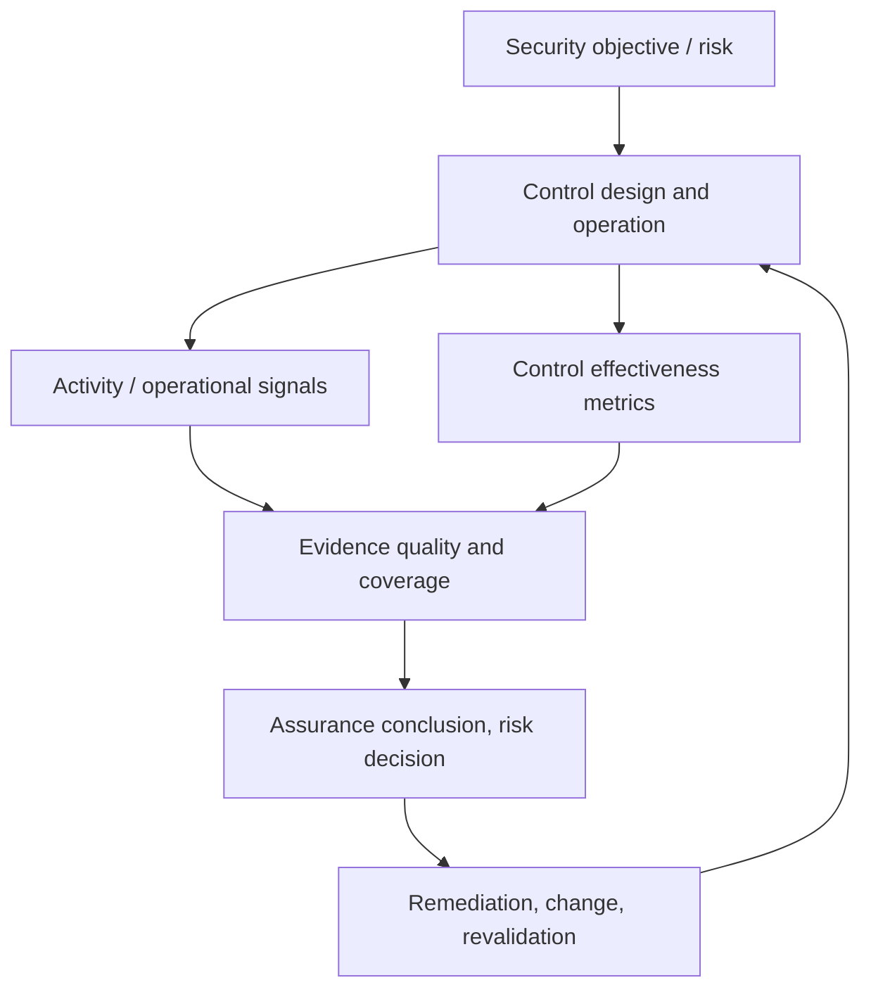
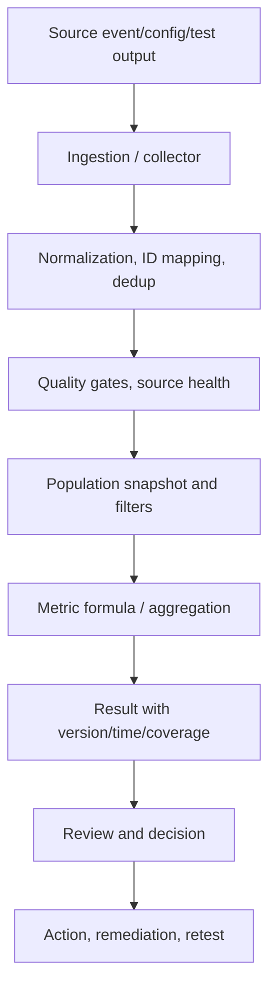
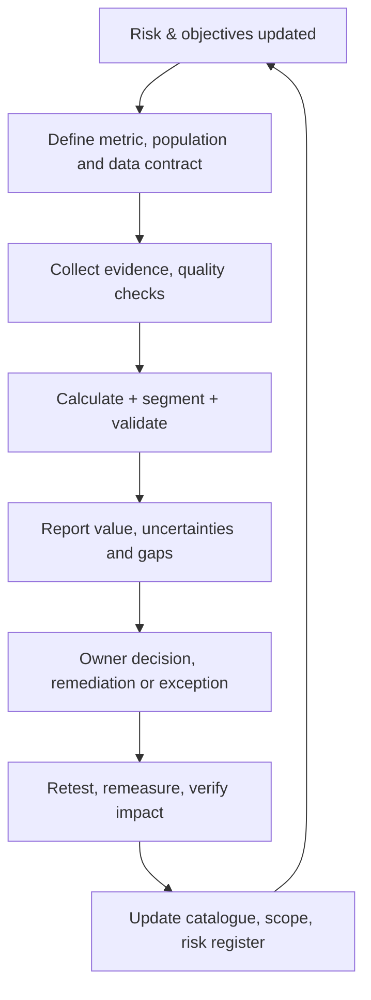

# Security Metric: đo lường hiệu quả bảo mật bằng bằng chứng và quyết định

## 1. Security Metric là gì và vì sao Security Assurance cần đo lường?

**Security metric (chỉ số đo lường bảo mật)** là một đại lượng được định nghĩa rõ về **đối tượng, công thức, nguồn dữ liệu, khoảng thời gian và cách diễn giải**, dùng để theo dõi trạng thái, hiệu quả hoặc rủi ro liên quan đến một mục tiêu bảo mật. Một metric có ích khi người đọc biết **nó đo điều gì, không đo điều gì, độ đáng tin ra sao và sẽ làm gì khi giá trị thay đổi**.

Trong chương **Metrics và reporting** của module **SECURITY_SECURITY_ASSURANCE**, đích đến không phải vẽ nhiều biểu đồ hơn mà là **xây dựng cách đánh giá có bằng chứng** hệ thống đáp ứng security objectives: từ risk assessment, security requirements, controls đến testing, audit, remediation và assurance liên tục trong quá trình phát triển và vận hành.

Ví dụ, nhóm vận hành ghi:

> “95% máy chủ đã được quét lỗ hổng.”

Đây mới là thông tin bước đầu. Một người làm assurance phải hỏi: 95% của **tập máy chủ nào**, trong **thời gian nào**, công cụ có truy cập được cả các máy chủ quan trọng không, kết quả scan có **còn mới**, có kiểm chất lượng scan không, những máy chưa quét có rủi ro cao không? Chỉ số có thể đẹp trong khi 5% chưa quét chính là các máy Internet-facing quan trọng.

Một metric đáng tin phải cho phép diễn đạt cụ thể hơn:

> “Trong 200 workload production thuộc inventory snapshot ngày 30/09, 190 workload có bản quét có hiệu lực trong 7 ngày gần nhất; 10 workload thiếu bằng chứng quét, gồm 3 workload Tier-1. **Validated scan coverage = 190/200 = 95%**, không đồng nghĩa 95% workload an toàn hoặc đã hết lỗ hổng.”

Đây là ví dụ giả lập. Điểm quan trọng là **mẫu số, cửa sổ thời gian, độ mới, rủi ro của các phần thiếu, và giới hạn kết luận**.

### Mục tiêu học tập

Sau bài học, người học có thể:

1. Phân biệt *measurement*, *metric*, KPI, KRI, KCI, SLI/SLO và các tín hiệu quan sát.
2. Thiết kế metric từ **mục tiêu/rủi ro/control/decision** thay vì bắt đầu từ dashboard sẵn có.
3. Định nghĩa **đơn vị đo, tập tổng thể, tử số, mẫu số, kỳ, bộ lọc, dữ liệu thiếu** và chủ sở hữu.
4. Tính và diễn giải các metric liên quan tới asset coverage, vulnerability management, IAM, security testing, detection, incident response, recovery và compliance.
5. Nhận diện sai lệch do chất lượng dữ liệu, missing telemetry, sampling, aggregation và khả năng “làm đẹp KPI”.
6. Thiết kế threshold, SLO, baseline, trend, alert và action plan phù hợp mức rủi ro.
7. Xây **security metric catalogue**, evidence lineage và báo cáo phục vụ security assurance liên tục.
8. Đánh giá một bảng số liệu minh họa, xác định khoảng trống, đề xuất cải thiện và báo cáo có giới hạn.

**Phạm vi:** bài tập trung vào thiết kế, sử dụng và kiểm chứng **security metrics**. Con số, ngưỡng và dữ liệu trong các ví dụ là giả lập để thực hành; không phải benchmark bắt buộc hoặc lời khẳng định về môi trường sản xuất.

## 2. Tại sao đếm hoạt động không đủ để đánh giá bảo mật?

Một nhóm có thể triển khai 100 detection rules, tổ chức 20 buổi training và đóng 500 tickets. Những con số này đo **khối lượng hoạt động**, nhưng chưa chứng minh rủi ro đã giảm hoặc control đã hoạt động đúng.

| Thống kê hoạt động | Câu hỏi assurance còn bỏ ngỏ | Security metric hữu ích hơn |
|---|---|---|
| “Đã chạy 1.000 security scans” | Scan có bao phủ asset quan trọng và có hợp lệ không? | % asset có scan còn hiệu lực, theo tier và điểm mù |
| “Đã sửa 300 CVEs” | Lỗ hổng nào còn mở, exposed bao lâu, có tái diễn không? | SLA attainment theo severity/exposure, backlog age |
| “Có 200 detection rules” | Threat scenarios nào phát hiện được với telemetry thật? | Validated scenario–asset detection coverage |
| “Xử lý 50 incidents” | Phát hiện/contain/recover có kịp, mức tác động thế nào? | Detection/containment delay với định nghĩa mốc, recovery validation |
| “100% backup jobs successful” | Backup có restore được và dữ liệu có nhất quán? | Verified restore success, RPO/RTO achievement |
| “Đã hoàn tất audit” | Scope/evidence đủ, findings đã được xác minh fix chưa? | Evidence coverage, critical findings aging, retest closure |
| “Đã yêu cầu MFA” | Tất cả đường xác thực trong scope có enforce MFA đúng không? | Effective MFA coverage trên identities/flows có áp dụng |

**Không phải số lượng hoạt động luôn vô ích.** Nó có thể là *operational capacity metric* để dự báo nhân lực. Vấn đề nằm ở việc **dùng output metric làm bằng chứng outcome không có quan hệ kiểm chứng**.

### 2.1. Ba tầng đo lường



Ví dụ mục tiêu **giảm nguy cơ lộ dữ liệu**:

- **Hoạt động:** số lần kiểm tra IAM policies.
- **Control operation:** quyền ngoài scope bị từ chối ở test case đúng điều kiện.
- **Outcome/risk signal:** số trường hợp public exposure được xác minh và thời gian tồn tại.
- **Assurance evidence:** inventory đúng, test positive/negative, cấu hình và audit events phù hợp kỳ.

Mỗi tầng hữu ích cho một câu hỏi khác nhau. Không nên biến một tín hiệu đơn lẻ thành lời khẳng định tổng thể rằng dữ liệu đã được bảo vệ hoàn toàn.

## 3. Phân biệt Measurement, Metric, KPI, KRI, KCI và SLI/SLO

### 3.1. Bộ thuật ngữ cơ bản

| Khái niệm | Vai trò | Ví dụ |
|---|---|---|
| **Measurement / observation** | Giá trị ghi nhận trực tiếp từ nguồn, trước khi diễn giải | “Event đến SIEM lúc 10:04 UTC”; “21 findings còn mở” |
| **Metric** | Phép đo được tính theo định nghĩa, có scope/time/unit | “Tỷ lệ asset có valid log coverage = 96%” |
| **KPI — Key Performance Indicator** | Chỉ số then chốt về tiến độ/hiệu quả đạt mục tiêu hoạt động | “% critical vulnerabilities fixed within approved SLA” |
| **KRI — Key Risk Indicator** | Chỉ số cảnh báo xu hướng tăng/giảm exposure hoặc rủi ro | “Số internet-facing assets có critical exposure quá hạn” |
| **KCI — Key Control Indicator** | Chỉ số về trạng thái hoặc hiệu lực của một control | “% privileged grants có approval hợp lệ và review đúng hạn” |
| **SLI — Service Level Indicator** | Đại lượng quan sát về chất lượng một dịch vụ/capability | “Tỷ lệ audit events đến log destination trong 5 phút” |
| **SLO — Service Level Objective** | Mục tiêu mức chất lượng của SLI trong một thời kỳ | “99% required audit events đến trong 5 phút trong kỳ” |
| **SLA — Service Level Agreement** | Thỏa thuận mức dịch vụ và trách nhiệm giữa các bên | Nghĩa vụ/điều khoản về phản hồi hoặc cung cấp dịch vụ |
| **Leading indicator** | Tín hiệu có thể cảnh báo sớm nguy cơ/giảm chất lượng | “Tỷ lệ control tests sắp hết hiệu lực” |
| **Lagging indicator** | Phản ánh kết quả đã xảy ra | “Số incident ảnh hưởng customer data trong quý” |

KPI, KRI và KCI **không phải các tập tách biệt tuyệt đối**: một metric có thể được dùng ở nhiều vai trò tùy quyết định và chủ thể. Ví dụ tỷ lệ secrets chưa rotate có thể là tín hiệu hoạt động cho platform, KCI cho control owner và KRI cho risk committee. Phải ghi **mục đích sử dụng**, không chỉ dán nhãn.

### 3.2. Ví dụ với privilege management

**Security objective:** người dùng và workload chỉ có quyền cần thiết.

| Dữ kiện/metric | Loại sử dụng | Ý nghĩa |
|---|---|---|
| Số IAM grant events trong tháng | Measurement/activity | Khối lượng thay đổi cần xử lý |
| % privileged grants có approval và đúng policy | KCI/KPI | Bằng chứng control cấp quyền vận hành |
| Số admin identities không owner | KRI | Exposure và thiếu governance |
| 95th percentile thời gian thu hồi quyền khi offboarding | KPI/SLI | Hiệu quả quy trình thu hồi |
| Số confirmed privilege misuse incidents | Lagging KRI | Tác động đã được phát hiện, phụ thuộc detection coverage |

Không thể suy ra “không có privilege misuse” từ 0 incidents nếu logging và detection coverage chưa được kiểm.

### 3.3. KPI không thay thế risk assessment

Metric là công cụ **theo dõi bằng chứng và ưu tiên hành động**, không phải phương pháp đầy đủ để đo xác suất attacker thành công hoặc tác động kinh tế. Khi dùng KRI cần ghi threat scenario, exposure, asset criticality, dữ liệu hỗ trợ và giới hạn suy luận.

## 4. Thiết kế metric bắt đầu từ quyết định

Thay vì hỏi “dashboard có dữ liệu gì?”, hãy bắt đầu từ **quyết định mà metric phải hỗ trợ**.

### 4.1. Chuỗi Goal–Question–Metric (GQM)

Phương pháp thực hành:

1. **Goal:** mục tiêu nghiệp vụ/bảo mật cần bảo vệ là gì?
2. **Question:** người phụ trách cần biết điều gì để xác định trạng thái hoặc quyết định?
3. **Metric:** đại lượng nào có dữ liệu đáng tin và quan hệ đủ rõ với câu hỏi?
4. **Action:** giá trị nào/biến động nào kích hoạt investigation, remediation hoặc chấp nhận rủi ro?
5. **Validation:** bằng chứng nào kiểm được công thức và chất lượng đầu vào?

Ví dụ:

```text
Goal:
  Giảm nguy cơ bị chiếm quyền điều hành production.
Question:
  Mọi đặc quyền quan trọng có được phê duyệt và kiểm tra lại đúng không?
Metric:
  Verified privileged-access review coverage.
Numerator:
  Số privileged identity–role assignments trong scope có review hợp lệ.
Denominator:
  Tất cả privileged identity–role assignments applicable trong kỳ.
Action:
  Bất kỳ assignment critical không review → triage và escalation.
Validation:
  Reconcile IAM effective grants với audit/change/review records.
```

### 4.2. Một metric có ý nghĩa nên có những gì?

| Thành phần | Câu hỏi |
|---|---|
| **ID/name** | Người khác biết chính xác đang dùng định nghĩa metric nào? |
| **Purpose & decision** | Ai dùng và sẽ quyết định gì? |
| **Related risk/objective/control** | Metric liên kết yêu cầu/đe dọa nào? |
| **Unit** | Count, %, duration, events/hour, ratio hay tiền? |
| **Population** | Tập nào được tính; ai tạo inventory và cách reconcile? |
| **Numerator/denominator** | Đếm phần tử nào và loại bỏ phần nào? |
| **Time window** | Kỳ, timezone, cutoff, event time hay ingest time? |
| **Sources/lineage** | API/log/ticket/test nào, version nào, retention? |
| **Data quality** | Missing, duplicate, stale, quyền bị chặn, clock skew xử lý ra sao? |
| **Methodology** | Filter, aggregation, sampling và quy tắc tính cụ thể? |
| **Segments** | Tier, environment, account, criticality, severity, owner? |
| **Target/threshold** | Mục tiêu dựa trên risk appetite hoặc SLO, ai duyệt? |
| **Action owner** | Ai điều tra, sửa và xác minh khi lệch? |
| **Evidence/verification** | Reviewer có thể tái lập từ nguồn và test IDs? |
| **Version/change trigger** | Thay đổi định nghĩa hoặc hệ thống khi nào phải rebaseline? |

Không nhất thiết tạo một tài liệu rất dài cho mọi counter kỹ thuật; nhưng những metric được dùng trong **quản trị rủi ro, audit hoặc cam kết assurance** nên có các thuộc tính trên ở mức đủ để kiểm lại.

### 4.3. SMART là công cụ rà soát, không thay định nghĩa

Một metric nên đủ **Specific, Measurable, Achievable, Relevant, Time-bound** để hỗ trợ hành động. Tuy nhiên, câu “đạt 100% security” nghe rõ mục tiêu nhưng không đo được. Câu “mọi production break-glass access events thuộc kỳ có approval và post-use review trong 24 giờ theo policy” có đối tượng và tiêu chí cụ thể hơn, dù vẫn cần định nghĩa approval, event population và trường hợp ngoại lệ.

## 5. Mẫu số, tập tổng thể, thời gian và đơn vị đếm

Nhiều sai lầm security metrics bắt đầu từ **chọn sai denominator**, không phải phép chia.

### 5.1. Tử số và mẫu số phải cùng scope

\[
\text{Coverage}=\frac{\text{Số đơn vị đạt điều kiện được xác minh}}
{\text{Tất cả đơn vị applicable trong scope}}\times100\%.
\]

Để dùng công thức đúng, cần nói rõ đơn vị: **asset, principal, privileged grant, service–scenario, control–asset pair, test run hay request**? Không thể so số rule với số threat scenario rồi gọi đó là “tỷ lệ phát hiện”.

### 5.2. Asset snapshot và asset-through-time khác nhau

Giả sử ngày 30/09 có 100 production workloads, nhưng 12 workloads đã được tạo rồi xóa trong quý. Có hai câu hỏi khác nhau:

- **Point-in-time coverage:** trong **100 workload đang tồn tại tại 30/09**, bao nhiêu có EDR agent hoạt động?
- **Period-of-time coverage:** trong **mọi workload từng hoạt động trong Q3**, bao nhiêu có EDR trong thời gian hoạt động theo chính sách?

Không lấy inventory cuối kỳ để kết luận toàn bộ quý nếu tài sản ngắn hạn không nằm trong mẫu số. Với ephemeral workloads có thể cần tính theo **workload-hour**, **deployment** hoặc **event time interval** thay vì chỉ đếm instance IDs. Chọn đơn vị phải phù hợp security objective.

### 5.3. Các trường hợp đặc biệt

| Trường hợp | Cách xử lý đúng |
|---|---|
| **Denominator = 0** | Metric không xác định/không áp dụng theo tiêu chí, không tự báo 100% |
| **Missing evidence** | Giữ trong population nếu applicable; ghi INCOMPLETE/UNVALIDATED, không chuyển PASS |
| **Not applicable** | Chỉ loại khi có rationale, owner và phê duyệt |
| **Out of scope** | Công bố phạm vi, không biến thành câu “toàn công ty” |
| **Duplicate assets/events** | Định nghĩa canonical ID, de-duplicate theo nguồn và rule đã nêu |
| **Ephemeral assets** | Đo theo vòng đời hoặc thời lượng hiện diện, không chỉ snapshot |
| **Unknown owner** | Ghi data quality/governance gap, không tự loại asset |
| **Timezone/clock skew** | Dùng UTC hoặc chuẩn đã chốt, ghi mốc event/ingest và sai lệch đồng hồ |
| **Stale data** | Có freshness threshold, tách stale hoặc invalid evidence |

### 5.4. Weighted metrics có rủi ro

Một trung bình không trọng số có thể che một tài sản **Tier-1** nguy hiểm. Chẳng hạn 99% workload có agent nhưng 1% còn thiếu là **những hệ thống giữ dữ liệu nhạy cảm nhất**. Có thể phân tầng theo criticality hoặc tính trọng số được duyệt; tuy nhiên phải báo:

- Coverage tổng thể và **coverage từng tier**.
- Giá trị tuyệt đối của những gaps quan trọng.
- Quy tắc trọng số và phiên bản.
- Những đơn vị chưa đủ bằng chứng.

Không tùy ý thay đổi trọng số sau khi thấy kết quả để làm đẹp dashboard.

## 6. Leading và Lagging Indicators: dùng song song

**Leading indicators** hỗ trợ phòng ngừa hoặc cảnh báo sớm; **lagging indicators** phản ánh tác động đã xảy ra. Cả hai đều có hạn chế và cần mối liên hệ được xác minh với rủi ro.

| Mục tiêu | Leading indicator | Lagging indicator | Điều cần lưu ý |
|---|---|---|---|
| Bảo vệ tài khoản đặc quyền | % privileged identities có MFA/least privilege và review hợp lệ | Confirmed privilege abuse incidents | 0 incidents có thể do thiếu detection |
| Quản lý lỗ hổng | % internet-facing assets được quét mới và ưu tiên đúng | Exploitation incidents, breach-related vulns | Định nghĩa “exploited” và coverage |
| Bảo vệ dữ liệu | % data stores có effective policy được kiểm | Confirmed unauthorized disclosures | Sự cố lộ dữ liệu khó quan sát đầy đủ |
| Detection engineering | % critical threat scenarios có validated detector | Missed detections được tìm ra qua incident/purple team | Cần kiểm test validity và logging |
| Incident response | % responders/playbooks được diễn tập, alert routing health | Observed containment delay, recurrence | Chỉ xét incidents có mốc đo đủ |
| DR readiness | % critical processes có restore exercise pass còn hiệu lực | Outage recovery overruns hoặc data loss | Một exercise không chứng minh mọi thảm họa |
| Secure SDLC | % production deployments qua verified security gate | Escaped vulnerabilities trên production | Discovery bias và thay đổi scope |

Không nên coi leading indicator luôn dự báo chắc chắn outcome. Một control có thể có coverage tốt nhưng chưa đủ chặn attacker; một lagging metric có thể giảm vì telemetry bị mất. Security assurance cần **triangulation**: kết hợp nhiều nguồn và phương pháp, đồng thời công bố phần chưa kiểm.

## 7. Security Metric cho asset inventory và telemetry coverage

**Muốn đo bảo mật, trước hết phải biết đối tượng cần bảo vệ.** Nếu chỉ lấy danh sách tài sản xuất hiện trong kết quả scanner, tất cả những tài sản chưa được scanner thấy sẽ biến mất khỏi mẫu số.

### 7.1. Asset inventory coverage

Ví dụ định nghĩa:

\[
\text{Owner-assigned asset coverage}=
\frac{\text{Asset applicable có owner được xác minh}}
{\text{Tổng asset applicable từ inventory đã đối chiếu}}\times100\%.
\]

Giả sử 240 production assets được đối chiếu từ cloud organization, CMDB và service catalog; 228 assets có owner hợp lệ, 12 assets chưa xác định owner. **Coverage = 228/240 = 95%**.

Diễn giải đúng: còn 12 tài sản thiếu accountability, trong đó cần nêu tier và dữ liệu. Không viết “95% assets đã an toàn”. Nếu còn accounts chưa được inventory, phải bổ sung **inventory completeness gap**; không được coi 240 là chắc chắn đầy đủ trước khi reconciliation.

### 7.2. Security telemetry availability

Đối với 50 nguồn event required trong môi trường đã định:

\[
\text{Validated source coverage}=
\frac{\text{Số nguồn có event canary hợp lệ đến đúng destination}}
{\text{Tổng nguồn event required}}\times100\%.
\]

Ví dụ: 42 nguồn PASS, 5 nguồn FAIL, 3 chưa thử. Validated coverage **42/50 = 84%**, không phải “42/47” hoặc “100%” vì 3 chưa thử. Báo riêng 5 FAIL và 3 UNTESTED.

Một nguồn được đánh PASS nếu bài kiểm đã xác định đủ:

- **Event generation:** có action được ủy quyền tạo event thật.
- **Collection/transport:** source/collector nhận và vận chuyển đúng.
- **Parsing/schema:** actor, action, resource, outcome, timestamp đúng.
- **Destination/retention:** record có tại nơi được yêu cầu, với độ trễ trong giới hạn.
- **Audit provenance:** event/canary ID và run ID đủ để kiểm lại.

### 7.3. Freshness của bằng chứng

Metric coverage nên có điều kiện **thời hạn hiệu lực**. Ví dụ:

> “Asset được tính là covered khi có validated scan trong 7 ngày gần nhất và scanner trả trạng thái hoàn tất, không có lỗi quyền/scope.”

Nếu 180/200 assets từng được scan nhưng chỉ 160 có kết quả còn hiệu lực, validated freshness coverage là **160/200 = 80%**, không phải 90%. Cần định nghĩa quy tắc khi công cụ không chạy hoặc cập nhật data trễ.

### 7.4. Mất telemetry có thể làm metric đẹp lên

Khi log pipeline ngừng, dashboard có thể hiển thị 0 suspicious events và 0 detections failed. Đây không phải bằng chứng rủi ro giảm. Nên dùng **independent pipeline health metrics** (source heartbeats, ingestion delay, dropped event count, schema validation rate) và đánh trạng thái **DATA DEGRADED** khi không đủ điều kiện quan sát.

## 8. Security Metric trong Vulnerability Management

Vulnerability metrics giúp biết **coverage, tốc độ triage/remediation và exposure còn lại**, nhưng phải kết hợp mức độ quan trọng tài sản, khả năng bị khai thác, đường tiếp cận và vòng đời asset.

### 8.1. Các metric cơ bản

| Metric | Công thức/đơn vị | Câu hỏi quyết định |
|---|---|---|
| **Validated scan coverage** | Assets có scan đủ chất lượng trong cửa sổ / assets applicable | Có bỏ sót nơi nào? |
| **Open vulnerability count** | Số findings còn mở theo định nghĩa canonical finding | Backlog hiện có và thay đổi ra sao? |
| **High-risk exposure backlog** | Số confirmed high-risk findings còn mở trên assets thuộc scope | Những vấn đề ưu tiên nào chưa xử lý? |
| **SLA remediation attainment** | Findings due trong cohort có verified fix trước hạn / findings due trong cohort | Control remediation có đạt chính sách? |
| **Median / P90 time-to-remediate** | Phân phối thời gian từ mốc xác định đến verified fix | Có outliers kéo dài nguy cơ? |
| **Overdue age** | Thời gian quá hạn của findings còn mở | Khoảng tồn dư rủi ro kéo dài bao lâu? |
| **Reopen/recurrence rate** | Findings reopen/tái diễn theo định nghĩa / cohort | Fix có bền vững không? |
| **Validation coverage** | Findings được xác minh trạng thái bằng evidence / findings cần xác minh | Có tin được dashboard “resolved” không? |

### 8.2. Định nghĩa cohort cho SLA

Ví dụ policy yêu cầu verified fix của findings critical trong **7 ngày kể từ mốc bắt đầu tính đã phê duyệt**. Trong tháng 9 có 20 findings đến hạn:

- 15 findings có verified fix trước/đúng hạn.
- 3 findings fix sau hạn.
- 2 findings còn mở tại thời điểm khóa báo cáo.

\[
\text{On-time remediation rate}=\frac{15}{20}\times100\%=75\%.
\]

**Không lấy 15/18** bằng cách loại hai findings chưa sửa khỏi mẫu số: chính các findings đến hạn nhưng chưa đóng mới thể hiện vi phạm thời hạn.

Mốc bắt đầu có thể là detection, validation, ticket creation hoặc SLA start theo chính sách; cần công bố để không thao túng thời gian. Một phát hiện xác minh lại là false positive có thể được loại theo quy tắc triage có evidence, không xóa tùy ý để tăng tỷ lệ.

### 8.3. MTTx và phân phối thời gian

Ví dụ có 5 findings được verified fixed sau **2, 3, 4, 5, 30 ngày**:

\[
\text{Mean TTR}=\frac{2+3+4+5+30}{5}=8.8\ \text{ngày}.
\]

Median là **4 ngày**. Trung bình 8,8 ngày bị kéo bởi một outlier 30 ngày, trong khi median một mình lại che vấn đề kéo dài nghiêm trọng. Nên báo **median, tail percentile và backlog age**, cộng các findings vẫn chưa sửa.

Đừng tính TTR chỉ trên findings đã fix rồi dùng để kết luận toàn backlog; các findings chưa fix bị **right-censored** và cần được báo theo tuổi tồn đọng hoặc một phương pháp phân tích phù hợp.

### 8.4. Severity không phải risk toàn phần

CVSS hoặc nhãn severity là đầu vào, nhưng rủi ro thực còn phụ thuộc:

- Tài sản Internet-facing hay chỉ có trong network cô lập.
- Dữ liệu, đặc quyền và chức năng nghiệp vụ có thể bị ảnh hưởng.
- Bằng chứng bị khai thác thực tế, exploitability và controls giảm thiểu.
- Lộ diện trên đường chạy thật hay trong dependency không được gọi.
- Thời gian tồn tại, owner và khả năng vá/giảm thiểu.

Không cộng điểm CVSS của mọi CVE rồi xem như “xác suất bị xâm nhập”. Với vulnerability metrics, nên có **risk segmentation** và tránh double-count cùng một vấn đề phát sinh từ nhiều scanner.

### 8.5. Đừng tối ưu số lượng findings đã đóng

Khi chỉ thưởng “đóng nhiều tickets”, nhóm có thể:

- Đóng findings dễ trước, bỏ critical exposure lâu ngày.
- Đánh false positive không đủ căn cứ.
- Chuyển status “fixed” trước khi deploy hoặc retest.
- Tạo nhiều tickets nhỏ để tăng output.

Vì vậy kết hợp **verified remediation, risk-weighted backlog, age và reopened findings**, với dữ liệu được audit.

## 9. IAM, authentication và secrets metrics

Các metric về danh tính thường rất nhạy với **định nghĩa effective access** và **tập người dùng/workload identities**.

### 9.1. Privileged access review coverage

```text
Unit: privileged identity–role assignment
Population: toàn bộ assignments applicable trong kỳ, gồm human/service/break-glass
Numerator: assignments có review evidence hợp lệ, đúng hạn và đúng quyền
Denominator: tất cả applicable assignments
Exclude: những assignment không áp dụng theo policy và có phê duyệt
```

Giả sử 120 privileged assignments được đối chiếu, 108 có review hợp lệ, 7 quá hạn, 5 thiếu bằng chứng. **Validated coverage = 108/120 = 90%**. Không gộp 5 thiếu evidence thành “không có lỗi”.

### 9.2. Effective MFA coverage

Metric “MFA enabled users” có thể khác “**MFA được enforce trên những đường truy cập quan trọng**”. Một IdP có MFA bật cho nhân viên nhưng service account, legacy protocol, recovery/break-glass hoặc API token vẫn có đường bypass.

Một cách đo đúng hơn cần xác định:

- Population identities/flows có yêu cầu MFA theo policy.
- Phương thức xác thực và điều kiện bypass.
- Positive/negative test hoặc effective policy verification.
- Thời hạn hiệu lực, exception, recovery flow và external users.

Nếu một break-glass account theo chính sách được phép phương thức bảo vệ khác MFA, phải ghi **alternative control và risk decision**; không mặc định mọi trường hợp không có MFA đều là sai giống nhau, cũng không loại khỏi báo cáo mà không có lý do.

### 9.3. Orphaned identities và credential health

Các chỉ số hữu ích:

| Metric | Điều cần kiểm | Hạn chế |
|---|---|---|
| Privileged identities không owner | Owner trong service catalog/HR/vendor register | Thiếu owner không luôn tương đương account bị lạm dụng |
| Dormant privileged accounts | Last activity vs policy window; tình trạng account | “Không hoạt động” phụ thuộc audit log completeness |
| Overprivileged service identities | Effective roles vs approved permission baseline | Policy danh nghĩa không luôn phản ánh effective permissions |
| Secrets quá hạn rotation | Những secrets policy yêu cầu rotate, có evidence | Rotation không tự chứng minh credential cũ vô hiệu mọi session |
| Time to revoke access | Từ trigger offboarding/incident đến effective denial | Phải đo kết quả thực, không chỉ timestamp ticket đóng |
| Exception aging | Duration của quyền ngoài baseline được duyệt | Exceptions cần expiry và review trigger |

### 9.4. Đo thời gian thu hồi quyền

Giả sử 10 offboarding events có thời gian từ **effective termination time** đến **quyền thực sự bị từ chối**. Nếu 9 hoàn tất trong 1 giờ nhưng 1 mất 30 giờ, dùng trung bình có thể che outlier. Nên báo **% đạt SLA theo policy, P90/P95 khi có ý nghĩa, maximum và count quá hạn**.

Điều quan trọng là xác định **điểm cuối**: ticket marked complete hay thử nghiệm/nguồn access xác nhận quyền đã không còn? Với Security Assurance, kết quả kiểm chứng effective revocation đáng tin hơn một status hành chính.

## 10. Detection, Logging và Monitoring Metrics

Một detector tốt cần **thu được event đúng, xử lý đúng, tạo tín hiệu đúng và chuyển tới người phản ứng**. Số lượng alert hoặc rule không đủ chứng minh detection capability.

### 10.1. Detection coverage theo threat scenario

Định nghĩa một đơn vị kiểm như cặp **(threat scenario, asset class)** hoặc **(detection use case, platform)** theo scope đã duyệt.

\[
\text{Validated detection coverage}=
\frac{\text{Số đơn vị có end-to-end positive test PASS còn hiệu lực}}
{\text{Tổng đơn vị detection required}}\times100\%.
\]

Giả sử 20 đơn vị required: 13 PASS, 3 FAIL, 2 INCONCLUSIVE và 2 UNTESTED:

\[
\frac{13}{20}\times100\%=65\%.
\]

Nói đúng: **65% đơn vị detection required có bằng chứng PASS trong lần đánh giá**, không phải xác suất 65% phát hiện mọi cuộc tấn công. Nếu kiểm bằng injected synthetic event tại SIEM thay vì hành vi thật từ source, chỉ chứng minh một **đoạn pipeline**, không được đánh end-to-end PASS vô điều kiện.

### 10.2. Phân biệt Precision, Recall và False Positive Rate

Trong bộ test có nhãn ground truth đáng tin:

| | Thực tế là hành vi tấn công/theo kịch bản | Thực tế là hành vi hợp lệ |
|---|---:|---:|
| **Detector báo alert** | TP (True Positive) | FP (False Positive) |
| **Detector không báo alert** | FN (False Negative) | TN (True Negative) |

\[
\text{Precision}=\frac{TP}{TP+FP},\quad
\text{Recall}=\frac{TP}{TP+FN}.
\]

\[
\text{False Positive Rate}=\frac{FP}{FP+TN}.
\]

Giả sử bộ test có **TP = 18, FP = 6, FN = 2, TN = 74**:

- Precision = \(18/24 = 75\%\).
- Recall = \(18/20 = 90\%\).
- False Positive Rate = \(6/80 = 7.5\%\).

Những chỉ số trên **chỉ có ý nghĩa cho tập có nhãn đã kiểm**. SOC production thường không biết đầy đủ FN hoặc TN, nên không thể lấy “10% alerts false positive” thay trực tiếp cho **False Positive Rate**. Có thể đo **false discovery proportion trong alerts đã triage**, nhưng phải gọi đúng định nghĩa và công bố nguồn label/sampling bias.

### 10.3. Data pipeline latency và alert latency

Cần phân biệt các mốc:

```text
t0 = action/event xảy ra tại source
t1 = event được log source tạo ra
t2 = collector/ingestion nhận event
t3 = detection engine tạo alert
t4 = alert tới kênh phản hồi
t5 = analyst acknowledge
```

Một số metrics:

- **Event-to-ingest delay:** `t2 - t0` hoặc `t2 - t1` với định nghĩa rõ.
- **Ingest-to-alert delay:** `t3 - t2`.
- **Event-to-alert delay:** `t3 - t0`.
- **Alert delivery delay:** `t4 - t3`.
- **Acknowledge delay:** `t5 - t4`.

Nếu engine tạo alert trong 2 giây sau ingestion nhưng ingestion mất 40 phút, **không thể gọi detection latency 2 giây** khi requirement cần cảnh báo vài phút từ hành vi thực. Cần báo percentile, scope, sample count, event time source và clock skew.

### 10.4. Alert fatigue và hành động của SOC

Các số liệu phụ trợ:

| Metric | Mục đích | Lưu ý |
|---|---|---|
| Alerts per analyst shift | Ước lượng tải xử lý | Không chứng minh chất lượng alerts |
| Alerts triaged within approved SLA | Theo dõi năng lực phản hồi | Chỉ tính được khi alert delivery/log đủ |
| Noise burden | Thời gian triage alerts không cần hành động theo phân loại có review | Không lấy tỉ lệ alert đóng nhanh làm KPI thành công |
| Duplicate/suppressed alerts | Kiểm tra gánh nặng và suppression | Suppression quá rộng có thể tăng FN |
| Rule test freshness | Tỷ lệ detector có validation gần đây | Rule “enabled” chưa chắc hoạt động |
| Telemetry missing event rate | Cảnh báo log pipeline health | Missing rate cần baseline/expected events |

### 10.5. Tín hiệu “0 alert” có nhiều nguyên nhân

0 alerts có thể là:

1. Không có hành vi đúng điều kiện.
2. Threat scenario không thuộc môi trường quan sát.
3. Source chưa bật log hoặc thiếu data events.
4. Collector/transport lỗi.
5. Parser/schema sai hoặc correlation fail.
6. Rule disabled/suppressed.
7. Routing lỗi hoặc quyền truy vấn thiếu.

Do đó một dashboard detection nên có **health và coverage** cạnh các metrics về alert volume, không chỉ biểu đồ số alert giảm theo tháng.

## 11. Incident Response Metrics

Trong incident response, các metric về **thời gian phát hiện, điều phối, containment, khôi phục và cải tiến** rất hữu ích nhưng phụ thuộc vào việc xác định mốc và độ đầy đủ của evidence.

### 11.1. Các mốc quan trọng

```text
t0: Thời điểm compromise/incident bắt đầu theo evidence, nếu biết
t1: Tín hiệu đầu tiên đủ chất lượng để phát hiện
t2: Alert/incident được người có trách nhiệm acknowledge
t3: Incident được khai báo, commander/owner được phân công
t4: Containment có hiệu lực và được kiểm chứng
t5: Dịch vụ đạt recovery acceptance criteria
t6: Finding/action items được xác minh khắc phục
```

| Metric | Gợi ý định nghĩa | Cạm bẫy |
|---|---|---|
| **Time to detect** | `t1 - t0` | `t0` có thể không biết chính xác |
| **Time to acknowledge** | `t2 - time_alert_delivered` | Cần một mốc đầu được thống nhất |
| **Time to declare** | `t3 - t1` | Đừng thay khai báo bằng nhận alert |
| **Time to contain** | `t4 - t3` hoặc `t4 - t1` theo định nghĩa | Chỉ API revoke success chưa chứng minh containment hiệu lực |
| **Time to recover** | `t5 - t0` hoặc mốc được quy định | Service lên không có nghĩa an toàn |
| **Verified improvement closure delay** | `t6 - issue_opened` | Ticket close không tự là verified fix |
| **Recurrent root-cause rate** | Tỷ lệ incident cùng cơ chế lỗi theo classification | Không đủ incident taxonomy hoặc thiếu phát hiện |

### 11.2. Ví dụ một incident giả định

Một incident có:

- Event đầu tiên được xác minh: **10:00**.
- Detection alert: **10:08**.
- Incident declaration: **10:13**.
- Containment được test hiệu lực: **10:28**.
- Business recovery được xác nhận: **11:40**.

Suy ra:

\[
\text{Time to detect}=8\text{ phút}.
\]

\[
\text{Time from declaration to containment}=15\text{ phút}.
\]

\[
\text{Incident start to recovery}=100\text{ phút}.
\]

**Đây là độ dài một incident**, không phải giá trị trung bình MTTD/MTTR. Muốn báo trung bình cần xác định tập incident, những trường hợp không biết t0, các case chưa phục hồi, phương pháp tính và percentile.

### 11.3. Ý nghĩa của MTTD, MTTR

Các chữ viết tắt như **MTTR** có thể được hiểu là *Mean Time To Respond, Repair, Resolve hoặc Recover* trong các tổ chức khác nhau. Một báo cáo đáng tin nên **viết đầy đủ tên và mốc đo**, không chỉ đưa nhãn “MTTR 25 phút”.

Nên xem median, P90/P95, sample count, severity segmentation và high-impact outliers. Một nhóm có thể xử lý nhiều incident nhỏ nhanh hơn nhưng một incident nghiêm trọng kéo dài, vì vậy **mean cải thiện không tự chứng minh rủi ro đã giảm**.

### 11.4. Tỷ lệ incident được phát hiện

Không thể tính “% tất cả incident được phát hiện” nếu không có tập **sự cố đã xảy ra nhưng không được phát hiện**. Có thể dùng:

- % controlled red-team/purple-team scenarios được phát hiện trong scope.
- % incidents có đủ timeline và bằng chứng response.
- Detection gaps được phát hiện qua post-incident review.
- Thời gian detection của các incidents có timestamp đáng tin.

Không diễn giải số incidents giảm là hiệu quả detection tăng nếu inventory và telemetry coverage cùng thay đổi.

## 12. DR, Business Continuity và Recovery Metrics

Các chỉ số resilience cần xuất phát từ BIA và kết quả phục hồi **nghiệp vụ**, không chỉ từ trạng thái backup/VM.

### 12.1. Các mục tiêu được phê duyệt

| Định nghĩa | Cần xác minh |
|---|---|
| **RTO — Recovery Time Objective** | Thời gian mục tiêu để đạt mức hoạt động đã định sau mốc gián đoạn |
| **RPO — Recovery Point Objective** | Mức mất dữ liệu theo thời gian được chấp thuận theo kịch bản |
| **MBCO — Minimum Business Continuity Objective** | Mức sản lượng/chức năng tối thiểu để doanh nghiệp tiếp tục |
| **Restore verification rate** | Tỷ lệ restore tests có integrity/business/security checks đạt |
| **DR scenario coverage** | Số cặp (business process, disaster scenario) có bài test PASS còn hiệu lực |
| **Backup recoverability gaps** | Backup thiếu key/quyền/data consistency hoặc không restore được |
| **Failback readiness** | Những phương án có failback test PASS và anti-split-brain checks |

### 12.2. Ví dụ thực nghiệm RTO/RPO

Một bài test giả lập bắt đầu gián đoạn **10:00 UTC**, business service đạt mức MBCO được duyệt lúc **11:20 UTC**, điểm dữ liệu được kiểm nhất quán đến **09:52 UTC**:

\[
\text{Observed recovery time}=80\text{ phút},\qquad
\text{Observed data-loss window}=8\text{ phút}.
\]

Nếu mục tiêu RTO = 120 phút, RPO = 15 phút, hai chỉ tiêu **đạt cho scenario/test scope này**, với điều kiện business throughput, consistency, security gates và timestamps đã được kiểm. Một bài test PASS không chứng minh mọi vùng/nhà cung cấp và cyber attack đều được bao phủ.

### 12.3. Backup success khác restore success

Giả sử 100 backup jobs completed, nhưng trong 10 restore drills:

- 7 drills restore, decrypt và chạy business integrity tests đạt.
- 2 drills fail vì quyền key và missing transaction log.
- 1 drill inconclusive do fixture sai.

**Validated restore success trên attempts = 7/10 = 70%**, kèm **2 FAIL, 1 INCONCLUSIVE**. Không viết “100% recoverability” từ 100/100 backup jobs successful.

### 12.4. Nguy cơ của RTO quá đẹp

Nếu bài test đo từ lúc chạy `restore` tới lúc database khởi động nhưng bỏ qua phát hiện, phê duyệt, DNS, app, customer login hoặc reconciliation, số RTO sẽ thấp giả tạo. Nên dùng **business-ready gates**, thời gian test, phạm vi dữ liệu, mức tải và thứ tự dependency rõ.

Đối với **cyber recovery**, restore point mới nhất có thể đã bị nhiễm và credential có thể còn bị lộ. Vì vậy cần metric về **clean restore validation, identity/secret revocation, artifact integrity và negative controls**, không chỉ thời gian.

## 13. Audit, Compliance và Remediation Metrics

Một metric phục vụ compliance assurance phải tách **số control được kiểm**, **chất lượng bằng chứng** và **số control đạt tiêu chí**. Nếu không, một tỷ lệ 100% có thể chỉ có nghĩa công cụ không kiểm được những phần có rủi ro cao.

### 13.1. Control–asset unit là một mẫu số hữu ích

Giả sử chương trình xác định 40 cặp *(control, asset/process)* applicable:

| Trạng thái | Số lượng |
|---|---:|
| PASS có evidence phù hợp | 24 |
| FAIL có evidence | 6 |
| INCOMPLETE vì thiếu evidence/test validity | 4 |
| UNTESTED | 6 |
| **Tổng applicable** | **40** |

Ba metric độc lập:

\[
\text{Decision coverage}=\frac{24+6}{40}\times100\%=75\%.
\]

\[
\text{Pass rate among conclusive tests}=\frac{24}{24+6}\times100\%=80\%.
\]

\[
\text{Verified PASS coverage}=\frac{24}{40}\times100\%=60\%.
\]

Nếu dashboard chỉ hiển thị 80% PASS mà không nêu 4 incomplete và 6 untested, người xem dễ cho rằng 80% tổng control đã được chứng minh compliant. **Metric cần công bố mẫu số, test coverage và trạng thái không đủ bằng chứng**.

### 13.2. Một test PASS không nhất thiết làm toàn control PASS

Ví dụ `CTRL-LOG-01` có 3 cloud accounts:

- Account A: log canary và retention test PASS.
- Account B: logging data events FAIL.
- Account C: chưa kiểm.

Chưa có cơ sở nói “CTRL-LOG-01 compliant” trên toàn scope. Có thể báo PASS theo **account-control unit**, control tổng thể **not fully validated**, hoặc đánh giá theo quy tắc được phê duyệt; phải tránh tự chọn phép gộp làm mất FAIL.

### 13.3. Chỉ số về findings và ngoại lệ

| Metric | Ý nghĩa | Cần cảnh giác |
|---|---|---|
| **Critical findings open** | Các vấn đề trọng yếu chưa khép vòng | Số nhỏ có thể do ít hoạt động audit |
| **Overdue remediation rate** | Findings quá hạn / findings đến hạn trong cohort | Không loại finding chưa sửa khỏi mẫu số |
| **Verified closure rate** | Findings đã retest PASS / findings đủ điều kiện cần xác minh | Đóng ticket chưa chắc sửa control |
| **Exception expiry backlog** | Ngoại lệ quá hạn hoặc thiếu người review | Accepted risk không phải compliant |
| **Evidence freshness** | Controls có evidence chưa hết hiệu lực / applicable controls | Cần xét asset/control revision |
| **Audit scope coverage** | Applicable units đã kiểm đủ / tất cả units | Scope thay đổi làm trend khó so |
| **Repeat finding rate** | Finding cùng nguyên nhân tái xuất hiện theo taxonomy | Cần ID và root-cause classification ổn định |

### 13.4. Không đồng nhất compliance với security outcome

Một quy định có thể yêu cầu **review quyền theo quý**. Tỷ lệ review PASS phản ánh control process; không tự chứng minh mọi quyền đều an toàn giữa hai lần review. Có thể kết hợp thêm **continuous effective-permissions checks**, break-glass events và exposure metrics.

Ngược lại, một vulnerability scan có kết quả sạch hôm nay không tự chứng minh tổ chức **đã đáp ứng toàn bộ yêu cầu về phê duyệt thay đổi, incident response hoặc retention**. Chương trình cần mapping nghĩa vụ tới controls và bằng chứng tương ứng.

## 14. Metric Catalogue: hợp đồng dữ liệu và người chịu trách nhiệm

Trong một chương trình nghiêm túc, metric không nên chỉ tồn tại như một câu SQL hoặc ô trong dashboard. Cần **metric definition record** được quản trị, kiểm soát phiên bản và review.

### 14.1. Mẫu catalogue record

```yaml
# Mẫu nội bộ minh họa, không phải schema của framework cụ thể
metric_id: SEC-METRIC-001
name: validated_vulnerability_scan_coverage
description: "Tỷ lệ production workloads có scan hợp lệ còn hiệu lực"
service: SECURITY_SECURITY_ASSURANCE
decision: "Xác định scan coverage gaps và ưu tiên onboarding"
category: control_coverage
indicator_uses: [KCI, KPI]
related_controls: [CTRL-VULN-01]
risk_scenarios:
  - unobserved_vulnerabilities_on_production_workloads
unit: percent
population:
  entity: canonical_production_workload
  source: reconciled_cloud_and_service_inventory
  include:
    - "Production workloads active during the measurement window"
  exclude_with_approval:
    - "Non-applicable runtime types with separate approved assessment"
numerator:
  rule: "Workload has complete validated scan within freshness window"
denominator:
  rule: "All applicable workloads in the reconciled inventory"
time:
  window: rolling_7_days
  timezone: UTC
freshness:
  max_scan_age_days: 7
  inventory_max_age_hours: 24
data_quality:
  permission_error: incomplete
  scanner_failure: incomplete
  unknown_owner: included_and_flagged
  missing_asset: investigate_inventory_gap
segments: [business_tier, cloud_account, environment, owner]
target:
  illustrative_value_percent: 100
  approval_required: risk_owner_and_control_owner
owners:
  business_owner: security-assurance-lead
  data_owner: vulnerability-platform-team
  action_owner: workload-owner
evidence:
  inventory_snapshot: required
  scan_run_ids: required
  tool_and_rule_revisions: required
review_frequency: weekly
version: 1
status: proposed
```

Đây là dữ liệu **giả lập**; `100%` là **minh họa một mục tiêu**, không phải yêu cầu phổ quát. Trong thực tế, metric owner phải cân nhắc loại tài sản, thời gian hoạt động, scan feasibility, yêu cầu riêng và rủi ro còn lại. Với mỗi metric, cần **chủ sở hữu định nghĩa**, **người sở hữu dữ liệu** và **người thực hiện khi không đạt**.

### 14.2. Metric contract và dữ liệu đầu vào

Một metric contract nêu:

- **Schema:** các fields bắt buộc và kiểu dữ liệu.
- **Source ownership:** hệ thống phát sinh và người chịu trách nhiệm.
- **Population semantics:** canonical asset/identity ID và lifecycle.
- **Time semantics:** event time, collected time, cutoff, timezone, late-arriving data.
- **Quality checks:** completeness, uniqueness, expected values, freshness.
- **Aggregation:** cách đếm distinct, de-dup, segmentation và rolling windows.
- **Access policy:** ai được xem dữ liệu thô, ai chỉ được xem aggregate.
- **Version history:** công thức, field mapping, filter và target thay đổi khi nào.

Thiếu metric contract, hai nhóm có thể dùng cùng tên “MFA coverage” nhưng một nhóm đếm human users, nhóm kia tính thêm workload identities, khiến dashboard so sánh sai.

### 14.3. Metric state và freshness

Nên ghi cả **giá trị** lẫn **độ tin cậy của giá trị**. Ví dụ:

```yaml
metric_result_id: SEC-METRIC-001-RUN-2026-09-30
metric_id: SEC-METRIC-001
definition_version: 1
measured_at_utc: "2026-09-30T23:59:59Z"
population_snapshot_id: INVENTORY-EXAMPLE-Q3
numerator: 190
denominator: 200
value_percent: 95
data_quality_status: partial_coverage
missing_or_invalid_count: 10
segments:
  tier1_missing: 3
evidence_refs:
  - EXAMPLE-INVENTORY-200
  - EXAMPLE-SCAN-RUNS-001
reviewer: example-assurance-reviewer
limitations:
  - "No coverage claim for assets outside reconciled snapshot"
```

Không có ý nghĩa nếu giữ giá trị 95% **vĩnh viễn** sau khi có cloud accounts mới hoặc scanner bị lỗi. Kết quả cần có measurement time và điều kiện hết hiệu lực.

## 15. Data Quality và Evidence Lineage: metric có thể sai dù phép tính đúng

Một phép chia chính xác trên dữ liệu sai vẫn tạo **kết luận sai**. Security telemetry thường phân tán ở IAM, asset inventory, CI/CD, scanner, ticketing, SIEM, EDR, cloud APIs và provider reports; không nguồn nào mặc định là đầy đủ.

### 15.1. Các đặc tính chất lượng

| Thuộc tính | Cần xác minh | Ví dụ lỗi |
|---|---|---|
| **Completeness** | Có đủ mọi đơn vị applicable/events cần đo? | Scanner chỉ thấy 8/10 accounts |
| **Accuracy** | Dữ liệu đúng tài sản, action và outcome? | Parser gán nhầm principal |
| **Uniqueness** | Một asset/event/finding được đếm bao nhiêu lần? | Cùng CVE từ hai scanners thành hai findings |
| **Freshness** | Source/scan còn phù hợp current state không? | Agent coverage từ tháng trước |
| **Timeliness** | Dữ liệu đến đúng hạn để hỗ trợ quyết định không? | Log có trễ 40 phút, dashboard “real time” |
| **Consistency** | IDs, timestamps, schema giữa nguồn có thống nhất? | Ticket ID không khớp event identity |
| **Validity** | Kết quả test có đạt prerequisites và phương pháp không? | Negative test fail vì object không tồn tại |
| **Provenance** | Biết ai/nguồn nào tạo dữ liệu, rule/version, cách thu? | CSV chỉnh sửa thủ công không có lịch sử |
| **Representativeness** | Sample đo có phản ánh scope cần kết luận? | Chỉ chọn ứng dụng dễ kiểm |
| **Privacy/access** | Có thu đúng quyền và bảo vệ dữ liệu nhạy cảm không? | Dùng raw PII cho dashboard rộng |

### 15.2. Data lineage tối thiểu



Một reviewer nên lần ngược được từ `value_percent: 95` về **190 valid scan records**, 200 applicable assets, inventory revision, scan-run IDs và thời điểm tính, thay vì chỉ xem ảnh chụp màn hình.

### 15.3. Late-arriving data và report cutoff

Nếu log của ngày 30/09 đến ngày 02/10, có hai thời điểm khác nhau:

- **Event time:** hành vi thực sự xảy ra trong Q3.
- **Ingestion/report cutoff:** thời điểm metric được tính và freeze.

Một báo cáo Q3 có thể quy định **grace period** để chờ dữ liệu trễ, rồi snapshot theo cutoff. Các dữ liệu xuất hiện sau cutoff cần **reconciliation/addendum** có version, không âm thầm sửa kết quả đã được duyệt.

### 15.4. Không mặc định dữ liệu vắng mặt là 0

Ba trạng thái khác nhau:

1. **Zero observed events với source healthy và scope đã xác minh.**
2. **No data vì source không hoạt động hoặc không có quyền.**
3. **Unknown vì chưa kiểm source hoặc chưa định nghĩa expected event.**

Chỉ trường hợp 1 mới có thể được diễn giải là **0 events được quan sát** trong giới hạn detection, **không** là bằng chứng tuyệt đối rằng không có hành vi xấu.

### 15.5. Error bars và uncertainty

Metric từ **census đủ nguồn** khác metric từ **sample**. Khi dùng sampling, có thể cần confidence interval và phương pháp ước lượng phù hợp, nhưng không áp một công thức thống kê lên judgmental sample như thể chọn ngẫu nhiên. Với scope thiếu dữ liệu, nên thể hiện **minimum validated coverage + missing/unknown count**, không tự thêm giả định đẹp.

Ví dụ 80 PASS, 10 FAIL, 10 UNKNOWN trong 100 units: validated PASS **80%**, test-conclusive PASS **80/90 ≈ 88,9%**, còn 10% không có kết luận. Không khẳng định “thực tế chắc chắn 88,9% đạt” trên tất cả 100 units.

## 16. Baseline, SLO, Threshold và Action

Một metric không có quyết định hoặc action owner dễ trở thành dashboard để ngắm. Nhưng threshold đặt tùy ý cũng có thể gây alert fatigue hoặc khuyến khích thao túng số liệu.

### 16.1. Baseline trước target

**Baseline** là mô tả trạng thái lịch sử có độ tin cậy; **target/SLO** là mục tiêu đã duyệt. Trước khi đặt mục tiêu:

1. Thu đủ dữ liệu đại diện theo mùa vụ, tải, asset tier và kỳ hoạt động.
2. Kiểm data quality, coverage và định nghĩa.
3. Phân tích phân phối, outliers, nguyên nhân ảnh hưởng và khung risk.
4. Xác định mức chấp nhận theo security objective và nguồn lực.
5. Chốt thời gian đạt mục tiêu, owner, escalation và review cycle.

Ví dụ metric “% critical assets có validated detection” có thể hiện tại đạt 70%; business/risk owner yêu cầu tăng lên 90% trong hai quý. Đây là **đề xuất minh họa**; nếu có 2 critical paths chưa được bảo vệ, có thể cần escalation **ngay** dù mục tiêu dài hạn chưa đến hạn.

### 16.2. Threshold theo rủi ro

| Loại threshold | Mục đích | Ví dụ minh họa |
|---|---|---|
| **Coverage floor** | Không cho coverage giảm dưới mức chấp nhận | Validated telemetry coverage phải duy trì mức đã duyệt |
| **Critical exception threshold** | Một sai lệch hiếm nhưng nghiêm trọng cần hành động ngay | Public bucket chứa confidential data được xác nhận |
| **Latency SLO** | Theo dõi khả năng phát hiện/thu log đúng hạn | ≥99% events thuộc source required đến trong 5 phút |
| **Remediation due threshold** | Theo dõi quá hạn và escalation | Critical findings đến hạn chưa fix |
| **Evidence freshness threshold** | Buộc revalidation khi evidence cũ | Config/control tests hết hiệu lực sau thay đổi có ảnh hưởng |
| **Data health threshold** | Báo lỗi đo lường thay vì báo security result sai | Scan/job/source heartbeat ngừng hoạt động |

**Không nên dùng cùng một ngưỡng cho mọi hệ thống**. Ví dụ một batch log source có thể có latency cao hơn real-time detection source theo thiết kế; SLO phải phù hợp yêu cầu nghiệp vụ và rủi ro đã được phê duyệt.

### 16.3. Alert của metric phải gắn với runbook

Một metric alert tốt nêu:

```text
Metric ID: SEC-METRIC-001
Trigger: Validated coverage below approved floor, or any Tier-1 unit unvalidated
Required context: denominator, missing unit IDs, time, source health, last known good
Owner: Vulnerability platform + affected service owners
First response: verify inventory/collector health and scope
Decision: classify true coverage gap or evidence-data issue
Escalation: risk-based, with SLA/owner and compensating actions
Closure: remediation + revalidated scan/test evidence
```

Nếu threshold chỉ tạo email mà không có người phản hồi, metric không cải thiện assurance. Ngược lại, alert quá nhạy với biến động tự nhiên có thể làm người trực bỏ qua tín hiệu quan trọng.

### 16.4. Phân biệt SLI, SLO và Error Budget

Với một SLI về log delivery:

\[
\text{SLI}=\frac{\text{Required events delivered within 5 minutes}}
{\text{All required events observed/generated under testable instrumentation}}.
\]

Giả sử 9.950/10.000 required events đạt 5 phút thì SLI là **99,5%**. Nếu SLO được phê duyệt là 99% trong kỳ, đã đạt **cho population/cửa sổ kiểm đó**, với điều kiện nguồn events đủ và được xác minh. Khoảng cho phép trễ khi SLO 99% là 1% events trong kỳ, đôi khi được gọi là **error budget**; cách áp dụng phải nhất quán với các yêu cầu về sự kiện bắt buộc.

**Không dùng error budget để bỏ qua một sự kiện pháp lý hoặc security critical** mà chính sách yêu cầu không được mất: có những loại event có tính bắt buộc riêng ngoài mục tiêu percentile.

## 17. Segmentation và Aggregation: nhìn đúng rủi ro

Một trung bình chung có thể che hiện tượng **Simpson’s paradox**, thay đổi cơ cấu tài sản hoặc tỷ lệ lỗi tập trung ở hệ thống nhạy cảm.

### 17.1. Ví dụ tổng thể xanh nhưng Tier-1 đỏ

Giả sử:

| Tier | Applicable assets | Validated controls | Coverage |
|---|---:|---:|---:|
| Tier-1 | 20 | 12 | 60% |
| Tier-2/3 | 180 | 178 | 98,9% |
| **Tổng** | **200** | **190** | **95%** |

Tổng thể **95%** nhưng Tier-1 chỉ **60%**. Quyết định nên dựa vào **tám Tier-1 assets chưa đạt**, không chỉ việc tổng 95% trông gần mục tiêu.

### 17.2. Phân tầng gợi ý

- Business criticality, data classification, internet exposure.
- Cloud provider/account/region, tenant, environment.
- Human vs workload identity, privileged vs nonprivileged.
- Severity, exploitability, exposure age.
- Product/team/owner, risk register category.
- Detection technique/use case và data source.
- Thời gian: tuần, tháng, before/after change, cohort.

Không mở quá nhiều lát cắt nếu số lượng sample quá nhỏ hoặc có thể **tái nhận diện cá nhân**. Với báo cáo nhân sự/insider activity, cần governance và privacy phù hợp.

### 17.3. Cảnh giác khi so sánh giữa các nhóm

Nếu team A có 20 high-criticality assets còn team B có 200 low-risk assets, raw finding count hoặc pass coverage không nói đầy đủ team nào “làm tốt” hơn. Cần **chuẩn hóa theo population, criticality, data freshness, policy applicability và sampling** trước khi so sánh.

### 17.4. Metric composite score nên dùng thận trọng

Có thể xây một score kết hợp coverage, exposure, response và control health, nhưng phải:

1. Công bố thành phần, trọng số, cách chuẩn hóa và điều kiện thiếu dữ liệu.
2. Giữ **component metrics** cho người xem, không chỉ một điểm duy nhất.
3. Quy định cách xử lý một **critical control FAIL** không bị bù bởi nhiều điểm tốt.
4. Kiểm sensitivity nếu weights hoặc scope thay đổi.
5. Không gọi score đó là “xác suất được bảo mật”.

Một score hữu ích cho **triage** không tự là kết luận rằng security objectives đã được bảo đảm.

## 18. Dashboard và Reporting: người đọc phải thấy cả khoảng trống

Security metrics có thể có nhiều góc nhìn nhưng cần chia sẻ cùng **semantic definitions và evidence lineage**.

### 18.1. Ba lớp báo cáo

| Lớp | Độc giả | Nên hiển thị |
|---|---|---|
| **Executive / risk committee** | Người quyết định chiến lược, ngân sách, risk acceptance | 3–6 metrics gắn objectives, critical risks, trends, limitations và decisions needed |
| **Security Assurance / GRC** | Người kiểm soát chất lượng bằng chứng và đánh giá | Control-to-risk mapping, coverage, invalid evidence, findings, exceptions, retest |
| **Operational / engineering** | Người sửa hệ thống và kiểm tra hàng ngày | Asset/event IDs, owner, failed controls, run health, latency, next action |

### 18.2. Mẫu một dòng dashboard có thể hành động

```text
Metric: Validated detection coverage / Tier-1 services
Current: 72% (18/25 required scenario–service units)
Previous comparable period: 68% (17/25)
Data quality: 25/25 units in inventory; 2 pending retest
Status: Below approved floor (illustrative: 90%)
Material gaps: 2 critical scenario units without valid end-to-end test
Owner: Detection engineering
Action: Fix source schema; rerun 2 tests; review remaining 5 gaps
Evidence cutoff: 2026-09-30T23:59:59Z
Definition: DET-COVERAGE v3
```

**Lưu ý:** trong ví dụ có 18 PASS và 7 còn lại không PASS; “2 pending retest” là một subset có trạng thái được ghi, không được tính thêm vào mẫu số 25. Nếu không có baseline cùng scope/criteria, đừng ghi mũi tên tăng/giảm như thể so sánh hợp lệ.

### 18.3. Màu và biểu đồ không thay con số

Một dashboard tốt hiển thị:

- **Numerator / denominator** bên cạnh %.
- Ngày/giờ cutoff, nguồn và độ mới.
- Số **FAIL, INCOMPLETE, UNTESTED** cạnh số PASS.
- Tier/criticality và các top risks.
- Thay đổi định nghĩa so với kỳ trước.
- Người chịu trách nhiệm, ticket và target/threshold.

Không dùng duy nhất màu xanh cho “0 findings” khi scanner không hoạt động. Nếu data quality không đạt, trạng thái metric nên là **unavailable/degraded** với lý do, không phải 0.

### 18.4. Câu chuyện dữ liệu cho lãnh đạo

Thay vì:

> “Vulnerability SLA 92%, Detection Coverage 75%, MFA 98%.”

Một diễn giải có trách nhiệm hơn:

> “Bảo vệ truy cập đang cải thiện trên scope được kiểm, nhưng hai Tier-1 services chưa có end-to-end detection test còn hiệu lực. Trong các critical vulnerabilities đến hạn, một nhóm còn quá hạn do phụ thuộc nâng cấp platform. Nhóm đề xuất ưu tiên khắc phục các gaps này, tiếp tục theo dõi trend với cùng inventory/control revisions và không coi các assets chưa được onboarding là đã PASS.”

Cấu trúc có ích: **Tình trạng → Vì sao quan trọng → Bằng chứng/giới hạn → Quyết định/hành động → Owner và thời hạn**.

## 19. Metric Gaming, Goodhart's Law và các lỗi suy luận

Một nguyên tắc quản trị đo lường thường được nhắc đến là: khi một phép đo trở thành **mục tiêu thưởng/phạt**, con người có thể thay đổi cách làm để đạt số mà không đạt mục tiêu thực. Trong bảo mật, điều này nguy hiểm vì **metric có thể tạo cảm giác an toàn sai**.

### 19.1. Những cách metric bị “làm đẹp”

| Metric bị tối ưu | Hành vi làm số đẹp nhưng hại assurance | Guardrail |
|---|---|---|
| Số tickets đã đóng | Chuyển thành fixed trước khi deploy hoặc test lại | Verified closure evidence và reopen rate |
| % assets được scan | Loại những assets không onboarding khỏi denominator | Independent inventory reconciliation |
| Critical vulnerability backlog | Hạ severity/đánh false positive không evidence | Risk review, triage audit và severity change history |
| Số alerts giảm | Tắt rule hoặc tăng suppression quá rộng | Source health, missed-scenario tests, alert quality |
| Incident MTTR giảm | Đóng incident trước recovery/security gates | Closure criteria và independent review |
| % compliance PASS | Chuyển INCOMPLETE sang N/A hoặc accepted risk | Governance của applicability và audit trail |
| MFA coverage | Chỉ đếm human users và bỏ service/break-glass paths | Effective flow coverage, exclusions documented |
| Backup success | Chỉ đo job completed, không test restore | Recovery drills và data integrity checks |
| Training completion | Đánh dấu tham dự không đo hành vi/quy trình | Scenario exercise, evidence of capability |

**Không cần giả định ai cũng cố ý gian lận.** Nhiều sai lệch đến từ công thức mơ hồ, áp lực deadline, thiếu công cụ hoặc hệ thống không hỗ trợ. Cách sửa là **metric contract rõ, công khai limitations và đối chiếu với outcome/quality metrics khác**.

### 19.2. Quy tắc “đo một chỉ số, nhìn một chỉ số đối chứng”

Ví dụ:

- Đo **SLA remediation attainment** cùng **risk-weighted overdue backlog**.
- Đo **alerts closed quickly** cùng **repeat/missed detection evidence**.
- Đo **scan coverage** cùng **inventory completeness và scanner health**.
- Đo **access review completion** cùng **effective orphaned privileged access**.
- Đo **DR recovery time** cùng **business capacity và data consistency**.

Một metric điều hành có thể có **guardrail metrics** nhằm bảo đảm việc tối ưu không tạo tác động ngoài ý muốn.

### 19.3. Correlation không chứng minh causation

Nếu số incidents giảm sau triển khai tool, có thể do control tốt hơn, nhưng cũng có thể do thay đổi detection rule, giảm customer volume hoặc mất telemetry. Để đánh giá hiệu quả đầu tư:

1. Có baseline đáng tin và thời điểm triển khai rõ.
2. So sánh cùng hoặc đã điều chỉnh scope/asset mix.
3. Xem các yếu tố thay đổi đồng thời (exposure, traffic, logging coverage).
4. Phân tích leading và lagging metrics liên quan.
5. Khi phù hợp, thực hiện controlled tests, simulations hoặc reviews giúp tăng độ tin cậy.

Metric có thể hỗ trợ **giả thuyết tác động**, nhưng không tự chứng minh nguyên nhân chỉ từ đồ thị trước–sau.

### 19.4. Base-rate và precision

Với các hành vi tấn công hiếm, detector có thể có recall tốt nhưng nhiều alerts sai so với số TP vì **base rate thấp**. Vì vậy cần xem precision, investigation effort, false alerts theo quy mô dữ liệu và các negative tests, chứ không chỉ đo “rule phát hiện được 90% positive cases”.

Không nên chọn tập test chứa 50% tấn công rồi dùng precision từ đó làm dự báo chính xác precision ở production có tỷ lệ sự kiện độc hại thấp hơn nhiều.

## 20. Quản trị lifecycle của Security Metrics

Các security metrics là **tài sản tri thức có phiên bản**. Khi thay đổi công thức, scope hoặc hệ thống nguồn, một đường trend liên tục có thể trở nên sai.

### 20.1. Các vai trò

| Vai trò | Trách nhiệm | Ví dụ output |
|---|---|---|
| **Metric owner** | Mục đích, công thức, target, review, thay đổi định nghĩa | Approved metric catalogue/version |
| **Data owner** | Source, field semantics, collection, quality, access | Data contract, lineage, source health |
| **Control owner** | Diễn giải metric trong hoạt động control và xử lý gaps | Control effectiveness review |
| **Risk/business owner** | Quyết định risk appetite, ưu tiên, ngoại lệ, đầu tư | Threshold approval, risk treatment |
| **Security Assurance** | Độc lập kiểm chứng evidence, giới hạn, consistency và retest | Metric validation, scoped conclusion |
| **Analytics/reporting team** | Thực hiện transform, dashboard, aggregation | Query/code revision, data quality monitoring |
| **Audit/compliance** | Kiểm traceability, thời kỳ, population, sign-off | Audit evidence, findings, review |

Không nhất thiết mỗi vai trò là một người riêng trong nhóm nhỏ, nhưng phải biết ai **chịu trách nhiệm định nghĩa**, ai **sở hữu nguồn dữ liệu** và ai **hành động nếu metric xấu**. Một dashboard không ai chịu trách nhiệm sẽ lỗi thời hoặc bị diễn giải sai.

### 20.2. Các trạng thái của metric

```text
PROPOSED
  → DEFINED (formula, scope, source, owner)
  → VALIDATED (data quality and sample result verified)
  → APPROVED (targets and intended use approved)
  → ACTIVE (measured and acted upon)
  → REBASELINE / VERSIONED (material definition or scope change)
  → RETIRED (no longer useful; history retained as policy requires)
```

Không nên đưa một metric `PROPOSED` vào dashboard điều hành dưới nhãn “official compliance KPI” khi source chưa được xác minh.

### 20.3. Change triggers

Metric cần review khi:

- Thêm/xóa cloud account, region, tenant, data store, asset class, loại identity.
- Scanner, SIEM, parser, telemetry source hoặc event schema thay đổi.
- Risk model, control, requirement hay obligation cập nhật.
- Đổi priority/severity taxonomy hoặc đơn vị đo.
- Thay time window, freshness threshold, cách de-dup hoặc sample.
- Nhận được incident/postmortem cho thấy metric bỏ sót rủi ro.
- Có bất thường trong phân phối, thay đổi số lượng quá lớn hoặc kết quả không khớp thực tế.

### 20.4. Version và so sánh trend

Nếu Q1 dùng denominator 100 workloads còn Q2 mở thêm 50 workloads, không nên ghi đơn giản “coverage giảm 90% → 80% nên đội vận hành kém hơn”. Hãy công bố:

- **Coverage trên cohort Q1** (like-for-like).
- **Coverage trên 50 assets mới**.
- **Coverage trên toàn scope Q2**.
- Thay đổi về metric definition/inventory.

Nếu công thức thay đổi đáng kể, có thể cần **tính lại lịch sử (backfill)** với source phù hợp và ghi phương pháp, hoặc hiển thị điểm gãy series. Không tự ghép hai metric definition thành một đường trend mượt.

### 20.5. Review và assurance cycle



**Continuous assurance** đòi hỏi hơn một dashboard tự cập nhật: nó cần một **vòng quyết định và kiểm tra lại bằng chứng**.

## 21. Case study: xây Security Metrics cho Order Service

### 21.1. Bối cảnh

Một hệ thống giả lập `Order Service` phục vụ đặt hàng trên cloud có:

- 200 production workloads thuộc nhiều tier.
- Cloud IAM và IdP phục vụ human admins, workload roles, CI/CD deploy identities.
- 20 cặp threat scenario–asset cần detection.
- Security audit sources từ cloud, ứng dụng và platform.
- Vulnerability scanning, change management, restore tests và compliance assessments.

Business owner quan tâm **confidentiality của dữ liệu đơn hàng**, **integrity giao dịch** và **availability**. Nhóm Security Assurance muốn chứng minh controls được vận hành, không chỉ báo số lượng tool/rules.

### 21.2. Chọn security objectives và metric

| Objective/risk | Metric ID | Metric | Người hành động |
|---|---|---|---|
| Phát hiện lỗ hổng trên mọi workload critical | `MET-SCAN-01` | Validated scan coverage theo tier | Vulnerability + service owner |
| Giới hạn đặc quyền | `MET-IAM-02` | Privileged review coverage và orphaned access | IAM owner |
| Nhìn thấy hành vi nguy hiểm | `MET-DET-03` | Validated detection coverage theo scenario–asset | Detection engineering |
| Khắc phục exposure đúng hạn | `MET-VULN-04` | On-time verified critical remediation | Service owner + risk owner |
| Giảm tác động incident | `MET-IR-05` | Containment delay và recovery validation | Incident commander/SRE |
| Khôi phục đơn hàng | `MET-DR-06` | RTO/RPO/MBCO test attainment | BC/DR owner |
| Chứng minh tuân thủ | `MET-COMP-07` | Evidence decision coverage và critical findings | Compliance + assurance |

Đây là một tập **metric có mục đích và owner**, không cần đo hàng trăm chỉ số nếu không có ai dùng.

### 21.3. Dữ liệu minh họa của kỳ kiểm

| Metric | Scope/population | Observed | Kết quả |
|---|---|---|---|
| Scan coverage | 200 workloads có scope, 190 valid scans | 190/200 | **95%** |
| Tier-1 scan coverage | 20 Tier-1 workloads, 12 valid scans | 12/20 | **60%** |
| IAM review coverage | 120 privileged assignments, 108 reviews hợp lệ | 108/120 | **90%** |
| Detection coverage | 20 scenario–asset units, 13 PASS | 13/20 | **65%** |
| Critical remediation on time | 20 findings due, 15 verified fix đúng hạn | 15/20 | **75%** |
| Compliance decision coverage | 40 control–asset units, 30 conclusive | 30/40 | **75%** |
| Verified compliant coverage | 40 units, 24 PASS | 24/40 | **60%** |

Số liệu tất cả **giả lập**, cùng kỳ minh họa chứ không đại diện một tổ chức thật. Từng metric có **đơn vị riêng** nên không lấy trung bình 95%, 90%, 65%, 75%, 60% thành “Security Score” rồi gọi đó là tỷ lệ bảo mật chung.

### 21.4. Phát hiện quan trọng hơn mức trung bình

**Đọc nhanh**: 95% scan coverage trông cao nhưng 8/20 workloads Tier-1 chưa có scan hợp lệ. Detection coverage chỉ 13/20 units, có thể bao gồm các đường truy cập dữ liệu critical chưa được kiểm end-to-end. Sự kết hợp đó đặt câu hỏi **“ở những nơi rủi ro cao, phòng ngừa và phát hiện có cùng thiếu coverage không?”**

Một chương trình assurance tốt sẽ:

1. Liệt kê canonical IDs của 8 Tier-1 workloads chưa scan.
2. Đối chiếu threat scenarios và detection units liên quan.
3. Kiểm có vulnerabilities đã quá hạn và owners tương ứng.
4. Xác nhận scanner/collector issue hay control thật chưa triển khai.
5. Tạo risk statements có business impact, ưu tiên và deadline.
6. Tái kiểm sau onboarding, scanner và detector fixes.

**Không có bằng chứng để kết luận** 8 workload bị xâm nhập, nhưng cũng không có căn cứ đánh giá chúng đã được bảo vệ chỉ vì toàn bộ dashboard đạt 95%.

### 21.5. Đề xuất hành động và validation

| Ưu tiên | Hành động | Expected outcome | Evidence cần có |
|---|---|---|---|
| Theo rủi ro Tier-1 | Onboard 8 workloads vào scanning hoặc biện pháp đánh giá được duyệt | Validated coverage Tier-1 tăng; gap không bị xóa bằng filter | Inventory snapshot, scan runs, data quality checks |
| Detection critical gaps | Khôi phục nguồn telemetry và retest các units chưa PASS | End-to-end positive/negative test đúng scope | Raw events, rule revision, alert routing evidence |
| Privileged assignments chưa review | Xác định owner, review/thu hồi, xử lý exceptions | Effective access đúng baseline | IAM grants, approvals, revocation tests |
| Critical findings quá hạn | Remediate hoặc áp biện pháp giảm rủi ro được phê duyệt | Verified fix, exposure age giảm | Fix revision, runtime evidence, retest |
| Compliance evidence gaps | Cải thiện test coverage và source permissions | 40/40 units được đánh giá theo điều kiện áp dụng | Control matrix, test IDs, source evidence |

Sau một tháng, báo cáo nên dùng **cùng metric definition** hoặc ghi rõ phiên bản thay đổi. Ví dụ coverage Tier-1 từ 60% lên 90% có ý nghĩa nếu 20 workloads vẫn trong scope; nếu chỉ còn 10 workloads vì loại 10 hệ thống chưa scan, trend tăng đó không chứng minh sự cải thiện.

### 21.6. Mẫu executive update

> **Phạm vi:** Đánh giá metric của Order Service production theo inventory và control catalogue đã chốt. Scan coverage tổng thể 95%, nhưng Tier-1 chỉ 60%; validated detection coverage 65%, privileged review coverage 90%. Các số liệu phản ánh phạm vi và bằng chứng đã kiểm, không phải xác suất chống tấn công.
>
> **Quyết định cần thực hiện:** Ưu tiên xử lý 8 Tier-1 workloads chưa scan và các detection scenarios chưa PASS, xác định chủ sở hữu IAM reviews, duy trì gap tickets đến khi có retest.
>
> **Giới hạn:** Các nguồn hoặc test không đủ dữ liệu không được tính PASS; thay đổi scope phải được trình bày khi so sánh kỳ tiếp theo.

Đoạn update có thể đọc nhanh nhưng vẫn dẫn tới **metric IDs, mẫu số, rủi ro và hành động**.

## 22. Bài thực hành: thiết kế và kiểm chứng bộ Security Metrics

### 22.1. Bối cảnh

Bạn là thành viên Security Assurance của một nền tảng Java/API sử dụng cloud IAM, CI/CD, Kubernetes, database và SIEM. Người quản lý cần báo cáo **tháng 9/2026** về khả năng đánh giá bảo mật của production, nhưng hiện có nhiều con số từ các công cụ không dùng chung mẫu số.

Một bộ dữ liệu **synthetic** được giao cho bài tập:

| Dữ liệu | Giá trị giả định |
|---|---:|
| Production workloads từ inventory đã reconcile | 150 |
| Tier-1 workloads | 30 |
| Workloads có valid scan trong 7 ngày | 132 |
| Tier-1 workloads có valid scan trong 7 ngày | 21 |
| Privileged assignments applicable | 80 |
| Assignments có review hợp lệ | 69 |
| Critical vulnerability findings đến hạn trong tháng | 24 |
| Findings verified fixed đúng hạn | 18 |
| Required detection scenario–asset units | 18 |
| Units có end-to-end validation PASS | 11 |
| Units FAIL | 3 |
| Units INCOMPLETE | 2 |
| Units UNTESTED | 2 |
| Applicable compliance control–asset units | 50 |
| Compliance PASS / FAIL / INCOMPLETE / UNTESTED | 31 / 7 / 5 / 7 |

**Những giá trị giả lập này không đồng nghĩa hệ thống an toàn hoặc có chứng nhận**. Bài thực hành yêu cầu thiết kế cách đo, tìm giới hạn và đề xuất hành động đúng.

### 22.2. Phần A — Định nghĩa metric

Chọn ít nhất **5 metrics** gắn với các security objectives khác nhau. Với mỗi metric:

1. Viết **Goal → Question → Metric → Action**.
2. Định nghĩa **unit, applicable population, numerator, denominator**.
3. Xác định **time window, timezone, source và evidence freshness**.
4. Nêu missing-data, scanner-error, out-of-scope và N/A semantics.
5. Chọn owner, risk relevance, threshold/action phù hợp.
6. Đề xuất **một guardrail** để tránh tối ưu điểm số sai mục tiêu.

Không cần tạo score tổng hợp cho cả hệ thống. Nếu chọn weighted score, bắt buộc giải thích weights, critical fail rules và limits.

### 22.3. Phần B — Tính toán và diễn giải

Tính các metrics sau:

\[
\text{Overall scan coverage}=\frac{132}{150}\times100\%=88\%.
\]

\[
\text{Tier-1 scan coverage}=\frac{21}{30}\times100\%=70\%.
\]

\[
\text{Privileged review coverage}=\frac{69}{80}\times100\%=86.25\%.
\]

\[
\text{Critical remediation SLA attainment}=\frac{18}{24}\times100\%=75\%.
\]

\[
\text{Validated detection coverage}=\frac{11}{18}\times100\%\approx61.11\%.
\]

Đối với compliance:

\[
\text{Conclusive evidence coverage}=\frac{31+7}{50}\times100\%=76\%.
\]

\[
\text{PASS rate among conclusive units}=\frac{31}{31+7}\times100\%\approx81.58\%.
\]

\[
\text{Verified PASS coverage}=\frac{31}{50}\times100\%=62\%.
\]

**Câu hỏi quan trọng:** kết quả **81,58% PASS trong những units đã kết luận** có chứng minh 81,58% toàn hệ thống được bảo đảm tuân thủ không? **Không.** Còn 12/50 units incomplete hoặc untested; các findings cần đánh giá trọng yếu; và tập các units chỉ đại diện scope được chọn.

### 22.4. Phần C — Phân tích rủi ro và chất lượng dữ liệu

Nhóm học viên phải trả lời:

1. Vì sao **88% scan coverage** có thể che vấn đề Tier-1 chỉ **70%**?
2. Cần liệt kê gì để biết 9 Tier-1 workloads chưa scan có nguy cơ cao nhất?
3. Nếu source SIEM mất log một account trong 7 ngày, detection coverage phải thay đổi thế nào?
4. Nếu 6 vulnerabilities quá hạn nằm trên một asset quan trọng, 75% SLA attainment có đánh giá đủ nguy cơ không?
5. Nếu một số IAM review records có approval nhưng quyền thực tế không được thu hồi, metric 86,25% còn đúng nghĩa như định nghĩa không?
6. Nếu scanner A và B cùng phát hiện một CVE trên một package, de-duplicate theo định danh nào để không đếm sai?
7. Nếu inventory thêm 20 workloads sau khi kỳ báo cáo được khóa, so sánh trend tháng trước/tháng sau như thế nào?
8. Nếu chưa biết các false negatives trong môi trường thật, tại sao không thể báo detection recall production theo cách tính từ bộ test?

Những câu hỏi này yêu cầu xem **quality, risk và measurement semantics**, không chỉ thực hiện phép chia.

### 22.5. Phần D — Thiết kế dashboard và action plan

1. Tạo một bảng **5–7 metrics** có giá trị, numerator/denominator, trend có thể so sánh, data health và target.
2. Phân tầng ít nhất theo **business criticality**; với detection theo **scenario type**.
3. Đề xuất 3 hành động ưu tiên dựa trên risk, không chỉ chọn % thấp nhất.
4. Gán owner, deadline theo policy của tình huống và retest criteria.
5. Viết executive update tối đa 150 từ, có **giới hạn kết luận** và quyết định cần lãnh đạo phê duyệt.
6. Ghi một cảnh báo nếu data source lỗi, để không hiển thị 0 findings như tín hiệu PASS.

### 22.6. Worksheet nộp bài

```markdown
# Security Metric Assurance Worksheet

Metric set ID / reporting period / version:
Business objective and threat/risk scenario:
Security requirements/control IDs:
Intended audience and decision:
Metric owners / data owner / action owner:

Metric ID/name/category:
Definition, numerator and denominator:
Applicable population and inventory snapshot:
Unit, time window, timezone, cutoff:
Source events/config/tests and revisions:
Collection method and data lineage:
Missing/duplicate/stale data handling:
Exclusions/N/A and approvals:
Evidence IDs and validation:

Current value and numerator/denominator:
Previous comparable period or baseline:
Business tier / owner / region segments:
Approved target, threshold or SLO:
Data quality/freshness/coverage status:
Known limitations and confidence in evidence:
Guardrail metrics and gaming risks:

Top findings, priority and residual risks:
Action owner / remediation / due date:
Verification and retest criteria:
Metric definition/change-review trigger:
Independent reviewer / approval:
Executive summary and scoped conclusion:
```

### 22.7. Rubric đánh giá

| Tiêu chí | Đạt | Chưa đạt |
|---|---|---|
| **Purpose** | Metric gắn objective/risk và quyết định có owner | Đếm hoạt động không nêu lý do |
| **Definition** | Numerator/denominator/time/unit và filters rõ | Chỉ có tên “security coverage %” |
| **Population** | Inventory reconcile, lifecycle và N/A có căn cứ | Dùng assets scanner thấy làm toàn denominator |
| **Evidence** | Có source, run IDs, freshness và quality gates | Chỉ dùng screenshot/CSV không provenance |
| **Math** | Tính đúng, không trộn pass rate với coverage | Bỏ incomplete khỏi mẫu số không giải thích |
| **Risk interpretation** | Phân tầng Tier-1, critical gaps và limitations | 88% chung được gọi là “an toàn” |
| **Actionability** | Target, owner, runbook, retest và guardrails | Dashboard không dẫn tới hành động |
| **Governance** | Version, change triggers, reviewer và privacy | Trend khác định nghĩa nhưng so trực tiếp |

### 22.8. Các câu hỏi tự kiểm tra

**Câu 1.** Trong 100 cloud assets applicable, scanner quét 70 và tất cả đều PASS. Dashboard nên báo “100% assets compliant” không?

**Gợi ý:** Không. Với định nghĩa có điều kiện, tối đa có thể nói **70/100 assets có kiểm đủ theo scanner = 70% coverage**, và trong số 70 được kiểm, **70/70 PASS với checks đã thực hiện**. 30 assets thiếu coverage phải được báo.

**Câu 2.** Có 500 alerts, SOC xác minh 300 benign và 200 cần điều tra. Có thể kết luận false positive rate = 60% không?

**Gợi ý:** Không được mặc định. Đây có thể là tỷ lệ benign **trong alerts đã triage** theo classification. False Positive Rate có mẫu số FP + TN trên tập có ground truth, chưa có dữ liệu TN.

**Câu 3.** 15/20 vulnerabilities sửa đúng SLA, nhưng 5 còn lại được risk owner “accepted”. Có thể báo on-time remediation 100%?

**Gợi ý:** Không. Theo cohort có 15/20 = 75% verified fix đúng hạn. Risk acceptance là trạng thái xử lý riêng theo policy; không sửa kết quả kỹ thuật đã xảy ra.

**Câu 4.** Tại sao 0 incidents sau khi tắt một logging source không được coi là improvement?

**Gợi ý:** Khả năng quan sát đã suy giảm. Cần metric pipeline/source health và detection coverage trước khi diễn giải lagging incident counts.

**Câu 5.** Một metric giảm từ 95% xuống 90% cùng lúc phạm vi tăng thêm 50 high-risk assets. Có thể nói control operation xấu đi không?

**Gợi ý:** Chưa đủ. Phân tách like-for-like cohort và assets mới, công bố revision; nếu coverage cũ ổn định mà assets mới chưa onboard, nguyên nhân khác với regressions ở assets cũ.

## 23. Những sai lầm phổ biến khi xây Security Metrics

| Sai lầm | Vì sao gây hiểu lầm | Cách cải thiện |
|---|---|---|
| Đếm số rules/scans/tickets là effectiveness | Đo hoạt động chứ chưa đo control behavior | Gắn mục tiêu và validated test outcome |
| Chỉ hiển thị phần trăm không có mẫu số | Không biết scope và phần chưa kiểm | Luôn kèm numerator, denominator, period |
| Chỉ đếm tài sản công cụ nhìn thấy | Mất tài sản không được onboarding | Reconcile independent asset inventory |
| Đổi missing evidence thành PASS | Tạo false assurance | INCOMPLETE/UNVALIDATED, health monitoring |
| Đổi N/A không cần phê duyệt | Giảm denominator tùy ý | Applicability rationale và review |
| Dùng snapshot cuối kỳ cho cả quá khứ | Không chứng minh operating effectiveness | Historical events và period-specific tests |
| Không tính ephemeral assets | Bỏ qua workload sinh/hủy liên tục | Asset-time hoặc lifecycle population |
| Dùng cùng tên metric khác công thức | Trend và so sánh sai | Metric catalogue, definition version |
| Không nêu timezone và mốc tính thời gian | MTTR/latency lệch hoặc không tái lập | Event/source/ingest/action time rõ |
| Chỉ báo mean | Outlier và tail risk bị che | Mean + median/percentiles + count/aging |
| Đếm findings đã đóng thay verified fixes | Control có thể chưa sửa thực | Retest và effective state validation |
| Dùng scanner severity làm rủi ro tổng thể | Không tính asset criticality/exposure | Risk segmentation, threat context |
| Đếm detections enabled làm detection coverage | Rule có thể sai/không có telemetry | End-to-end validation theo scenario–asset |
| Nhầm alert benign % với FPR | Mẫu số của FPR khác | Ground truth TP/FP/FN/TN đúng |
| Báo incident recall từ dữ liệu production thiếu FN | Không biết tổng incidents bị bỏ sót | Dùng controlled tests và limits |
| Dùng RTO từ lúc restore script chạy | Bỏ thời gian detection/decision/business | Đo t0 tới business-ready criteria |
| Coi backup job success là recovery readiness | Có thể không decrypt/restore/integrity | Restore exercises và security gates |
| Lấy trung bình các % khác đơn vị | Không có ngữ nghĩa rủi ro hợp lệ | Báo component metrics, composite có governance |
| 95% tổng thể che Tier-1 60% | Mức rủi ro phân bố không đồng đều | Segmentation, top gaps và risk actions |
| So sánh kỳ trước khác scope | Tạo trend giả | Like-for-like và công bố changes |
| Không đo data pipeline health | 0 alerts có thể do log lỗi | Heartbeats, freshness, source coverage |
| Không ghi guardrails | Nhân viên tối ưu số, bỏ mục tiêu | Countermetrics và independent review |
| Đặt target tuỳ ý rồi coi là yêu cầu chuẩn | Không có risk/ownership justification | Target được duyệt theo risk/business context |
| Dashboard không có owner/action | Metric không giúp sửa rủi ro | Runbook, SLA/escalation, follow-up |
| Đưa PII/raw secret vào dashboard | Assurance tạo lộ lọt mới | Redact, access control, retention |
| Kết luận “an toàn 100%” từ control PASS | Control coverage không bao quát mọi threat | Scoped conclusion, limitations và continuous revalidation |

## 24. Tổng kết

**Security Metric** là phép đo có **mục đích, định nghĩa, nguồn, phạm vi, thời kỳ, công thức và giới hạn** rõ ràng nhằm giúp tổ chức quản trị rủi ro và xác minh hiệu quả security controls. Giá trị của một metric nằm ở việc nó hỗ trợ **quyết định và hành động có thể kiểm chứng**, không nằm ở số lượng dashboard hay một điểm % cao.

Đối với **SECURITY_SECURITY_ASSURANCE**, chuỗi đo lường cần có thể truy ngược:

```text
Risk / security objective
  → Requirement and control
  → Question and intended decision
  → Metric definition and applicable population
  → Raw evidence, quality and coverage validation
  → Formula / segmentation / uncertainty
  → Interpreted result and limitations
  → Action owner, remediation or risk treatment
  → Retest, remeasurement and assurance update
```

Ba nguyên tắc cần nhớ:

1. **Đo đúng cái cần biết:** một hoạt động được thực hiện không tự chứng minh hiệu quả, và một con số không tự thay risk assessment.
2. **Không che dữ liệu chưa biết:** công bố mẫu số, missing/invalid/untested, source health, scope, thời gian và độ mới của bằng chứng; không biến thiếu telemetry thành thành công.
3. **Đóng vòng có evidence:** mỗi chỉ số quan trọng phải có owner, ngưỡng/tiêu chí đã duyệt, hành động khi lệch, kiểm tra lại sau sửa và lịch sử phiên bản.

Khi đo lường được tổ chức như một vòng **rủi ro → kiểm soát → bằng chứng → metric → quyết định → remediation → revalidation**, security metrics trở thành nền tảng cho **Security Assurance liên tục, trung thực, có thể audit và có ích cho cả phát triển lẫn vận hành**.
