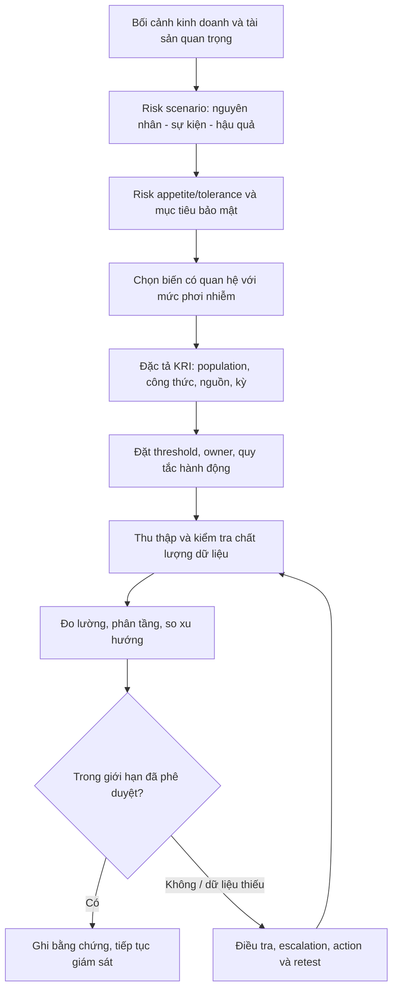
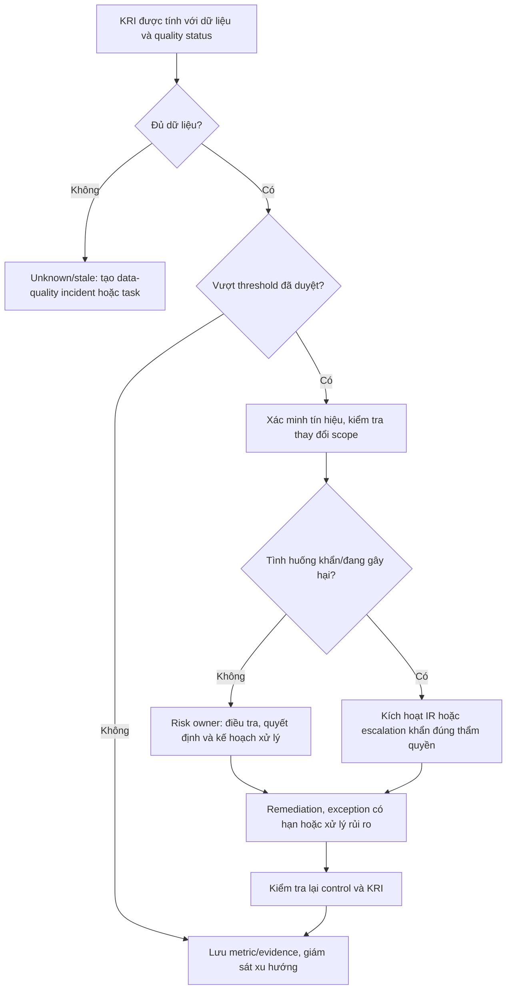

# KRI (Key Risk Indicator): đo tín hiệu rủi ro để điều hành security assurance

## 1. KRI là gì?

**KRI (Key Risk Indicator)**, hay *chỉ số rủi ro trọng yếu*, là thước đo được lựa chọn để **theo dõi sự thay đổi của mức phơi nhiễm, điều kiện làm tăng rủi ro hoặc dấu hiệu rủi ro đang hiện thực hóa**. KRI giúp người chịu trách nhiệm rủi ro nhận biết khi nào cần điều tra, điều chỉnh ưu tiên, tăng cường kiểm soát, chấp nhận rủi ro theo thẩm quyền hoặc kích hoạt hành động ứng phó.

Trong chương **Metrics và reporting** của module **SECURITY_SECURITY_ASSURANCE**, KRI không chỉ là một con số đặt trên dashboard. Module hướng tới **đánh giá có bằng chứng rằng hệ thống đáp ứng mục tiêu bảo mật**, từ phân tích rủi ro, yêu cầu, security controls đến kiểm thử, audit, khắc phục và assurance liên tục. Vì vậy, một KRI có giá trị phải gắn với **kịch bản rủi ro và quyết định quản trị**, có định nghĩa đo lường rõ, dữ liệu đáng tin, ngưỡng giải thích được và lịch sử hành động sau cảnh báo.

Ví dụ, tổ chức có rủi ro **tài khoản quản trị bị chiếm đoạt**. KRI có thể đo **số danh tính đặc quyền không đáp ứng phương thức xác thực bắt buộc**, được phân tầng theo môi trường production và mức quan trọng. Nếu xu hướng tăng hoặc vượt ngưỡng được phê duyệt, đội quản trị IAM phải xem nguyên nhân và phản ứng, chứ không chỉ chụp lại số liệu vào báo cáo tháng.

KRI **không trực tiếp chứng minh xác suất xảy ra sự cố**. Nó là tín hiệu về rủi ro theo một mô hình và tập dữ liệu xác định. Ngay cả KRI “xanh” cũng không có nghĩa hệ thống không thể bị tấn công.

Sau bài học, người học có thể:

- Phân biệt KRI với KPI, KCI, KGI và các số liệu hoạt động thuần túy.
- Thiết kế KRI từ risk scenario, mục tiêu an toàn, mức chịu đựng rủi ro và quyết định quản trị.
- Định nghĩa công thức, population, nguồn dữ liệu, mốc thời gian, chiều hướng và ngưỡng cảnh báo.
- Kiểm chứng chất lượng dữ liệu và nhận biết điểm mù, thiếu mẫu số, chỉ số dễ bị thao túng.
- Xây dashboard, quy trình escalation, evidence trail, ví dụ tính toán và bài kiểm thử KRI.

## 2. Vì sao tổ chức cần KRI?

Các kiểm soát bảo mật có thể được triển khai theo kế hoạch nhưng rủi ro thực tế vẫn thay đổi:

- Số tài khoản đặc quyền tăng nhanh, trong khi quy trình rà soát quyền không theo kịp.
- Dịch vụ mới được đưa lên cloud nhưng chưa được gắn logging, EDR hoặc chính sách backup.
- Lỗ hổng có khả năng bị khai thác vẫn tồn tại trên các tài sản quan trọng sau thời hạn xử lý.
- Một nhà cung cấp trọng yếu thay đổi dịch vụ, tăng phạm vi dữ liệu hoặc chậm khắc phục phát hiện.
- Incident chưa được triage hoặc tình trạng mất telemetry kéo dài khiến đội bảo mật không nhận ra bất thường.
- Backup job thành công nhưng tuổi điểm dữ liệu có thể khôi phục vượt RPO của nghiệp vụ.

Các ví dụ trên có thể báo hiệu **rủi ro tăng lên trước khi thiệt hại xuất hiện**. KRI được chọn tốt cho phép tổ chức phát hiện xu hướng, quyết định sử dụng nguồn lực và xác minh liệu cải tiến kiểm soát có đang giúp giảm phơi nhiễm.

Một chỉ số chỉ có ý nghĩa quản trị nếu người dùng trả lời được bốn câu hỏi:

1. **Nó liên hệ với rủi ro nào?** Có kịch bản, tài sản và hậu quả cụ thể không?
2. **Con số thay đổi nói gì?** Tăng/giảm cho thấy tăng hay giảm phơi nhiễm, dưới điều kiện nào?
3. **Khi vượt ngưỡng phải làm gì?** Ai nhận thông báo, trong thời gian nào, quyết định gì?
4. **Dữ liệu có đủ đáng tin để hành động không?** Population, kỳ, nguồn, sai lệch và phần chưa quan sát được đã rõ chưa?

Nếu không trả lời được, số liệu có thể là **metric để tham khảo**, chưa nên gọi là KRI trọng yếu trong chương trình assurance.

## 3. Phân biệt KRI, KPI, KCI và KGI

| Khái niệm | Trọng tâm | Câu hỏi ví dụ |
|---|---|---|
| **KRI – Key Risk Indicator** | Mức phơi nhiễm rủi ro, điều kiện nguy hiểm hoặc tín hiệu rủi ro hiện thực hóa | Có bao nhiêu tài khoản đặc quyền chưa đáp ứng xác thực yêu cầu? |
| **KPI – Key Performance Indicator** | Hiệu quả thực hiện hoạt động hoặc quy trình | Tỷ lệ yêu cầu cấp quyền được xử lý trong thời hạn? |
| **KCI – Key Control Indicator** | Tình trạng, độ phủ hoặc hiệu quả vận hành của một kiểm soát | Tỷ lệ hệ thống đã bật MFA policy/EDR theo scope? |
| **KGI – Key Goal Indicator** | Mức độ đạt một mục tiêu kết quả được đặt ra | Mức độ đạt mục tiêu giảm gián đoạn dịch vụ trọng yếu? |
| **Operational metric** | Dữ liệu vận hành mô tả tải/công việc | SIEM nhận bao nhiêu triệu event mỗi ngày? |

Những tên gọi này có thể khác nhau giữa các tổ chức hoặc hệ thống GRC. **Cùng một phép đo có thể đóng nhiều vai trò** tùy mục đích sử dụng, nhưng phải định nghĩa rõ cách diễn giải và quyết định liên quan.

Ví dụ:

- `Số ticket patch đã đóng`: KPI về khối lượng công việc.
- `Tỷ lệ máy chủ có bản vá bắt buộc đang được áp dụng`: KCI về độ phủ kiểm soát.
- `Số tài sản internet-facing quan trọng còn lỗ hổng có mức phơi nhiễm cao quá hạn xử lý`: một KRI có thể phản ánh nguy cơ bị khai thác.
- `Số cuộc tấn công thành công được xác nhận`: số liệu kết quả sự cố (*lagging*), có thể được dùng làm KRI hậu nghiệm nhưng không đủ làm chỉ số cảnh báo sớm.

**Không đánh giá chất lượng chương trình chỉ từ số metric cao hay thấp.** Một SOC nhận nhiều alert hơn sau khi cải thiện telemetry có thể là tiến bộ về độ quan sát, không nhất thiết là rủi ro tăng tương ứng.

## 4. Chuỗi liên kết từ rủi ro đến KRI

KRI nên được thiết kế từ **risk statement**, không phải từ biểu đồ mà công cụ dễ xuất.



Ví dụ đầy đủ:

| Bước | Nội dung |
|---|---|
| **Risk scenario** | Danh tính privileged bị chiếm đoạt dẫn đến sửa IAM và truy cập dữ liệu trái phép |
| **Risk driver** | Tài khoản privileged thiếu phương thức xác thực bắt buộc hoặc quyền không được rà soát |
| **Security objective** | Các quyền đặc quyền thuộc phạm vi được xác thực, giới hạn, giám sát và kiểm soát theo chính sách |
| **KRI đề xuất** | Số lượng và tỷ lệ privileged identities thiếu bảo vệ xác thực theo tiêu chí áp dụng |
| **Population** | Toàn bộ human privileged identities và các nhánh khác được đo riêng trên tenant production |
| **Dữ liệu nguồn** | IAM role inventory, IdP policy assignment, ngoại lệ, lịch sử role grant |
| **Ngưỡng** | Do risk owner phê duyệt dựa trên tác động, không lấy mặc định từ công cụ |
| **Phản ứng** | Xác minh ngoại lệ, xử lý tài khoản, báo owner và theo dõi hiệu quả sửa |
| **Assurance evidence** | Snapshot và query, population reconciliation, test policy, quyết định và retest |

Một KRI tốt phải giữ **quan hệ nhân quả hoặc quan hệ tín hiệu hợp lý** với rủi ro. “Số người tham gia khóa học an ninh mạng” có thể là KPI về đào tạo nhưng không tự là tín hiệu trực tiếp đáng tin về nguy cơ bị chiếm quyền admin.

## 5. Xây dựng risk scenario trước khi đo

Một cách mô tả scenario:

> **Do [nguồn đe dọa/điều kiện], [sự kiện bất lợi] có thể xảy ra đối với [tài sản/quy trình], dẫn tới [hậu quả nghiệp vụ và an ninh].**

Ví dụ:

> “Do các cấu hình hạ tầng mới được đưa vào production mà không áp dụng đầy đủ logging, hành vi truy cập trái phép có thể không được phát hiện kịp thời, làm tăng thiệt hại dữ liệu và thời gian điều tra.”

Từ scenario này, có thể đề xuất hai nhóm KRI:

- **Độ phơi nhiễm:** số/tỷ lệ tài sản production trọng yếu chưa có telemetry theo data contract đã duyệt.
- **Khoảng trống kéo dài:** thời gian mà một nguồn log trọng yếu mất tín hiệu trước khi khôi phục hoặc có phương án bù.

Cần cân nhắc có nhiều yếu tố ảnh hưởng cùng một hậu quả: telemetry khỏe không bảo đảm detection rule đúng, còn rule đúng không bảo đảm SOC phản ứng đúng. Vì thế một scenario có thể cần **một tập KRI bổ sung** thay vì một “siêu chỉ số” duy nhất.

### 5.1. Leading và lagging indicators

| Loại | Ý nghĩa | Ví dụ | Giới hạn |
|---|---|---|---|
| **Leading KRI** | Chỉ ra điều kiện có thể làm rủi ro tăng trước khi sự cố xảy ra | Tài sản internet-facing trọng yếu quá hạn xử lý lỗ hổng có thể khai thác |
| **Lagging KRI** | Ghi nhận hậu quả hoặc sự kiện rủi ro đã xuất hiện | Số incident được xác nhận có tác động lớn trong kỳ |
| **Near-real-time exposure** | Đo phơi nhiễm hoặc suy giảm kiểm soát gần thời điểm phát sinh | Nguồn log trọng yếu đang mất dữ liệu quá ngưỡng cho phép |
| **Composite KRI** | Kết hợp nhiều tín hiệu có mô hình định nghĩa rõ | Điểm phơi nhiễm theo asset criticality, access và tình trạng control |

Leading không có nghĩa **dự báo chắc chắn**; lagging không đồng nghĩa vô ích. Sau một sự cố, chỉ số hậu nghiệm có thể kiểm tra liệu mô hình rủi ro và bộ chỉ báo trước sự cố đã bỏ sót điều gì.

Đặc biệt với các rủi ro hiếm nhưng hậu quả rất lớn, **số sự cố bằng 0** không chứng minh rủi ro thấp. Cần giám sát các điều kiện dẫn đến sự cố và kiểm tra khả năng phát hiện.

## 6. Chọn KRI: các tiêu chí chất lượng

Một KRI nên được đánh giá trước khi đưa vào dashboard:

| Tiêu chí | Câu hỏi xem xét |
|---|---|
| **Risk relevance** | Chỉ số có liên hệ được giải thích với scenario và tác động không? |
| **Sensitivity** | Khi phơi nhiễm thay đổi đáng kể, metric có phản ánh đủ nhanh không? |
| **Specificity** | Số liệu có bị tác động mạnh bởi yếu tố không liên quan rủi ro không? |
| **Actionability** | Có owner và hành động rõ khi vượt ngưỡng không? |
| **Timeliness** | Dữ liệu cập nhật đủ nhanh cho quyết định cần đưa ra không? |
| **Measurability** | Công thức, population, đơn vị, trường nguồn và kỳ có rõ không? |
| **Reliability** | Nguồn và data pipeline có thể đối chiếu/kiểm chứng không? |
| **Comparability** | Có thể so giữa các kỳ sau khi điều chỉnh scope và định nghĩa không? |
| **Resistance to gaming** | Metric có dễ được làm đẹp bằng cách đổi nhãn, đóng ticket hoặc thu hẹp mẫu số không? |
| **Cost proportionality** | Chi phí thu thập/kiểm tra phù hợp với giá trị quyết định không? |

Một chỉ số rất dễ đo nhưng khó giải thích thành quyết định có thể được giữ là **metric vận hành**, không cần nâng thành KRI chính thức.

### 6.1. Phương pháp thử một KRI trước khi vận hành

Với KRI đề xuất, hãy chạy thử trên dữ liệu lịch sử hoặc tình huống giả lập:

1. Khi một asset trọng yếu bị mất EDR, KRI có thay đổi không?
2. Khi số lượng tài sản tăng gấp đôi, KRI có tăng giả chỉ vì population lớn hơn không?
3. Khi một log connector lỗi, KRI hiển thị `unknown` hay tự về 0?
4. Khi nhóm vận hành chỉ đóng ticket mà chưa sửa quyền, KRI có giảm nhầm không?
5. Khi một ngoại lệ được phê duyệt, metric còn phản ánh đúng **phơi nhiễm còn lại** không?
6. Khi nguồn event bị đổi schema, data quality check có phát hiện không?

Nếu metric không vượt qua các kiểm tra này, cần sửa định nghĩa hoặc công bố giới hạn trước khi dùng cho quyết định.

## 7. Data dictionary: định nghĩa KRI như một data product

Một KRI có thể được mô tả bằng bộ metadata sau:

| Trường | Nội dung cần xác định |
|---|---|
| `kri_id`, `version` | Định danh và phiên bản không bị thay đổi âm thầm |
| `name`, `description` | Tên, mục đích và cách diễn giải ngắn |
| `risk_scenario_ref` | Kịch bản rủi ro và tài sản/nghiệp vụ liên quan |
| `risk_owner`, `metric_owner` | Người quyết định về rủi ro và người quản trị metric |
| `population_definition` | Tập đối tượng có thể kiểm chứng được |
| `inclusion_exclusion_rules` | Bao gồm/loại trừ và căn cứ, phê duyệt |
| `numerator_definition` | Khi nào một đối tượng được coi là đang phơi nhiễm? |
| `denominator_definition` | Số đối tượng thuộc scope và quy tắc trùng lặp |
| `aggregation_unit` | Đếm identity, host, ứng dụng, account, ngày hay event? |
| `measurement_type` | Count, rate, duration, age, quantile, composite score |
| `direction` | Tăng là xấu, giảm là xấu, hay tốt nhất nằm trong một dải? |
| `source_and_lineage` | Hệ thống nguồn, query, mapping và cách đối soát |
| `event_time`, `as_of`, `ingested_at` | Mốc nghiệp vụ, snapshot và thời gian hệ thống nhận dữ liệu |
| `frequency`, `allowed_lag` | Tần suất đo và độ trễ dữ liệu cho phép |
| `thresholds`, `baseline` | Ngưỡng đã được phê duyệt, mốc so sánh và lý do |
| `data_quality_rules` | Xử lý null, duplicate, stale, incomplete, unknown |
| `escalation`, `response_plan` | Ai nhận thông báo và hành động tương ứng |
| `evidence_ref`, `review_cycle` | Hồ sơ kiểm chứng, ngày rà soát |
| `limitations` | Những điều không thể suy ra từ KRI |

**Nếu có nhiều đơn vị đo, không gộp thiếu định nghĩa.** Ví dụ “số tài sản vi phạm” khác “số lần vi phạm” vì một host có thể tạo 20 alert. Quyết định chọn đơn vị phụ thuộc scenario, cách tránh đếm trùng và hành động cần thực hiện.

## 8. Công thức KRI: count, rate, duration và severity

### 8.1. Số lượng (count)

\[
\mathrm{KRI}_{\mathrm{count}}(t)
= \#\{\text{đối tượng thuộc phạm vi thỏa điều kiện rủi ro tại }t\}
\]

Ví dụ **7 tài khoản đặc quyền không đáp ứng yêu cầu xác thực** tại thời điểm chụp. Count dễ hiểu, nhưng cần nhìn cả tổng population và mức quan trọng. Tăng từ 7 lên 8 có thể là nhỏ với tổ chức hàng nghìn tài khoản, nhưng cực nghiêm trọng nếu đó là các tài khoản quản trị root.

### 8.2. Tỷ lệ (rate)

\[
\mathrm{KRI}_{\mathrm{rate}}(t)
= \frac{\mathrm{ExposedEligible}(t)}
{\mathrm{EligiblePopulation}(t)} \times 100\%
\]

Nếu có **7/350** danh tính privileged thuộc scope không đáp ứng kiểm soát, tỷ lệ là:

\[
7/350 \times 100\% = 2\%.
\]

Tỷ lệ giúp so sánh khi quy mô thay đổi, nhưng có thể **che giấu một trường hợp nguy hiểm ở tài sản trọng yếu**. Do đó nên hiển thị song song count, rate và phân tầng criticality.

### 8.3. Age và duration

\[
\mathrm{Age}_i = t_{\mathrm{measurement}}-t_{\mathrm{due},i}
\]

Trong đó `t_due` là hạn xử lý hợp lệ theo chính sách, **không phải ngày phát hiện** nếu các mốc này khác nhau. Với backlog quá hạn, có thể đo **số finding quá hạn**, **tuổi quá hạn lớn nhất**, **median** hoặc **P95** của tuổi quá hạn.

P95 của thời gian xử lý cũng có thể có ích khi phân phối lệch. Tuy nhiên, P95 trên 10 mẫu rất khó ổn định, và chọn “case đã đóng” có thể bỏ qua các case vẫn đang tồn đọng. Phải ghi rõ **population, window và censoring** của trường hợp chưa hoàn tất.

### 8.4. Mức trọng yếu và số đo phân tầng

Ví dụ:

- **KRI A:** số asset internet-facing critical quá hạn khắc phục lỗ hổng trọng yếu.
- **KRI B:** tỷ lệ asset medium/low quá hạn.
- **KRI C:** số ngày tuổi lớn nhất của các phát hiện rủi ro cao chưa đóng.

Đây thường là cấu trúc dễ hành động hơn một điểm tổng hợp duy nhất. Trường hợp cần composite score, phải mô tả **trọng số, chuẩn hóa, rule gating, sensitivity, cách xử lý missing data và người phê duyệt mô hình**. Không lấy trọng số tùy ý rồi gọi kết quả là “risk probability”.

## 9. Chọn population và mẫu số đúng

Sai ở mẫu số có thể khiến KRI thay đổi mà rủi ro thật không đổi.

Ví dụ:

- Có 200 máy chủ production trong CMDB, nhưng cloud discovery tìm thêm 25 máy đang chạy chưa nhập CMDB.
- Dashboard EDR cho thấy 190/200 máy “healthy”, tương đương 95% theo CMDB.
- Nếu 25 máy mới đều chưa được xét, **không thể kết luận 95% của toàn bộ máy production đã có EDR**.

Để đo phơi nhiễm, phải xác định **universe từ nguồn có thẩm quyền**, hoặc nếu nhiều nguồn không hoàn chỉnh thì lưu rõ phần chênh lệch chưa xác minh.

Cần phân biệt:

- **Eligible**: đối tượng thuộc phạm vi theo định nghĩa đã được duyệt.
- **Non-compliant/exposed**: có bằng chứng cho thấy đối tượng vi phạm điều kiện.
- **Compliant/not exposed by this test**: có bằng chứng đáp ứng tiêu chí đo.
- **Unknown/unobserved**: đối tượng thuộc scope nhưng thiếu dữ liệu để xác định.
- **Excluded/exceptional**: có căn cứ hợp lệ, thẩm quyền và hạn hiệu lực nếu cần.

Không ép `unknown` thành `compliant`. Cũng không tự coi mọi `unknown` là sự cố đã xác nhận; nên hiển thị riêng mức **không chắc chắn** và quy trình xử lý khoảng trống.

### 9.1. Ví dụ có dữ liệu thiếu

Giả sử inventory xác định **60 máy chủ trọng yếu**:

| Trạng thái kiểm tra log | Số máy |
|---|---:|
| Có bằng chứng gửi log đầy đủ | 53 |
| Có bằng chứng mất log vượt ngưỡng | 3 |
| Chưa xác minh vì collector/export lỗi | 4 |
| **Tổng** | **60** |

Ta có:

- **Phơi nhiễm đã xác nhận:** `3/60 = 5%`.
- **Chưa xác định:** `4/60 \approx 6,67%`.
- **Tỷ lệ máy có bằng chứng đạt:** `53/60 \approx 88,33%`.

Nếu cả bốn trường hợp chưa xác định sau đó bị xác nhận mất log, tỷ lệ phơi nhiễm là `7/60 \approx 11,67%`; nếu đều tốt thì tỷ lệ phơi nhiễm vẫn là 5%. Có thể báo **khoảng 5%–11,67% trong giả định hai trạng thái của phần unknown**, nhưng không nên trình bày đó là khoảng tin cậy thống kê.

Khi dữ liệu thiếu, dashboard cần hiển thị **coverage và unknown** đủ nổi bật. Nếu chỉ ghi 3 máy và gọi số còn lại an toàn, người ra quyết định có thể đánh giá thấp rủi ro.

## 10. Thời gian, độ trễ và quy tắc tổng hợp

Một KRI phải được hiểu trong **cửa sổ và thời điểm đo cụ thể**:

| Kiểu đo | Phù hợp với | Ví dụ |
|---|---|---|
| **Snapshot (as-of)** | Tình trạng đang tồn tại | Số tài khoản đặc quyền không có bảo vệ tại 09:00 UTC |
| **Period flow** | Sự kiện phát sinh trong kỳ | Số incident P1 được xác nhận trong tháng |
| **Rolling window** | Tín hiệu thay đổi nhanh | Tỷ lệ tài sản mất logging trong 24 giờ gần nhất |
| **Cumulative** | Số liệu tích lũy theo mốc | Số finding quá hạn chưa xử lý tính đến cuối kỳ |
| **Duration** | Mức phơi nhiễm kéo dài | Tổng giờ tài sản critical không có EDR trong tuần |
| **Event-driven** | Tín hiệu tức thời khi điều kiện xảy ra | Một kho backup quan trọng bị tắt bất thường |

Các mốc `event_time`, `ingested_at`, `evaluated_at` và `report_generated_at` không đồng nghĩa. Nếu log đến muộn sau 2 giờ, một báo cáo theo event time có thể thay đổi sau khi đã phát hành. Cần quy định:

1. Đo theo **event time** hay theo thời gian ingestion?
2. Window dùng `[start_inclusive, end_exclusive)` hay quy tắc nào khác?
3. Dữ liệu đến muộn được chấp nhận đến thời điểm nào?
4. Snapshot được đóng băng khi báo cáo, hay có thể restate với version mới?
5. Timezone nào là chuẩn? Nên lưu UTC và quy đổi giờ địa phương khi trình bày.
6. Khi dữ liệu nguồn tạm mất, KRI có phải gắn `stale` hoặc `unavailable`?

Không so sánh một snapshot sáng thứ Hai với tổng sự kiện của cả tháng như thể chúng là cùng một loại số đo.

## 11. Risk appetite, tolerance và threshold

**Risk appetite** là mức độ và loại rủi ro tổ chức sẵn sàng chấp nhận khi theo đuổi mục tiêu; **risk tolerance** thường được dùng để chỉ mức sai lệch có thể chấp nhận quanh mục tiêu/risk appetite trong ngữ cảnh quản trị cụ thể. Cách định nghĩa chi tiết có thể khác theo framework và chính sách nội bộ, vì vậy cần dùng **nghĩa đã được tổ chức phê duyệt**.

Ngưỡng KRI giúp chuyển mức phơi nhiễm thành **quy tắc xem xét và hành động**, nhưng **ngưỡng cảnh báo không tự bằng giới hạn pháp lý hoặc tiêu chí compliance**.

Ví dụ giả định cho tỷ lệ tài khoản privileged không đáp ứng cơ chế xác thực trong một nhóm hệ thống:

| Mức tín hiệu nội bộ | Điều kiện minh họa | Hành động |
|---|---|---|
| **Normal** | 0 trường hợp đã xác nhận trong population đầy đủ | Giám sát và ghi evidence theo kỳ |
| **Watch** | 1 trường hợp mới trên tài khoản không thuộc nhóm đặc biệt trọng yếu | Xác minh trong thời hạn vận hành đã phê duyệt |
| **Action required** | Có vi phạm đã xác nhận hoặc xu hướng tăng vượt điều kiện nội bộ | Tạo remediation, giao owner và theo dõi |
| **Critical escalation** | Tài khoản đặc quyền cực cao không bảo vệ hoặc có dấu hiệu lạm dụng đang diễn ra | Kích hoạt điều phối khẩn theo quy trình |

Bảng là **giả định quản trị**, không phải thang bắt buộc. Với requirement bắt buộc “mọi tài khoản thuộc scope phải đáp ứng”, ngay **một sai lệch** có thể đã là vấn đề compliance, dù chương trình vận hành dùng mức `Watch` cho phản ứng ban đầu.

### 11.1. Các cách đặt ngưỡng

- **Theo nghĩa vụ và mục tiêu được duyệt:** không có vi phạm được phép, hoặc thời gian tối đa theo SLA/BCP.
- **Theo hậu quả rủi ro:** một hệ thống crown-jewel không được dùng cùng ngưỡng số lượng với hệ thống thí nghiệm ít ảnh hưởng.
- **Theo baseline lịch sử:** xem mức biến động bình thường, nhưng không lấy lịch sử sai lệch kéo dài làm mức chấp nhận mới.
- **Theo xu hướng tốc độ:** tăng nhanh trong 24 giờ có thể quan trọng hơn một số dư ổn định thấp.
- **Theo khả năng phát hiện:** đặt mức `unknown / stale` riêng; mất dữ liệu không được xem là rủi ro giảm.

### 11.2. Hysteresis và chống nhiễu

Một KRI thay đổi từng phút có thể liên tục nhảy giữa các mức cảnh báo. Có thể dùng **hysteresis**, ví dụ điều kiện vào vùng cảnh báo khác điều kiện trở về bình thường, hoặc yêu cầu vượt ngưỡng kéo dài một khoảng thời gian. Tuy nhiên không áp dụng trì hoãn cho các tín hiệu cần ứng phó khẩn như **mất kiểm soát root account hoặc phá hủy dữ liệu đang diễn ra**.

Cơ chế chống nhiễu phải được tài liệu hóa và kiểm thử để không vô tình che sự kiện hiếm nhưng hậu quả lớn.

## 12. Ví dụ KRI 1: quyền truy cập đặc quyền

**Risk scenario:** kẻ tấn công chiếm hoặc lạm dụng tài khoản privileged để thay cấu hình hoặc lấy dữ liệu.

**KRI đề xuất:** `Privileged identities without approved strong authentication protection`.

Định nghĩa:

- Population là mọi **human privileged identities** trong tenant production theo role inventory và lịch sử quyền.
- Numerator là số danh tính thuộc scope có bằng chứng **không** chịu cơ chế xác thực bắt buộc theo chính sách được duyệt tại thời điểm đo.
- Trường hợp thiếu policy export hoặc role mapping được ghi `unknown`, không mặc định pass.
- Tài khoản **workload/service** được theo dõi bằng requirement xác thực và quản lý credential phù hợp, không ép tiêu chí MFA người dùng cho machine identity.
- Trường hợp emergency có chính sách đặc thù được phân tầng và ghi ngoại lệ rõ.

Một bộ chỉ số bổ sung hợp lý:

| KRI / metric | Điều phát hiện |
|---|---|
| **Count unprotected privileged identities** | Số trường hợp nguy hiểm cần hành động |
| **Share of privileged identities exposed** | Mức phơi nhiễm tương đối khi population đổi |
| **Critical privileged exposure** | Trường hợp root/admin đặc biệt trọng yếu |
| **Days since exposure first observed** | Khoảng kéo dài của sai lệch |
| **Unknown privileged coverage** | Điểm mù trong population/policy mapping |
| **Control health metric** | IdP policy và auditing có đang hoạt động đúng không? |

Nếu đợt đo tiếp theo số tài khoản không có MFA giảm từ 7 xuống 1, cần kiểm tra **vì đã sửa kiểm soát, đã loại khỏi scope hợp lệ, hay hệ thống mất dữ liệu**. Chỉ thay đổi một con số không đủ chứng minh giảm rủi ro.

## 13. Ví dụ KRI 2: lỗ hổng, bản vá và mức phơi nhiễm

**Risk scenario:** kẻ tấn công khai thác lỗ hổng trên các tài sản có thể truy cập từ internet dẫn tới thực thi mã hoặc lấy dữ liệu.

Một KRI có thể là:

> “Số tài sản production có phơi nhiễm internet, độ quan trọng cao và tồn tại lỗ hổng đã được xác nhận vượt thời hạn xử lý theo quy tắc ưu tiên nội bộ.”

Dữ liệu cần:

- **Asset inventory:** ID ổn định, owner, môi trường, trạng thái đang chạy, criticality.
- **Exposure mapping:** thực sự public/internet-reachable, qua network path nào, thời điểm và phạm vi.
- **Finding:** CVE hoặc mô tả lỗ hổng, phiên bản, phát hiện đầu tiên, tình trạng hiện tại, bằng chứng xác thực.
- **Remediation policy:** hạn theo mức rủi ro đã duyệt, ngoại lệ và biện pháp bù nếu có.
- **Validation:** kết quả re-scan/kiểm tra sau sửa, không chỉ ticket đóng.
- **Data quality:** tài sản chưa được scan, scanner lỗi, signature cũ, vùng mạng không có coverage.

Không nên chỉ dùng **số lượng CVE**: một asset có 20 CVE và một asset có 1 CVE nhưng là hệ thống thanh toán quan trọng có thể có mức rủi ro khác nhau. Mức CVSS, tín hiệu khai thác và mức phơi nhiễm là yếu tố đánh giá, **không phải xác suất bị tấn công**. Nếu công cụ cung cấp điểm xác suất riêng, phải hiểu phạm vi và giới hạn mô hình trước khi diễn giải.

### 13.1. Đếm lỗ hổng hay đếm tài sản?

- **Count findings:** cho biết khối lượng lỗ hổng cần xử lý, có thể nhiều finding trên cùng asset.
- **Count impacted critical assets:** cho biết có bao nhiêu tài sản trọng yếu đang phơi nhiễm.
- **Age past due:** phản ánh mức kéo dài không đáp ứng chính sách.
- **Potential business impact:** kết hợp dữ liệu BIA hoặc criticality, không đơn thuần cộng số CVE.

Chọn phép đo theo câu hỏi quyết định: muốn ưu tiên sửa hệ thống nào hay muốn dự báo khối lượng công việc đội patching?

## 14. Ví dụ KRI 3: logging, detection và response

**Risk scenario:** hoạt động tấn công không được phát hiện hoặc phản ứng kịp thời do mất telemetry, rule yếu hoặc case tồn đọng.

Các KRI liên quan:

| KRI | Định nghĩa cần chú ý | Khi tăng có thể có nghĩa |
|---|---|---|
| **Critical assets without required telemetry** | Tài sản bắt buộc nhưng chưa có log đủ điều kiện | Vùng mù giám sát mở rộng |
| **Time exposed due to source outage** | Thời gian nguồn log trọng yếu không quan sát được | Rủi ro bị bỏ sót tăng theo thời gian |
| **Untriaged high-priority case age** | Tuổi case P0/P1 chưa triage so với mốc chính sách | Tồn đọng làm chậm phản ứng |
| **Detection regression failures** | Số detection test thất bại trên bộ kiểm thử đã duyệt | Khả năng phát hiện một số hành vi suy giảm |
| **Critical detection coverage gaps** | Threat scenario quan trọng chưa có năng lực kiểm chứng | Phơi nhiễm trước các kỹ thuật chưa được quan sát |

**Số alert tăng không mặc nhiên là KRI rủi ro tăng.** Có thể detector vừa được cải thiện, một đối tác mới bắt đầu gửi log hoặc tăng false positives. Cần so với telemetry health, detection precision, thay đổi rule và kết quả điều tra.

Đối với incident response, nên ghi riêng các metric như **time to acknowledge**, **time to triage**, **time to escalate**, và chọn KRI nếu các độ trễ này phản ánh một risk scenario đã xác định. Chỉ tính các case “đã đóng” có thể che backlog chưa xử lý; cần xem cả case còn mở và thời gian đang tiếp diễn.

## 15. Ví dụ KRI 4: backup và khả năng phục hồi

**Risk scenario:** ransomware, lỗi vận hành hoặc hỏng dữ liệu khiến nghiệp vụ không khôi phục được trong giới hạn BIA.

Các lựa chọn:

- Số workload quan trọng mà **điểm phục hồi sử dụng được mới nhất** cũ hơn RPO đã duyệt.
- Số workload quan trọng **quá hạn restore test** theo chính sách dựa trên rủi ro.
- Số workload chưa có bản backup tách khỏi **failure/control domain** được xác định trong threat model.
- Số diễn tập phục hồi **không đạt RTO/RPO** hoặc còn finding chưa được retest.
- Thời gian gián đoạn liên tục của backup log shipping trên các hệ thống trọng yếu.

Phải phân biệt:

- `backup_job_success = true` là một tín hiệu hoạt động.
- `recoverable_point_age <= RPO` đòi hỏi bằng chứng về điểm dữ liệu **có thể khôi phục nhất quán**.
- `restore_test_passed` có giá trị khi kịch bản, môi trường, quyền truy cập, data consistency và nghiệp vụ được kiểm tra theo tiêu chí.
- `recovery risk` có thể còn cao dù RPO đo tốt nếu bản sao có thể bị xóa bởi cùng một tài khoản admin.

Đối với BIA, tổ chức cần xem **độ quan trọng nghiệp vụ**: một lần thất bại restore của cơ sở dữ liệu thanh toán có thể quan trọng hơn nhiều lần thất bại backup trên dữ liệu có thể tái tạo.

## 16. Ví dụ KRI 5: third-party và compliance assurance

**Risk scenario:** nhà cung cấp trọng yếu không đáp ứng cam kết bảo mật hoặc làm gián đoạn một hoạt động then chốt.

KRI đề xuất:

- Số engagement rủi ro cao có **finding critical/high quá hạn** chưa được kiểm chứng khắc phục.
- Số vendor quan trọng có **bằng chứng đánh giá đã hết thời kỳ áp dụng** và chưa có nguồn thay thế phù hợp.
- Tỷ lệ hoạt động trọng yếu phụ thuộc **một fourth party hoặc một failure domain** không có phương án thay thế đã kiểm tra.
- Số third-party privileged integrations chưa có owner và đường thu hồi quyền được xác nhận.
- Số hợp đồng trọng yếu đến hạn gia hạn mà chưa được đánh giá lại các yêu cầu liên quan.

Cần tách **trạng thái chứng cứ** khỏi **thực trạng rủi ro**. Vendor chưa gửi báo cáo mới có thể tạo *evidence gap*, nhưng không chứng minh ngay vendor đã vi phạm kiểm soát. Tuy nhiên, sự thiếu khả năng chứng minh trong một quan hệ quan trọng có thể là **rủi ro quản trị đáng quan tâm** và vẫn cần KRI theo dõi riêng.

**Compliance KRI** cũng không phải một cột “compliant = yes/no” lấy từ bảng checklist. Hãy dùng các tín hiệu có cơ chế diễn giải: yêu cầu critical chưa có implementation, control test thất bại, finding quá hạn, ngoại lệ hết hạn, nguồn bằng chứng bị mất hoặc tài sản mới ngoài phạm vi đánh giá.

## 17. Thiết kế ngưỡng, cảnh báo và escalation

KRI có giá trị khi được đưa vào một **chuỗi quyết định có trách nhiệm**:



Đối với mỗi mức cảnh báo, cần định nghĩa:

| Trường | Ý nghĩa |
|---|---|
| `trigger_condition` | Count/rate/duration nào tạo cảnh báo? Có cần liên tục vượt ngưỡng không? |
| `severity_and_criticality` | Rủi ro trên asset critical có quy tắc riêng không? |
| `notification_target` | Ai nhận: SOC, control owner, risk owner, lãnh đạo, BCM? |
| `acknowledgement_target` | Thời hạn xác nhận tiếp nhận theo mức rủi ro |
| `triage_steps` | Dữ liệu nguồn, thay đổi quy mô, nguyên nhân, ngoại lệ cần xem |
| `decision_authority` | Ai có quyền sửa kiểm soát, kích hoạt response hoặc chấp nhận rủi ro? |
| `response_action` | Hành động giảm phơi nhiễm và mốc theo dõi |
| `closure_criteria` | Bằng chứng nào cho thấy tình trạng đã được xử lý? |
| `retest` | Cách đo lại từ nguồn tin cậy, kể cả dữ liệu chưa quan sát được |

**Vượt ngưỡng cảnh báo không tự đồng nghĩa đã có incident bảo mật.** Có thể là vấn đề cần điều tra. Nếu phát hiện hành vi gây hại đang xảy ra, quy trình incident response phải được kích hoạt theo điều kiện và quyền hạn, không chờ báo cáo KRI tháng sau.

### 17.1. Tránh biến threshold thành mục tiêu “làm đẹp”

Nếu một chỉ số dùng ngưỡng `< 3%` số máy không có EDR, nhóm vận hành có thể vô tình hoặc cố ý loại các máy khó đo khỏi inventory để giữ dashboard xanh. Kiểm soát hiệu quả cần **đối chiếu population độc lập và theo dõi số unknown/exception**, không chỉ hiển thị tỷ lệ đã chuẩn hóa.

## 18. Thiết kế dashboard KRI cho từng đối tượng

Dashboard không nên chỉ là một bảng màu. Các vai trò có câu hỏi khác nhau:

| Người nhận | Cần biết | Mức chi tiết phù hợp |
|---|---|---|
| **Board / lãnh đạo** | Những rủi ro nào đang vượt mức chịu đựng và cần quyết định nguồn lực? | KRI trọng yếu, tác động, xu hướng, quyết định và chủ sở hữu |
| **Risk committee** | Ngưỡng nào bị vượt, vì sao, rủi ro còn lại và kế hoạch xử lý? | Risk scenario, segment, finding, lịch sử threshold và action |
| **CISO / Security assurance** | Mức phơi nhiễm, chất lượng bằng chứng, gap kiểm soát và tiến độ kiểm chứng? | Drill-down, evidence refs, data quality, retest |
| **SOC / IAM / SRE** | Cần sửa asset, identity, case hoặc job nào ngay? | Danh sách đối tượng cụ thể, event IDs, runbook, owner |
| **Audit / Compliance** | Số liệu có tái hiện được và kết luận có giới hạn gì? | Metric definition, query/version, source, cutoff, exceptions |

Một dashboard nên hiển thị cho mỗi KRI:

- **Giá trị hiện tại**, đơn vị, thời điểm đo và kỳ.
- **Count + denominator**, không chỉ phần trăm.
- **Trend và baseline**, kèm thông tin khi định nghĩa hoặc scope thay đổi.
- **Threshold và lý do**, trạng thái theo quy tắc đã duyệt.
- **Critical segment**, ví dụ tài sản crown-jewel hoặc quyền admin cao nhất.
- **Unknown/stale coverage**, khả năng data lag và kết quả quality checks.
- **Owner, next action, due date**, trạng thái finding và retest.
- **Nguồn và method version** để có thể truy lại.

Khi báo cáo cấp cao, hãy kết hợp số liệu với câu giải thích hành động, ví dụ: “Có 3 hệ thống trọng yếu mất log trên population 60; 4 hệ thống chưa xác minh do lỗi collector; đội logging đang xử lý với hạn đã phê duyệt”. Câu này hữu ích hơn một nhãn đỏ thiếu bối cảnh.

## 19. KRI trend và so sánh qua thời gian

KRI tháng này tăng có thể do:

1. Phơi nhiễm thực sự tăng.
2. Phát hiện tốt hơn, nguồn mới được bổ sung.
3. Scope hoặc asset inventory thay đổi.
4. Chuyển phương pháp tính, định nghĩa severity hoặc parser.
5. Dữ liệu tháng trước bị thiếu hoặc được cập nhật muộn.
6. Ngoại lệ hết hạn hoặc chính sách quản lý thay đổi.

Vì vậy nên lưu **series với metric version và scope version**. Khi thay đổi định nghĩa, đừng ghép hai đường đồ thị như thể phép đo giống nhau.

### 19.1. Snapshot đúng và so sánh cùng population

Ví dụ:

| Thời điểm | Total eligible | Exposed | Unknown | Exposed / eligible |
|---|---:|---:|---:|---:|
| Tháng 1 | 100 | 10 | 0 | 10,0% |
| Tháng 2 | 200 | 12 | 15 | 6,0% |

Tỷ lệ giảm từ 10% xuống 6%, nhưng **số trường hợp phơi nhiễm tăng từ 10 lên 12** và có 15 trường hợp chưa biết. Không thể kết luận chắc chắn rủi ro giảm chỉ bằng tỷ lệ. Cần xem khối lượng mới, criticality, thời gian phơi nhiễm, nguyên nhân unknown và chất lượng dữ liệu.

Nếu report được restate do log đến muộn, phải lưu **as-reported** và **revised** (hoặc cơ chế version tương đương) để audit phân biệt những gì người quản trị đã thấy ở thời điểm ra quyết định.

### 19.2. Chuẩn hóa theo mức rủi ro có điều kiện

Không nên xếp hai nhóm ngang nhau nếu một nhóm có 3 máy quan trọng và một nhóm có 300 máy ít ảnh hưởng. Có thể phân tầng:

- Critical/internet-facing.
- Production có dữ liệu nhạy cảm.
- Internal production.
- Development/test và phần ngoài scope.

Một điểm tổng hợp có trọng số chỉ nên được tạo nếu **risk owner phê duyệt và người dùng có thể drill-down** tới các trường hợp gốc. Một sai lệch critical không được “bù” bởi hàng nghìn điểm đạt low-risk trong một chỉ số trung bình.

## 20. Dữ liệu nguồn, lineage và kiểm soát chất lượng

KRI chịu rủi ro **garbage in, garbage out**. Một data pipeline cần có quy tắc về nguồn và khả năng đối chiếu.

| Kiểm tra | Vấn đề có thể phát hiện | Hành động |
|---|---|---|
| **Source freshness** | Connector không cập nhật, data lag | Gắn stale, không công bố như dữ liệu mới |
| **Schema validation** | Đổi `asset_id`, `role`, `event_time` | Dừng/đánh dấu không đáng tin, điều tra mapping |
| **Completeness check** | Một tenant, page API hoặc khoảng ngày bị bỏ | Tạo gap và tính lại population |
| **Referential integrity** | Identity/host không ánh xạ vào asset inventory | Hàng đợi xử lý unknown |
| **Deduplication** | Một asset có nhiều bản ghi do nhiều scanner | Quy tắc unique ID và snapshot |
| **Timezone/window** | Event lùi/nhảy kỳ do timezone | Chuẩn hóa UTC, lưu cả event và ingest time |
| **Exception verification** | Bản ghi loại trừ không có phê duyệt/hạn | Không mặc nhiên hạ phơi nhiễm |
| **Independent reconciliation** | KRI từ một công cụ bỏ sót assets trong nguồn khác | Đối chiếu sample hoặc full population |
| **Permission/audit trail** | Người vận hành có thể sửa kết quả sau tính | Role separation và log thay đổi |
| **Outlier review** | Giá trị nhảy đột biến do thay đổi parser | Kiểm tra trước khi kết luận risk trend |

Cần có chính sách cho **dữ liệu thiếu**: `not_available`, `stale`, `partial`, `unknown` hoặc trạng thái tương đương. Không thay null bằng 0 rồi báo “không còn rủi ro”.

Với dữ liệu có tính bảo mật, chỉ hiển thị mức tổng hợp phù hợp cho lãnh đạo; record chi tiết về lỗ hổng, quyền đặc biệt hay tài khoản người dùng phải được phân quyền và lưu theo chính sách.

## 21. Mẫu đặc tả KRI có thể kiểm toán

Ví dụ YAML dưới đây là **schema mô tả nội bộ phục vụ học tập**, không phải cấu hình chạy trực tiếp trên GRC/SIEM/BI. Các ID, ngưỡng và ngày là giả định; tổ chức phải phê duyệt theo bối cảnh riêng.

```yaml
kri:
  id: KRI-LOG-CRITICAL-001
  version: "1.0"
  name: "Critical production assets with missing required logging"
  risk_scenario_ref: RISK-DETECTION-BLINDSPOT-001
  objective: >
    Detect growth in the exposure created by blind spots
    in security telemetry for critical production assets.
  risk_owner: head-of-security-risk
  metric_owner: security-monitoring-engineering

scope:
  environment: production
  criticality: critical
  asset_population_ref: inventory-critical-assets-v3
  included: "Active assets required to emit defined audit events"
  exclusions: "Only approved, dated and reviewable exceptions"
  identity_key: asset_id

measurement:
  type: rate_and_count
  numerator: >
    Eligible critical assets with confirmed logging loss
    beyond their approved allowed outage window.
  denominator: "All verified eligible critical assets"
  unknown_count: "Eligible assets lacking a valid health determination"
  direction: higher_is_worse
  unit: percent
  as_of_semantics: snapshot_utc
  frequency: hourly
  allowed_data_lag_minutes: 20

data_contract:
  sources:
    - asset-inventory
    - telemetry-health-events
    - approved-exception-register
  required_fields:
    - asset_id
    - observed_at_utc
    - criticality
    - logging_state
    - source_id
  quality_checks:
    - "No missing pages from the inventory query"
    - "One state per asset at each as-of boundary"
    - "Unknown is never silently treated as healthy"
    - "Exception approval and expiry are checked"

thresholds:
  note: "Illustrative only; must be approved by the risk owner"
  watch: "One confirmed exposed critical asset"
  escalate: "Confirmed exposure persists beyond approved response target"
  data_quality_escalation: "Health evidence unavailable beyond allowed lag"

governance:
  evidence:
    - "Versioned metric query"
    - "Snapshot population and observation time"
    - "Telemetry health records"
    - "Alert, action and retest history"
  owner_review_frequency: monthly
  last_approved_at: null
  approval_status: pending
```

YAML cố ý có `approval_status: pending`, để **không ngộ nhận ngưỡng minh họa đã là chính sách thực tế**. Một bản ghi KRI chỉ nên được dùng cho quyết định chính thức sau khi định nghĩa, owner, ngưỡng, nguồn và cách xử lý thiếu dữ liệu đã được review.

## 22. Ví dụ SQL tính KRI theo snapshot

Giả sử hệ thống dữ liệu có hai bảng *đã được chuẩn hóa và có nguồn được kiểm tra*:

- `asset_snapshot(snapshot_at, asset_id, environment, criticality, active)` — một bản ghi mỗi asset tại mốc snapshot.
- `log_health_snapshot(snapshot_at, asset_id, health)` — tối đa một bản ghi mỗi asset tại cùng mốc, với `health` thuộc `healthy`, `missing`, `unknown`.

Đoạn SQL minh họa (theo cú pháp gần PostgreSQL), chỉ là **logic báo cáo trong một snapshot giả định**:

```sql
WITH eligible AS (
  SELECT DISTINCT a.asset_id
  FROM asset_snapshot a
  WHERE a.snapshot_at = TIMESTAMPTZ '2026-11-28 09:00:00+00'
    AND a.environment = 'production'
    AND a.criticality = 'critical'
    AND a.active = TRUE
),
status_per_asset AS (
  SELECT
    e.asset_id,
    COALESCE(h.health, 'unknown') AS health
  FROM eligible e
  LEFT JOIN log_health_snapshot h
    ON h.asset_id = e.asset_id
   AND h.snapshot_at = TIMESTAMPTZ '2026-11-28 09:00:00+00'
),
summary AS (
  SELECT
    COUNT(*) AS eligible_count,
    COUNT(*) FILTER (WHERE health = 'missing') AS exposed_count,
    COUNT(*) FILTER (WHERE health = 'healthy') AS healthy_count,
    COUNT(*) FILTER (WHERE health = 'unknown') AS unknown_count
  FROM status_per_asset
)
SELECT
  eligible_count,
  exposed_count,
  healthy_count,
  unknown_count,
  ROUND(100.0 * exposed_count / NULLIF(eligible_count, 0), 2)
    AS observed_exposure_pct,
  ROUND(100.0 * unknown_count / NULLIF(eligible_count, 0), 2)
    AS unknown_pct
FROM summary;
```

**Giả định bắt buộc:** hai bảng đã được xây dựng với uniqueness constraint hoặc pre-aggregation thích hợp; trạng thái `missing` đã phản ánh điều kiện “mất log vượt cửa sổ được phép”; dữ liệu `healthy` thực sự đã được kiểm tra theo data contract. Nếu mỗi asset có nhiều dòng trong `log_health_snapshot`, join có thể tạo **nhân đôi mẫu số**, cần chọn bản ghi hợp lệ một cách xác định trước khi tính. Nếu `eligible_count = 0`, tỷ lệ trả về `NULL` chứ không nên tự chuyển thành 0% rủi ro.

Đây **không** phải câu truy vấn có thể chạy trực tiếp trên một hệ thống SIEM cụ thể. Quy tắc chống trùng, ngoại lệ, tài sản mới và quality status phải được triển khai theo schema thật, kiểm thử và version hóa.

### 22.1. Một lỗi tính toán dễ gặp

Nếu join một máy chủ với 20 sự kiện log trong ngày mà không gom về **một trạng thái theo asset**, máy chủ đó có thể được đếm 20 lần. Khi KRI định nghĩa đơn vị là **asset**, phải xác minh mỗi `asset_id` được tính đúng một lần tại thời điểm đo. Nếu đơn vị là **thời gian phơi nhiễm**, cần dùng interval logic riêng, không lấy count event thay cho duration.

## 23. Kiểm thử KRI để tạo evidence assurance

KRI dùng làm căn cứ ra quyết định phải được **kiểm thử như một kiểm soát dữ liệu và quy trình**, không chỉ kiểm tra dashboard hiện ra số.

| Tình huống thử | Đầu vào giả lập | Kết quả kỳ vọng |
|---|---|---|
| **Positive exposure** | Một critical asset mất log vượt ngưỡng | Count và tỷ lệ tăng, tạo cảnh báo tương ứng |
| **Healthy recovery** | Asset khôi phục logging, có kiểm tra nguồn | Trạng thái chuyển đúng kỳ, ghi thời gian và evidence |
| **Missing data** | Connector lỗi/không gửi dữ liệu | `unknown/stale`, không tự về `healthy` |
| **Duplicate source rows** | Asset xuất hiện nhiều lần trong dữ liệu health | Không nhân đôi numerator/denominator |
| **New production asset** | Discovery tìm asset mới chưa có telemetry | Asset có trong population hoặc queue xác minh, không bị bỏ âm thầm |
| **Scope change** | Một asset chuyển từ test sang production | Version/snapshot cho thấy thay đổi, so trend đúng ngữ cảnh |
| **Exception expired** | Ngoại lệ hết thời hạn | Trường hợp được đưa vào kiểm tra rủi ro theo quy tắc |
| **Threshold boundary** | Giá trị đúng bằng và ngay trên ngưỡng | Quy tắc `>`/`>=` nhất quán, test có kết quả dự kiến |
| **Critical override** | Một root identity đặc biệt trọng yếu thiếu bảo vệ | Escalate theo điều kiện rủi ro dù tỷ lệ tổng thể thấp |
| **History restatement** | Log đến muộn sau cutoff | Báo cáo phiên bản mới hoặc ghi giới hạn theo chính sách |
| **False improvement** | 10 assets biến mất khỏi CMDB nhưng vẫn còn hoạt động | Reconciliation phát hiện, dashboard không xanh giả |
| **Escalation failure** | Người trực không xác nhận cảnh báo vượt ngưỡng | Đường chuyển cấp dự phòng hoạt động, có audit log |
| **Metric tampering** | Ai đó sửa source/filter/threshold | Có phân quyền, phê duyệt thay đổi và dấu vết |

Một test case nên ghi **ID, input, phạm vi giả lập, expected result, actual result, query version, người thực hiện, ngày và bằng chứng**, cùng việc khắc phục nếu sai lệch. Không chạy test phá hoại production ngoài phạm vi được phê duyệt; có thể dùng dữ liệu tổng hợp hoặc môi trường cô lập.

### 23.1. Bằng chứng cho mỗi kỳ báo cáo

Để có thể tái kiểm tra một số KRI đã công bố, nên lưu:

1. **Risk context:** risk register entry, scenario, asset criticality và mức appetite/tolerance đã duyệt.
2. **Metric definition:** công thức, population, exclusions, thời gian, aggregation và metric version.
3. **Nguồn và lineage:** snapshot, query, filter, schema, row count, ID, mốc UTC, chất lượng/độ trễ.
4. **Kết quả đo:** numerator, denominator, unknown, giá trị, kỳ và baseline.
5. **Threshold and decision:** ngưỡng có hiệu lực, người phê duyệt, cảnh báo và hành động đã kích hoạt.
6. **Response evidence:** ticket, owner, ETA, thay đổi kiểm soát, exception hoặc risk decision.
7. **Retest:** dữ liệu sau khắc phục và kết luận có còn vượt mức cho phép không.
8. **Review:** ý kiến người có thẩm quyền, giới hạn kết luận và kế hoạch cải tiến metric.

**Báo cáo KRI là bằng chứng quan sát và điều hành rủi ro, không tự là bằng chứng hoàn chỉnh rằng mọi kiểm soát đã đạt.** Claim về control effectiveness vẫn cần phép kiểm tra tương ứng.

## 24. Rủi ro Goodhart, gaming và nghịch lý của metric

Khi một metric trở thành mục tiêu đánh giá hiệu suất, người thực hiện có thể tối ưu số thay vì mục tiêu an ninh. Những tình huống thường gặp:

| Cách làm đẹp số | Hệ quả | Kiểm soát chống sai lệch |
|---|---|---|
| Đóng finding trước khi retest | Backlog giảm dù lỗ hổng còn tồn tại | Chỉ tính đã xử lý khi có evidence kiểm chứng |
| Xóa asset khó kiểm tra khỏi population | Tỷ lệ tuân thủ tăng giả | Đối chiếu nguồn inventory độc lập |
| Đổi mức severity của incident | KRI P1 giảm nhưng rủi ro không đổi | Log thay đổi classification, review độc lập |
| Thêm ngoại lệ vô thời hạn | Vi phạm biến mất trên dashboard | Ngoại lệ có owner, thẩm quyền, hạn, test bù |
| Tắt detection rule gây nhiều alert | Số alert giảm nhưng mất khả năng phát hiện | KRI coverage/regression test riêng |
| Báo backup success thay vì recoverability | RPO nhìn đạt trong khi restore thất bại | Restore exercise và checkpoint validation |
| Chuyển metric từ count sang rate không giải thích | Trend có vẻ tốt nhờ mẫu số tăng | Hiển thị cả count và rate, version định nghĩa |

Bộ KRI nên có **metric về data quality, coverage và biện pháp đối chiếu** để giảm nguy cơ điều hành dựa trên số “đẹp”. Tuy nhiên, cũng không nên tạo hàng trăm chỉ số chỉ để chống gaming; hãy ưu tiên những tín hiệu có đường tác động tới quyết định.

## 25. Case study: KRI logging cho nền tảng giao dịch

**Bối cảnh giả định:** một tổ chức vận hành 60 máy chủ production trọng yếu, yêu cầu audit log phục vụ phát hiện và điều tra sự cố. Một số máy được thay mới liên tục. Đội assurance muốn biết liệu mức phơi nhiễm do mất telemetry có tăng không.

### 25.1. Đặc tả KRI và dữ liệu

- **Scenario:** hoạt động trái phép trên máy trọng yếu có thể không được nhận ra kịp thời.
- **KRI:** số và tỷ lệ máy chủ critical không gửi đủ sự kiện bắt buộc vượt cửa sổ lỗi cho phép.
- **Population:** từ asset inventory đã đối chiếu với cloud/server discovery.
- **Nguồn trạng thái:** telemetry health và log pipeline với độ trễ có kiểm tra.
- **Unknown:** asset chưa có trạng thái đáng tin phải được báo riêng.
- **Hành động:** khi mất log trên hệ thống critical, logging owner xác minh, mở ticket, thông báo SOC để áp dụng giám sát hoặc kiểm soát bù theo chính sách; thời gian xử lý theo rủi ro đã được duyệt.

Giả sử ở mốc 09:00 UTC:

| Nhóm | Count | Tỷ lệ trên 60 |
|---|---:|---:|
| Healthy được xác minh | 53 | 88,33% |
| Missing được xác minh | 3 | 5,00% |
| Unknown | 4 | 6,67% |

**Kết luận phù hợp:** có ít nhất **3 máy chủ đã xác nhận phơi nhiễm** theo tiêu chí KRI; **4 máy chưa đủ dữ liệu**. Không được ghi “57/60 không có rủi ro” hay “KRI chính xác 5% trên mọi trường hợp” khi chưa xác minh bốn máy.

### 25.2. Đặt thử ngưỡng và phản ứng

Giả định risk owner phê duyệt:

- **Mất log trên bất kỳ critical asset**: phải được đội logging và SOC nhận để xác minh, có hạn xử lý.
- **Mất log vượt thời hạn rủi ro chấp nhận:** escalation tới cấp quản lý rủi ro.
- **Unknown do nguồn lỗi kéo dài:** tạo task chất lượng dữ liệu với mức ưu tiên phù hợp; nếu có dấu hiệu mất giám sát nghiêm trọng, kích hoạt quy trình bảo mật theo thực tế.

Đây chỉ là **ví dụ thiết kế**, không phải ngưỡng bắt buộc. Cảnh báo có thể chỉ phản ánh collector ngừng hoạt động nhưng chưa chứng minh có tấn công; tuy nhiên cần xem xét khả năng phát hiện và điều tra bị ảnh hưởng.

### 25.3. Sau khắc phục

Ngày hôm sau, hai máy missing đã được sửa và một máy có bản ghi log liên tục, nhưng trên snapshot mới phát hiện thêm năm máy vừa được triển khai, chưa có health status. Khi đó:

- Không nên báo “KRI giảm mạnh nên rủi ro đã hết” mà không cập nhật population.
- Cần xác nhận 60 máy cũ có còn active và năm máy mới có thuộc scope không.
- Phải kiểm tra lại **tuổi phơi nhiễm**, loại sự kiện log bắt buộc và các khoảng mất giám sát.
- Phải ghi cả **metric version, population version, kiểm soát được sửa và evidence**.

**Assurance finding mẫu:** “Quy trình tích hợp nguồn log cho máy chủ mới không bảo đảm có trạng thái giám sát trước khi máy được khai thác production.” Phương án khắc phục có thể gồm gate trong pipeline triển khai, kiểm tra đăng ký asset, và cảnh báo khi host mới không xuất hiện ở telemetry trong ngưỡng. Test lại phải chứng minh gate/alert hoạt động, không chỉ xác nhận năm máy đã gửi log.

## 26. Bài thực hành: thiết kế bộ KRI bảo mật cho dịch vụ học trực tuyến

Một nền tảng học tập giả định có các thành phần: IAM của quản trị viên, API public, cơ sở dữ liệu học viên, dịch vụ thanh toán, hệ thống log/SIEM, backup và hai SaaS hỗ trợ vận hành. Chủ nghiệp vụ xác định dịch vụ thanh toán và dữ liệu học viên là quan trọng. Một đợt đánh giá trước đã phát hiện asset inventory chưa bao phủ đầy đủ workload cloud mới.

Yêu cầu:

1. Viết **ba risk scenario** có nguyên nhân, sự kiện bất lợi, tài sản và hậu quả: privileged access, dữ liệu học viên/đối tác, và khả năng phục hồi.
2. Đề xuất **một leading KRI và một lagging/near-real-time metric** hỗ trợ mỗi scenario; giải thích tại sao liên quan rủi ro.
3. Với **mỗi KRI**, ghi ID, owner, population, numerator, denominator hoặc đơn vị đo, data source, thời kỳ, direction và limitations.
4. Đặt **ngưỡng giả định** gắn mức chịu đựng rủi ro nội bộ; nêu loại quyết định và người có quyền phê duyệt, không dùng ngưỡng như yêu cầu pháp lý chung.
5. Thiết kế **ít nhất hai data-quality checks** cho mỗi KRI và cách báo `unknown` khi nguồn không đáng tin.
6. Xây một bảng gồm `current value, previous value, count, population, unknown, threshold, trend, owner, action, due date`.
7. Chọn một KRI về lỗ hổng hoặc logging, tính bằng dữ liệu giả định: 12 assets có phơi nhiễm đã xác nhận, 240 assets eligible, 15 assets unknown. Nêu tỷ lệ đã xác nhận và phần chưa biết, không tự suy ra mọi asset còn lại đạt nếu chưa kiểm tra.
8. Chứng minh một trường hợp KRI **giảm nhưng rủi ro không giảm** do thay đổi mẫu số, source hoặc ngoại lệ; đề xuất cách phát hiện gaming.
9. Thiết kế hai test: **tín hiệu thực vượt threshold** và **collector mất dữ liệu**; nêu kết quả dashboard, cảnh báo và escalation kỳ vọng.
10. Viết một assurance finding giả định khi dữ liệu thiếu làm KRI không thể dùng để kết luận và đề xuất owner, hành động khắc phục, retest.
11. Chuẩn bị gói evidence gồm risk context, metric definition, query version, source snapshot, reviewer, threshold approval, hành động và lịch sử kết quả.

**Gợi ý tính toán:** với dữ liệu câu 7, tỷ lệ phơi nhiễm đã xác nhận là `12/240 = 5%`; tỷ lệ chưa xác định là `15/240 = 6,25%`. Nếu 15 trường hợp unknown đều có phơi nhiễm, tỷ lệ có thể là `27/240 = 11,25%` trong giả định đơn giản; không nên gọi đó là khoảng tin cậy thống kê.

**Tiêu chí đạt:** mỗi KRI có thể tái tính từ nguồn xác định, giải thích rõ quan hệ với rủi ro, nêu được điểm mù, không đánh đồng KPI/KCI với KRI, có owner và quyết định khi vượt ngưỡng, và có bằng chứng để một reviewer độc lập kiểm tra lại.

## 27. Ghi nhớ

KRI giúp tổ chức **nhận biết biến động phơi nhiễm và quyết định hành động trước hoặc sau khi rủi ro hiện thực hóa**. Chất lượng KRI phụ thuộc vào cách liên kết với kịch bản rủi ro, định nghĩa population, nguồn và thời gian, ngưỡng được phê duyệt, data quality, khả năng diễn giải và quy trình xử lý.

Chuỗi triển khai:

**Risk scenario → risk appetite/tolerance → KRI specification → data lineage + data-quality checks → threshold/trend → owner và escalation → khắc phục → retest + assurance evidence.**

Trong **SECURITY_SECURITY_ASSURANCE**, một dashboard KRI chỉ có giá trị assurance khi người khác có thể **truy lại vì sao chỉ số này quan trọng, tính lại con số, nhìn thấy dữ liệu thiếu, hiểu điều kiện phản ứng và xác minh kết quả cải tiến**. Con số thấp không tự chứng minh an toàn; con số cao không tự xác nhận có incident. KRI là **tín hiệu ra quyết định có giới hạn**, không phải sự thay thế cho đánh giá rủi ro, kiểm thử kiểm soát hoặc điều tra sự cố.
