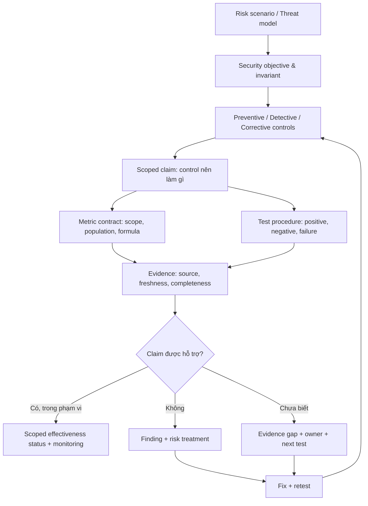
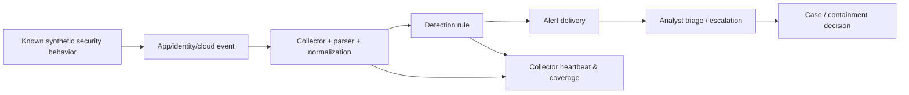
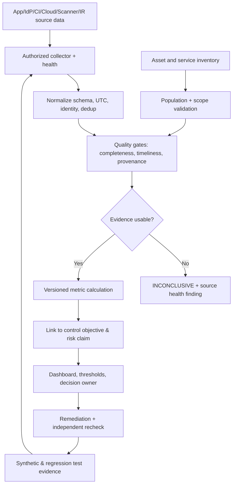
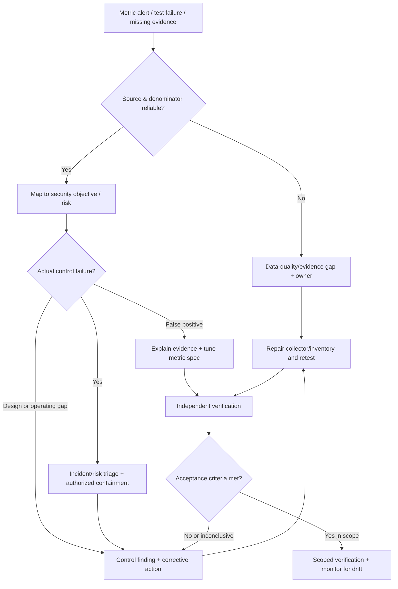
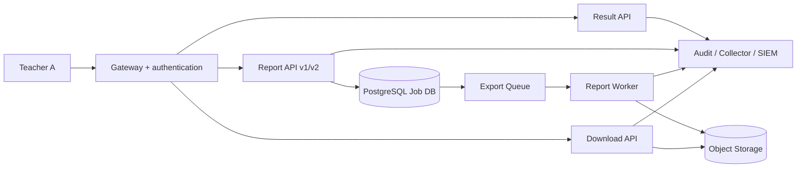

# Hiệu quả kiểm soát: đo lường, chứng minh và báo cáo security controls có thực sự bảo vệ hệ thống

## 1. Tình huống mở đầu: 99% controls “xanh” nhưng dữ liệu vẫn lộ

Một nền tảng học tập nhiều tenant vận hành Java/Spring Boot, PostgreSQL, Kubernetes và các dịch vụ cloud. Dashboard tháng này hiển thị:

- **100%** services có security policy trong repository.
- **99,2%** dependency scan jobs báo thành công.
- **98%** người dùng hoàn thành khóa đào tạo bảo mật.
- **0** cảnh báo truy cập dữ liệu ngoài quyền.
- **97%** endpoints có test tự động.

Lãnh đạo nhận báo cáo “security controls hoạt động tốt”. Tuy nhiên, một giảng viên tenant A có thể tải bảng điểm tenant B thông qua API `/api/v1/reports/{id}`. Endpoint đó không nằm trong test inventory, một collector log đã ngừng gửi dữ liệu trong nhiều ngày, và các CI jobs “thành công” chỉ phản ánh trạng thái pipeline chứ không chứng minh production đang chạy artifact đã kiểm thử.

Các chỉ số trên **không nhất thiết sai**, nhưng chúng trả lời những câu hỏi khác với mục tiêu: **“Đường truy cập trái tenant có bị ngăn chặn hiệu quả trong thực tế không?”**

**Hiệu quả kiểm soát (control effectiveness)** là mức độ một security control, hoặc tập controls phối hợp, **thực sự đạt mục tiêu bảo vệ rủi ro đã xác định** trong một phạm vi, thời điểm hoặc khoảng thời gian, dưới các điều kiện vận hành có liên quan. Đánh giá hiệu quả đòi hỏi nhiều hơn kiểm tra control tồn tại: phải xem thiết kế, phạm vi triển khai, vận hành thực tế, các đường bypass, bằng chứng kiểm thử và tác động tới rủi ro.

Trong chương **Metrics và reporting** của module **SECURITY_SECURITY_ASSURANCE**, bài này xây dựng tư duy **đánh giá có bằng chứng** từ phân tích rủi ro, security requirements và controls đến test, audit, phát hiện sai lệch và khắc phục. Trọng tâm là cách **biến telemetry thành kết luận có giới hạn và hành động cụ thể**, phục vụ continuous security assurance trong phát triển và vận hành.

### Mục tiêu học tập

Sau bài này, bạn có thể:

1. Phân biệt control existence, coverage, design adequacy, implementation, operating effectiveness, outcome và efficiency.
2. Liên kết threat/risk → security objective → control claim → metric → verification evidence.
3. Thiết kế metric với **population, numerator, denominator, unit, time window, owner, source, freshness, segmentation, limitations**.
4. Chọn KPI, KRI, KCI, leading/lagging indicators mà không dùng tỷ lệ đẹp thay cho security outcomes.
5. Đánh giá preventive, detective, corrective, compensating controls bằng phương pháp phù hợp.
6. Nhận biết blind spots từ thiếu asset inventory, logs, tests, production drift và data-quality failures.
7. Đọc metrics về authorization, IAM/MFA, SAST/SCA, vulnerability, patch, logging, incident response, data protection và recovery.
8. Dùng test fixtures, code/SQL minh họa và evidence pipeline để kiểm chứng controls trong hệ thống Spring Boot đa tenant.
9. Xây dashboard cho engineering, security, management và audit, có threshold, uncertainty, residual risk và owner.
10. Tổ chức vòng lặp **monitor → validate → detect gap → remediation → retest → evidence refresh** để giảm rủi ro thực, không chỉ cải thiện con số báo cáo.

## 2. Các khái niệm phải phân biệt

| Khái niệm | Câu hỏi | Ví dụ |
|---|---|---|
| **Control existence** | Control/document có tồn tại không? | Có IAM policy, CI scan config |
| **Control design adequacy** | Nếu làm đúng như thiết kế, control có xử lý rủi ro không? | Authorization kiểm object ownership, không chỉ login |
| **Implementation coverage** | Control được triển khai ở bao nhiêu đối tượng cần bảo vệ? | Số API routes có enforce object policy |
| **Operating effectiveness** | Control có hoạt động đúng khi cần trong khoảng đánh giá? | Requests trái tenant bị deny trên bản đang chạy |
| **Control outcome** | Mục tiêu bảo mật có được duy trì/đạt ở ranh giới rủi ro? | Không có export trái quyền trong phạm vi test |
| **Control efficiency** | Đạt kết quả với mức chi phí/tác động vận hành nào? | False-positive rate và latency sau WAF |
| **Control assurance** | Bằng chứng đáng tin tới đâu cho nhận định về hiệu quả? | Evidence có nguồn, phạm vi, timestamps, negative tests |
| **Residual risk** | Rủi ro còn lại sau control và các giả định? | API cũ/worker chưa test, vendor token còn hiệu lực |
| **Compliance status** | Có đáp ứng yêu cầu được xác định trong scope? | Theo policy/standard và kỳ đánh giá |
| **Security posture** | Trạng thái bảo mật tổng thể được quan sát từ nhiều nguồn | Asset, vulnerability, identity, runtime config |

### 2.1. Có control không đồng nghĩa control có hiệu lực

Ứng dụng có annotation `@PreAuthorize("isAuthenticated()")` nhưng không kiểm quyền trên tài nguyên đang đọc. Control xác thực có thể hoạt động, nhưng control **object-level authorization** chưa đầy đủ. Nếu dashboard chỉ đếm `@PreAuthorize`, chỉ số coverage có thể tăng mà rủi ro BOLA/IDOR vẫn còn.

### 2.2. Có hiệu lực trong test không mặc nhiên có hiệu lực mọi nơi

Test cross-tenant trên staging release R chứng minh điều gì đó về **bản R, fixtures và đường thử**. Production có thể chạy release R-1, API v1, worker riêng, cloud IAM khác hoặc cache stale. Assurance claim phải giới hạn vào scope và có cơ chế cập nhật khi thay đổi.

### 2.3. Hiệu quả khác hiệu suất

Một WAF chặn 100% malicious requests đã gắn nhãn trong một bộ test nhưng chặn luôn 30% requests hợp lệ có thể có hiệu quả ngăn chặn cao **trong test sample**, nhưng gây business impact nghiêm trọng. Cần đo cả **security outcome và collateral effects**, không tối ưu một con số.

### 2.4. Không có sự cố không chứng minh có kiểm soát tốt

Sự cố có thể không xảy ra, không được phát hiện, không được ghi nhận hoặc nằm ngoài scope. **0 alerts** có thể mang nhiều ý nghĩa, đặc biệt khi source hoặc collector mất dữ liệu. Cần thêm positive/negative tests, coverage và telemetry health.

## 3. Control effectiveness theo bốn tầng bằng chứng

Một phương pháp thực tế là xem mỗi security control ở bốn tầng:

| Tầng | Đánh giá | Ví dụ với MFA admin |
|---|---|---|
| **1. Design** | Control được thiết kế đủ để giảm threat? | Policy bắt buộc MFA cho privileged human identities |
| **2. Implementation** | Đúng cấu hình/quyền ở mọi đối tượng trong scope? | MFA enforced ở IdP, cloud console, break-glass paths |
| **3. Operation** | Kiểm soát thực sự chạy đúng trong kỳ/điều kiện? | Admin không MFA không đăng nhập được; exceptions có TTL |
| **4. Outcome** | Rủi ro/quyền lợi bảo vệ đạt trong phạm vi được thử? | Không có privileged access trái policy trong negative tests |

**Không nên chấm tầng 4 PASS chỉ vì tầng 1 có văn bản.** Một control có design tốt nhưng implementation thiếu coverage; hoặc deployment đúng nhưng thiếu operation vì drift, session bypass, admin exception.

### 3.1. Một ví dụ khác: backup

- **Design:** có backup và retention đáp ứng mục tiêu dự phòng.
- **Implementation:** jobs và keys được cấu hình đúng ở databases/regions trong scope.
- **Operation:** backup thực sự chạy, không có khoảng trống bị che, logs/alerts hoạt động.
- **Outcome:** restore dữ liệu được, ứng dụng hoạt động, RTO/RPO và data integrity được kiểm tra.

`backup_job_success_rate = 100%` thường chỉ hỗ trợ một phần tầng vận hành, không tự chứng minh recovery outcome.

### 3.2. Phạm vi và thời gian thay đổi giá trị claim

“Access review đạt trong quý II tại IdP A” khác “IAM toàn bộ doanh nghiệp hiệu quả hôm nay”. Control có thể bị thay đổi hoặc bypass sau review. Mỗi claim cần **thời điểm, kỳ, nguồn, owner và trigger tái kiểm chứng**.

### 3.3. Đánh giá nhiều controls cùng bảo vệ một risk

Đối với export báo cáo điểm, tổ chức có thể dùng authentication, object authorization, queue worker validation, storage ACL, audit và detection. Một số bảo vệ theo **defense in depth**, nhưng nếu đường trực tiếp tới storage bỏ qua app, tính hiệu quả cuối cùng phải được xét **end-to-end**, không cộng điểm controls rồi suy ra không có bypass.

## 4. Kết nối threat, security objective, control và metric

Metric có ý nghĩa chỉ khi trả lời được **quyết định nào về rủi ro**.



### 4.1. Ví dụ mapping cho multi-tenant API

| Thành phần | Nội dung |
|---|---|
| **Threat** | BOLA/IDOR: teacher A đọc hoặc xuất kết quả của tenant B |
| **Protected asset** | Dữ liệu học viên, điểm thi, danh tính/tenant |
| **Objective** | Không có actor trái quyền đọc hoặc gây side effect trên dữ liệu tenant khác |
| **Preventive controls** | Verified identity, server-side object authorization, storage IAM |
| **Detective controls** | Security event logging, anomaly detection, independent audit |
| **Corrective controls** | Incident containment, token revoke, fix và regression |
| **Coverage metric** | Tỷ lệ các entry points trong scope có enforcement và test |
| **Effectiveness test** | Cross-tenant synthetic request bị deny; DB/queue/storage không đổi |
| **Assurance evidence** | Test, active release digest, rule/config, audit delivery |
| **Residual risk** | API cũ, worker retries, signed URLs hoặc region chưa kiểm |

### 4.2. Security invariant tốt hơn cấu hình cụ thể

**Yếu:** “Mọi endpoint có annotation security.”

**Mạnh hơn:** “Không request hoặc event nào từ một actor ngoài quyền được đọc, sửa hay xuất dữ liệu không thuộc quyền, kể cả API phiên bản cũ, worker và download path.”

Chỉ số về annotation có thể là **một tín hiệu coverage**, nhưng không thể thay test cho invariant.

### 4.3. Control claim phải khả kiểm

Mẫu:

> Trong **scope S** và **kỳ T**, khi xảy ra **điều kiện C**, control **K** phải **ngăn/phát hiện/khôi phục hành vi H** với outcome/giới hạn **A**, được kiểm bằng **method M** và evidence từ **source E**.

Ví dụ:

> “Trong release R của `report-service` ở staging, teacher tenant A không thể tạo export job của tenant B qua các routes và workers đã kiểm; evidence gồm negative request test, database/queue state, storage artifact inventory và test run timestamp.”

Đây là claim đúng phạm vi; không tuyên bố mọi đường production đều an toàn.

## 5. Phân loại controls để chọn metric phù hợp

| Loại | Mục đích | Phép đo thường hữu ích | Cần tránh |
|---|---|---|---|
| **Preventive** | Ngăn hành vi trái quyền trước tác động | Negative tests, denied vs allowed legitimate, coverage | Đếm block events mà bỏ bypass |
| **Detective** | Phát hiện dấu hiệu rủi ro | Known-case detection, coverage, time-to-alert, noise | Dựa vào 0 alerts hoặc chỉ precision |
| **Corrective** | Sửa sai và khôi phục trust | Verified remediation, recurrence, time to recover | Đóng ticket ≠ fix hiệu lực |
| **Compensating** | Giảm rủi ro khi control gốc thiếu | Risk scenario tests, scope/expiry, residual exposure | Coi control bù đắp giống hệt control gốc |
| **Deterrent** | Giảm động cơ/hành vi rủi ro | Compliance checks, access monitoring, behavior study | Gán tác động ngăn chặn thiếu bằng chứng |
| **Recovery** | Khôi phục khả năng hoạt động/dữ liệu | Restore success, observed RTO/RPO, integrity | Backup success ≠ restore success |
| **Administrative** | Quy định và phân trách nhiệm | Training comprehension, review records, exceptions | Policy published ≠ thực hiện |
| **Technical** | Enforce bằng hệ thống | Effective configuration và runtime tests | Desired-state config ≠ applied state |

### 5.1. Đừng dùng cùng công thức cho mọi control

Đo tỷ lệ người hoàn thành training không cùng bản chất với đo khả năng WAF chặn payload, khả năng SOC phát hiện replay hoặc khả năng database restore. Mỗi control có **population, mục tiêu và kết quả** khác nhau.

### 5.2. Đánh giá control độc lập và control kết hợp

Ví dụ access logs có đủ field nhưng SIEM parser bỏ trường `tenant_id`; detection rule không phát hiện cross-tenant success. Logging có thể đạt yêu cầu phát event nhưng **chuỗi detection outcome** vẫn thất bại. Vì vậy vừa cần component-level metrics vừa cần end-to-end validation.

## 6. KPI, KRI, KCI, leading và lagging indicators

### 6.1. Không coi các từ viết tắt là nhãn chuẩn hóa cho mọi tổ chức

- **KPI (Key Performance Indicator):** đo mức đạt mục tiêu vận hành/kinh doanh được lựa chọn.
- **KRI (Key Risk Indicator):** tín hiệu cho thấy mức exposure hoặc điều kiện rủi ro tăng/giảm.
- **KCI (Key Control Indicator):** đo trạng thái/hoạt động của một kiểm soát trọng yếu theo định nghĩa của tổ chức.
- **Leading indicator:** cho tín hiệu sớm về điều kiện có thể dẫn đến outcome.
- **Lagging indicator:** phản ánh kết quả/biến cố đã xảy ra.

Một phép đo có thể phục vụ nhiều góc nhìn, nhưng cần chỉ ra **decision/use case**, không dán nhãn KRI rồi coi đó là risk level định lượng.

### 6.2. Bảng ví dụ

| Metric | Góc nhìn | Tác dụng | Giới hạn |
|---|---|---|---|
| Critical assets with verified owners | KCI/leading | Giảm blind spot governance | Owner không chứng minh control hiệu lực |
| Unauthorized object-access test pass rate | KCI/outcome test | Kiểm thực thi authz trên cases đã thử | Coverage test suite hạn chế |
| Age of exploitable unpatched exposures | KRI | Ưu tiên risk treatment | Affectedness và reachability cần xác minh |
| Time from known malicious event to alert | KPI/KCI | Đánh giá detection path | Chỉ trên test events có ground truth |
| Confirmed data exposure incidents | Lagging outcome | Quan sát thiệt hại đã xác minh | Phụ thuộc detection/reporting |
| % restore exercises with verified RPO | KCI/recovery outcome | Đo phục hồi qua exercise | Simulation không đại diện mọi disaster |
| User training completion | Process KPI | Theo dõi chương trình đào tạo | Không tự chứng minh giảm phishing risk |
| Logging collector health coverage | Leading/data quality | Biết khi monitoring bị mù | Healthy collector không bảo đảm detection rule đúng |

### 6.3. Leading indicator tốt phải được kiểm chứng quan hệ

“Tăng số quy tắc SIEM” chưa chắc dẫn đến phát hiện tốt hơn. Có thể tạo thêm nhiều false positives và làm analyst bỏ sót signals quan trọng. Nên đo **rule validity và real/synthetic incident outcomes**, đồng thời quan sát chi phí vận hành.

### 6.4. Lagging outcome có thể hiếm

Không thể chỉ chờ data breach xảy ra để biết authorization hoạt động chưa. Cần **test-based assurance** với dữ liệu thử, canary/detection simulation và review thiết kế phù hợp. Dữ liệu sự cố thật là bổ sung, không phải điều kiện duy nhất.

## 7. Metric contract: trước công thức phải định nghĩa đúng điều cần đo

Mỗi metric nên có một **specification có phiên bản**, để người viết pipeline, reviewer và decision maker hiểu cùng một nghĩa.

### 7.1. Các trường bắt buộc nên có

| Trường | Vì sao cần |
|---|---|
| **Metric ID/name** | Tham chiếu duy nhất, tránh đổi tên mà giữ cách tính sai |
| **Security objective / risk** | Metric trả lời câu hỏi gì? |
| **Control and owner** | Ai chịu trách nhiệm control và xử lý |
| **Scope** | Assets, services, tenants, environments, regions, identities, kỳ |
| **Population/eligibility** | Các đối tượng bắt buộc thuộc mẫu số |
| **Numerator/denominator** | Cách đếm có thể tái tạo, tránh mơ hồ |
| **Time semantics** | Event time hay collection time, UTC và interval |
| **Data sources** | Authoritative systems và quyền collection |
| **Validation rules** | Source health, missing/duplicate events, scope checks |
| **Segmentation** | Criticality, exposure, environment, tenant, control type |
| **Target/threshold** | Do risk owner chấp thuận theo impact, không ngẫu nhiên |
| **Measurement method** | Continuous observation, sample, synthetic test, audit |
| **Confidence/limitations** | Những gì metric không chứng minh |
| **Response** | Alert, remediation, re-test, escalation và exception workflow |
| **Version/review triggers** | Khi nào phải sửa công thức hoặc đánh giá lại |

### 7.2. Mẫu YAML đặc tả metric

```yaml
metric_id: "AUTHZ-EFFECT-001"
title: "Verified cross-tenant object access control"
status: "ILLUSTRATIVE_NOT_APPROVED"
security_objective: "Prevent unauthorized cross-tenant data access"
control_id: "CTRL-OBJECT-LEVEL-AUTHZ"
scope:
  service: "result-api"
  environments: ["isolated-staging"]
  api_versions: ["v1", "v2"]
  tenant_fixtures: ["tenant-A", "tenant-B"]
  assessment_window: "<start-UTC-to-end-UTC>"
population:
  inventory_source: "<reviewed-entry-point-inventory>"
  eligibility: "all in-scope result read/export entry points"
numerator: "entry points with relevant negative and positive tests passing"
denominator: "all eligible entry points with known count"
unit: "fraction"
sources:
  - "authorized-integration-test-results"
  - "runtime-artifact-and-config-inventory"
  - "audit-and-side-effect-observations"
quality_gates:
  - "inventory-completeness-verified"
  - "test-fixtures-valid"
  - "no-collector-gap-for-evidence-claimed"
  - "active-version-matches-tested-version"
on_missing_data: "INCONCLUSIVE"
target: "<approved-risk-based-target>"
reviewer: "<security-assurance-reviewer>"
owner: "result-service-team"
decision_triggers:
  - "failed-negative-authorization-test"
  - "new-route-or-worker"
  - "release-or-role-policy-change"
limitations:
  - "Passing selected tests is not universal proof of no BOLA"
```

Các giá trị là ví dụ, không phải control có sẵn trong một framework hay dữ liệu production. `on_missing_data: INCONCLUSIVE` bảo vệ khỏi “green giả” khi pipeline mất nguồn.

### 7.3. Spec phải được review như code

Khi đổi denominator, filter severity, target, source hoặc time window, trend trước/sau có thể không so sánh trực tiếp. Version metric spec và ghi change rationale, không “nâng hiệu quả” chỉ bằng việc âm thầm loại assets khỏi mẫu.

## 8. Công thức, đơn vị, mẫu số và những trường hợp không được chia

Một chỉ số dạng tỷ lệ thường có cấu trúc:

\[
\text{Rate}=\frac{\text{Số đối tượng thỏa điều kiện trong scope}}{\text{Tổng đối tượng đủ điều kiện trong scope}}\times100\%.
\]

Tuy nhiên định nghĩa **“đối tượng đủ điều kiện”** thường quan trọng hơn phép tính. Có thể là assets, identities, permissions, events, releases, test cases, findings hoặc thời gian hệ thống thực sự hoạt động.

### 8.1. Ba ví dụ cùng là tỷ lệ nhưng khác bản chất

| Metric | Tử số | Mẫu số | Không chứng minh |
|---|---|---|---|
| Endpoint test coverage | Entry points có test đúng requirement | Toàn bộ entry points eligible đã inventory | Test có pass hoặc đủ khả năng phát hiện lỗi |
| Negative test pass rate | Negative tests pass trong test set | Tổng negative tests đã chạy và có kết quả hợp lệ | Mọi attack paths ngoài test set đều bị chặn |
| Privileged MFA enforcement coverage | Identities/paths đã xác minh MFA theo policy | Toàn bộ privileged human login paths eligible | Không có session bypass chưa được nhận diện |

### 8.2. Mẫu số bằng 0

Nếu không có incidents trong kỳ, `incident_remediation_successes / incident_count` không thể nhận **100%** chỉ bằng quy ước chia 0. Cần định nghĩa `NOT_APPLICABLE_NO_CASES` hoặc `NO_OBSERVED_EVENTS` và dùng tabletop/synthetic incident test để kiểm readiness.

Nếu mẫu số chưa biết, không hợp lệ khi coi mẫu số bằng số items scanner nhìn thấy rồi tuyên bố “toàn bộ coverage”. Phải phân biệt **0 eligible** với **unknown eligible**.

### 8.3. Hệ quả từ các phép đếm khác nhau

Giả sử inventory có 100 API routes, 80 có test security, trong 80 đó có 76 pass:

- **Coverage của test:** 80/100 = **80%**.
- **Pass rate trong tests đã chạy:** 76/80 = **95%**.
- **Số routes pass trong toàn bộ inventory:** 76/100 = **76%**.

Không được báo chỉ “95% security-effective endpoints” nếu 20 routes chưa test và 4 routes có failure. Ngay cả 76/100 cũng chỉ là **độ bao phủ của kiểm chứng đạt theo test suite**, không phải xác suất thực tế ngăn mọi kiểu tấn công.

### 8.4. Denominator drift

Nếu quý trước có 100 services và quý này có 150 vì inventory tốt hơn, metric “percentage patched” có thể giảm dù đội patch không làm kém hơn. Một biểu đồ đúng phải thể hiện thay đổi population, risk tier và phương pháp thu thập, không suy ngay hiệu quả giảm.

### 8.5. Dữ liệu phân nhóm

Tỷ lệ trung bình che high-impact assets. Ví dụ 98/100 servers đạt baseline nhưng 2 servers không đạt là IdP gateway và backup admin host. Báo 98% “healthy” không nói đúng security exposure. Cần báo:

- **Coverage toàn cục** để theo dõi quy mô.
- **Criticality/exposure segments** để xác định risk.
- **Danh sách critical exceptions** với owner và due date.
- **Unknown scope** và chất lượng dữ liệu.

### 8.6. Không tự biến weight thành xác suất rủi ro

Một điểm “risk weighted compliance” có thể hữu ích nếu weights được định nghĩa và duyệt, nhưng `0,9 × coverage + 0,1 × training` không phải xác suất hệ thống an toàn. Trọng số mang tính **ưu tiên ra quyết định**, không phải bằng chứng toán học rằng rủi ro giảm theo tỷ lệ điểm.

## 9. Asset inventory, population completeness và coverage thật

### 9.1. Vì sao inventory là prerequisite?

Không thể đo effective patching nếu không biết host/container/serverless/runtime nào tồn tại; không thể đo MFA admin nếu không biết mọi admin identities/paths; không thể đo authorization coverage nếu không biết routes, GraphQL resolvers, workers và storage links.

### 9.2. Scope có nhiều chiều

| Chiều | Ví dụ |
|---|---|
| **Asset** | VM, container image digest, Kubernetes node, database, queue |
| **Service** | Exam API, Result API, Report Worker |
| **Environment** | Production primary, DR, staging |
| **Region/account** | Cloud regions và service accounts |
| **Identity** | Learner, teacher, tenant admin, system admin, workload |
| **Entry point** | Public REST, internal API, scheduled job, webhook, download URL |
| **Data** | Exam answers, grades, PII, secrets, audit logs |
| **Time** | UTC interval, deployment changes, account lifecycle |
| **Threat condition** | Invalid token, cross-tenant ID, replay, compromised credential |

### 9.3. Sources có thể không đồng nhất

CMDB thường chứa systems được đăng ký; cloud inventory có runtime resources; CI có artifacts đã build; Kubernetes có pods đang chạy; API gateway có public routes; source repository có code endpoints, nhưng không chắc những endpoints đó đang deploy. **Đối chiếu nhiều nguồn** giúp phát hiện shadow workloads, inactive routes, ephemeral resources và omitted paths.

### 9.4. Reconcile inventory

Một phương pháp:

1. Chọn authoritative source theo từng loại tài sản.
2. Định nghĩa IDs và mối liên hệ service → artifact → runtime → tenant/data.
3. Đối chiếu source inventory với cloud/Kubernetes runtime, CI/CD và network/API logs khi phù hợp.
4. Tìm gaps từ accounts, regions, legacy APIs, CronJobs và DR.
5. Phân biệt excluded theo policy, genuinely not applicable và not discovered.
6. Ghi inventory completeness estimate/uncertainty, time of observation.
7. Chạy lại sau thay đổi hoặc trên cadence theo criticality.

### 9.5. Ephemeral infrastructure

Nếu một autoscaler tạo Pods trong 10 phút rồi xóa, snapshot cuối ngày có thể không ghi nhận các Pods đó. Đo population theo **resource events, workload controllers, deployment templates và thời gian sống**, không chỉ instance count tại cuối kỳ.

### 9.6. Rủi ro của mẫu số tự báo cáo

Nếu team tự khai “mọi services của tôi đều có monitoring” nhưng quên một batch worker, tự dùng danh sách họ cung cấp làm mẫu số có thể tạo 100% sai. Assessor cần cách kiểm completeness độc lập, đặc biệt với controls bảo vệ dữ liệu nhạy cảm.

## 10. Data quality là một phần của hiệu quả đo lường

Metric không đáng tin nếu pipeline dữ liệu bị lỗi. Cần xem **observability of observability**: hệ thống đo có đo được chính sức khỏe của nó không?

### 10.1. Data-quality dimensions

| Thuộc tính | Vấn đề nếu thiếu | Validation |
|---|---|---|
| **Completeness** | Bỏ events/assets trong scope | Cross-source reconciliation, expected event counts |
| **Timeliness/freshness** | Dashboard chỉ phản ánh hôm trước | Lag from event time to available evidence |
| **Accuracy** | Parser gắn nhầm actor/status | Schema tests, sample raw event comparison |
| **Consistency** | Các nguồn dùng timezones/trạng thái khác | Normalize và explicit conversion |
| **Uniqueness** | Retry event bị đếm nhiều lần | Stable IDs, dedup policy |
| **Validity** | Missing required IDs hoặc sai schema | Validate types, ranges, signatures |
| **Lineage/provenance** | Không biết số đến từ đâu | Source, query, collector version |
| **Availability** | Feed ngừng không có alert | Collector health/heartbeat |
| **Scope attribution** | Một số events thuộc staging lẫn production | Environment/tenant/account identity |
| **Integrity/access** | Bằng chứng có thể bị sửa hoặc lộ | Restricted store, audit access, integrity checks |

### 10.2. Một thiết kế trạng thái có ích

```text
METRIC_VALID
METRIC_STALE
SOURCE_UNAVAILABLE
POPULATION_INCOMPLETE
SCHEMA_INVALID
TEST_HARNESS_FAILED
SCOPE_MISMATCH
INCONCLUSIVE
NOT_APPLICABLE
```

Không nên hiển thị `SOURCE_UNAVAILABLE` như `0 observed threats` rồi tô xanh. Đối với control trọng yếu, nguồn thiếu cần có ticket/alert owner.

### 10.3. Thời điểm event và ingestion

Một security event xảy ra lúc 10:01 nhưng collector ingest lúc 10:06. Nếu tính time-to-detect bằng collection timestamps mà bỏ event time, kết quả có thể sai. Cần clock synchronization, UTC normalization và ghi lag; lưu ý clock skew khi kết hợp nhiều services/clouds.

### 10.4. Trùng events và retries

Kafka/queue hoặc vendor webhook có thể giao event nhiều lần. Nếu phát hiện 200 “malicious actions” từ 20 event IDs được retry 10 lần, số lượng riêng biệt khác event deliveries. Metric phải nêu **đếm raw attempts, unique events, unique actors hay affected resources**.

### 10.5. Missing không nhất thiết bằng zero

Trong kỳ có 0 access-denied events, điều đó có thể do không có attempt, users chưa thử, logging sai, API bypass, hoặc collector mất event. Để hỗ trợ claim control hiệu quả cần kiểm **synthetic denied request → app log → collector → rule/alert**, cùng scope/coverage.

## 11. Thiết kế phép đo hiệu quả: kiểm chứng thay vì đếm hoạt động

### 11.1. Ba nguồn bổ sung nhau

1. **Operational telemetry:** thực tế sử dụng, requests, policies, alerts, outcomes.
2. **Controlled tests:** negative/positive cases, fault injection, exploit simulation được phép.
3. **Independent review:** audit, code/config walkthrough, population/sample, third-party evidence.

Operational data cho quy mô và xu hướng; tests tạo ground truth có kiểm soát; independent review giúp kiểm scope/provenance và khả năng bị bỏ sót.

### 11.2. Positive test và negative test

**Positive:** request hợp lệ được phép, chức năng vẫn hoạt động theo business policy. **Negative:** actor/action ngoài quyền bị deny và không gây side effect. Chỉ kiểm negative có thể tạo control “chặn tất cả”; chỉ kiểm positive không phát hiện authorization bypass.

### 11.3. Test harness cũng có thể sai

Một test `403` có thể pass vì endpoint chết, mock identity không có quyền truy cập bình thường hoặc route không được deploy. Vì vậy cần preconditions: đúng runtime identity/version, fixture tồn tại, legitimate reference case pass, audit source healthy. Nếu test harness invalid → **INCONCLUSIVE**, không coi security control pass.

### 11.4. Sample-based tests

Khi volume lớn có thể lấy mẫu theo criticality, time, location, actors/roles, resource type, release. Kích thước mẫu và phương pháp phải phù hợp tiêu chí assessment, không suy xác suất toàn cục từ một vài test case được chọn có chủ ý. Lưu universe, sampling rationale và limitations.

### 11.5. Failure injection có giới hạn

Để thử detection/containment có thể gửi synthetic suspicious events hoặc giả lập vendor unavailable **trong môi trường được ủy quyền**. Không tạo data breach, phá hỏng production hoặc pentest tài sản bên ngoài ngoài phạm vi chỉ để đo “effectiveness”.

### 11.6. Hiệu quả theo thời gian

Một test tại ngày T chứng minh trạng thái tại T. Với controls dễ drift như IAM, API routes hoặc security rule, cần **monitor configuration changes, continuous checks và re-test triggers**. Nếu control chỉ được test sau major change, đừng báo “continuously verified” khi chưa có coverage thời gian.

## 12. Identity, MFA và authorization: đo bằng hành vi và phạm vi

### 12.1. Identity control metrics

| Metric | Metric tốt cần gì | Những hạn chế |
|---|---|---|
| Privileged MFA verified coverage | Full eligible privileged human identities/paths, negative login tests | Bỏ sót break-glass/alternate IdP paths |
| Stale access grants | Active grants quá hạn, owners, business necessity | Phải định nghĩa “stale” theo policy |
| JIT privilege review timeliness | Grants có effective TTL và approval/review | Ticket close không bằng revoke |
| Offboarding effectiveness | User/role removed + denied effective access | Sessions/tokens có thể còn hiệu lực |
| Service account least privilege | Effective scope/trust/resource policy tests | Credential inventory có thể thiếu |
| Cross-tenant access test coverage | All eligible object-access paths and fixture matrix | Test suite không bao phủ mọi cách tấn công |
| Unauthorized side-effect test outcome | Denial + DB/queue/storage unchanged | Async race/retry vẫn có thể xảy ra sau test |

### 12.2. Ví dụ: MFA adoption khác MFA enforcement

Nếu 500/500 admin users đã đăng ký MFA, con số registration là 100%. Nhưng nếu 5 emergency identities truy cập privileged console qua fallback không yêu cầu MFA, **verified enforcement coverage** vẫn thiếu. Không được dùng `enrolled` thay cho `enforced on every eligible login path`.

### 12.3. Thử quyền trên tài nguyên

Giả sử teacher A gửi `GET /results/resultB`:

- Dùng **actor token đã verify** và record thật thuộc tenant B trong test.
- Kỳ vọng 403 hoặc 404 phù hợp policy, không có dữ liệu nhạy cảm.
- Xác minh không thêm export jobs, storage files hoặc notifications.
- Chạy positive control với result A để tránh test PASS do service down.
- Ghi endpoint/API version, artifact digest, config revision, test time.

Một request test không chứng minh tất cả routes/GraphQL/download URLs. Coverage metric phải gắn với **entry point inventory**.

### 12.4. Session/token lifecycle

Password reset không mặc nhiên thu hồi self-contained JWT đã phát. Đo effective revocation nên xét token expiry, refresh token, session stores, key rotation và accepted paths theo kiến trúc thực. Một record `revoked=true` trong admin UI chưa đủ để khẳng định token cũ bị chặn ngay.

### 12.5. Least privilege có thể đánh giá theo rủi ro

Đếm số permissions không tự chứng minh least privilege. Phải xem **required actions, resource scope, trust relationships, effective decisions và runtime usage**, đồng thời tránh xóa quyền thật khi chưa kiểm business continuity.

## 13. Logging, detection và SOC: đo khả năng phát hiện chứ không đếm alert

### 13.1. Chuỗi kiểm chứng phát hiện



Một rule YAML hợp lệ không chứng minh actor nhận cảnh báo; một alert được tạo không chứng minh analyst xử lý đúng; một incident ticket Closed không chứng minh rủi ro đã bị contain.

### 13.2. Detection performance: ground truth quan trọng

Với một **bộ sự kiện đã gắn nhãn và giới hạn**, có thể tính:

\[
\text{Precision}=\frac{TP}{TP+FP},\qquad
\text{Recall}=\frac{TP}{TP+FN}.
\]

Trong đó:

- **TP:** hành vi có hại trong labeled dataset được detect.
- **FP:** hành vi bình thường bị cảnh báo nhầm trong labeled dataset.
- **FN:** hành vi có hại trong labeled dataset bị bỏ sót.

Các giá trị này **chỉ đúng cho tập đã đánh giá và cách tạo ground truth**; không phải “precision thật trên toàn bộ adversary activity”. Nếu mẫu số bằng 0, báo **undefined/not estimable**, không tự điền 100%.

### 13.3. Các metrics cần đi cùng nhau

| Metric | Điều phản ánh | Bẫy |
|---|---|---|
| Event source coverage | Những sources cần log đang phát events? | Service chỉ gửi heartbeat không có security fields |
| Ingestion freshness | Event đến sink sau bao lâu? | Missing sources không được tính |
| Parser/schema validation | Fields critical được giữ đúng? | Data khác semantics sau version change |
| Detection recall trên synthetic attacks | Bao nhiêu test cases đã được detect? | Test set quá dễ hoặc lặp không đổi |
| Detection precision trên labeled set | Noise trong dữ liệu đã xét | Nhãn sai, không phản ánh production |
| Time to alert | Từ test/event tới alert | Clock skew, collector lag |
| Time to acknowledgement | Alert tới analyst nhận trách nhiệm | Ack không có nghĩa triage đúng |
| Time to verified containment | Từ incident/detection tới effectiveness evidence | Action applied ≠ control effect |
| Untriaged/aged alerts | Backlog và risk do bỏ sót | Severity labels không thống nhất |
| Missed known detections | Failures quan sát được | Chỉ tính khi có ground truth |

### 13.4. Ví dụ metric “0 critical alerts”

Dashboard hiển thị 0 alerts trong 48 giờ, nhưng collector của một region bị 401 từ hôm trước. **Kết luận đúng:** dữ liệu không đủ để nói không có hành vi nguy hiểm ở region đó. Cần alert collector failure, kiểm source health và backfill/alternative evidence; không vẽ màu xanh cho 0.

### 13.5. Không để alert noise phá hiệu quả vận hành

Tăng số rules có thể tăng coverage nhưng cũng tăng false positives, thời gian triage và analyst fatigue. Mục tiêu là **phát hiện đúng risk scenarios quan trọng trong thời gian phù hợp, với chi phí vận hành bền vững**, không phải số alerts lớn.

## 14. Vulnerability, patching và exposure: từ “số CVE” tới risk reduction

### 14.1. Metrics hữu ích

| Metric | Đo điều gì | Cần chú ý |
|---|---|---|
| Asset scan coverage | Eligible assets được quét bằng nguồn phù hợp | Containers/ephemeral hosts, authenticated scan gaps |
| High-risk exposure age | Thời gian tồn tại vulnerability ảnh hưởng môi trường | Affectedness/exploitability, first-observed vs existed |
| Remediation within risk SLA | Findings được verified fixed trong ngưỡng | Ticket close không chứng minh fix |
| Patch runtime compliance | Actual running versions/digests đáp ứng baseline | Maven update ≠ JVM/container runtime update |
| Exception age | Risk còn được chấp nhận có điều kiện bao lâu? | Không kéo dài waiver âm thầm |
| Known exploited exposure | Assets thực sự bị ảnh hưởng và có reachability | Advisory không đủ cho affectedness |
| Reopened vulnerability rate | Fix regression/false closure | Có thể do scanner accuracy hoặc change |
| Verified mitigation coverage | Workloads có compensating control hiệu lực | Config applied ≠ validated behavior |

### 14.2. MTTR dễ gây nhầm

“Mean Time to Remediate” tùy định nghĩa có thể tính từ phát hiện tới ticket close, deploy patch, hoặc verified mitigation. Không so sánh hai nhóm nếu điểm bắt đầu/kết thúc khác nhau. Với risk, một vulnerability kéo dài trên internet-facing critical system có thể quan trọng hơn 100 low-risk findings được xử lý nhanh.

### 14.3. Đếm findings có thể giảm vì scanner chết

Nếu scanner mất credential, kết quả vulnerability count giảm về 0. Đây là **coverage failure** chứ không phải thành tích remediation. Cần scanner health, authentication success, freshness và asset inventory độc lập.

### 14.4. Affectedness và false positives

Một CVE trong SBOM không tự chứng minh runtime có đường khai thác. Cần xem vendor advisories, backports, vulnerable code reachability, runtime configuration, exploit preconditions và exposure. Nhưng cũng không được bỏ finding chỉ vì “không thấy exploit” nếu rủi ro chưa được đánh giá có căn cứ.

### 14.5. Sửa xong phải kiểm bản đang chạy

Một PR nâng version JDK hoặc base image chưa chứng minh pods đã được thay. Evidence cần artifact digest, runtime imageID, active JVM version, rollout status, vulnerability/behavior retest, autoscaled workloads và CronJobs nếu liên quan.

## 15. Secure SDLC và software supply chain: kiểm gate thực tế

### 15.1. Các câu hỏi kiểm chứng

Một nền tảng có pipeline SAST/SCA không có nghĩa mọi release production đều được kiểm. Cần trả lời:

- **Population:** có bao nhiêu production releases, gồm emergency/manual/IaC paths?
- **Identity:** reviewed commit, test run, build artifact digest và deployed digest liên kết được không?
- **Gate:** mỗi eligible build có chạy các checks bắt buộc theo risk policy không?
- **Findings:** critical/high findings có triage, mitigation hoặc approved exceptions?
- **Bypass:** ai có quyền skip gates, có recorded approval/audit không?
- **Operation:** có failed scans do tool errors hoặc missing credentials không?
- **Runtime:** service đang chạy đúng version từng được test không?

### 15.2. Metrics cần phân biệt

| Metric | Cách hiểu đúng | Không thể suy ra |
|---|---|---|
| % repos configured with SAST | Có khai báo một tool trong repos | Scan thực sự chạy và kết quả được dùng |
| % eligible production releases with verified gate execution | Coverage của release process theo population đã đối chiếu | Mọi security flaw đều bị phát hiện |
| % critical findings with verified fix | Kết quả remediation theo evidence trong scope | Zero vulnerabilities globally |
| % deployed artifacts with trusted provenance | Provenance/signature matching cho runtime | Code không có business logic defect |
| % dependencies with maintained SBOM | Component inventory available | SBOM đầy đủ/đúng/version deployed |
| % security exceptions expired/overdue | Control debt cần giải quyết | Tự đánh giá mức rủi ro nếu exception chưa review |

### 15.3. Thí dụ denominator

Trong một tháng, CI ghi 120 builds thành công nhưng runtime inventory cho thấy 25 production deployments, gồm 2 emergency changes ngoài CI. Metric `passed_gate_builds / all_builds` có thể đạt 100% mà **coverage của production releases** thiếu. Cần reconcile deployments/changes, không lấy toàn bộ successful builds làm denominator của production gate effectiveness.

### 15.4. Supply-chain assurance

Kiểm signature/provenance, SBOM, build materials, container digest và admission policy có thể hỗ trợ integrity/trust chain. Nhưng signature hợp lệ không làm BOLA biến mất. Nên kết hợp **source assurance + artifact identity + deployed runtime + application security tests**.

### 15.5. Change-triggered metric refresh

Nếu thêm CI pipeline mới hoặc đổi artifact registry, các metrics gate coverage cần cập nhật inventory. Nếu bypass được kích hoạt, báo trạng thái degraded ngay cả khi tỷ lệ build success vẫn cao.

## 16. Data protection và privacy: đo kiểm soát dữ liệu thay vì đếm cờ bật

### 16.1. Mục tiêu bảo vệ

Đối với điểm thi, bài làm, thông tin học viên và secrets, cần xét **confidentiality, integrity, availability, data minimization, retention, purpose/location và user/tenant rights** theo yêu cầu áp dụng.

| Control | Metric/evidence hữu ích | Giới hạn |
|---|---|---|
| Object storage access | Cross-role/tenant denied tests, IAM resource policy coverage | “Private bucket” config không bao phủ signed URL |
| Encryption at rest | Eligible datasets encrypted + key policy effective tests | Mã hóa không thay authorization |
| TLS enforcement | Valid/invalid cert/hostname negative tests | HTTPS endpoint tồn tại không chứng minh mọi call dùng TLS |
| Key management | Privileged key usage/review, access denied, rotation evidence | Xóa key tùy tiện có thể phá recovery |
| Data minimization | Approved outbound fields vs actual synthetic payloads | Schema test không biết mọi data-copy path |
| Retention/deletion | Records due for deletion vs verified processing | Backup/replica/legal hold exceptions cần xét |
| Tenant isolation | Matrix actor×role×object×entry point và side effects | Một test tenant A/B không suy toàn cục |
| Vendor data handling | Scoped audit report/DPA, subprocessor changes, actual integration | Vendor certificate không thay customer tests |

### 16.2. Không gộp mọi thứ thành “data protected = true”

Một DB có encrypted disks nhưng cloud role quá rộng, API gửi nhầm dữ liệu cho vendor hoặc cache trả dữ liệu tenant khác vẫn là rủi ro. Dashboard nên cho phép truy sâu **control/property cụ thể**, không chôn vấn đề trong một badge tổng.

### 16.3. Chỉ số deletion phải có eligible population

Ví dụ 900 records hết hạn retention, 850 đã được xác minh xóa trong các stores thuộc scope, 30 bị legal hold hợp lệ và 20 chưa xác định. Nếu requirement loại legal hold khỏi eligible set, denominator phải mô tả rõ; **không tự loại 20 unknown** hoặc báo 100% do xóa jobs đã chạy.

### 16.4. Metric data handling cũng có privacy risk

Không đưa email, điểm học viên, raw JWT, object IDs nhạy cảm vào Prometheus labels/dashboards công khai. Dùng dimensions có cardinality hạn chế, pseudonymization khi cần và evidence store phân quyền để thực hiện điều tra sâu.

## 17. Incident response và corrective controls: action khác effect

Một incident ticket Closed là trạng thái workflow, không chứng minh actor đã bị chặn hoặc rủi ro tái diễn đã giảm.

### 17.1. Các mốc đo cần thống nhất

| Mốc | Diễn giải |
|---|---|
| `t_event` | Hoạt động/sự cố xảy ra nếu xác định được |
| `t_detect` | Detection signal được tạo |
| `t_ack` | Nhóm có trách nhiệm xác nhận |
| `t_decision` | Quyết định containment được phê duyệt |
| `t_action` | Thao tác containment được áp dụng |
| `t_verified` | Evidence cho thấy đường gây hại bị giới hạn trong scope |
| `t_rootfix` | Root cause remediation thực thi |
| `t_retest` | Security regression/recovery được xác minh |
| `t_closed` | Incident lifecycle kết thúc theo policy |

**Time to action** và **time to verified containment** không đồng nghĩa. Nếu token được revoke lúc 10:05 nhưng các sessions tiếp tục dùng tới 10:15, cần xem effective access test, propagation và residual risk.

### 17.2. Các metrics bổ sung nhau

- Tỷ lệ incidents được phân loại/escale đúng theo tiêu chí.
- Thời gian phát hiện, xác nhận, đưa ra decision và verified containment (khi có ground truth).
- Tỷ lệ containment actions có actual behavior tests/evidence.
- Tỷ lệ root-cause corrective actions được retest và đóng có bằng chứng.
- Tỷ lệ incidents tái diễn cùng failure mode sau khắc phục.
- Số/tuổi residual-risk exceptions và công việc còn mở.
- Tỷ lệ evidence preservation/response runbook exercises được thực hiện phù hợp.
- Mức gián đoạn nghiệp vụ do containment gây ra.

### 17.3. Rủi ro khi “đo càng nhanh càng tốt”

Chỉ khen nhóm đóng incident nhanh có thể thúc đẩy bỏ forensic, khóa mọi users hoặc tắt logging cho bớt alert. Nên xem **effectiveness, business impact, evidence, fairness và repeatability** cùng response times.

### 17.4. Không có incidents thì đánh giá bằng gì?

Có thể sử dụng tabletop, synthetic detection tests, runbook review, authorized incident simulation và audit case sampling. Phải ghi rõ **SIMULATED_ONLY** hoặc **TEST_SCOPE_VERIFIED**, không báo như incident thật đã được xử lý.

## 18. Business continuity và recovery: đo tới workflow đã sử dụng được

### 18.1. Control effectiveness trong backup/DR

| Metric | Ý nghĩa | Cạm bẫy |
|---|---|---|
| Backup execution coverage | Có backup jobs cho eligible assets/data? | Inventory và source health |
| Successful backup jobs | Jobs không báo lỗi | Không chứng minh recoverability |
| Verified restore coverage | Assets có exercise khôi phục thành công | Test environment có khác production? |
| Observed RTO | Thời gian tới business workflow usable theo tiêu chí | Pod Running ≠ business recovery |
| Observed RPO | Recovery point/data-loss window theo định nghĩa | ACK transactions/integrity cần đối soát |
| Data integrity verification | Checksum/transaction IDs/ownership sau restore | Count bằng nhau chưa chắc data đúng |
| Security retention after DR | MFA/authz/TLS/IAM/audit vẫn hoạt động | Recovery shortcut có thể nới quyền |
| Communication execution | Người cần biết được cập nhật theo plan | Message drafted chưa phải delivered |

### 18.2. RTO và RPO khác nhau

RTO là mục tiêu thời gian khôi phục khả năng hoạt động theo định nghĩa business; RPO là ngưỡng điểm dữ liệu/khả năng mất dữ liệu chấp nhận theo thiết kế. Hai chỉ số khác cả mốc và ý nghĩa.

Nếu gián đoạn xảy ra 10:00, Pod chạy lúc 10:20 nhưng học viên nộp bài giả thành công vào 10:48, **recovery duration cho nghiệp vụ đó** là 48 phút nếu đo từ 10:00. Không thể dùng 20 phút làm observed business RTO.

Nếu điểm dữ liệu khôi phục là 09:53, so với mốc 10:00 có recovery-point age 7 phút; việc có mất bài đã ACK hay không còn cần **transaction reconciliation**. Không nhầm thời gian khôi phục với thời gian dữ liệu bị mất.

### 18.3. Security availability có điều kiện

Trong degraded mode có thể tạm tắt xuất PDF mà vẫn duy trì nộp bài thi, nhưng không thể bỏ token verification hoặc tenant isolation để app “healthy”. Cần cả positive flow (student hợp lệ nộp bài) và negative flow (teacher A không đọc kết quả B).

### 18.4. DR tests không chứng minh mọi scenario

Một restore exercise trên staging với synthetic data có giá trị, nhưng chưa cho biết khả năng chịu peak production traffic hoặc multi-region failover khi cloud IdP/KMS down đồng thời. Báo **scenario coverage và missing tests**, không suy kết luận rộng.

## 19. Third-party và supply-chain controls: rủi ro ngoài biên ứng dụng

Khi sử dụng IdP, payment, PDF processor, cloud hosting hoặc security monitoring vendor, một phần controls do nhà cung cấp vận hành nhưng tổ chức vẫn có **customer responsibilities**.

### 19.1. Metrics cần xem

| Dimension | Metric/evidence |
|---|---|
| Critical vendor inventory | Tỷ lệ critical dependencies có owner, scope, risk tier |
| Assurance report relevance | Scope/period/exceptions và CUECs đã review |
| Customer config obligations | Customer-side controls đã tested effective |
| Incident notice effectiveness | Notice delivered, triaged, customer affectedness assessed |
| Subprocessor changes | Material changes reviewed/approved theo requirement |
| Vendor availability | Customer synthetic success + vendor service report |
| Contractual remediation | Findings có owner, deadline, verified close |
| Exit readiness | Data export/deletion/credential revoke được thử theo scope |
| Concentration risk | Shared failure domains của nhiều vendors |

### 19.2. Báo cáo bên ngoài hỗ trợ nhưng không thay test của khách hàng

SOC 2/ISO assurance có thể hỗ trợ một số inherited controls nếu đúng service, period và scope, nhưng không chứng minh **customer API webhook** xác thực signature, **customer SSO** enforce MFA, hoặc **customer object storage** có quyền chính xác.

### 19.3. Chỉ số vendor SLA cần gắn business outcome

IdP status page báo 99,99% uptime nhưng trong giờ thi client authentication/refresh thất bại vì customer-specific callback config. SLA của vendor và tỷ lệ login thành công của nền tảng là hai thước đo bổ sung, không thay thế nhau.

### 19.4. Evidence gaps từ fourth-party

Nếu provider dùng subprocessor cho storage/logging nhưng không có báo cáo bao phủ, ghi **INCONCLUSIVE** hoặc **RESIDUAL_RISK** theo risk decision. Không tự kết luận subprocessor đã bảo đảm chỉ vì vendor chính có chứng chỉ.

## 20. Thiết kế evidence pipeline cho metrics có thể kiểm toán

### 20.1. Các lớp dữ liệu



### 20.2. Nguyên tắc ingestion

- **Least privilege:** collector chỉ đọc những nguồn đúng scope.
- **Do not trust source strings blindly:** xác minh event origin, schema, required fields.
- **Immutable or protected raw evidence:** giữ nguyên source khi cần điều tra; không sửa history để làm đẹp trend.
- **Normalize identifiers:** service, environment, region, asset, role, test run, release digest.
- **Separate event time from ingestion time:** có clock skew và missing windows.
- **Dedup:** retry/read-backs có thể nhân đôi records.
- **Validate population:** đối chiếu control requirement với asset inventory.
- **Quality status:** zero events khác failed collection.
- **Access/retention:** không xuất PII/secrets trong metric labels.
- **Lineage:** từ dashboard truy được query/version và evidence ref.

### 20.3. Hai loại evidence phải tách

**Operational evidence** là các records về system runtime (access log, deployment, actual patch, events); **assessment evidence** là kết quả đánh giá (test cases, reviewer decisions, scope, limitations). Một metric dashboard có thể kết hợp chúng nhưng không biến interpretation thành raw fact.

### 20.4. Evidence freshness

Một code review năm ngoái có thể vẫn là evidence cho design cũ, nhưng không chắc hợp lệ với release mới. Một runtime configuration snapshot hôm qua không bảo đảm hôm nay không có drift. Cần event-driven invalidation hoặc gắn “stale due to change” khi source/release/criteria đổi.

### 20.5. Pipeline health cần có owner riêng

Security team có thể sở hữu detection logic, platform team sở hữu collection pipeline, service owner sở hữu event schema. Nếu một nguồn ngừng gửi mà không ai chịu trách nhiệm, chương trình metrics tự tạo blind spot. **Đo và báo cả metric data quality** là một security control thực sự.

## 21. SQL minh họa: tính coverage không bỏ qua trạng thái UNKNOWN

Giả sử tổ chức có bảng tổng hợp từ các nguồn được phép, chứa một row cho mỗi entry point **đã xác minh** thuộc scope. Để đo tỷ lệ entry points có security tests pass, chỉ đếm trong inventory được xác định và phân loại trạng thái chưa test.

```sql
-- Pseudocode PostgreSQL: schema là ví dụ do dự án tự thiết kế.
-- Không chạy trên dữ liệu production nếu chưa được cấp quyền.
WITH eligible AS (
    SELECT
        entry_point_id,
        service_id,
        criticality,
        COALESCE(last_assessment_status, 'NOT_TESTED') AS test_status
    FROM security_entry_point_inventory
    WHERE environment = 'production'
      AND in_security_control_scope = TRUE
      AND inventory_snapshot_id = :verified_inventory_snapshot
)
SELECT
    criticality,
    COUNT(*) AS eligible_total,
    COUNT(*) FILTER (WHERE test_status = 'PASS') AS verified_pass,
    COUNT(*) FILTER (WHERE test_status = 'FAIL') AS verified_fail,
    COUNT(*) FILTER (
      WHERE test_status IN ('NOT_TESTED', 'INCONCLUSIVE')
    ) AS not_verified,
    ROUND(
      100.0 * COUNT(*) FILTER (WHERE test_status = 'PASS')
      / NULLIF(COUNT(*), 0), 2
    ) AS pass_fraction_of_eligible_pct
FROM eligible
GROUP BY criticality
ORDER BY criticality;
```

### 21.1. Điều công thức chưa giải quyết

- SQL chỉ có ý nghĩa nếu **inventory_snapshot đã verify completeness** và data sources không thiếu.
- `last_assessment_status = PASS` phải gắn với release/config hiện hành, không lấy test cũ trên code khác.
- `NULLIF` tránh chia 0; kết quả NULL cần hiển thị **N/A/INCONCLUSIVE**, không biến thành 100%.
- Các test statuses nên có `STALE`, `SCOPE_MISMATCH` khi hệ thống cần, không ép vào PASS.
- `criticality` phải có owner và method phân loại.
- Một entry point có nhiều tests: aggregate `PASS` chỉ khi relevant test requirements đạt; không tự lấy latest arbitrary test.

### 21.2. Số liệu minh họa

Giả sử bảng trả kết quả:

| Criticality | Eligible | Pass | Fail | Not verified | Tỷ lệ pass trên eligible |
|---|---:|---:|---:|---:|---:|
| Critical | 20 | 13 | 2 | 5 | 65% |
| High | 50 | 41 | 3 | 6 | 82% |
| Moderate | 30 | 28 | 0 | 2 | 93,3% |

Tổng có 100 entry points, 82 pass, 5 fail, 13 chưa kiểm. Chỉ báo `82/87≈94,3% tests pass trong tập đã có kết quả` sẽ che 13 unknown và sự tập trung failures ở Critical. Báo cáo nên hiển thị **critical failures + incomplete verification + phân nhóm**, không một tỷ lệ duy nhất.

### 21.3. Dữ liệu được dùng để đánh giá quyền

Khi thu evidence cho SQL/report, cần lưu query revision, selected inventory snapshot, extraction timestamp, source completeness status, artifact checksum và reviewer. Chỉ gửi aggregate đã được phép ra dashboard rộng; details của actor/result/service có thể thuộc restricted evidence store.

## 22. Java/Spring Boot: đo hiệu quả authorization bằng test và trạng thái đo rõ ràng

### 22.1. Positive/negative verification

Các tests dưới đây giả định hệ thống cung cấp `/api/results/{id}` và API export. Test sử dụng tài khoản/record giả; kết luận cần liên hệ với artifact đang chạy và actual test scope.

```java
// Pseudocode Spring Boot + JUnit + MockMvc:
// SyntheticTenantFixtures, TestTokenIssuer và TestSideEffectProbe là giả định.
@SpringBootTest
@AutoConfigureMockMvc
class ObjectAuthorizationAssuranceIT {
    @Autowired MockMvc mvc;
    @Autowired SyntheticTenantFixtures fixtures;
    @Autowired TestTokenIssuer tokens;
    @Autowired TestSideEffectProbe effects;

    @Test
    void sameTenantAuthorizedReadWorks() throws Exception {
        var teacherA = fixtures.teacherOf("tenant-A");
        var resultA = fixtures.resultOf("tenant-A");

        mvc.perform(get("/api/results/{id}", resultA.id())
                .header("Authorization", "Bearer " + tokens.forActor(teacherA)))
            .andExpect(status().isOk());
    }

    @Test
    void crossTenantReadIsDeniedWithoutEffects() throws Exception {
        var teacherA = fixtures.teacherOf("tenant-A");
        var resultB = fixtures.resultOf("tenant-B");
        var before = effects.snapshotFor(resultB.id());

        mvc.perform(get("/api/results/{id}", resultB.id())
                .header("Authorization", "Bearer " + tokens.forActor(teacherA)))
            .andExpect(status().isForbidden());

        // Kiểm chứng không chỉ HTTP status, còn side effects.
        assertThat(effects.snapshotFor(resultB.id())).isEqualTo(before);
    }
}
```

**Giới hạn:** helpers chưa được định nghĩa nên đây không phải project chạy trực tiếp; trong production nhiều đường side effects là async, cần quan sát **queue/worker/storage với bounded eventual-consistency window** và test infrastructure phù hợp. `MockMvc` không nhất thiết đi qua ingress/IdP/managed cloud như production.

### 22.2. Vì sao chỉ đo HTTP status là chưa đủ?

Một endpoint có thể:

1. Tạo unauthorized export job vào DB.
2. Publish queue event.
3. Trả HTTP 403 vì policy check xảy ra muộn.
4. Worker vẫn đọc dữ liệu và tạo file.

Test `andExpect(status().isForbidden())` sẽ **PASS sai mục tiêu** nếu không kiểm side effects. Metric “negative requests blocked” chỉ có giá trị khi security invariant và test assertions phù hợp.

### 22.3. Java metric calculator không chuyển unknown thành pass

```java
import java.util.OptionalDouble;

public record ControlTestCounts(long passed, long failed, long unknown) {
    public ControlTestCounts {
        if (passed < 0 || failed < 0 || unknown < 0) {
            throw new IllegalArgumentException("Negative control test count");
        }
    }

    public long eligibleCount() {
        return Math.addExact(Math.addExact(passed, failed), unknown);
    }

    // Chỉ tính số test PASS / tổng eligible khi population được xác minh.
    public OptionalDouble passOverEligiblePercent() {
        long total = eligibleCount();
        if (total == 0L) {
            return OptionalDouble.empty();
        }
        return OptionalDouble.of(100.0 * passed / total);
    }

    public boolean hasUnverifiedCases() {
        return unknown > 0L;
    }
}
```

**Điều kiện ngoài class:** dữ liệu đầu vào phải phản ánh **toàn bộ eligible test cases hoặc control instances** trong scope, không chỉ kết quả scanner thu được. Nếu inventory hoặc source validation thất bại, dù công thức ra số vẫn phải gắn **INCONCLUSIVE**. Không khuyến khích dùng trường `passed/eligible` như “risk-free probability”.

### 22.4. Metric event mẫu không chứa dữ liệu học viên

```json
{
  "metric_id": "AUTHZ-EFFECT-001",
  "control_id": "CTRL-OBJECT-LEVEL-AUTHZ",
  "assessment_scope": "isolated-staging/report-api/v2",
  "artifact_digest": "sha256:<verified-digest>",
  "test_suite_version": "<reviewed-version>",
  "test_run_id": "<non-sensitive-id>",
  "event_time_utc": "<actual-time>",
  "eligible_cases": 12,
  "passed": 10,
  "failed": 1,
  "inconclusive": 1,
  "population_status": "VERIFIED_WITHIN_TEST_SUITE",
  "data_quality_status": "VALID",
  "evidence_ref": "restricted://<test-artifact>",
  "conclusion": "PARTIAL_OR_FAILED_IN_TEST_SCOPE"
}
```

Các giá trị là giả định. **Không đưa JWT, raw response chứa điểm thi hoặc student identifiers vào metric pipeline**; test evidence chi tiết cần lưu nơi hạn chế quyền.

### 22.5. Observed runtime mapping

Khi test suite chạy trên commit R nhưng deployment production đang dùng digest D khác, dashboard phải cho thấy **TESTED_NOT_APPLICABLE_TO_CURRENT_RUNTIME** hoặc cần retest. Ngược lại, “R đang ở main branch” không chứng minh R đã deploy.

## 23. Đánh giá độ tin cậy của kết luận (confidence và uncertainty)

### 23.1. Ba câu hỏi tách biệt

- **What was measured?** Metric và kết quả đo là gì?
- **How reliable is the evidence?** Nguồn/coverage/ground truth có đáng tin?
- **How far may we generalize?** Kết luận áp dụng đến đâu ngoài test scope?

Một tỷ lệ test pass 100% trên 3 cases có thể hoàn toàn chính xác về 3 cases, nhưng **assurance thấp cho toàn bộ attack surface**.

### 23.2. Các lý do hạn chế confidence

| Nguồn bất định | Ví dụ |
|---|---|
| **Selection bias** | Chỉ test endpoints dễ hoặc ít critical |
| **Incomplete population** | Không biết legacy APIs/sidecars |
| **Measurement error** | Parser đếm sai statuses |
| **Sparse ground truth** | Ít known malicious events |
| **Temporal drift** | Test trước major release |
| **Environmental mismatch** | Test staging khác production IAM/network |
| **Correlated failures** | Nhiều services cùng phụ thuộc một IdP/region |
| **Adversarial adaptation** | Attacker đổi technique sau khi detection rule công bố |
| **Unobserved confounders** | Traffic/security events giảm vì users giảm, không do control |
| **Missing evidence** | Collector down hoặc report chưa có |

### 23.3. Không biến confidence thành số tùy ý

Gắn `confidence: 0.97` không làm evidence tốt hơn nếu không có phương pháp ước lượng. Có thể dùng mô tả có cấu trúc:

```yaml
conclusion:
  status: "VERIFIED_IN_SCOPE"
  observed_result: "synthetic cross-tenant attempts denied"
  assessment_type: "authorized-integration-and-runtime-verification"
  confidence_basis:
    population_completeness: "PARTIAL"
    source_integrity: "REVIEWED"
    test_fixture_quality: "REVIEWED"
    production_applicability: "NOT_TESTED"
  scope_limits:
    - "only API v2"
    - "only two synthetic tenant fixtures"
    - "worker/replay paths excluded"
  risk_decision: "ADDITIONAL_VERIFICATION_REQUIRED"
```

### 23.4. Thống kê và sự kiện hiếm

Với test events độc lập được chọn ngẫu nhiên đúng mô hình, có thể dùng thống kê để ước lượng sai số. Nhưng security test cases thường được lựa chọn theo risk và adversary behavior **không phải phân phối ngẫu nhiên ổn định**. Không suy từ “0 failures trong 100 synthetic tests” rằng xác suất thực tế của breach bằng 0.

### 23.5. Triangulation

Một claim mạnh hơn khi có bằng chứng bổ sung:

- Source/config review cho design.
- Runtime inventory cho applied artifact.
- Synthetic negative/positive tests cho behavior.
- Audit/telemetry cho operation.
- Independent review/sample cho scope và data quality.

Nhưng nhiều bằng chứng từ **cùng một nguồn sai** chưa chắc tăng confidence. Cần chú ý independence và source correlation.

## 24. Thresholds, risk appetite và control decision rules

### 24.1. Target không phải định luật

Một mục tiêu “95% controls compliant” không có nghĩa 5% còn lại được chấp nhận bất kể đó là gì. Threshold nên gắn với **impact, exploitability, control criticality, business requirements và evidence availability** do owner phê duyệt.

### 24.2. Nhiều loại threshold

| Loại | Ví dụ |
|---|---|
| **Hard-stop / critical invariant** | Có confirmed cross-tenant leak → escalate ngay |
| **Coverage target** | Eligible critical APIs cần 100% inventory/test theo policy đã duyệt |
| **Quality gate** | Collector data missing → metric inconclusive |
| **Time-bound risk** | Critical remediation vượt ngưỡng SLA theo risk tier |
| **Trend-based** | KRI tăng nhiều kỳ, cần root-cause review |
| **Risk-based exception** | Chỉ chấp nhận theo owner, expiry và compensating controls |
| **Business guardrail** | WAF chặn nhầm traffic hợp lệ vượt ngưỡng được duyệt |

Các ví dụ không đặt một con số target phổ quát; chương trình thực phải có decision authority và context.

### 24.3. Khi một metric nằm dưới target

Không chỉ tô đỏ. Cần biết:

1. Metric/data quality có hợp lệ?
2. Đây là control design, implementation, operation hay evidence gap?
3. Affected assets/identities/regions nào? Criticality?
4. Rủi ro đang tiếp diễn, cần containment hoặc risk acceptance?
5. Owner/action/deadline/evidence retest nào?
6. Khi nào update report và escalate?

### 24.4. Một hard failure không được trung bình hóa

Giả sử 99 of 100 security test cases pass, nhưng một test failed là “student tenant A có thể đọc toàn bộ bài thi tenant B”. Không chấp nhận report “99% hiệu quả” rồi coi control green. **Security invariant failure** cần được trình bày rõ và triage theo severity/exposure.

### 24.5. Tiêu chí dừng tự động hóa

Một automation thấy failed tests có thể mở finding, đánh dấu risk và đề xuất change; nó **không mặc nhiên có quyền khóa production, xóa data hoặc sửa cloud policies**. Automated containment/remediation phải có authorization, guardrails, audit và stop conditions phù hợp.

## 25. Dashboard cho từng nhóm người sử dụng

Không phải ai cũng cần cùng mức chi tiết. Một dashboard tốt cho phép từ **risk-level status** đi tới **control evidence/finding** mà không làm lộ PII hoặc thông tin có thể hỗ trợ kẻ tấn công.

### 25.1. Lãnh đạo/quản trị rủi ro

Cần thấy:

- Các risk objectives trọng yếu và security-control outcome.
- Material failed controls, affected business processes, owner và quyết định.
- Scope/coverage/evidence confidence, **unknowns**.
- Trend của risk treatment và overdue corrective actions.
- Thay đổi lớn: cloud/vendor/CI release/incident sau kỳ đánh giá.
- Business impact và trade-offs, không chỉ dashboard màu.

Một câu tóm tắt tốt:

> “Dữ liệu điểm thi: 2/20 critical entry points chưa đạt negative authorization tests; 5 chưa có evidence áp dụng cho release hiện tại. Owner đã tạm hạn chế một route và đang kiểm queue/worker. Chưa đủ căn cứ kết luận tenant isolation được bảo đảm toàn bộ.”

### 25.2. Security assurance/GRC

Cần mapping requirements/controls, evidence provenance, population, testing, issue tracking, vendor CUECs, exceptions, audit trail và report period. Có khả năng xuất restricted evidence package theo quyền.

### 25.3. Engineering/SRE

Cần service/artifact-level metrics, failing test IDs, collector health, drift, deployment changes, queue/retry effects, network/policy state, remediation tasks, near-real-time alerts và cách reproducing trong môi trường có phép.

### 25.4. SOC/incident response

Cần detection coverage, known-event tests, alert delivery, triage backlog, control degraded signals và incident response outcomes. Report “0 alerts” phải hiển thị **source health và coverage**, không chỉ số đếm.

### 25.5. Auditor/khách hàng

Cần scope, criteria, period, method, limitations, evidence references và findings/closure status. Không tự công khai secrets, student records hoặc raw exploit logs. External assurance statements phải đúng quyền và report language.

### 25.6. Mẫu dashboard executive dạng bảng

| Control objective | Coverage | Behavior evidence | Data quality | Status | Action |
|---|---|---|---|---|---|
| Tenant isolation | 20 eligible critical paths, 13 tested-pass, 2 fail, 5 unknown | Negative/positive fixtures | Current nhưng scope thiếu | **FAILED_IN_TEST_SCOPE** | Contain + fix + expand tests |
| Privileged MFA | Human admin paths đã inventory một phần | Login negative tests một subset | Incomplete population | **INCONCLUSIVE** | Reconcile break-glass paths |
| Detection pipeline | 9/10 expected sources active | 8 synthetic alerts delivered | One collector gap | **DEGRADED** | Restore collector + replay |
| Patch runtime | 90/95 assets verified current | Runtime version/image digest | Five unverified ephemeral workloads | **PARTIAL** | Update inventory + assess exposures |
| Restore readiness | One isolated staging restore pass | App workflow tests partial | No production failover test | **LIMITED_VERIFICATION** | Plan controlled follow-up |

**Số liệu là giả định cho đào tạo.** Không dùng các số này làm benchmark hay tiêu chí bắt buộc.

### 25.7. Chú thích được nhìn thấy ngay

Dashboard nên hiển thị as-of time, covered environments, metric specification version, source health, excluded population, last verification, owner và drill-down link. Không chôn những giới hạn này trong một phụ lục mà người ra quyết định không đọc.

## 26. Phân tích xu hướng và chứng minh cải tiến thật

### 26.1. Before/after có thể bị confounding

Sau khi bật WAF, requests bị chặn tăng. Có thể do WAF hoạt động, nhưng cũng có thể do traffic xấu tăng, rule false positives hoặc client retries. Để đánh giá hiệu quả cần kiểm **known malicious test outcomes, legitimate user impact và exposure changes**.

### 26.2. Phân nhóm để tránh trung bình che lỗi

Ví dụ tỷ lệ verified patching chung tăng từ 85% lên 95% sau khi bổ sung 100 low-risk workloads, nhưng critical internet-facing servers vẫn chưa cập nhật. Báo cáo theo **asset criticality và threat relevance** thay vì một headline số đẹp.

### 26.3. Simpson's paradox và denominator shifts

Một aggregate metric có thể tăng dù mỗi nhóm critical/high đều giảm, do tỷ trọng nhóm ít rủi ro thay đổi. Khi so các kỳ, giữ ổn định hoặc giải thích population/cohort/weighting, đặc biệt với hệ thống auto-scaling và thay đổi scope.

### 26.4. Kiểm thời gian can thiệp

Nếu muốn biết một control fix có hiệu lực, cần xác định **khi nào thực sự deploy/applied**, kết quả before/after trong scope và thay đổi cùng lúc (traffic, threat landscape, user roles, logging schema). Một reduction trong incidents sau fix không tự chứng minh causal impact nếu không có ground truth hoặc so sánh phù hợp.

### 26.5. Không tạo incentive sai

Chỉ đo “số findings đóng trong tháng” có thể khiến team đóng ticket thiếu evidence, chia findings, giảm severity hoặc tránh scan. Tốt hơn là đo **verified fixes, exposure age, critical residual risk, recurrence và evidence quality**.

### 26.6. Metric retrospective review

Định kỳ hỏi:

- Metric còn phù hợp risk scenario hiện tại?
- Denominator có thay đổi? Có blind spots mới?
- Có bằng chứng metric bị game hoặc gây unwanted behavior?
- Một tăng/giảm có được phản ánh bởi independent tests?
- Có cần retirement metric, thay spec và preserve historical comparability?

Metrics là sản phẩm cần bảo trì, không phải dashboards tạo một lần.

## 27. Evidence record và assurance case cho một metric

Một dashboard có thể hiện màu/giá trị, nhưng audit và security assurance cần biết **bằng chứng nào tạo ra số đó**.

### 27.1. Claim–argument–evidence

**Claim:** “Trong release R, report API từ chối hành vi xuất dữ liệu ngoài tenant trong các entry points đã kiểm.”

**Argument:** Các routes trong inventory thuộc scope có server-side object authorization; negative tests không tạo DB/queue/storage side effects; active runtime version trùng với bản được kiểm.

**Evidence:** Entry point inventory + metadata, source/release/digest, authorization test outputs, DB/queue/object state, audit events, reviewer record, timestamps.

**Limitation:** Các paths ngoài inventory, vendor signed links hoặc DR region chưa có tests **không được kết luận an toàn**.

### 27.2. Evidence record YAML

```yaml
evidence_id: "EV-CTRL-EFF-DEMO-027"
module_service: "SECURITY_SECURITY_ASSURANCE"
control_id: "CTRL-OBJECT-LEVEL-AUTHZ"
claim_id: "CLM-TENANT-EXPORT-CONTROL"
metric_id: "AUTHZ-EFFECT-001"
metric_spec_version: "v1-example"
scope:
  application: "learning-platform"
  service: "report-api"
  environment: "isolated-staging"
  api_version: "v2"
  release_artifact: "sha256:<actual-tested-digest>"
  time_range_utc: "<actual-assessment-window>"
  eligible_inventory_snapshot: "<reviewed-snapshot>"
population:
  eligible: "<verified-number>"
  pass: "<observed-number>"
  fail: "<observed-number>"
  unknown: "<observed-number>"
  completeness: "PENDING_REVIEW"
measurement:
  procedure: "positive-and-negative-cross-tenant-test"
  behavior_assertions:
    - "invalid-tenant-request-denied"
    - "no-db-queue-storage-side-effects"
    - "valid-same-tenant-request-allowed"
  data_quality: "NOT_ASSESSED"
  observed_result: "<real-test-outcome>"
  assessment_status: "NOT_VERIFIED"
evidence:
  - uri: "restricted://<test-result>"
    sha256: "<actual-content-hash>"
  - uri: "restricted://<runtime-inventory>"
    sha256: "<actual-content-hash>"
limitations:
  - "Other API versions and DR region not evaluated"
  - "No conclusion about all possible attack inputs"
review:
  control_owner: "<application-owner>"
  assessor: "<assurance-reviewer>"
  reviewed_at: "<UTC-timestamp>"
risk_decision: "PENDING"
retest_trigger:
  - "new-api-route-or-worker"
  - "release-or-authorization-policy-change"
```

Các placeholders là chủ ý; không coi ví dụ này là kết quả kiểm định thật. Khi đưa vào hệ thống metrics, cần kiểm source accuracy, protected storage và quyền truy xuất.

### 27.3. Evidence đủ cấp độ nào?

| Loại | Claim có thể hỗ trợ |
|---|---|
| Policy/architecture | Control được yêu cầu/thiết kế |
| CI/source config | Mechanism được mã hóa trong một revision |
| Deployment/runtime inventory | Mechanism được deploy vào những workloads đã quan sát |
| Synthetic positive/negative tests | Behavior thỏa test cases trong scope |
| Operational logs | Có observed events/outcomes trong kỳ, nếu collection đủ |
| Independent review | Tăng khả năng đánh giá scope, method và reliability |
| Risk treatment record | Chủ sở hữu đã quyết định xử lý phần còn lại |

Không có một evidence item nào tự thay được tất cả tầng thiết kế → implementation → operation → outcome.

### 27.4. Chất lượng evidence

Một record tốt nêu rõ **relevance, source provenance, temporal freshness, completeness, integrity, reproducibility, test environment, independent review và known limitations**. Artifact hash chỉ giúp kiểm bytes, không xác nhận metric interpretation đúng.

## 28. Từ metric thành action: quy trình continuous control assurance

### 28.1. Runbook xử lý control degradation

1. **Nhận tín hiệu:** metric dưới target, negative test failed, data source missing, incident, drift hoặc change trigger.
2. **Xác thực dữ liệu:** nguồn/collector và denominator đáng tin? Có schema/version change?
3. **Đối chiếu security objective:** control nào, risk nào, business/data impact nào?
4. **Phân loại:** actual control failure, design gap, implementation gap, evidence gap hay false signal?
5. **Triage severity:** critical paths, exploitability, exposure, affected tenants và time window.
6. **Quyết định tạm:** containment/mitigation/monitoring có thẩm quyền khi rủi ro tiếp diễn.
7. **Giao owner:** app/platform/SOC/risk owner, deadline và expected acceptance.
8. **Khắc phục root cause:** code, configuration, process, inventory hoặc monitoring pipeline.
9. **Kiểm chứng lại:** negative/positive tests, observed runtime, cross-source evidence.
10. **Cập nhật claim/dashboard:** status mới đúng phạm vi, open risks và limitation.
11. **Post-action review:** xem metric có tạo false confidence hoặc incentive sai không.
12. **Theo dõi regression:** change triggers, expiry và giám sát liên tục.

### 28.2. Quy trình xử lý dạng sơ đồ



### 28.3. Trạng thái chuẩn nội bộ

| Status | Ý nghĩa |
|---|---|
| **NOT_DEFINED** | Control objective/metric chưa được xác lập |
| **NOT_MEASURED** | Chưa có phép đo trong scope |
| **CURRENT_UNVERIFIED** | Source còn cập nhật nhưng chưa có test/effectiveness evidence |
| **VERIFIED_IN_SCOPE** | Có bằng chứng cho test/claim trong scope hiện tại |
| **PARTIALLY_VERIFIED** | Một phần được chứng minh, còn gaps |
| **FAILED** | Có behavior/requirement failure được xác nhận |
| **DEGRADED** | Control/coverage yếu hơn mức yêu cầu |
| **INCONCLUSIVE** | Test/evidence không đủ để đánh giá |
| **STALE** | Evidence không còn áp dụng sau change/elapsed period |
| **MITIGATED_PENDING_FIX** | Control bù đắp áp dụng và cần root-cause fix |
| **RETEST_PENDING** | Fix được claim nhưng chưa verified |
| **EXCEPTION_APPROVED_UNTIL** | Risk owner chấp thuận có điều kiện và expiry |

Không viết `VERIFIED_IN_SCOPE` khi còn confirmed failed test của cùng invariant mà không có risk/exception treatment minh bạch.

### 28.4. CAPA có evidence

Một corrective action không được coi đã hoàn tất vì ticket Closed, PR merged, image built hoặc provider nói “resolved”. Cần **affected runtime hiện tại, test acceptance, coverage, data quality và independent review** phù hợp severity.

### 28.5. Vai trò và quyền quyết định

| Vai trò | Trách nhiệm |
|---|---|
| **Business/risk owner** | Chấp nhận mức rủi ro, ưu tiên bảo vệ nghiệp vụ, phê duyệt exception |
| **Control owner** | Thiết kế/vận hành control, xử lý findings |
| **Security Assurance/GRC** | Metric contract, criteria, claims, evidence quality và reporting |
| **Application/AppSec** | Logic authz, SDLC, data flows, tests và releases |
| **Platform/SRE** | Runtime inventory, IAM/cloud/network, logging/backup, SLO |
| **SOC/IR** | Detection quality, incident/containment, alert triage |
| **Data/Privacy owner** | Retention, PII, classification và data handling |
| **Independent assessor/audit** | Đánh giá bằng chứng/kết luận theo authority và scope |
| **Metrics platform owner** | Collection quality, pipeline health, query versioning |

### 28.6. Đường escalation

Nếu phát hiện dữ liệu thật bị lộ hoặc actor đang khai thác, chuyển theo incident response procedure chứ không chờ cuộc họp metrics tháng. Nếu chỉ là missing test evidence, mở assurance gap có owner và deadline. **Một dashboard không có quyền tự thay quyết định risk/incident command**.

## 29. Case study xuyên suốt: 0 alerts nhưng vẫn có cross-tenant export

### 29.1. Kiến trúc giả định

Nền tảng `learning-platform` có:

- `identity-service`/IdP, JWT/OIDC cho user roles.
- `exam-api` cho submissions.
- `result-api` cho grades.
- `report-api` cho export requests.
- PostgreSQL cho job metadata và student results.
- Queue và `report-worker` xử lý PDF bất đồng bộ.
- Cloud object storage và signed links.
- Kubernetes primary + recovery region.
- App audit → collector → SIEM/detection → SOC.



### 29.2. Báo cáo lúc đầu

Tất cả số liệu dưới đây **là dữ liệu giả định phục vụ học**.

| Chỉ số được báo | Giá trị | Vấn đề |
|---|---:|---|
| CI security scan success | 99% | Không mapping tới deployed digest |
| API security test pass rate | 96% | Denominator chỉ từ 50 tests, legacy paths excluded |
| Unauthorized access alerts | 0 | Collector region B mất dữ liệu 12 giờ |
| MFA enrolled admins | 100% | Break-glass paths chưa test enforcement |
| Patch compliant assets | 95% | Chưa inventory CronJobs/autoscaled workloads |
| Incident tickets closed | 100% | Một remediation chưa retest |

Trong một test được ủy quyền dùng dữ liệu giả, teacher tenant A gọi `POST /api/v1/reports/export` với class ID thuộc tenant B. HTTP API trả `403`, nhưng một job trái quyền đã được tạo và đưa vào queue. Worker xử lý job, lưu PDF và sinh signed URL. Monitoring rule không alert vì parser thiếu trường ownership và một số logs không tới SIEM.

### 29.3. Xác định vì sao hiệu quả bị báo sai

1. **Metric specification lỗi:** “API security pass rate” không định nghĩa đúng eligible entry points và side effects.
2. **Inventory thiếu:** API v1 và async worker không được tính vào population.
3. **Test assertion yếu:** chỉ kiểm HTTP 403.
4. **Preventive control thiếu:** authorization thực hiện sau khi tạo job.
5. **Detective control thiếu:** audit/schema không có actor→resource→tenant mapping.
6. **Data quality gap:** collector region B bị ngắt.
7. **Assurance claim quá rộng:** kết quả test nhỏ được dùng kết luận toàn nền tảng.

### 29.4. Viết lại security objectives và test

**OBJ-01:** Actor ngoài tenant không thể yêu cầu tạo/tải báo cáo của tenant khác.

**OBJ-02:** Denied requests không tạo unauthorized DB rows, queue events, file hoặc signed link.

**OBJ-03:** Nếu thử nghiệm có known unauthorized success, audit pipeline phát đủ fields và detection đưa đến triage đúng.

**OBJ-04:** Các routes/worker/region cần thiết nằm trong inventory và có owner/release mapping.

**OBJ-05:** Hệ thống vẫn cho phép user hợp lệ xuất báo cáo đúng tenant trong thời gian/điều kiện nghiệp vụ cho phép.

### 29.5. Ma trận verification

| Test ID | Điều kiện | Expected | Assurance cần |
|---|---|---|---|
| ME-01 | Teacher A export class A | Allowed, đúng dữ liệu/tenant | Positive control |
| ME-02 | Teacher A export class B | Denied, không tạo job | Negative + DB |
| ME-03 | Event giả cross-tenant bị replay qua queue | Worker không tạo PDF | Async control |
| ME-04 | Download link tenant B dùng token A | Denied theo policy | Storage/download |
| ME-05 | API v1/v2 và internal routes | Không bypass trong scope | Coverage |
| ME-06 | Synthetic audit unauthorized attempt/success fixture | Source→SIEM→alert valid | Detection |
| ME-07 | Collector region B không nhận event | Metric status DEGRADED/INCONCLUSIVE | Data quality |
| ME-08 | Release R mới | Tested digest bằng deployed digest | Applicability |
| ME-09 | Worker retry/duplicate message | Idempotent business outcome | Integrity |
| ME-10 | CronJob/DR workload với config cũ | Được inventory và kiểm theo policy | Drift coverage |
| ME-11 | Revoked privileged token | Denied theo token lifecycle design | IAM control |
| ME-12 | Hệ thống ngắt report export | Exam submission vẫn hoạt động | Availability guardrail |

### 29.6. Thiết kế metric mới

| Metric | Cách đo và tiêu chí |
|---|---|
| **Eligible entry point inventory coverage** | So gateway, source routes, workers, storage links với active runtime inventory |
| **Negative/positive test evidence coverage** | Đếm tất cả eligible paths, tách PASS/FAIL/UNKNOWN |
| **Side-effect prevention** | DB/queue/storage snapshots và bounded async verification |
| **Detection hypothesis coverage** | Known events + end-to-end alert delivery + parser schema |
| **Collector health** | Expected sources × region, last event/heartbeat, error window |
| **Release verification** | Tested artifact digest = deployed artifact digest |
| **Critical open findings** | Security invariant failures có owner, age, actions |
| **Residual risk** | Unverified API versions/regions/tokens và exception expiry |

### 29.7. Kết quả giả định sau kiểm thử

Inventory được reconciled có 20 critical entry points:

- 13 pass đủ negative/positive tests trong scope.
- 2 confirmed fail, gồm API v1 và một worker.
- 5 chưa verify.

**13/20 = 65%** eligible critical entry points có bằng chứng test pass. **2 failures** phải hiển thị thành material findings. **5 unknown** phải có owner/kế hoạch kiểm, không coi là pass; không dùng `13/(13+2)≈86,7%` như coverage toàn bộ.

### 29.8. Remediation với evidence

| Finding | Hành động có thể xem xét | Acceptance/retest |
|---|---|---|
| Authz sau DB side effect | Đưa kiểm quyền vào trusted server-side boundary trước operation | Negative tests + no job/file side effects |
| Worker thiếu ownership check | Validate job binding/state, tenant authorization policy | Queue replay/duplicate test |
| API v1 không được inventory | Discovery từ runtime/routes, deprecation/guardrail | Coverage reconciliation |
| Detection thiếu fields | Review event schema, rule/parser và correlation | Synthetic known-case pipeline test |
| Collector mất dữ liệu | Restore source, health alert và backfill khi có thể | Freshness/coverage evidence |
| Release khác test | Enforce digest/provenance mapping | Actual running digest verification |
| MFA break-glass unknown | Review identity paths và time-bound privileges | Effective invalid/valid login tests |

### 29.9. Cách báo cáo cho lãnh đạo

**Không phù hợp:** “Mức độ bảo mật chung đạt 96%, chưa có sự cố.”

**Có căn cứ hơn:** “Trong 20 critical entry points được inventory, 13 có bằng chứng test pass trong phạm vi, 2 bị xác nhận authorization failure và 5 chưa kiểm chứng. Detection telemetry có khoảng thiếu ở region B, nên không thể kết luận không có unauthorized activity chỉ từ số 0 alerts. Hành động ưu tiên là hạn chế các đường nguy cơ, sửa authz/worker, kiểm side effects và phục hồi logging; trạng thái sẽ được cập nhật sau retest trên runtime đã deploy.”

### 29.10. Bài học về causal inference

Sau khi sửa API, số unauthorized exports giảm trong bộ tests có phép. Đây là evidence mạnh hơn về **behavior đối với kịch bản đã thử**. Không được suy “nguy cơ rò rỉ tổng thể giảm 65%” chỉ từ điểm coverage. Để ước lượng rủi ro tài chính/thiệt hại cần mô hình, dữ liệu và assumptions riêng, không gộp vào pass rate.

## 30. Sai lầm thường gặp khi đo hiệu quả kiểm soát

| Sai lầm | Tại sao nguy hiểm | Cách sửa |
|---|---|---|
| Đếm policy/config rồi gọi control hiệu quả | Chưa thấy actual behavior | Bốn tầng design–implementation–operation–outcome |
| Chỉ dùng tỷ lệ pass trong tests đã chạy | Che eligible items chưa test | Hiển thị denominator toàn bộ và unknown |
| Không có inventory độc lập | Bỏ qua legacy, CronJob, DR | Runtime + config + source reconciliation |
| Denominator bằng 0 được gán 100% | Thể hiện assurance không có căn cứ | N/A hoặc INCONCLUSIVE có lý do |
| Alert count bằng 0 được tô xanh | Collector có thể down | Source health + known-case testing |
| Scanner count giảm coi là giảm risk | Scan coverage/credential lỗi | Track data quality và affectedness |
| MFA registered = enforced | Fallback/admin paths có bypass | Effective login/role tests |
| HTTP 403 = không gây hại | Queue/DB side effects vẫn có | State assertions + async checks |
| CI job configured = release verified | Deploy có thể skip/bypass | Map source→test→artifact→runtime |
| Backups green = recovery đạt | Chưa restore, data có thể hỏng | End-to-end restore/RTO/RPO/integrity |
| Dùng vendor certificate cho app authz | Sai shared responsibility | Customer config/behavior evidence |
| Lấy CVSS score làm toàn bộ risk | Bỏ exposure/affectedness/context | Risk-based triage |
| Trung bình hóa hard failures | Một critical leak bị che | Hard-stop và severity stratification |
| Đếm số controls như số bảo vệ độc lập | Correlated controls cùng bypass | Threat-path và dependency review |
| Chỉ đo nhiều alerts | Noise và SOC fatigue tăng | Recall/precision + delivery/triage |
| Không xét business guardrails | Control chặn luôn người hợp lệ | Positive tests, SLO/user impact |
| Cập nhật công thức âm thầm | Trend giả tăng/giảm | Version metric specification |
| Thay missing data bằng 0 | Blind spot bị diễn giải tốt | Quality states và alerts |
| Dùng sample thuận lợi | Selection bias | Document population, rationale, independent sampling |
| Báo 100% sau một snapshot | Control drift qua thời gian | Historical evidence + change triggers |
| Tự đặt confidence score | Tạo giả định chính xác | Nêu confidence basis và limitations |
| Coi ticket close = remediation | Root cause chưa fix/retest | Verified runtime behavior |
| Exception không expiry | Residual risk bị chấp nhận vô hạn | Owner, expiration, triggers |
| Thêm nhiều metrics không có owner | Không ai ra quyết định | Metric-to-decision mapping |
| Đưa PII và JWT vào labels | Rò dữ liệu qua telemetry | Minimal aggregation và restricted evidence |
| Chỉ đo red count | Team có động cơ che findings | Incentives cho verified fixes |
| Lấy decline incidents làm causal proof | Threat/reporting/population có thể đổi | Controlled tests và bounded conclusion |

### 30.1. Mục tiêu của chương trình đo lường

**Không phải** có bảng điểm cao nhất. Mục tiêu là giúp phát hiện **controls không đủ hoặc mất hiệu lực**, hiểu phạm vi/rủi ro, quyết định đúng, khắc phục và chứng minh lại bằng evidence. Một dashboard phát hiện nhiều lỗi hơn sau khi cải tiến inventory có thể là dấu hiệu chương trình assurance đang trưởng thành.

## 31. Checklist triển khai một chương trình đo hiệu quả kiểm soát

### 31.1. Chuẩn bị: risk và control context

- [ ] Security/business objectives đã xác định, gắn với risk scenarios?
- [ ] Có asset/service/data/identity inventory và business criticality?
- [ ] Control library có owner, design, implementation và dependencies?
- [ ] Control classification preventive/detective/corrective/recovery phù hợp?
- [ ] Có requirement-to-control mapping và biết phần inherited/customer-operated?
- [ ] Có entry point/trust-boundary map, gồm legacy API/worker/DR?
- [ ] Biết những cases cần hard-stop vì impact cao?
- [ ] Có thẩm quyền duyệt target, exceptions và cách xử lý risk?

### 31.2. Thiết kế metrics

- [ ] Mỗi metric có objective, ID, spec version, owner và decision use?
- [ ] Numerator/denominator/population được định nghĩa, có đủ eligible items?
- [ ] Có trường hợp denominator 0, unknown và source failure?
- [ ] Có time window, timezone, event/ingestion semantics?
- [ ] Có source authority, collection method và validation rules?
- [ ] Có segmentation theo criticality, exposure, region và service?
- [ ] Có coverage, data quality và effectiveness tách riêng?
- [ ] Có positive/negative security test method cho control trọng yếu?
- [ ] Target/threshold gắn risk và business guardrails?
- [ ] Ghi limitations, confidence basis và expected re-test triggers?
- [ ] Không cộng/trung bình vô nghĩa các heterogeneous control outcomes?

### 31.3. Thu thập và kiểm chứng evidence

- [ ] Source identity và collector có least-privilege read access?
- [ ] Metric sources được monitor health; missing source không hiển thị xanh?
- [ ] Inventory được reconcile với runtime/deployment/events theo scope?
- [ ] Parser/schema validation, duplicate handling, pagination đầy đủ?
- [ ] Bản test liên kết release artifact/config đang chạy?
- [ ] Evidence có timestamps, provenance, query/tool revision và reviewer?
- [ ] Có kiểm negative side effects DB/queue/storage khi relevant?
- [ ] Có independent corroboration/assessor review theo severity?
- [ ] Synthetic fixtures/production tests nằm trong authorization?
- [ ] Có xử lý PII, secrets và logs trong restricted evidence store?
- [ ] Có freshness/retention và access audit cho evidence?

### 31.4. Vận hành và báo cáo

- [ ] Dashboard có current scope, as-of date, owner và last verification?
- [ ] PASS/FAIL/UNKNOWN/STALE/NOT_TESTED được trình bày riêng?
- [ ] Critical failures được nêu nổi bật về rủi ro, không bị average che?
- [ ] Có business impact và positive-service tests để xem collateral damage?
- [ ] Có drill-down tới evidence và test procedures đúng quyền?
- [ ] Trend so sánh được cohort/methodology giữa các kỳ?
- [ ] Có alerts cho data-quality gaps và control degradation?
- [ ] Có action register: finding, owner, due date, approval và risk decision?
- [ ] Retest có kiểm active runtime và root cause sau remediation?
- [ ] Exceptions có expiry, compensating controls và review triggers?
- [ ] Management/audit communication dùng conclusion đúng scope?
- [ ] Các metric không còn hữu ích được retire/version chứ không giữ vô hạn?

### 31.5. Review định kỳ

Đối với từng control trọng yếu, hỏi: **có thay đổi attack path, service, version, identity, tenant, dữ liệu, region, cloud vendor, key hoặc requirement từ lần đánh giá gần nhất không?** Nếu có, xác định evidence nào stale và cần re-test gì. Chương trình hiệu quả không phụ thuộc duy nhất vào kỳ audit hàng năm.

## 32. Bài tập thực hành tổng hợp: thiết kế dashboard hiệu quả kiểm soát

### 32.1. Bối cảnh

Một SaaS học tập có ba tenants giả A/B/C với Java 21/Spring Boot, Kubernetes, PostgreSQL, Redis, queue, vendor PDF và object storage. Security team chuẩn bị một báo cáo tháng về hiệu quả controls trên primary và DR regions.

Các quan sát **hoàn toàn giả định**:

1. Inventory có 200 API entry points, trong đó 20 Critical, 70 High và 110 Moderate.
2. Có 180 entry points có một hoặc nhiều security tests; 171 pass và 9 fail trong test suite hiện tại. Những tests chưa kiểm side effects.
3. Trong 20 Critical paths, 13 pass, 2 fail và 5 chưa verified.
4. Có một GraphQL resolver, một legacy API và một CronJob chưa được API gateway inventory phản ánh.
5. Có 100 human privileged identities; 97 đã verified MFA enforcement, 2 fail ở fallback path và 1 chưa test.
6. Có 5 workload service principals có cloud admin-level permission chưa có business justification.
7. CI ghi 600 successful builds nhưng production có 40 deployments, trong đó 3 manual changes và 2 artifacts chưa map tới tested commit.
8. Scanner đã báo 0 critical findings trong 10 ngày, nhưng 30% eligible assets không scan do credential hết hạn.
9. SIEM báo 0 alerts từ region DR trong 24 giờ; collector bị 401 và không có heartbeat alert.
10. Synthetic known-event detection test gồm 20 malicious cases, trong đó 15 được cảnh báo; có 5 false-positive alerts trên 40 benign cases.
11. Một incident được ticket Closed sau 6 phút, nhưng negative verification chỉ xác nhận containment sau 20 phút.
12. Backup jobs thành công 100%, restore drill vào staging thực hiện 4 lần: 3 pass và 1 fail do KMS grant thiếu.
13. Một restore đáp ứng infrastructure readiness sau 18 phút nhưng application nộp bài giả hoạt động sau 44 phút.
14. PDF vendor status báo uptime 99,95%; customer export SLO không đạt do retry storm.
15. Một test cross-tenant export trả HTTP 403 nhưng queue vẫn có unauthorized job.
16. Báo cáo trước ghi overall compliance 96% mà không có nguồn, version công thức hoặc denominator.

### 32.2. Nhiệm vụ

1. Liệt kê ít nhất sáu **security objectives** gắn BIA và risk scenarios.
2. Thiết kế control inventory cho authz, MFA, CI gate, vuln scanning, detection, IR, DR và vendor.
3. Viết metric spec cho authz negative-test coverage, gồm numerator/denominator/quality gate.
4. Tính tỷ lệ coverage của 180/200, test pass trong tập 171/180 và pass trên eligible 171/200; diễn giải khác biệt.
5. Trình bày riêng 2 Critical failures và 5 Critical unknowns; không chỉ dùng 90% coverage.
6. Đề xuất cách tìm GraphQL/legacy/CronJob paths còn thiếu trong inventory.
7. Tính verified MFA rate theo eligible privileged human paths, và giải thích vì sao 97% không đủ kết luận mọi admin an toàn.
8. Đưa ra cách đánh giá privileged service principals riêng, không gộp chúng vào human MFA denominator.
9. Giải thích vì sao 600 successful builds không đo production release gate effectiveness; chọn authoritative population.
10. Đề xuất metric control coverage cho manual changes và artifact digest mapping.
11. Phân tích vì sao 0 critical vulnerabilities từ scanner bị lỗi không phản ánh risk reduction.
12. Thiết kế data-quality alert cho scanner credential expired và SIEM collector 401.
13. Trên synthetic labeled detection cases, tính recall và precision theo định nghĩa có đủ denominator; ghi rõ giới hạn dataset.
14. Tách time-to-action 6 phút và time-to-verified-containment 20 phút.
15. Phân biệt backup job success 100% với verified restore test outcome 3/4.
16. Xác định observed business recovery duration 44 phút so với infrastructure readiness 18 phút; nêu điều kiện để so RTO mục tiêu.
17. Viết negative test cho unauthorized export không tạo job, queue event hoặc file.
18. Giải thích vendor SLA khác end-to-end customer export SLO, và biện pháp kiểm retry storm.
19. Thiết kế dashboard ba lớp: management, security engineering và audit evidence.
20. Chọn ít nhất ba **hard-stop conditions** có rationale và action owners.
21. Viết structured evidence record cho một test và một collector gap.
22. Phân loại các vấn đề là confirmed control failure, data-quality gap, evidence gap hay risk indicator.
23. Soạn một corrective action có acceptance/retest cho API authz.
24. Soạn một corrective action có acceptance/retest cho SIEM collector.
25. Nêu cách đánh giá risk-weighted reporting nhưng không biến score thành probability an toàn.
26. Tạo 90-day roadmap ngắn để cải thiện inventory, control verification, dashboards và exception governance.
27. Viết một executive summary 150–200 từ tách rõ **failures, unknowns, verified claims và limitations**.

### 32.3. Gợi ý tự đánh giá

Các phép tính ban đầu:

- **Test coverage theo entry points ban đầu:** 180/200 = **90%** (chỉ nếu 200 thực sự là eligible universe; khi tìm thêm endpoints, cần cập nhật denominator).
- **Pass rate trong 180 đã test:** 171/180 = **95%**.
- **Pass trên 200 eligible:** 171/200 = **85,5%**, vẫn chỉ đại diện test pass evidence.
- **Critical passed trên 20:** 13/20 = **65%**, với **2 fail** và **5 unknown** phải hiện riêng.
- **MFA human enforcement đã verified:** 97/100 = **97%**; 2 fail và 1 unknown là những gaps cần xử lý.
- **Synthetic detection recall:** 15/20 = **75%** cho bộ cases giả có ground truth.
- Nếu 15 TP và 5 FP đều là alert outcomes của cùng labeled evaluation set, **precision = 15/(15+5) = 75%**. Kết luận chỉ áp dụng trong test dataset/cách dán nhãn này; cần kiểm 40 benign cases có đủ và các FP được xác định nhất quán.
- **Restore test pass rate:** 3/4 = **75%** trong bốn exercises, không đại diện mọi disaster scenario.

Những con số là bài tập toán, **không phải benchmarks**. Chúng không khắc phục được thiếu inventory, missing events hoặc cross-tenant export failure. Một trả lời tốt sẽ **không chuyển UNKNOWN thành PASS**, không lấy 18 phút readiness làm observed business RTO, không dùng 0 alerts khi collector lỗi và không giảm severity của một quyền truy cập trái tenant chỉ vì tổng phần trăm khá cao.

## 33. Câu hỏi tự ôn tập

1. Hiệu quả kiểm soát khác sự tồn tại và coverage của control như thế nào?
2. Control design adequacy khác implementation/operating effectiveness?
3. Khi nào một control hiệu quả nhưng efficiency kém hoặc gây business impact?
4. Vì sao 0 incidents/alerts không phải bằng chứng hệ thống an toàn?
5. Làm thế nào liên kết threat, security objective, claim, metric và evidence?
6. KPI, KRI, KCI và leading/lagging indicators khác nhau ra sao?
7. Metric contract cần có những trường nào để hai người tính cùng kết quả?
8. Vì sao denominator/population completeness quan trọng hơn phần trăm đẹp?
9. Trường hợp denominator bằng 0 hoặc chưa biết phải hiển thị thế nào?
10. Vì sao pass rate trên tests đã chạy không bằng pass coverage toàn bộ eligible paths?
11. Làm sao ngăn high-impact failures bị điểm trung bình che?
12. Một metric risk-weighted có phải xác suất bị breach không?
13. Vì sao inventory Kubernetes snapshot không đủ cho ephemeral workloads?
14. Những validation rules nào bảo vệ metric khỏi collector/source failure?
15. Event time và ingestion time ảnh hưởng time-to-detect thế nào?
16. Vì sao duplicate events có thể làm một detection metric tăng giả?
17. Positive test và negative test bổ trợ nhau ở điểm nào?
18. Test harness không đáng tin có thể tạo false PASS như thế nào?
19. Chứng minh object authorization hiệu quả cần xem những side effects nào?
20. MFA enrollment khác MFA enforcement trên mọi privileged paths ra sao?
21. Precision/recall tính như thế nào khi có labeled ground truth?
22. Vì sao 100% synthetic detection không chứng minh không có missed attacks ngoài test set?
23. Một SIEM parser schema change có thể làm mất control effectiveness thế nào?
24. Vì sao scanner finding count giảm có thể là dấu hiệu xấu?
25. Runtime patch verification khác CI dependency update thế nào?
26. Vì sao security gate configured không chứng minh mọi production releases được kiểm?
27. Artifact provenance/signature hỗ trợ nhưng không tự đảm bảo security outcome ra sao?
28. Mã hóa at rest có thay được object authorization không?
29. Vì sao token rotation/password reset không tự chứng minh effective revocation?
30. Time to action khác time to verified containment ở điểm nào?
31. Backup success và restore/RPO/business workflow evidence khác nhau ra sao?
32. Provider SLA/SOC report có thể thay customer-side configuration tests không?
33. Những điều kiện nào khiến evidence test bị stale?
34. “Confidence” nên được diễn đạt thế nào khi tests được chọn theo risk thay vì random sampling?
35. Khi nào hard-stop finding quan trọng hơn một aggregate score?
36. Làm sao chọn threshold mà không tự tạo target tùy ý?
37. Một dashboard tốt cho management khác dashboard của engineer/auditor thế nào?
38. Denominator drift và Simpson's paradox ảnh hưởng trend reporting ra sao?
39. Vì sao giảm incidents sau một control fix chưa chắc chứng minh causal risk reduction?
40. Corrective action khi nào được coi verified closed?
41. Metric-as-code cần bảo vệ audit trail và evidence confidentiality thế nào?
42. Một chương trình đo lường tốt xử lý UNKNOWN/INCONCLUSIVE như thế nào?

## 34. Ghi nhớ và tài liệu tham khảo

### 34.1. Tóm tắt các nguyên tắc

- **Control tồn tại ≠ được triển khai đầy đủ ≠ đang vận hành ≠ bảo vệ thành công security objective.** Cần kết nối design, implementation, operation và outcome.
- **Metric phải có claim, scope, population, numerator, denominator, data source, time window, validation và owner.** Nếu không, một tỷ lệ phần trăm có thể đánh lừa.
- **Coverage, quality và effectiveness là ba chiều khác nhau.** Đếm những tests đã pass mà bỏ 20% chưa thử không có nghĩa control 95% hiệu quả.
- **Unknown/missing evidence không phải zero risk.** Scanner/SIEM collector lỗi phải hiển thị DEGRADED/INCONCLUSIVE và kích hoạt hành động.
- **Security testing cần cả positive và negative checks, bao gồm side effects** ở DB/queue/worker/storage, không chỉ HTTP status.
- **Đánh giá theo risk và criticality**, không để một critical security invariant failure bị che bằng aggregate score.
- **Không áp dụng metrics sai bản chất**: backup success không là restore success, CI configured không là deployed gate, MFA enrolled không là enforced, provider attestation không là customer authorization.
- **Evidence đáng tin có provenance, source health, actual runtime identity, freshness, completeness và honest limitations.**
- **Metrics phục vụ quyết định và cải tiến**, không phải tối ưu điểm dashboard. Phải có finding, owner, risk acceptance, CAPA, verified retest và follow-up triggers.
- **Continuous security assurance** kết nối risk management, security controls, development, monitoring, independent testing, audit và remediation theo vòng đời hệ thống.

### 34.2. Tài liệu tham khảo định hướng

- **NIST Cybersecurity Framework (CSF) 2.0:** tổ chức mục tiêu quản trị rủi ro theo Govern, Identify, Protect, Detect, Respond và Recover; chọn outcome gắn metrics.
- **NIST SP 800-55 — Performance Measurement Guide for Information Security:** tư duy thiết kế và dùng security performance measures; cần đối chiếu edition/volume áp dụng.
- **NIST SP 800-53 — Security and Privacy Controls for Information Systems and Organizations:** control objectives/families làm nền mapping risk→controls.
- **NIST SP 800-53A — Assessing Security and Privacy Controls:** kỹ thuật examine, interview, test và assessment objectives.
- **NIST SP 800-137 — Information Security Continuous Monitoring:** xây chiến lược ISCM và sử dụng evidence liên tục.
- **NIST SP 800-37 — Risk Management Framework:** kết nối controls, assessments, authorization và ongoing monitoring.
- **NIST SP 800-61 — Incident Response Guidance:** kiểm chứng detection/response/containment, theo phiên bản tổ chức áp dụng.
- **NIST SP 800-34 — Contingency Planning Guide:** backup, recovery, BIA và testing trong scope.
- **ISO/IEC 27001 và ISO/IEC 27002:** chương trình quản lý an toàn và controls, gắn với measurement/review theo tiêu chí cụ thể.
- **ISO/IEC 27004 — Information security management — Monitoring, measurement, analysis and evaluation:** tham khảo thiết kế metrics/measurement processes cho ISMS.
- **ISO 31000 — Risk management guidelines:** quản trị rủi ro và quyết định theo context.
- **OWASP Application Security Verification Standard (ASVS):** testable application security requirements.
- **OWASP API Security Top 10:** rủi ro API, object-level authorization và trust boundaries.
- **CISA Known Exploited Vulnerabilities Catalog và vendor advisories:** hỗ trợ triage exposure, không tự là evidence affectedness.
- **Kubernetes Documentation — Workloads, Security, Audit và NetworkPolicy:** hiểu controller, runtime inventory, audit và limits.
- **Cloud provider IAM/Monitoring/Backup/Shared Responsibility documentation:** kiểm effective permissions, telemetry, resilience và boundaries.
- **Tài liệu kỹ thuật chính thức về CI/CD, SAST/SCA, SBOM, SIEM, data retention và test framework** phù hợp hệ thống thực tế.

Các tiêu chuẩn và hướng dẫn thay đổi theo phiên bản, hợp đồng và quy định áp dụng. **Một báo cáo hiệu quả kiểm soát đáng tin không chỉ nói “bao nhiêu phần trăm xanh”, mà chỉ ra mục tiêu rủi ro nào được bảo vệ, điều gì đã thử và quan sát, bằng chứng nào đáng tin, những điểm nào chưa biết, ai chịu trách nhiệm và biện pháp cải thiện nào đã được kiểm chứng thực sự.**
