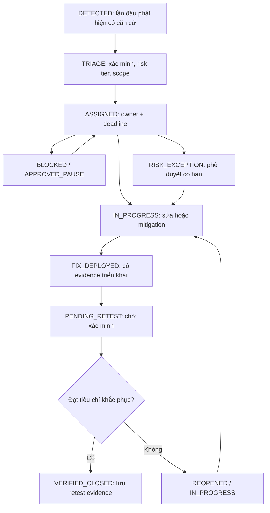
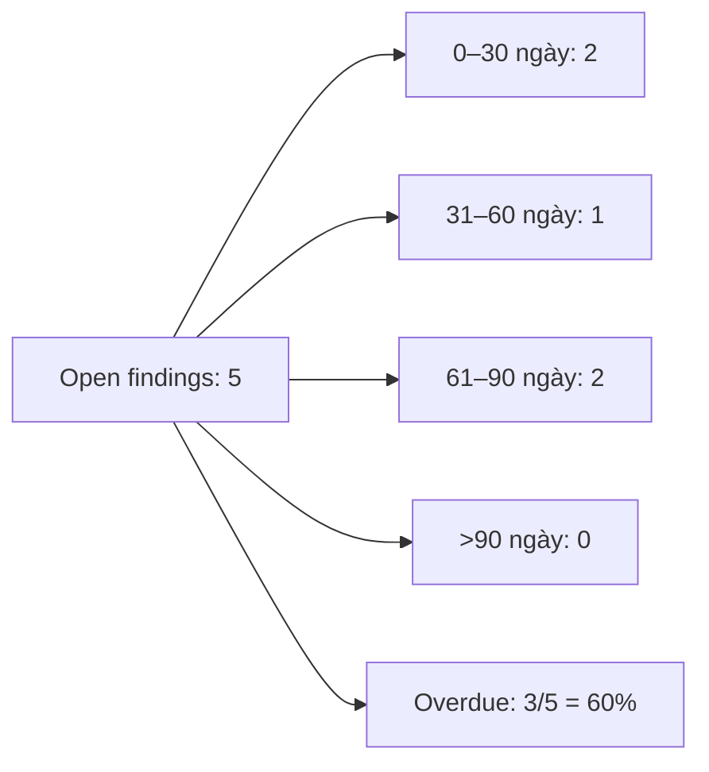
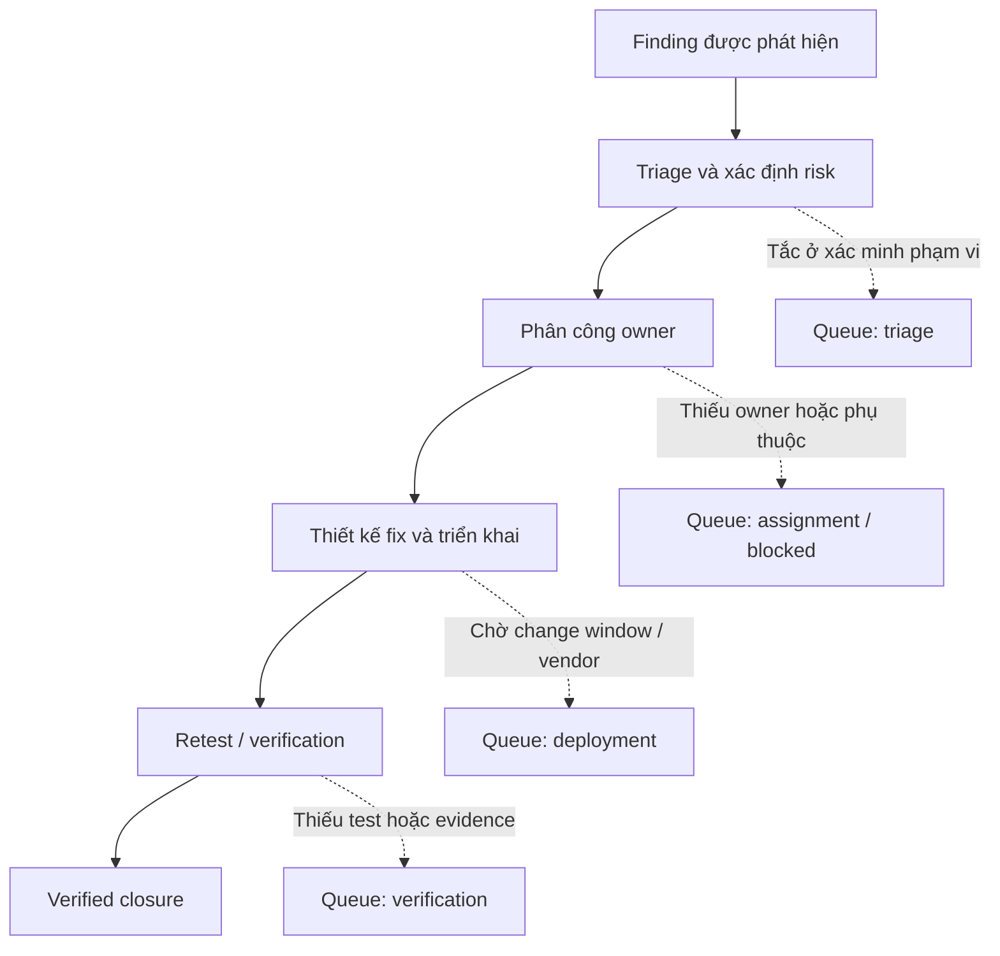
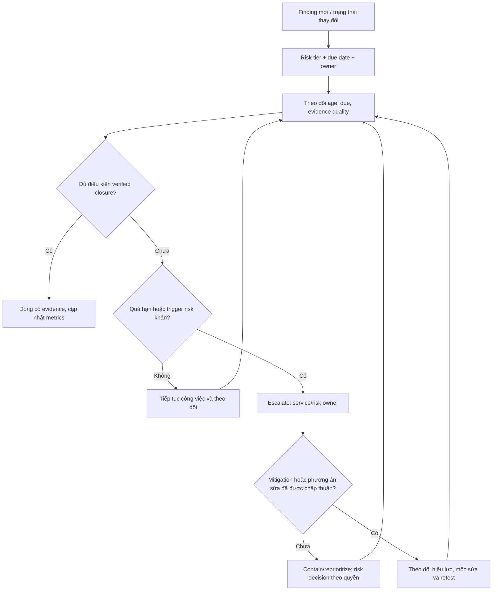

# Remediation aging: đo tuổi tồn đọng và hiệu quả khắc phục các phát hiện bảo mật

## 1. Remediation aging là gì?

**Remediation aging** là phép đo khoảng thời gian một phát hiện (*finding*) bảo mật tồn tại trong vòng đời xử lý, thường tính từ một mốc khởi đầu đã được định nghĩa đến thời điểm đánh giá hoặc thời điểm đóng **đã được kiểm chứng**. Nó giúp trả lời: “Rủi ro nào đã tồn tại bao lâu?”, “Đã vượt hạn cam kết chưa?”, “Nhóm nào đang bị tắc?”, và “Chúng ta có bằng chứng rằng việc khắc phục thực sự hiệu quả hay mới chỉ đóng ticket?”.

Trong chương **Metrics và reporting** của module **SECURITY_SECURITY_ASSURANCE**, remediation aging nối **risk assessment → security controls → findings → khắc phục → retest → bằng chứng → báo cáo** thành vòng lặp security assurance liên tục. Một dashboard chỉ đếm số lỗ hổng được xử lý không đủ; cần nhìn **mức rủi ro, thời gian phơi nhiễm, thời gian chờ, phần việc còn mở và chất lượng xác minh**.

Ví dụ, một lỗi cấp quyền truy cập chéo tenant được phát hiện ngày 1 và “Fix deployed” vào ngày 5. Nếu đến ngày 12 phép thử âm tính mới xác nhận đã chặn đường đọc dữ liệu, thì:

- **Thời gian tới triển khai bản sửa:** từ ngày 1 tới ngày 5.
- **Thời gian tới kiểm chứng khắc phục:** từ ngày 1 tới ngày 12.
- Trước ngày 12, không được tự động coi phát hiện đã được xác nhận khắc phục, kể cả ticket mang trạng thái `DONE`.
- Nếu chưa có kiểm tra sau sửa hoặc vẫn có đường bypass, aging tiếp tục theo chính sách đo lường.

Mục đích của metric không phải “làm đẹp tỷ lệ đóng việc”. Mục đích là giúp tổ chức **giảm rủi ro tồn đọng có thể chứng minh**, phân bổ nguồn lực đúng và giải thích trung thực với quản lý, audit và các bên chịu trách nhiệm.

### Kết quả học tập

Sau bài này, người học có thể:

1. Phân biệt remediation aging, time-to-remediate, time-to-verify, overdue age, backlog age và exposure duration.
2. Xác định mốc bắt đầu/kết thúc, cách xử lý trạng thái tạm dừng, mở lại, trùng lặp, ngoại lệ và thay đổi severity.
3. Thiết kế chính sách hạn khắc phục theo rủi ro, không suy rằng một thời hạn áp dụng cho mọi loại finding.
4. Xây dashboard theo age buckets, severity, asset criticality, owner, cohort và trạng thái kiểm chứng.
5. Tính các chỉ số đúng mẫu số và tránh thiên lệch chỉ nhìn ticket đã đóng.
6. Thiết kế dữ liệu, event history, quy tắc kiểm thử và bằng chứng có thể kiểm toán.
7. Chuyển phát hiện quá hạn thành escalation, risk decision, remediation và kết quả retest có trách nhiệm.

## 2. Finding, incident, risk và remediation item không hoàn toàn giống nhau

Một chương trình security assurance có thể tiếp nhận nhiều loại sự kiện, nhưng cần mô hình hóa rõ “đơn vị được đếm”.

| Đối tượng | Ví dụ | Vai trò trong aging |
| --- | --- | --- |
| **Finding** | Kiểm thử phát hiện API cho truy cập trái quyền | Đối tượng gắn rủi ro, phạm vi và vòng đời khắc phục |
| **Vulnerability instance** | Một CVE trên một máy chủ hoặc image đang chạy | Có thể là một finding/instance theo quy tắc quản lý tài sản |
| **Control gap** | IAM review không có đủ approval evidence | Có thể là vi phạm control hoặc thiếu bằng chứng; phải phân loại |
| **Incident** | Có dấu hiệu dữ liệu bị truy cập trái phép | Điều tra/ứng phó khẩn; aging finding không thay thế incident timeline |
| **Risk record** | Nguy cơ mất tính bảo mật do API scope quá rộng | Có thể tồn tại qua nhiều findings và remediation tasks |
| **Remediation task** | Sửa middleware, bổ sung test, rotate token | Một hoặc nhiều công việc hỗ trợ đóng một finding |
| **Evidence gap** | Không thu được log của account production | Chưa đủ bằng chứng để biết control có đạt; có thể cần xử lý riêng |
| **Exception/risk acceptance** | Cho phép tạm vận hành cùng control bù trừ | Quyết định quản trị rủi ro, không đồng nghĩa finding đã được sửa |

Nếu một finding phải thực hiện bốn task, việc đóng ba task **không có nghĩa** finding đã hoàn tất. Nếu cùng một lỗ hổng xuất hiện trên 1.000 host, phải xác định đơn vị báo cáo: một **finding theo root cause**, 1.000 **asset instances**, hay cả hai ở hai tầng khác nhau. Trộn chúng sẽ làm age và số lượng thay đổi tùy cách gộp.

### 2.1. Định nghĩa “remediated” theo tiêu chí bảo mật

Một phát hiện chỉ nên được xem là khắc phục theo nghĩa assurance khi **điều kiện gây rủi ro không còn tồn tại trong phạm vi cần bảo vệ**, được kiểm chứng bằng phương pháp phù hợp. Ví dụ:

- Lỗ hổng trên image: bản vá hoặc biện pháp sửa phải có mặt trên các workload thực sự đang chạy trong scope.
- Sai phân quyền: kiểm thử truy cập trái quyền phải bị từ chối; không chỉ có PR đã merge.
- Thiếu audit log: nguồn đã hồi phục, event thử tới kho và khoảng dữ liệu thiếu được xử lý hoặc công bố.
- DR test thất bại: diễn tập/retest có điều kiện tương ứng đạt, không chỉ sửa runbook.
- Nhà cung cấp thiếu bằng chứng: phải phân biệt vendor chưa đưa tài liệu với control vận hành không đạt.

Có thể chấp nhận **mitigation** tạm thời hoặc **compensating control** theo quy trình, nhưng metric phải ghi rõ đây là giảm thiểu, khắc phục vĩnh viễn hay rủi ro đã được chấp nhận.

## 3. Các mốc thời gian và loại clock

Một số hệ thống chỉ có `created_at` và `closed_at`. Như vậy chưa đủ để phân tích đúng aging.

| Mốc | Ý nghĩa | Rủi ro nếu hiểu sai |
| --- | --- | --- |
| `first_observed_at` | Lần đầu có bằng chứng về vấn đề trong scope | Có thể có trước khi được nhập vào hệ thống ticket |
| `detected_at` | Khi hệ thống/nhân sự thực sự phát hiện hoặc nhận diện finding | Phải định nghĩa thống nhất với `first_observed_at` |
| `reported_at` | Khi bên phát hiện báo cho đầu mối xử lý | Trễ báo cáo có thể bị che nếu dùng ngày mở ticket |
| `registered_at` | Khi finding được ghi vào registry | Không nhất thiết là ngày rủi ro bắt đầu |
| `triaged_at` | Khi xác minh vấn đề, mức độ và chủ sở hữu | Không nên tự động đặt lại đồng hồ tại đây |
| `assigned_at` | Khi giao owner thực hiện | Dùng đo độ trễ phân công |
| `due_at` | Hạn hoàn tất theo policy/risk decision | Phải có timezone, lịch và phiên bản quy tắc |
| `work_started_at` | Khi bắt đầu công việc sửa | Có thể khác thời điểm nhận ticket |
| `mitigated_at` | Khi biện pháp giảm thiểu tạm hoạt động | Chưa chắc đáp ứng tiêu chí đóng |
| `fix_deployed_at` | Khi bản sửa được triển khai đúng phạm vi | Chưa chứng minh hiệu quả |
| `retest_started_at` | Khi bắt đầu kiểm tra lại | Giúp thấy tắc nghẽn ở review |
| `verified_closed_at` | Khi reviewer xác minh đủ điều kiện đóng | Mốc kết thúc theo chính sách assurance |
| `reopened_at` | Khi phát hiện còn tồn tại/tái xuất hiện | Cần giữ lịch sử và quan hệ với finding cũ |
| `exception_approved_at` | Khi risk owner cho phép ngoại lệ có điều kiện | Không được dùng thay ngày kiểm chứng đóng |

### 3.1. Cần định nghĩa clock chính thức

Một chương trình có thể chọn các đồng hồ khác nhau:

- **Gross finding age:** từ `detected_at` tới mốc đánh giá nếu còn mở, hoặc tới `verified_closed_at` nếu đã xác minh đóng.
- **Workflow lead time:** từ lúc ticket được đăng ký tới khi đóng; hữu ích cho vận hành nhưng có thể che thời gian phát hiện–đăng ký.
- **Time to acknowledge/assign:** độ trễ từ phát hiện tới xác nhận và phân công.
- **Time to deploy fix:** từ phát hiện tới khi bản sửa xuất hiện ở đúng asset/production scope.
- **Time to verified closure:** từ phát hiện tới kiểm thử xác nhận đóng.
- **Overdue duration:** phần thời gian đã trôi qua sau `due_at` đối với finding chưa đóng đã kiểm chứng.
- **Risk exposure duration:** khoảng hệ thống thực tế ở trạng thái chịu rủi ro; có thể bắt đầu trước khi tổ chức phát hiện và cần nêu mức bất định.

Không đồng nhất **thời gian từ lúc phát hiện** với **thời gian phơi nhiễm thật**. Lỗi có thể tồn tại nhiều tháng trước khi scanner nhận diện; `detected_at` chỉ là proxy có giới hạn.

## 4. Cách tính tuổi tồn đọng

Với finding còn mở tại thời điểm quan sát `as_of`:

\[
\text{Open age} = \text{as-of time} - \text{detected time}
\]

Với finding đã được xác minh đóng:

\[
\text{Time to verified closure} = \text{verified close time} - \text{detected time}
\]

Với finding còn mở:

\[
\text{Overdue duration} = \max(0,\ \text{as-of time} - \text{due time})
\]

Khi báo cáo theo ngày, phải xác định rõ làm tròn hay đếm ngày lịch. Phương pháp nhất quán là tính từ timestamp UTC, đổi sang **24-hour duration** rồi quy định cách hiển thị (số ngày thập phân hoặc floor). Các nhóm `0–30`, `31–60`… cần nói rõ dựa trên **ngày đã hoàn tất** hay khoảng thời gian chính xác.

### 4.1. Quy tắc thời gian cần thống nhất

1. **Clock source:** dùng timestamp đáng tin, đồng bộ NTP khi có thể; không để máy trạm quyết định thay nguồn chính.
2. **Timezone:** lưu UTC (hoặc offset rõ), đổi giờ địa phương chỉ để hiển thị.
3. **Unit:** giờ liên tục, ngày lịch hay ngày làm việc? Đừng trộn giữa báo cáo.
4. **Start event:** phát hiện đầu tiên hợp lệ, nhập finding hay triage? Chọn và nêu rành mạch.
5. **Stop event:** xác minh đóng, không phải chuyển ticket sang `DONE` nếu còn thiếu retest.
6. **After due:** chỉ overdue khi `as_of > due_at` theo chính sách; sát hạn có thể là `AT_RISK`.
7. **Historical query:** muốn biết backlog tại một thời điểm quá khứ phải dùng trạng thái lịch sử, không chỉ nhìn status hiện tại.
8. **Calendar exceptions:** kỳ nghỉ, sự cố hoặc thời gian chờ nhà cung cấp chỉ ảnh hưởng net clock khi policy cho phép và có evidence.

### 4.2. Ví dụ đọc timestamp

Giả sử thời điểm đánh giá `2026-11-28T00:00:00Z`:

- Finding được phát hiện `2026-11-20T00:00:00Z`: **8 ngày** tuổi.
- Deadline `2026-11-27T00:00:00Z`: **1 ngày quá hạn**.
- Nếu hạn được lưu là `2026-11-27T23:59:59Z`, overdue chỉ vài giây tại mốc đánh giá. Vì vậy không suy ra cùng số ngày quá hạn chỉ từ một ô ngày khi ý nghĩa “hết ngày” chưa định nghĩa.

Nếu tổ chức đặt deadline là **hết ngày địa phương** thì phải chuyển đúng múi giờ sang timestamp dùng so sánh. Việc chọn múi giờ có thể làm một finding chuyển trạng thái overdue ở thời điểm khác.

## 5. Gross age, net age và thời gian tạm dừng

Một số tổ chức có cơ chế **pause** đồng hồ SLA, ví dụ chờ một nhà cung cấp hoặc có lệnh cấm thay đổi tạm thời. Tuy nhiên, pause có thể tạo rủi ro nếu mọi nhóm đều sử dụng để che tuổi tồn đọng.

| Metric | Cách hiểu | Khi nào hữu ích |
| --- | --- | --- |
| **Gross age** | Toàn bộ thời gian từ phát hiện đến as-of/verified closure | Cho thấy rủi ro hoặc vấn đề tồn tại bao lâu theo lịch |
| **Net processing age** | Gross age trừ những khoảng pause **hợp lệ theo policy** | Đánh giá phần thời gian nằm trong trách nhiệm xử lý của nhóm |
| **Blocked duration** | Thời gian ghi nhận ở trạng thái chờ/tháo gỡ phụ thuộc | Phân tích bottleneck |
| **External wait duration** | Chờ nhà cung cấp, phê duyệt hoặc upstream dependency | Quản lý rủi ro chuỗi cung ứng |
| **Validation queue duration** | Fix đã có nhưng chưa retest/accept | Phát hiện tồn đọng ở bước assurance |

**Gross age cần được giữ dù tính net age.** Một biện pháp giảm thiểu có thể giảm xác suất khai thác nhưng không xóa nhu cầu kiểm chứng việc sửa; một ticket bị pause vẫn có rủi ro tồn tại.

### 5.1. Điều kiện pause an toàn

Nếu policy cho phép pause, cần bản ghi:

- `pause_started_at`, `pause_ended_at`, lý do và loại dependency.
- Người yêu cầu, người có quyền phê duyệt, thời hạn tối đa.
- Trạng thái rủi ro khi pause: có control bù trừ, isolation hoặc hạn chế sử dụng không?
- Có phát sinh `due_at` mới không, ai phê duyệt và vì sao?
- Tác động lên gross age, net SLA clock và báo cáo ban lãnh đạo.

Một pause mở vô thời hạn hoặc không có review phải bị cảnh báo. Khi báo cáo, nên hiển thị cả **gross age, approved pause duration và net age**, tránh chỉ công bố số net.

## 6. Chính sách deadline theo rủi ro thay vì một ngưỡng chung

Không có hạn remediation duy nhất phù hợp mọi tổ chức, tài sản hay tình huống. Chính sách nên phân loại theo **severity + exploitability + exposure + business impact + control compensating**.

Ví dụ **chỉ để minh họa nội bộ**:

| Risk tier | Mục tiêu thời hạn ví dụ | Điều kiện ưu tiên |
| --- | --- | --- |
| **Critical** | 7 ngày | Có thể khai thác trực tiếp, ảnh hưởng dịch vụ/dữ liệu trọng yếu hoặc rủi ro diện rộng |
| **High** | 30 ngày | Ảnh hưởng lớn nhưng có khả năng kiểm soát ở mức độ nhất định |
| **Medium** | 90 ngày | Có biện pháp giảm thiểu phù hợp và tác động chưa vượt ngưỡng nội bộ |
| **Low** | Theo chu kỳ được phê duyệt | Theo dõi, batch work và quản lý thay đổi |

Những mốc 7/30/90 ngày **không phải tiêu chuẩn pháp lý hay yêu cầu chung**, và có thể hoàn toàn không đủ nhanh trong sự cố đang bị khai thác. Khi đang có exploit active hoặc ảnh hưởng người dùng, quy trình **incident response/containment** cần kích hoạt riêng, không chờ hết SLA remediation thông thường.

### 6.1. Quyết định risk tier

Cần xét:

- **Exploitability thực tế:** có khai thác đang diễn ra, có đường truy cập tới attack surface, điều kiện tiên quyết nào?
- **Severity kỹ thuật:** tác động lên confidentiality, integrity, availability; CVSS có thể là đầu vào nhưng không thay toàn bộ đánh giá.
- **Asset criticality:** xử lý dữ liệu khách hàng nhạy cảm, thanh toán, IAM, KMS, control plane chung?
- **Exposure:** Internet-facing, tenant boundary, quyền service account, các hệ thống có chung điểm lỗi?
- **Blast radius:** số tenant, tài khoản, region, workstation hoặc business process bị ảnh hưởng.
- **Controls đã có:** segmentation, WAF, monitoring, least privilege, offline recovery… có bằng chứng hiệu quả không?
- **Business/legal constraints:** nghĩa vụ hợp đồng, thời gian hoạt động, phê duyệt risk owner.
- **Nguồn evidence:** đã kiểm chứng impact hay chỉ scanner báo dựa trên version?

Một thay đổi severity nên tạo **risk reassessment record có thời điểm hiệu lực**, không xóa mức trước đó. Nếu finding trở nên critical hôm nay, deadline và escalation cần theo policy đã phê duyệt; không chỉnh `detected_at` để tạo cảm giác mới phát hiện.

## 7. Vòng đời finding để aging có thể kiểm toán



Sơ đồ là mô hình minh họa, không phải một danh sách trạng thái bắt buộc. **Ngoại lệ và pause là thuộc tính quyết định quản trị**, có thể đi song song với workflow, không nhất thiết là trạng thái exclusive.

### 7.1. Những chuyển trạng thái cần bằng chứng

| Transition | Evidence tối thiểu | Lỗi phổ biến |
| --- | --- | --- |
| `DETECTED → TRIAGED` | Source, bước tái hiện, phạm vi, risk rationale | Đặt severity mà không xác minh finding |
| `TRIAGED → ASSIGNED` | Owner, due date, acceptance criteria | Ticket vô chủ hoặc hạn rỗng |
| `IN_PROGRESS → FIX_DEPLOYED` | Change ID, build/resource version, scope được sửa | PR merge nhưng production chưa thay đổi |
| `FIX_DEPLOYED → PENDING_RETEST` | Phép kiểm tra lại, người có quyền review, lịch | Đóng ticket ngay khi deploy |
| `PENDING_RETEST → VERIFIED_CLOSED` | Test PASS đúng scope, evidence và reviewer | Test chỉ ở staging, không xem phần còn sót |
| `PENDING_RETEST → REOPENED` | Test FAIL/partial, finding vẫn tồn tại | Tạo ID mới để “reset” tuổi |
| `OPEN → EXCEPTION_APPROVED` | Risk owner, điều kiện, expiry, compensating controls | Coi ngoại lệ là fix và biến khỏi backlog |

Nếu một finding được đóng sau khi mọi asset bị ảnh hưởng đã được **decommission** một cách có kiểm chứng, đó có thể là **loại bỏ exposure** hợp lệ. Phải lưu decommission evidence và bảo đảm không còn tài sản hoặc dữ liệu tương tự trong scope; không coi “host biến mất khỏi scanner” là bằng chứng đã xử lý khi inventory thiếu.

## 8. Reopen, duplicate, merge, split và reclassification

Đây là nhóm nguyên nhân làm remediation aging dễ bị thao túng, dù cố ý hay vô ý.

### 8.1. Reopen

Hai tình huống khác nhau:

1. **Fix chưa từng đạt**: retest cho thấy vấn đề tồn tại liên tục. Nên giữ finding ID, ngày phát hiện ban đầu và lịch sử, kể cả khi ticket đã tạm đóng sai.
2. **Sự cố tái xuất hiện sau verified closure hợp lệ**: có thể ghi một *episode* mới hoặc finding mới có liên kết `regression_of`, đồng thời vẫn giữ lịch sử lần trước. Metric cần công bố phương pháp.

Không đặt lại ngày phát hiện một cách tự động mỗi lần reassign hoặc chuyển status. Nếu cần đo SLA của episode mới, sử dụng **`episode_start_at`** bên cạnh `original_detected_at`, không thay dữ liệu gốc.

### 8.2. Duplicate

Nếu hai scanner báo cùng một root cause trên cùng một asset/scope, quy trình có thể xác định duplicate và liên kết với canonical finding. Nhưng:

- Giữ `first_detected_at` sớm nhất **có căn cứ** trong tập được gộp.
- Lưu các source/evidence và scope ban đầu; không xóa traceability.
- Không đếm duplicate vào backlog hai lần nếu báo cáo theo canonical finding.
- Nếu metric đo **vulnerability instances**, vẫn phải ghi nhận số asset affected riêng.
- Không dùng gộp nhiều findings không liên quan để che số lượng.

### 8.3. Merge và split

Một finding chung “IAM too broad” có thể cần tách thành nhiều scope, owner và due dates khi điều tra. Cần lưu `parent_id`, `child_ids`, nguyên nhân tách, phạm vi mới và tuổi gốc theo quy tắc. Các chỉ số lịch sử có thể cần **restatement có ghi version**, không âm thầm thay số cũ.

### 8.4. Thay severity và due date

Khi risk tier tăng do phát hiện có khả năng khai thác, phải ghi `severity_changed_at`, nguyên nhân, phê duyệt và due date theo chính sách hiện hành. Chỉ nên thay due date nếu có quyết định được ủy quyền và không xóa **original_due_at**. Báo cáo nên thể hiện `original_due`, `current_approved_due` và số lần gia hạn.

Một dashboard chỉ hiển thị hạn đã được lùi nhiều lần sẽ che ý nghĩa remediation aging. Cần bổ sung số ngày quá hạn theo hạn gốc và phân tích rủi ro còn mở.

## 9. Các metrics quan trọng của remediation aging

### 9.1. Snapshot backlog metrics

| Metric | Định nghĩa ngắn | Câu hỏi giúp quyết định |
| --- | --- | --- |
| **Open findings count** | Số canonical findings còn mở tại `as_of` | Quy mô tồn đọng bao nhiêu? |
| **Open age / mean age** | Tuổi từng finding; trung bình theo scope | Tồn đọng trung bình tăng hay giảm? |
| **Median / P75 / P90 age** | Phân vị tuổi trên tập còn mở | Phần đuôi lâu năm có đang xấu đi? |
| **Maximum age** | Tuổi lớn nhất trong scope | Có finding nào bị bỏ quên? |
| **Age buckets** | Số và tỷ lệ findings trong khoảng tuổi | Đâu là nhóm ưu tiên? |
| **Overdue count/rate** | Finding đang mở có `as_of > current_approved_due_at` | Mức vi phạm hạn hiện tại? |
| **Original-deadline overdue** | Finding đã vượt hạn gốc dù được gia hạn | Chất lượng quản trị gia hạn ra sao? |
| **Critical/high overdue** | Tồn đọng quá hạn ở nhóm rủi ro cao | Có cần escalation hay containment? |
| **Oldest critical risk** | Tuổi của finding trọng yếu tồn tại lâu nhất | Có rủi ro không thể chấp nhận đang được duy trì? |
| **Unowned findings** | Finding chưa có owner hợp lệ | Nút thắt ở bước quản trị? |
| **Pending verification age** | Từ deploy fix tới as-of khi chưa retest | Tắc nghẽn ở khâu xác minh? |
| **Exception aging** | Thời gian tồn tại của ngoại lệ và quá hạn review | Rủi ro tạm thời có thành vĩnh viễn? |

### 9.2. Flow metrics và chất lượng đóng

| Metric | Định nghĩa | Lưu ý |
| --- | --- | --- |
| **Time to assignment** | Phát hiện → owner chịu trách nhiệm | Giảm độ trễ trước khi sửa |
| **Time to mitigation** | Phát hiện → giảm thiểu có hiệu lực | Không thay verified remediation |
| **Time to fix deploy** | Phát hiện → triển khai sửa vào scope | Kiểm tra asset/build thực chạy |
| **Time to verified closure** | Phát hiện → retest đạt và đóng | Có thể báo trung vị/phân vị theo cohort |
| **Reopen rate** | Tỷ lệ finding hoặc episode bị mở lại theo định nghĩa | Cần cohort và thời gian quan sát |
| **Retest failure rate** | Tỷ lệ retest không đạt trong tập được test lại | Không bỏ `SKIP`/`ERROR` khỏi coverage |
| **Finding inflow/outflow** | Findings mới và verified closures trong kỳ | Thay đổi backlog = inflow − outflow ± điều chỉnh |
| **SLA attainment** | Tỷ lệ verified closures đúng hạn trên cohort phù hợp | Tránh chỉ tính các ticket dễ đóng |

**Không phải mọi metric cần lên dashboard cho lãnh đạo.** Chọn theo quyết định mong muốn: ưu tiên risk, điều phối năng lực, kiểm soát SLA, cải thiện retest hay phát hiện nguồn dữ liệu thiếu.

## 10. Age buckets, phân vị và cách tránh đánh lạc hướng

Một cách phân nhóm illustrative, tính trên **ngày tuổi hoàn tất**:

| Bucket | Khoảng ngày tuổi | Cách diễn giải |
| --- | --- | --- |
| `0–30` | 0 đến 30 ngày, bao gồm 30 | Vấn đề tương đối mới |
| `31–60` | 31 đến 60 ngày | Đang kéo dài |
| `61–90` | 61 đến 90 ngày | Cần xem xét nguy cơ tồn đọng |
| `>90` | Trên 90 ngày | Long-running findings |

Đây là các bucket **theo tuổi**, không phải ngưỡng SLA. Một finding Critical 8 ngày tuổi có thể đã quá hạn 1 ngày, trong khi finding Medium 88 ngày tuổi vẫn chưa đến hạn. **Age bucket một mình không quyết định mức ưu tiên.**

### 10.1. Vì sao median và phân vị quan trọng?

- **Mean** bị ảnh hưởng mạnh bởi vài finding cực cũ.
- **Median** mô tả finding ở giữa phân bố, nhưng có thể che phần đuôi rủi ro cao.
- **P90/P95** giúp thấy nhóm tồn tại lâu; cần công bố cách nội suy phân vị, số mẫu và scope.
- **Max** hữu ích để tìm issue bị bỏ quên nhưng có thể lệch nếu bản ghi là lỗi nhập liệu.
- **Breakdown theo severity/criticality** ngăn một lượng lớn issue Low làm dashboard chung trông tốt.

Ví dụ có 95 findings Low tuổi 5 ngày và 5 findings Critical tuổi 120 ngày. Median tổng rất thấp, nhưng **tồn đọng Critical** vẫn là tín hiệu khẩn cần điều tra. Không dùng một con số trung bình để che phân bố và tác động.

## 11. Ví dụ định lượng hoàn chỉnh tại một thời điểm

Giả sử tại `as_of = 2026-11-28T00:00:00Z`, tổ chức có sáu canonical findings và sử dụng quy tắc tính **ngày 24 giờ từ thời điểm phát hiện**. Thời gian dưới đây chỉ là **dữ liệu học tập**.

| ID | Tier | Detected UTC | Approved due UTC | Trạng thái tại as-of | Open age | Overdue |
| --- | --- | --- | --- | --- | ---: | ---: |
| **F-101** | Critical | 20/11/2026 00:00 | 27/11/2026 00:00 | OPEN | 8 ngày | 1 ngày |
| **F-102** | High | 20/10/2026 00:00 | 19/11/2026 00:00 | IN_PROGRESS | 39 ngày | 9 ngày |
| **F-103** | High | 01/11/2026 00:00 | 01/12/2026 00:00 | PENDING_RETEST | 27 ngày | 0 |
| **F-104** | Medium | 01/09/2026 00:00 | 30/11/2026 00:00 | OPEN | 88 ngày | 0 |
| **F-105** | High | 30/08/2026 00:00 | 29/09/2026 00:00 | BLOCKED | 90 ngày | 60 ngày |
| **F-106** | High | 25/10/2026 00:00 | 24/11/2026 00:00 | VERIFIED_CLOSED ngày 15/11 | Không thuộc open backlog | 0 tại lúc đóng |

**F-106** có time to verified closure từ 25/10 đến 15/11 là **21 ngày**, đạt deadline ví dụ. Không được dùng 34 ngày từ 25/10 tới 28/11 để tính “tuổi khi còn mở”, vì finding đã đóng trước thời điểm đánh giá.

### 11.1. Tính backlog

Tại as-of, chỉ có F-101…F-105 còn mở. Vì vậy:

- **Open findings = 5**.
- Tuổi các finding còn mở = `8, 39, 27, 88, 90` ngày.
- **Mean age** = `(8 + 39 + 27 + 88 + 90) / 5 = 50,4 ngày`.
- Sắp xếp `8, 27, 39, 88, 90` ⇒ **median age = 39 ngày**.
- **Maximum age = 90 ngày** (F-105).
- **Overdue count = 3** (F-101, F-102, F-105).
- **Overdue rate = 3/5 = 60%** trên tập findings còn mở.
- **Critical/High open = 4**, trong đó overdue 3 ⇒ **75%** của nhóm này đang quá hạn.
- **Age buckets:** `0–30: 2`, `31–60: 1`, `61–90: 2`, `>90: 0`.

Đây là chỉ số học tập cho **một snapshot**, không phản ánh xu hướng nếu chưa có nhiều mốc thời gian và nguồn dữ liệu nhất quán.

### 11.2. Minh họa phân bố tuổi



Sơ đồ là cách **minh họa phân nhóm**, không phải biểu đồ thời gian thực. Cần lọc theo tier và asset để tránh coi mọi finding trong cùng một bucket có mức ưu tiên bằng nhau.

### 11.3. Quyết định vận hành từ ví dụ

- **F-101:** tuy mới 8 ngày nhưng Critical đã overdue; cần xem containment, escalation và quyền chấp nhận rủi ro khẩn theo quy trình.
- **F-102:** High quá hạn 9 ngày; phải xem nguyên nhân trì hoãn và chủ sở hữu hành động.
- **F-103:** ở bước `PENDING_RETEST`, chưa được tính là closed; cần kiểm tra hàng đợi assurance có làm rủi ro kéo dài hay không.
- **F-104:** Medium tuổi 88 ngày nhưng còn trước hạn; theo dõi năng lực team và khả năng vượt hạn.
- **F-105:** High blocked 90 ngày, overdue 60 ngày; cần tháo gỡ dependency, xem control bù trừ và báo cáo rủi ro tồn dư. `BLOCKED` không phải bằng chứng đã an toàn.
- **F-106:** chỉ dùng trong flow/closure metrics; không đưa vào current open age.

## 12. Cohort analysis: thời gian xử lý thay đổi ra sao?

Một sai lầm thường gặp là chỉ lấy những finding **đã đóng trong tháng** rồi tính “mean time to remediate”. Những ticket lâu năm chưa đóng bị loại, khiến kết quả trông tốt dù backlog xấu đi.

### 12.1. Khác biệt snapshot, cohort và closure period

| Góc nhìn | Đơn vị quan sát | Dùng để trả lời |
| --- | --- | --- |
| **Open backlog snapshot** | Findings còn mở tại ngày X | Tồn đọng hiện tại và tuổi rủi ro |
| **Detected cohort** | Findings được phát hiện trong một tháng/quý | Bao nhiêu phần trăm được verified close sau N ngày? |
| **Closed cohort** | Findings được verified close trong một kỳ | Thời gian xử lý của nhóm đã đóng trong kỳ |
| **Asset cohort** | Findings trên một nhóm tài sản/region/service | Rủi ro của khu vực nào đang tồn đọng? |
| **Risk tier cohort** | Critical/High/Medium theo chính sách version xác định | Đánh giá đúng ưu tiên và SLA |
| **Release cohort** | Findings trên artifact/deployment generation | Kiểm tra hiệu quả remediation theo vòng đời phát hành |

**Không so median time-to-close của nhóm đóng tháng A với nhóm mở tháng B** như thể hai mẫu tương đương. Các cohort có tuổi theo dõi khác nhau và quyền quan sát khác nhau.

### 12.2. Right censoring: những finding chưa đóng

Một finding mới tồn tại 10 ngày mà vẫn mở không thể có “time to verified closure = 10 ngày”. Ta mới biết thời gian đóng **lớn hơn 10 ngày**, chứ không biết khi nào sẽ đóng. Đây là ví dụ dữ liệu bị **right-censored** trong phân tích thời gian tới sự kiện.

Khi theo dõi cohort:

- Có thể báo **tỷ lệ verified closure trong 30 ngày** nếu mọi finding trong cohort đã được quan sát đủ 30 ngày hoặc phương pháp xử lý censoring rõ.
- Không loại findings còn mở khỏi cohort rồi báo tỷ lệ từ nhóm đã đóng.
- Có thể dùng survival analysis/Kaplan–Meier khi dữ liệu, giả định và mục tiêu phân tích phù hợp; không tự suy chính xác tương lai từ một cohort ít quan sát.
- Nếu finding bị xóa khỏi scope do asset decommission, phải ghi loại kết thúc và tác động thống kê, không coi tự động là `verified remediation`.

### 12.3. Ví dụ cohort có đủ thời gian quan sát

Một cohort gồm 20 findings được phát hiện ở một giai đoạn đủ xa trong quá khứ để quan sát trọn 30 ngày sau phát hiện. Sau 30 ngày:

- 12 đã được verified close trong vòng 30 ngày.
- 5 vẫn còn mở ở ngày thứ 30.
- 3 chỉ được verified close **sau** ngày thứ 30.

Tỷ lệ verified closure trong 30 ngày = **12/20 = 60%**. Tám finding còn lại **không đạt mốc đóng trong 30 ngày**, kể cả ba finding đã đóng muộn. Nếu chỉ lấy 15 findings cuối cùng đã đóng và tính `12/15 = 80%`, kết luận “80% đóng trong 30 ngày” đã bỏ năm finding còn tồn đọng khỏi mẫu số.

Mức 30 ngày chỉ là mốc **phân tích cohort minh họa**, không phải hạn bắt buộc cho mọi risk tier.

## 13. Phân tích flow và điểm nghẽn của remediation

Aging lớn có thể đến từ nguyên nhân khác nhau. Chỉ trách “nhóm xử lý chậm” thường không tạo được hành động đúng.



### 13.1. Đo age theo trạng thái

| Trạng thái tồn đọng | Metric có ích | Hành động quản trị |
| --- | --- | --- |
| `TRIAGE_PENDING` | Thời gian chờ xác định phạm vi/severity | Phân bổ năng lực đánh giá, chuẩn hóa bước xác minh |
| `UNASSIGNED` | Thời gian chưa có owner | Escalate tới asset/business owner |
| `IN_PROGRESS` | Thời gian xử lý thực và số dependency | Hỗ trợ kỹ thuật, chia nhỏ nhiệm vụ nhưng giữ finding gốc |
| `BLOCKED` | Blocked duration, nguyên nhân, risk mitigation | Xử lý đối tác/quyền, thay phương án, risk acceptance |
| `FIX_DEPLOYED` | Fix đã triển khai nhưng coverage chưa xác nhận | Kiểm tra deployment/asset inventory |
| `PENDING_RETEST` | Thời gian chờ kiểm thử độc lập | Tăng capacity/retest automation |
| `REOPENED` | Thời gian từ verified status tới regression, số vòng rework | Phân tích root cause và test coverage |

Một tổ chức có thể tăng số finding đóng bằng cách dồn tất cả case đã fix vào trạng thái `DONE` trước retest. Nhưng theo **verified closure clock**, bottleneck vẫn nằm ở `PENDING_RETEST`. Đây là khác biệt giữa metric vận hành ticket và metric assurance.

## 14. Risk-weighted aging và cách ưu tiên hành động

Tính tuổi thuần túy chưa đo đúng rủi ro. Một finding critical ở data plane chung có thể đáng ưu tiên hơn nhiều findings low đã tồn tại lâu hơn.

### 14.1. Ma trận quyết định

| Yếu tố | Câu hỏi |
| --- | --- |
| Severity và exploitability | Có khai thác thực tế hoặc đường truy cập công khai không? |
| Critical service | Tác động tới thanh toán, IAM, dữ liệu nhạy cảm, recovery hay safety không? |
| Blast radius | Số tenant, tài sản hoặc business processes bị ảnh hưởng |
| Finding age | Vấn đề đã nằm trong backlog bao lâu? |
| Overdue duration | Đã vượt approved due bao lâu? Có lùi hạn nhiều lần không? |
| Mitigation effectiveness | Có control bù trừ **được kiểm thử** không? |
| Remediation feasibility | Có thể khắc phục nhanh, cần migration hay phụ thuộc vendor? |
| Uncertainty | Có thiếu log/evidence khiến rủi ro không thể ước lượng chắc chắn? |
| Repeat failure | Finding có tái diễn hoặc fix liên tục không đạt retest? |

Có thể xây **priority score nội bộ** để sắp xếp công việc, nhưng không nên coi một công thức số là “mức rủi ro thực tế”. Hệ số trọng số phải được phê duyệt, giải thích, kiểm tra tính nhạy và không cho phép một số điểm thấp che rủi ro bắt buộc phải xử lý khẩn.

### 14.2. Một biểu thức minh họa, không phải tiêu chuẩn

Giả sử nội bộ thiết kế một score dùng để sắp thứ tự:

\[
\text{Priority index} =
w_s S + w_e E + w_b B + w_o O
\]

Trong đó `S` là độ nghiêm trọng, `E` là mức phơi nhiễm, `B` là tác động nghiệp vụ và `O` là chỉ số quá hạn, mỗi biến được chuẩn hóa theo rubric đã phê duyệt. **Không được dùng score này làm bằng chứng rằng rủi ro đã được định lượng khách quan** nếu cách chuẩn hóa và trọng số chỉ là quyết định tùy ý.

Ngoài score, vẫn phải có **hard escalation rules** cho phát hiện đang bị khai thác, tác động safety, breach nghiêm trọng, hoặc những trạng thái vượt mức risk appetite đã được phê duyệt.

## 15. Thiết kế dashboard và báo cáo cho các cấp

Một bảng remediation aging hữu ích cần dẫn tới **quyết định cụ thể**, thay vì hiển thị hàng chục số không biết xử lý gì.

### 15.1. Dashboard vận hành (engineering/SecOps)

Nên trả lời: finding nào cần xử lý hôm nay? Ai là owner? Đang mắc ở đâu? Khi nào tới hạn? Có bằng chứng fix và đường retest chưa?

Các trường hữu ích: ID, service, asset/tenant scope, severity, exploitability, owner, detected date, age, original/current due, overdue, trạng thái, blocked reason, mitigation, linked change, retest due và alert.

### 15.2. Báo cáo security leadership/risk committee

Tập trung vào:

- Backlog Critical/High đang mở và số overdue.
- Tuổi và xu hướng các finding rủi ro cao (median/P90/max).
- Dịch vụ/đội có rủi ro kéo dài và phụ thuộc chung.
- Findings có ngoại lệ quá hạn hoặc gia hạn lặp lại.
- Tỷ lệ verified closure theo cohort và failure/reopen rate.
- Khoảng thiếu chứng cứ làm giảm độ tin cậy của chỉ số.
- Các quyết định cần cấp có thẩm quyền: thay nguồn lực, chấp nhận rủi ro, hạn chế dịch vụ, yêu cầu vendor.

### 15.3. Báo cáo audit/assurance

Ngoài chỉ số, phải trình bày **logic và provenance**:

- Scope và population, quy tắc deduplicate, nguồn phát hiện.
- Policy và severity taxonomy version dùng cho kỳ.
- Đồng hồ tính tuổi, timezone, calendar, pause logic.
- Mốc snapshot, dữ liệu late-arriving, lịch sử trạng thái.
- Danh mục findings với evidence và reviewer.
- Ngoại lệ, gaps, đã điều chỉnh số liệu lịch sử và người phê duyệt.

Một dashboard xanh nhưng không thể tái dựng finding nào đã đóng đúng hạn thì không đủ mạnh cho audit.

### 15.4. Quy tắc biểu diễn

| Hiển thị | Giá trị | Cảnh báo |
| --- | --- | --- |
| Trend open backlog theo tuần | Thấy lượng tồn đọng tăng/giảm | Cần annotate scope/new scanner coverage |
| Age distribution theo risk tier | Thấy “đuôi” Critical/High kéo dài | Đừng chỉ show overall average |
| Heatmap service × overdue | Định hướng owner và tài nguyên | Số lượng nhiều không đồng nghĩa rủi ro nặng hơn |
| Cohort closure curve | So sánh tốc độ xử lý theo thời gian | Cohort phải có thời gian follow-up tương xứng |
| Exception/extension report | Giám sát quản trị rủi ro | Không đổi ngoại lệ thành PASS |
| Finding drill-down | Truy từng số liệu về evidence | Phân quyền đúng vì dữ liệu có thể nhạy cảm |

## 16. Mô hình dữ liệu có khả năng kiểm toán

Cần tách **bản ghi finding hiện hành** khỏi **lịch sử event không bị ghi đè**, để tính lại snapshot quá khứ.

### 16.1. Trường finding

| Trường | Mục đích |
| --- | --- |
| `finding_id`, `canonical_id` | ID và logic dedup/merge |
| `risk_id`, `control_id`, `requirement_id` | Traceability tới mục tiêu bảo mật |
| `service_id`, `asset_ids`, `tenant/region` | Phạm vi và business criticality |
| `title`, `source`, `source_event_ref` | Thông tin phát hiện và provenance |
| `detected_at`, `registered_at` | Mốc gốc, thời gian nhập registry |
| `severity`, `severity_effective_at`, `risk_rationale` | Mức rủi ro có thời điểm và lý do |
| `owner`, `business_owner`, `reviewer` | Trách nhiệm khắc phục và xác minh |
| `original_due_at`, `approved_due_at` | Hạn gốc và hiện hành |
| `current_state`, `state_reason` | Điều kiện vận hành hiện tại |
| `fix_deployed_at`, `verified_closed_at` | Mốc triển khai và xác minh |
| `exception_id`, `pause_intervals` | Ngoại lệ, pause có bằng chứng |
| `evidence_refs`, `retest_id`, `change_id` | Đường truy vết |
| `parent/duplicate/regression_id` | Quan hệ và xử lý tuổi không reset tùy tiện |
| `record_version`, `last_updated_at` | Version và audit trail |

### 16.2. Event history

Mỗi thay đổi đáng kể nên có event:

```yaml
event_id: EVT-F105-004
finding_id: F-105
event_type: SLA_EXTENSION_APPROVED
occurred_at: "2026-11-10T09:00:00Z"
recorded_at: "2026-11-10T09:00:05Z"
actor_role: authorized_risk_owner
before:
  approved_due_at: "2026-09-29T00:00:00Z"
after:
  approved_due_at: "2026-12-10T00:00:00Z"
reason: "Approved bounded exception with verified temporary containment"
approval_ref: "risk-decision-example"
evidence_refs:
  - "evidence-store://containment-test/example"
```

**Ví dụ này minh họa cách lưu sự kiện gia hạn, không phải dữ kiện đã xảy ra của F-105 ở bảng trước.** Nếu áp dụng event này thực tế cho F-105, số ngày overdue theo hạn hiện hành ở bảng minh họa sẽ thay đổi; cần tính lại từ **snapshot event history** cho đúng ngày và cùng policy. Đây là lý do không nên lưu duy nhất một cột due date rồi ghi đè.

### 16.3. Một lần thay đổi cần giữ cả hai góc nhìn

- **Current approved due:** giúp vận hành biết hạn được phê duyệt mới.
- **Original due:** cho thấy mức độ trì hoãn so với cam kết đầu.
- **Extension history:** cho biết ai cho phép, điều kiện, bằng chứng và ngày hết hiệu lực.
- **Gross age:** không biến mất dù có extension hay pause.

Khi so sánh xu hướng, cần giải thích “ngày báo cáo dùng hạn gốc hay hạn mới” và nếu phương pháp thay đổi thì có thực hiện **restatement** hay không.

## 17. Ví dụ pseudocode tính aging và cảnh báo

Pseudo-code sau minh họa yêu cầu tính toán, không phải phần mềm production hoàn chỉnh:

```text
function agingAt(finding, asOf, policy):
    state = reconstructStateFromHistory(finding.id, asOf)
    if state.didNotExistAt(asOf):
        return NOT_IN_POPULATION

    if state.isCanonicalDuplicate:
        return EXCLUDED_WITH_LINK_TO_CANONICAL

    detected = state.originalDetectedAt
    closed = state.verifiedClosedAt

    # Closed findings không nằm trong open backlog.
    if closed != null and closed <= asOf:
        return {
            population: "VERIFIED_CLOSED",
            timeToVerifiedClose: closed - detected,
            closedOnTime: closed <= state.dueAtApplicableToClosure
        }

    grossAge = asOf - detected
    approvedDue = state.currentApprovedDueAt
    overdue = max(0, asOf - approvedDue)
    approvedPause = sumApprovedPauseIntervals(state, detected, asOf)
    netProcessingAge = grossAge - approvedPause

    return {
        population: "OPEN",
        state: state.workflowState,
        severity: state.riskTierAsOf,
        grossAge: grossAge,
        netProcessingAge: netProcessingAge,
        overdue: overdue,
        originalDueAt: state.originalDueAt,
        approvedDueAt: approvedDue,
        owner: state.ownerAsOf,
        evidenceQuality: state.evidenceQualityAsOf,
        riskException: state.activeRiskDecisionAsOf
    }
```

**Điểm kỹ thuật cần xử lý trước khi triển khai thật:**

1. Không để `grossAge` âm hoặc null khi timestamp bị sai; phải cảnh báo dữ liệu lỗi.
2. `sumApprovedPauseIntervals` phải loại overlap và cắt khoảng theo `asOf`, không cộng trùng.
3. Không trừ pause khỏi overdue nếu policy không định nghĩa cơ chế đó.
4. `reconstructStateFromHistory` cần xử lý event đến muộn, corrected source timestamps và quyền sửa bản ghi.
5. Mọi điều chỉnh `detected_at`, risk tier hoặc due date phải có event và approval phù hợp.
6. Nếu `due_at` rỗng, trạng thái là **unknown SLA/due**, không tự coi “không overdue”.
7. Nếu `verifiedClosedAt` thiếu evidence, không tự biến finding sang `VERIFIED_CLOSED`.
8. Với finding đã reopen, phải có policy giải thích bản ghi đang đo **continuous unresolved exposure** hay episode mới.

### 17.1. SQL minh họa cho current snapshot

Đối với mô hình đơn giản có một bảng `findings` giữ các timestamp được xác minh (không đủ tự tái dựng các snapshot lịch sử nếu cập nhật ghi đè), truy vấn PostgreSQL sau minh họa tính **tuổi thực tế tính bằng ngày 24 giờ**, không thực thi trên hệ thống nào:

```sql
WITH parameters AS (
    SELECT TIMESTAMPTZ '2026-11-28 00:00:00+00' AS as_of_utc
),
open_findings AS (
    SELECT
        f.finding_id,
        f.risk_tier,
        f.detected_at,
        f.approved_due_at,
        p.as_of_utc
    FROM findings AS f
    CROSS JOIN parameters AS p
    WHERE f.detected_at <= p.as_of_utc
      AND (f.verified_closed_at IS NULL
           OR f.verified_closed_at > p.as_of_utc)
      AND f.canonical_id = f.finding_id
)
SELECT
    finding_id,
    risk_tier,
    ROUND((
      EXTRACT(EPOCH FROM (as_of_utc - detected_at)) / 86400.0
    )::numeric, 2) AS gross_age_days,
    CASE WHEN approved_due_at IS NULL THEN NULL
         ELSE ROUND((
           GREATEST(
             0.0,
             EXTRACT(EPOCH FROM (as_of_utc - approved_due_at))
           ) / 86400.0
         )::numeric, 2)
    END AS overdue_days
FROM open_findings;
```

Trong triển khai, điều kiện `canonical_id = finding_id` chỉ là quy ước minh họa; hệ thống thật cần mô hình dedup, asset instance, event history và trạng thái nguồn phù hợp. Nếu câu SQL được chạy để báo cáo **snapshot quá khứ** trên bảng đã ghi đè status/due date, kết quả có thể sai. Phải dùng các mốc lịch sử hoặc bảng snapshot bất biến để bảo đảm tái lập.

## 18. Chất lượng dữ liệu và những rủi ro Goodhart

**Goodhart's law** theo nghĩa thực dụng: khi một chỉ số trở thành mục tiêu thưởng/phạt đơn lẻ, cách hành xử có thể tối ưu chỉ số thay vì tối ưu bảo mật.

### 18.1. Các kiểu “làm đẹp” metric

| Hành vi | Kết quả dashboard | Rủi ro thật |
| --- | --- | --- |
| Đóng ticket ngay sau khi merge PR | Time to close giảm | Fix có thể chưa tới production |
| Tạo ticket mới khi reopen | Tuổi backlog giảm giả | Rủi ro chưa được sửa |
| Hạ severity để khỏi overdue High | KPI High cải thiện | Rủi ro vẫn tồn tại |
| Gia hạn due date liên tục | Overdue hiện hành giảm | Không giảm exposure |
| Đổi asset thành “out of scope” | Population nhỏ lại | Shadow infrastructure không được bảo vệ |
| Chuyển sang “exception accepted” rồi loại khỏi mẫu số | Backlog ít đi | Risk acceptance không phải remediation |
| Dồn người vào ticket dễ đóng | Closure count tăng | Critical finding tồn tại lâu hơn |
| Chỉ quét các account có agent khỏe | Phát hiện ít lỗi hơn | Không có dữ liệu không đồng nghĩa không có lỗi |
| Đếm mọi duplicate làm một remediation hoàn tất | Closure volume tăng | Cùng một root cause vẫn còn trên nhiều asset |

Biện pháp giảm thiểu: **auditability, change history, metric pairings, owner review, independent sampling và công bố coverage**. Cần cân bằng leading và lagging metrics, quantity và risk.

### 18.2. Chất lượng dữ liệu tối thiểu

- `detected_at`, `owner`, `scope`, `risk tier`, `due_at` phải có hoặc reason code rõ khi thiếu.
- Source scanners và reporting phải giám sát heartbeat, permissions, ingestion lag.
- Version của dedup và severity rubric phải được lưu.
- Finding chưa có retest evidence phải ở trạng thái thích hợp.
- Deleted assets phải đối soát inventory và provenance trước khi loại.
- Event history phải phân biệt `occurred_at` với `recorded_at`, xử lý late arrival.
- Chỉ số có missing data phải thể hiện **unknown count**, không lấp số 0.

Một dashboard có “0 critical overdue” khi nguồn quét tắt hoặc inventory trống là **không đáng tin**.

## 19. Assurance claims và bằng chứng cần giữ

Kết quả aging phải có khả năng **kiểm toán ngược**: từ một con số trên dashboard đi tới từng finding, nguồn, timeline, owner và kết quả.

### 19.1. Ma trận metric–control–evidence

| Yêu cầu assurance | Control vận hành | Phép kiểm tra | Evidence |
| --- | --- | --- | --- |
| Finding được ghi kịp thời | Detection + registry intake | Chọn mẫu scanner event so `detected_at` với `registered_at` | Source event, intake log |
| Finding có owner và due date hợp lệ | Risk-based assignment | So policy, severity, owner record | Risk rubric version, approval |
| Remediation đạt tiêu chí thực | Change + verified retest | Kiểm tra deployed artifact/negative test | Change ID, test run, runtime config |
| SLA không bị che bởi pause/extension | Event history và approval gates | Reconstruct overdue theo các mốc | Before/after due, risk approval, pause log |
| Duplicate/merge không làm reset tuổi | Canonical lineage controls | Chọn mẫu merge/reopen và tái tính | Link graph, first evidence, decisions |
| Metrics phản ánh đủ population | Inventory/source health | Đối soát scope, missing asset, scanner coverage | Asset inventory, source status |
| Report có thể tái hiện | Snapshot, query, metric definition version | Rerun và so với số đã công bố | Query version, snapshot ID, output |
| Rủi ro chưa sửa được escalated | Overdue trigger, owner and committee review | Kiểm tra alert và decision record | Incident/finding/risk tickets |
| Exception không được coi là fix | Status separation | Kiểm tra finding active exception có còn trong risk report | Exception register, backlog view |

### 19.2. Mẫu phát biểu assurance tốt

> Tại snapshot X, trong tập canonical findings của các production services thuộc inventory Y, báo cáo áp dụng chính sách remediation version Z, clock tính từ ngày phát hiện đầu tiên đến thời điểm verified closure, và hạn khắc phục đã phê duyệt tại snapshot. Những finding đang mở có độ tuổi và overdue đã được đối chiếu với event history. Kết quả hiển thị riêng Critical/High, ngoại lệ, trường hợp thiếu due date và những nguồn scanner chưa đủ coverage. Các giá trị chỉ hỗ trợ kết luận về **tiến độ/quản trị khắc phục trong phạm vi**, không tự chứng minh tất cả control đã an toàn.

Một câu “Tỷ lệ quá hạn = 0% nên hệ thống compliant” là suy luận sai. Nó có thể do tất cả finding chưa đến hạn hoặc scanner không nhìn thấy vấn đề; còn phải đánh giá **phạm vi phát hiện, mức rủi ro và chất lượng khắc phục**.

### 19.3. Khi chưa đủ bằng chứng

Cần phân loại:

- **Measured overdue:** có mốc và hạn hợp lệ, đã xác định vượt hạn.
- **Due date unknown:** chưa biết hạn/không có phê duyệt; không giả định không overdue.
- **Unverified fix:** claim đã triển khai nhưng chưa retest, vẫn chưa verified close.
- **Inventory coverage unknown:** không chắc population hiện có đủ; không khẳng định toàn hệ thống không còn lỗi.
- **Disputed finding:** chưa thống nhất có lỗi hay không; lưu nguồn và xác minh, không tự xóa.
- **Accepted risk:** có quyết định quản trị phù hợp, theo dõi riêng và hết hạn, không biến thành closed remediation.

## 20. Escalation và quản lý rủi ro theo tuổi

Aging nên kích hoạt **hành động có owner**, thay vì chỉ gửi email đỏ mỗi tuần.



### 20.1. Các mức escalation minh họa

| Điều kiện | Hành động gợi ý |
| --- | --- |
| Gần hạn, có nguy cơ không kịp | Nhắc owner, kiểm tra blocker và lên lịch retest |
| Quá hạn lần đầu | Escalate tới technical owner/service owner và ghi root cause |
| Critical/High quá hạn hoặc có exploit active | Đánh giá incident/containment, business impact và risk owner khẩn |
| Quá hạn kéo dài dù có gia hạn | Review risk committee, chọn mitigation hoặc thay chiến lược |
| Ngoại lệ sắp hết hạn mà chưa sửa | Yêu cầu phê duyệt lại theo chính sách hoặc hạn chế exposure |
| Missing evidence của khâu retest | Ưu tiên xác minh, giữ trạng thái chưa verified |
| Nhiều finding trùng cùng root cause | Tập trung sửa control/architecture gốc thay vì chỉ đóng từng ticket |
| Scanner mất nguồn hoặc inventory thiếu | Khắc phục assurance gap, công bố giới hạn metric |

Trong thực tế, time thresholds và quyền phê duyệt phải xuất phát từ chính sách tổ chức và mục tiêu rủi ro. Không có mô hình escalation chung phù hợp cho mọi sản phẩm.

## 21. Ma trận kiểm thử hệ thống báo cáo remediation aging

Không chỉ kiểm tra code tính ngày; cần thử các trường hợp gây **false confidence** hoặc thay đổi lịch sử.

| Test ID | Trường hợp | Kết quả kỳ vọng |
| --- | --- | --- |
| **RA-01** | Finding open phát hiện 8 ngày trước | Age là 8 ngày theo mốc đã chọn |
| **RA-02** | Deadline đã qua 1 ngày | Overdue > 0, cảnh báo đúng severity |
| **RA-03** | Finding verified closed trước snapshot | Không nằm trong open backlog, vẫn có closure metrics |
| **RA-04** | Ticket `DONE` nhưng không có retest evidence | Không tính verified closure |
| **RA-05** | Finding bị reopen vì fix chưa đạt | Tuổi không bị reset, giữ history |
| **RA-06** | Regression sau verified closure hợp lệ | Gắn episode/regression và lịch sử đúng policy |
| **RA-07** | Hai nguồn báo duplicate cùng root cause/scope | Count theo canonical đúng, asset instances không bị mất |
| **RA-08** | Hai findings khác nhau bị merge sai | Cảnh báo scope/risk lineage bất hợp lý |
| **RA-09** | Severity đổi từ Medium sang Critical | Lưu trước/sau, deadline và escalation theo risk policy |
| **RA-10** | Gia hạn due date không có approval | Không áp dụng làm giảm overdue chính thức |
| **RA-11** | Có approved pause chồng lấn | Không cộng thời gian pause hai lần; gross age giữ nguyên |
| **RA-12** | Thời gian UTC và giờ địa phương qua ngày khác | Tính cùng một khoảng tuyệt đối, định nghĩa hiển thị rõ |
| **RA-13** | Finding thiếu `due_at` | Report `UNKNOWN_DUE`, không tính là on-time |
| **RA-14** | Nhập `detected_at` sau `as_of` | Data quality error, không tính age âm |
| **RA-15** | Source scanner mất một cloud account | Coverage gap, không tự làm KPI cải thiện |
| **RA-16** | Asset decommission chưa có evidence | Không tự loại khỏi population |
| **RA-17** | Tính lại snapshot tháng trước sau khi ticket đổi trạng thái | Dùng event history, tái hiện kết quả lịch sử |
| **RA-18** | Cohort có finding còn mở sau 30 ngày | Không bỏ khỏi mẫu số closure-within-30 |
| **RA-19** | Test fix PASS ở staging nhưng production chưa cập nhật | Chưa verified close trong production |
| **RA-20** | Exception approved nhưng chưa fix | Tiếp tục báo risk outstanding, không cộng closure |
| **RA-21** | Một finding sau merge có nhiều owners/asset scopes | Mapping canonical/instance và responsibility còn đầy đủ |
| **RA-22** | Logic phân nhóm ngày 30, 60, 90 | Không bị double count ở ranh giới bucket |
| **RA-23** | Report hiển thị top finding nhưng evidence bị mất quyền | Cảnh báo không thể kiểm toán ngược và xử lý access-controlled evidence |
| **RA-24** | Event đến muộn làm đổi ngày phát hiện đầu tiên | Ghi correction, restatement và tác động trên metric |

### 21.1. Test sau thay đổi reporting logic

Khi đổi phương pháp (ví dụ từ `ticket_created_at` sang `first_detected_at`), phải:

1. Ghi phiên bản định nghĩa cũ và mới.
2. Chạy cùng bộ dữ liệu kiểm tra cho hai phiên bản.
3. So sánh chênh lệch và giải thích nguyên nhân.
4. Quyết định có cần restate số liệu lịch sử hay thể hiện break-in-series.
5. Lưu approvals của metric owner và assurance reviewer.
6. Công bố thay đổi trong dashboard và báo cáo liên quan.

Không đặt hai chuỗi thời gian cạnh nhau như thể đo cùng một khái niệm nếu một bên tính từ ticket creation và một bên tính từ first detection.

## 22. Bài tập thực hành: dựng báo cáo aging cho SaaS đa tenant

Bạn phụ trách metrics/reporting của chương trình security assurance cho một nền tảng SaaS có payment API, IAM, cloud accounts, CI/CD và nhà cung cấp xử lý hóa đơn. Có các findings sau (dữ liệu giả định):

- `F-A`: Critical, lỗi quyền truy cập chéo tenant, phát hiện 20/11, hạn 27/11, chưa sửa.
- `F-B`: High, cloud role quá rộng, phát hiện 20/10, hạn 19/11, bản fix đã deploy nhưng chưa retest.
- `F-C`: High, secret bị ghi vào log cũ, phát hiện 01/11, hạn 01/12, có remediation nhưng vẫn còn artifact cần làm sạch.
- `F-D`: Medium, backup restore evidence thiếu, phát hiện 01/09, hạn 30/11, đang phụ thuộc vendor.
- `F-E`: High, audit collector thiếu một account, phát hiện 30/08, hạn 29/09, `BLOCKED`.
- `F-F`: High, lỗi network policy phát hiện 25/10, verified closed 15/11, hạn 24/11.
- Một scanner source không nhận dữ liệu production trong hai ngày và hệ thống ticket đã từng đóng một finding trước retest.

Giả sử các ngày là **00:00 UTC**, snapshot lấy tại **28/11/2026 00:00 UTC** và hạn áp dụng theo đúng timestamp trong đề; đây chỉ là dữ liệu của bài tập.

### Nhiệm vụ

1. Xác định **đơn vị đếm** canonical finding, phạm vi tài sản, severity, due date và mốc `detected_at`.
2. Tính open age, overdue days và age bucket cho F-A…F-E, tách F-F vào closure metrics.
3. Tính backlog open count, mean, median, max, overdue count/rate và High/Critical overdue.
4. Giải thích vì sao F-B chưa được verified closed dù bản fix đã deploy.
5. Đề xuất hai phương án xử lý F-D bị vendor chặn, yêu cầu hồ sơ risk owner nếu cần gia hạn.
6. Đánh giá nguy cơ của F-A (Critical quá hạn) so với F-D (Medium tồn đọng lâu hơn nhưng chưa đến hạn); không dùng tuổi thuần túy để chọn ưu tiên.
7. Xác định những chỉ số bị giảm độ tin cậy do scanner source mất dữ liệu; cách báo cáo unknown coverage.
8. Thiết kế event history tối thiểu cho một finding bị reopen và một finding gia hạn deadline; nêu vì sao không reset tuổi.
9. Viết truy vấn/pseudocode tính aging, đảm bảo tách gross/net và approved pause interval.
10. Soạn một dashboard 2 tầng: cho remediation owner và cho risk committee, chỉ ra các hành động từ từng metric.
11. Đề xuất sáu test cases, gồm duplicate, exception, thiếu source, negative age, verified closure và cohort bias.
12. Viết assurance statement có scope và giới hạn, không suy từ tỉ lệ quá hạn thấp ra khẳng định “bảo mật tốt”.

### Tiêu chí tự kiểm

Kết quả đúng trong dữ liệu giả định phải cho:

- **5 finding còn mở**, 1 verified closed.
- Tuổi open là `8, 39, 27, 88, 90` ngày.
- Trung bình **50,4 ngày**, median **39 ngày**, max **90 ngày**.
- **3 finding quá hạn**, chiếm **60%** open backlog.
- Tỷ lệ overdue của nhóm Critical/High open là **75%**.
- F-F có time to verified closure **21 ngày**.
- Phải nêu rủi ro và control/evidence gap vì scanner không đủ dữ liệu; chỉ số là kết quả trên **tập nhìn thấy**, không chứng minh đủ mọi findings production.

## 23. Ghi nhớ

**Remediation aging đo tuổi của những rủi ro đã được phát hiện nhưng chưa có kết quả khắc phục được kiểm chứng**, chứ không đơn thuần là số ngày của ticket. Muốn metric đáng tin, phải định nghĩa clock, nguồn dữ liệu, population, severity, deadline, exception, verified closure và cách xử lý reopen/duplicate; kết hợp snapshot aging với cohort và flow metrics để tránh thiên lệch; phân tầng theo rủi ro, giữ bằng chứng lịch sử và theo dõi scanner coverage. Trong **SECURITY_SECURITY_ASSURANCE**, một báo cáo remediation aging có giá trị khi nó dẫn được từ **finding → rủi ro → owner → hạn → thay đổi → retest evidence → kết luận có giới hạn → quyết định khắc phục**, giúp tổ chức cải thiện security assurance liên tục trong phát triển và vận hành.
