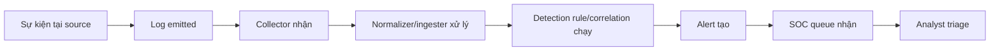
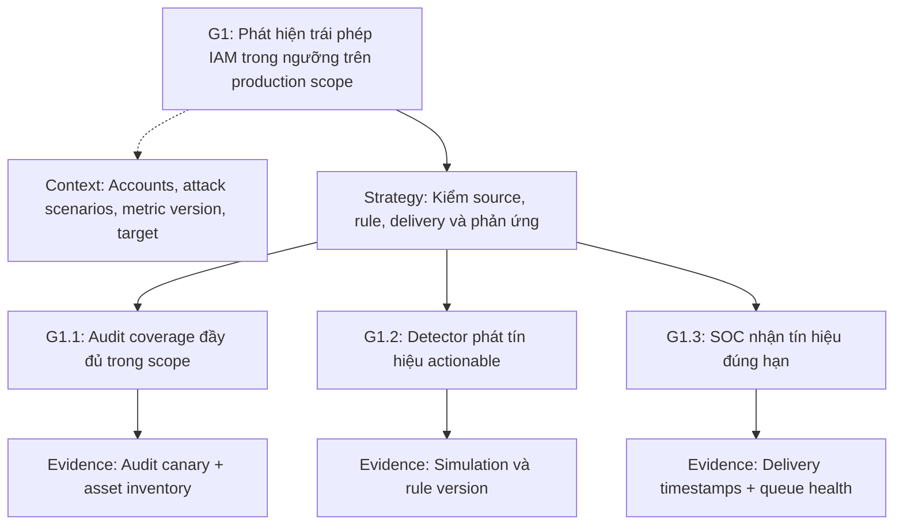

# Mean time to detect (MTTD): Đo thời gian phát hiện sự cố bảo mật bằng dữ liệu đáng tin cậy

## 1. Mục tiêu học tập

Sau bài học, người học có thể:

- Giải thích **Mean Time to Detect (MTTD)** trong chương trình **security assurance**, phân biệt MTTD với thời gian tiếp nhận cảnh báo, thời gian phân loại, thời gian ứng cứu và thời gian khắc phục.
- Thiết lập định nghĩa vận hành rõ ràng cho **điểm bắt đầu sự cố**, **điểm phát hiện**, **phạm vi sự cố**, **kỳ đo**, **cửa sổ quan sát** và các quy tắc đưa sự cố vào hoặc loại khỏi phép tính.
- Tính MTTD từ một tập sự cố có timestamp và trình bày cùng **median**, **p90/p95**, số mẫu, độ bao phủ, dữ liệu thiếu và đặc tính phân bố.
- Phân biệt **event time**, **ingestion time**, **alert generated**, **alert delivered**, **analyst acknowledged** và **incident confirmed**; tránh gộp những mốc này thành một chỉ số sai nghĩa.
- Nhận diện các sai lệch do **chỉ chọn sự cố đã phát hiện**, log retention, sự cố chưa xác nhận, telemetry blind spot, clock skew, delayed ingestion và thay đổi detection rules.
- Thiết kế mô hình dữ liệu, truy vấn kiểm toán, dashboard và bằng chứng để tính MTTD có thể tái lập, giải thích và so sánh theo cùng điều kiện.
- Đánh giá cải tiến detection engineering dựa trên **chất lượng phát hiện, coverage, false negatives, precision, vận hành và rủi ro nghiệp vụ**, thay vì tối ưu MTTD đơn lẻ.
- Thiết kế kiểm thử và chuỗi **claim → control → test → evidence → assessment** cho mục tiêu phát hiện sớm sự cố.

Bài thuộc chương **Metrics và reporting** trong dịch vụ `SECURITY_SECURITY_ASSURANCE`. Dịch vụ này xây dựng cách đánh giá **có bằng chứng** rằng hệ thống đáp ứng mục tiêu bảo mật, từ phân tích rủi ro, yêu cầu và security controls đến kiểm thử, audit và xử lý phát hiện; chương trình assurance được duy trì trong phát triển và vận hành. MTTD là một phép đo hữu ích của năng lực phát hiện, nhưng **không tự chứng minh toàn bộ chương trình an ninh hiệu quả**. Phải đánh giá cả cách định nghĩa, dữ liệu nguồn, phạm vi và những sự cố có thể chưa từng được nhìn thấy.

## 2. MTTD là gì và nên dùng để trả lời câu hỏi nào?

**Mean Time to Detect (MTTD)** là **thời gian trung bình từ một mốc bắt đầu sự cố được xác định đến một mốc phát hiện được định nghĩa trước**, trên tập sự cố đủ điều kiện trong một kỳ quan sát.

Với chương trình Security Operations/SOC, cách hiểu phổ biến là:

> Thông thường mất bao lâu từ khi một sự cố bảo mật bắt đầu cho đến khi hệ thống hoặc con người nhận ra dấu hiệu đủ hành động theo tiêu chí của tổ chức?

**“Phát hiện”** có thể được các tổ chức đo khác nhau: alert có thể hành động được xuất hiện trong SIEM/SOAR, detector công bố finding, hoặc analyst xác nhận nghi ngờ xâm nhập. Vì vậy, **không có một timestamp mặc định mang ý nghĩa giống nhau cho mọi hệ thống**. Muốn so sánh MTTD phải cố định định nghĩa và ghi rõ nó ở mỗi báo cáo.

Ví dụ một attacker đăng nhập trái phép lúc 10:00, nguồn audit gửi event vào SIEM lúc 10:02, detector phát cảnh báo tới SOC lúc 10:07, analyst mở ticket lúc 10:14, incident được xác nhận lúc 10:30. Nếu tổ chức định nghĩa phát hiện là **cảnh báo đầu tiên có thể hành động, đã tới hàng đợi SOC**, thời gian phát hiện là **7 phút**. Nếu định nghĩa phát hiện là **analyst xác nhận sự cố**, thời gian là **30 phút**. Hai con số **không nên cùng được đặt tên MTTD mà không mô tả mốc kết thúc**.

### 2.1. MTTD được dùng vào việc gì?

- Đo xem detection controls có đưa ra tín hiệu **kịp thời** đối với những sự cố đã biết trong phạm vi không.
- Theo dõi cải tiến từ bổ sung nguồn log, sửa rule, tương quan sự kiện, rút độ trễ pipeline hoặc thay lịch trực.
- Phát hiện các loại xâm nhập khó phát hiện: credential abuse, data exfiltration, privilege escalation, lateral movement, insider misuse.
- Gắn kết quả với BIA, risk appetite và khả năng giới hạn thiệt hại trước khi attacker thực hiện bước tiếp theo.
- Đánh giá chương trình threat detection và security assurance qua phép kiểm có kịch bản, không chỉ qua dashboard.

### 2.2. Điều MTTD không thể tự nói

Một MTTD thấp **không** bảo đảm rằng:

- Hệ thống phát hiện **mọi sự cố**.
- Detection rule có precision tốt hoặc ít false positives.
- SOC triage và containment đủ nhanh.
- Attacker chưa từng đọc/sửa dữ liệu.
- Tất cả tài sản, region, tenant và identity đã được giám sát.
- Logs còn đầy đủ và không bị attacker vô hiệu.
- Nguy cơ nghiệp vụ thực tế đã giảm.

**Một metric tốt chỉ có ý nghĩa khi phạm vi đo và những giới hạn chưa đo được được công bố.**

## 3. Phân biệt MTTD với những chỉ số thời gian gần nhau

Một sự cố đi qua nhiều giai đoạn. Mỗi giai đoạn có người chịu trách nhiệm và độ trễ khác nhau.

| Chỉ số/khái niệm | Bắt đầu | Kết thúc | Ý nghĩa |
|---|---|---|---|
| **Time to telemetry availability** | Sự kiện tại nguồn | Event khả dụng tại pipeline/warehouse | Sức khỏe ingest và thời gian đưa dữ liệu đến detector |
| **Detection latency** | Dấu hiệu có thể quan sát theo quy tắc | Detector tạo tín hiệu hợp lệ | Tốc độ logic rule/correlation |
| **MTTD (theo định nghĩa đã duyệt)** | Sự cố bắt đầu trong phạm vi | Mốc phát hiện được chọn | Năng lực phát hiện end-to-end theo định nghĩa |
| **Mean Time to Acknowledge (MTTA)** | Alert/finding được đưa vào queue | Người/nhóm tiếp nhận xác nhận đã nhận | Khả năng trực và nhận việc |
| **Time to triage / confirm** | Alert đủ điều kiện | Xác minh tính hợp lệ và phạm vi ban đầu | Chất lượng và tốc độ phân loại |
| **Time to contain / MTTC (nếu tổ chức dùng)** | Mốc bắt đầu đã công bố | Containment có hiệu lực theo tiêu chí | Khả năng giới hạn thiệt hại |
| **MTTR** | Mốc do tổ chức quy định | Restore/remediate/respond theo định nghĩa | Phải ghi “R” là respond, recover, resolve hay repair |
| **Attacker dwell time** | Attacker có hiện diện/đặc quyền trái phép | Thời điểm chấm dứt sự hiện diện đó | Không đồng nghĩa MTTD hoặc thời gian containment |

Từ viết tắt **MTTR** có nhiều cách dùng; khi báo cáo phải viết đầy đủ tên chỉ số, mốc đo và đơn vị. “MTTD giảm” nhưng MTTA tăng có thể khiến tổng thời gian đến containment không cải thiện.

### 3.1. Ví dụ timeline

```mermaid
flowchart LR
    A["T0: hoạt động trái phép bắt đầu"] --> B["T1: log được ghi ở nguồn"]
    B --> C["T2: log đến SIEM"]
    C --> D["T3: detector phát tín hiệu đủ hành động"]
    D --> E["T4: alert đến queue SOC"]
    E --> F["T5: analyst acknowledge"]
    F --> G["T6: incident confirmed"]
    G --> H["T7: containment hiệu lực"]
    H --> I["T8: eradication / recovery đã kiểm"]
```



Các mốc có thể không xuất hiện theo đúng thứ tự trong mọi hệ thống: một analyst có thể phát hiện thủ công trước khi rule chạy, một nguồn dữ liệu có thể backfill sau incident hoặc cảnh báo được gửi trực tiếp tới on-call không qua SOC. Vì thế cần lưu **mốc thực và phương pháp phát hiện**, không ép một timeline giả định cho mọi vụ việc.

### 3.2. Đừng dùng thời điểm tạo ticket làm “sự cố bắt đầu”

Một ticket được mở lúc 10:30 có thể mô tả hoạt động đã xảy ra từ 09:00. Nếu dùng `ticket.created_at` làm mốc bắt đầu, MTTD dễ bị rút ngắn sai. Ngược lại, alert có timestamp của event ban đầu nhưng chỉ được backfill vào SIEM sau nhiều giờ cũng không nên coi như detector đã biết sự kiện ngay từ lúc nó xảy ra.

## 4. Định nghĩa mốc bắt đầu: Incident start / T0

**T0** phải được định nghĩa theo **loại tình huống và mục tiêu đánh giá**. Không phải mọi incident đều có thời điểm bắt đầu chính xác.

### 4.1. Các lựa chọn phổ biến

| Tình huống | T0 có thể dùng | Rủi ro cần tránh |
|---|---|---|
| Credential compromise | Lần sử dụng credential trái phép đầu tiên có bằng chứng trong phạm vi | Dùng thời điểm key bị phát hiện lộ thay vì lần lạm dụng đầu |
| Unauthorized login | Phiên đăng nhập trái phép bắt đầu | Nhầm login thất bại hoặc thử hợp lệ thành compromise |
| Privilege escalation | Quyền trái phép đầu tiên có hiệu lực hoặc thao tác leo quyền được xác nhận | Nhầm request gửi lên với thay đổi đã commit |
| Lateral movement | Hành vi di chuyển ngang đầu tiên được xác nhận | Bỏ những tài sản không có log |
| Malware execution | Lần chạy mã độc đầu tiên có chứng cứ | Chỉ dùng thời gian file được phát hiện |
| Data exfiltration | Thời điểm hoạt động lấy dữ liệu trái phép bắt đầu theo định nghĩa | Không suy từ file download hợp lệ hay tổng egress |
| Ransomware | Có thể chọn mốc hoạt động trái phép đầu tiên, không chỉ lúc mã hóa hiển hiện | Sự cố có thể âm thầm từ nhiều ngày |
| Synthetic detection exercise | Mốc người kiểm thử chủ động tạo kịch bản đã duyệt | Không đồng nhất với incident thật nếu attack path khác |

Tổ chức cần lưu **start_definition** cho từng loại incident, hoặc một quy tắc chung đủ nhất quán để so sánh. **Không đổi T0 từ “initial compromise” sang “first known malicious activity” giữa các kỳ mà không báo thay đổi phương pháp.**

### 4.2. Trường hợp chỉ biết khoảng bắt đầu

Với xâm nhập kéo dài, forensic có thể xác nhận sự cố bắt đầu **không muộn hơn** 02:00 nhưng log trước 02:00 đã hết retention. Khi đó:

- `earliest_confirmed_at` có thể là 02:00.
- `true_start_at` vẫn **UNKNOWN**.
- Thời gian tính từ 02:00 đến detection chỉ là **giới hạn dưới** nếu xâm nhập thực sự xảy ra sớm hơn.
- Không được đưa số này vào tập “MTTD chính xác” mà không ghi phương pháp ước tính và bất định.
- Có thể báo **interval/range** hoặc trình bày theo nhóm “start estimated”.

Một chỉ số tốt thường cần **cohort chính** với timestamp đủ tin cậy và **nhóm dữ liệu không đủ điều kiện** tách riêng.

### 4.3. Không đồng nhất vulnerability với incident

Thời điểm một lỗ hổng xuất hiện trong code hoặc bản vá được công bố không phải mặc định là T0 của một **sự cố xâm nhập**. Đó có thể là mốc của chỉ số khác như **time to remediate vulnerability**. Chỉ khi định nghĩa chương trình đang đo *thời gian phát hiện lỗ hổng*, tên và công thức metric phải phản ánh mục đích đó, không gộp vào MTTD cho security incidents.

## 5. Định nghĩa mốc phát hiện: Detection timestamp / Td

Điểm kết thúc MTTD nên là một **sự kiện có thể quan sát và truy vết**, nhất quán với mục tiêu của đội.

### 5.1. Những mốc khác nhau

| Mốc | Ý nghĩa | Có nên gọi “detected”? |
|---|---|---|
| First malicious event logged | Nguồn ghi lại hoạt động | Chưa, event có thể nằm im trong storage |
| First ingestion at detector | Detector có dữ liệu đầu vào | Chưa, detector có thể không tạo tín hiệu |
| Rule match | Điều kiện rule được thỏa | Chỉ nếu quy ước và tín hiệu đủ hành động |
| Alert generated | Detector tạo alert | Có thể, nếu alert có chất lượng và được phát hành |
| Alert delivered to SOC | Tín hiệu đã tới nơi người hoặc tự động hóa có thể xử lý | Phù hợp làm Td nếu được định nghĩa trước |
| First analyst recognition | Analyst nhận ra dấu hiệu nghi là incident | Phù hợp với định nghĩa human detection riêng |
| Incident confirmed | Xác minh một sự cố có thật | Thường là chỉ số triage/confirmation, không nên trộn với alert-based MTTD |
| Ticket opened | Workflow ghi nhận case | Chỉ có ý nghĩa nếu timestamp này thật sự phản ánh detection |

### 5.2. Quy ước đề xuất cho một chương trình

Một tổ chức có thể chọn:

> **Td là thời điểm sớm nhất mà một tín hiệu bảo mật đủ hành động và về sau được xác nhận liên quan đến sự cố được công bố cho hàng đợi SOC hoặc responder có trách nhiệm.**

Điều kiện tối thiểu:

- Tín hiệu được liên kết đúng `incident_id` và `detection_id`.
- Có `signal_available_at` hoặc `alert_delivered_at` đáng tin, không dùng `event.occurred_at` làm thời điểm detector biết.
- Có định nghĩa **actionable**: diễn đạt actor, đối tượng, hành vi, phạm vi và mức tin cậy đủ để bắt đầu triage.
- Việc xác nhận về sau có thể làm rõ đây là **đúng sự cố**, nhưng **không viết lại thời điểm tín hiệu đến**.
- Nếu do người phát hiện thủ công, ghi rõ source và thời điểm thông tin được nhận diện theo quy trình.

Đây là **một cách định nghĩa minh họa**, không phải chuẩn duy nhất. Quan trọng là văn bản đo lường phải ghi đúng cách đã chọn và không thay đổi tùy kết quả mong muốn.

### 5.3. Không backdate phát hiện bằng event time

Một log cloud có `event_time = 10:00` nhưng tới SIEM lúc 10:15, detector chạy lúc 10:18. Nếu alert liên quan được tạo và khả dụng lúc 10:18, **Td = 10:18 theo quy ước alert-based**, không phải 10:00.

Nếu pipeline backfill sau 24 giờ, detector không thể được coi là đã phát hiện theo thời gian thực tại T0. Cần đo riêng **event-to-ingest latency** và **ingest-to-alert latency**.

## 6. Công thức MTTD và điều kiện sử dụng

Với `N` sự cố đủ điều kiện có mốc T0 và Td đáng tin:

\[
\mathrm{TTD}_i = T_{d,i} - T_{0,i}
\]

\[
\mathrm{MTTD} = \frac{\sum_{i=1}^{N}\mathrm{TTD}_i}{N}
\]

Trong đó:

- `TTD_i`: thời gian phát hiện của sự cố thứ `i`.
- `T0_i`: thời điểm sự cố bắt đầu theo quy ước.
- `Td_i`: thời điểm phát hiện theo quy ước.
- `N`: số sự cố được **đo hợp lệ**, không tự động bằng tổng số tất cả sự cố.
- Đơn vị: giây, phút, giờ hoặc ngày; phải ghi rõ.

Giá trị âm, timestamp sai thứ tự, timezone không nhất quán hoặc không xác định T0/Td **không được làm tròn về 0**. Chúng phải tạo **data-quality finding** để điều tra và trình bày riêng.

### 6.1. Ví dụ tính tay

Giả sử có bốn sự cố đã xác nhận, cùng định nghĩa T0/Td:

| Incident | T0 (UTC) | Td (UTC) | TTD |
|---|---|---|---:|
| `INC-01` | 00:00 | 00:06 | 6 phút |
| `INC-02` | 10:00 | 10:18 | 18 phút |
| `INC-03` | 12:00 | 12:03 | 3 phút |
| `INC-04` | 20:00 | 20:33 | 33 phút |

\[
\mathrm{MTTD}=\frac{6+18+3+33}{4}=15\text{ phút}
\]

Sắp xếp TTD tăng dần: **3, 6, 18, 33**.

- **Mean:** 15 phút.
- **Median:** trung bình của giá trị thứ hai và thứ ba, `(6 + 18)/2 = 12` phút.
- **p90 theo quy tắc nearest-rank:** giá trị tại vị trí `ceil(0.9 × 4) = 4`, là **33 phút**.
- **Số mẫu:** `N = 4`.

Chỉ bốn sự cố là mẫu rất nhỏ, nên percentile dễ thay đổi mạnh và không nên được diễn giải như đặc tính ổn định của toàn môi trường.

### 6.2. Ví dụ có outlier

Nếu thêm một sự cố mất **8 giờ = 480 phút** mới được phát hiện, MTTD mới là:

\[
\mathrm{MTTD}=\frac{6+18+3+33+480}{5}=108\text{ phút}
\]

Trong khi **median của năm giá trị** chỉ là **18 phút**. Mean tăng đáng kể do một sự cố có thời gian phát hiện rất dài. Điều này có thể phản ánh vấn đề nghiêm trọng, không phải “lỗi thống kê” để tự tiện xóa khỏi báo cáo.

Vì vậy nên trình bày **mean cùng median, tail latency, số mẫu và chi tiết outlier có phân tích nguyên nhân**.

## 7. Chọn cohort và mẫu số: Những sự cố nào được tính?

Một chương trình không thể so sánh MTTD nếu mỗi tháng lại chọn tập sự cố khác theo cách khác nhau.

### 7.1. Những quyết định bắt buộc

- **Đơn vị:** incident, attack campaign, affected asset, finding hay detection episode?
- **Kỳ đo:** incidents bắt đầu trong kỳ, được phát hiện trong kỳ hay được đóng trong kỳ?
- **Mức độ xác nhận:** chỉ confirmed incidents hay gồm validated simulation?
- **Severity/risk:** mọi mức hay chỉ high/critical? Phân loại khi nào?
- **Environment:** production, staging, lab, DR, tenant-managed?
- **Nguồn phát hiện:** automated SOC, external notification, user report, red team, audit retrospective?
- **Sự cố trùng:** một chiến dịch có 30 alerts được tính một incident hay 30?
- **Thiếu T0/Td:** bị loại khỏi mean nhưng vẫn báo số lượng và lý do?
- **Chưa phát hiện đến cuối kỳ:** được xử lý thế nào?
- **Incident reopened/merged:** có thay đổi sample và phiên bản báo cáo không?

### 7.2. Hai cách chọn kỳ thường bị nhầm

**Cohort theo thời điểm xảy ra:** lấy các incident có T0 trong tháng. Cách này phù hợp với câu hỏi “các sự cố bắt đầu tháng này được phát hiện nhanh đến đâu?”, nhưng ở thời điểm chốt tháng có thể còn **chưa được phát hiện hoặc chưa xác minh**, gây right-censoring.

**Cohort theo thời điểm phát hiện:** lấy incidents có Td trong tháng. Cách này phù hợp với câu hỏi “tháng này SOC đã phát hiện được những sự cố kéo dài bao lâu?”, nhưng có thể lẫn các sự cố xảy ra từ nhiều tháng trước và gây lệch xu hướng.

Cả hai đều có ích, **nhưng không trộn** khi trình bày một chuỗi MTTD. Mỗi báo cáo phải ghi cohort rule và chính sách cập nhật số liệu khi điều tra thêm.

### 7.3. Tránh đếm alerts như incidents

Một attacker thử 200 yêu cầu dẫn tới 30 alerts, tạo 5 findings và được hợp nhất thành một incident. Nếu metric định nghĩa theo **incident**, chỉ nên có **một TTD** theo rule đã phê duyệt, không chia một case thành nhiều bản ghi chỉ vì có nhiều alerts.

Ngược lại, nếu một incident chứa hai pha tấn công tách biệt, có thể cần metric theo **detection objective/attack stage** để không che việc phát hiện sớm pha đầu nhưng bỏ sót pha nguy hiểm tiếp theo. Khi đó phải đặt tên metric và unit-of-analysis rõ ràng.

## 8. Những sự cố chưa phát hiện và vấn đề censoring

**MTTD tính trên những incident đã được phát hiện là chỉ số có điều kiện.** Nó không tự cho biết có bao nhiêu incident chưa từng được phát hiện.

### 8.1. Right-censoring là gì?

Giả sử một bài thử mô phỏng bắt đầu lúc 10:00, kết thúc cửa sổ đo lúc 11:00 mà detector không báo. TTD thực, nếu sau này có phát hiện, **lớn hơn 60 phút**; không nên:

- Ghi TTD = 0.
- Ghi TTD = 60 phút và coi như phát hiện tại 11:00.
- Loại bài thử khỏi mẫu mà không báo thất bại detection.
- Khẳng định detector “không có sự cố” vì không thấy alert.

Đây là quan sát **censored**: chỉ biết đến cuối kỳ chưa xảy ra mốc phát hiện. Với synthetic exercises, ta thường biết chính xác T0 và có thể đo **detection rate within time budget** bên cạnh MTTD cho các bài phát hiện thành công.

### 8.2. Những loại missingness cần phân biệt

| Tình trạng | Ví dụ | Cách báo |
|---|---|---|
| `DETECTED_VALID` | T0 và Td có bằng chứng, quy ước nhất quán | Đưa vào phân bố TTD |
| `START_UNKNOWN` | Sự cố được phát hiện nhưng không biết lúc bắt đầu | Exclude khỏi exact-mean, báo gap |
| `DETECTION_TIME_UNKNOWN` | Có case nhưng không biết lúc tín hiệu đến | Khắc phục audit/ticket pipeline |
| `NOT_DETECTED_WITHIN_WINDOW` | Bài thử biết T0, hết cửa sổ mà không có tín hiệu | Censored/negative outcome |
| `CLOCK_INCONSISTENCY` | Td sớm hơn T0 vì timestamp sai hoặc quy ước khác | Data-quality error, không ép về 0 |
| `OUT_OF_SCOPE` | Kịch bản không thuộc chương trình đo đã duyệt | Báo ngoài phạm vi, lưu lý do |
| `DUPLICATE` | Nhiều alerts cùng incident | Dedupe theo quy tắc, giữ lineage |
| `RETROSPECTIVE_DISCOVERY` | Điều tra tháng sau mới thấy sự cố tháng trước | Ghi cách restate kỳ và ngày phát hiện thật |

### 8.3. Tại sao MTTD thấp có thể là dấu hiệu xấu?

Giả sử kỳ A phát hiện được 90 trong 100 tình huống kiểm thử, mean TTD = 18 phút. Kỳ B chỉ phát hiện 30 tình huống dễ nhất, mean TTD = 3 phút. Nếu chỉ xem MTTD, kỳ B **trông tốt hơn** nhưng detection coverage giảm từ 90% xuống 30%.

**Không có detection rate/recall hoặc canary coverage, MTTD có thể khuyến khích bỏ qua các tình huống khó.**

Với sự cố thực tế, số incident chưa phát hiện không thể quan sát trực tiếp hoàn toàn. Có thể dùng **authorized red-team/purple-team exercises, backtesting, threat hunting, external reports, retrospective incident discovery** để ước lượng và tìm khoảng trống; không coi số observed incidents là toàn bộ sự thật.

## 9. Mean, median, p90/p95 và phân tích phân bố

MTTD là số trung bình, nhưng một phân bố thời gian thường **lệch phải**, có đuôi dài do những vụ xâm nhập tồn tại hàng tuần hoặc tháng trước khi bị phát hiện.

### 9.1. Chỉ số nên trình bày cùng nhau

| Chỉ số | Trả lời | Hạn chế |
|---|---|---|
| **Mean TTD** | Thời gian trung bình trên cohort hợp lệ | Nhạy với outliers và bỏ sót sự cố chưa phát hiện |
| **Median TTD (p50)** | Một nửa sự cố được phát hiện nhanh hơn giá trị này | Che phần đuôi rất chậm |
| **p90/p95 TTD** | Ngưỡng bao phủ phần lớn những sự cố trong mẫu | Mẫu nhỏ không ổn định; phải ghi phương pháp percentile |
| **Maximum TTD** | Sự cố phát hiện chậm nhất trong cohort | Phụ thuộc kích thước tập mẫu |
| **N valid** | Có bao nhiêu incident được đo chính xác? | N thấp làm xu hướng dễ nhiễu |
| **Excluded/unknown/censored** | Bao nhiêu trường hợp chưa có TTD chính xác? | Không thể bỏ qua trong kết luận |
| **Detection coverage** | Phần kịch bản/đối tượng có cơ chế và test hợp lệ | Coverage trên giấy không phải recall thực |
| **Within-target detection rate** | Tỷ lệ kịch bản có Td trong ngưỡng đã duyệt | Cần mẫu số là toàn bộ phép thử đủ điều kiện |
| **Severity/risk breakdown** | Các nhóm rủi ro cao có phát hiện sớm không? | Group nhỏ và phân loại thay đổi |

### 9.2. Percentile có nhiều định nghĩa

Với chỉ bốn quan sát, **nearest-rank p90 = 33 phút**, trong khi cách nội suy percentile liên tục của công cụ thống kê/SQL có thể cho giá trị khác. Vì vậy dashboard phải ghi **phương pháp percentile**, cách xử lý ties và mẫu số. Không so sánh trực tiếp nếu hai hệ thống dùng định nghĩa khác.

### 9.3. Không lấy trung bình của các trung bình tùy tiện

Giả sử nhóm A có 2 incidents với mean 10 phút; nhóm B có 18 incidents với mean 30 phút. Trung bình đơn giản `(10+30)/2=20` phút **không** phải mean trên 20 sự cố. Mean theo incident là:

\[
\frac{2\times10+18\times30}{20}=28\text{ phút}
\]

Chỉ dùng trung bình không trọng số giữa các nhóm nếu **đơn vị mục tiêu là nhóm**, đã định nghĩa rõ và không gọi là incident-level MTTD.

### 9.4. Có nên đặt mục tiêu MTTD?

Có thể đặt ngưỡng theo **risk scenario**, ví dụ “mô phỏng misuse of privileged cloud IAM phải được báo tới SOC trong 10 phút đối với các account production có telemetry đạt yêu cầu”. Một ngưỡng chung cho mọi incident có thể vô nghĩa khi ghép credential theft, exfiltration âm thầm, ransomware hiển hiện và vật lý.

Các ngưỡng trong bài là **giả định để học**, không phải yêu cầu chung của tiêu chuẩn hay nhà cung cấp.

## 10. Phân nhóm kết quả trước khi so sánh

Một MTTD tổng có thể giảm chỉ vì tỷ lệ sự cố dễ phát hiện tăng, không phải năng lực detection đối với cùng mối đe dọa được cải thiện.

### 10.1. Các chiều phân nhóm hữu ích

- **Threat/use case:** account takeover, privilege escalation, lateral movement, suspicious API access, exfiltration.
- **Tài sản:** endpoint, cloud control plane, Kubernetes, identity provider, application, OT nếu liên quan.
- **Severity và business criticality:** high/critical và các hệ thống quan trọng theo BIA.
- **Detection source:** EDR, SIEM rule, cloud native finding, human report, vendor notice, threat hunt.
- **Environment:** production, staging, region, tenant, data sensitivity.
- **Giờ vận hành:** giờ trực, ngoài giờ, ngày nghỉ; phải tách MTTA để tránh gán trễ tiếp nhận thành lỗi detector.
- **Loại T0:** known-from-exercise, first confirmed malicious activity, forensic-estimated.
- **Evidence confidence:** exact, estimated, interval, retrospective.
- **Control maturity:** trước/sau rollout rule hoặc thay pipeline/normalization.

Nhóm có N rất nhỏ phải được ghi chú; tránh lấy nhiều nhóm con nhỏ rồi công bố xếp hạng tuyệt đối mà không có độ không chắc chắn.

### 10.2. Simpson's paradox ở mức trực quan

Nếu kỳ A phần lớn incidents là **xâm nhập âm thầm** mất nhiều giờ mới phát hiện, kỳ B phần lớn là **brute force** dễ cảnh báo, MTTD tổng có thể cải thiện dù MTTD **trong từng nhóm** không cải thiện. Do đó cần phân nhóm nhất quán và diễn giải **thay đổi cơ cấu cohort** trước khi quy kết lợi ích cho một rule mới.

### 10.3. Severity thường được gán sau khi phát hiện

Nếu chỉ đo “critical incidents” theo severity cuối cùng, có thể thiên lệch vì sự cố phát hiện chậm thường bị gắn mức nghiêm trọng cao hơn do thiệt hại đã xảy ra. Báo cáo nên ghi severity được xác định ở thời điểm nào và có tái phân loại không; không trình bày quan hệ nhân quả chỉ từ một biểu đồ tương quan.

## 11. Mô hình dữ liệu để tính MTTD có thể audit

Một record có thể kiểm chứng nên tách **incident facts**, **detection signals**, **timestamp provenance** và **assessment metadata**.

### 11.1. Các trường tối thiểu

| Nhóm | Trường | Mục đích |
|---|---|---|
| Incident identity | `incident_id`, `scenario_id`, `case_version` | Dedupe và truy vết khi merge/reopen |
| Scope | `environment`, `asset_ids`, `tenant_ids`, `risk_tier` | Biết hệ thống được đo |
| Incident start | `started_at`, `start_method`, `start_confidence` | Xác định T0 |
| Detection record | `detection_id`, `detector_id`, `signal_available_at` | Xác định Td |
| Signal quality | `actionable`, `validated_relevance`, `rule_version` | Không tính alert nhiễu không liên quan |
| Lifecycle | `alert_created_at`, `alert_delivered_at`, `acknowledged_at`, `confirmed_at` | Tách MTTD và triage |
| Pipeline | `event_time`, `ingested_at`, `collector_health` | Phân tích nguồn trễ |
| Measurement | `metric_version`, `cohort_rule`, `unit`, `cutoff_at` | Tái lập report |
| Evidence | `start_evidence_ref`, `detection_evidence_ref`, `reviewer` | Kiểm chứng nguồn |
| Data quality | `quality_flags`, `exclusion_reason`, `clock_sync_status` | Không che điểm mù |
| Accountability | `incident_owner`, `detection_owner`, `assessor` | Xử lý gap và phê duyệt |

### 11.2. Mẫu incident measurement record

```yaml
measurement_id: MTTD-ASMT-2026-028
metric: mean_time_to_detect
metric_definition_version: "2.0"
unit_of_analysis: confirmed_incident
cohort_rule: incident_started_in_period
cohort_period_utc:
  from: "2026-11-01T00:00:00Z"
  to_exclusive: "2026-12-01T00:00:00Z"
detection_milestone: first_valid_actionable_signal_delivered_to_soc
incident:
  incident_id: INC-2026-042
  scenario: "Unauthorized privileged role grant"
  environment: production
  asset_scope: ["cloud-account-prod-a"]
  started_at: "2026-11-28T10:00:00Z"
  start_method: "First confirmed unauthorized role assignment"
  start_confidence: confirmed
  start_evidence_ref: "evidence://incident-042/iam-action"
detection:
  detection_id: DET-2026-772
  detector: "iam-privilege-escalation-rule"
  rule_version: "4.1"
  signal_available_at: "2026-11-28T10:07:00Z"
  actionable: true
  validated_relevance: confirmed
  evidence_ref: "evidence://incident-042/alert-delivery"
measurement:
  ttd_minutes: 7
  status: VALID
  checked_at: "2026-11-28T13:00:00Z"
  reviewer: "security-assurance"
limitations:
  - "Không dùng giá trị này để kết luận tỷ lệ phát hiện chung"
```

Đây là **dữ liệu minh họa**, không phải sự cố hoặc bằng chứng có thật. Các đường `evidence://` là tham chiếu giả lập. Trường `ttd_minutes: 7` chỉ đáng tin khi evidence về T0/Td và quy ước đo đã được kiểm.

### 11.3. Bất biến dữ liệu cần kiểm

- `signal_available_at >= started_at` cho phép đo chính; trường hợp ngược thứ tự phải điều tra chứ không sửa im lặng.
- Định danh incident không được trùng; nhiều alerts được lưu trong bảng con và giữ mối liên kết.
- Timestamps dùng UTC có offset hoặc chuẩn chuyển đổi được quản trị.
- Mọi kết quả phải có `metric_definition_version` và ngày tạo report.
- T0 sửa sau điều tra phải có history/version, không ghi đè mà không lưu thay đổi.
- Detection signal được đánh dấu valid phải có source và phương pháp xác nhận.
- Missing event không được tự thay `null` thành `now()`, 0 hay giá trị trung bình.
- Không rút ngắn TTD khi sửa rule bằng cách dùng lại ngày xảy ra của event backfill.

## 12. Tính MTTD bằng SQL và cách kiểm kết quả

Giả sử tổ chức đã chuẩn hóa hai bảng:

- `incidents(incident_id, started_at, incident_state, scenario, environment, start_confidence)`.
- `detection_signals(signal_id, incident_id, signal_available_at, actionable, validated_relevance, source)`.

Quy ước: cohort là **incidents đã xác nhận và bắt đầu trong tháng 11/2026**, Td là **tín hiệu actionable sớm nhất đã được xác nhận liên quan**, timestamp UTC; dữ liệu không đủ để đo phải hiện rõ thành nhóm riêng.

### 12.1. Truy vấn PostgreSQL minh họa

```sql
WITH cohort AS (
    SELECT
        incident_id,
        started_at,
        scenario,
        environment,
        start_confidence
    FROM incidents
    WHERE incident_state = 'confirmed'
      AND started_at >= TIMESTAMPTZ '2026-11-01T00:00:00Z'
      AND started_at <  TIMESTAMPTZ '2026-12-01T00:00:00Z'
      AND environment = 'production'
),
first_actionable AS (
    SELECT
        incident_id,
        MIN(signal_available_at) AS detected_at
    FROM detection_signals
    WHERE actionable = TRUE
      AND validated_relevance = 'confirmed'
      AND signal_available_at IS NOT NULL
    GROUP BY incident_id
),
measured AS (
    SELECT
        c.incident_id,
        c.scenario,
        c.started_at,
        f.detected_at,
        CASE
            WHEN c.start_confidence = 'confirmed'
             AND f.detected_at >= c.started_at
            THEN EXTRACT(EPOCH FROM
                (f.detected_at - c.started_at)) / 60.0
            ELSE NULL
        END AS ttd_minutes,
        CASE
            WHEN c.start_confidence IS DISTINCT FROM 'confirmed'
                THEN 'START_NOT_VERIFIED'
            WHEN f.detected_at IS NULL
                THEN 'NO_VALID_DETECTION'
            WHEN f.detected_at < c.started_at
                THEN 'INVALID_TIMESTAMP_ORDER'
            ELSE 'VALID'
        END AS measurement_status
    FROM cohort AS c
    LEFT JOIN first_actionable AS f
      ON f.incident_id = c.incident_id
)
SELECT
    COUNT(*) AS cohort_incidents,
    COUNT(*) FILTER (
        WHERE measurement_status = 'VALID'
    ) AS valid_ttd_count,
    COUNT(*) FILTER (
        WHERE measurement_status = 'NO_VALID_DETECTION'
    ) AS missing_detection_count,
    COUNT(*) FILTER (
        WHERE measurement_status = 'START_NOT_VERIFIED'
    ) AS uncertain_start_count,
    COUNT(*) FILTER (
        WHERE measurement_status = 'INVALID_TIMESTAMP_ORDER'
    ) AS invalid_timestamp_count,
    ROUND(AVG(ttd_minutes), 2) AS mean_ttd_minutes,
    ROUND(
        CAST(PERCENTILE_CONT(0.50)
          WITHIN GROUP (ORDER BY ttd_minutes) AS numeric), 2
    ) AS median_ttd_minutes,
    ROUND(
        CAST(PERCENTILE_CONT(0.90)
          WITHIN GROUP (ORDER BY ttd_minutes) AS numeric), 2
    ) AS p90_ttd_minutes
FROM measured;
```

### 12.2. Đọc kết quả đúng cách

- `AVG` và `PERCENTILE_CONT` bỏ qua giá trị `NULL`, nên các kết quả thời gian chỉ phản ánh tập **VALID**. Dashboard phải hiển thị `cohort_incidents` và `valid_ttd_count` cùng kết quả.
- `PERCENTILE_CONT` dùng cách **nội suy liên tục**, có thể khác ví dụ nearest-rank ở mục 6; không trộn hai phương pháp.
- Với incident được xác nhận nhưng **không có tín hiệu hợp lệ trong kho đo**, query cho `NO_VALID_DETECTION`; điều này **không tự chứng minh SOC không phát hiện bằng kênh khác** nếu bảng signals chưa gồm human detection/vendor report.
- Query không phát hiện những incident **chưa từng được biết đến**; đó là giới hạn cấu trúc của tập dữ liệu.
- Quy ước `start_confidence = confirmed` và `incident_state = confirmed` phải được quản trị bằng quy trình evidence, không chỉ gán chuỗi văn bản cho đẹp.
- Nếu một incident được merged, reopened hoặc phát hiện retrospectively, cần versioning và quy tắc cập nhật cohort.

### 12.3. Điều cần cải thiện trước khi chạy production

Ví dụ chỉ diễn giải logic học tập. Trong hệ thống thực cần bổ sung **source coverage**, **evidence references**, điều kiện trùng lặp, event identity, loại detection channels, timestamp timezone/clock sync, reporting cutoff, start-time uncertainty và quyền truy cập dữ liệu. Các incident không có `started_at` không thể xuất hiện trong cohort sử dụng điều kiện timestamp, vì vậy phải có **báo cáo data-quality riêng** đếm các incident thiếu T0. Truy vấn SQL chính không thể thay thế quy trình forensic xác nhận mốc bắt đầu.

## 13. Độ trễ của telemetry pipeline và ảnh hưởng tới MTTD

Một rule tốt vẫn có thể tạo MTTD cao khi sự kiện không đến đúng lúc. Muốn sửa nguyên nhân, cần phân rã **end-to-end detection path**.

### 13.1. Các đoạn thời gian thường đo



Có thể tính:

- **Source emit lag:** `log_emitted_at - event_occurred_at`.
- **Collection lag:** `collector_received_at - log_emitted_at`.
- **Ingest lag:** `queryable_at - collector_received_at`.
- **Rule processing lag:** `alert_created_at - queryable_at` trong trường hợp so khớp một event; correlation window có thể làm cách tính phức tạp hơn.
- **Delivery lag:** `alert_delivered_at - alert_created_at`.
- **Acknowledgment lag:** `acknowledged_at - alert_delivered_at`.

Không cộng máy móc các độ trễ nếu event có nhiều nguồn, correlation, retried delivery hoặc một analyst phát hiện thủ công trước detector. Cần xác định **đường dẫn gây ra phát hiện đầu tiên** của từng incident.

### 13.2. Late arrival và backfill

Một event mang `event_occurred_at = 02:00` nhưng thực sự tới warehouse lúc 04:00. Một rule chạy retrospective vào 04:05 thấy event này **không** phải phát hiện lúc 02:00. Nếu dashboard sử dụng thời điểm của event thay cho `signal_available_at`, MTTD sẽ bị cải thiện giả.

Cũng cần phân biệt **rule match evaluated_at** và **alert delivered_at**: detector có thể tính đúng nhưng queue bị tắc trong 20 phút. Mốc kết thúc phải phản ánh định nghĩa đã chọn và chỉ số phụ cần chỉ rõ bottleneck.

### 13.3. Pipeline health là security control

Để đo MTTD đáng tin, nguồn telemetry phải có:

- Inventory các data sources bắt buộc và coverage theo account/cluster/region.
- Heartbeat hoặc canary, đặc biệt với nguồn ít phát sinh event.
- Ingestion lag distribution và backlog theo thời gian.
- Schema validation, parser errors và dropped events.
- Monitoring log permissions, retention và tamper resistance.
- Sự kiện cảnh báo khi pipeline bị tắt hoặc bất thường.
- Đối soát số lượng record/sequence khi nguồn hỗ trợ.
- Quy trình backfill và ghi trạng thái dữ liệu sau khi pipeline phục hồi.

**Không có log không đồng nghĩa không có tấn công.** Khi collector lỗi, hệ thống phải báo tình trạng giám sát `DEGRADED/UNKNOWN` chứ không tạo dashboard MTTD xanh vì ít incident được phát hiện.

## 14. MTTD và chất lượng detection engineering

Bài toán detection không chỉ là phát càng nhiều alert càng tốt. Một tín hiệu có ích cần có **độ đúng, độ bao phủ, mức hành động và khả năng chuyển thành triage**.

### 14.1. Những thuộc tính cần xem cùng MTTD

| Thuộc tính | Câu hỏi | Phép kiểm |
|---|---|---|
| **Coverage** | Những attack paths và assets trọng yếu có detection không? | Threat/use-case mapping, test matrix |
| **Recall/sensitivity** | Có bao nhiêu kịch bản malicious trong tập kiểm thử được phát hiện? | Authorized attack simulation, replay |
| **Precision** | Tỷ lệ alert được xác định là có liên quan thực? | Triage outcomes trên tập alert |
| **Actionability** | Alert có actor, target, outcome, context và hướng điều tra đủ không? | Analyst evaluation, case review |
| **Timeliness** | Tín hiệu tới kịp để hạn chế tác động không? | TTD, target-based detection |
| **Resilience** | Detector còn hoạt động khi một source/collector lỗi? | Pipeline fault test, alert health |
| **Integrity** | Data và rule có bị sửa trái phép? | Rule change audit, log access controls |
| **Explainability** | Có thể giải thích rule match và evidence? | Rule version, event lineage |
| **Sustainability** | Alert noise và vận hành có làm quá tải SOC? | Queue, MTTA, false positive trends |

### 14.2. Ví dụ cảnh báo quá nhạy

Một rule mới phát alert ngay khi một user truy cập admin endpoint, khiến MTTD đối với các incident có admin abuse có vẻ giảm. Nhưng nếu mỗi ngày có hàng chục nghìn hoạt động hợp lệ trùng điều kiện, alert có thể không đủ **actionable**, gây overload, tăng MTTA và khiến các tín hiệu thật bị bỏ qua.

Nếu định nghĩa Td là **first valid actionable signal delivered**, một cảnh báo chung không có đủ tiêu chí không nên tự động được dùng để giảm MTTD của mọi incident.

### 14.3. Tránh tối ưu dashboard bằng cách thay đổi ngữ nghĩa

Không chuyển từ `analyst confirmed` sang `rule matched` mà không đổi metric version. Không loại outliers khó điều tra, không chia một incident thành nhiều alerts để tăng số thành công, không bỏ các kịch bản thất bại khỏi denominator của detection rate và không dời start time sang ngày tạo ticket. Đây là các dạng **metric gaming** làm mất giá trị assurance.

## 15. Threat model, asset criticality và detection objectives

MTTD nên liên kết với **rủi ro cần giảm**, không chỉ hiệu năng kỹ thuật của pipeline.

### 15.1. Bắt đầu từ kịch bản có tác động

Ví dụ:

| Kịch bản | Tài sản | Mục tiêu phát hiện | Lý do nghiệp vụ |
|---|---|---|---|
| Thêm admin role trái phép | Cloud production account | Cảnh báo nhanh khi quyền thay đổi ngoài phê duyệt | Chặn lạm dụng IAM và hạ tầng |
| API key exfiltration và sử dụng bất thường | Integration xử lý dữ liệu khách | Nhận diện token misuse trên phạm vi có log | Giảm nguy cơ đọc dữ liệu hàng loạt |
| Kubernetes privileged workload trái baseline | Cluster production | Phát hiện admission bypass hoặc privileged Pod | Ngăn tăng quyền node |
| Đọc hàng loạt tài liệu nhạy cảm | SaaS/data platform | Phát hiện bulk access bất thường | Giảm thiểu confidentiality impact |
| Logging disabled | Security telemetry plane | Cảnh báo suy giảm nguồn quan sát | Tránh blind spot và mất bằng chứng |
| Backup deletion/restore failure | DR/backup platform | Phát hiện thay đổi nguy hiểm vào backup | Bảo toàn năng lực recovery |

Giá trị mục tiêu **nên dựa trên threat modeling, risk appetite, BIA và đặc tính hệ thống**. Không giả định mọi attack path đều có thời gian tiến triển như nhau hoặc một ngưỡng 5 phút đủ cho tất cả.

### 15.2. Detection may be early but too late

Ví dụ attacker chiếm key và xuất dữ liệu trong 2 phút; SOC nhận alert trong 4 phút. MTTD = 4 phút có thể tốt về kỹ thuật nhưng **không ngăn kịp hành vi exfiltration**. Cần xem **time-to-impact** và các preventive/containment controls như least privilege, egress restrictions, rate limit và policy enforcement.

Security assurance nên hỏi **“đã có tín hiệu đủ sớm để thay đổi kết cục rủi ro chưa?”**, không chỉ **“tốc độ detector có nhanh hơn tháng trước không?”**.

## 16. Đo bằng kiểm thử có chủ đích thay vì chỉ incident lịch sử

Sự cố thật thường hiếm, khó xác định T0 hoặc không biết những sự cố bị bỏ sót. **Authorized purple-team, synthetic injections và replay** giúp kiểm soát T0 và đánh giá các detector trong phạm vi.

### 16.1. Thiết kế phép thử

1. Chọn **threat scenario** gắn với control objective và tài sản trọng yếu.
2. Xác định **phạm vi và quyền** của phép thử: environment, account, thời gian, safety limits.
3. Chọn thao tác **an toàn**, không gây mất dữ liệu hoặc tăng quyền ngoài phạm vi được duyệt.
4. Ghi **T0** từ nguồn thử độc lập: test harness/control plane có timestamp.
5. Đảm bảo dữ liệu nguồn và logging health được ghi nhận.
6. Quan sát **first actionable signal delivered** và thời điểm liên quan.
7. Ghi **true positive/false negative**, detector ID, rule version và test coverage.
8. Đo TTD nếu phát hiện; nếu không, ghi `NOT_DETECTED_WITHIN_WINDOW`.
9. Kiểm độ trễ pipeline, actionability và có cần analyst hỗ trợ để hiểu signal không.
10. Lưu evidence và finding; sửa rule/pipeline, chạy lại để xác minh.

### 16.2. Ma trận kiểm thử ví dụ

| Test | Kịch bản đã duyệt | Expected | Điều kiện FAIL/UNKNOWN |
|---|---|---|---|
| `DET-T01` | Thay đổi IAM role test không có approval trong lab | Alert tới SOC theo ngưỡng mục tiêu | Missing alert hoặc event source thiếu |
| `DET-T02` | Hành động IAM hợp lệ có approval | Không tạo incident giả | Nhiều false positives gây overload |
| `DET-T03` | Tắt collector ở môi trường thử có kiểm soát | Pipeline-health alert theo ngưỡng | Collector lỗi nhưng dashboard vẫn xanh |
| `DET-T04` | Delayed log arrival/replay với event-time cũ | Td phản ánh lúc tín hiệu thực sự khả dụng | MTTD bị backdate |
| `DET-T05` | Kubernetes security-policy violation có phép | Detection chứa namespace, workload, actor | Alert không đủ hành động hoặc không đến queue |
| `DET-T06` | Mô phỏng bulk access với test data | Nhận diện theo ngưỡng/rule đã duyệt | Tập nguồn chưa được onboarding |
| `DET-T07` | SOC queue delivery bị trì hoãn trong sandbox | Đo và alert delivery lag | Chỉ lưu alert_created_at |
| `DET-T08` | Tạo nhiều signals cho cùng một scenario | Chỉ một detection outcome theo scenario | Đếm trùng và làm sai denominator |
| `DET-T09` | Tình huống không được detector hỗ trợ | Ghi coverage gap có owner | Loại case khỏi dashboard mà không công bố |
| `DET-T10` | Source logs thiếu timestamp chính xác | Quality flag và không tính số sai | Ép giá trị âm về 0 |

Đây là các **phép thử đề xuất trong môi trường được phê duyệt**, không phải chỉ dẫn khai thác trái phép.

### 16.3. Detection rate trong tập thử

Nếu có 20 kịch bản độc lập đủ điều kiện và chỉ 16 được phát hiện trong cửa sổ 30 phút, **within-target detection rate = 16/20 = 80%**. MTTD nếu tính trên 16 kịch bản phát hiện thành công phải được báo là **MTTD conditional on detection, N=16**; bốn bài còn lại là **không phát hiện trong cửa sổ**.

Không nhập `30 phút` vào TTD cho bốn bài chưa phát hiện rồi gọi đó là MTTD thông thường. Nếu cần phân tích thời gian-với-censoring, phải sử dụng phương pháp thống kê phù hợp và chú thích riêng; median/mean thông thường chỉ từ các case đã phát hiện không thể hiện đầy đủ rủi ro.

## 17. Evidence-based assurance: MTTD là kết quả, không phải bằng chứng đơn độc

Một assurance claim có thể là:

> “Đối với các kịch bản thay đổi quyền đặc quyền trái phép trên cloud accounts production đã định danh, hệ thống phát hiện và gửi tín hiệu có thể hành động tới SOC trong thời gian mục tiêu theo coverage và điều kiện kiểm thử đã phê duyệt.”

Chuỗi chứng minh:

**Security objective → Threat scenario → Control → Data source → Detection rule → Test → T0/Td evidence → Result → Scoped conclusion.**

### 17.1. Mô hình lập luận



Đây là sơ đồ lập luận minh họa, không phải chứng nhận hoặc bằng chứng một môi trường cụ thể đã đạt.

### 17.2. Phân tách các claim để không nhầm kết quả

| Claim/subclaim | Evidence cần | MTTD có đủ không? |
|---|---|---|
| Source events được tạo đầy đủ | Coverage map, canary, config, pipeline health | Không |
| Detector phát tín hiệu phù hợp | Rule tests, validation, precision/recall | Không |
| Tín hiệu tới nơi xử lý đúng hạn | Signal available timestamps, delivery logs | Một phần |
| Incident được phát hiện sớm | T0/Td đáng tin và cohort phù hợp | Có điều kiện |
| SOC hành động kịp | MTTA, triage logs, containment timeline | Không |
| Tác động nghiệp vụ giảm | Risk/control outcomes, incident analysis | Không trực tiếp |
| Kết quả vẫn đúng sau thay đổi | Change/retest and drift monitoring | Không |

Một `MTTD = 5 phút` không thể tự động làm **G1 SUPPORTED** nếu nguồn log của một cloud account production đã bị tắt toàn bộ trong kỳ đánh giá.

### 17.3. Evidence package cần có

- Metric definition/version và người phê duyệt.
- Danh sách incident IDs, cohort rules, observation cutoff, de-duplication rules.
- Start/detection timestamps với nguồn, confidence, reviewer.
- Query/logic version và kết quả tính toán có thể tái lập.
- Asset inventory và detection coverage trong kỳ.
- Data-quality report: source health, exclusions, missing values, clock skew.
- Detection rule versions, test plans và kết quả positive/negative/failure cases.
- Kết quả MTTA/triage/containment khi cần liên kết tác động.
- Findings, exceptions, remediation, evidence sau sửa.
- Giới hạn của kết luận và lịch đánh giá lại.

## 18. Security assurance controls cho việc đo MTTD

Một chương trình nên kiểm soát cả **năng lực detection** và **độ tin cậy của phép đo**.

| Control ID | Mục tiêu | Phép kiểm và bằng chứng |
|---|---|---|
| `MET-MTTD-01` | Mốc T0/Td được định nghĩa thống nhất | Metric policy, versioned field dictionary |
| `MET-MTTD-02` | Incident và signal IDs không bị đếm trùng | Dedup rule, case merge history |
| `MET-MTTD-03` | Timestamp có nguồn gốc và đồng bộ thời gian phù hợp | Clock checks, event/source metadata |
| `MET-MTTD-04` | Detection sources trong scope có coverage | Asset/data-source inventory và canary |
| `MET-MTTD-05` | Data loss/lag được phát hiện | Collector heartbeat, dropped events, backlog |
| `MET-MTTD-06` | Actionable signals được xác minh | SOC review, detection rule tests |
| `MET-MTTD-07` | Incidents thiếu T0/Td và chưa phát hiện được báo riêng | Data-quality dashboard, censored test outcomes |
| `MET-MTTD-08` | Aggregations có cohort/version, thống kê và N | Reproducible query, report metadata |
| `MET-MTTD-09` | Thay rule/pipeline được revalidate | CI/CD/detection-as-code checks, change evidence |
| `MET-MTTD-10` | Evidence được bảo vệ khỏi sửa trái phép | Access logs, retention, provenance checks |
| `MET-MTTD-11` | Alert delivery tới SOC được đo độc lập | Queue timestamps và delivery health |
| `MET-MTTD-12` | Mục tiêu theo threat/risk và phản hồi finding có owner | Threat mapping, risk sign-off, re-test |

### 18.1. Kiểm thử các trường hợp âm

Một kiểm thử tốt không chỉ xem một rule báo thành công. Phải thử **một nguồn log bị mất**, **rule bị vô hiệu**, **alert không tới queue**, **clock lệch**, **hai incident bị merge** hoặc **event được backfill**. Kỳ vọng là metric **thể hiện sự bất thường** chứ không tạo TTD thấp giả.

### 18.2. Giới hạn của việc tự kiểm

Nếu cùng một pipeline vừa tạo alert vừa tự đánh giá rằng alert đã đến SOC, sự cố trong pipeline có thể làm cả measurement và detection cùng biến mất. Khi phù hợp, dùng **nguồn kiểm độc lập** (test harness, queue audit, canary, asset inventory ngoài nguồn log bị kiểm) để tăng mức tin cậy.

## 19. Dashboard MTTD nên hiển thị những gì?

Một dashboard giúp hành động đúng thường tách **tổng quan**, **độ bao phủ**, **data quality**, **phân nhóm nguy cơ** và **danh sách những trường hợp có vấn đề**.

### 19.1. Cấu trúc gợi ý

| Khối | Trường hiển thị | Cách hiểu |
|---|---|---|
| Summary | Mean, median, p90; unit; kỳ và metric definition | Xu hướng trên tập hợp hợp lệ |
| Population | Total incident cohort, N valid, missing, censored | Ngăn chỉ nhìn một số trung bình |
| Risk breakdown | MTTD theo threat, severity, asset, environment | Tìm nhóm phát hiện chậm |
| Telemetry health | Source coverage, ingest p90, backlog, drop rate | Tìm điểm mù đo lường |
| Detection quality | Recall/within-target rate từ exercises, precision | Không tối ưu time bằng noise |
| Workflow | MTTA, triage/confirmation lag, containment lag | Xem bottleneck sau detection |
| Outliers | Incident IDs chậm nhất kèm timeline nguyên nhân | Ưu tiên remediation |
| Findings | Coverage gaps, stale rules, missing evidence, owners | Gắn metric với hành động |
| Trend annotations | Rule releases, incident cohort changes, onboarding | Tránh quy kết sai biến động |

### 19.2. Ví dụ báo cáo kỳ

```text
MTTD REPORT — PRODUCTION / NOV 2026 (MINH HỌA)
Metric definition : v2.0 — incident start -> first actionable SOC signal
Cohort           : incidents started Nov 1–30 UTC, confirmed only
Total known      : 18
Valid TTD        : 12
Start uncertain  : 3
No matched signal: 2
Bad time order   : 1
Mean (N=12)      : 42 minutes
Median (N=12)    : 17 minutes
p90 (N=12)       : 96 minutes (continuous percentile)
Source health    : 2 production accounts had audit gaps
Simulation       : 23/30 scenarios detected inside target window
Conclusion       : Conditional MTTD improved on measured incidents;
                   overall coverage and source reliability remain limited.
```

Con số trên là **giả lập**. Nếu total 18, các nhóm 12+3+2+1=18 đúng theo một phân loại ưu tiên được thống nhất. Nhưng `no matched signal` không tự động có nghĩa **không có ai từng phát hiện sự cố**: có thể kênh phát hiện khác chưa nhập dữ liệu. Tương tự “source health: 2 accounts có audit gaps” cần nguồn và khoảng thời gian cụ thể trước khi suy tác động.

### 19.3. So sánh xu hướng có trách nhiệm

Khi MTTD giảm từ 60 xuống 20 phút, cần kiểm:

- Cohort rule có đổi không?
- Có nhiều incidents dễ phát hiện hơn?
- Incident start accuracy có cải thiện khiến T0 lùi sớm, làm MTTD **tăng** dù evidence tốt hơn?
- Cảnh báo gần nhất có thật sự actionable?
- Những sự cố chưa phát hiện và data gaps có tăng không?
- Rule mới có làm false positives/MTTA tăng?
- Phần đuôi p90/p95 và risk scenarios trọng yếu có cải thiện?
- Có bài test trước/sau cùng điều kiện hỗ trợ kết luận nguyên nhân?

Không tuyên bố **“cải thiện security 67%”** chỉ từ tỷ lệ giảm của MTTD nếu chưa chứng minh thay đổi do control và không phát sinh tác động xấu khác.

## 20. Case study: Phát hiện chậm privilege escalation trên cloud

**Bối cảnh giả lập:** một tổ chức vận hành nhiều cloud accounts. SOC đã có rule phát hiện việc cấp đặc quyền bất thường, nhưng một cuộc điều tra phát hiện tài khoản automation có quyền quá rộng bị sử dụng để cấp role quản trị ngoài phê duyệt.

### 20.1. Timeline được đối soát

| Mốc UTC | Sự kiện | Bằng chứng |
|---|---|---|
| 09:00 | Role admin trái phép được gán thành công | Cloud audit + effective IAM change |
| 09:01 | Audit event được ghi ở nguồn | Source event metadata |
| 09:12 | Collector mới đẩy event đến SIEM | Ingestion metadata |
| 09:15 | Rule tạo finding về admin grant | Detection engine record |
| 09:17 | Finding tới queue SOC | Delivery log |
| 09:35 | Analyst acknowledge và bắt đầu triage | SOC workflow |
| 09:48 | Analyst xác nhận privilege escalation | Investigation timeline |
| 10:10 | Token cũ bị thu hồi và quyền hiệu lực được giảm | IAM state + access checks |

Nếu quy ước Td là **first actionable signal delivered to SOC**, **MTTD/TTD của incident = 17 phút**. Khoảng `09:17 → 09:35 = 18 phút` là **time to acknowledge**, không tính vào TTD theo định nghĩa này. Khoảng `09:00 → 10:10 = 70 phút` là thời gian đến một containment milestone được nêu, **không phải MTTD**.

### 20.2. Phân tích nguyên nhân

Từ timeline:

- Event-to-SIEM: **12 phút** tính từ 09:00 tới 09:12; cần kiểm mốc sự kiện ở nguồn có chính xác.
- SIEM-to-rule: **3 phút**.
- Rule-to-SOC: **2 phút**.
- SOC-to-ack: **18 phút**.
- Ack-to-confirm: **13 phút**.
- Confirm-to-revoke verified: **22 phút**.

Nguồn trễ lớn trong MTTD là **thu thập dữ liệu**, không nhất thiết rule logic. Nếu đội chỉ tối ưu rule từ 3 phút xuống 1 phút, TTD có thể giảm rất ít trong khi blind spot do collector vẫn còn.

### 20.3. Các quyết định cải tiến

1. Rà data-source inventory cho toàn bộ accounts và audit permissions.
2. Sửa collector lag, kiểm event delivery canary và backlog alarms.
3. Kiểm rule phân biệt grant được duyệt và grant trái policy; giảm alert noise.
4. Bổ sung alert health khi source không gửi event kỳ vọng.
5. Kiểm quyền automation/service account, giảm privilege để ngăn exploit.
6. Đánh giá SOC staffing và MTTA theo thời gian trực.
7. Tạo synthetic scenario có quyền: grant thử trong lab, đo độc lập T0 và Td.
8. Chạy lại test với cùng định nghĩa và compare TTD, detection rate, p90, precision.
9. Lưu evidence và findings, review rủi ro còn lại.

**Mục tiêu tổng thể không chỉ làm alert nhanh hơn**, mà là giảm thời gian attacker có thể giữ quyền và ngăn hành động trái phép ngay từ đầu bằng preventive controls.

### 20.4. Tình huống báo cáo sai

Đội detection lấy `cloud audit event time 09:00` làm mốc phát hiện vì alert payload chứa trường đó, báo MTTD = 0 phút. Đây là sai về semantics: detector chỉ có thông tin lúc 09:15 và SOC nhận lúc 09:17. Cách báo đúng giữ cả `event_occurred_at` và `signal_available_at` để thấy độ trễ.

## 21. Một case study khác: MTTD giảm nhưng năng lực detection đi xuống

Giả sử SOC có hai kỳ kiểm thử với cùng 40 kịch bản, cùng môi trường và cửa sổ tối đa 30 phút:

| Kỳ | Kịch bản có alert hợp lệ trong 30 phút | MTTD trên những kịch bản được phát hiện | Điểm còn thiếu |
|---|---:|---:|---|
| Trước thay đổi | 34/40 (85%) | 11 phút | 6 kịch bản không phát hiện |
| Sau thay đổi | 22/40 (55%) | 4 phút | 18 kịch bản không phát hiện |

Nếu chỉ đọc MTTD, kết quả có vẻ “nhanh hơn 7 phút”. Nhưng detection rate giảm **30 điểm phần trăm**, có thể vì rule chỉ còn phát những tình huống rất rõ. Không nên kết luận hiệu quả security được cải thiện.

### 21.1. Cách điều tra

- Những kịch bản mất coverage thuộc threat/asset nào?
- Rule mới có điều kiện filter làm mất data source?
- Collector/normalizer có bị thay schema?
- Alert noise có giảm nhưng false negatives tăng?
- Có đổi cách chấm `actionable` giữa hai kỳ?
- Có source incident nào không được tính vì thiếu mốc T0?
- Những kịch bản bị bỏ qua có risk impact cao hơn nhóm phát hiện nhanh không?

### 21.2. Kết luận assurance có giới hạn

> “Thời gian phát hiện trung bình trong số các kịch bản được phát hiện của kỳ sau giảm, nhưng tỷ lệ phát hiện trong cửa sổ 30 phút giảm từ 85% xuống 55%. Vì vậy chưa có cơ sở kết luận chương trình detection được cải thiện toàn diện. Cần khôi phục coverage của các kịch bản mất tín hiệu, kiểm lại rule/telemetry và sau đó so sánh theo cùng tiêu chí.”

Đây là một ví dụ về việc **không tối ưu chỉ số bằng cách đánh đổi mục tiêu an toàn**.

## 22. Chỉ số bổ trợ và cách kết hợp thành security scorecard

MTTD nên là một thành phần trong **scorecard có nguyên nhân và kết quả**.

| Nhóm | Chỉ số | Lý do cần |
|---|---|---|
| Threat coverage | Detection use cases có test hợp lệ / threat scenarios trọng yếu | Biết phạm vi bảo vệ |
| Telemetry | Source health, dropped events, lag p90 | Biết khả năng quan sát |
| Detection quality | Precision và recall trên test/control cohort | Biết tốc độ có đi cùng độ đúng |
| Timeliness | Mean, median, p90/p95 TTD, within-target rate | Biết tốc độ điển hình và đuôi |
| Workflow | MTTA, triage confirmation time | Biết tín hiệu có được xử lý nhanh không |
| Response | Time to containment, time to eradication | Biết có chặn được tiến triển |
| Data quality | Unknown starts, bad order, retrospective restatements | Biết phép đo có đáng tin |
| Operations | False positive queue load, analyst capacity, repeat alerts | Biết chương trình có bền vững |
| Assurance | Findings overdue, re-test pass, evidence freshness | Biết control có được cải tiến và kiểm chứng |
| Business risk | Impact, affected data/assets, recovery objectives | Biết metric có liên hệ mục tiêu nghiệp vụ |

**Không có một công thức score duy nhất** nên cộng tất cả KPI thành một điểm số mà không có cách giải thích. Đặc biệt không nên để một MTTD thấp “bù” cho không phát hiện ransomware hoặc audit disabled trên tài sản trọng yếu.

## 23. Data governance và quyền riêng tư trong hệ thống đo

Để tính MTTD, tổ chức có thể thu audit logs, alerts và incident timelines chứa thông tin nhạy cảm. Cần bảo vệ chính pipeline đo.

### 23.1. Nguyên tắc quản trị

- **Data minimization:** lưu metadata đủ tính metric, không sao chép plaintext credentials, secrets hoặc payload nhạy cảm nếu không cần thiết.
- **Access control:** phân quyền xem từng incident theo vai trò, tách báo cáo tổng hợp khỏi case details.
- **Integrity và audit:** giữ dấu vết chỉnh T0, Td, severity, merger và việc thay trạng thái.
- **Retention:** xác định vòng đời dữ liệu theo policy/nguồn nghĩa vụ áp dụng; không bịa ngưỡng chung.
- **Privacy:** dùng aggregation và hạn chế nhận diện cá nhân khi báo cáo hiệu suất đội/ca trực.
- **Provenance:** bản ghi source và test result có reviewer và evidence references.
- **Versioning:** giữ định nghĩa metric, query và report revision để kiểm lại những kỳ đã công bố.
- **Incident confidentiality:** không công bố TTP chi tiết hoặc cấu hình yếu còn chưa sửa trong dashboard đại chúng.

### 23.2. Metric được dùng để học và cải tiến

Nếu chỉ số bị dùng như công cụ quy trách nhiệm đơn giản cho cá nhân, người vận hành có thể có động lực dời timestamp, hạ severity hoặc bỏ các trường hợp khó. Tổ chức nên tạo một **môi trường báo cáo có thể kiểm chứng, tách nguyên nhân do con người, quy trình và công nghệ**, ưu tiên tìm nguyên nhân hệ thống.

Một MTTD xấu do phát hiện retrospective tốt hơn có thể phản ánh **độ minh bạch tăng**, không nên tự động bị xem là thất bại vận hành.

## 24. Continuous measurement và vòng lặp cải tiến

Một chương trình MTTD trưởng thành có vòng lặp:

1. **Define:** công bố T0/Td, unit, cohort, target, rule version và cách xử lý missing.
2. **Instrument:** đủ log, clock synchronization, IDs, alert delivery audit.
3. **Validate:** chạy test nguồn, positive/negative detection, pipeline failure cases.
4. **Measure:** tính TTD theo incident và thống kê cùng N/missing/censoring.
5. **Review:** phân tích nhóm rủi ro, tail cases, outliers, false negatives và nguồn dữ liệu.
6. **Decide:** chọn remediation theo nguy cơ lớn nhất, không theo chỉ số dễ sửa nhất.
7. **Implement:** sửa source/collector/rule, IAM, network, workflow hoặc staffing.
8. **Re-test:** dùng kịch bản và ngữ nghĩa đồng nhất; ghi cải thiện và regression.
9. **Report:** trình bày kết luận có phạm vi, limitation, reviewer và quyết định.
10. **Maintain:** phát hiện drift khi asset, pipeline, cloud account hoặc threat thay đổi.

### 24.1. Definition of Done cho một finding

Ví dụ finding “MTTD chậm do cloud audit ingest lag” chỉ nên đóng khi:

- Source đã được xác định và nguyên nhân lag được xử lý.
- Collector health có canary/alert tương ứng.
- Lag đã được đo lại trong điều kiện đại diện.
- Detection rule và delivery path đã được re-test.
- TTD end-to-end của kịch bản mục tiêu được đo và kết quả đạt hoặc residual risk được duyệt.
- Bằng chứng mới có ID, thời điểm, asset scope, reviewer và đường truy xuất.
- Không còn vùng mù chưa xử lý bị ẩn khỏi báo cáo.

Merge code thay pipeline hoặc đổi cấu hình là **hành động**, chưa phải **bằng chứng hiệu quả**.

## 25. Bài tập thực hành: Tính MTTD và đánh giá chất lượng số liệu

**Tình huống:** nhóm SOC theo dõi cloud IAM và Kubernetes. Định nghĩa chính thức là `Td = first valid actionable signal delivered to SOC`; T0 là **first confirmed malicious activity**, đơn vị phút, cohort là incidents bắt đầu trong kỳ.

Dữ liệu giả lập:

| Incident | T0 UTC | Alert delivered UTC | Tình trạng | Ghi chú |
|---|---|---|---|---|
| A | 08:00 | 08:04 | CONFIRMED | Cloud IAM role grant |
| B | 09:10 | 09:28 | CONFIRMED | Suspicious workload identity use |
| C | 10:00 | 10:07 | CONFIRMED | K8s privileged workload |
| D | 11:20 | 12:00 | CONFIRMED | Abnormal bulk data access |
| E | 13:00 | Chưa có lúc 14:00 | TEST_SCENARIO | Kịch bản purple-team có T0 đã biết |
| F | Chưa xác định | 15:20 | CONFIRMED | Forensic log mất phần đầu |
| G | 16:00 | 15:58 | CONFIRMED | Nghi clock skew hoặc sai liên kết incident |
| H | 17:00 | 17:12 | CONFIRMED | Analyst chỉ xác nhận lúc 17:40 |

### 25.1. Nhiệm vụ

1. Xác định A, B, C, D, H có đủ điều kiện tính `TTD` không; tính từng giá trị.
2. Tính **mean, median và maximum TTD** của năm case hợp lệ A, B, C, D, H.
3. Nếu dùng p90, công bố **phương pháp tính** và giải thích vì sao N=5 tạo độ không chắc chắn.
4. Xử lý **E**: vì sao không coi TTD = 60 phút và tại sao không đưa E vào mean incident thực?
5. Xử lý **F**: cần bằng chứng gì để biết T0, có thể báo giới hạn dưới của dwell/detection time không?
6. Xử lý **G**: đề xuất kiểm clock sync, event-time semantics và incident linkage; tại sao không ép TTD = 0?
7. Với **H**, giải thích vì sao Td = 17:12 thay vì 17:40 theo quy ước.
8. Nếu pipeline cloud audit trễ 10 phút và detection rule xử lý mất 2 phút, phân biệt các chỉ số phụ cần đo.
9. Lập **measurement record** cho A có start evidence, detection evidence, rule version, asset, reviewer và result.
10. Thiết kế bảng SQL hoặc query logic để hiển thị N valid, N missing, N invalid cùng các thống kê.
11. Đề xuất một **MTTD scorecard** có thêm detection coverage, precision, MTTA, pipeline health và findings.
12. Viết kết luận assurance khoảng 150–250 từ: điều gì được chứng minh, điều gì UNKNOWN, giới hạn mẫu và bước kiểm tra tiếp.

### 25.2. Gợi ý tự đánh giá

- **A:** 4 phút.
- **B:** 18 phút.
- **C:** 7 phút.
- **D:** 40 phút.
- **H:** 12 phút, vì 17:12 là lúc tín hiệu đến SOC; 17:40 là confirmation milestone.
- **Mean:** `(4 + 18 + 7 + 40 + 12)/5 = 16,2 phút`.
- **Median:** sắp xếp `4, 7, 12, 18, 40`, trung vị **12 phút**.
- **Maximum:** **40 phút**.
- **E:** chưa phát hiện trong cửa sổ 60 phút, là một bài thử `NOT_DETECTED_WITHIN_WINDOW`, cần báo detection rate riêng.
- **F:** thiếu T0, không gán thời gian bằng 0; điều tra nguồn forensic khác và thể hiện độ bất định.
- **G:** thứ tự âm là data-quality finding; cần xác nhận nguồn timestamp trước khi tính.
- **H:** không được đổi định nghĩa Td từ alert-based sang confirmed-based để so kết quả.

Một bài giải tốt **phân biệt cohort sự cố thật với synthetic exercise**, giữ cả những trường hợp không đủ điều kiện tính mean trong báo cáo và có kế hoạch cải thiện bằng chứng.

## 26. Những sai lầm thường gặp

1. **Không định nghĩa T0/Td:** các nhóm đang gọi hai mốc khác nhau cùng là MTTD.
2. **Lấy timestamp của event trong alert làm thời điểm detector phát hiện:** bỏ qua backfill và delivery lag.
3. **Dùng ticket creation làm T0:** tính thời gian từ lúc SOC mở case thay vì lúc xâm nhập bắt đầu.
4. **Dùng analyst confirmation làm Td nhưng so với alert-based metric:** thay đổi phép đo mà không ghi.
5. **Không lưu cohort rule:** so kỳ theo incident start với kỳ theo detection time.
6. **Đếm 20 alerts thành 20 incidents:** gây lệch mẫu số và phân bố.
7. **Loại incident chưa phát hiện nhưng không báo:** MTTD đẹp nhờ bỏ sót.
8. **Thay sự cố thiếu T0/Td bằng 0:** tạo thời gian phát hiện giả.
9. **Coi thời điểm log đầu tiên là chắc chắn thời điểm xâm nhập đầu:** log retention có thể che phần trước.
10. **Bỏ kết quả âm vì nghĩ là ngoại lệ:** clock skew và mapping lỗi phải được điều tra.
11. **Chỉ hiển thị mean:** bỏ phần đuôi phát hiện chậm và độ không chắc chắn.
12. **Tính trung bình của các trung bình không trọng số:** sai với incident-level mean khi cỡ nhóm khác nhau.
13. **Không công bố phương pháp percentile:** hai dashboard p90 có thể khác nhau.
14. **Mẫu nhỏ nhưng diễn giải xu hướng chắc chắn:** biến động ngẫu nhiên dễ làm lệch.
15. **Trộn severity/asset types:** thay đổi cơ cấu cohort gây kết luận sai.
16. **Chỉ đo confirmed cases mà kết luận coverage toàn bộ:** có selection bias và unknown incidents.
17. **Không đo telemetry blind spots:** source tắt nhưng báo ít incident và MTTD thấp.
18. **Không tách detection và acknowledgment:** tối ưu sai nhóm nguyên nhân.
19. **Coi alert noise là tốt:** phát nhanh nhưng không actionable, SOC không xử lý được.
20. **Dùng bài test staging để chứng minh production:** sai môi trường, identity và network conditions.
21. **Không gắn rule version:** thay logic nhưng dashboard so kết quả như cùng phép đo.
22. **Không gắn threat/risk objective:** số trung bình thấp nhưng data exfiltration vẫn xảy ra trước detection.
23. **Không kiểm end-to-end delivery:** rule matched nhưng queue không nhận tín hiệu.
24. **Không lưu source/evidence:** không thể tái lập số liệu khi audit hoặc incident review.
25. **Chỉ sửa dashboard thay vì control:** nguyên nhân collector/data source không được giải quyết.
26. **Không theo dõi findings và re-test:** không biết thay đổi có thực sự rút ngắn phát hiện.
27. **Kết luận “MTTD giảm = tổ chức an toàn hơn” mà không chứng minh:** thiếu detection rate, impact và các controls phòng ngừa.

## 27. Tổng kết

**Mean Time to Detect (MTTD)** là thước đo **thời gian trung bình phát hiện** trên một tập sự cố được định nghĩa rõ, nhưng ý nghĩa của nó phụ thuộc chặt chẽ vào **mốc T0, mốc Td, cách chọn cohort, độ tin cậy của timestamp, độ bao phủ quan sát và những sự cố chưa phát hiện**. Một phép tính đúng số học vẫn có thể tạo ra thông điệp sai nếu log đến muộn, thiếu T0, chỉ chọn tình huống dễ phát hiện hoặc trộn rule-match với incident confirmation.

Trong chương trình `SECURITY_SECURITY_ASSURANCE`, MTTD chỉ có giá trị assurance khi kết nối được **security objective → threat scenario → detection control → nguồn telemetry → test → evidence T0/Td → kết quả có phạm vi → finding và recheck**. Nên báo **mean cùng median/p90, N valid, missing/censored, detection coverage và pipeline health**, đồng thời làm rõ risk context. Mục tiêu sau cùng không phải làm số MTTD trông nhỏ, mà là **nhìn thấy các xâm nhập quan trọng đủ sớm, tạo tín hiệu đủ hành động, giảm thiệt hại và chứng minh điều đó bằng bằng chứng có thể tái lập**.
