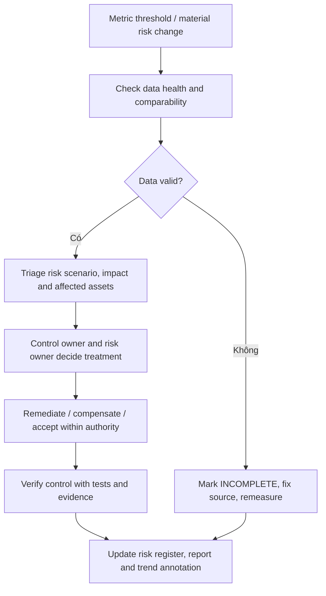

# Risk Trend: phân tích xu hướng rủi ro bảo mật từ bằng chứng theo thời gian

## 1. Risk Trend là gì?

**Risk trend (xu hướng rủi ro)** là cách quan sát và giải thích **rủi ro thay đổi như thế nào qua các thời điểm hoặc các giai đoạn**, dựa trên những phép đo, giả định và bằng chứng có thể truy vết. Mục đích không chỉ là phát hiện đường biểu đồ tăng hoặc giảm, mà là trả lời: **rủi ro nào đang thay đổi, đối với tài sản/nghiệp vụ nào, vì nguyên nhân gì, độ tin cậy của số liệu ra sao và ai phải hành động?**

Trong chương **Metrics và reporting** của module **SECURITY_SECURITY_ASSURANCE**, Risk Trend hỗ trợ xây dựng đánh giá **có bằng chứng** rằng hệ thống đáp ứng các mục tiêu bảo mật: từ risk assessment, security requirements và controls đến kiểm thử, audit, remediation và chương trình Security Assurance liên tục trong phát triển và vận hành.

Ví dụ nhóm vận hành báo:

> “Số lỗ hổng nghiêm trọng còn mở giảm từ 80 xuống 40, tức rủi ro bảo mật giảm 50%.”

Kết luận này **chưa đủ căn cứ**. Có thể 40 findings đã được khắc phục thực sự; nhưng cũng có thể scanner mất quyền truy cập, 30 máy bị bỏ khỏi inventory hoặc mức severity bị đổi. Ngay cả khi số findings giảm đúng, mức **rủi ro nghiệp vụ** không nhất thiết giảm cùng tỷ lệ vì độ phơi nhiễm, tài sản bị ảnh hưởng và khả năng khai thác có thể khác.

Một kết luận chặt chẽ hơn:

> “Trên cùng tập 120 workloads production và cùng bộ tiêu chí đánh giá, số findings critical đã được xác minh còn mở giảm từ 80 xuống 40 trong quý. Trong đó 35 findings được kiểm chứng khắc phục, 5 findings được phân loại lại có evidence; không ghi nhận missing scan trên cohort này. Mức exposure giảm trên cohort được kiểm, nhưng còn ba internet-facing services có findings quá hạn và cần xử lý ưu tiên.”

Đây là tình huống **giả lập**. Risk Trend tốt luôn giữ liên kết **giữa số liệu, tính đầy đủ của nguồn, bối cảnh rủi ro và hành động**.

### Mục tiêu học tập

Sau bài học, người học có thể:

1. Phân biệt **risk level, risk trend, risk velocity, exposure, inherent/residual risk**, security metric và KRI.
2. Xây dựng chuỗi thời gian có **baseline, đơn vị đo, population, thời điểm, phiên bản tiêu chí và evidence lineage**.
3. Phân tích các chỉ báo **leading/lagging** về vulnerabilities, identities, data exposure, detection, incidents, DR và exceptions.
4. Phân biệt xu hướng do **rủi ro thực sự đổi** với thay đổi do **coverage, measurement, policy hoặc scope**.
5. So sánh các cohort và phân tầng theo **business criticality, Internet exposure, asset owner và control domain**.
6. Thiết kế threshold, escalation và governance cho xu hướng xấu hoặc độ tin cậy của số liệu giảm.
7. Tạo dashboard và báo cáo Risk Trend không suy rộng quá bằng chứng, kèm risk register và remediation tracking.
8. Thực hành tính chỉ số theo tháng, giải thích bất thường và đề xuất hành động kiểm chứng được.

**Phạm vi:** bài này trình bày phương pháp theo dõi Risk Trend trong Security Assurance, không đưa ra xác suất bị tấn công hay mô hình định lượng tài chính như một chân lý khi không có dữ liệu hiệu chỉnh. Mọi con số và ngưỡng bên dưới đều dùng để học tập; tổ chức cần phê duyệt phương pháp và ranh giới riêng.

## 2. Risk, Exposure, Finding, Metric và Trend khác nhau thế nào?

| Khái niệm | Ý nghĩa | Ví dụ |
|---|---|---|
| **Risk scenario** | Một chuỗi tình huống có thể gây tác động lên mục tiêu nghiệp vụ | Token CI/CD bị chiếm dụng dẫn tới thay image production |
| **Risk level/assessment** | Đánh giá mức rủi ro tại thời điểm/kỳ theo phương pháp đã duyệt | “High residual risk” sau khi xét controls |
| **Exposure** | Điều kiện tạo cơ hội hoặc đường tác động của một đe dọa | API public thiếu rate limiting; role có quyền quá mức |
| **Finding** | Một sai lệch/quan sát so với yêu cầu hoặc control | IAM grant thiếu approval, bucket public ngoài policy |
| **Security metric** | Đại lượng được định nghĩa để đo trạng thái/hiệu lực/coverage | % privileged grants có review đúng hạn |
| **KRI — Key Risk Indicator** | Metric dùng để phát cảnh báo hoặc theo dõi một rủi ro trọng yếu | Số critical internet-facing exposure quá hạn |
| **Risk trend** | Diễn tiến theo thời gian của risk level hoặc các chỉ báo liên quan | Exposure days tăng ba kỳ liên tiếp dù số findings giảm |
| **Risk velocity** | Mức độ hoặc tốc độ thay đổi của một chỉ báo rủi ro theo thời gian | Số assets exposed mới tăng 12 mỗi tuần |
| **Assurance confidence** | Mức tin cậy của kết luận do scope/evidence/method | KRI có số đẹp nhưng scanner chỉ bao phủ 60% assets |

**Số findings không bằng số risk scenarios.** Một risk scenario có thể liên quan nhiều CVEs, IAM grants, nhà cung cấp và business controls; một finding có thể ảnh hưởng nhiều scenarios. Cần xác định **đơn vị đo** trước khi so sánh hoặc cộng số.

### 2.1. Risk Trend là xu hướng của cái gì?

Có ít nhất ba nhóm giá trị:

1. **Trend của mức đánh giá rủi ro:** sự thay đổi rating của từng risk scenario (ví dụ High → Medium), với phương pháp đánh giá không thay đổi hoặc đã được giải thích.
2. **Trend của exposure/control indicators:** độ phơi nhiễm, gaps, kiểm soát hiệu lực, thời gian tồn đọng, evidence coverage; thường dễ đo thường xuyên hơn.
3. **Trend của kết quả/tác động thực:** incident, data-loss events, downtime, tổn thất được xác minh; những chỉ báo *lagging* có thể hiếm và phụ thuộc khả năng phát hiện.

Không được coi ba nhóm trên là một đường số duy nhất nếu chưa có **mô hình liên kết và giới hạn suy luận**.

### 2.2. Risk appetite, tolerance và threshold

- **Risk appetite:** mức/range rủi ro tổ chức sẵn sàng theo đuổi hoặc chấp nhận để đạt mục tiêu, do cấp có thẩm quyền xác định.
- **Risk tolerance:** giới hạn cụ thể của mức lệch chấp nhận được đối với một rủi ro hoặc mục tiêu.
- **KRI threshold:** giá trị quan sát tạo điều kiện điều tra/escalation; không tự đồng nghĩa với ngưỡng rủi ro pháp lý.

Ví dụ một KRI vượt ngưỡng **10 critical exposure-days/tuần** có thể yêu cầu review ngay. Ngưỡng này phải được xác định theo business impact, kiểm soát và quyết định governance, **không phải con số khuyến nghị chung**.

## 3. Mục tiêu thật: hỗ trợ quyết định chứ không vẽ đường cong

Risk Trend hữu ích khi kết quả ảnh hưởng đến **quản trị rủi ro và đầu tư security controls**:

- **Ưu tiên remediation:** risk scenario nào xấu đi dù tổng số lỗi giảm?
- **Xác nhận hiệu quả control:** sau khi bật MFA/segmentation, các chỉ báo liên quan đã cải thiện đáng tin chưa?
- **Phát hiện drift:** quyền rộng, exception quá hạn hay audit logging thiếu đang tăng?
- **Đánh giá thay đổi kiến trúc:** cloud migration làm exposure tăng hay chỉ làm inventory lớn hơn?
- **Kiểm tra rủi ro còn lại:** accepted risk vẫn trong giới hạn, có hết hạn hoặc đổi bối cảnh không?
- **Kiểm toán và assurance:** xu hướng có bằng chứng lịch sử, người review và hành động tiếp theo không?

### 3.1. Goal–Question–Trend

```text
Goal:
  Giảm khả năng truy cập ngoài quyền vào dữ liệu khách hàng.
Question:
  Các đường privileged/data-access exposure đang tăng hay giảm?
Trend unit:
  Risk scenario + affected asset group + calendar month.
Indicators:
  Effective unauthorized access paths, overdue grants, control test pass coverage.
Data confidence:
  IAM history, effective permissions, negative authorization tests, inventory.
Decision:
  Escalate newly exposed Tier-1 path; retest authorization after remediation.
```

Chọn câu hỏi trước giúp tránh sử dụng metric dễ thu nhưng **không phản ánh rủi ro cần quyết định**. Số lần chạy scanner có thể tăng mà những đường dữ liệu nguy hiểm vẫn tồn tại.

### 3.2. Phân biệt trạng thái, mức thay đổi và tác động

Một KRI có thể:

| Mức hiện tại | Chiều thay đổi | Ý nghĩa cần hành động |
|---|---|---|
| Cao | Giảm | Cải thiện nhưng vẫn vượt tolerance; chưa thể đóng risk |
| Thấp | Tăng nhanh | Cảnh báo sớm trước khi chạm ngưỡng |
| Cao | Ổn định | Rủi ro dai dẳng, không được coi là tốt chỉ vì “không tăng” |
| Thấp | Ổn định | Có thể đạt mục tiêu, cần kiểm chứng evidence và duy trì |
| Không rõ | Không thể kết luận | Khắc phục telemetry/data quality trước khi báo trend |

Một biểu đồ xu hướng chỉ hữu ích khi **đọc đồng thời level, direction, velocity, criticality và confidence**.

## 4. Khung nguyên nhân: rủi ro thay đổi từ đâu?

Rủi ro an ninh thường được xem xét qua **threat scenario, likelihood và impact** cùng hiệu quả của controls. Một kết quả đánh giá có thể thay đổi do nhiều nguyên nhân:

1. **Tài sản hoặc dữ liệu thay đổi:** số khách hàng, độ nhạy cảm, lưu lượng, số account, public endpoints.
2. **Threat environment thay đổi:** kỹ thuật khai thác, chiến dịch tấn công hoặc điều kiện truy cập của attacker.
3. **Control effectiveness thay đổi:** MFA, segmentation, patching, detection, backup, response.
4. **Control coverage thay đổi:** scanner/EDR/logging/backup chưa bao phủ tài sản mới.
5. **Business impact thay đổi:** hệ thống trước đây ít quan trọng nay là luồng doanh thu chính.
6. **Measurement thay đổi:** rule, severity taxonomy, inventory source, data retention, detection logic.
7. **Risk treatment thay đổi:** mitigate/transfer/accept/avoid, hết hạn exception hoặc thay chủ sở hữu.

### 4.1. Inherent risk và residual risk

**Inherent risk** là mức rủi ro xét theo phương pháp tổ chức **trước khi tính các controls đang áp dụng**; **residual risk** là phần rủi ro còn lại sau khi xem xét sự hiện diện và hiệu quả của các controls. Hai mức có thể được đánh giá bằng qualitative categories hoặc phương pháp định lượng có dữ liệu.

Ví dụ:

| Thời kỳ | Inherent risk (minh họa) | Controls được xác minh | Residual assessment |
|---|---|---|---|
| T1 | High | MFA chưa enforce ở admin; audit logs thiếu | High |
| T2 | High | MFA enforce trên admin, nhưng service roles chưa review | Medium hoặc High tùy phương pháp |
| T3 | High | Effective privilege review + negative tests PASS, logs tốt | Medium theo risk owner nếu điều kiện phù hợp |

**Không tự chuyển High → Medium chỉ vì control “đã triển khai”.** Phải xem kiểm soát có hoạt động, đầy đủ và đúng phạm vi, bên cạnh những thay đổi threat/impact. Nếu data/controls thay đổi đáng kể, ghi lại giả định và confidence.

### 4.2. Cảnh giác khi tính điểm rủi ro

Một số risk register dùng bảng likelihood × impact, thang 1–5. Kết quả nhân thường mang tính **xếp loại/ưu tiên** do tổ chức thiết kế; các mức 1–5 thường là **ordinal**, không phải xác suất hoặc tiền tệ. Vì vậy:

- “Score 20 giảm còn 10” **không tự có nghĩa xác suất hoặc tổn thất giảm 50%**.
- Tổng các điểm 1–5 trên 100 risks không nhất thiết là “total enterprise risk”.
- Đổi thang, trọng số, impact definitions hoặc assessor sẽ làm trend kém so sánh.
- Nếu có mô hình định lượng ước tính tần suất/tổn thất, cần nguồn dữ liệu, assumptions, uncertainty và validation riêng.

Để theo dõi trend dạng qualitative, có thể báo **số risk scenarios theo tier, những scenario đổi tier, thời gian ở mức High và các căn cứ thay đổi**, thay vì giả định cộng các ordinal scores như đại lượng vật lý.

## 5. Phạm vi, thời gian và baseline: điều kiện để trend có nghĩa

Một chuỗi thời gian cần có **những quan sát có thể so sánh được**. Phép tính đúng chưa đủ nếu mỗi kỳ có population hoặc tool khác.

### 5.1. Ranh giới bắt buộc

| Chiều | Câu hỏi cần chốt |
|---|---|
| **Business scope** | Dịch vụ/quy trình, tier và data classes nào? |
| **Technical scope** | Accounts, clusters, endpoints, identities và environments nào? |
| **Risk scope** | Threat scenarios, risk register IDs và control domains nào? |
| **Unit** | Risk scenario, finding, asset, risk–asset pair hay exposure-day? |
| **Time** | Theo ngày/tuần/tháng, event time, UTC, timezone và cutoff? |
| **Inventory** | Snapshot cuối kỳ, active-during-period hay cohort cố định? |
| **Method revision** | Công thức, severity/risk criteria, scanning/detection rule phiên bản nào? |
| **Missing data** | Kỳ nào thiếu nguồn, asset nào không quan sát được? |
| **Baseline** | Mốc tham chiếu được chọn trước hay sau khi thấy kết quả? |
| **Decision** | Ngưỡng/điều kiện nào dẫn đến triage, escalation hoặc re-assessment? |

### 5.2. “Current population” và “like-for-like cohort”

Giả sử Q1 có 100 workloads, Q2 có 150 workloads sau một cloud migration:

- Q1: 90/100 có EDR hợp lệ = **90%**.
- Q2: 120/150 có EDR hợp lệ = **80%**.

Có thể tổng coverage giảm vì **50 workloads mới chưa onboarding**, không hẳn 30 workloads cũ mất EDR. Để kết luận:

1. Đo **like-for-like** trên 100 workloads Q1 còn tồn tại.
2. Đo **new cohort** 50 workloads.
3. Báo coverage trên **current scope** 150 workloads.
4. Ghi rủi ro của những tài sản chưa bảo vệ và timeline onboarding.

Nếu chỉ cố giữ 100 workloads cũ trong mẫu số, lại có nguy cơ **che exposure mới**. Do đó cần báo đồng thời trend của cohort cố định và **mức phơi nhiễm thực tế toàn phạm vi hiện tại**.

### 5.3. Các loại baseline

- **Historical baseline:** giá trị kỳ trước hoặc trung bình giai đoạn có dữ liệu tin cậy.
- **Target/risk-tolerance baseline:** ngưỡng được phê duyệt, không phải trạng thái cũ.
- **Peer/group baseline:** hệ thống tương đồng có định nghĩa và exposure gần nhau.
- **Post-change baseline:** giai đoạn sau thay đổi công cụ/policy được chốt có phương pháp.
- **Scenario baseline:** mức ban đầu trước control rollout hoặc exercise.

Không nên chọn giai đoạn tốt nhất từ dữ liệu lịch sử làm “baseline” sau khi đã nhìn thấy trend để tuyên bố mức tăng giảm thuận lợi. Ghi **lý do chọn mốc, dữ liệu nguồn và phiên bản**.

### 5.4. Snapshot và event-flow

Một số metrics đo tại **một mốc** (open critical exposure lúc 23:59 UTC cuối tháng), số khác đo **dòng sự kiện trong kỳ** (new high-risk findings/tháng), và số khác đo **thời lượng tồn tại** (exposure-days).

Một asset bị public 23 giờ rồi sửa trước cuối tháng sẽ **không xuất hiện trong end-of-month open exposure snapshot**, nhưng vẫn tạo rủi ro trong kỳ. Kết hợp snapshot, new events và duration metrics có thể diễn giải đúng hơn.

## 6. Time Series: level, direction, velocity, volatility, duration

### 6.1. Một bộ khái niệm

Với một metric được đo ở các thời điểm cách nhau đều, ký hiệu \(x_t\):

- **Level:** giá trị \(x_t\) hiện tại.
- **Absolute change:** \(\Delta x_t = x_t-x_{t-1}\).
- **Relative change:** \((x_t-x_{t-1})/x_{t-1}\) khi \(x_{t-1}\ne 0\).
- **Rate of change:** mức thay đổi chia theo khoảng thời gian đo khi các kỳ không đều.
- **Volatility:** độ dao động của series theo một quy ước thống kê được định nghĩa.
- **Duration/persistence:** giá trị ở trạng thái xấu hoặc vượt tolerance bao lâu.
- **Trend direction:** tăng/giảm/ổn định có căn cứ qua nhiều quan sát.

Không thể tự nói một điểm tăng giữa hai ngày là “xu hướng dài hạn”. Có thể đó là **seasonality, thay đổi volume, hoặc phát hiện mới nhờ công cụ tốt hơn**.

### 6.2. Ví dụ risk exposure count

| Tuần | Confirmed high-risk exposed assets |
|---|---:|
| W1 | 10 |
| W2 | 12 |
| W3 | 15 |
| W4 | 18 |

Thay đổi từ W1 tới W4 là **+8 assets**, tương đương **+80% so với mốc 10** nếu definition/scope không đổi. Nhưng không có nghĩa rủi ro tăng 80%: những assets có thể khác nhau về impact và exposure duration. Phải phân tích **new vs persistent vs remediated** và những tier bị ảnh hưởng.

### 6.3. Từ count sang exposure-days

**Exposure-day** là một cách tính duration có định nghĩa, ví dụ:

\[
\text{Exposure-days in period}
= \sum_i \text{Số ngày phơi nhiễm được xác minh của đơn vị }i\text{ trong kỳ}.
\]

Giả sử hai internet-facing assets cùng có lỗi nghiêm trọng: asset A exposed 20 ngày, B exposed 2 ngày. **Số assets exposed = 2**, còn **exposure-days = 22**. Metric duration giữ lại thông tin về **thời gian rủi ro tồn tại**, nhưng vẫn không phải trực tiếp là xác suất khai thác hoặc tổn thất tiền tệ.

Nếu các exposures chồng lấn và một asset có nhiều findings, cần định nghĩa **unit = asset–exposure, unique asset, hoặc risk scenario–asset** để không double-count. Tách thời gian không có log/scan khỏi trạng thái “không exposed”.

### 6.4. Rolling average không thay raw values

Một rolling average có thể giảm nhiễu trong chuỗi nhiều ngày, nhưng **làm mờ spike ngắn hạn** rất quan trọng (như public data exposure tồn tại 3 giờ). Trên dashboard, nên giữ **raw events, peak, threshold breaches và duration**, bên cạnh đường xu hướng mượt.

## 7. Dữ liệu và bằng chứng để tạo Risk Trend

Risk Trend được xây từ **các phép quan sát có giới hạn**, không phải một phép đọc trực tiếp “mức rủi ro thật” từ hệ thống. Số liệu cần đối chiếu giữa các nguồn để giảm sai lệch.

### 7.1. Nguồn dữ liệu và rủi ro chất lượng

| Nguồn | Dữ liệu hữu ích | Điều có thể làm lệch trend |
|---|---|---|
| **Risk register** | Scenario IDs, ratings, owners, inherent/residual, treatment history | Ratings chủ quan, criteria thay đổi, các risks chưa được review |
| **Asset inventory/CMDB/cloud API** | Workloads, accounts, owners, criticality, lifecycle | Thiếu transient assets, duplicate resource IDs, shadow IT |
| **Vulnerability/SBOM/scanners** | CVEs, validated findings, affected packages, first/last seen | Scan coverage/agent failure, reclassification, rescans trùng |
| **IAM/IdP** | Effective grants, privilege events, reviews, credential state | Snapshot bỏ historical grants, identity mapping sai |
| **SIEM/EDR/telemetry** | Detections, source health, actor/action/resource, event time | Logging gaps, parser drift, rule disabled, missing labels |
| **Security testing** | SAST/DAST/pentest, negative controls, red/purple-team results | Test scope khác production, false positives, sample bias |
| **Ticket/change management** | Finding lifecycle, approvals, due dates, deployment histories | Ticket đóng chưa verified fix, đổi owner hoặc SLA start |
| **IR/postmortem** | Incidents, impact, detection/containment times, root causes | Under-reporting, đổi severity taxonomy, mốc không chắc |
| **DR exercises** | RTO/RPO/MBCO, backup recovery, clean restore tests | Lab khác production, kịch bản dễ, thiếu security gates |
| **Third-party assurance** | Provider controls, exposure, contract exceptions | Scope, services, time periods hoặc assumptions khác |

**Một nguồn không đủ** cho mọi mục đích. Ví dụ số incident “0” từ ticketing có thể do không có incident, hoặc do alerts không đến SOC. Vì vậy cần bổ sung **telemetry source health và detection validation** trước khi diễn giải trend.

### 7.2. Các kiểm tra chất lượng cơ bản

1. **Completeness:** có bao nhiêu accounts, assets, events ngoài khả năng thu?
2. **Accuracy:** asset ID, identity, severity, owner và timestamps có chính xác?
3. **Uniqueness:** một vấn đề ở nhiều tools có bị double-count?
4. **Freshness:** scan, risk assessment, review và evidence còn hiệu lực?
5. **Consistency:** criteria, scope, time window và status semantics giữa các kỳ có khớp?
6. **Provenance:** biết nguồn, query, extraction time, rule version, người review?
7. **Representativeness:** cohort đo có phản ánh business process/risk đang báo?
8. **Security/privacy:** evidence có PII, token, secrets hoặc chi tiết attack surface nhạy cảm?

Một “risk score = 5” tính từ dữ liệu thiếu nguồn **không mạnh hơn** việc ghi “UNKNOWN”. Để bảo đảm tin cậy, dashboard nên có trạng thái **VALID, DEGRADED, INCOMPLETE hoặc NOT COMPARABLE** và nêu nguyên nhân.

### 7.3. Event time, ingestion time và cutoff

Đối với kỳ Q3:

- **Event time:** khi thay đổi quyền hoặc phát hiện thực sự xảy ra.
- **First-seen time:** khi scanner/monitoring quan sát lần đầu, có thể muộn hơn sự kiện thật.
- **Ingested time:** khi pipeline nhận dữ liệu.
- **Reported/closed time:** khi dữ liệu được snapshot hoặc freeze trong báo cáo.

Nếu events của 30/09 tới ngày 02/10, cần quy định **grace period**, ngày khóa sổ và cách bổ sung dữ liệu trễ. Không ngầm thay số liệu Q3 sau khi báo cáo được phê duyệt; có thể phát hành bản revision/addendum theo governance.

### 7.4. Missing data không phải 0 risk

Ví dụ một tháng:

```text
Assets applicable: 100
Scanned and validated: 78
Scanner permission failures: 12
No agent / not onboarded: 10
Critical findings among 78: 0
```

Không được kết luận “0 critical exposures trên 100 assets”. Kết luận hỗ trợ được là: **không có critical findings từ 78 assets đã được scan hợp lệ bằng bộ check đó**, còn 22 assets chưa được đánh giá; cần báo **validated scan coverage 78%** và kiểm rủi ro của 22 assets.

### 7.5. Độ tin cậy của Risk Trend

Nên trình bày **evidence-confidence assessment** riêng, ví dụ:

| Mức tin cậy | Điều kiện minh họa | Cách dùng |
|---|---|---|
| **High** | Population đầy đủ, tiêu chí và công cụ ổn định, test có review và raw evidence | So trend có giới hạn, ưu tiên theo risk |
| **Moderate** | Một số sai lệch/thiếu nguồn không trọng yếu, được công bố và kiểm bù | So trend thận trọng, theo dõi gaps |
| **Low/Incomplete** | Data gaps trọng yếu, phương pháp đổi, không biết population | Không phát biểu xu hướng chắc chắn; ưu tiên khôi phục measurement |

Bảng phân loại là **hướng dẫn tư duy**, không phải thang chuẩn. Một số metric có thể cần confidence intervals hoặc sensitivity analysis nếu dựa trên mẫu thống kê; **không áp interval của random sample lên judgmental sample**.

## 8. Risk Trend của Vulnerability và Technical Exposure

Theo dõi vulnerability không chỉ là đếm CVEs còn mở: cần phân biệt **new, fixed, reopened, risk accepted, reclassified, disappeared do mất scan** và exposure duration.

### 8.1. Các metric quan trọng

| Metric | Đơn vị/cách đo | Câu hỏi |
|---|---|---|
| **Verified high-risk open backlog** | Findings confirmed còn mở tại snapshot | Exposure hiện tại ở đâu? |
| **New high-risk findings** | Findings lần đầu được xác minh trong kỳ | Exposure mới phát sinh hay phát hiện tốt hơn? |
| **Verified remediation count** | Findings có fix được kiểm lại | Có thực sự giảm exposure? |
| **Reopened/recurrence count** | Findings quay lại sau fix theo định nghĩa | Fix có bền vững không? |
| **Overdue critical exposures** | Findings vượt SLA trên assets relevant | Rủi ro nào đang kéo dài quá tolerance? |
| **Exposure-days** | Tổng thời lượng exposure trong cửa sổ | Số ngày có nguy cơ thay vì snapshot count |
| **Remediation time quantiles** | Median, P90/P95 theo cohort đã fixed | Những cases kéo dài là gì? |
| **Validated scan coverage** | Valid scans / applicable assets | Có thể tin open backlog đủ đại diện? |

### 8.2. Backlog flow và conservation

Để giải thích xu hướng **open backlog**, có thể dùng sổ cái:

\[
\text{Open}_{end}=
\text{Open}_{start}+\text{New}+\text{Reopened}-
\text{Verified fixed}-\text{Approved out-of-scope transitions}-\text{Validated reclassifications}.
\]

Công thức chỉ đúng với **định nghĩa state transitions độc lập, không đếm trùng**. Accepted risk thường **không làm kỹ thuật exposure biến mất**; nên lưu ở trạng thái risk treatment riêng, không tự trừ khỏi open backlog.

Ví dụ:

```text
Open start:                   60
New confirmed:               20
Reopened:                     3
Verified fixed:             -18
Out-of-scope approved:       -2
False-positive reclass:      -3
Open end:                    60
```

Kết quả: backlog đầu và cuối **đều bằng 60**, nhưng trong kỳ có 20 new exposures, 3 reopened và 18 verified fixes. Chỉ nhìn đường backlog phẳng sẽ che **churn và exposure pressure**. Đồng thời phải ghi lý do và bằng chứng cho 5 đơn vị được loại qua transition; nếu là scanner error thì không được âm thầm xóa.

### 8.3. Discovery tăng có thể là tín hiệu tốt

Tháng 1 scanner chỉ bao phủ 60 assets và tìm thấy 10 critical findings; tháng 2 mở rộng tới 120 assets và tìm 30. Số findings tăng **không tự chứng minh posture xấu đi**: phát hiện tốt hơn là một khả năng. Nên phân tích:

- **Like-for-like** trên 60 assets cũ: số valid findings và tuổi exposure thay đổi thế nào?
- **New cohort** 60 assets: có findings mới do previously unobserved?
- Lỗ hổng được introduced sau khi mở scope hay đã tồn tại từ trước?
- Mức business criticality và Internet exposure của hai nhóm?

Không lấy số findings/asset làm “xác suất bị khai thác” nếu không có mô hình và dữ liệu phù hợp.

### 8.4. Độ trễ remediation và findings chưa sửa

Chỉ tính mean time-to-remediate của những findings đã đóng có thể tạo **survivorship bias**: các vấn đề tồn đọng lâu chưa đóng bị bỏ ra. Cần hiển thị:

- Distribution time-to-verified-fix của cohort đã sửa.
- **Age của open backlog**, nhất là critical vượt hạn.
- SLA attainment của **findings đã đến hạn**, kể cả vẫn mở.
- Risk acceptance/exception tuổi bao lâu, còn hiệu lực không.

Ví dụ 20 critical findings đến hạn, 15 verified fix đúng hạn, 3 fix trễ và 2 chưa fix: **on-time rate = 15/20 = 75%**. Không báo 15/18 bằng cách bỏ hai findings khó nhất.

### 8.5. Quyền ưu tiên theo threat context

Sự giảm CVE count không đủ để kết luận giảm business risk nếu các CVEs còn lại nằm trên **authentication gateway**, **payment workflow**, **CI/CD token** hoặc **confidential database**. Có thể lập trend riêng cho **Internet-facing Tier-1 overdue findings**, asset criticality và exploitability evidence.

## 9. Risk Trend của Identity và Access Control

Identity là đường tấn công quan trọng nhưng rất khó đánh giá chỉ qua “số tài khoản có MFA” hoặc “số quyền đã cấp”. Nên theo dõi **effective privileges, control operation và ngoại lệ**.

### 9.1. Những chỉ báo rủi ro

| KRI/KCI | Cách dùng | Kiểm tra dữ liệu |
|---|---|---|
| **Unreviewed privileged assignments** | Theo dõi grants không có review hợp lệ | Reconcile IAM effective access và review records |
| **Orphaned privileged identities** | Phát hiện human/service roles không có owner | So HR, vendor register, service catalogue |
| **Excessive effective permissions** | Quyền vượt least-privilege baseline | Policy evaluation, paths/transitive access |
| **Stale break-glass exceptions** | Quyền khẩn cấp không bị thu hồi/review đúng | Event, approval, expiry và post-use review |
| **Time to revoke after trigger** | Mức kéo dài quyền sau offboarding/compromise | Trigger time tới effective denial, không chỉ ticket closure |
| **Privileged credential age** | Các credentials cần rotate theo policy | Secret ownership, age, revocation evidence |
| **Effective MFA/strong auth coverage** | Các access flows required được bảo vệ | Positive/negative tests, bypass conditions |

### 9.2. Ví dụ xu hướng IAM

| Tháng | Privileged assignments | Unreviewed | Tỷ lệ unreviewed |
|---|---:|---:|---:|
| T7 | 100 | 8 | 8% |
| T8 | 120 | 12 | 10% |
| T9 | 150 | 15 | 10% |

**Tỷ lệ** đi từ 8% tới 10% rồi ổn định; **số trường hợp chưa review** tăng 8 → 15. Không nên nói “không xấu thêm trong T9” mà bỏ mức exposure tuyệt đối lớn hơn. Cần xem:

- Bao nhiêu assignments mới do business mở rộng?
- Những unreviewed grants có liên quan Tier-1 hay production admin?
- Có grants cùng tồn tại từ T7 không được review suốt ba kỳ?
- Có chính sách review khác nhau theo identity type không?

Kết hợp **stock count, age, repeat offenders và risk tier** có ích hơn một % đơn lẻ.

### 9.3. Không nhầm MFA enrollment với effective protection

Enrollment 100% không chứng minh MFA enforced trên mọi access path: legacy auth, service tokens, emergency access và delegated roles có thể đi qua cơ chế khác. Khi tracking trend, cần giữ **định nghĩa “applicable flows” và test method**, báo alternatives/exceptions rõ ràng.

### 9.4. Positive và negative assurance

Kết quả một policy có thể được xác minh qua:

1. **Positive control:** principal có phép đọc/ghi canary đúng quyền.
2. **Negative control:** principal ngoài quyền bị chặn trên cùng tài nguyên còn tồn tại.
3. **Source evidence:** effective IAM role, policy, event/correlation ID và thời điểm.

Không tính negative authorization test là PASS nếu request trả 404 chỉ vì tài nguyên không tồn tại; đó có thể là **invalid test**.

## 10. Risk Trend của Logging, Detection và Monitoring

**Detection trend** rất dễ diễn giải ngược: số alerts giảm có thể do rủi ro giảm, hoặc do nguồn sự kiện ngừng hoạt động. Cần theo dõi song song **telemetry health, validated detection coverage, latency và chất lượng alerts**.

### 10.1. Các chuỗi bổ trợ

| Nhóm | Ví dụ trend | Cần công bố |
|---|---|---|
| **Logging source health** | % required sources có canary PASS qua từng kỳ | Denominator, event categories, ingestion lag |
| **Detection coverage** | Số scenario–asset pairs có end-to-end test PASS | Scenario inventory, test revisions, unknown/untested |
| **Detection delay** | P50/P90 event-to-alert latency | Event-time quality, sample count, test vs production |
| **Actionability** | % alerts được triage có giá trị theo taxonomy | Label process, review sample, operational workload |
| **Missed detections** | Confirmed misses qua purple team/incidents | Kịch bản, scope, những nơi chưa kiểm |
| **Suppression/disabled rules** | Rule suppression exceptions và expiry | Owner, rationale, false-negative risk |

### 10.2. Độ tăng giảm alert không tự phản ánh threat trend

Giả sử số alerts tuần T3 giảm từ 100 xuống 20. Cùng lúc:

- Số required event sources online giảm từ 50 xuống 30.
- Pipeline ingestion delay tăng từ 2 phút lên 45 phút.
- Một detector critical chuyển sang trạng thái disabled.

**Đây có thể là suy giảm khả năng quan sát**, không phải tình hình an ninh cải thiện. Báo một **telemetry health degradation** với cùng mức ưu tiên phân tích; không gộp 20 alerts thành “80% risk reduction”.

### 10.3. Precision, recall và giới hạn labels

Trong bộ test có ground truth:

\[
\mathrm{Precision}=\frac{TP}{TP+FP},\qquad
\mathrm{Recall}=\frac{TP}{TP+FN}.
\]

Trong production thường không biết đầy đủ các false negatives, nên **không thể tính recall của mọi tấn công thật chỉ từ alerts đã triage**. Một số “false positive rate” trên tickets thực chất là **fraction alerts bị đóng benign**, khác \(FP/(FP+TN)\).

Risk Trend của detection nên tập trung vào **khả năng đã kiểm chứng trong những threat scenarios cụ thể**, nhất là các tình huống critical, và báo những nguồn chưa có chứng cứ.

### 10.4. Data gap là một rủi ro riêng

Nếu log source có lỗ hổng 10 ngày, có thể không phục hồi được những event bị mất. Một số cách xử lý:

- Ghi khoảng thời gian thiếu và affected event categories/asset scope.
- Phân biệt **source event absent**, **collector failure**, **parser failure**, **query access limitation**.
- Khắc phục đường ghi/thu và thử một canary mới với event/correlation ID.
- Xem tác động tới những điều tra/assurance claims trong kỳ.
- Không giả lập bằng chứng lịch sử mà hệ thống chưa từng lưu.

Sự cố mất log có thể đồng thời tăng **rủi ro detection** và làm **độ tin cậy của các risk trends khác giảm**.

## 11. Risk Trend của Incidents và Business Impact

Incident count là chỉ báo *lagging* nhưng chịu ảnh hưởng mạnh bởi **khả năng phát hiện, định nghĩa incident, policy khai báo, reporting culture và business exposure**.

### 11.1. Các metric nên theo dõi

- **Confirmed incidents theo severity/risk scenario** và phạm vi business bị ảnh hưởng.
- **Time to detect, contain và recover**, với mốc thời gian có định nghĩa.
- **Dữ liệu/tài sản/khách hàng bị tác động** theo bằng chứng đã xác minh, nếu đo được.
- **Repeat incidents do cùng root cause** và mức hiệu lực của remediation.
- **Unresolved post-incident actions** đã quá hạn, nhất là biện pháp kiểm soát trọng yếu.
- **Detection coverage** để tránh diễn giải sai biến động số incident.
- **Near misses/test discoveries** nếu có taxonomy ổn định, không trộn với confirmed incidents.

### 11.2. Một ví dụ nghịch lý

Tháng 7 có 2 confirmed incidents và hệ thống logging chỉ bao phủ 50% critical services. Tháng 8 tăng coverage lên 95%, có 6 confirmed incidents. Đồ thị count tăng **không đủ chứng minh threat landscape xấu đi**; có thể đã phát hiện tốt hơn. Cần phân tích:

1. Những incidents mới thuộc các critical services trước đây chưa được giám sát?
2. Severity/tác động thực tế có tăng?
3. Root cause/exposure tồn tại từ trước hay vừa phát sinh?
4. Business/traffic hoặc policy incident declaration có thay đổi?
5. Detection latency, coverage và test validity đã được cải thiện thế nào?

Một chương trình risk reporting trung thực không dùng **số incidents thấp** làm phần thưởng khuyến khích che giấu hoặc giảm detection.

### 11.3. Mốc thời gian cho response trend

```text
t0 = Incident start, được xác minh hoặc ước lượng có uncertainty
t1 = First detection signal
t2 = Incident formally declared
t3 = Containment effective, có kiểm tra
t4 = Business recovery accepted
t5 = Remediation retest verified
```

Không gộp tất cả thành nhãn “MTTR” vì thuật ngữ này có thể là *Mean Time to Respond, Repair, Resolve hoặc Recover*. Khi so sánh qua quý, phải giữ **cùng mốc, same case cohort/segmentation và xử lý incidents chưa giải quyết**.

### 11.4. Tail risk quan trọng

Một tháng xử lý 20 incidents nhỏ trong 5 phút và 1 incident critical kéo dài 6 giờ có thể có **mean detection/response time đẹp**. Dashboard cần phân tầng theo severity/business criticality, thể hiện P90/P95 khi sample đủ, maximum, số cases đo được và các incidents thiếu timeline.

Trong các biến cố hiếm, không nên dùng một percentile thiếu ổn định để khẳng định mức xác suất rủi ro. Có thể dùng **case review, scenario exercise và impact-specific lessons**.

## 12. Risk Trend của Disaster Recovery và Business Continuity

Rủi ro gián đoạn dịch vụ không được đo đầy đủ bằng số lần backup thành công. Cần xem **business recovery capability** và bằng chứng diễn tập.

| KRI/KCI | Cách theo dõi | Giới hạn |
|---|---|---|
| **Critical-process DR validation coverage** | Cặp (business process, scenario) có bài exercise PASS còn hiệu lực / cặp required | Một failover AZ không đại diện mất region hoặc ransomware |
| **RTO attainment trend** | Tỷ lệ exercises đạt RTO theo business-ready gate | Lab và production khác nhau; phải giữ cùng tiêu chí |
| **RPO validation trend** | Các bài test có dữ liệu nhất quán trong RPO | Replica lag không đủ chứng minh consistency |
| **MBCO attainment** | Throughput/chức năng nghiệp vụ đạt mức tối thiểu tại DR | Health check thành công không đủ |
| **Backup restore failure trend** | Restore attempts FAIL và nguyên nhân đã xác minh | Backup job PASS không đồng nghĩa restore PASS |
| **Failback readiness** | Scenario có failback test và fencing/reconciliation evidence | Chuyển DNS đơn lẻ không chứng minh an toàn |
| **Cyber recovery trust gaps** | Backup/identity/artifact chưa có clean recovery validation | Mất dữ liệu/tài khoản do attacker không giống hỏng máy chủ |

### 12.1. Ví dụ RTO qua ba lần diễn tập

| Bài thử (cùng scenario và MBCO) | Observed RTO | Target |
|---|---:|---:|
| T7 | 95 phút | 120 phút |
| T8 | 82 phút | 120 phút |
| T9 | 115 phút | 120 phút |

Cả ba đạt mục tiêu trong **scope đã kiểm** nhưng T9 chỉ còn 5 phút biên an toàn. **Trend T7→T8 cải thiện, T8→T9 xấu đi**; không nên chỉ báo “3/3 PASS”. Cần tìm nguyên nhân: dữ liệu tăng, scale-up chậm, quyền DR lỗi, approval kéo dài, DNS hoặc thiếu nhân lực.

### 12.2. Kịch bản thay đổi làm mất tính so sánh

Nếu T7 chỉ thử restore database 5 GB, còn T9 thử toàn ứng dụng trên dataset 1 TB, **RTO numbers không thể so trực tiếp** như cùng một experiment. Ghi scenario, scope, data volume, recovery point, failover/failback, load, test tools và runbook revision; có thể so sánh riêng các bước chung.

### 12.3. Rủi ro tăng dù RTO ngắn

Một hệ thống có thể đạt RTO nhanh vì bypass authentication hoặc bỏ audit logging tại DR. Khi đó **availability metric tốt lên** nhưng **security residual risk tăng**. Recovery trend cần đi cùng positive/negative authorization tests, key management, log canary và data integrity.

## 13. Risk Acceptance, Exceptions và Treatment Trends

**Risk acceptance** là quyết định của risk owner có thẩm quyền khi rủi ro còn lại được chấp nhận theo điều kiện, không phải trạng thái kỹ thuật “đã sửa”. Tình trạng exception qua thời gian có thể phản ánh **risk debt** tích lũy.

### 13.1. Các chỉ báo hữu ích

- Số **open accepted risks** theo severity/owner/business service.
- **Exception-days**: tổng thời gian ngoại lệ có hiệu lực hoặc quá hạn trong kỳ.
- **Expired exceptions** chưa review/đóng, đặc biệt trên critical controls.
- Tỷ lệ accepted risks có **compensating controls được kiểm định**.
- Số risks được **reassessed khi threat, impact, asset hoặc control thay đổi**.
- Số technical findings được **verified remediated** sau một thời gian acceptance.
- Những risk scenarios chuyển từ mitigated sang accepted hoặc ngược lại, có lý do.

### 13.2. Ví dụ ngoại lệ

Tháng 7 có 8 exceptions còn hiệu lực, tháng 8 có 12, tháng 9 có 14; trong 14 của tháng 9 có 5 đã quá hạn review. Đường **8 → 12 → 14** cho thấy outstanding exceptions tăng, nhưng để đánh giá rủi ro phải hỏi:

1. Số exceptions mới do kiểm soát được phát hiện tốt hơn hay policy rộng hơn?
2. Có exceptions nào là cùng một asset/control được renew nhiều lần?
3. Những exceptions quá hạn thuộc Tier-1/data-critical systems nào?
4. Cơ chế giảm thiểu có được **kiểm bằng evidence** không?
5. Có risk owner và hạn phê duyệt hợp lệ không?

**Đừng coi accepted risks là zero exposure.** Một metric “technical control PASS rate” không nên cộng accepted risks vào tử số PASS nếu criterion chưa đạt. Báo **acceptance status** song song với **residual technical risk**.

### 13.3. Treatment efficiency

Kết quả xử lý có thể được theo dõi như:

| Transition | Điều kiện chứng minh |
|---|---|
| Open → Mitigated | Control được triển khai và behavior/test evidence phù hợp |
| Open → Accepted | Risk owner có thẩm quyền, scope, lý do, expiry, compensating actions |
| Accepted → Expired | Hết hạn mà chưa có quyết định mới; phải escalate |
| Mitigated → Reopened | New evidence/control regression theo criterion |
| High → Medium | Risk re-assessment có phương pháp, threat/impact/control evidence |

Chuyển trạng thái trong risk register **không tự là bằng chứng giảm rủi ro thực tế** nếu không có test hoặc nguồn xác minh phù hợp.

## 14. Tổng hợp nhiều rủi ro và phân tầng

Một danh mục rủi ro (risk portfolio) có thể gồm nhiều scenarios không đồng nhất. **Cộng tất cả severity scores** thường gây hiểu lầm nếu thang ordinal hoặc cùng exposure được tính nhiều lần.

### 14.1. Ba mức nên báo

1. **Risk scenario level:** rủi ro gì, asset/process nào, inherent/residual rating, owner, trend và evidence.
2. **Control/exposure level:** tỷ lệ control PASS, overdue exposure, duration, coverage/quality, exception.
3. **Portfolio level:** nhóm risks theo tier/business criticality, material changes, risk appetite breaches và top decisions.

### 14.2. Ma trận phân tầng

| Phân tầng | Vì sao cần |
|---|---|
| **Business Tier 1 / 2 / 3** | Rủi ro tài sản trọng yếu có thể bị che bởi khối lượng tài sản thấp rủi ro |
| **Data sensitivity** | Confidential/regulated data có impact khác dữ liệu công khai |
| **Internet-facing vs internal** | Attack surface và exploitability khác nhau |
| **Human admin vs workload identity** | Paths kiểm soát quyền và rotation khác nhau |
| **Cloud account/region/provider** | Common-mode failures, vendor boundaries và coverage gaps |
| **Risk domain** | IAM, vulnerability, detection, DR, supply chain, privacy |
| **Control owner/service owner** | Có người chịu trách nhiệm hành động |
| **Scenario/technique** | Nhìn risk concentration theo threat mechanism |

Nếu 90% toàn bộ assets có kiểm soát tốt nhưng chỉ 50% Tier-1 đạt, báo **cả hai**. Trung bình toàn bộ không đủ để kết luận những hệ thống trọng yếu được bảo vệ.

### 14.3. Tránh double-count một nguyên nhân

Một CI/CD token bị lộ có thể đồng thời xuất hiện trong:

- Finding secret-scanning.
- IAM overly broad grants.
- Software supply-chain risk scenario.
- Incident/near-miss ticket.

Đây có thể là **một chuỗi nguyên nhân có nhiều facets**, không nhất thiết bốn sự kiện độc lập. Risk register cần có canonical scenario IDs, relationship IDs và cách tính để không cộng các observations như những rủi ro độc lập.

### 14.4. Heatmap có ích nhưng dễ gây ngộ nhận

Một risk heatmap likelihood × impact hữu ích để **ưu tiên thảo luận**, nhưng:

- Màu hoặc ô “High” phụ thuộc cách định nghĩa thang.
- Hai scenarios cùng ô có thể khác exposure duration và control confidence.
- Di chuyển ô do thay đổi scoring criteria khác di chuyển do remediation.
- Không biến số ô High thành xác suất tổn thất của toàn danh mục.

Nên bổ sung **scenario change log**, risk owner, evidence confidence và ngưỡng đã được phê duyệt.

## 15. Trend Analysis: seasonality, volatility, change points và bias

Một đường tăng/giảm có thể do **tình hình hệ thống**, **mùa vụ**, **công cụ đo**, hoặc **biến động ngẫu nhiên**. Không nên kết luận “đang xấu đi” chỉ từ hai điểm.

### 15.1. Các yếu tố tạo biến động

| Hiện tượng | Ví dụ | Cách xử lý |
|---|---|---|
| **Seasonality** | Traffic và fraud attempts tăng mùa sale | So với giai đoạn tương tự, chuẩn hóa theo volume nếu phù hợp |
| **Scope expansion** | Thêm 50 workloads từ M&A/migration | Like-for-like và new cohort riêng |
| **Tool revision** | Scanner thay rule/CVE feed | Chốt method version, kiểm ảnh hưởng trước/sau |
| **Policy change** | SLA critical giảm từ 30 xuống 7 ngày | Không so raw overdue count như cùng tiêu chí |
| **Data gap** | SIEM thiếu 10 ngày | Mark DEGRADED; không báo số 0 là cải thiện |
| **Case reclassification** | Incidents đổi severity theo taxonomy mới | Giữ history, mapping/version nếu so sánh |
| **True control change** | Enforce MFA và retest effective access | Đối chiếu evidence, xem những paths còn ngoại lệ |
| **External threat shift** | Exploit active trên software exposed | Reassess risk scenario, không chỉ đợi KRI trung bình |

### 15.2. Rolling averages, percentiles và thay đổi thật

Để giảm nhiễu, có thể dùng rolling 4-week average hoặc các percentile của latency/remediation ages. Tuy nhiên:

- Rolling average **làm trễ/che spike**; giữ raw values và critical threshold alerts.
- Một percentile từ **rất ít observations** có thể không ổn định.
- Mean TTR trên các tickets đã đóng che những cases đang mở.
- Kỳ khác population/method làm trend thống kê thiếu cơ sở so sánh.

Không mặc định dùng biểu đồ càng phức tạp thì insight càng mạnh. Với vài critical risk scenarios, **case-by-case evidence review** có thể đáng tin hơn một fitted line.

### 15.3. Trend break / change point

Ví dụ high-risk findings tăng từ 30 lên 60 đúng ngày triển khai scanner mới. Cần:

1. Ghi **thời điểm phát hành rule** và tập assets mới.
2. Chạy song song hoặc đối chiếu một cohort ổn định nếu được phép.
3. Tách findings **mới thực sự** khỏi findings **mới được quan sát**.
4. Gắn annotation/change point lên dashboard.
5. Không vẽ trend liền như thể không có thay đổi phương pháp.

### 15.4. Causal impact không tự suy ra từ tương quan

Sau khi triển khai security training, số incidents có thể giảm. Điều đó có thể tương quan, nhưng muốn khẳng định training gây giảm cần xem **thay đổi đồng thời** (logging, risk exposure, seasonality, reporting) và có phương pháp đánh giá phù hợp.

Không nên khẳng định “MFA làm risk score giảm 40%” khi cơ sở chỉ là điểm ordinal trước/sau, khác assessor và chưa kiểm security behavior. Có thể kết luận thận trọng hơn: **MFA enforce được kiểm chứng trên các flows trong scope, privileged access exposure theo định nghĩa đã giảm**, còn phần risk-level cần reassessment.

### 15.5. Forecast và uncertainty

Có thể dự báo trend để **lập năng lực remediation** (ví dụ số findings backlog nếu inflow/outflow giữ nguyên), nhưng forecast không phải tiên tri rủi ro. Cần:

- Đủ dữ liệu qua nhiều chu kỳ và không có thay đổi measurement không kiểm soát.
- Ghi assumptions về inflow, capacity, threat shifts, asset growth.
- Cung cấp scenario/range, không chỉ một số chính xác giả tạo.
- So sánh dự báo với số liệu sau đó để hiệu chỉnh.
- Tách **operational capacity forecast** khỏi xác suất cyber loss nếu không có dữ liệu thống kê chuyên biệt.

## 16. Thresholds, Risk Appetite và Escalation

Một biểu đồ tăng cần chuyển thành **quy tắc ra quyết định**. Quy tắc nên do risk/business owner phê duyệt, dựa trên materiality và criticality, không chọn số đẹp sau khi xem kết quả.

### 16.1. Các kiểu điều kiện kích hoạt

| Kiểu trigger | Ví dụ minh họa | Hành động |
|---|---|---|
| **Absolute threshold** | Bất kỳ confirmed public exposure của confidential data | Immediate triage/contain theo policy |
| **Ratio threshold** | Validated control coverage dưới ngưỡng được duyệt | Investigate gaps, assign owners |
| **Velocity threshold** | Overdue critical findings tăng liên tiếp trong ba tuần | Review remediation capacity và root causes |
| **Duration threshold** | Một Tier-1 accepted exception quá hạn 7 ngày | Escalate risk owner; review compensating controls |
| **Data health trigger** | Inventory hoặc log source thiếu quá giới hạn cho phép | Không phát hành trend như VALID; khôi phục telemetry |
| **Change trigger** | Thêm region, CI identity có đặc quyền hoặc third party mới | Reassess scope, threat model và metrics |
| **Tail-risk trigger** | Một incident critical kéo dài vượt containment target | Incident review và control redesign |

Các giá trị như “ba tuần”, “7 ngày” là **ví dụ cấu trúc**; thực tế phải theo yêu cầu và risk appetite được phê duyệt.

### 16.2. Đường xử lý có bằng chứng



**Risk acceptance không biến một control FAIL thành PASS.** Giữ original observation, decision, compensating controls, expiration và retest plan. Nếu giá trị risk trend giảm chỉ vì exception được loại khỏi mẫu số, đây là một vấn đề reporting cần sửa.

### 16.3. Phân biệt breach của KRI và breach của policy

KRI vượt cảnh báo là **tín hiệu cần điều tra**. Nó không tự động chứng minh vi phạm pháp luật hoặc hợp đồng. Ngược lại, một vi phạm rõ ràng đối với critical control có thể phải escalation **ngay cả khi tỷ lệ tổng thể chưa vượt KRI threshold**.

### 16.4. Ai ra quyết định?

| Vai trò | Trách nhiệm |
|---|---|
| **Business/risk owner** | Risk appetite, treatment priorities và chấp nhận rủi ro thuộc thẩm quyền |
| **Control owner** | Kiểm soát thực tế, remediation và verification |
| **Security Assurance/GRC** | Định nghĩa/đánh giá bằng chứng, consistency, kết luận và limitations |
| **Data/analytics owner** | Inventory, source health, lineage, metric quality, revision |
| **Incident response/SRE** | Hành động khi có phát hiện active threat/critical outage |
| **Audit/reviewer** | Đánh giá tính độc lập của conclusions, sampling và change logs |

Không cho người chịu áp lực phải giữ KPI xanh có quyền **đơn phương thay denominator hoặc loại incidents** mà không có audit trail và review.

## 17. Case study: Risk Trend cho nền tảng Order Service

### 17.1. Business context và security objectives

Giả sử một nền tảng **Order Service** có API nhận đơn, database giao dịch, object storage và CI/CD triển khai container lên cloud. Sản phẩm tăng trưởng nhanh trong Q3/2026, mở rộng production workloads, tài khoản IAM và threat detection use cases.

Ba mục tiêu trọng tâm:

1. **Confidentiality:** ngăn principal ngoài quyền đọc hồ sơ khách hàng và attachment.
2. **Integrity:** ngăn CI/CD, admin hoặc service identity trái quyền sửa dữ liệu và artifacts.
3. **Availability:** duy trì khả năng xử lý đơn, phát hiện và phục hồi khi có sự cố.

Nhóm Security Assurance xem ba nhóm bằng chứng: **vulnerability/asset exposure**, **detection control coverage**, **risk register/residual assessment**. Kỳ đánh giá theo tháng và mọi số liệu đều **giả lập**.

### 17.2. Bảng số liệu theo kỳ

| Chỉ báo / tháng 2026 | T7 | T8 | T9 |
|---|---:|---:|---:|
| Workloads production applicable | 100 | 120 | 150 |
| Workloads có scan hợp lệ | 90 | 105 | 132 |
| **Validated scan coverage** | **90%** | **87,5%** | **88%** |
| Tier-1 workloads applicable | 20 | 25 | 30 |
| Tier-1 workloads có scan hợp lệ | 16 | 18 | 21 |
| **Tier-1 scan coverage** | **80%** | **72%** | **70%** |
| Confirmed critical findings còn mở cuối kỳ | 40 | 52 | 55 |
| Critical findings mới được xác minh trong kỳ | 15 | 30 | 25 |
| Critical findings verified fixed trong kỳ | 10 | 14 | 22 |
| Critical findings quá hạn trên assets priority | 6 | 10 | 13 |
| Required detection scenario–asset units | 20 | 20 | 22 |
| Detection units có end-to-end test PASS | 10 | 13 | 14 |
| **Validated detection coverage** | **50%** | **65%** | **63,64%** |
| Risk scenarios trong register đã review | 12 | 12 | 14 |
| Residual risks được đánh giá High | 6 | 7 | 9 |

**Tất cả là dữ liệu bài học**, không phải kết quả một tổ chức thật. Các denominators thay đổi do growth, vì vậy không dùng chênh lệch raw count để kết luận xác suất rủi ro tăng tương ứng.

### 17.3. Phân tích thứ nhất: scan coverage giảm vì phạm vi tăng?

Tổng scan coverage T7 → T9: 90% → 88%, giảm **2 điểm phần trăm** (không phải “giảm 2%” theo nghĩa tương đối). Trong khi số workloads có scan tăng từ 90 → 132. Cần hỏi:

- 100 workloads T7 còn hoạt động trong T9 có bao nhiêu được scan hợp lệ?
- Workloads mới T8/T9 có mức onboarding nào?
- Tier-1 growth và production Internet exposure thay đổi ra sao?
- Có scanner permission failures hoặc agent rollout gaps?

Giả sử trên **cohort 100 workloads của T7** còn nguyên trong T9, valid scan tăng 90 → 96. Còn trên **50 workloads mới**, 36 có scan. Tổng T9:

\[
96+36=132,\qquad \frac{132}{150}=88\%.
\]

Vậy một phần hiệu quả trên cohort cũ **tăng** (90% → 96%), nhưng tổng coverage giảm do cohort mới chỉ **36/50 = 72%**. Đây là bằng chứng cho một **onboarding risk gap**, không nhất thiết là regression của các scanner agents cũ.

### 17.4. Phân tích thứ hai: Tier-1 đang xấu đi

Tier-1 scan coverage giảm liên tục **80% → 72% → 70%**. Số Tier-1 thiếu scan:

\[
20-16=4,\quad 25-18=7,\quad 30-21=9.
\]

Đến T9 có **9 Tier-1 workloads chưa được kiểm đủ** theo định nghĩa, tăng từ 4 ở T7. Dù total scan coverage T9 88%, không thể kết luận rủi ro Tier-1 ổn định. Ưu tiên là xác định **9 IDs**, owners, loại dữ liệu, public exposure và kiểm biện pháp giám sát/kiểm tra thay thế nếu scanner không hỗ trợ.

### 17.5. Phân tích thứ ba: vulnerability backlog có áp lực

Giả sử open backlog đầu T7 là 35. Trong T7 có 15 new findings và 10 verified fixes:

\[
35+15-10=40.
\]

Trong T8 có 30 new, 14 verified fixes và **4 findings được phân loại lại không còn là valid findings** theo bằng chứng được duyệt:

\[
40+30-14-4=52.
\]

Trong T9 có 25 new, 22 verified fixes, không có transition khác:

\[
52+25-22=55.
\]

Sổ cái reconciles đúng các **snapshot 40 → 52 → 55**. Nhưng T9 **verified fixes tăng từ 14 lên 22** trong khi backlog vẫn tăng: inflow 25 còn cao hơn outflow 22. Đồng thời **overdue critical findings tăng 6 → 10 → 13**, nên chưa thể kết luận remediation program đã giảm rủi ro đến mức chấp nhận.

Cần xác minh 4 reclassifications T8 dựa trên test/evidence; **không loại accepted-risk findings khỏi backlog** chỉ để cân bằng.

### 17.6. Phân tích thứ tư: detection coverage cần cùng denominator

Detection coverage:

\[
\frac{10}{20}=50\%,\quad
\frac{13}{20}=65\%,\quad
\frac{14}{22}\approx63.64\%.
\]

T9 thêm hai required scenario–asset units. Giả sử 14 PASS T9 đều thuộc 20 units cũ, còn hai units mới chưa PASS:

- **Like-for-like T8 → T9:** 13/20 = 65% → 14/20 = 70%.
- **Current-scope T9:** 14/22 = 63,64%.

Vì vậy **coverage trên cohort cũ cải thiện**, nhưng độ bao phủ tổng **giảm 1,36 điểm phần trăm** do mở rộng scope. Cần ưu tiên kiểm các scenario mới, không chỉ báo “detection xấu đi”.

### 17.7. Phân tích thứ năm: residual risk register

High-rated residual risk scenarios tăng từ 6/12 lên 9/14. Những câu hỏi cần review:

1. Hai scenarios mới T9 có ở mức High vì mới phát hiện risk hay mới phát sinh?
2. Những scenario cũ nào chuyển Medium → High, có evidence gì?
3. Control test quality và asset criticality có đổi không?
4. Phương pháp đánh rating có giữ nguyên? Risk owner có phê duyệt?
5. Một risk scenario có được đổi tên/đếm thành hai IDs hay không?

**Không suy ra “rủi ro tăng 50%” từ 6 High → 9 High**: vừa có thay đổi universe, vừa có thể thay đổi loại rủi ro; đây là sự tăng **số scenarios được đánh giá High**, cần phân tích theo scenario và impact.

### 17.8. Kết luận case study có căn cứ

> “Trong Q3, trên phạm vi Order Service đang tăng trưởng, validated scan coverage tổng duy trì quanh 88–90% nhưng Tier-1 giảm từ 80% xuống 70%; số critical findings quá hạn tăng 6 lên 13. Detection coverage trên cohort cũ cải thiện, nhưng xuất hiện hai scenario–asset units mới chưa có test PASS. Risk register ghi thêm High-rated scenarios, cần review nguyên nhân riêng. Các ưu tiên là hoàn thiện Tier-1 onboarding, xử lý exposure quá hạn và bảo đảm các detection scenarios mới có bằng chứng kiểm thử.”

Đây là kết luận **có giới hạn**. Không thể định lượng xác suất compromise, financial loss hoặc mức bảo mật “giảm X%” chỉ từ bảng.

## 18. Dashboard Risk Trend: hiển thị level, trend, confidence và hành động

Một dashboard Risk Trend nên giúp người đọc nhận ra **cái gì xấu, tại sao có thể xấu, có đáng tin không, ai phải làm gì**.

### 18.1. Cấu trúc được khuyến nghị

| Khối | Thành phần |
|---|---|
| **Top risks** | Top 3–5 risk scenarios theo business impact, chủ sở hữu, residual assessment |
| **KRI snapshot** | Level, delta vs baseline, trend, threshold, denominator, time cutoff |
| **Risk concentration** | Tier-1, Internet-facing, confidential data, new assets |
| **Evidence health** | Inventory/scanner/logging coverage, stale results, missing sources |
| **Changes & drivers** | New assets, exploit alert, policy/rule change, control rollout |
| **Treatment progress** | Verified fixes, overdue backlog, exception expiry, reopen |
| **Decision log** | Escalations, owners, target dates, validation/acceptance |
| **Scope and version** | Population, risk method, metric definitions, comparison caveats |

### 18.2. Không chỉ dùng màu và mũi tên

Ví dụ hàng dashboard:

```text
KRI: Tier-1 validated vulnerability scan coverage
Period: 2026-09 (UTC), inventory revision INV-Q3-EX-03
Current: 70% (21/30)
Previous: 72% (18/25) — population changed
Like-for-like: separate cohort analysis required
Target: Approved floor to be confirmed by risk owner
Missing high-priority units: 9 Tier-1 workloads
Data health: population reconciled, 9 no valid scan
Risk: unobserved critical exposure on sensitive services
Owner: vulnerability-platform + Tier-1 service owners
Action: asset-level triage, onboarding, validate scanning
Evidence: inventory snapshot and scan-run IDs
```

Nếu thông tin không đủ để kết luận, hiển thị **NOT COMPARABLE / INCOMPLETE**, không ép một mũi tên đỏ/xanh. Màu có thể hỗ trợ triage nhưng phải đi kèm số liệu và bối cảnh.

### 18.3. Tránh một “Risk Index” bí ẩn

Một composite index dễ báo cáo nhưng có rủi ro:

- Trộn % coverage, counts, duration và ordinal ratings.
- Dùng weights không được duyệt, thay sau khi thấy kết quả.
- Cho phép nhiều low-risk PASS che một critical FAIL.
- Double-count những findings cùng một root cause.
- Bỏ missing evidence để điểm số tăng.

Nếu tổ chức dùng index, cần công bố **công thức, component metrics, weights, missing-data behavior, critical override, sensitivity và intended decisions**. Không mô tả index là “xác suất bị tấn công” nếu không có mô hình chuyên biệt.

### 18.4. Báo cáo cho ba nhóm người đọc

| Người đọc | Cần biết | Định dạng |
|---|---|---|
| **Executive/risk committee** | Top material risks, trend, confidence, owner và quyết định cần đưa ra | 1 trang tổng hợp, ít metrics nhưng có rủi ro cụ thể |
| **Security Assurance/GRC** | Control mapping, scope, evidence, trend breaks, exceptions và test status | Risk-to-evidence matrix, coverage, limitations |
| **Engineering/operations** | Asset IDs, failing controls, scan/log errors và bước fix | Drill-down theo owner, tickets, verification run |

Một executive chart có thể bỏ chi tiết nhạy cảm nhưng **không được xóa các caveats ảnh hưởng kết luận**. Các bản cùng kỳ phải tham chiếu chung scope/metric revisions.

## 19. Evidence Package: từ đường trend về raw observations

Risk Trend phục vụ audit chỉ đáng tin khi mỗi điểm dữ liệu được truy vết. Một ảnh chụp dashboard màu đẹp **không đủ để tái kiểm kết luận**.

### 19.1. Các thành phần tối thiểu

| Artifact | Vai trò |
|---|---|
| **Risk register snapshot** | Scenario IDs, owner, ratings, phương pháp và revision |
| **Metric catalogue/definition** | Công thức, unit, scope, thresholds và phiên bản |
| **Population snapshot** | Assets/identities/scenarios thuộc kỳ, reconciliation method |
| **Raw/normalized source records** | Event, vulnerability, IAM, test runs, timestamps |
| **Data quality report** | Missing sources, stale data, duplicate resolution, coverage |
| **Trend calculation** | Query/rule version, aggregation, cutoff, cohort handling |
| **Change annotation** | Policy/scanner/architecture changes ảnh hưởng tính so sánh |
| **Risk decision log** | Triage, escalation, risk acceptance và owner |
| **Remediation + retest** | Findings, fix evidence, verified control behavior |
| **Reviewer approval** | Ngày, scope, report version và phạm vi kết luận |

### 19.2. Evidence manifest minh họa

```yaml
# Ví dụ mô tả bằng chứng; không có file/tài nguyên thật được tạo
trend_report_id: RISK-TREND-EXAMPLE-Q3-2026
service: SECURITY_SECURITY_ASSURANCE
title: Order Service Risk Trend
status: draft_for_review
reporting_period:
  start_utc: "2026-07-01T00:00:00Z"
  end_utc: "2026-09-30T23:59:59Z"
  cutoff_utc: "2026-10-03T00:00:00Z"
scope:
  business_process: order_acceptance
  environment: production
  included_accounts: [orders-prod-a, orders-prod-b]
  excluded_with_rationale: []
revisions:
  risk_method: risk-matrix-example-r3
  metric_catalogue: metric-definitions-example-r5
  inventory: inventory-orders-example-2026q3
  vulnerability_rules: vuln-scan-example-r4
  detection_catalogue: detect-scenarios-example-r2
data_quality:
  inventory_reconciled: true
  logging_sources_complete: pending_validation
  source_gaps:
    - "Some end-to-end detection scenarios remain untested"
metric_results:
  - id: tier1_valid_scan_coverage
    at: "2026-09-30T23:59:59Z"
    numerator: 21
    denominator: 30
    value_percent: 70
    result_status: valid_for_declared_scope
  - id: validated_detection_coverage
    at: "2026-09-30T23:59:59Z"
    numerator: 14
    denominator: 22
    value_percent_rounded: 63.64
    result_status: partial_coverage
material_changes:
  - "Production population expanded during Q3"
  - "Two required detection scenario-asset units added in September"
evidence_refs:
  - example/inventory-snapshot.json
  - example/vulnerability-ledger.json
  - example/detection-test-results.json
risk_decision_status: awaiting_owner_review
report_reviewer: example-security-assurance-reviewer
```

**Đây là YAML giả lập**, không phải kết quả đã xác minh hoặc một schema chứng nhận. Các đường `example/...` là references minh họa, **không phải files thực được tạo**. Trong báo cáo thật phải có source IDs, run IDs, công thức, người review và raw evidence có quyền truy cập đúng.

### 19.3. Từ metric result đến risk decision

```text
Risk scenario: RISK-ORDER-CI-001
  → Objective: production deployment integrity
  → Control: CI review + artifact provenance + least privilege
  → Units: 3 production deploy pipelines
  → Evidence: IAM role snapshots, build/deploy event and digest test
  → Metric: privileged deploy paths lacking validated approval
  → Trend: 1 → 2 → 3 affected paths
  → Quality: no missing pipelines; same criteria across periods
  → Decision: risk owner escalates and funds guardrail
  → Remediation: restrict roles, enforce approvals
  → Retest: negative deployment attempt + runtime artifact verification
  → Report: changed trend with limitations and result
```

Một trend report không cần chứa toàn bộ raw logs; nó cần **truy vết tới nơi lưu được phân quyền**. Nếu evidence chứa credentials, PII hoặc attack paths nhạy cảm, nên tách raw/restricted và redacted/summary.

### 19.4. Checksum và dữ liệu nhạy cảm

Hash giúp phát hiện file bị sửa so với bản tham chiếu **nếu checksum/manifest được bảo vệ**, nhưng không tự chứng minh dữ liệu xuất phát từ hệ thống đáng tin. Cần ghi source, collection actor/method, tool version, timestamp và audit trail. Với raw/redacted artifacts, dùng references và hashes riêng; giữ theo retention/privacy policy và không đưa secrets vào dashboard.

## 20. Quy trình quản trị và trách nhiệm Risk Trend

### 20.1. RACI ở mức ý nghĩa

| Vai trò | Trách nhiệm |
|---|---|
| **Business/risk owner** | Xác định scenario impact, appetite/tolerance, treatment và quyết định rủi ro |
| **Security Assurance** | Đảm bảo metric đúng định nghĩa, evidence đủ, conclusion không vượt scope |
| **Control owner (IAM/Vuln/IR/DR...)** | Theo dõi control hiệu lực, phân tích bất thường, sửa và retest |
| **Data/analytics owner** | Inventory, lineage, data quality, reproducibility, report generation |
| **Threat/Incident team** | Bổ sung threat context, incident evidence, detection gaps |
| **Compliance/audit reviewer** | Kiểm scope, period, method và independent review khi cần |
| **Executive sponsor** | Ưu tiên nguồn lực, chấp thuận action/risk trong phạm vi thẩm quyền |

Nhiều vai trò có thể do một người kiêm nhiệm ở nhóm nhỏ, nhưng **người chấm metric**, **người vận hành control** và **người phê duyệt thay đổi risk treatment** cần có review/ủy quyền rõ ràng để hạn chế thiên lệch.

### 20.2. Vòng đời

1. Định nghĩa risk scenarios và security objectives theo risk assessment.
2. Chọn KRIs/control metrics và unit/population/time phù hợp.
3. Phê duyệt công thức, baseline, thresholds, targets, owner và rule versions.
4. Thu data/evidence, reconcile inventory và kiểm source health.
5. Tính kết quả, so cohort, phân tầng và kiểm bất thường.
6. Review causes, confidence, control changes và threat context.
7. Ra quyết định mitigate/accept/transfer/avoid theo thẩm quyền.
8. Thực hiện remediation, retest và đo lại bằng cách tương đương.
9. Cập nhật risk register/report, giữ history và phiên bản.

### 20.3. Khi nào cần rebaseline hoặc đánh giá lại?

Trigger gồm: thêm cloud account/region, migration, thay risk appetite hoặc security policy, thay scanner/detection methodology, thay scope identities/data, mất telemetry, quan sát major incident, critical vulnerability exploit announcement, hoặc đợt diễn tập phát hiện dependency mới.

Đổi baseline có thể cần thiết nhưng **không được xóa các kết quả lịch sử bất lợi**. Có thể hiển thị series tách giai đoạn với chú thích, hoặc backfill bằng dữ liệu nguồn phù hợp và lưu cả thuật toán cũ/mới.

## 21. Chất lượng tính toán và phát hành Risk Trend Report

Việc viết SQL, tạo biểu đồ và tự động gửi báo cáo chưa bảo đảm số liệu đúng. Một quy trình nên có **data contract, quality gates, sanity checks và review** để tránh tính sai mẫu số, double-count hoặc đánh mất các đơn vị không đủ bằng chứng.

### 21.1. Model dữ liệu chuẩn hóa

Một hệ thống có thể quản trị các loại bản ghi:

| Entity | Khóa/quan hệ quan trọng | Ý nghĩa |
|---|---|---|
| `risk_scenario` | `risk_id`, category, business owner | Đối tượng đánh giá rủi ro, không phải CVE |
| `risk_assessment` | `risk_id` + `assessment_at` + method revision | Inherent/residual, criteria, assumptions, reviewer |
| `asset` | Canonical `asset_id` + lifecycle + criticality | Đối tượng chịu tác động, dùng reconciliation |
| `control_test` | `test_id` + control + asset/scenario + time | PASS/FAIL/INCOMPLETE và test evidence |
| `finding` | `finding_id` + issue identity + asset | Observed deviation, severity, first/last seen |
| `finding_transition` | `finding_id` + `event_at` + status | New/fixed/reopened/reclass/out-of-scope có lý do |
| `metric_definition` | `metric_id` + version | Unit, scope, time, formula, missing semantics |
| `metric_result` | `metric_id` + period + snapshot | Numerator, denominator, quality, evidence |
| `risk_decision` | `risk_id` + decision time + approver | Treatment, expiry, compensating controls |
| `evidence_record` | Source ID/run ID/time/hash/classification | Truy vết quan sát và quyền truy cập |

Không cần áp đúng schema này; đây là ví dụ cách tránh để các loại **findings, risks, controls và assets** bị lẫn thành một số.

### 21.2. Pseudocode đối soát mỗi kỳ

```text
INPUT:
  approved_risk_scenarios
  metric_definitions_and_versions
  reconciled_asset_inventory
  evidence/test/finding_events
  prior_frozen_snapshot

FOR each required metric:
  select applicable units for period and definition version
  validate source coverage and event/schema quality
  reconcile duplicate IDs and lifecycle transitions
  classify each unit as PASS/FAIL/INCOMPLETE/UNTESTED when applicable
  calculate numerator, denominator and segments
  record time, baseline, confidence and source references

FOR each vulnerability backlog:
  verify:
    start + new + reopened - verified_fixed
    - approved_reclassification - approved_scope_exit == end
  investigate reconciliation differences rather than masking them

FOR each changed metric:
  check scope/method/asset mix and evidence coverage differences
  annotate non-comparable periods
  identify high-priority assets and affected risk scenarios

BEFORE PUBLISH:
  verify owner, material risks, thresholds and required decisions
  verify each summary claim has a trace to evidence
  freeze report scope, metric revisions and cutoff timestamps
  review raw/redacted access and approvals
```

Đây là pseudocode để thiết kế pipeline, **không phải chương trình có thể chạy trực tiếp**. Kết quả PASS của validator chỉ chứng minh các invariant đã mã hóa, không chứng minh toàn bộ risk assessment đúng.

### 21.3. Quy tắc kiểm consistency cho một metric tỷ lệ

Nếu metric có bốn trạng thái:

```text
applicable_units = pass + fail + incomplete + untested
validated_pass_coverage = pass / applicable_units
conclusive_coverage = (pass + fail) / applicable_units
pass_rate_on_conclusive = pass / (pass + fail)
```

Chỉ tính các tỷ lệ khi mẫu số khác 0; nếu `pass + fail = 0`, pass rate on conclusive là **không xác định**, không tự ghi 100%. Với các states khác (waived, partial, excluded), cần quy tắc phân loại hợp lệ và mẫu số có thẩm quyền.

### 21.4. Quy tắc kiểm time-series

Trước khi đưa hai điểm lên cùng đường trend:

- **Same semantic definition?** Unit và formula có cùng nghĩa?
- **Same or comparable scope?** Population đã đổi như thế nào?
- **Same effective criteria?** Risk severity/likelihood/impact/scanner rules có thay?
- **Same measurement quality?** Tỷ lệ source missing và freshness có thay?
- **Same time basis?** UTC/event time, cutoff, frequency và aggregation giống nhau?
- **Same lifecycle semantics?** Reclassified, retired, fixed, accepted statuses có tính nhất quán?

Nếu không, phải **annotate, phân tích cohort hoặc đánh NOT COMPARABLE**, không chỉ nối các điểm số.

### 21.5. Ví dụ kiểm lỗi đếm trùng

Giả sử một vulnerability bị hai scanners ghi hai `finding IDs` khác nhau trên cùng workload/image/package/CVE. Nếu metric theo đơn vị **unique vulnerable asset–component–issue**, cần mapping về một canonical issue để tránh báo “2 exposures”. Nhưng nếu hai paths có impact khác nhau hoặc asset có nhiều phiên bản chạy, quy tắc dedup phải phù hợp threat scenario và dữ liệu. Không xóa findings chỉ vì trùng CVE string; cần xem **asset, package version, runtime exposure và fix state**.

### 21.6. Quy tắc review và phát hành

1. Data owner xác nhận nguồn, chất lượng và completeness.
2. Control owner kiểm observed facts và remediation progress.
3. Risk owner kiểm impact, appetite/tolerance, treatment, acceptance và top priorities.
4. Security Assurance/reviewer kiểm logic so sánh, coverage, limitations và evidence traceability.
5. Authorized approver ký vào **bản report/snapshot cụ thể**, không phải dashboard thay đổi liên tục.
6. Khi có facts xuất hiện sau cutoff, dùng revision/addendum; giữ lịch sử theo retention.

Mục tiêu là **tái tạo được kết quả từ nguồn có kiểm soát**, không có nghĩa cần công bố raw PII, secret, exploit details hoặc internal topology cho mọi người đọc.

## 22. Bài thực hành: đọc xu hướng, tìm sai lệch và đưa ra quyết định

### 22.1. Tình huống

Bạn làm Security Assurance cho một nền tảng cloud đa dịch vụ có 2 production accounts, Kubernetes, CI/CD, IAM, vulnerability scanner, SIEM và risk register. Chủ nghiệp vụ quan tâm **phơi nhiễm trên các hệ thống Tier-1** và **khả năng phát hiện hành vi vượt quyền**.

Các kết quả **giả lập** sau đây được thu theo tháng, nhưng có hai thay đổi quan trọng:

- T8 đưa thêm **20 workloads** vào inventory.
- T9 triển khai **scanner/rule version mới**, phát hiện thêm loại issues trước đây không được thu.

| Chỉ báo | T7 | T8 | T9 |
|---|---:|---:|---:|
| Production workloads (applicable) | 80 | 100 | 100 |
| Workloads có scan hợp lệ | 72 | 84 | 95 |
| Tier-1 workloads | 16 | 20 | 20 |
| Tier-1 có scan hợp lệ | 14 | 15 | 17 |
| Confirmed critical findings còn mở | 24 | 35 | 48 |
| Critical findings quá hạn trên Tier-1 | 3 | 6 | 9 |
| Required detection scenario–asset units | 12 | 12 | 15 |
| Validated detection PASS | 8 | 9 | 10 |
| Missing logging sources | 0 | 2 | 3 |
| Open accepted-risk exceptions | 4 | 5 | 7 |

### 22.2. Nhiệm vụ A — Định nghĩa metric

Hãy lập ít nhất **5 metric definition records**, mỗi record có:

1. Risk objective và intended decision.
2. Unit (asset, finding, asset–issue, scenario–asset).
3. Population và inventory snapshot, inclusion/exclusion.
4. Numerator/denominator và time window.
5. Source, method/scanner revision, freshness threshold và quality rule.
6. Risk owner, control/data owner, threshold/action và evidence refs.

Không dùng một metric “Risk Score chung” nếu chưa có mô hình/weight được duyệt.

### 22.3. Nhiệm vụ B — Tính đúng và diễn giải

Tính:

| Metric | T7 | T8 | T9 |
|---|---:|---:|---:|
| Validated scan coverage | 72/80 = **90%** | 84/100 = **84%** | 95/100 = **95%** |
| Tier-1 scan coverage | 14/16 = **87,5%** | 15/20 = **75%** | 17/20 = **85%** |
| Detection coverage | 8/12 = **66,67%** | 9/12 = **75%** | 10/15 = **66,67%** |

Phân tích bằng lời:

- T7→T8, tổng scan coverage giảm từ 90% xuống 84% dù số scan hợp lệ tăng. **Cohort growth** có thể góp phần; cần phân tích 80 assets cũ và 20 assets mới.
- T8→T9, scan coverage tăng lên 95% nhưng findings critical cũng tăng 35 → 48 đúng lúc scanner version đổi. Cần kiểm **detection expansion** và **new issues** trước khi kết luận risk tăng.
- Detection coverage T8→T9 giảm 75% → 66,67% khi có ba scenario units mới. Cần **like-for-like** và xác định các scenarios chưa test.
- Missing logging sources 0 → 2 → 3 làm **độ tin cậy risk trend của detection/incidents giảm**; cần tìm source gaps.
- Tier-1 overdue critical findings tăng 3 → 6 → 9 là tín hiệu nghiêm trọng cần review ngay, dù một số coverage rates cải thiện.

### 22.4. Nhiệm vụ C — Tìm nguyên nhân và lập kế hoạch kiểm chứng

Với sự tăng critical backlog tháng T9, liệt kê:

1. Những findings mới **thực sự introduced** trong T9.
2. Những findings cũ nhưng **lần đầu được quan sát** nhờ scanner/rule mới.
3. Findings đã verified fixed, reopened, reclassified hoặc retired.
4. Những assets thuộc cohort mới so với T7.
5. Những Tier-1/Internet-facing assets có critical exposures quá hạn.
6. Data gaps: scan errors, source missing, policy revision, duplicate issue IDs.

Sau đó đề xuất **ba hành động ưu tiên**. Ví dụ: triage 9 overdue Tier-1 findings, khôi phục 3 logging sources, làm detection validation trên các scenario–asset units chưa PASS. Mỗi hành động phải có owner, trigger, dữ liệu cần thu và tiêu chí retest.

### 22.5. Nhiệm vụ D — Báo cáo theo đối tượng

Hãy viết:

- Một **executive update 150–200 từ** cho risk committee: material changes, confidence, decisions.
- Một bảng **control-level evidence** cho Security Assurance: source IDs, metric definitions, test status, data gaps.
- Một **remediation tracker** cho engineering: assets, controls, owner, due date, retest.
- Một nhận định về **tại sao không được báo “critical risk tăng 100%”** chỉ vì overdue critical findings 3 → 6 trong T7→T8.

### 22.6. Worksheet nộp bài

```markdown
# Risk Trend Assurance Worksheet

Report ID / report revision / status:
Business process / legal or product scope:
Reporting periods, UTC cutoff and measurement frequency:
Risk scenario IDs / threat assumptions:
Security objective and risk/control mapping:
Asset classes, criticality and inventory snapshots:
Inherent/residual assessment method and revisions:

Metric ID/name and owner:
Intended question and decision:
Unit and applicable population:
Numerator / denominator / inclusion / exclusion:
Event/observed/ingested time semantics:
Formula and normalizations:
Source systems, tool versions and evidence IDs:
Data quality checks and missing-data outcomes:
Baseline and comparable cohort definition:
Target, threshold and risk-owner approval:

Current value, previous value and absolute/relative delta:
Scope/criteria/rule changes between periods:
Tier-1 or critical-data segments:
New, persistent, remediated, reclassified exposures:
Exception and accepted-risk status:
Evidence confidence / limitations:
Interpretation and alternative explanations:

Owner / priority / decision needed:
Remediation or compensating control:
Verification test and expected outcome:
Report review / change-log / approval:
Residual risks / next remeasurement trigger:
```

### 22.7. Rubric chấm bài

| Tiêu chí | Đạt | Chưa đạt |
|---|---|---|
| **Risk relevance** | Nêu scenario và objective, rủi ro/tác động liên quan | Chỉ vẽ số findings mà không có risk context |
| **Comparability** | Phân biệt cohort và tool revision, có trend break | Nối số T8/T9 rồi kết luận nguyên nhân chắc chắn |
| **Denominator** | Có full applicable scope, missing và asset lifecycle | Chỉ lấy tài sản công cụ tìm thấy |
| **Data quality** | Source health, freshness và review được báo | 0 log/alert được hiểu là 0 risk |
| **Aggregation** | Nêu count, duration, tier và avoid double count | Cộng ordinal scores rồi gọi loss probability |
| **Treatment** | Ghi accepted risk riêng technical status | Risk accepted được tính fixed |
| **Actionability** | Owner, threshold, remediation và retest | Chỉ nói “cần tăng cường bảo mật” |
| **Evidence** | Có lineage, snapshot, reviewer và scope-limited conclusion | Screenshot màu đỏ/xanh không nguồn |

### 22.8. Câu hỏi kiểm tra hiểu biết

**Câu 1.** “Số incidents giảm 50%” có chứng minh risk giảm không nếu logging coverage từ 95% xuống 60%?

**Đáp án hướng dẫn:** Chưa thể. Khả năng quan sát suy giảm có thể làm số incidents được phát hiện giảm; cần khôi phục source và phân tích cùng scope.

**Câu 2.** “High residual risk score = 20” giảm còn 10 có thể gọi “risk giảm 50%” không?

**Đáp án hướng dẫn:** Không nếu score chỉ là ordinal matrix likelihood × impact. Có thể nói **risk rating/score được đánh lại theo phương pháp X**, nêu lý do và controls, không suy từ số đó thành xác suất/tổn thất.

**Câu 3.** Khi công cụ scan mới tìm thêm 30 critical issues, điều gì cần làm đầu tiên?

**Đáp án hướng dẫn:** Phân biệt **newly introduced vs newly discovered**, xác minh validity, cohort, tool change và affected critical assets; xử lý exposures thật theo rủi ro, không đợi kết luận trend tổng.

**Câu 4.** Một finding có risk acceptance hiệu lực và chưa fix. Nó có được trừ khỏi technical open backlog?

**Đáp án hướng dẫn:** Thông thường không nếu backlog định nghĩa là **unremediated technical findings**. Risk treatment được ghi riêng; nếu dashboard có “actionable backlog excluding accepted”, phải báo cả tổng technical open và phần loại ra với rationale.

**Câu 5.** Đường risk trend giữ nguyên nhưng số Tier-1 assets bị ảnh hưởng tăng gấp đôi, báo cáo nên làm gì?

**Đáp án hướng dẫn:** Phân tầng theo Tier-1, xem absolute count, exposure duration và mức tác động; không kết luận “ổn định” chỉ từ tỷ lệ chung.

## 23. Những sai lầm phổ biến khi phân tích Risk Trend

| Sai lầm | Vì sao nguy hiểm | Cách làm tốt hơn |
|---|---|---|
| Dùng số findings như xác suất rủi ro | Khác impact/exposure; tool coverage thay đổi | Risk scenario và control-context mapping |
| Coi risk score ordinal giảm 50% là tổn thất giảm 50% | Thang điểm không phải đại lượng tỷ lệ | Báo rating change, method và assumptions |
| Không định nghĩa baseline | Dễ lựa mốc thuận lợi | Baseline có nguồn, version và phê duyệt |
| So hai thời kỳ khác scope mà không chú thích | Tạo trend ảo | Like-for-like và current population song song |
| Bỏ assets mới/đã ngừng hoạt động | Mẫu số không phản ánh exposure thực | Lifecycle-aware population |
| Tính zero findings khi scanner mất quyền | Missing evidence biến thành “an toàn” | Data DEGRADED/INCOMPLETE và coverage gap |
| Coi 0 incidents là bảo mật tốt | Under-detection và reporting bias | Detection/telemetry validation cùng lagging data |
| Không phân biệt introduced với discovered | Tool tốt hơn bị báo là risk xấu đi | Cohort, method version và finding first-seen review |
| Không kiểm false-positive reclassification | Có thể xóa finding để đẹp số | Evidence và approval cho transitions |
| Trừ accepted risk khỏi technical backlog | Che exposure chưa được khắc phục | Technical status và risk-treatment riêng |
| Chỉ báo open backlog, bỏ inflow/outflow | Không thấy churn hoặc công suất remediation | Reconciled ledger và new/fixed/reopened |
| Chỉ nhìn % coverage tổng | Tier-1 gaps bị che | Segments, absolute critical gaps |
| Chỉ dùng mean TTR của tickets đã đóng | Survivorship bias, bỏ các vấn đề tồn đọng | Open-age, overdue, percentiles và cohort |
| Trộn nhiều tool findings không dedup | Double-count cùng issue | Canonical issue/asset identity |
| Đếm risk scenarios như findings | Một scenario nhiều findings, và ngược lại | Quan hệ nhiều-nhiều và scenario IDs |
| Tùy ý thay severity để hạ trend | Không so sánh được và tăng reporting bias | Criteria revision và independent review |
| Bỏ qua incident severity/tác động | 10 sự cố nhỏ có thể che một sự cố nặng | Impact-specific segments, case reviews |
| Chỉ báo rolling average | Spike/ngày phơi nhiễm ngắn bị che | Raw max, duration và threshold incidents |
| Forecast một con số chắc chắn | Không thể dự báo threat shifts chính xác như vậy | Assumptions, ranges, validation |
| Không ghi source/ingest time | Trend trễ hoặc gộp sai kỳ | UTC, cutoff, event time, late data policy |
| Dashboard chỉ có màu hoặc score tổng | Không biết nguyên nhân và evidence | Numerator/denominator, scope, owner, evidence |
| Không nêu uncertainty | Người đọc tưởng dữ liệu đủ tuyệt đối | Confidence và limitations ngay cạnh trend |
| Dùng threshold không có risk owner | Không rõ hành động và mức độ ưu tiên | Risk appetite/tolerance và escalation |
| Mở remediation ticket rồi coi là mitigated | Control chưa được xác minh | Verified fix, negative/positive retest |
| Kết luận từ correlation như causal fact | Có thể do tool/scope/traffic đổi | Counter-explanations và validation |
| Tự sửa bản đã ký để thêm dữ liệu mới | Mất khả năng audit history | Frozen snapshot, versioned addendum |
| Chia sẻ raw data chứa secrets/PII | Tạo rủi ro mới từ báo cáo | Redacted summaries, least privilege, retention |

## 24. Tổng kết

**Risk Trend** là cách theo dõi sự thay đổi của **risk scenarios, exposure và các chỉ báo hiệu lực controls** theo thời gian, để hỗ trợ quyết định dựa trên bằng chứng. Điều khó nhất không phải vẽ đường tăng/giảm mà là xác định **đang đo cái gì, mẫu số và đối tượng có giống nhau không, nguồn dữ liệu đáng tin đến đâu, thay đổi có thực sự phản ánh rủi ro hay chỉ phản ánh khả năng quan sát**.

Trong module **SECURITY_SECURITY_ASSURANCE**, nên truy vết:

```text
Business impact / risk scenario
  → Security objective and requirements
  → Control / risk treatment
  → Risk trend metric with approved population/method
  → Source evidence and data quality checks
  → Cohort-comparable time series and segments
  → Level, change, duration and confidence
  → Risk-owner decision / prioritized remediation
  → Verified retest / reassessment
  → Risk register, reporting and continuous assurance
```

Các nguyên tắc quan trọng:

1. **Không nhầm lượng quan sát được với mức rủi ro tuyệt đối.** Số CVEs, alerts, incidents hoặc ordinal scores không tự quy đổi thành xác suất bị khai thác/tổn thất.
2. **Luôn kiểm khả năng so sánh.** Thay asset population, tool, criteria, label taxonomy hoặc kỳ quan sát phải được công bố và phân tích bằng cohorts/annotations.
3. **Nêu rõ những điều chưa biết.** Thiếu log, scanner errors, mẫu chưa đại diện hoặc control chưa kiểm không được tính thành PASS hay risk reduction.
4. **Giữ rủi ro trọng yếu hiện rõ.** Tier-1 overdue exposures, unreviewed privileged access và material control failures không được che trong tỷ lệ trung bình.
5. **Biến trend thành hành động có evidence.** Threshold, risk owner, decision log, remediation và retest là phần không thể thiếu của reporting.

Một chương trình Risk Trend trưởng thành giúp tổ chức **nhận ra nơi exposure đang tăng, kiểm được control có thực sự cải thiện, giải thích nguyên nhân thay đổi và ra quyết định kịp thời**, đồng thời duy trì sự **trung thực, khả năng audit và cải tiến Security Assurance liên tục** trong phát triển và vận hành.
