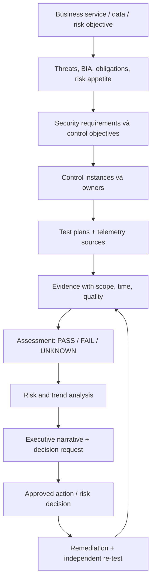
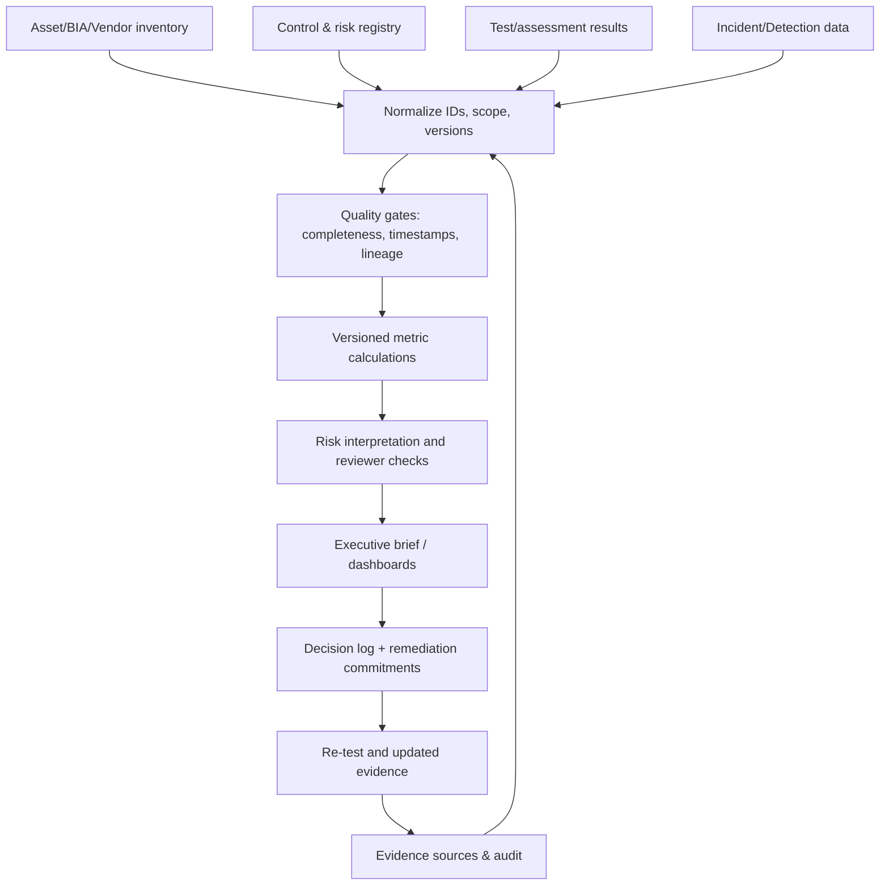

# Báo cáo lãnh đạo: Chuyển bằng chứng security assurance thành quyết định quản trị

## 1. Mục tiêu học tập

Sau bài học, người học có thể:

- Giải thích mục đích của **báo cáo lãnh đạo** trong chương trình **security assurance** và phân biệt nó với dashboard vận hành, báo cáo kỹ thuật, kiểm toán, báo cáo tuân thủ và hồ sơ ứng phó sự cố.
- Xác định **người nhận, câu hỏi quyết định, phạm vi, kỳ báo cáo, ngưỡng rủi ro, người sở hữu và mức tin cậy** trước khi chọn biểu đồ hoặc KPI.
- Tổ chức một **executive summary** ngắn gọn, có thông điệp chính, thay đổi so với kỳ trước, rủi ro đáng kể, độ tin cậy của bằng chứng, phương án xử lý và **quyết định cần lãnh đạo đưa ra**.
- Chuyển các số liệu **security objectives, risk, controls, testing, findings, exceptions, incident/detection, third-party, business continuity và compliance** thành kết luận có thể kiểm chứng.
- Phân biệt **KPI, KRI, KCI, leading/lagging indicators**, kết quả hoạt động, độ bao phủ kiểm thử và bằng chứng hiệu lực; tránh đánh đồng “có control”, “đã kiểm” và “đã chứng minh đạt”.
- Thiết kế định nghĩa metric đầy đủ: **tử số, mẫu số, cohort, phạm vi, thời gian, nguồn, freshness, cách xử lý UNKNOWN, threshold, owner và công thức tổng hợp**.
- Nhận diện các cách báo cáo gây hiểu sai: mẫu số thay đổi, nhiều trạng thái chưa kiểm, so sánh sai kỳ, chỉ số trung bình che đuôi rủi ro, điểm tổng hợp giả chính xác và dashboard “xanh” khi mất telemetry.
- Thiết kế **decision log**, bảng remediation, nguyên tắc escalation, chu kỳ cập nhật và kiểm chứng sau khắc phục.
- Xây dựng bản báo cáo minh họa cho hội đồng quản trị, ban điều hành hoặc chủ dịch vụ, với dữ liệu có thể truy ngược đến các control tests và findings.

Bài thuộc chương **Metrics và reporting** của dịch vụ `SECURITY_SECURITY_ASSURANCE`. Dịch vụ này đào tạo cách đánh giá **có bằng chứng** rằng hệ thống đáp ứng mục tiêu bảo mật, từ phân tích rủi ro, yêu cầu và security controls đến kiểm thử, audit và khắc phục phát hiện; hoạt động assurance diễn ra liên tục trong phát triển và vận hành.

Với chủ đề **Báo cáo lãnh đạo**, mục tiêu không phải tạo càng nhiều biểu đồ càng tốt. Điều cần đạt là **tạo một căn cứ ra quyết định trung thực, đúng phạm vi, có thể kiểm toán và dẫn đến hành động cụ thể**.

## 2. Báo cáo lãnh đạo là gì và vì sao khác báo cáo kỹ thuật?

**Báo cáo lãnh đạo** là sản phẩm truyền thông quản trị tổng hợp các kết quả security assurance để hỗ trợ người có thẩm quyền **hiểu trạng thái rủi ro, đánh giá mức bảo đảm, quyết định ưu tiên và phân bổ nguồn lực**.

Một kỹ sư có thể cần biết tên IAM role, event parser, địa chỉ asset, false-positive cause và dòng cấu hình. Một thành viên ban điều hành thường cần biết:

- **Điều gì quan trọng?** Dịch vụ, dữ liệu, khách hàng hoặc nghĩa vụ nào đang chịu rủi ro?
- **Trạng thái hiện tại?** Control nào đã được kiểm đạt, không đạt hoặc chưa có đủ bằng chứng?
- **Có gì thay đổi?** Rủi ro tăng/giảm thật hay phép đo và phạm vi thay đổi?
- **Tổ chức có đang trong ngưỡng chấp nhận rủi ro?** Ngưỡng nào do ai phê duyệt?
- **Hành động đang diễn ra có đủ?** Chủ sở hữu, mốc xử lý, bằng chứng xác nhận sau sửa?
- **Cần quyết định gì ngay?** Cấp nguồn lực, ưu tiên backlog, chấp nhận rủi ro có điều kiện, tạm dừng release hoặc thay đổi chiến lược?
- **Chúng ta chắc đến đâu?** Bằng chứng có mới, đủ và đại diện cho toàn phạm vi hay không?

### 2.1. Khác biệt theo loại sản phẩm

| Sản phẩm | Người đọc chủ yếu | Mục đích | Mức chi tiết |
|---|---|---|---|
| **Operational dashboard** | SOC, SRE, platform/security engineering | Hành động tại thời điểm gần thực | Event, asset, alert, latency, queue |
| **Technical assurance report** | Control owner, assessor, auditor kỹ thuật | Kiểm logic control/test/evidence | Phương pháp, mẫu, nguồn, lỗi, tái lập |
| **Compliance/audit package** | Internal audit, compliance, legal, đánh giá độc lập | Đối chiếu tiêu chí/điều khoản trong phạm vi | Requirement mapping, records, exceptions |
| **Executive security report** | CISO, CTO, CEO, risk committee, lãnh đạo đơn vị | Ra quyết định về tác động, ưu tiên và rủi ro tồn dư | Kết luận rõ, xu hướng, phân tích nguyên nhân, yêu cầu quyết định |
| **Board-level risk brief** | Hội đồng quản trị hoặc ủy ban rủi ro theo cấu trúc tổ chức | Giám sát quản trị, chiến lược, mức chịu đựng rủi ro | Rủi ro trọng yếu, độ tin cậy, thay đổi, phương án và cam kết |

Một tổ chức có thể có nhiều người kiêm nhiệm và yêu cầu báo cáo khác nhau. Không dùng cùng một bảng 200 controls cho mọi tầng người đọc; nhưng cũng không vì đơn giản hóa mà bỏ **không đạt**, **chưa kiểm**, **ngoại lệ** hoặc **điều kiện hạn chế kết luận**.

### 2.2. Mục tiêu là quyết định, không phải số lượng slide

Một báo cáo có ích thường giúp lãnh đạo trả lời:

> “Có nguy cơ đáng kể nào ngoài mức tổ chức cho phép, do đâu, đã được xác minh đến mức nào, phương án khắc phục nào khả thi, và tôi phải quyết định gì trước hạn nào?”

Nếu không có câu trả lời hoặc chưa rõ phần lãnh đạo có thể quyết định, báo cáo có nguy cơ chỉ là **một dashboard kỹ thuật được thu nhỏ**.

## 3. Xác định người nhận và quyết định trước khi chọn metric

Mỗi cấp lãnh đạo có phạm vi trách nhiệm khác nhau; một báo cáo tốt không bắt người đọc tự suy ra hành động.

### 3.1. Ma trận người nhận

| Người nhận | Câu hỏi thường quan tâm | Nội dung ưu tiên | Quyết định điển hình |
|---|---|---|---|
| Hội đồng quản trị / risk committee | Rủi ro có phù hợp appetite và chiến lược? | Top enterprise risks, exceptions trọng yếu, readiness và xu hướng | Chấp thuận giới hạn rủi ro, đầu tư chiến lược, giám sát tiến độ |
| CEO / Ban điều hành | Dịch vụ và khách hàng nào có nguy cơ gián đoạn/tổn thất? | Tác động kinh doanh, hành động cấp tổ chức | Ưu tiên giữa các chương trình, điều phối liên phòng ban |
| CISO / Security leadership | Controls có hiệu lực và coverage đủ không? | Risk/control posture, source health, testing, findings | Sửa rule/architecture, tăng kiểm tra, xử lý rủi ro |
| CTO / CIO | Khả năng thay đổi nền tảng và giới hạn nguồn lực? | Platform dependencies, IAM, DR, technical debt | Phân bổ engineering capacity, thay đổi roadmap |
| Product/business owner | Dịch vụ của mình đã đạt assurance target? | User journey, customer impact, service-specific control gaps | Giới hạn tính năng, ưu tiên khắc phục |
| Legal/compliance leadership | Nghĩa vụ nào có thể không đáp ứng và cần xử lý? | Applicability, evidence, exceptions và deadline | Đánh giá nghĩa vụ, yêu cầu kiểm chứng, chỉ đạo báo cáo theo thẩm quyền |

Tư cách pháp lý và quyền phê duyệt khác nhau giữa tổ chức. Báo cáo phải dựa trên **decision rights thực tế** đã được quy định, không tự gán thẩm quyền pháp lý hoặc chấp nhận rủi ro cho một chức danh.

### 3.2. Khung câu hỏi chuẩn

Trước khi tạo báo cáo, trả lời:

1. **Audience:** ai đọc và họ có thẩm quyền gì?
2. **Decision:** quyết định nào cần được đưa ra trong kỳ?
3. **Time horizon:** điều gì cần trong 24 giờ, 30 ngày, 90 ngày hoặc năm?
4. **Risk appetite:** ngưỡng nào đã được duyệt và thay đổi do ai?
5. **Scope:** business services, tài sản, dữ liệu, region và bên thứ ba nào?
6. **Evidence strength:** nguồn và phép kiểm nào đủ để kết luận?
7. **Sensitivity:** người đọc được phép xem dữ liệu chi tiết đến mức nào?
8. **Follow-up:** ai sẽ theo dõi quyết định, hạn và re-test?

Một báo cáo tháng có thể dùng chung số liệu cơ sở với dashboard hằng ngày, nhưng cách tổng hợp và câu hỏi **quản trị** phải được thiết kế riêng.

## 4. Hợp đồng thông tin giữa đội assurance và lãnh đạo

Một khung báo cáo cần thỏa thuận không chỉ định dạng mà cả **ngữ nghĩa và chất lượng dữ liệu**.

### 4.1. Những cam kết nên có

- **Reporting scope:** những dịch vụ, accounts, vendors và nghĩa vụ được theo dõi.
- **Reporting period:** mốc bắt đầu/kết thúc và timezone, không dùng “tháng này” mơ hồ.
- **Data cutoff:** thời điểm khóa dữ liệu để lập báo cáo; phát hiện sau cutoff xử lý thế nào?
- **Metric dictionary:** định nghĩa các chỉ số, đơn vị, cohort và công thức tổng hợp.
- **Evidence standard:** yêu cầu về nguồn, phạm vi, độ mới, integrity và người phê duyệt.
- **Unknowns policy:** cách báo cáo chưa kiểm, mất logs, thiếu owner, chưa rõ applicability.
- **Materiality threshold:** vấn đề nào phải nổi bật, được chuyển cấp xử lý hoặc báo ngoài chu kỳ?
- **Approval chain:** ai tổng hợp, kiểm dữ liệu, duyệt nội dung và chịu trách nhiệm quyết định.
- **Confidentiality:** mức phân quyền với rủi ro, dữ liệu khách hàng, cấu hình bảo mật.
- **Revision policy:** khi sửa báo cáo kỳ trước phải giữ số phiên bản và lý do.

### 4.2. Hai nguyên tắc quan trọng

**Không biết không có nghĩa là an toàn.** Khi một control chưa được kiểm hoặc log pipeline hỏng, báo cáo nên thể hiện `UNKNOWN` hoặc `NOT_TESTED`, không tự chuyển thành `PASS`.

**Có triển khai không đồng nghĩa có hiệu lực.** Một hệ thống “có MFA”, “có backup”, “có SIEM” chưa chứng minh những chức năng đó hoạt động trên đúng population trong kỳ và đáp ứng security objective.

## 5. Chuỗi truy vết từ rủi ro đến quyết định

Báo cáo lãnh đạo trong security assurance không được tách khỏi các security objectives và bằng chứng vận hành.



### 5.1. Mỗi thông điệp cần một “đường chứng minh”

Ví dụ kết luận:

> “Khả năng khôi phục dịch vụ đặt hàng chưa đạt mục tiêu.”

Cần truy ngược được:

- **Business service:** Checkout, định nghĩa minimum service.
- **Objective:** RTO và RPO theo BIA có phiên bản.
- **Scope:** môi trường, regions và các luồng giao dịch cần khôi phục.
- **Control:** backup, restore, IAM/KMS, network, security recovery gates.
- **Test:** DR exercise theo kịch bản và phương pháp đã duyệt.
- **Observed:** thời gian khôi phục, dữ liệu mất, kết quả đối soát và log.
- **Decision:** cần sửa gì, chủ sở hữu, hạn, cách chứng minh lại.

Một ô đỏ không có đường truy vết chỉ làm người đọc lo ngại; một đường link dài tới raw logs mà không có kết luận cũng không hỗ trợ quyết định.

### 5.2. Phân biệt evidence, inference và recommendation

- **Observed fact:** “Bài diễn tập DR-04 mất 84 phút để xác minh minimum service.”
- **Interpretation:** “Kết quả này vượt RTO mục tiêu 60 phút của dịch vụ trong phạm vi bài thử.”
- **Risk implication:** “Nếu xảy ra gián đoạn tương tự và các điều kiện không thay đổi, có nguy cơ không đạt yêu cầu liên tục kinh doanh.”
- **Recommendation:** “Ưu tiên sửa quyền KMS phục hồi và thử lại đường găng.”
- **Decision requested:** “Phê duyệt phân bổ nhóm platform/data trong chu kỳ tới và mốc nghiệm thu theo bài test.”

Không trình bày giả định thành fact hoặc dùng test staging để khẳng định chắc chắn production sẽ thất bại/đạt trong mọi tình huống.

## 6. KPI, KRI, KCI và chỉ số leading/lagging

Một report trưởng thành dùng các nhóm metric khác nhau; không nên gộp chúng thành một điểm “security score” tùy ý.

| Loại | Trả lời | Ví dụ | Giới hạn |
|---|---|---|---|
| **KPI – Key Performance Indicator** | Chương trình vận hành hiệu quả đến đâu? | Tỷ lệ bài kiểm thực hiện đúng kỳ, remediation lead time | Hoàn thành công việc chưa chắc giảm rủi ro |
| **KRI – Key Risk Indicator** | Dấu hiệu nào cho thấy nguy cơ vượt appetite? | Số dịch vụ critical còn SPOF chưa xử lý, privileged access ngoài baseline | Cần giải thích liên hệ với rủi ro thực |
| **KCI – Key Control Indicator** | Control cụ thể đang vận hành tốt không? | Tỷ lệ IAM grants có approval hợp lệ, audit source health | Chỉ có ý nghĩa theo scope/evidence |
| **Leading indicator** | Dấu hiệu trước khi có hậu quả | Drift, missing control tests, tăng exposed admin permissions | Không tự dự đoán chính xác sự cố |
| **Lagging indicator** | Kết quả đã xảy ra | Incidents, data loss, sự cố recovery, tổn thất đo được | Có thể bị ảnh hưởng bởi khả năng phát hiện |
| **Assurance coverage indicator** | Đã kiểm được bao nhiêu của phạm vi cần kiểm? | 24/40 dịch vụ critical đã DR drill | Coverage không phải pass rate |
| **Data-quality indicator** | Số liệu có đủ tin cậy không? | Telemetry missing, unknown owner, stale evidence | Không nên biến thành chỉ số trang trí |

**KPI “số vulnerability đã đóng”** có thể tăng khi đội xử lý nhiều lỗi thấp, trong lúc một quyền cloud admin rộng tồn tại. KRI và bảng material findings phải phản ánh **tác động**, không chỉ năng suất xử lý.

### 6.1. Không dùng một số làm đại diện cho “độ an toàn”

Có thể hữu ích khi lập một scorecard tổng quan, nhưng phải nêu:
- Phương pháp đánh trọng số và cơ sở quyết định.
- Những **hard gates** không thể được “bù điểm” bằng chỉ số khác.
- Phần ngoài phạm vi hoặc UNKNOWN không bị bỏ qua.
- Nhạy cảm của kết quả khi thay trọng số/cohort.
- Lý do metric tương quan với security objectives.

Nếu một dịch vụ xử lý dữ liệu nhạy cảm chưa đạt IAM protection, số lượng policy documents khác không thể làm rủi ro đó biến mất qua phép cộng điểm.

## 7. Tách coverage, effectiveness và compliance conclusion

Ba câu hỏi thường bị gộp nhầm:

1. **Có control được thiết kế/triển khai không?**
2. **Control có được kiểm trong kỳ và có evidence đáng tin không?**
3. **Control có đạt tiêu chí và đủ để kết luận yêu cầu liên quan được đáp ứng không?**

### 7.1. Ví dụ giả định: Chương trình DR cho 40 dịch vụ critical

| Trạng thái dịch vụ | Số lượng | Tỷ lệ trên 40 |
|---|---:|---:|
| Có runbook được phê duyệt | 32 | 80% |
| Đã diễn tập trong kỳ | 24 | 60% |
| Diễn tập đạt toàn bộ gate áp dụng | 18 | 45% |
| Diễn tập không đạt | 4 | 10% |
| Đã thử nhưng thiếu bằng chứng/kết luận | 2 | 5% |
| Chưa diễn tập trong kỳ | 16 | 40% |

Trong đó 18 + 4 + 2 = 24 dịch vụ đã diễn tập; 24 + 16 = 40 dịch vụ trong phạm vi. **Không được kết luận “75% dịch vụ critical đã sẵn sàng DR” chỉ vì 18/24 bài thử đạt**, vì 16 dịch vụ chưa được thử và 2 trường hợp còn thiếu bằng chứng.

Các cách diễn đạt khác nhau:

- **Document coverage:** 32/40 = 80%.
- **Test execution coverage:** 24/40 = 60%.
- **Verified pass over total scope:** 18/40 = 45%.
- **Conditional pass among tested services:** 18/24 = 75%, *không phải tổng mức sẵn sàng*.
- **Fail among total scope:** 4/40 = 10%.
- **Unknown after test:** 2/40 = 5%.
- **Untested:** 16/40 = 40%.

Mỗi tỷ lệ phải ghi **tử số, mẫu số và đơn vị đếm**. Chưa diễn tập không phải tự động FAIL trong mọi chế độ đánh giá, nhưng rõ ràng **không được coi PASS**.

### 7.2. “Đã có chứng nhận” không bằng “đã kiểm các control instances”

Một báo cáo assurance của cloud/vendor có thể hỗ trợ phần control thuộc nhà cung cấp theo **phạm vi và kỳ báo cáo cụ thể**. Nó không mặc nhiên chứng minh IAM tenant, application, data retention và DR runbook của tổ chức đã đúng. Báo cáo lãnh đạo phải giữ **shared responsibility**, không dùng tên chứng nhận để xóa các khoảng chưa được kiểm.

## 8. Định nghĩa chỉ số trước khi làm biểu đồ

Một dashboard có thể tính đúng toán học nhưng sai **nghĩa**. Trước khi báo cáo, mỗi metric cần một **data contract** rõ.

### 8.1. Metric definition card

| Thuộc tính | Ví dụ |
|---|---|
| `metric_id` | `ASSURANCE_CRITICAL_DR_PASS_COVERAGE` |
| `business_question` | Có bao nhiêu dịch vụ critical được xác minh khả năng DR trong kỳ? |
| `decision_owner` | Head of Technology Risk |
| `unit_of_analysis` | Một business service theo BIA, không phải một test run |
| `population` | Các dịch vụ critical thuộc scope tại cutoff |
| `numerator` | Dịch vụ có bài drill hợp lệ đạt mọi gate bắt buộc |
| `denominator` | Tất cả dịch vụ critical thuộc scope |
| `cohort_rule` | Danh sách baseline tại ngày cuối kỳ |
| `period` | Tháng/quý với timezone và cutoff |
| `source_systems` | BIA register, exercise records, security gate checks |
| `unknown_policy` | Unknown/untested không tính PASS, báo tách |
| `deduplication` | Dùng service ID ổn định, chọn assessment mới nhất đủ điều kiện |
| `freshness_rule` | Re-test sau thay đổi ảnh hưởng hoặc khi quá hạn |
| `thresholds` | Dựa risk appetite và kế hoạch phê duyệt, không bịa |
| `metric_owner` | BCM/assurance data owner |
| `reviewer` | Assurance lead độc lập theo quy trình |
| `version` | `v1.2` |
| `limitations` | Không tự suy rộng drill staging thành DR toàn production |

### 8.2. Tại sao cần version?

Nếu kỳ trước tính “số dịch vụ có DR plan” và kỳ này tính “số dịch vụ đã chạy DR exercise thành công”, hai số không phải cùng KPI. Một cải thiện/giảm sút có thể đến từ **đổi định nghĩa**, chứ không phải thay đổi năng lực.

Mỗi phiên bản phải lưu:
- Ngày áp dụng và owner phê duyệt.
- Thay đổi logic.
- Ảnh hưởng tới chuỗi thời gian lịch sử.
- Quy tắc restatement nếu tính lại.
- Tương thích giữa các báo cáo cũ và mới.

## 9. Mẫu số, cohort và thay đổi phạm vi

Một tổ chức có thể thêm cloud accounts, dịch vụ hoặc vendors giữa hai kỳ. Khi đó việc giữ nguyên mẫu số cũ có thể khiến dashboard đẹp giả; việc chỉ hiển thị % mà không nêu số lượng cũng che biến động.

### 9.1. Ví dụ denominator drift

Giả sử:

- Quý A có **50** dịch vụ trong scope, **40** được kiểm đạt → **80%**.
- Quý B thêm 20 dịch vụ mới; tổng **70**, trong đó **49** được kiểm đạt → **70%**.

Tỷ lệ giảm từ 80% xuống 70%, dù số dịch vụ đạt **tăng từ 40 lên 49**. Không nên kết luận ngay team làm kém đi; cần xem **scope expansion** và chất lượng onboard các dịch vụ mới.

Ngược lại, nếu loại những dịch vụ có risk cao khỏi mẫu số mà không có lý do hợp lệ, tỷ lệ có thể tăng giả.

### 9.2. Cách trình bày thay đổi công bằng

- Nêu **N tuyệt đối** và tỷ lệ mỗi kỳ.
- Tách **like-for-like cohort** (tập dịch vụ giống nhau giữa kỳ A và B).
- Tách **newly onboarded** và **retired services**.
- Nếu mục tiêu áp dụng cho toàn phạm vi hiện hành, vẫn báo **current-scope number**.
- Không âm thầm chuyển các dịch vụ mới sang nhóm ngoài scope chỉ để KPI đạt target.
- Đối chiếu BIA/asset registry để đảm bảo population không bị thiếu.

### 9.3. Nguyên tắc không suy rộng thống kê

Một mẫu 5 dịch vụ hoặc 3 incidents có thể cho phần trăm trông chính xác tới một chữ số thập phân, nhưng thiếu độ ổn định và chưa đại diện toàn bộ hệ thống. Báo cáo nên ghi **N**, phương pháp chọn mẫu, thời kỳ và giới hạn suy rộng. Với dữ liệu ít, ưu tiên **case cụ thể và quyết định** thay vì điểm xếp hạng.

## 10. Báo cáo UNKNOWN, NOT_TESTED, EXCEPTION và dữ liệu thiếu

Phần chưa biết thường quan trọng bằng phần biết, đặc biệt trong security assurance.

### 10.1. Phân biệt các trạng thái

| Trạng thái | Ý nghĩa | Cách trình bày |
|---|---|---|
| `PASS` | Control/requirement đã được kiểm đạt trong scope/kỳ cụ thể | Ghi bằng chứng và giới hạn |
| `FAIL` | Có bằng chứng điều kiện bắt buộc không đạt | Gắn finding, tác động, owner, hạn |
| `UNKNOWN` | Không đủ bằng chứng để kết luận | Nêu nguồn thiếu, phương án thu/kiểm |
| `NOT_TESTED` | Chưa thực hiện phép kiểm trong kỳ | Tách coverage gap và lý do |
| `NOT_APPLICABLE` | Điều kiện không áp dụng, có căn cứ và phê duyệt | Nêu quy tắc phạm vi và người duyệt |
| `PENDING_VALIDATION` | Đã sửa/thực hiện nhưng chưa re-test | Không tính như PASS |
| `EXCEPTION_APPROVED` | Rủi ro còn lại được chấp nhận có điều kiện và thẩm quyền | Hiển thị owner, expiry, compensating controls |
| `STALE_EVIDENCE` | Bằng chứng không còn phù hợp thời gian/thay đổi | Yêu cầu kiểm mới, không dùng cho PASS hiện hành |

Không chuyển `UNKNOWN` thành `NOT_APPLICABLE`; không chuyển `EXCEPTION_APPROVED` thành `PASS`; và không lấy việc ticket đóng làm bằng chứng control đã có hiệu lực.

### 10.2. Quy tắc tổng hợp an toàn

Với một dịch vụ phải đạt **ba security gates bắt buộc**, có thể dùng quy tắc:

- Nếu có gate `FAIL` → dịch vụ **không đạt yêu cầu tổng hợp**.
- Nếu không có FAIL nhưng có gate `UNKNOWN`, `NOT_TESTED` hoặc `STALE_EVIDENCE` → **chưa đủ cơ sở PASS**.
- Chỉ khi mọi gate áp dụng đã `PASS` → được kết luận PASS **trong phạm vi phép kiểm**.
- Nếu có exception, phải xử lý theo **chính sách nguồn yêu cầu**; không giả định ngoại lệ nội bộ xóa nghĩa vụ pháp lý/hợp đồng.

Đó là quy tắc ví dụ cho **hard-gate assurance assessment**, không phải một thuật toán áp dụng cho mọi hệ thống hoặc tiêu chuẩn.

### 10.3. Data-quality degradation là một rủi ro báo cáo

Nếu collector của 3/20 cloud accounts production không gửi audit, số “không phát hiện hành vi nguy hiểm” ở những accounts đó không thể được coi bằng chứng hệ thống an toàn. Cần đưa **telemetry health** vào báo cáo và đánh dấu kết luận phụ thuộc nguồn log đó là **limited hoặc UNKNOWN**.

## 11. Ngưỡng rủi ro, materiality và cách diễn giải đèn trạng thái

Một dashboard thường dùng màu hoặc biểu tượng để giúp nhận diện mức ưu tiên. Nhưng **màu không phải sự thật**, mà là kết quả đánh giá theo ngưỡng đã được phê duyệt.

### 11.1. Định nghĩa ngưỡng

Cần phân biệt:

- **Risk appetite:** loại/mức rủi ro tổ chức sẵn sàng chấp nhận để đạt mục tiêu.
- **Risk tolerance:** độ dao động/giới hạn thực tế đối với một chỉ tiêu hay quy trình.
- **Control threshold:** ngưỡng hoạt động hoặc mục tiêu phép kiểm.
- **Materiality:** tác động/điều kiện đủ quan trọng để báo cáo/escalate lên cấp có thẩm quyền.
- **Escalation threshold:** điều kiện yêu cầu thông báo hoặc quyết định ngoài chu kỳ.
- **Evidence threshold:** điều kiện tối thiểu để coi một kết luận được kiểm chứng.

Các ngưỡng phải có **owner và phương pháp xác lập**. Không tự bịa “vulnerability critical phải sửa trong 7 ngày” hoặc “MTTD dưới 10 phút là an toàn” nếu tổ chức chưa xác nhận.

### 11.2. Gợi ý nhóm trạng thái trên báo cáo

| Nhóm biểu thị | Ý nghĩa cần ghi | Chú ý |
|---|---|---|
| Đạt | Evidence xác nhận đáp ứng tiêu chí trong phạm vi | Có thể cần revalidation sau thay đổi |
| Cần theo dõi | Có xu hướng xấu hoặc nguy cơ gần ngưỡng | Không đồng nhất với control failure |
| Vượt ngưỡng | Có bằng chứng rủi ro/control không đáp ứng | Kèm owner, tác động và quyết định |
| Chưa đủ dữ liệu | Missing/untested/stale hoặc scope bất định | Không làm trạng thái trông “tốt” hơn |
| Ngoại lệ có phê duyệt | Sai lệch có thẩm quyền chấp thuận còn hiệu lực | Không xóa nghĩa vụ và residual risk |

**Một điểm đỏ cho control trọng yếu có thể quan trọng hơn 100 điểm xanh cho controls ít liên quan.** Bản báo cáo lãnh đạo phải có **material risks và hard gates**, không chỉ tổng số trạng thái.

## 12. Chọn các chỉ số đáng đưa lên cấp lãnh đạo

Không cần mang tất cả operational telemetry lên một trang. Chọn metric theo **mục tiêu rủi ro và quyết định**.

### 12.1. Scorecard mẫu theo các miền bảo đảm

| Miền | Chỉ số trọng tâm | Câu hỏi lãnh đạo |
|---|---|---|
| Risk management | High/critical residual risks vượt tolerance; tuổi ngoại lệ | Rủi ro trọng yếu còn ai chịu và bao lâu? |
| Security objectives | Dịch vụ critical có assurance claims đã kiểm | Chúng ta đã chứng minh bảo vệ được năng lực nào? |
| Identity/access | Privileged grants ngoài approval; review coverage | Có đường chiếm quyền chưa được kiểm soát? |
| Data protection | Encryption/key access test; data access exceptions | Dữ liệu quan trọng có được bảo vệ thực? |
| Vulnerability/patch | Critical findings quá hạn theo policy và exposure | Điểm yếu nào đang có khả năng bị khai thác? |
| Detection | Coverage, test detection rate, MTTD cùng N/missing | Những tình huống nguy hiểm có được nhìn thấy đủ sớm? |
| Incident response | Time to contain, backlog, lessons re-tested | Tổ chức có giảm thiểu thiệt hại và học được từ sự cố? |
| Business continuity/DR | Services có drill PASS, RTO/RPO gap, recovery dependencies | Năng lực nghiệp vụ có thể phục hồi trong mục tiêu? |
| Third-party assurance | Critical vendors có review, gaps và exit readiness | Phụ thuộc bên ngoài nào vượt tolerance? |
| Compliance assurance | Applicable requirements có evidence đủ, FAIL/UNKNOWN | Nghĩa vụ nào chưa được chứng minh? |
| Secure delivery | Policy-as-code failures, drift, time to revalidation | Thay đổi hệ thống có làm mất assurance trước đó? |
| Evidence/data quality | Source health, stale evidence, untested scope | Có đáng tin vào những số liệu trên trang này không? |

### 12.2. Giới hạn số chỉ số trên trang đầu

Trang đầu thường nên ưu tiên **vài thông điệp/metric thực sự gắn quyết định**, phần còn lại có thể đặt trong phụ lục có thể truy xuất. Không có số lượng KPI tối ưu áp dụng mọi doanh nghiệp; chất lượng dựa trên **sự liên quan, tính đúng và mức hành động**, không theo một quota về biểu đồ.

### 12.3. Leading và lagging phải đi cùng nhau

Ví dụ “đã triển khai thêm 20 detection rules” là **output**, không chắc là outcome. Có thể đi cùng:
- 20 rules đã được kiểm **precision/recall**?
- Threat coverage tăng ở các tài sản quan trọng?
- False positives và MTTA có xấu đi?
- Những incidents hoặc các kịch bản purple-team có được phát hiện sớm hơn không?
- Đã giải quyết data gaps/telemetry health chưa?

Một cải tiến đáng tin có **cơ chế nguyên nhân** và phép kiểm sau thay đổi, không chỉ số lượng cấu hình mới.

## 13. Báo cáo sự cố và detection ở mức lãnh đạo

Sự cố là chủ đề nhạy cảm vì số lượng được quan sát phụ thuộc năng lực phát hiện và quy tắc phân loại.

### 13.1. Những chỉ số nên gắn ngữ cảnh

- Incidents theo mức ảnh hưởng nghiệp vụ đã xác nhận, không chỉ alert count.
- Dữ liệu/tài sản chịu tác động theo phạm vi có chứng cứ.
- Time to detect (MTTD) theo mốc định nghĩa và **N valid/unknown**.
- Time to acknowledge/triage/contain theo nghĩa và mốc riêng.
- Tỷ lệ kịch bản detection được kiểm phát hiện trong cửa sổ mục tiêu.
- Telemetry coverage và những khoảng mất quan sát.
- Repeat incidents, root-cause themes và chất lượng khắc phục sau re-test.

### 13.2. Vì sao “số incident tăng” chưa đủ để kết luận xấu đi?

Số incident quan sát tăng có thể do:
- Tấn công/sự kiện thực tăng.
- Detection coverage tăng và phát hiện trước đây bị bỏ sót.
- Quy tắc phân loại incident được mở rộng.
- Asset scope và số người dùng tăng.
- Alert deduplication hoặc reporting pipeline thay đổi.

Phải phân tích **điều gì thay đổi trong cohort và hệ thống đo** trước khi gắn xu hướng vào rủi ro thực.

### 13.3. Tránh dùng MTTD thấp đơn độc

Nếu rule mới chỉ phát hiện những kịch bản rất dễ, MTTD trên tập detected giảm nhưng **detection rate** cũng giảm, lãnh đạo có thể bị dẫn tới quyết định sai. Tập số liệu nên báo **mean/median/p90, sample size, coverage, test rate và source health**.

Một case critical chưa phát hiện trong bài test đã duyệt phải được làm nổi bật theo rủi ro, không bị làm lu mờ bởi MTTD trung bình tốt.

## 14. Báo cáo findings, control gaps và rủi ro tồn dư

Nhóm báo cáo này giúp lãnh đạo biết công việc nào **chưa được khắc phục có kiểm chứng**.

### 14.1. Phân biệt những loại finding

| Loại | Ví dụ | Điều phải thông báo |
|---|---|---|
| **Design gap** | Control thiếu bước phê duyệt IAM | Rủi ro dù hệ thống đang chạy bình thường |
| **Implementation gap** | Một cloud account thiếu audit collector | Phạm vi thiếu bảo vệ |
| **Operating failure** | Permission review đã lên lịch nhưng không được thực hiện | Control không có hiệu lực trong kỳ |
| **Evidence gap** | Không thể thu log cho một loại admin action | Chưa thể kết luận |
| **Coverage gap** | Dịch vụ mới chưa được onboarding vào assurance | Mẫu số và scope thay đổi |
| **Stale assessment** | Test trước release lớn không được re-run | Kết luận hiện tại có thể vô hiệu |
| **Vendor gap** | Không có bằng chứng scope/notice từ nhà cung cấp | Mức phụ thuộc và unknowns |
| **Remediation verification gap** | Ticket đóng nhưng quyền hiệu lực chưa được rechecked | Chưa đủ cơ sở đóng finding |

### 14.2. Finding register cho báo cáo lãnh đạo

| Finding | Tác động | Owner | Hạn | Trạng thái | Bằng chứng/điều kiện đóng |
|---|---|---|---|---|---|
| `F-001`: quyền admin vượt baseline | Privileged compromise path | IAM platform | Theo plan phê duyệt | OPEN | Effective permissions và negative test |
| `F-002`: audit không bao phủ cluster mới | Mất khả năng phát hiện/điều tra | Platform logging | Theo plan | BLOCKED | End-to-end audit canary |
| `F-003`: DR restore không đạt RTO | Không đáp ứng mục tiêu nghiệp vụ | Data/DR lead | Theo BIA priority | RETEST_PENDING | Integrated recovery exercise |
| `F-004`: vendor contact đã lỗi thời | Thông báo sự cố có thể bị trễ | Vendor management | Theo risk tier | ACTION_TAKEN | Contact drill và acknowledgment |

Các trường là ví dụ. **Không dùng “FIXED” nếu mới merge cấu hình; phải ghi “PENDING_VALIDATION” cho tới khi kiểm runtime đạt**.

### 14.3. Aging không chỉ là số ngày

Một finding tồn tại 10 ngày trên dịch vụ nhiều dữ liệu nhạy cảm có thể nghiêm trọng hơn finding 60 ngày trên tài sản ít tác động. Nên báo theo **materiality**, thời gian vượt hạn và mức phơi lộ, không ưu tiên chỉ dựa số ngày mở ticket.

## 15. Báo cáo compliance: Yêu cầu, phạm vi và mức đủ bằng chứng

Security assurance có thể hỗ trợ compliance nhưng **kết quả mapping không phải chứng nhận tuân thủ**.

### 15.1. Các trạng thái cần được phân biệt

- Requirement có **áp dụng** hay chưa được đánh giá applicability?
- Có mapping tới control hay còn **mapping gap**?
- Control đã **triển khai** đúng asset scope?
- Test có **bằng chứng hiện hành** và phù hợp kỳ đánh giá?
- Requirement **đạt/chưa đạt/chưa đủ cơ sở kết luận** theo phương pháp?
- Có ngoại lệ được chấp thuận đúng thẩm quyền và trong thời hạn?
- Nguồn nghĩa vụ/phiên bản/hợp đồng có thay đổi không?

Không báo “100% compliant” chỉ vì đã map đủ 100/100 requirements sang controls. Báo đúng có thể là “mapping coverage 100%; operating effectiveness validated 72%; 12% failed; 16% insufficient evidence”, **nếu các tử số/mẫu số và trạng thái đã được kiểm**.

### 15.2. Ranh giới nhận định pháp lý

Phạm vi của yêu cầu pháp lý, thời điểm thông báo, quyền của chủ thể dữ liệu và cách chấp nhận biện pháp bù trừ có thể phụ thuộc vào luật/hợp đồng/chủ thể. Đội kỹ thuật phải cung cấp evidence và nêu khoảng trống; **bộ phận có thẩm quyền** đánh giá kết luận pháp lý, không suy diễn từ điểm dashboard.

## 16. Báo cáo third-party, cloud và dependency risk

Báo cáo lãnh đạo cần thể hiện **nguy cơ bên ngoài tổ chức vẫn ảnh hưởng dịch vụ và dữ liệu của mình**, đồng thời tránh coi mọi sự cố vendor đều là sự cố dữ liệu tại doanh nghiệp.

### 16.1. Chỉ số và thông điệp phù hợp

- Dịch vụ critical phụ thuộc vendor có kiểm inventory/owner/contract.
- Vendor có quyền đặc quyền, khả năng xử lý dữ liệu nhạy cảm hoặc liên quan quy trình trọng yếu.
- Những nhà cung cấp thiếu evidence về controls trong scope của họ.
- Cơ chế thông báo incident đã được thử, điểm liên hệ còn hiệu lực.
- Vendor incident đang xảy ra, mức tác động **đã xác nhận**, **có thể**, **chưa xác định**.
- Khả năng degraded mode, data export và exit/failover đã được kiểm.
- Tập trung rủi ro vào cùng cloud, IdP, payment rail hoặc subprocessor.

### 16.2. Không hiểu sai assurance artifacts của provider

Một cloud security report hoặc chứng nhận chỉ có ý nghĩa trong **phạm vi, kỳ và criteria được đánh giá**. Các customer controls như tenant IAM, network, logging, backup key access và ứng dụng vẫn cần kiểm độc lập. Nếu báo cáo lãnh đạo nêu “cloud đã được chứng nhận”, phải giải thích nó **không thay thế** phần nghĩa vụ customer cần thực hiện.

### 16.3. Ví dụ material supplier risk

Tổ chức có hai nhà cung cấp thông báo độc lập trên hợp đồng nhưng cả hai cùng dựa vào một dịch vụ identity toàn cục. Một outage IdP có thể ảnh hưởng cả hai; **số lượng hợp đồng** không chứng minh tính độc lập phục hồi. Báo cáo nên nêu shared dependency, tác động tới BIA, evidence failover và quyết định về architecture hoặc degraded mode.

## 17. Báo cáo DR/BCP và khả năng phục hồi nghiệp vụ

Trong security assurance, resilience phải được kiểm bằng **nghiệp vụ và bảo mật**, không chỉ bằng khả năng bật server.

### 17.1. Những câu hỏi lãnh đạo cần thấy

- Dịch vụ trọng yếu nào có **RTO/RPO được phê duyệt và còn hiệu lực**?
- Bao nhiêu dịch vụ có dependency map và recovery runbook?
- Bao nhiêu đã diễn tập **end-to-end** trong kỳ?
- Bao nhiêu đạt minimum service, data integrity và các security gates?
- Có **single point of failure** hoặc shared identity/KMS/DNS chưa xử lý?
- Backups có thể restore tại recovery region và có quyền giải mã?
- Khả năng failover, failback và capacity đã được kiểm với tải nào?
- Ngoại lệ vượt RTO/RPO được phê duyệt đúng thẩm quyền chưa?

### 17.2. Mẫu kết luận có phạm vi

> “Trong 40 dịch vụ critical thuộc scope BIA kỳ này, 24 dịch vụ có bài diễn tập DR trong kỳ. Có 18 dịch vụ đạt tất cả tiêu chí áp dụng, 4 không đạt và 2 chưa đủ bằng chứng; 16 dịch vụ chưa diễn tập. Kết quả hiện tại chưa chứng minh toàn bộ danh mục critical services đạt mục tiêu phục hồi. Rủi ro trọng yếu tập trung ở quyền KMS vùng dự phòng và thứ tự khôi phục dữ liệu.”

Đó là ví dụ **đúng phạm vi số liệu giả định**, không phải kết quả của hệ thống thực.

## 18. Một trang báo cáo điều hành: Cấu trúc khuyến nghị

Trang đầu nên cho phép người đọc nhận ra **rủi ro, bằng chứng và quyết định**, trước khi xem phụ lục.

### 18.1. Khung một trang

1. **Tiêu đề và phạm vi:** thời kỳ, các dịch vụ và cutoff.
2. **Overall assessment có giới hạn:** trạng thái theo ngưỡng đã phê duyệt, không tự viết “secure”.
3. **Ba thông điệp trọng yếu:** đã thay đổi gì, nguyên nhân nào quan trọng.
4. **Top material risks:** tác động, khả năng, mức tin cậy, owner và kế hoạch.
5. **KPI/KRI tối thiểu:** hiển thị N, % và chiều so sánh nhất quán.
6. **Evidence confidence:** telemetry, coverage và phần unknown.
7. **Decisions required:** ai quyết định, phương án, hạn và hệ quả nếu không quyết định.
8. **Commitments:** actions đã nhận, mốc kiểm lại, người báo cáo tiếp.
9. **References:** mã finding, source dashboard, evidence package và phụ lục.

### 18.2. Mẫu executive brief giả lập

```text
SECURITY ASSURANCE — EXECUTIVE BRIEF
Kỳ: 01–30/11/2026 UTC
Phạm vi: 40 dịch vụ critical theo BIA (scope version: BIA-2026-Q4)
Cutoff: 01/12/2026 06:00 UTC
Trạng thái: CHƯA ĐỦ CƠ SỞ XÁC NHẬN TOÀN BỘ PHẠM VI ĐẠT

Thông điệp 1 — DR:
  24/40 dịch vụ đã diễn tập trong kỳ.
  18 PASS; 4 FAIL; 2 UNKNOWN; 16 NOT_TESTED.
  2 FAIL liên quan tới KMS/restore; các nguyên nhân khác được theo dõi riêng.

Thông điệp 2 — Identity:
  Có 1 đường gán quyền production ngoài workflow được phát hiện.
  Quyền đã được hạn chế theo biên bản thay đổi; re-test hiệu lực còn chờ.
  Finding: IAM-2026-041; owner: Identity Platform.

Thông điệp 3 — Assurance coverage:
  3 account production mới chưa hoàn tất audit source validation.
  Những đánh giá phụ thuộc audit ở 3 account được gắn UNKNOWN.
  Không đưa các account đó vào numerator PASS.

Quyết định yêu cầu trước ngày đã được phê duyệt:
  A. Ưu tiên nguồn lực platform/data sửa DR key access và chạy lại drill.
  B. Ưu tiên audit onboarding các account mới trước khi mở rộng release.
  C. Xác nhận owner và thời hạn cho các ngoại lệ còn mở.

Độ tin cậy:
  DR assessment dựa trên 24 bài thử đã ghi evidence.
  Không suy rộng các kết quả này sang 16 dịch vụ chưa thử.
  Những số liệu và mã finding trên đều minh họa, không phải dữ liệu thực.
```

Một executive brief **không cần nêu tên máy chủ, account ID thực, secrets hoặc thông tin làm tăng nguy cơ bị khai thác**. Phụ lục kỹ thuật chỉ dành cho người có quyền truy cập phù hợp.

### 18.3. So sánh cách viết tốt và chưa tốt

| Chưa phù hợp | Phù hợp hơn |
|---|---|
| “Hệ thống hiện an toàn 95%” | “95/100 control instances được kiểm đạt trong kỳ; 5 chưa đạt, theo scope X và policy Y” |
| “Không có incident nên phòng vệ hiệu quả” | “Không ghi nhận incident được xác nhận trong dữ liệu hiện có; có nguồn audit thiếu tại 2 accounts” |
| “Đã sửa toàn bộ lỗ hổng” | “Đã triển khai thay đổi cho 8/8 findings; 6/8 có re-test PASS, 2 đang chờ xác minh” |
| “MTTD giảm 60%, rất tốt” | “Mean TTD giảm theo cohort đã đo; detection rate và missing cases được báo kèm” |
| “DR đạt 75%” | “18/24 bài thử đạt, tương ứng 18/40 dịch vụ critical trong tổng phạm vi; 16 chưa thử” |
| “Vendor bảo đảm không có rủi ro” | “Provider cung cấp assurance report trong scope/kỳ; controls phía customer và những phần không có evidence được đánh giá riêng” |

## 19. Viết thông điệp theo mô hình What – So what – Now what

Để tránh báo cáo thành danh sách metric, mỗi finding trọng yếu nên có ba tầng:

### 19.1. What — Điều đã quan sát

> “Bài kiểm audit tại 3 cloud accounts production mới chưa có kết quả hợp lệ, vì sự kiện từ các accounts chưa được xác nhận đến central sink.”

Đây là **fact về tình trạng kiểm chứng**, không nhất thiết khẳng định mọi audit event thực tế đều bị mất.

### 19.2. So what — Rủi ro và độ tin cậy

> “Do thiếu bằng chứng source coverage, chưa thể xác nhận detection controls có đầy đủ quan sát với các accounts đó. Các claim phụ thuộc nguồn log được đánh dấu UNKNOWN; tổ chức có nguy cơ phát hiện chậm các thay đổi IAM trái phép.”

Đây là **suy luận rủi ro có điều kiện**, được tách khỏi quan sát.

### 19.3. Now what — Quyết định và hành động

> “Đề nghị ưu tiên onboard các accounts vào audit pipeline, kiểm bằng canary end-to-end có phê duyệt trước mốc release đã định. Owner: Cloud Platform; Security Assurance sẽ review lại evidence. Nếu không thể đạt, business risk owner cần đánh giá phương án giới hạn release hoặc ngoại lệ có điều kiện.”

Một yêu cầu quyết định tốt phải nêu **lựa chọn, người quyết định, deadline, hệ quả, người thực hiện và tiêu chí chứng minh hoàn thành**.

## 20. Cách thể hiện xu hướng và tránh ngụy kết luận

Xu hướng thường có tính thuyết phục cao, vì vậy càng cần kiểm phương pháp.

### 20.1. Các loại thay đổi khác nhau

- **Real control improvement:** control được kiểm đạt trên cùng phạm vi và test tương thích.
- **Population change:** thêm/bớt assets, vendors, users hoặc incidents.
- **Metric definition change:** khác tử số, mẫu số, ngưỡng, kỳ, phương pháp percentile.
- **Measurement coverage change:** onboarding nguồn log hoặc phát hiện thêm trước đây chưa thấy.
- **Risk mix change:** cohort chuyển sang các tình huống dễ/khó hơn.
- **Data restatement:** phát hiện bổ sung bằng chứng làm thay đổi số kỳ trước.
- **Seasonality/operating mode:** cao điểm, migration, failover, incident response.

### 20.2. Ví dụ một xu hướng gây hiểu sai

Kỳ A có 10 sự cố được phát hiện, mean MTTD 30 phút. Kỳ B chỉ có 3 sự cố được phát hiện, mean MTTD 8 phút. Có thể rule mới tốt hơn, nhưng cũng có thể kỳ B đang **mất một nguồn telemetry** khiến những sự cố khó không được phát hiện. Muốn kết luận phải xem:
- Asset coverage.
- Detection tests và false negatives.
- Số N và phân loại incident.
- Rule/pipeline changes.
- Timestamp semantics.
- Telemetry health.

### 20.3. Simpson's paradox dưới góc nhìn lãnh đạo

Một tổng KPI có thể cải thiện dù từng nhóm rủi ro chính không cải thiện, chỉ vì tỷ trọng nhóm thay đổi. Báo cáo nên tách **like-for-like cohort** và những nhóm high/critical material. Một đồ thị tổng chỉ có ý nghĩa khi mẫu số và mix đủ tương thích.

### 20.4. Không tạo độ chính xác giả

Một số “risk giảm 13,72%” có thể kém tin cậy hơn “2 trên 5 dịch vụ critical đã được re-test đạt”, nếu dữ liệu thiếu và phương pháp chấm risk mang tính định tính. Chỉ dùng độ chính xác số học phù hợp với **độ chính xác bằng chứng**, kèm các khoảng bất định nếu có.

## 21. Định lượng rủi ro: Khi nào nên và không nên gán tiền

Một số hội đồng quản trị muốn thấy tác động tài chính. Điều này có thể hữu ích **nếu có mô hình và giả định đủ minh bạch**, không phải yêu cầu phải ép mọi control finding thành chi phí tiền tệ.

### 21.1. Những thành phần cần khai báo

- Kịch bản tổn thất cụ thể: outage, dữ liệu bị lộ, gian lận, vi phạm hợp đồng.
- Phạm vi tác động: khách hàng, dịch vụ, thời lượng, lượng dữ liệu.
- Giả định về tần suất/khả năng xảy ra và nguồn ước lượng.
- Phương pháp tính direct/indirect losses, độ phụ thuộc và phạm vi bất định.
- Dữ liệu lịch sử và giới hạn khi ngoại suy.
- Biện pháp kiểm soát hiện có, tác động dự kiến của đầu tư và những unknowns.

Ví dụ “mất khả năng checkout trong một giờ có thể ảnh hưởng khối lượng giao dịch của thời điểm tương ứng” là một định hướng hợp lý nếu có BIA. Nhưng **không tự bịa con số doanh thu hoặc xác suất tấn công**, và không coi giá trị ước tính là khoản lỗ đã xảy ra.

### 21.2. Risk matrix và risk acceptance

Một heatmap dựa trên impact/likelihood có thể hỗ trợ đối thoại nhưng phải có thang đo, owner và ngày đánh giá. **Risk acceptance** là một quyết định có thẩm quyền, không đồng nghĩa một control đáp ứng nghĩa vụ pháp lý/hợp đồng. Ngoại lệ còn hiệu lực phải có lý do, scope, compensating controls, thời hạn và điều kiện xem xét lại.

### 21.3. Không dùng điểm tổng hợp để che hard gates

Nếu khôi phục database cần KMS nhưng key không dùng được ở recovery region, việc tăng điểm các security controls khác không tự khiến bài DR đạt RTO/RPO. Những điều kiện **bắt buộc** phải được giữ làm hard gates hoặc findings riêng trong báo cáo lãnh đạo.

## 22. Kiến trúc dữ liệu cho báo cáo lãnh đạo

Một executive dashboard tốt thường được xây từ nhiều nguồn nhưng **không trực tiếp phụ thuộc một truy vấn ad hoc duy nhất**.



### 22.1. Các đối tượng dữ liệu quan trọng

| Đối tượng | ID và trường chủ yếu | Vì sao cần |
|---|---|---|
| Business service | `service_id`, criticality, owner, BIA version | Phạm vi và ưu tiên kinh doanh |
| Asset/control instance | `asset_id`, control ID, environment, scope | Tránh kết luận từ control name chung |
| Assessment | `assessment_id`, expected/observed, test version, status | Phân biệt test đã chạy và có hiệu lực |
| Evidence | `evidence_id`, provenance, timestamp, source health | Truy vết và đánh giá độ tin cậy |
| Finding | `finding_id`, impact, owner, remediation state, recheck | Quản trị các lỗ hổng đã biết |
| Risk | `risk_id`, scenario, current risk, appetite, approvals | Liên kết tác động và quyết định |
| Exception | `exception_id`, scope, authority, expiry | Không che rủi ro còn mở |
| Metric definition | `metric_id`, numerator, denominator, cohort, version | Tái lập phép tính |
| Report snapshot | `report_id`, cutoff, source versions, reviewer | Kiểm toán và đối chiếu kỳ |
| Decision record | `decision_id`, option, owner, due, rationale | Đảm bảo báo cáo dẫn tới hành động |

### 22.2. Yêu cầu bảo vệ dữ liệu báo cáo

Security report có thể chứa **thông tin tài sản trọng yếu, lỗ hổng chưa sửa, incident details, account IDs hoặc dữ liệu khách hàng**. Cần:
- Phân quyền truy cập phù hợp người đọc.
- Tách executive summary và technical appendix.
- Redact/tokenize thông tin không cần cho quyết định.
- Lưu audit người truy cập và thay đổi record.
- Giữ data lineage và tính toàn vẹn theo quy định.
- Không đưa plaintext secrets, token hoặc nội dung forensic nhạy cảm vào slide hoặc email đại trà.

## 23. Mẫu dữ liệu cấu trúc cho executive report

Đây là YAML **giả lập để minh họa data contract**, không phải schema chuẩn của một phần mềm GRC hoặc SIEM.

```yaml
report_id: SEC-EXEC-2026-11
report_version: "1.0"
program: SECURITY_SECURITY_ASSURANCE
title: "Executive security assurance — November 2026"
audience: [ciso, cto, risk-committee]
reporting_period_utc:
  from: "2026-11-01T00:00:00Z"
  to_exclusive: "2026-12-01T00:00:00Z"
data_cutoff_utc: "2026-12-01T06:00:00Z"
scope:
  business_service_tier: critical
  service_count: 40
  bia_version: BIA-2026-Q4
overall_position:
  status: NOT_FULLY_ASSURED
  rationale: >
    Chỉ một phần dịch vụ critical đã có bài DR drill
    với bằng chứng đủ; còn failures, unknowns và untested scope.
metrics:
  - id: DR_SERVICE_TEST_COVERAGE
    definition_version: "1.2"
    unit: business_service
    numerator: 24
    denominator: 40
    value_percent: 60
    source_ref: "evidence://assurance/dr-exercises"
  - id: DR_SERVICE_VERIFIED_PASS_COVERAGE
    definition_version: "1.2"
    unit: business_service
    numerator: 18
    denominator: 40
    value_percent: 45
    source_ref: "evidence://assurance/dr-outcomes"
result_distribution:
  pass: 18
  fail: 4
  unknown: 2
  not_tested: 16
material_findings:
  - finding_id: DR-2026-021
    domain: disaster-recovery
    issue: "Recovery KMS access not validated in target region"
    owner: data-platform
    status: RETEST_PENDING
    risk: HIGH
  - finding_id: IAM-2026-041
    domain: identity
    issue: "Privileged grant outside approval workflow"
    owner: identity-platform
    status: PENDING_VALIDATION
    risk: HIGH
evidence_limitations:
  - "16 dịch vụ critical chưa có DR drill trong kỳ"
  - "2 bài diễn tập thiếu bằng chứng đủ để kết luận"
decision_requests:
  - id: DEC-001
    authority: technology-risk-committee
    subject: "Ưu tiên khắc phục DR KMS và thực hiện re-test"
    options: ["Ưu tiên nguồn lực", "Chấp nhận trì hoãn có điều kiện"]
    due_date: "2026-12-10"
    decision_status: REQUESTED
review:
  prepared_by: security-assurance
  technical_reviewed_by: control-owners
  risk_reviewed_by: enterprise-risk
  status: DRAFT_FOR_APPROVAL
```

**Không có phép xác minh nào được thực thi chỉ nhờ dữ liệu này.** Các `evidence://` là tham chiếu mẫu, không chứng minh artifacts tồn tại. Báo cáo `DRAFT_FOR_APPROVAL` chưa được xem là đã phê duyệt.

### 23.1. Phân biệt report snapshot và trạng thái live

- **Report snapshot:** số liệu ở cutoff nhất định, có version và evidence refs; cần giữ lịch sử.
- **Live dashboard:** có thể thay đổi từng giờ, cần chỉ rõ `last_refreshed_at` và health.
- **Restated historical report:** cập nhật số đã công bố do điều tra bổ sung, phải lưu revision và lý do.

Không cập nhật ngầm báo cáo đã gửi để làm số kỳ cũ trông đẹp hơn; giữ **audit trail** về thay đổi.

## 24. Ví dụ SQL tổng hợp status đúng mẫu số

Giả định có bảng:

- `expected_control_instances`: các control instances thuộc scope phải được đánh giá, mỗi dòng có `instance_id`, `service_id`, `in_scope`.
- `control_test_results`: các lần test gồm `test_id`, `instance_id`, `checked_at`, `status`.
- Các test statuses được chuẩn hóa `PASS`, `FAIL`, `UNKNOWN`; chưa có test trong kỳ là `NOT_TESTED`.

Ví dụ PostgreSQL **read-only** sau đây tổng hợp theo instance, **không tự kết luận pháp lý hoặc toàn bộ security posture**:

```sql
WITH required AS (
    SELECT instance_id, service_id
    FROM expected_control_instances
    WHERE in_scope = TRUE
),
period_tests AS (
    SELECT
        t.test_id,
        t.instance_id,
        t.status,
        t.checked_at,
        ROW_NUMBER() OVER (
            PARTITION BY t.instance_id
            ORDER BY t.checked_at DESC, t.test_id DESC
        ) AS rn
    FROM control_test_results AS t
    WHERE t.checked_at >= TIMESTAMPTZ '2026-11-01T00:00:00Z'
      AND t.checked_at <  TIMESTAMPTZ '2026-12-01T00:00:00Z'
),
latest AS (
    SELECT
        r.instance_id,
        r.service_id,
        CASE
            WHEN t.test_id IS NULL THEN 'NOT_TESTED'
            WHEN t.status IN ('PASS', 'FAIL', 'UNKNOWN')
                THEN t.status
            ELSE 'UNKNOWN'
        END AS assessment_status
    FROM required AS r
    LEFT JOIN period_tests AS t
      ON t.instance_id = r.instance_id AND t.rn = 1
)
SELECT
    COUNT(*) AS required_instances,
    COUNT(*) FILTER (WHERE assessment_status = 'PASS') AS passed,
    COUNT(*) FILTER (WHERE assessment_status = 'FAIL') AS failed,
    COUNT(*) FILTER (WHERE assessment_status = 'UNKNOWN') AS unknown,
    COUNT(*) FILTER (WHERE assessment_status = 'NOT_TESTED') AS not_tested,
    ROUND(
        100.0 * COUNT(*) FILTER (WHERE assessment_status = 'PASS')
        / NULLIF(COUNT(*), 0),
        2
    ) AS verified_pass_percent_of_scope
FROM latest;
```

### 24.1. Giới hạn của truy vấn

- Mẫu số dựa `expected_control_instances`: nếu registry bỏ sót account/asset, kết quả **không phản ánh toàn phạm vi thật**.
- `in_scope` là thuộc tính đã được phê duyệt; không tự suy applicability từ số dòng hiện có.
- Kết quả chỉ lấy **lần test mới nhất trong kỳ**. Nếu control cần nhiều test bắt buộc hoặc nhiều quan sát liên tục, cần mô hình khác; một test PASS gần nhất không xóa một FAIL quan trọng chưa khắc phục.
- Query không tự kiểm **bằng chứng còn tin cậy**, phép thử có đúng assertions, reviewer đã duyệt và evidence đủ hay không.
- `NULL`/status lạ được đưa UNKNOWN; dữ liệu thiếu phải được điều tra, không âm thầm bỏ.
- Truy vấn ở **instance-level**. Muốn báo dịch vụ-level cần aggregation có hard-gate và tập instances bắt buộc cho từng service.
- So sánh kỳ phải lưu registry snapshot/cutoff, nếu không mẫu số có thể đổi sau khi báo cáo.
- Tỷ lệ `verified_pass_percent_of_scope` trong ví dụ chính xác hơn nên gọi **recorded latest-test PASS coverage** nếu chưa kiểm chất lượng evidence độc lập.

### 24.2. Không lấy SQL success làm bằng chứng assurance

SQL có thể tính đúng những record được lưu nhưng các record vẫn có thể:
- Không đủ data-source coverage.
- Test status sai ngữ nghĩa.
- Có duplicates hoặc stale approval.
- Ghi tên asset đã đổi nhưng ID không khớp.
- Thiếu records về thất bại chưa từng nhập hệ thống.
- Có mapping requirement–control không chính xác.

Do đó phải có **data-quality checks** và review nghiệp vụ trước khi dùng kết quả để quyết định.

## 25. Kiểm chất lượng báo cáo trước khi trình lãnh đạo

Một checklist chất lượng nên xem cả **logic nội dung** lẫn **nguồn số liệu**.

| Nhóm kiểm | Câu hỏi | Không đạt thì xử lý thế nào? |
|---|---|---|
| Phạm vi | Có ghi rõ danh mục dịch vụ, owner, region, loại dữ liệu và cutoff? | Khóa scope và cập nhật denominator |
| Định nghĩa metric | Tử số/mẫu số, unit, period, thresholds và version rõ? | Không công bố xu hướng chưa so sánh được |
| Source integrity | Evidence có provenance, quyền và thời gian? | Gắn UNKNOWN hoặc tìm nguồn kiểm độc lập |
| Coverage | Có account/asset chưa onboard, missing evidence, nguồn down? | Nêu data-quality limitations |
| Arithmetic | Các trạng thái cộng lại bằng mẫu số? Các % có đúng? | Sửa trước khi trình duyệt |
| Consistency | Executive summary, biểu đồ và appendix có cùng con số? | Truy ngược cùng snapshot/version |
| Risk materiality | Findings critical có xuất hiện rõ dù KPI tổng xanh? | Làm nổi hard gates |
| Language | Fact, assumption, estimate và recommendation được tách? | Viết lại kết luận có giới hạn |
| Trend | Cohort, denominator, rule, policy có đổi? | Chú thích, like-for-like hoặc không so |
| Ownership | Mỗi material finding có owner và due? | Escalate ownership gap |
| Decisions | Có rõ người quyết định, lựa chọn, deadline và hậu quả? | Sửa action section |
| Security/privacy | Báo cáo có lộ secrets, PII hoặc chi tiết exploit không cần thiết? | Redact và giới hạn phân phối |
| Review | Control owner, risk reviewer và evidence reviewer đã kiểm? | Ghi draft, chưa xem approved |
| Revalidation | Các finding “đã sửa” có re-test và evidence? | Giữ trạng thái PENDING_VALIDATION |

### 25.1. Phân quyền kiểm soát số liệu

- **Data owner:** đảm bảo nguồn, mapping và quality.
- **Metric owner:** định nghĩa, logic và thay đổi phiên bản.
- **Control owner:** xác nhận triển khai và phạm vi vận hành.
- **Assurance reviewer:** đánh giá evidence và kết luận.
- **Risk owner:** chấp nhận rủi ro hoặc ưu tiên xử lý đúng thẩm quyền.
- **Executive report owner:** thống nhất narrative và decision requests.

Một người có thể đảm nhiệm nhiều vai trong tổ chức nhỏ, nhưng các khẳng định quan trọng cần có **quy trình review độc lập tương xứng rủi ro**.

## 26. Cadence, escalation và decision log

Lãnh đạo không nên chỉ nghe về một phát hiện nghiêm trọng vào kỳ họp hàng quý tiếp theo.

### 26.1. Phân tầng thông báo theo sự kiện

| Nhịp | Loại thông tin | Ví dụ |
|---|---|---|
| **Theo sự kiện/khẩn cấp** | Sự cố có tác động lớn, hard gate critical thất bại, nghĩa vụ có deadline sớm | Escalation theo incident/risk process được duyệt |
| **Hằng ngày/tuần** | Kết quả vận hành cần ưu tiên hành động, source health, findings quá hạn | Control owners và security/platform leaders |
| **Hằng tháng** | Trends, material risks, verified remediation và quyết định phân bổ ngắn hạn | Ban điều hành, CISO/CTO |
| **Hằng quý hoặc theo lịch quản trị** | Risk appetite, sự phù hợp chiến lược, vendor concentration, resilience và đầu tư | Risk committee/board theo cơ cấu |
| **Theo thay đổi quan trọng** | Scope/control/threat baseline thay đổi khiến kết luận cũ không còn phù hợp | Người chịu trách nhiệm quyết định và assurance owner |

Chu kỳ chỉ là **ví dụ**. Thời hạn thật cần theo chính sách tổ chức, nghĩa vụ cụ thể và mức độ tác động; không để một nhịp báo cáo chậm làm chậm escalation cần thiết.

### 26.2. Decision log

```yaml
decision_id: SEC-DEC-2026-017
report_ref: SEC-EXEC-2026-11
subject: "Ưu tiên khôi phục security audit coverage cho cloud accounts mới"
decision_owner: technology-risk-committee
requested_at: "2026-12-01T08:00:00Z"
options:
  - id: A
    description: "Ưu tiên resource platform để onboard và re-test trước release"
    tradeoff: "Hoãn một số công việc nền tảng ít rủi ro hơn"
  - id: B
    description: "Giữ kế hoạch release với exception có kiểm soát"
    tradeoff: "Phải đánh giá residual risk và compensating controls"
decision: PENDING
due_date: "2026-12-05"
execution_owner: cloud-platform
assurance_acceptance_criteria:
  - "Audit canary thành công trên toàn bộ accounts thuộc scope"
  - "Event đến protected sink và được kiểm trường bắt buộc"
  - "Những findings liên quan có re-test evidence"
evidence_refs: []
```

**`decision: PENDING` không phải phê duyệt của hội đồng.** Khi có quyết định thật, ghi người phê duyệt, thời điểm, lựa chọn, rationale, điều kiện và evidence. Không tạo approval giả để khép kín workflow.

### 26.3. Theo dõi execution và outcome

Một quyết định được thông qua chỉ là **đầu vào của công việc**. Báo cáo kỳ sau phải cho biết:
- Action có được thực thi không?
- Có vượt deadline?
- Risk exposure đã thay đổi?
- Re-test có xác nhận control hoạt động?
- Có ảnh hưởng không mong muốn và cần rollback?
- Residual risk có được cập nhật hay phải chuyển cấp xử lý tiếp?

Không chỉ báo “đã cấp ngân sách” hoặc “đã bổ sung nhân sự” mà bỏ trạng thái của objective sau đó.

## 27. Case study: Dashboard xanh nhưng chưa đủ assurance

**Bối cảnh giả định:** một nền tảng thương mại có 40 dịch vụ critical. Ban đầu đội security trình dashboard “75% DR successful” và “95% controls compliant” cho lãnh đạo. CTO chuẩn bị quyết định tăng tốc mở rộng sang region mới dựa vào các con số đó.

Review phát hiện:

- “75% DR successful” thực tế là **18 trên 24 bài diễn tập đã chạy**, trong khi tổng có 40 dịch vụ.
- 16 dịch vụ chưa diễn tập; 2 bài đã thử thiếu evidence kết luận.
- Trong 4 bài thất bại có một dịch vụ thanh toán và một dịch vụ order database có RTO vượt ngưỡng.
- “95% controls compliant” được tính từ **số control IDs có cấu hình**, chưa kiểm hiệu lực runtime hoặc đủ asset scope.
- Ba cloud accounts mới chưa gửi audit log tới security monitoring.
- Báo cáo vendor đưa vào một slide chứng nhận nhưng không chỉ rõ thời kỳ và complementary customer controls.
- Một finding privileged IAM grant đã sửa trong IaC, nhưng effective role trên production chưa được re-tested.

### 27.1. Điều sai trong báo cáo ban đầu

| Cách trình bày | Sai ở đâu | Thông tin cần đưa vào |
|---|---|---|
| “75% DR ready” | Chỉ dùng 18/24 tested; bỏ 16 chưa thử | 18 PASS / 4 FAIL / 2 UNKNOWN / 16 NOT_TESTED trên 40 |
| “95% compliant” | Đếm configured controls thay vì assessed requirements | Tách mapping, deployment, testing và assessment |
| Không có risk banner | RTO failure của dịch vụ high-impact bị chìm | Nêu material risk và owner |
| Không có telemetry health | 3 accounts thiếu audit vẫn được xem như được bảo vệ | Source coverage và UNKNOWN |
| Vendor badge màu xanh | Assurance artifact ngoài scope/kỳ có thể không đủ | Kiểm scope và customer responsibilities |
| “Finding fixed” | Chưa có effective permissions recheck | PENDING_VALIDATION tới khi re-test đạt |

### 27.2. Executive brief đã sửa

> **Đánh giá hiện tại:** chưa đủ bằng chứng xác nhận toàn bộ danh mục dịch vụ critical đạt recovery và security assurance objectives. Trong 40 dịch vụ, 24 đã được diễn tập DR; 18 đạt toàn bộ tiêu chí áp dụng, 4 không đạt, 2 chưa đủ kết luận và 16 chưa thử trong kỳ. Các failures trọng yếu liên quan tới phục hồi dữ liệu và mục tiêu RTO; ngoài ra ba cloud accounts mới chưa hoàn tất xác minh audit coverage. Các kết quả control deployment trước đây không được sử dụng như tỷ lệ compliance đã chứng minh. Đề xuất ưu tiên sửa đường phục hồi của dịch vụ trọng yếu, hoàn tất audit onboarding và re-test IAM permissions trước khi đưa ra quyết định mở rộng năng lực. Các vấn đề cần được gắn owner, hạn, impact và báo lại bằng bằng chứng sau khắc phục.

### 27.3. Phương án ra quyết định

1. **Tạm giới hạn mở rộng rủi ro cao** cho tới khi các hard gates được xác minh, nếu đó là điều kiện đã được governance phê duyệt.
2. **Ưu tiên remediation** của các dịch vụ critical có rủi ro lớn nhất, tránh tối ưu số lượng ticket đóng.
3. **Phân bổ nguồn lực kiểm thử**, đặc biệt với 16 dịch vụ chưa diễn tập và các nguồn log thiếu.
4. **Đánh giá rủi ro tồn dư** với những phần chưa thể sửa đúng hạn, theo quyền phê duyệt và nghĩa vụ.
5. **Đo lại trên cùng tiêu chí**, cập nhật executive report bằng kết quả observed, không chỉ trạng thái “work in progress”.

### 27.4. Bài học

Một báo cáo dễ đọc nhưng **sai mẫu số hoặc gộp UNKNOWN vào PASS** có thể nguy hiểm hơn một báo cáo chưa đẹp. Mục tiêu của security assurance là **phản ánh trung thực điều đã chứng minh và điều chưa thể chứng minh để giúp quyết định đúng**.

## 28. Bài tập thực hành: Thiết kế báo cáo lãnh đạo có thể kiểm chứng

**Tình huống:** công ty vận hành 60 dịch vụ, trong đó 20 critical và 40 non-critical. Đội security chuẩn bị báo cáo tháng cho CISO, CTO và ủy ban rủi ro.

Thông tin giả lập:

| Mã | Quan sát |
|---|---|
| A | Trong 20 dịch vụ critical, 16 có DR runbook; 12 đã diễn tập, 8 PASS, 3 FAIL, 1 UNKNOWN |
| B | 8 dịch vụ critical chưa diễn tập trong kỳ, gồm 2 dịch vụ có PII nhạy cảm |
| C | Có 120 privileged grants, 100 được review đầy đủ; 6 grant thiếu approval, 14 grant còn lại không có evidence hiện hành |
| D | Detection rule mới làm mean MTTD giảm từ 25 xuống 10 phút trong các incidents đã phát hiện, nhưng testing recall giảm từ 90% xuống 70% |
| E | 2/15 cloud accounts không gửi audit logs trong 48 giờ của kỳ |
| F | Vendor xử lý dữ liệu khách hàng có assurance report của kỳ trước nhưng chưa có incident notification drill |
| G | 12 findings critical/high còn mở; 4 đã được sửa cấu hình, nhưng chỉ 2 được re-tested PASS |
| H | Security dashboard đang gắn 4 findings “closed” ngay sau khi PR merge |
| I | Tháng này thêm 5 ứng dụng SaaS và 1 cloud account mới vào production |
| J | Lãnh đạo cần quyết định ưu tiên năng lực platform cho DR hoặc cho tính năng sản phẩm mới trong quý tới |

### 28.1. Yêu cầu bài làm

1. Chỉ rõ **đối tượng nhận**, quyết định cần đưa ra và business/security objectives liên quan.
2. Thiết kế **cấu trúc trang đầu** với ba thông điệp quan trọng, hạn chế từ chuyên môn không cần thiết.
3. Tính đúng tỷ lệ **runbook coverage, drill coverage, PASS trên tổng critical services, FAIL, UNKNOWN và NOT_TESTED** từ A.
4. Giải thích vì sao 8/12 DR PASS trong các bài thử không đồng nghĩa 2/3 toàn bộ dịch vụ critical đã sẵn sàng.
5. Phân loại 120 privileged grants trong C và xác định các giá trị PASS/FAIL/UNKNOWN có thể kết luận, nêu giả định cần làm rõ.
6. Với D, phân tích vì sao mean MTTD giảm không đủ kết luận năng lực phát hiện cải thiện.
7. Với E, xác định cách thể hiện **telemetry health** và những claims phải giới hạn.
8. Với F, phân biệt bằng chứng provider và customer-control validation.
9. Với G–H, xây dựng finding lifecycle; không dùng PR merge làm bằng chứng re-test.
10. Với I, chỉ ra **population/denominator drift** và thiết kế phép so sánh like-for-like.
11. Viết **decision request** cho J gồm các phương án, tác động, rủi ro nếu trì hoãn, owner và acceptance criteria.
12. Tạo **metric definition cards** cho ba metric quan trọng, gồm source, tử số/mẫu số, cutoff, threshold, confidence và quality checks.
13. Viết một executive brief 250–400 từ với **fact → interpretation → action**, ít nhất hai limitation rõ.
14. Thiết kế cấu trúc evidence references và owner để assessor độc lập có thể kiểm lại các con số.
15. Lập dashboard có nhãn PASS/FAIL/UNKNOWN/NOT_TESTED nhưng không cộng chúng thành một điểm “an toàn” tùy ý.

### 28.2. Gợi ý tự đánh giá và phép tính

Đối với A:

- Runbook coverage: `16/20 = 80%`.
- Drill coverage: `12/20 = 60%`.
- Verified DR PASS trên tổng dịch vụ critical: `8/20 = 40%`.
- FAIL trên toàn scope: `3/20 = 15%`.
- UNKNOWN sau drill: `1/20 = 5%`.
- NOT_TESTED: `8/20 = 40%`.
- PASS trong tập đã thử: `8/12 = 66,7%`, nhưng **không phải mức bảo đảm toàn scope**.

Đối với C: 120 grants được mô tả, 100 được review đầy đủ, 6 thiếu approval và 14 không có evidence hiện hành. Để tổng hợp **100 PASS, 6 FAIL, 14 UNKNOWN**, phải xác nhận 100 grants được review thực sự đạt tiêu chí, 6 vi phạm nằm **ngoài** 100 và 14 thiếu evidence **không trùng** hai nhóm khác. Nếu thông tin đầu vào chưa chứng minh các nhóm tách biệt, **không tự suy tỷ lệ PASS**; trước hết đối soát population và status.

Đối với G: “4 đã sửa cấu hình” không đồng nghĩa “4 đã verified”. Chỉ những finding có **re-test kết quả đạt trong scope** và đầy đủ điều kiện đóng mới được xem là VERIFIED; phải phân biệt 2 đã kiểm và 2 còn chờ kiểm.

Đối với D: so sánh theo cùng cohort, kết hợp detection recall, sample size, precision, coverage và telemetry health để tránh đưa ra kết luận ngược thực tế.

Một bài làm tốt phải cho lãnh đạo hiểu **rủi ro nào đáng quan tâm, nguồn số liệu nào còn chưa đủ, quyết định nào cần đưa ra và làm sao xác nhận sau khi thực hiện**.

## 29. Những sai lầm thường gặp khi báo cáo lãnh đạo

1. **Bắt đầu từ dashboard thay vì quyết định:** nhiều hình đẹp nhưng không rõ ai cần làm gì.
2. **Biến số output thành outcome:** số policy/rule/ticket tăng được coi là bảo vệ tốt hơn.
3. **Không ghi phạm vi và cutoff:** người đọc tưởng số liệu bao phủ production toàn cầu.
4. **Chỉ đưa một phần trăm:** không biết N và denominator.
5. **Thay mẫu số giữa các kỳ:** xu hướng không còn tương đương.
6. **Gộp test PASS với control được triển khai:** làm đẹp assurance bằng cấu hình chưa kiểm.
7. **Coi UNKNOWN và NOT_TESTED là PASS:** che những blind spots trọng yếu.
8. **Dùng chứng nhận nhà cung cấp để kết luận customer tuân thủ:** bỏ shared responsibility.
9. **Không thể truy về evidence:** số liệu không audit được khi bị hỏi.
10. **Dùng dữ liệu stale sau release:** kết luận hôm nay dựa trên môi trường cũ.
11. **Chỉ báo mean MTTD:** bỏ detection rate, false negatives và p90.
12. **Số incident giảm = ít tấn công hơn:** không xét coverage/telemetry.
13. **Cộng điểm các controls để che một hard gate thất bại:** quyết định rủi ro sai.
14. **Đóng finding sau PR merge:** không kiểm runtime và hiệu lực.
15. **Đếm exception được chấp nhận như compliance PASS:** nhầm risk acceptance và nghĩa vụ.
16. **Không nêu material risk dù tổng thể xanh:** lãnh đạo bỏ qua tài sản trọng yếu.
17. **Đánh đồng risk estimate với tổn thất thực tế:** tạo độ chính xác giả.
18. **Không ghi assumption trong một mức risk:** người đọc tưởng xác suất là số quan sát.
19. **So kết quả staging với kỳ production:** ngữ cảnh sai.
20. **Trộn severity thay đổi với tốc độ cải thiện:** cohort mix làm lệch số liệu.
21. **Dùng màu nhưng không có ngưỡng:** người đọc không biết “đỏ” do đâu.
22. **Không có owner, due date, acceptance criteria:** action không thể theo dõi.
23. **Không tách fact/interpretation/recommendation:** lời khuyên bị hiểu là bằng chứng.
24. **Bỏ qua sự cố được xác minh muộn:** không có restatement policy cho incidents chỉ được xác nhận sau kỳ báo cáo.
25. **Báo cáo quá nhiều chi tiết nhạy cảm:** tăng risk disclosure.
26. **Không kiểm nguồn hoặc công thức:** dashboard trông chuyên nghiệp nhưng phép tính sai.
27. **Không quản trị thay đổi metric definition:** số liệu giữa kỳ mất khả năng so sánh.
28. **Không thông báo phát hiện trọng yếu trước kỳ họp:** escalation bị trì hoãn.
29. **Chấp nhận rủi ro bằng lời nói nhưng không có record:** không rõ authority, expiry và compensating controls.
30. **Không quay lại báo cáo kết quả sau quyết định:** thiếu closed-loop assurance và bằng chứng hiệu quả đầu tư.

## 30. Tổng kết

**Báo cáo lãnh đạo** trong security assurance là **cầu nối giữa bằng chứng kỹ thuật và quyết định quản trị rủi ro**. Báo cáo tốt không né tránh kết quả xấu và không tạo cảm giác an toàn giả từ phần trăm đẹp; nó trả lời **đã kiểm chứng được điều gì, phạm vi nào còn thiếu, nguy cơ tác động tới nghiệp vụ ra sao, có thay đổi gì và cần quyết định gì tiếp theo**.

Trong `SECURITY_SECURITY_ASSURANCE`, một thông điệp executive đáng tin phải truy vết được qua **business objective → risk/security requirement → control → implementation → test → evidence → assessment → finding → remediation → re-test**. Chỉ số phải có **tử số, mẫu số, kỳ đo, phương pháp, nguồn, trạng thái data quality và owner**; trạng thái `UNKNOWN`, `NOT_TESTED`, `FAIL` và ngoại lệ còn rủi ro phải hiển thị minh bạch. Sau cùng, giá trị của báo cáo được chứng minh không phải bằng số slide đã phát hành, mà bằng **quyết định có căn cứ, hành động đúng ưu tiên và bằng chứng rủi ro được giảm sau khi khắc phục**.
