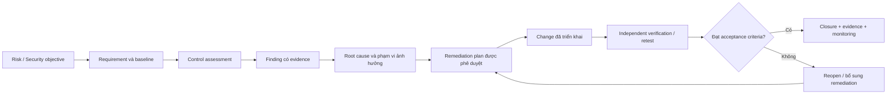
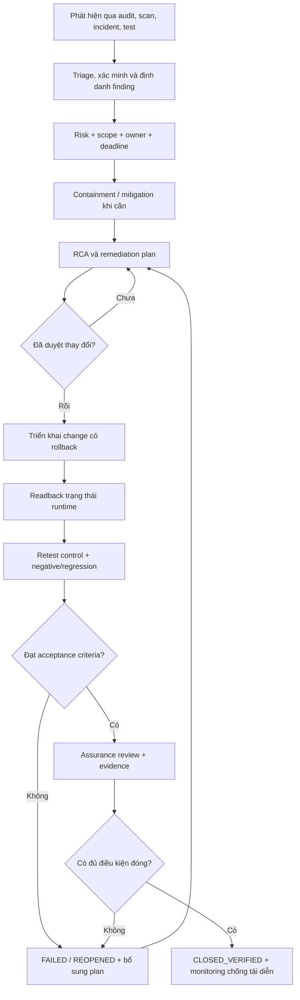

# Remediation là gì? Từ phát hiện bảo mật đến khắc phục được kiểm chứng

## 1. Remediation: định nghĩa và vị trí trong security assurance

**Remediation** (khắc phục) là quá trình **loại bỏ hoặc sửa chữa nguyên nhân và điều kiện gây ra một vấn đề đã được xác định**, nhằm đưa hệ thống, quy trình hoặc security control về trạng thái đáp ứng các yêu cầu được phê duyệt. Trong bảo mật, remediation không chỉ là “sửa một lỗi”, mà là chuỗi hoạt động có người chịu trách nhiệm, phạm vi, tiêu chí thành công, bằng chứng triển khai, kiểm thử lại và quyết định đóng phát hiện.

Ví dụ, một báo cáo audit xác định cloud production account chưa chuyển management audit events tới SIEM. Việc bật một cấu hình logging có thể là bước sửa kỹ thuật, nhưng **remediation hoàn thành** thường còn cần chứng minh:

1. Account đó thực sự nằm trong inventory và scope phải giám sát.
2. Nguồn audit tạo ra event phù hợp, kể cả những event quan trọng đang thiếu.
3. Event được vận chuyển, parse, lưu giữ và truy xuất đúng yêu cầu.
4. Detection và alert routing hoạt động với các kịch bản bắt buộc.
5. Lỗ hổng tương tự được rà soát ở **các account khác** và có cơ chế ngăn tái diễn.
6. Bằng chứng kiểm thử sau thay đổi được review và finding được đóng đúng thẩm quyền.

Trong module **SECURITY_SECURITY_ASSURANCE**, nội dung học tập tập trung vào đánh giá có bằng chứng rằng hệ thống đáp ứng mục tiêu bảo mật, từ phân tích rủi ro, xác định yêu cầu, security controls đến kiểm thử, audit và xử lý phát hiện. **Remediation là cầu nối giữa “chúng ta biết điều gì không đạt” và “chúng ta đã chứng minh điều đó được sửa đúng”**.

### Mục tiêu học tập

Sau bài học, người học có thể:

- Phân biệt remediation với containment, mitigation, workaround, risk acceptance và preventive action.
- Chuyển một audit finding, vulnerability, incident lesson hoặc control gap thành remediation plan có thể thực thi.
- Xác định nguyên nhân gốc, phạm vi ảnh hưởng và thứ tự ưu tiên dựa trên rủi ro.
- Đặt acceptance criteria trước khi triển khai và xác định bằng chứng cần thu thập.
- Tổ chức trách nhiệm, deadline, escalation, change control, rollback và retest.
- Phân biệt **fix deployed** với **control operating effectively**.
- Đóng finding một cách có kiểm chứng, quản lý ngoại lệ và theo dõi rủi ro tái phát.

## 2. Remediation khác gì với containment, mitigation và risk acceptance?

Những từ này thường bị sử dụng thay thế cho nhau, nhưng chúng đại diện cho **quyết định khác nhau** trong quản trị rủi ro.

| Khái niệm | Mục tiêu chính | Ví dụ cloud IAM | Điều chưa được chứng minh |
| --- | --- | --- | --- |
| **Containment** (khoanh vùng) | Ngăn tác động lan rộng ngay lúc sự cố đang diễn ra | Vô hiệu hóa token nghi bị lộ | Nguồn lộ token đã được sửa hay chưa |
| **Eradication** (loại bỏ tác nhân) | Loại mã độc, phiên truy cập, persistence hoặc yếu tố tấn công đã xác định | Thu hồi phiên không hợp lệ, xóa identity độc hại | Hệ thống có thiết kế chống tái diễn hay chưa |
| **Mitigation** (giảm thiểu) | Giảm xác suất hoặc tác động của rủi ro, có thể tạm thời | Hạn chế IP, giảm scope quyền | Nguyên nhân gốc đã được giải quyết hoàn toàn hay chưa |
| **Workaround** | Duy trì chức năng bằng đường thay thế | Tạm dừng một API và cho thao tác qua quy trình được duyệt | Kiểm soát cũ đã hoạt động lại hay chưa |
| **Remediation** (khắc phục) | Sửa nguyên nhân/điều kiện không đạt, xác minh hiệu lực | Thiết kế lại vòng đời secrets và kiểm tra quyền runtime | Cần test và bằng chứng để kết luận thực sự hoàn thành |
| **Corrective action** | Hành động sửa nguyên nhân của sự không phù hợp để ngăn tái diễn, thường dùng trong hệ thống quản lý | Thêm kiểm tra policy và ownership trong quy trình triển khai | Một hành động quản lý chưa tự chứng minh control runtime |
| **Preventive improvement** | Ngăn lỗi tương tự ở phạm vi rộng trước khi nó xảy ra | Policy-as-code và inventory reconciliation mọi account | Phải kiểm tra hiệu quả thực tế |
| **Risk acceptance** | Chấp nhận rủi ro còn lại theo thẩm quyền, điều kiện và thời hạn | Cho phép một ngoại lệ có kiểm soát trong một kỳ | **Không** đồng nghĩa vấn đề đã được khắc phục hoặc đạt compliance |

Một sự cố có thể trải qua cả containment, eradication, remediation và recovery. Tuy nhiên **remediation không chỉ xuất hiện sau sự cố**: audit, pentest, vulnerability scanning, threat modeling, compliance assessment hoặc tabletop exercise đều có thể tạo ra những phát hiện cần khắc phục.

### Minh họa

Nếu Kubernetes cho phép tạo privileged Pod ở một namespace nhạy cảm:

- **Containment:** chặn tạm workload nguy hiểm và kiểm soát quyền thay đổi.
- **Mitigation:** giới hạn namespace hoặc nhóm được phép sử dụng đặc quyền.
- **Remediation:** sửa admission policy và các ngoại lệ không phù hợp, kiểm tra policy ở toàn bộ cluster/namespace trong phạm vi.
- **Verification:** chứng minh workload không được phép bị từ chối, workload hợp lệ không bị ảnh hưởng bất hợp lý và policy change được audit.
- **Prevention:** đưa policy test vào CI/CD, drift monitoring và review các exemption.

Việc chặn một Pod duy nhất không chứng minh toàn bộ chính sách được khắc phục.

## 3. Những nguồn tạo ra một remediation item

**Remediation item** là đơn vị công việc có thể quản lý để xử lý một lỗ hổng, control failure hoặc finding. Nó có thể đến từ nhiều nguồn:

| Nguồn | Đầu vào | Ví dụ finding |
| --- | --- | --- |
| Security audit / control assessment | Control requirement và kết quả test | Audit log thiếu ở một nhóm tài sản |
| Penetration test | Bằng chứng exploit và tác động trong scope | API không kiểm tra quyền đối tượng |
| Vulnerability management | Advisory, scan, ảnh hưởng phiên bản và exposure | Package có lỗ hổng ảnh hưởng workload production |
| Incident response / postmortem | Timeline, nguyên nhân và gap phát hiện | Credential rotation không thu hồi session cũ |
| Threat modeling | Attack path và security requirement | Thiếu kiểm soát lateral movement |
| Compliance assurance | Obligation đã xác định và control gap | Bằng chứng retention không đủ theo phạm vi |
| Third-party assurance | Vendor evidence, CUEC, subprocessor gap | Vendor không cung cấp bằng chứng DR đã cam kết |
| Configuration assurance | Baseline vs runtime drift | Cloud storage có public policy ngoài ngoại lệ |
| Business continuity / DR test | Recovery objective và bài thử | Restore vượt RTO, dữ liệu không nhất quán |
| Secure SDLC | Static/dynamic testing, code review, release check | Secret hardcoded hoặc thư viện lỗi thời |
| Operational monitoring | Missing-source/failed-control alert | SIEM parser đổi schema khiến rule không hoạt động |

Không phải mọi cảnh báo thô đều là finding đã được xác minh. Cần **triage** xác định nguồn, phạm vi và bằng chứng. Ngược lại, khi thiếu telemetry để kết luận, tạo **finding về khoảng trống quan sát** nếu baseline bắt buộc visibility; đừng mặc định hệ thống an toàn vì “không thấy lỗi”.

## 4. Kết quả cuối cần là một claim có bằng chứng

Một finding điển hình có thể được biểu diễn:

> **Expected:** mọi production cloud accounts phải có security audit logs có thể truy xuất trong thời gian retention đã duyệt.
>
> **Observed:** một account được phát hiện trong cloud organization inventory nhưng không có audit trail trong SIEM trong kỳ kiểm tra.
>
> **Risk:** một số thao tác đặc quyền có thể không được quan sát, ảnh hưởng khả năng phát hiện và điều tra.
>
> **Remediation claim:** account đã được onboard đúng nguồn log, đủ event types, được kiểm thử source-to-sink và có giám sát phát hiện mất nguồn.

Điều cuối cùng cần chứng minh **không phải** “ticket FIX-123 đã đóng”, “PR đã merge” hoặc “cấu hình hiện đã bật”. Đó là **claim về điều kiện mong muốn** đã được đánh giá trong scope và thời gian xác định.

### Chuỗi truy vết



Assurance không kết thúc ở bước triển khai thay đổi. Sơ đồ nhấn mạnh **verification có thể bác bỏ claim** và trả công việc lại cho remediation team.

## 5. Finding chất lượng tốt là đầu vào cho khắc phục tốt

Nếu finding chỉ viết “Security chưa tốt” thì không thể phân công, ước lượng tác động hoặc retest. Một finding đủ tốt cần trả lời:

1. **What:** yêu cầu/control nào không đạt; bản chất sai lệch là gì?
2. **Where:** asset ID, service, environment, account, cluster, identity hoặc loại dữ liệu nào?
3. **When:** phát hiện lúc nào, kỳ đánh giá nào, lần cuối biết trạng thái tốt?
4. **Expected:** baseline version, tiêu chí kiểm tra đã được phê duyệt.
5. **Observed:** kết quả thực tế; bằng chứng gốc và nguồn.
6. **Impact:** kịch bản tấn công, nghĩa vụ hoặc rủi ro nghiệp vụ có thể bị ảnh hưởng.
7. **Confidence:** đã xác minh, nghi ngờ hay chưa đủ dữ liệu?
8. **Owner:** nhóm kỹ thuật, control owner, risk owner và người xác nhận đóng.
9. **Reproduction/test:** cách quan sát lại bằng phương pháp an toàn.
10. **Dependencies:** những thành phần, quyền hoặc đội khác cần phối hợp.

Ví dụ tốt hơn “mã hóa chưa đạt” là:

> “Theo baseline DATA-ENC v2, các object thuộc nhóm tài liệu khách hàng trong bucket B phải dùng phương thức mã hóa K. Tại assessment time T, cấu hình mặc định của bucket không phù hợp và một nhóm object không có metadata chứng minh mã hóa theo policy. Chưa xác định đầy đủ tập object lịch sử; cần kiểm tra cấu hình mới lẫn dữ liệu đã tồn tại.”

Một lỗi cấu hình mặc định mới **không tự động sửa lại dữ liệu đã ghi**. Tách vấn đề hiện tại, lịch sử và kiểm chứng.

## 6. Phân loại rủi ro và mức độ khẩn cấp

Ưu tiên remediation nên dựa trên **tác động thực tế và mức độ phơi lộ**, không chỉ severity nhãn scan hoặc số lượng tickets.

Các yếu tố cần xem:

- **Impact:** loại dữ liệu, khả năng mất confidentiality/integrity/availability, an toàn con người, tài chính, nghĩa vụ hợp đồng.
- **Likelihood/exploitability:** điều kiện khai thác, quyền cần thiết, đường truy cập, bằng chứng hoạt động khai thác khi có.
- **Exposure:** internet-facing, privileged identity, sensitive workload, cross-tenant impact, vùng production.
- **Threat context:** khả năng tấn công có chủ đích, exploit đã được ghi nhận đáng tin, tài sản có giá trị.
- **Compensating controls:** thực sự có hiệu lực, bao phủ scope và được kiểm thử hay chỉ là cấu hình trên giấy?
- **Blast radius:** một asset riêng lẻ hay hàng trăm tenants/đường phục hồi?
- **Detection and response readiness:** có nhận diện và ngăn chặn kịp thời hành vi lạm dụng không?
- **Dependency and feasibility:** có cần maintenance window, nhà cung cấp hoặc thay đổi kiến trúc?
- **Time and regulatory obligations:** deadline hợp đồng/pháp lý được xác nhận nếu áp dụng.

### Ví dụ bảng ưu tiên giả định

| Finding | Bối cảnh | Mức ưu tiên minh họa | Quyết định cần xét |
| --- | --- | --- | --- |
| Credential privileged có dấu hiệu bị lộ | Production IAM, khả năng bị lạm dụng ngay | **Khẩn cấp** | Containment ngay, incident response rồi remediation dài hạn |
| API authorization bypass | Internet-facing, truy cập dữ liệu nhiều người dùng | **Rất cao** | Kiểm soát tạm, sửa logic và test regression |
| Thiếu audit logging tại account quan trọng | Mất visibility và forensic history | **Cao** | Bật source/route, kiểm tra blind spot và giám sát mất log |
| Package cũ trên môi trường isolated | Không có đường tấn công đã xác nhận, có lớp kiểm soát | **Theo đánh giá** | Cập nhật có kiểm soát, ghi residual risk |
| Tài liệu runbook lỗi thời | Tác động phụ thuộc mức liên tục của dịch vụ | **Theo đánh giá** | Cập nhật, tabletop và retest |

Đây không phải SLA chuẩn. **Mốc thời gian khắc phục phải được tổ chức định nghĩa theo risk appetite, cam kết và khả năng ứng phó**, kèm escalation cho các rủi ro không thể chờ.

### CVSS và độ ưu tiên

CVSS có thể hỗ trợ mô tả mức độ nghiêm trọng của vulnerability, nhưng **điểm CVSS không tự thay thế đánh giá rủi ro môi trường**. Một lỗ hổng CVSS thấp trong chuỗi truy cập quyền cao có thể quan trọng hơn một vấn đề điểm cao nhưng không có đường khai thác vào hệ thống thực. Với control gap không phải CVE, có thể không có CVSS; vẫn cần risk analysis.

## 7. Phân biệt nguyên nhân trực tiếp, nguyên nhân gốc và nguyên nhân hệ thống

**Root Cause Analysis (RCA)** tìm lý do khiến lỗi có thể xảy ra và không được phát hiện/ngăn đúng lúc. Một remediation bền vững không nên dừng ở bước sửa **triệu chứng**.

### Ví dụ: cloud audit gap

- **Triệu chứng:** không thấy management audit logs của account C trên SIEM.
- **Nguyên nhân trực tiếp:** forwarding configuration chưa được bật.
- **Nguyên nhân quy trình:** account mới không trải qua logging onboarding checklist.
- **Nguyên nhân hệ thống:** authoritative asset inventory không được liên kết với monitoring inventory; không có test phát hiện nguồn bị thiếu.
- **Hậu quả:** không chỉ account C; các account tạo sau có thể lặp lại lỗi.

### Một số phương pháp RCA

| Phương pháp | Hữu ích khi | Cẩn trọng |
| --- | --- | --- |
| **5 Whys** | Lần theo chuỗi điều kiện trong một quy trình rõ | Không dừng ở “nhân viên quên” nếu còn lỗ hổng hệ thống |
| **Fishbone/Ishikawa** | Nhiều nhóm yếu tố: people, process, tech, vendor | Tránh kết luận dựa trên suy đoán thiếu dữ liệu |
| **Fault tree / causal graph** | Nhiều điều kiện phải đồng thời xảy ra | Quan hệ nhân quả cần được xác minh |
| **Timeline analysis** | Incident và failure liên quan thay đổi/time window | Phân biệt tương quan với nhân quả |
| **Control gap review** | Thiếu preventive/detective/corrective control | Tránh sửa một lớp rồi bỏ nguyên nhân tại lớp khác |

Một remediation có thể cần cả **specific fix** (sửa account C) và **systemic fix** (chặn account mới không được onboarding). Không nên dừng audit finding bằng một thao tác thủ công nếu cơ chế sinh lỗi vẫn tồn tại.

### Điều chưa biết cần giữ nguyên

Khi không xác định được RCA, có thể đưa ra containment/mitigation cần thiết, mở investigation và ghi **UNKNOWN** về nguyên nhân. Không bịa RCA để vừa form. Một hypothesis “lỗi do collector” chưa được xác minh cần có owner, phương pháp kiểm tra và thời hạn.

## 8. Mở rộng phạm vi tìm lỗi tương tự (look-across)

Một finding thường được phát hiện trên một mẫu; rủi ro thật có thể lớn hơn mẫu.

Ví dụ một Kubernetes cluster thiếu enforcement của admission policy. Trước khi kết luận remediation, cần hỏi:

- Có bao nhiêu cluster/namespace trong **authoritative inventory**?
- Những tài sản nào thuộc cùng baseline và kịch bản rủi ro?
- Policy đã được cấp nhưng bị disable, hay không được cài?
- Có exemptions, legacy workloads hoặc alternative controllers nào bỏ qua kiểm tra?
- Lỗi xuất phát từ module IaC dùng chung cho nhiều cluster?
- Có blind spot vì thiếu quyền quan sát hoặc asset chưa onboard?
- Giai đoạn lịch sử nào có thể đã xảy ra vi phạm mà không có bằng chứng?

**Look-across** phải dùng **mẫu số độc lập**, không chỉ tập assets có log. Nếu một nguồn bị mất, không thể loại asset đó khỏi scope và công bố “100% đã khắc phục”.

### Bảng phân loại

| Tập đối tượng | Hành động | Kết luận |
| --- | --- | --- |
| Asset đã xác nhận bị ảnh hưởng | Fix + retest | Có thể PASS sau evidence phù hợp |
| Asset tương tự đã kiểm tra và không bị lỗi | Ghi negative evidence | Không cần fix nhưng cần bảo đảm scope |
| Asset nghi bị ảnh hưởng nhưng thiếu quyền | Yêu cầu truy cập/kiểm tra | UNKNOWN, không tính PASS |
| Asset ngoài scope có phê duyệt | Ghi lý do N/A | Đánh giá lại khi thay đổi scope |
| Asset đã ngừng nhưng dữ liệu còn tồn tại | Kiểm tra residual data/access/retention | Không tự coi đã hết rủi ro |

## 9. Remediation lifecycle: các bước quản trị từ đầu đến cuối



Nên tách **trạng thái triển khai** và **trạng thái kiểm chứng** để không biến việc đóng ticket kỹ thuật thành đánh giá security assurance đạt.

### Các pha

1. **Intake/Triage:** ghi finding, xác minh đúng đích, loại duplicate, tách false positive có evidence.
2. **Assess:** scope, severity, owner, affected controls và requirements.
3. **Plan:** RCA, options, acceptance criteria, rollout/rollback, dependency và risk management.
4. **Approve:** người có thẩm quyền duyệt thay đổi, ngoại lệ hoặc hướng xử lý.
5. **Implement:** thay code, config, policy, credential, process hoặc contract theo kế hoạch.
6. **Verify:** đo actual state và chạy test có thể phát hiện lỗi còn tồn tại.
7. **Close:** reviewer kiểm tra đủ bằng chứng, owner/approver chấp thuận, kết luận có giới hạn.
8. **Monitor:** tìm drift/tái phát và kiểm tra remediation có hiệu lực sau một thời gian khi cần.

Thứ tự có thể thay đổi trong incident khẩn cấp: containment được thực hiện trước khi RCA đầy đủ. Nhưng những điểm về **phê duyệt theo quyền, lưu dấu vết và retest** vẫn cần được thực hiện theo quy trình phù hợp.

## 10. Một remediation plan có thể thực thi cần gì?

| Thành phần | Câu hỏi |
| --- | --- |
| Finding ID / source | Sai lệch nào, từ đâu, evidence gốc nào? |
| Baseline/control ID | Đang sửa để đạt yêu cầu nào, version nào? |
| Asset/service scope | Đối tượng nào phải được sửa và kiểm tra lại? |
| Risk level / rationale | Vì sao cần ưu tiên; rủi ro còn tồn tại trong thời gian chờ? |
| Owner và approver | Ai thực thi, ai chịu trách nhiệm hiệu lực và ai được đóng? |
| Root cause | Triệu chứng/điều kiện hệ thống nào cần thay đổi? |
| Target state | Trạng thái mong đợi được mô tả có thể kiểm tra không? |
| Options/trade-offs | Fix dài hạn, mitigation, thay thiết kế, loại bỏ chức năng? |
| Dependencies | Hệ thống, đội, nhà cung cấp, maintenance window nào liên quan? |
| Implementation tasks | Công việc theo thứ tự, reviewer, version, canary/rollout |
| Acceptance criteria | Điều kiện PASS cụ thể được xác định **trước** thay đổi |
| Test and evidence plan | Dữ liệu nguồn, positive/negative/regression, runtime readback |
| Deadline và milestones | Hạn theo risk tier/chính sách, escalation khi không đạt |
| Rollback/failure plan | Khi nào dừng triển khai, cách bảo toàn hệ thống/dữ liệu |
| Monitoring after fix | Phát hiện tái diễn và trigger kiểm tra |
| Risk/exception record | Ngoại lệ còn lại, owner, expiry, compensation khi cần |

Một action item “bật logging” là quá ngắn nếu finding gốc liên quan **audit completeness và alerting**. Plan phải xác định loại log, tài sản, sink, retention, parsing, test và outcome.

### SMART nhưng không làm mất an toàn

Acceptance criteria nên **cụ thể, có thể đo, có cơ sở, phù hợp rủi ro và thời hạn**. Tuy nhiên đừng đặt điều kiện “giảm số lượng alert về 0” vì điều đó có thể đạt bằng cách tắt detection. KPI cần được thiết kế để phản ánh **hiệu lực control**, không tạo động cơ che dữ liệu.

## 11. Phân công trách nhiệm và RACI

| Vai trò | Trách nhiệm | Bằng chứng |
| --- | --- | --- |
| **Finding owner / GRC** | Duy trì finding, SLA, risk, follow-up và hồ sơ | Finding register, history, escalation |
| **Technical remediation owner** | Thiết kế/triển khai giải pháp, change, rollback | PR, IaC, deployment, implementation record |
| **Control owner** | Xác nhận target state và coverage của control | Baseline, control requirement, acceptance |
| **Security assurance / validation team** | Thực hiện hoặc review retest, đánh giá evidence | Test report, readback, verdict |
| **Business/Service owner** | Đánh giá tác động dịch vụ và chấp nhận vận hành sau thay đổi | Business acceptance, risk context |
| **Incident Commander** | Điều phối khi finding phát sinh trong sự cố đang diễn ra | Incident timeline, action decision |
| **Risk owner** | Phê duyệt rủi ro còn lại và ngoại lệ trong thẩm quyền | Risk decision, expiry và bù trừ |
| **Change approver** | Phê duyệt thay đổi theo chính sách | Change ID, window, rollback review |
| **Legal/Compliance** | Xác nhận các nghĩa vụ pháp lý/hợp đồng khi liên quan | Applicability, obligation review, legal assessment |
| **Vendor manager** | Điều phối trách nhiệm và evidence từ bên thứ ba | Vendor ticket, SLA, attestation, retest |

### RACI minh họa

| Hoạt động | Tech owner | Control owner | Assurance | Risk owner | Change approver |
| --- | --- | --- | --- | --- | --- |
| Xác minh finding | C | C | A/R | I | I |
| Xác định target/acceptance criteria | R | A | C | C | I |
| Đề xuất fix và rollback | A/R | C | C | I | C |
| Phê duyệt change | C | C | I | I | A/R |
| Triển khai fix | A/R | C | I | I | I |
| Retest độc lập hoặc review | C | C | A/R | I | I |
| Phê duyệt risk exception | C | C | C | A/R | I |
| Đóng finding sau verification | C | C | A/R | I | I |

RACI chỉ là **ví dụ**, không thay thế chính sách tổ chức. Với đội nhỏ, người triển khai có thể đồng thời chạy test nhưng phải có **bằng chứng và review độc lập phù hợp mức rủi ro**, tránh người sửa tự tuyên bố PASS không có kiểm tra.

## 12. Thời hạn, SLA và escalation theo rủi ro

Tổ chức thường đặt **remediation SLA** cho finding classes, nhưng không có một bộ deadline cố định phù hợp mọi tài sản, luật và kịch bản. Một lỗ hổng đang bị khai thác ở production có thể cần containment khẩn cấp; lỗi tài liệu ít ảnh hưởng có thể được xử lý trong chu kỳ thay đổi tiếp theo.

### Mẫu chính sách minh họa

| Priority nội bộ | Trigger điển hình | Nhịp quản trị | Khi không đạt hạn |
| --- | --- | --- | --- |
| **P0 / Immediate** | Nguy cơ gây tác động đang diễn ra | Incident command, containment và reporting thường xuyên | Escalation ngay tới risk/incident leadership |
| **P1 / Urgent** | Khả năng gây tác động cao trên hệ thống trọng yếu | Owner và plan được xác nhận sớm; milestones sát | Lãnh đạo rủi ro duyệt phương án giảm exposure |
| **P2 / Planned** | Rủi ro vừa, có preventive controls còn hiệu lực | Theo sprint/change window và milestone | Review lại rủi ro, deadline hoặc bù trừ |
| **P3 / Routine** | Tác động thấp, phạm vi hạn chế | Backlog được quản lý và review định kỳ | Báo cáo overdue và risk owner |

Bảng chỉ minh họa **cấu trúc**. Deadline thực tế phải dựa trên tiêu chí của tổ chức và những hạn bắt buộc được xác nhận. Không được tự đặt một mốc “30 ngày theo luật” khi chưa kiểm tra nguồn pháp lý/hợp đồng cụ thể.

### Overdue khác exception

Nếu một finding quá hạn, không nên tự chuyển thành “accepted risk”. Ngoại lệ hợp lệ cần có **phê duyệt rõ, phạm vi, lý do, giới hạn thời gian, biện pháp bù trừ và kỳ review**. Một email “đang bận” không đủ là quyết định quản trị rủi ro.

## 13. Remediation có thể chọn nhiều hướng kỹ thuật

| Hướng xử lý | Khi phù hợp | Ví dụ | Phép kiểm cần có |
| --- | --- | --- | --- |
| **Patch/upgrade** | Phần mềm có bản sửa phù hợp | Nâng thư viện có vulnerability | Version runtime, regression và scanner xác minh |
| **Configuration hardening** | Baseline drift, mặc định không an toàn | Tắt quyền public cho bucket | Actual policy, truy cập thử bị từ chối |
| **Access reduction** | Quyền cấp quá mức | Giảm IAM roles/OAuth scopes | Effective permissions, negative test, session review |
| **Design change** | Lỗi có tính cấu trúc | Thay secret lưu lâu bằng workload identity | Threat model, integration/regression tests |
| **Compensating control** | Chưa thể sửa trực tiếp hoặc cần thời gian | Restrict route, thêm detection, giảm dữ liệu | Test hiệu lực và ghi residual risk |
| **Service removal** | Rủi ro không thể chấp nhận | Ngừng endpoint/lưu lượng hoặc ngừng vendor | Kiểm tra không còn access/exposure/data residual |
| **Process improvement** | Root cause ở luồng phê duyệt/onboarding | Control gate khi tạo cloud account | Test quy trình, thử trường hợp bị thiếu |
| **Contract/vendor change** | Lỗi nằm ở bên thứ ba | Bổ sung log export/audit right hoặc thay provider | Report, test, contract evidence, exit readiness |

**Không phải mọi finding đều sửa bằng patch.** Một control gap về retention có thể cần sửa pipeline, quyền, quy trình lưu trữ và bằng chứng truy xuất; một incident gap có thể cần training, escalation và tabletop. Remediation phải khớp **nguyên nhân và mục tiêu**.

## 14. Thiết kế thay đổi an toàn: canary, rollback và dependency

Với hệ thống production, “fix nhanh” nhưng gây gián đoạn hoặc mất dữ liệu có thể tạo rủi ro mới lớn hơn finding ban đầu.

### Các nguyên tắc

- Kiểm tra **điều kiện triển khai**, ownership, change window và dependencies.
- Dùng môi trường thử và rollout từng phần nếu kiến trúc cho phép.
- Chuẩn bị **rollback plan** nhưng không tự giả định mọi thay đổi đều có thể đảo ngược.
- Với database migration, key rotation, data deletion hoặc IAM revocation, cần phân biệt **rollback cấu hình** với **khôi phục trạng thái/dữ liệu**.
- Thiết lập health, security telemetry và success criteria trước khi rollout.
- Xác định ngưỡng dừng; không mở rộng rollout khi canary gây lỗi hoặc phát hiện rủi ro mới.
- Ghi decision log khi khẩn cấp phải lệch quy trình thông thường; review sau sự kiện.

### Ví dụ: thu hẹp IAM permission

Một policy đang cho service role quyền rộng. Việc cắt bỏ quyền có thể làm hỏng các batch jobs chưa được inventory. Plan nên gồm:

1. Tìm effective permissions và actual usage với log/telemetry phù hợp.
2. Xác nhận trách nhiệm và loại hành động được phép.
3. Tạo policy tối thiểu có review, test những luồng hợp lệ.
4. Triển khai canary trong phạm vi an toàn hoặc theo giai đoạn.
5. Chứng minh hành động hợp lệ vẫn thành công, hành động không được phép bị từ chối.
6. Kiểm tra sessions/credentials cũ có còn quyền hiệu lực không.
7. Giữ evidence, theo dõi regression và xử lý exception có owner.

Nếu chỉ thấy PR IaC giảm quyền nhưng **runtime policy chưa áp dụng** hoặc token cũ vẫn hoạt động ngoài ý muốn thì chưa đủ điều kiện đóng finding.

## 15. Acceptance criteria phải được viết trước triển khai

Một tiêu chí đóng tốt cần xác định **trạng thái mục tiêu, phạm vi, phép thử, ngưỡng và nguồn bằng chứng**.

### Ví dụ finding về cloud logging

| Thành phần | Tiêu chí |
| --- | --- |
| **Scope** | Mọi production accounts theo authoritative inventory revision hiện hành |
| **Source** | Các management audit event types đã được baseline yêu cầu |
| **Delivery** | Event tới sink với schema, actor, resource và thời gian hợp lệ |
| **Retention** | Dữ liệu truy xuất được trong cửa sổ đã phê duyệt |
| **Detection** | Bài thử hành vi IAM quan trọng tạo finding/alert phù hợp |
| **Negative test** | Thao tác được phê duyệt không bị phân loại nhầm theo logic đã định |
| **Missing-source** | Mất nguồn, thiếu quyền hoặc parser lỗi được phát hiện thay vì báo xanh |
| **Operational handoff** | Alert đúng owner, có acknowledgment nếu policy yêu cầu |
| **Evidence** | Config readback, canary IDs, alert receipts, test report, reviewer |
| **Residual risk** | Khoảng mất log lịch sử được mô tả và quản lý riêng nếu không thể khôi phục |

Đừng đặt tiêu chí “0 cảnh báo sau fix”. Điều đó có thể chứng minh detector không hoạt động chứ không phải hệ thống an toàn. Với control preventive, phải kiểm tra **positive và negative behavior** tương ứng.

## 16. Verification và validation: kiểm tra “đã sửa” nghĩa là gì?

**Verification** thường xem giải pháp có được triển khai theo thiết kế và tiêu chí kỹ thuật không. **Validation** xem giải pháp có thực sự giải quyết mục tiêu/rủi ro trong ngữ cảnh sử dụng mong đợi không. Tùy quy trình tổ chức, hai từ có thể được dùng khác nhau, nhưng cả hai loại câu hỏi đều cần có người chịu trách nhiệm.

### Các cấp độ kiểm tra

| Cấp | Ví dụ | Hạn chế |
| --- | --- | --- |
| **Change existence** | Commit/PR đã merge, ticket deploy SUCCESS | Không chứng minh runtime state đúng |
| **Runtime readback** | IAM policy, log config, image digest hiện đúng | Không tự chứng minh hành vi/hiệu lực control |
| **Component/unit test** | Hàm authorization trả kết quả dự kiến | Không bao phủ routing, integration và data source thực |
| **Integration test** | API–DB–queue làm việc phù hợp | Có thể vẫn khác production |
| **Negative/abuse-case test** | Principal trái quyền bị chặn | Cần đảm bảo test case đại diện và an toàn |
| **End-to-end test** | Event từ nguồn tới SIEM, alert tới owner | Test có scope và time window |
| **Regression test** | Hệ thống hợp lệ vẫn hoạt động sau fix | Không đảm bảo mọi chức năng chưa test |
| **Production monitoring** | Theo dõi drift và lỗi tái diễn sau triển khai | Không quan sát thấy không luôn chứng minh không có lỗi |

Một remediation mạnh thường cần **tối thiểu hai lớp bằng chứng độc lập hoặc bổ sung**, ví dụ actual runtime config và test hành vi. Đối với rủi ro cao, nên có reviewer khác người sửa hoặc phương pháp kiểm chứng đủ khách quan.

### Trường hợp test thiếu dữ liệu

Nếu scan agent không thấy một host hoặc SIEM không đọc được một account, không thể chấm PASS vì “không phát hiện lỗi”. Phải phân biệt:

- **PASS:** điều kiện được chứng minh đạt theo scope.
- **FAIL:** có bằng chứng cho thấy không đạt.
- **UNKNOWN:** không đủ dữ liệu/không thể kiểm tra.
- **NOT_APPLICABLE:** có căn cứ quy tắc không áp dụng cho đối tượng cụ thể.

## 17. Phân biệt fix, workaround và kết thúc rủi ro lịch sử

Một remediation có thể đưa hệ thống về trạng thái đúng **từ hiện tại trở đi**, nhưng không thể xóa tác động đã xảy ra.

Ví dụ:

- Bật logging **không khôi phục** mọi log chưa từng được tạo.
- Thu hồi token **không chứng minh** token đó chưa được dùng trước khi thu hồi.
- Bật mã hóa mặc định **không bảo đảm** dữ liệu cũ được mã hóa theo chính sách.
- Vá thư viện **không chứng minh** không có exploitation trước khi vá.
- Sửa role assumption **không tự chấm dứt** các session đã được cấp trước đó nếu cơ chế phiên cho phép chúng tồn tại.
- Sửa backup job **không tạo lại** recovery points đã không tồn tại trong quá khứ.

Do đó, tìm và tách:

1. **Current exposure:** trạng thái hiện tại cần fix và retest.
2. **Historical impact:** điều tra xem vấn đề trước đây có gây tác động không và còn bằng chứng nào.
3. **Systemic recurrence:** điều kiện khiến lỗi tái xuất hiện trong môi trường, quy trình hoặc nhà cung cấp.
4. **Residual risk:** rủi ro không thể loại bỏ hoàn toàn, được giám sát và phê duyệt phù hợp.

Không đóng incident hoặc privacy/legal evaluation chỉ vì remediation kỹ thuật đạt.

## 18. Hồ sơ remediation có thể kiểm toán

Một **remediation register** hoặc ticket nên liên kết tới nguồn finding, control baseline, owner, plan, change và retest. Ví dụ cấu trúc:

| Nhóm | Trường |
| --- | --- |
| Identity | `remediation_id`, `finding_id`, `source_type`, `related_incident_id` |
| Context | `service`, `environment`, `asset_scope`, `baseline_id`, `control_id` |
| Risk | `severity`, `risk_rationale`, `compensating_controls`, `risk_owner` |
| Analysis | `observed_state`, `expected_state`, `root_cause`, `affected_population` |
| Plan | `target_state`, `tasks`, `dependencies`, `rollback_plan`, `milestones` |
| Ownership | `technical_owner`, `control_owner`, `assessor`, `change_approver` |
| Time | `detected_at`, `due_at`, `implemented_at`, `verified_at`, `closed_at` |
| Evidence | `source_evidence_refs`, `change_refs`, `test_refs`, `readback_refs` |
| Outcome | `verification_result`, `residual_risks`, `exceptions`, `closure_decision` |
| Lifecycle | `status`, `status_history`, `reopened_reason`, `next_review_trigger` |

Không sao chép secrets, customer data hoặc exploit payload nhạy cảm vào một ticket truy cập rộng. Dùng tham chiếu tới kho evidence đã kiểm soát và ghi quyền truy xuất phù hợp.

### YAML: mẫu remediation plan

Đây là **schema quản trị minh họa**, không phải cấu hình tự chạy trên một nền tảng GRC, cloud hay SIEM cụ thể.

```yaml
remediationPlan:
  id: REM-2026-041
  version: "1.0.0"
  state: APPROVED
  findingId: FIND-LOG-027
  baseline:
    id: SECURITY-LOGGING
    version: "2.1.0"
    controlId: LOG-01
  scope:
    service: payment-platform
    environment: production
    assetGroup: cloud-accounts
    inventoryRevision: "org-inventory-r42"
  risk:
    priority: high
    reason: "Privileged management events may be unobservable"
    residualHistoricalGap: true
  ownership:
    technicalOwner: Cloud Platform
    controlOwner: Security Monitoring
    assuranceReviewer: Security Assurance
    riskOwner: Security Risk
  problem:
    expected: "Required management events are captured and delivered"
    observed: "An in-scope account lacks audit ingestion"
    rootCause: "Account onboarding was not linked to log provisioning"
  approach:
    immediateMitigation: "Restrict unapproved privileged changes"
    durableFix: "Enforce audit onboarding through account provisioning"
    preventRecurrence: "Reconcile cloud inventory to monitored sources"
  acceptanceCriteria:
    - "all in-scope accounts have required audit configuration"
    - "safe canary events appear end-to-end"
    - "required detection tests and alert delivery pass"
    - "missing-source monitoring raises an actionable gap"
  tests:
    positive: ["source-to-sink-event-test", "detection-alert-test"]
    negative: ["approved-operation-classification"]
    missingSource: ["collector-access-loss"]
    regression: ["account-onboarding-test"]
  change:
    changeId: CHG-7821
    rollbackPlanRef: "evidence://rem-041/rollback-plan"
  dueAt: "2026-12-15T17:00:00Z"
  evidenceRefs: []
  closeOnlyAfterIndependentReview: true
```

Các trường `dueAt`, `required` và `acceptanceCriteria` trong mẫu là giả định cho lớp học; deadline, policy và criteria phải được phê duyệt phù hợp trước khi dùng thật.

## 19. Evidence package sau khi triển khai

Một báo cáo “remediation completed” nên chứa **bằng chứng trước và sau** với khả năng truy vết.

### Gói bằng chứng đề xuất

1. **Finding gốc**: condition, expected, affected assets, risk và evidence ID.
2. **RCA**: giả thuyết và nguyên nhân được xác minh; điều chưa biết.
3. **Approved plan**: phạm vi, owner, target state, acceptance criteria, deadlines.
4. **Change implementation**: PR, review, deployment, runtime version và change approval.
5. **Readback**: cấu hình thực tại tài sản/tenant liên quan sau thay đổi.
6. **Test results**: positive, negative, boundary, missing-source và regression khi áp dụng.
7. **Coverage proof**: authoritative inventory và kết quả theo từng asset/control.
8. **Business/security acceptance**: người xác nhận, mốc thời gian, hạn chế và impact.
9. **Historical and residual risk**: khoảng thời gian không thể xác minh, các exceptions còn mở.
10. **Monitoring and closure**: thiết lập kiểm tra drift, next review trigger, record đóng có thẩm quyền.

Bằng chứng cần **provenance** (nguồn, thời gian, version), tính toàn vẹn, quyền truy cập, retention và khả năng truy xuất. Một ảnh chụp dashboard có thể hỗ trợ nhưng không thay thế log/test IDs để người khác kiểm tra lại.

## 20. Ví dụ JSON: kết quả retest chưa đủ đóng finding

```json
{
  "remediationId": "REM-2026-041",
  "findingId": "FIND-LOG-027",
  "environment": "production",
  "assetInventoryRevision": "org-inventory-r42",
  "assessedAt": "2026-11-28T08:30:00Z",
  "implementation": {
    "changeId": "CHG-7821",
    "status": "DEPLOYED",
    "readback": "PASS"
  },
  "verification": {
    "sourceToSink": "PASS",
    "detectionRule": "PASS",
    "alertRouting": "PASS",
    "missingSourceTest": "UNKNOWN"
  },
  "historicalScope": {
    "dataGapDetected": true,
    "pastEventsRecoverable": "UNDETERMINED"
  },
  "assessment": {
    "result": "UNKNOWN",
    "reason": "Missing-source behavior has not been verified",
    "findingStatus": "PENDING_RETEST",
    "assuranceReviewer": "Security Assurance"
  },
  "evidenceRefs": [
    "evidence://rem-041/change-7821",
    "evidence://rem-041/source-canary",
    "evidence://rem-041/alert-receipt"
  ],
  "nextActions": [
    "Run missing-source test in approved environment",
    "Document historical blind spot and residual risk"
  ]
}
```

**Đây là bản ghi minh họa**, không phải kết quả thật trên production. Dù việc triển khai và ba phép kiểm đạt, **finding chưa đủ điều kiện đóng** vì tiêu chí bắt buộc `missingSourceTest` chưa có bằng chứng. Có thể phải tách tình trạng hiện tại (sau retest) khỏi historical gap cần điều tra riêng; không đánh đồng một remediation PASS với việc mọi ảnh hưởng lịch sử đã được giải quyết.

## 21. Case study A: Khắc phục quyền cloud IAM quá rộng

### Bối cảnh

Đội audit phát hiện service principal dùng cho CI/CD có quyền quản trị cloud rộng hơn nhu cầu. Quyền này có thể bị lạm dụng để thay đổi policies, tạo credentials hoặc truy cập tài nguyên ngoài ứng dụng.

### Chuỗi công việc

| Giai đoạn | Việc cần làm | Evidence |
| --- | --- | --- |
| Triage | Xác nhận effective permissions và principal đang sử dụng | IAM readback, trusted activity logs |
| Scope | Tìm roles, accounts, workloads và pipelines cùng dùng template | Inventory/ IaC references |
| Containment | Hạn chế trường hợp lạm dụng ngay nếu rủi ro cao | Temporary policy, approval và impact |
| Root cause | Xác định vì sao quyền wildcard được cấp và review không phát hiện | IaC history, design, access review history |
| Target | Role tối thiểu chỉ cho phép deployment actions hợp lệ | Approved permission matrix |
| Implementation | Sửa policy/role bindings, rollout kiểm soát | Reviewed change + runtime state |
| Verification | Negative test chặn hành động ngoài quyền, positive test cho deploy hợp lệ | Test IDs, access denied/success events |
| Historical review | Xem có dấu hiệu lạm dụng quyền trước fix không | Audit investigations, limitations |
| Closure | Kiểm tra quyền thực tế, sessions và test; gắn preventive gate | Review record, monitoring check |

### Hai lỗi dễ gặp

**Lỗi thứ nhất:** PR policy đã merge nhưng role thực tế chưa cập nhật hoặc role khác vẫn cấp quyền tương đương. Phải xem **effective permissions**, không chỉ một file IaC.

**Lỗi thứ hai:** giảm quyền làm CI/CD fail, nhóm khôi phục wildcard vĩnh viễn mà không cập nhật finding. Mọi rollback có tác động bảo mật phải được đánh giá lại và có owner; không được giữ báo cáo “đã khắc phục” khi runtime đã quay về trạng thái cũ.

## 22. Case study B: Khắc phục detection gap sau thay đổi log schema

### Bối cảnh

Một cloud provider thay một số trường trong audit event. Collector vẫn nhận log và dashboard số lượng event bình thường, nhưng rule nhận diện thay đổi IAM trust không tạo alert. Một lần diễn tập phát hiện gap này.

### Phân tích

**Finding:** pipeline chưa bảo đảm **detection rule tương thích event schema**, không phải đơn thuần thiếu log volume.

**Root cause có thể có:**

- Parser mapping không được cập nhật theo event version mới.
- Không có regression tests khi collector/cloud SDK nâng version.
- Health dashboard chỉ đo ingestion rate, không kiểm tra semantics.
- Synthetic canary không bao gồm loại event và trường nhạy cảm.

### Plan kiểm chứng

1. Xác nhận event schema nguồn và version tại thời điểm phát hiện.
2. Cập nhật normalizer/query để xử lý đúng các trường/giá trị hiện hành.
3. Test event hợp lệ và bất hợp lệ, bao gồm policy diff/context cần thiết.
4. Chạy **source-to-alert** canary và xác nhận alert/ticket routing.
5. Test missing-source, schema mismatch và logic bypass để tránh xanh giả.
6. So sánh hành vi các rule khác dùng chung parser.
7. Ghi thời kỳ có thể không phát hiện được hành vi; kiểm tra dữ liệu lịch sử nếu log thô còn lưu.
8. Đưa schema contract/regression vào pipeline để ngăn tái phát.

**Không thể coi rule đã sửa chỉ vì unit test trên một JSON giả lập đạt**, nếu nguồn audit thực hoặc toàn bộ đường truyền tới alert chưa được kiểm tra ở môi trường đại diện.

## 23. Case study C: Remediation phát hiện DR không đạt RTO

### Bối cảnh

Bài diễn tập phục hồi Payment API có mục tiêu RTO **120 phút** theo BIA giả định. Thời điểm dịch vụ không đáp ứng điều kiện nghiệp vụ là **09:00 UTC**, hoàn tất business/security acceptance lúc **11:20 UTC**. Thời gian quan sát là **140 phút**, vượt mục tiêu 20 phút.

### Các yếu tố cần phân tích

- Chậm ở **phát hiện/khai báo**, quyết định hay đợi người có quyền?
- Thiếu backup/restore automation hoặc quyền truy cập KMS tại DR?
- Deployment hay DNS/routing cần thao tác thủ công?
- Security gate như IAM, TLS, audit source-to-sink được cấu hình quá muộn?
- Dữ liệu DB/queue có mất thời gian reconciliation lớn?
- Business acceptance được thiết kế/đào tạo từ trước chưa?

### Remediation target và retest

| Nhóm | Ví dụ thay đổi | Bằng chứng cần có |
| --- | --- | --- |
| Operational | Rõ roster, quyền khẩn cấp và trigger | Paging/approval test |
| Technical | Chuẩn hóa IaC, pre-provision dependency, backup test | Restore job, runtime/readiness |
| Data | Tự động hóa có kiểm tra reconciliation | Commit watermark, queue offset |
| Security | Triển khai audit/logging và chính sách trước khi mở dịch vụ | Source-to-sink canary, access negative test |
| End-to-end | Diễn tập lại theo cùng định nghĩa RTO | Impact-to-business-acceptance timeline |

Nếu lần retest chỉ đo từ lúc bắt đầu restore tới khi VM sẵn sàng thì **không thể dùng để chứng minh mục tiêu RTO nghiệp vụ 120 phút**. Tiêu chí phải được giữ nhất quán, không đổi mẫu số/điểm đo sau khi thất bại.

## 24. Case study D: Lỗ hổng ứng dụng và test chống tái phát

Một API đọc hồ sơ bằng `recordId` nhưng từng cho phép principal hợp lệ của tenant A truy cập dữ liệu tenant B khi đoán được ID. Đây là **lỗi authorization theo đối tượng**, không chỉ là thiếu xác thực.

### Hướng khắc phục

- Rà soát mô hình owner/tenant và quy tắc truy cập theo nghiệp vụ.
- Áp dụng kiểm tra authorization **tại nơi quyết định truy cập**, không chỉ ẩn nút trên UI.
- Phân biệt actor có quyền đọc, không có quyền đọc, user đã bị thu hồi và service-to-service access.
- Xác định các API và data access paths cùng dùng logic kiểm tra cũ.
- Thêm positive/negative tests: tenant A đọc dữ liệu A, bị từ chối khi cố đọc B; kiểm tra quyền bị hủy.
- Kiểm tra log các lần từ chối và anomaly detection phù hợp, tránh ghi sensitive payload.
- Review lịch sử theo evidence có sẵn, báo unknowns khi retention không đủ.
- Dùng code review/automated tests để ngăn tái diễn ở endpoint mới.

**Không nên chứng minh remediation bằng cách thử truy cập dữ liệu thật của người khác.** Dùng tenant/dataset được phép trong môi trường thử hoặc test account cô lập, ghi rõ scope và giới hạn suy rộng.

## 25. Khi finding liên quan vendor hoặc bên thứ ba

Remediation có thể không do đội nội bộ trực tiếp triển khai. Khi nhà cung cấp chịu trách nhiệm, vẫn phải có **owner phía doanh nghiệp** để quản lý rủi ro, bằng chứng và quyết định.

| Hạng mục | Điều cần kiểm tra |
| --- | --- |
| Contract/SLA | Nghĩa vụ vendor, thời hạn, quyền lấy evidence và escalation |
| Scope | Dịch vụ, region, pháp nhân, subprocessor/tenant thực sự bị ảnh hưởng |
| Vendor plan | RCA, hành động, milestones, rollbacks và người chịu trách nhiệm |
| Compensating control | Bên khách hàng có thể giảm dữ liệu, scope quyền, route hoặc sử dụng khác không? |
| Evidence | Thư xác nhận, audit report phù hợp, cấu hình hoặc kết quả thử nghiệm trong scope |
| Retest | Có thể tự kiểm tra customer-side không, cần vendor attest hoặc independent review? |
| Exit plan | Khi không thể chấp nhận rủi ro, khả năng thu hồi tích hợp và di chuyển/xóa dữ liệu |
| Decision | Risk owner duyệt tiếp tục, hạn chế hoặc chấm dứt, có expiry |

Một email “vendor đã sửa” có thể hỗ trợ nhưng **không tự chứng minh** control đã hoạt động đúng với tenant và data flow đang sử dụng. Nếu vendor không cung cấp evidence, ghi **UNKNOWN** và cân nhắc các phương án giảm exposure, quyền audit hoặc exit.

## 26. Ghi nhận ngoại lệ mà không đánh tráo kết quả khắc phục

Không phải mọi finding đều có thể sửa ngay. Có thể tồn tại legacy platform, vendor dependency hoặc thời điểm bảo trì chưa phù hợp. Khi cần tiếp tục vận hành, sử dụng **risk exception workflow**, nhưng phải phân biệt trạng thái remediation và quyết định rủi ro.

### Nội dung tối thiểu của ngoại lệ

1. Finding ID, asset/service scope và rủi ro đang chấp nhận.
2. Lý do chưa thể sửa ngay, các phương án đã đánh giá.
3. Biện pháp bù trừ **đã kiểm thử**, người vận hành và giới hạn.
4. Người có thẩm quyền phê duyệt, thời điểm và hạn hiệu lực.
5. Hành động/remediation plan còn mở, deadline và cách escalation khi hết hạn.
6. Trigger rà soát sớm: exploit mới, sự cố, thay đổi dữ liệu, hệ thống, pháp luật/hợp đồng.
7. Cách thu hồi ngoại lệ khi fix được kiểm chứng.

**Risk acceptance không hợp pháp hóa việc không thực hiện nghĩa vụ pháp luật bắt buộc.** Legal/Compliance phải đánh giá các nghĩa vụ áp dụng; ngoại lệ nội bộ không tự sửa luật hoặc hợp đồng. Cũng không được dùng nhãn `EXCEPTION` để tạo báo cáo “0 finding”.

### Quản lý thời điểm hết hạn

Đến lúc ngoại lệ hết hạn, tổ chức phải **review lại và quyết định** theo chính sách. Không tự gia hạn âm thầm. Kết quả có thể là fix, hạn chế dịch vụ, cấp ngoại lệ mới có thẩm quyền nếu hợp lệ hoặc dừng hoạt động rủi ro.

## 27. Trạng thái remediation và quy tắc chuyển trạng thái

| Trạng thái | Ý nghĩa | Điều kiện chuyển tiếp |
| --- | --- | --- |
| **NEW** | Finding vừa được tạo | Xác minh nguồn/đối tượng |
| **TRIAGED** | Đã phân loại sơ bộ và xác nhận owner | Phân tích rủi ro và scope |
| **PLANNED** | Có RCA/plan và acceptance criteria | Duyệt change và nguồn lực |
| **IN_PROGRESS** | Đang triển khai fix/mitigation | Báo cáo milestone và deviations |
| **IMPLEMENTED** | Thay đổi đã triển khai theo kế hoạch | **Chưa** được tự đánh dấu control PASS |
| **PENDING_VERIFICATION** | Chờ hoặc đang chạy retest | Có evidence runtime và bài thử |
| **VERIFICATION_FAILED** | Retest không đạt hoặc phát hiện gap mới | Reopen, bổ sung RCA và plan |
| **VERIFIED** | Bằng chứng đáp ứng acceptance criteria trong scope | Independent review/approval |
| **CLOSED_VERIFIED** | Được chấp thuận đóng theo tiêu chí và thẩm quyền | Chuyển sang monitoring tái diễn |
| **ON_HOLD** | Bị chặn bởi dependency hoặc quyết định cần thiết | Owner, lý do, milestone và escalation |
| **RISK_ACCEPTED** | Tiếp tục có điều kiện với ngoại lệ hợp lệ | Không có nghĩa finding đã được kỹ thuật sửa |
| **REOPENED** | Control tái phát hoặc evidence mới bác bỏ kết luận | Tạo phiên đánh giá mới, giữ lịch sử |

Các trạng thái là **mô hình nội bộ minh họa**, không phải tiêu chuẩn bắt buộc. Có thể dùng status “CLOSED_RISK_ACCEPTED” nếu GRC muốn phản ánh đóng hồ sơ hành chính theo quyết định, nhưng nó **phải phân biệt** rõ với “CLOSED_VERIFIED” về hiệu lực control.

### Nguyên tắc chống chuyển sai

- Không chuyển NEW → CLOSED nếu không có quyết định xác minh hoặc bác bỏ finding hợp lệ.
- Không chuyển IMPLEMENTED → VERIFIED chỉ dựa trên trạng thái CI/CD.
- Không chuyển UNKNOWN → PASS bằng cách loại asset lỗi khỏi mẫu số.
- Không chuyển RISK_ACCEPTED → VERIFIED trừ khi có evidence mới và retest.
- Khi kết quả test không phù hợp, giữ history và **reopen** thay vì sửa kết quả cũ không có dấu vết.

## 28. Phép đo hiệu quả remediation

| Chỉ số | Định nghĩa | Giới hạn |
| --- | --- | --- |
| **Open findings by risk** | Số finding chưa được xử lý theo Critical/High/... | Cần xét scope, không chỉ số lượng |
| **Verified closure rate** | Finding được đóng sau retest đạt / tập finding phải xử lý | Không trộn risk-accepted closure |
| **Mean/median time to verify** | Từ khi finding được xác nhận tới retest đạt | Phân biệt fix deployed với verified |
| **Remediation SLA attainment** | Finding được verified trong hạn / finding đến hạn | Cần phân biệt nghỉ, dependency và ngoại lệ có approval |
| **Overdue high-risk findings** | Số finding rủi ro cao vượt hạn | Phải hiển thị owner và thời gian quá hạn |
| **Reopen/recurrence rate** | Finding tái mở hoặc lỗi tương tự tái diễn sau fix | Có thể bị thấp giả vì thiếu monitoring |
| **Look-across completeness** | Asset/control pairs đã kiểm tra / tổng pairs áp dụng | Mẫu số từ inventory độc lập |
| **Evidence completeness** | Finding có đủ required artifacts / finding trong kỳ | Có bằng chứng chưa chắc kết quả là PASS |
| **Retest pass rate** | Bài kiểm tra lại đạt / bài kiểm tra đã chạy | Thiếu bài test cần ghi UNKNOWN, không loại tùy tiện |
| **Root-cause elimination rate** | Nhóm nguyên nhân đã có preventive control và retest | Cần kiểm tra vòng đời và tái diễn |
| **Exception aging** | Tuổi và thời hạn các ngoại lệ còn hoạt động | Không coi exception là khắc phục |
| **Historical impact review coverage** | Finding có đủ đánh giá phơi lộ trong quá khứ / tập yêu cầu | Không có logs có thể làm kết luận UNKNOWN |

### Công thức ví dụ

Với tập \(F\) gồm những finding phải có kết luận trong kỳ và tập \(V\) đã **CLOSED_VERIFIED**:

\[
\text{Verified closure rate} = \frac{|V|}{|F|} \times 100\%.
\]

Giả sử trong kỳ có **20 findings**: 11 đã verified, 3 được risk owner chấp nhận tạm, 2 đã triển khai nhưng chưa retest, 4 còn mở. Tỷ lệ đóng sau kiểm chứng là **11/20 = 55%**, **không phải 70%** khi cộng ngoại lệ vào “done”, và càng không phải 80% khi cộng các thay đổi chưa retest.

Cần báo riêng 3 exceptions, 2 awaiting verification và 4 open. Một số đội còn thống kê **risk-weighted exposure** theo mức nghiêm trọng; phương pháp chấm phải được phê duyệt và không đánh tráo tỷ lệ hoàn tất.

## 29. Remediation trong SDLC và vận hành liên tục

| Giai đoạn | Hành động | Bằng chứng |
| --- | --- | --- |
| Threat modeling | Nhận diện attack path và control gaps | Threat model, finding ID |
| Requirement/control design | Xác định target baseline và acceptance criteria | Security requirements, control mapping |
| Pull request | Sửa code/IaC/policy với review và unit/regression tests | Diff, approvals, CI results |
| Pre-release | Test positive/negative/abuse cases | Test IDs, results và exceptions |
| Deployment | Rollout/canary có giám sát và rollback | Change record, release digest, runtime logs |
| Post-deploy | Runtime readback, integration và source-to-sink validation | Actual config, tests, alert receipts |
| Operations | Theo dõi drift, vulnerability reappearance và owner | Monitoring, asset inventory, regression triggers |
| Audit / compliance | Review evidence và các findings quá hạn | Assessment, risk decision, closure sign-off |
| Incident / postmortem | Cập nhật RCA, mở look-across và systemic remediation | Incident timeline, corrective actions |
| Periodic review | Tái kiểm tra các control và ngoại lệ trọng yếu | Reassessment, baseline version, evidence freshness |

**Continuous remediation** không có nghĩa tự ý thay production khi phát hiện một alert. Tự động hóa có thể tạo ticket, rollout bản sửa đã được phê duyệt và chạy kiểm tra an toàn; quyết định ảnh hưởng lớn tới quyền, dữ liệu hoặc availability vẫn cần policy và thẩm quyền phù hợp.

## 30. Pseudocode: quản lý retest và quyết định đóng

Mã sau là **pseudocode** để minh họa workflow; không phải script thực thi trên môi trường production.

```text
for each finding in remediation_register:
    if finding.status == "IMPLEMENTED":
        finding.move_to("PENDING_VERIFICATION")

        scope = authoritative_inventory.get_in_scope_assets(
            finding.baseline_id,
            finding.control_id
        )

        if scope is unavailable or incomplete:
            finding.verification_result = "UNKNOWN"
            request_inventory_evidence()
            continue

        results = []
        for asset in scope:
            results.append(
                run_approved_control_test(
                    asset,
                    finding.acceptance_criteria,
                    finding.baseline_version
                )
            )

        if any(result == "FAIL" for result in results):
            finding.move_to("VERIFICATION_FAILED")
            reopen_plan_and_assign_owner()
            continue

        if any(result == "UNKNOWN" for result in results):
            finding.verification_result = "UNKNOWN"
            request_missing_evidence()
            continue

        if all_required_tests_pass(results):
            reviewer = assign_independent_reviewer(finding)
            if reviewer.approves_evidence_and_scope():
                finding.move_to("CLOSED_VERIFIED")
                schedule_drift_monitoring(finding)
            else:
                finding.move_to("PENDING_VERIFICATION")
```

Thực tế cần xử lý race conditions, quyền truy cập, kết quả đến trễ, baseline thay đổi, timeouts, dữ liệu nhạy cảm và phê duyệt change. Không để automation tự chấp nhận rủi ro hoặc đổi UNKNOWN thành PASS vì test không chạy được.

## 31. Bộ kiểm thử cho quy trình remediation

Bên cạnh test control kỹ thuật, cần test xem **quy trình remediation** có hoạt động như được thiết kế không.

| Test ID | Tình huống | Điều kiện thành công |
| --- | --- | --- |
| REM-T01 | Finding High mới từ pentest | Có triage, risk, owner và due date theo policy |
| REM-T02 | Finding từ asset chưa có trong CMDB | Đối chiếu authoritative inventory, không bỏ qua scope |
| REM-T03 | Fix đã merge nhưng runtime chưa thay | Không thể đóng verified |
| REM-T04 | Retest positive pass, negative fail | Giữ VERIFICATION_FAILED và xử lý |
| REM-T05 | Test thất bại do thiếu quyền đọc | UNKNOWN, yêu cầu evidence; không PASS |
| REM-T06 | Một control lỗi trên nhiều accounts | Look-across phát hiện và kiểm tra cùng root cause |
| REM-T07 | Ngoại lệ rủi ro hết hạn | Escalation tới risk owner, không gia hạn tự động |
| REM-T08 | Rollback khôi phục cấu hình dễ bị lỗi | Finding được reopen, dashboard cập nhật |
| REM-T09 | Vendor nói đã sửa nhưng không có test | Reviewer ghi evidence gap và kế hoạch xác minh |
| REM-T10 | Fix làm gián đoạn chức năng hợp lệ | Regression test phát hiện, rollback có quyết định |
| REM-T11 | Bài test source-to-sink đạt nhưng monitoring source-health lỗi | Không công nhận đủ acceptance |
| REM-T12 | Incident đã đóng nhưng historical impact chưa điều tra | Giữ risk/follow-up tách biệt theo thẩm quyền |
| REM-T13 | Lỗi từng sửa tái phát sau thay đổi IaC | Drift alert, finding REOPENED hoặc linked recurrence |
| REM-T14 | Cần legal/regulatory exception | Không sử dụng risk acceptance nội bộ để tự miễn nghĩa vụ luật |

Một bài tabletop có thể kiểm tra phân quyền, escalation và quyết định. Phép thử kỹ thuật cần đo **hành vi thật hoặc môi trường đại diện được phê duyệt**. Không thực hiện xóa dữ liệu, tấn công hệ thống hoặc thao tác đặc quyền nguy hiểm trên production chỉ để kiểm tra workflow.

## 32. Các lỗi thường gặp trong remediation

1. **Đóng finding ngay khi PR merge:** chưa kiểm tra cấu hình thực và kết quả control.
2. **Chỉ sửa một asset mẫu:** bỏ qua cùng root cause trên các asset khác.
3. **Không có acceptance criteria từ trước:** thay đổi định nghĩa PASS sau khi test thất bại.
4. **Không phân biệt mitigation với root cause fix:** hạn chế tạm thời được báo là đã loại rủi ro.
5. **Không xác định mẫu số kiểm tra:** dashboard 100% nhưng account chưa onboard bị bỏ qua.
6. **Dùng scanner clean làm bằng chứng duy nhất:** scan có thể thiếu asset hoặc không phát hiện logic flaw.
7. **Bỏ qua negative tests:** cắt hết quyền hoặc tắt chức năng để có “không còn lỗi”, làm hỏng nghiệp vụ.
8. **Không kiểm tra dữ liệu/phiên lịch sử:** sửa hiện tại nhưng hậu quả trước đó còn.
9. **Thay cấu hình không theo change control:** tạo outage hoặc làm mất bằng chứng.
10. **Không thiết kế rollback:** không thể phục hồi khi fix gây regressions.
11. **Nhầm false positive với không có dữ liệu:** mất log bị đánh dấu “không có lỗi”.
12. **Không có owner rõ:** ticket chuyển vòng giữa security, platform và vendor.
13. **Hứa deadline không dựa trên rủi ro hoặc dependency:** theo đuổi KPI đẹp thay vì kiểm soát hiệu quả.
14. **Tự gia hạn exception:** rủi ro kéo dài không có phê duyệt.
15. **Risk acceptance thay legal compliance:** nhầm quyền quản trị rủi ro với miễn nghĩa vụ bắt buộc.
16. **Chỉ đo number of tickets closed:** thiếu độ nghiêm trọng và verified closure.
17. **Không lưu evidence gốc:** báo cáo không thể tái dựng kết quả test.
18. **RCA dừng ở “người thao tác quên”:** không sửa hệ thống quy trình tạo lỗi.
19. **Không kiểm tra third-party scope:** chứng chỉ vendor không bao phủ tenant/feature cần sửa.
20. **Không chạy regression sau schema/version update:** tái tạo cùng detection gap.
21. **Không kiểm tra quyền tạm thời sau incident:** break-glass access còn hoạt động.
22. **Ghi “chưa thấy tái phát” như bằng chứng hoàn tất:** monitoring có thể thiếu.
23. **Gộp remediation trạng thái với compliance conclusion:** kỹ thuật đạt một phần nhưng nghĩa vụ bao quát hơn.
24. **Không giữ lịch sử reopen:** xóa dấu vết lỗi từng tái xuất hiện.
25. **Không liên kết BIA/risk:** xử lý hàng trăm vấn đề nhỏ trước vấn đề gây gián đoạn hệ thống trọng yếu.

## 33. Bài tập và câu hỏi tự đánh giá

1. Một finding ghi “audit logging chưa đầy đủ” mà không có scope. Hãy viết lại finding đủ expected, observed, asset và evidence.
2. Phân biệt containment, mitigation, remediation và preventive action khi privileged cloud token bị lộ.
3. Một security bug đã được sửa trong Git nhưng production vẫn chạy release cũ. Trạng thái remediation và bằng chứng nào phù hợp?
4. Cloud inventory có 12 accounts, SIEM chỉ có nguồn log từ 11. Vì sao không thể báo 100% source coverage? Hãy đề xuất retest.
5. Một API authorization bug cho phép tenant A xem dữ liệu của B. Thiết kế positive/negative/regression tests bằng dữ liệu thử.
6. Lỗi cấu hình IAM được sửa trên role nhưng một permission tương đương vẫn tồn tại qua role khác. Tại sao cần effective permissions?
7. Một bản cập nhật thư viện đã deploy, scanner không còn báo CVE nhưng integration bị lỗi. Có thể đóng finding ngay không?
8. Quy trình phê duyệt change yêu cầu hai người, nhưng trong incident chỉ một người trực. Đề xuất cách phối hợp mitigation/risk exception phù hợp thẩm quyền.
9. Một DR exercise có RTO mục tiêu 120 phút và observed 140 phút. Viết remediation claim, acceptance criteria và mốc đo cho retest.
10. Một log schema change làm rule không còn phát hiện IAM trust update. Tìm nguyên nhân trực tiếp và hệ thống cần sửa.
11. Một fix từ vendor được thông báo qua email; chưa có source-to-sink test phía khách hàng. Kết luận nào có thể đưa ra?
12. Vì sao việc không thấy activity bất thường trong kỳ thiếu logs không chứng minh không có lạm dụng?
13. Có 20 findings, 11 verified, 3 risk accepted, 2 implemented, 4 open. Tính verified closure rate và phân loại phần chưa đóng.
14. Một finding đã được chuyển VERIFIED, sau đó rollback trả cấu hình cũ. Thiết kế trigger reopen và bằng chứng cần lưu.
15. Lập YAML remediation plan cho một cluster có admission policy không áp dụng trên namespace nhạy cảm.
16. Thiết kế ma trận RACI khi control owner khác technical remediation owner và security assurance reviewer.
17. Viết acceptance criteria cho việc giải quyết “secrets đang nằm trong source code”, gồm historical exposure và rotation.
18. Khi nào nên dùng compensating control? Vì sao cần kiểm thử cả compensation chứ không chỉ ghi chú?
19. Một finding cần sửa dữ liệu khách hàng lịch sử. Đề xuất kiểm tra integrity, backup/rollback và quyền xác nhận.
20. Làm thế nào tổ chức có thể phát hiện remediation không còn hiệu lực sau khi có cloud account mới?
21. Một policy đổi phiên bản giữa khi finding được tạo và khi retest. Cần ghi những version/mốc nào?
22. Một legal obligation được xác nhận áp dụng, nhưng remediation hiện chưa có. Risk acceptance của lãnh đạo có đủ để coi compliance PASS không?
23. Thiết kế dashboard không khuyến khích đóng ticket khi chưa được verified.
24. Một vendor gia hạn khắc phục bốn lần mà không có evidence mới. Phân tích escalation, hạn chế scope và exit decision.
25. Đề xuất bộ hồ sơ assurance cần để một người độc lập kiểm tra việc remediation thành công từ đầu tới cuối.

**Tiêu chí trả lời tốt:** nối được **risk → finding có căn cứ → owner/RCA/scope → remediation plan có acceptance criteria → change an toàn → readback và kiểm thử có thể bác bỏ → evidence và verdict → risk/history → closure và monitoring chống tái phát**.

## 34. Tài liệu tham khảo

- **NIST SP 800-53**: các họ **SI** (System and Information Integrity), **CA** (Assessment, Authorization, and Monitoring), **RA** (Risk Assessment), **CM** (Configuration Management), **AC** (Access Control), **AU** (Audit and Accountability) và **IR** (Incident Response) hỗ trợ thiết kế controls và đánh giá gaps.
- **NIST SP 800-40**: tài liệu quản lý bản vá và xử lý lỗ hổng ở cấp tổ chức; lựa chọn bản/phiên bản phù hợp khi áp dụng.
- **NIST SP 800-61** và tài liệu incident response được tổ chức chấp thuận: phân biệt hoạt động ứng phó sự cố, phục hồi và cải tiến.
- **NIST Cybersecurity Framework (CSF) 2.0**: tư duy quản trị rủi ro và các kết quả bảo vệ, phát hiện, phản ứng, phục hồi.
- **ISO/IEC 27001**: nguyên tắc hệ thống quản lý an ninh thông tin, xử lý nonconformity và corrective actions trong phạm vi áp dụng.
- **OWASP ASVS / SAMM / Top 10**: tham khảo yêu cầu kiểm thử và cải tiến security engineering cho ứng dụng.
- **FIRST CVSS và hướng dẫn risk-based vulnerability management**: hỗ trợ đánh giá severity và ưu tiên, không thay thế rủi ro trong môi trường cụ thể.
- **Tài liệu tổ chức** về BIA, security baseline, control catalog, incident runbook, change management, risk acceptance, vulnerability SLAs, vendor assurance và evidence retention: nguồn thực tế để xác định phạm vi và điều kiện đóng.
- **Bằng chứng vận hành** từ IAM, cloud, Kubernetes, CI/CD, log pipeline, DAST/SAST, scanners và hệ thống quản lý change: nguồn kiểm tra trạng thái thật; phải đánh giá provenance, scope, thời kỳ và quyền truy xuất.

**Remediation là một kết quả đã được chứng minh, không phải một lời hứa đã sửa.** Một chương trình security assurance trưởng thành không chỉ phát hiện thiếu sót mà còn xác định nguyên nhân, sửa đúng phạm vi, kiểm thử lại với khả năng phát hiện lỗi, giữ bằng chứng và theo dõi tái diễn. Chỉ khi **trạng thái mong đợi thực sự được xác nhận**, finding mới có cơ sở để đóng theo đúng thẩm quyền.
