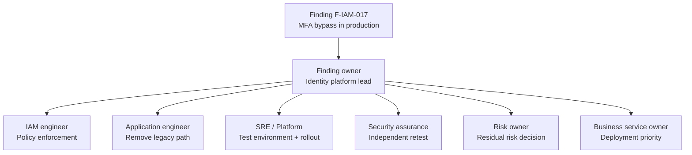
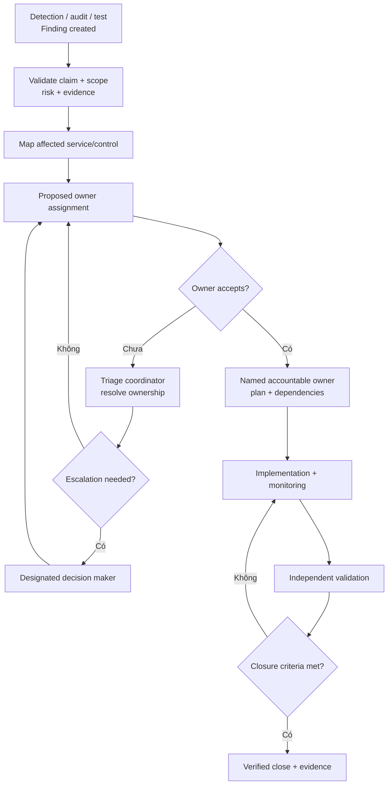

# Finding owner trong Remediation: xác lập trách nhiệm và kiểm chứng đóng phát hiện bảo mật

## 1. Finding owner là ai và tại sao quan trọng?

Một cuộc kiểm tra an ninh phát hiện một tài khoản quản trị production có thể đăng nhập qua đường xác thực cũ mà không cần MFA. Nhóm kiểm toán tạo finding, nhóm IAM nhận thông báo, nhóm ứng dụng nêu rằng đường đăng nhập thuộc nền tảng, còn nhóm nền tảng cho rằng policy là trách nhiệm IAM. Sau hai tuần, có nhiều tin nhắn trao đổi nhưng không có người chịu trách nhiệm điều phối, không có ngày hoàn thành và không ai xác nhận đường bypass đã bị chặn.

Vấn đề ở đây không chỉ là **control kỹ thuật chưa đạt** mà còn là **finding chưa có quyền sở hữu rõ ràng**.

**Finding owner** là **cá nhân hoặc vai trò được chỉ định chịu trách nhiệm giải trình về việc một phát hiện đã được tiếp nhận, đánh giá, có kế hoạch xử lý phù hợp, được theo dõi và được đưa đến trạng thái kết thúc có căn cứ** theo quy trình tổ chức. Finding owner **không nhất thiết trực tiếp sửa toàn bộ lỗi** và **không tự động có quyền chấp nhận rủi ro, tự xác nhận kết quả hoặc miễn trừ nghĩa vụ**.

Trong chương **Remediation** của module **SECURITY_SECURITY_ASSURANCE**, người học cần gắn việc xác định owner với mục tiêu của dịch vụ: **xây dựng cách đánh giá có bằng chứng rằng hệ thống đáp ứng các mục tiêu bảo mật**, từ rủi ro, requirements, security controls đến kiểm thử, audit và khắc phục findings. Công việc của finding owner là đảm bảo có một **đường trách nhiệm và bằng chứng xuyên suốt**, không để một phát hiện quan trọng biến mất ở giữa nhiều nhóm.

> Một finding có người được @mention chưa chắc đã có owner. Owner thực sự cần được xác nhận, có phạm vi quyền hạn và trách nhiệm, biết tiêu chí hoàn thành, theo dõi phụ thuộc và có cơ chế escalation nếu không thể xử lý.

### Kết quả học tập

Sau bài này, người học có thể:

1. Giải thích vai trò **finding owner** và phân biệt với **control owner, asset/service owner, remediation assignee, risk owner, audit owner và independent validator**.
2. Đề xuất cơ chế phân công, xác nhận trách nhiệm, chuyển giao và escalation theo mức rủi ro.
3. Thiết kế **finding register** với owner, severity, bằng chứng, kế hoạch sửa, hạn, phụ thuộc, ngoại lệ và retest.
4. Xác định cách xử lý một finding liên quan nhiều nhóm hoặc nhà cung cấp mà không mất đầu mối trách nhiệm.
5. Đo **ownership coverage, overdue, aging và verified closure** bằng đúng mẫu số.
6. Nhận biết khác biệt giữa **“đã sửa”**, **“có bằng chứng đã sửa”** và **“được phép đóng finding”**.

## 2. Phân biệt Finding, vulnerability, incident và remediation task

Trước khi phân công owner, cần xác định **đơn vị công việc**.

| Khái niệm | Ý nghĩa | Ví dụ |
|---|---|---|
| **Finding** | Phát hiện đã được mô tả và đánh giá so với yêu cầu, baseline hoặc kỳ vọng bảo mật | Một nhóm admin thuộc production không bị enforce MFA |
| **Vulnerability** | Điểm yếu kỹ thuật/logic có thể bị khai thác | Lỗ hổng trong thư viện xử lý đầu vào |
| **Control gap** | Control thiếu, sai scope hoặc hoạt động không đạt yêu cầu | Audit source không gửi đủ log vào SIEM |
| **Incident** | Sự kiện an ninh cần phản ứng và có thể gây tác động | Tài khoản admin đã bị dùng trái phép |
| **Remediation plan** | Tập hoạt động nhằm sửa nguyên nhân và giảm rủi ro | Chặn legacy auth, cập nhật policy, kiểm thử |
| **Remediation task** | Công việc cụ thể được giao cho người/nhóm thực hiện | Sửa cấu hình identity provider |
| **Finding owner** | Đầu mối accountable cho tiến trình và kết quả giải quyết finding | Identity platform lead |
| **Validator/reviewer** | Người/nhóm xác minh tiêu chí đóng finding bằng bằng chứng mới | Security assurance team |

**Một finding có thể sinh nhiều remediation tasks.** Ngược lại, một thay đổi hệ thống có thể xử lý nhiều findings nhưng **mỗi finding vẫn cần kết luận và bằng chứng riêng**. Nếu finding thực chất là dấu hiệu của sự cố đang diễn ra, cần kích hoạt quy trình incident response theo tiêu chí hiện hành, không để ticket remediation làm chậm containment.

### Ví dụ về tách đơn vị

Finding `F-IAM-017`: “Admin legacy login bypass MFA ở tenant production”.

- Task A: cập nhật conditional access policy.
- Task B: chặn hoặc giới hạn legacy authentication paths.
- Task C: đối chiếu admin inventory và các exception.
- Task D: thêm regression test để phát hiện tái diễn.
- Task E: thực hiện negative test và lưu source audit evidence.

Chỉ định năm người cho năm task **không thay thế** việc có **một finding owner accountable** cho `F-IAM-017`. Owner phải biết task nào blocking, task nào đang chờ, cách xử lý nếu đội thực hiện không thể sửa và khi nào chuyển sang validation.

## 3. Finding owner chịu trách nhiệm những gì?

Finding owner không chỉ “nhận ticket”. Vai trò bao phủ toàn bộ vòng đời:

1. **Tiếp nhận:** xác nhận finding thuộc dịch vụ/tài sản và điều khoản áp dụng.
2. **Kiểm tra tính rõ ràng:** yêu cầu evidence, scope, observed state, expected state và finding severity.
3. **Phối hợp triage:** làm rõ mức tác động, khả năng khai thác, phụ thuộc và biện pháp giảm rủi ro trước mắt.
4. **Đặt kế hoạch:** tìm root cause, chia công việc, xác định assignees, nguồn lực, dependencies và milestone.
5. **Quản lý thời hạn:** theo dõi due date theo chính sách, nhận diện blocker sớm và escalation khi có rủi ro trễ.
6. **Điều phối thay đổi:** bảo đảm mọi sửa đổi tuân thủ change control và không gây regression nghiêm trọng.
7. **Chuẩn bị evidence:** thu hoặc yêu cầu raw evidence, test result, effective configuration và bản ghi phê duyệt.
8. **Yêu cầu retest:** đưa finding đến người có trách nhiệm xác minh, cung cấp acceptance criteria và dữ liệu.
9. **Xử lý phản hồi:** nếu retest FAIL hoặc INCONCLUSIVE, mở lại công việc và cập nhật kế hoạch.
10. **Kết thúc có căn cứ:** đề xuất closure sau khi được xác minh đúng quyền và lưu lịch sử.
11. **Ngăn tái phát:** cập nhật baseline, automation, runbook và review các trường hợp tương tự.
12. **Duy trì khả năng audit:** làm rõ ai quyết định, ai thực hiện, khi nào, vì sao, bằng chứng nào hỗ trợ.

Owner không bắt buộc tự thực hiện các bước kỹ thuật nếu không có quyền hoặc chuyên môn; nhiệm vụ của owner là **không để thiếu hành động và không làm mất khả năng giải trình**.

## 4. Phân biệt các vai trò dễ bị nhầm lẫn

| Vai trò | Trách nhiệm chính | Không tự động được phép |
|---|---|---|
| **Finding owner** | Chịu trách nhiệm theo dõi việc xử lý finding đến kết luận có căn cứ | Tự chấp nhận mọi residual risk hoặc tự xác nhận độc lập |
| **Control owner** | Chịu trách nhiệm thiết kế và vận hành một security control | Sở hữu tất cả findings liên quan tới control ở mọi dịch vụ |
| **Asset/service owner** | Chịu trách nhiệm dịch vụ, nguồn lực, hoạt động kinh doanh hoặc kỹ thuật | Bỏ qua yêu cầu security/compliance do quyền sở hữu tài sản |
| **Remediation assignee/implementer** | Thực hiện thay đổi cụ thể và cung cấp evidence kỹ thuật | Tự đổi observed FAIL thành PASS nếu chưa có validation |
| **Risk owner** | Chịu trách nhiệm quyết định cách xử lý rủi ro thuộc phạm vi được giao | Miễn trừ yêu cầu pháp lý/hợp đồng vượt thẩm quyền |
| **Security/assurance validator** | Kiểm tra evidence, chạy retest, đánh giá closure | Tự sửa chính sách severity nhằm làm finding đạt |
| **Audit/compliance reviewer** | Xác định yêu cầu áp dụng, độ phù hợp và kết quả kiểm toán | Thay đổi hệ thống production ngoài quyền được cấp |
| **Program/process owner** | Quản trị chuẩn SLA, workflow, dashboard và cơ chế escalation | Mặc nhiên nhận trách nhiệm remediation của mọi hệ thống |
| **Incident commander** | Chỉ huy ứng phó khi có sự cố đang diễn ra | Thay thế vĩnh viễn finding owner sau incident nếu không bàn giao |
| **Third-party/vendor owner** | Quản trị quan hệ nhà cung cấp và điều khoản liên quan | Đảm bảo vendor sẽ sửa đúng hạn chỉ bằng việc gửi email |

Một người có thể kiêm nhiều vai trò ở tổ chức nhỏ, nhưng khi nguy cơ **tự kiểm tra công việc của mình** là đáng kể, cần kiểm tra độc lập hoặc cơ chế peer review phù hợp rủi ro. Sự trùng vai trò cần được ghi nhận, không giả định độc lập.

### Finding owner và risk owner

Finding owner có thể đề xuất ngoại lệ vì nền tảng legacy chưa thể nâng cấp, nhưng **risk acceptance** phải được quyết định theo chính sách bởi risk owner/người có thẩm quyền. Nếu nghĩa vụ bắt buộc không cho phép ngoại lệ nội bộ, rủi ro không thể “được chấp nhận” để biến hành vi không tuân thủ thành tuân thủ.

## 5. Nguyên tắc một đầu mối accountable, nhiều người thực hiện

Với một finding cần nhiều nhóm, cách làm hiệu quả thường là **một accountable finding owner được chỉ định** và **nhiều assignees cho các hành động con**.



Đường liên kết tới validator và risk owner biểu thị **phối hợp và yêu cầu ra quyết định**, không có nghĩa finding owner được chỉ huy độc lập các quyết định của họ. Phải đảm bảo **tách trách nhiệm**: owner tổ chức công việc; validator có quyền xác nhận hoặc từ chối closure theo bằng chứng; risk owner quyết định ngoại lệ theo thẩm quyền.

### Vì sao “đồng sở hữu ngang nhau” dễ gặp vấn đề?

Nếu ticket có ba nhóm “co-owner” nhưng không ai có trách nhiệm tổng hợp, mọi nhóm có thể nói đã hoàn thành phần mình trong khi finding vẫn FAIL. Thay vào đó:

- Một owner chịu trách nhiệm cập nhật trạng thái finding.
- Các workstream có owner riêng và các mốc phải đạt.
- Người giải quyết xung đột là người có thẩm quyền escalation được ghi rõ.
- Việc chuyển owner phải có lịch sử chuyển giao và acceptance.

Một mô hình tổ chức có thể dùng **team owner** và **named delegate/on-call role** thay cho cá nhân dài hạn; quan trọng là tại mỗi thời điểm có **đầu mối chịu trách nhiệm thực tế**.

## 6. Chọn finding owner theo ranh giới trách nhiệm nào?

Không nên gán owner theo người phát hiện issue, theo người tạo ticket hoặc theo đội rảnh nhất. Những tiêu chí hữu ích:

| Tiêu chí | Câu hỏi | Dấu hiệu lựa chọn tốt |
|---|---|---|
| **Quyền tác động** | Ai có thẩm quyền điều phối sửa những thành phần ảnh hưởng chính? | Có quyền lập kế hoạch, huy động hoặc escalation |
| **Chủ sở hữu tài sản/control** | Hệ thống hoặc security control nào gây ra finding? | Có service/control ownership rõ và được xác nhận |
| **Kiến thức chuyên môn** | Nhóm nào hiểu root cause và failure mode? | Có thể đề xuất sửa và hướng dẫn test |
| **Khả năng điều phối** | Ai có thể xử lý phụ thuộc giữa nhiều nhóm/vendor? | Có đầu mối quản trị và kênh escalation |
| **Nguồn lực** | Ai chịu trách nhiệm bảo đảm task được ưu tiên và có lịch? | Có kế hoạch, milestone và quản lý phụ thuộc |
| **Phạm vi kinh doanh** | Ai chịu tác động nếu việc sửa gây downtime hoặc thay quy trình? | Phối hợp với business service owner |
| **Thời hạn và mức rủi ro** | Có cần owner đủ thẩm quyền quyết định khẩn? | Có escalation lên cấp quản lý phù hợp |
| **Auditability** | Có thể xác định ai đã nhận trách nhiệm ở từng thời điểm? | Named owner, acknowledgement, change log |

### Một số quy tắc gán owner thực hành

- IAM policy áp sai scope: ưu tiên **owner vận hành policy/IAM** làm finding owner; nhóm ứng dụng phối hợp nếu cần loại legacy path.
- Vulnerability trong application code: thường **service/application owner** là finding owner; developer nhận nhiệm vụ code fix.
- Cloud misconfiguration từ shared landing zone: thường **platform control owner** khi root cause nằm trong template chung.
- Lỗi phát sinh do cấu hình tenant của một sản phẩm SaaS: **customer service/tenant owner** điều phối sửa với vendor.
- Nhà cung cấp không đáp ứng nghĩa vụ trong hợp đồng: có thể **vendor relationship owner** là đầu mối, nhưng cần security/compliance và business risk owner tham gia.
- Data retention sai lệch giữa nhiều hệ: lựa chọn owner theo **quy trình dữ liệu chịu trách nhiệm chính**, đồng thời có các subtask cho ứng dụng, storage và đối tác.

Đây là **gợi ý routing**, không phải quy định áp cho mọi tổ chức. Khi chưa rõ nguyên nhân, có thể đặt **temporary triage owner** chịu trách nhiệm phân tích và tìm người nhận cuối cùng, tránh để ticket mồ côi.

## 7. Giai đoạn từ phát hiện đến owner được xác nhận

Một workflow có thể được thiết kế như sau:



### Các checkpoint bắt buộc

1. **Finding hợp lệ:** biết expected state, observed state, phạm vi, nguồn và mức tin cậy.
2. **Owner proposed:** có service/control routing và căn cứ lựa chọn.
3. **Owner accepted:** người/nhóm nhận trách nhiệm xác nhận, có quyền và đường escalation.
4. **Plan recorded:** có tasks, owners, target dates, dependencies, criteria và biện pháp giảm rủi ro trước mắt.
5. **Implementation evidence:** mọi sửa đổi có change references và kết quả kiểm tra kỹ thuật.
6. **Validation:** reviewer xác minh điều kiện đóng với evidence còn mới, đúng scope.
7. **Closure hoặc mở lại:** lưu decision, date, reviewer và trạng thái các exceptions/unknowns.

Trạng thái “Assigned” không nên được coi là đã **accepted** nếu đội nhận việc chưa biết hoặc không có năng lực xử lý. Có thể dùng cơ chế auto-accept theo quy định nếu người/nhóm thực sự được thông báo và chịu trách nhiệm; điều đó phải được định nghĩa trong workflow.

## 8. Finding owner phải nhận đủ thông tin để làm việc

Một finding không rõ ràng sẽ khó có người nhận trách nhiệm hoặc sẽ bị giải quyết sai hướng.

| Trường đầu vào | Ý nghĩa đối với owner |
|---|---|
| `finding_id`, `source_type` | Định danh và nguồn từ pen test, audit, detection, scan, review |
| `requirement_id`, `control_id` | Điều kiện được yêu cầu |
| `asset/service scope` | Cái gì bị ảnh hưởng và ai sở hữu |
| `observed_state`, `expected_state` | Vấn đề cần khắc phục cụ thể |
| `evidence_refs`, `collected_at` | Căn cứ và độ mới của dữ liệu |
| `severity`, `risk_rationale` | Ưu tiên và yêu cầu escalation |
| `first_seen_at`, `verified_at` | Tuổi thực của phát hiện, không chỉ ngày tạo ticket |
| `reproduction/test procedure` | Cách xác nhận hiện tượng trong phạm vi cho phép |
| `acceptance_criteria` | Điều kiện kiểm chứng đã hết lỗi |
| `deadline_policy`, `target_due_at` | Thời hạn theo thẩm quyền/chính sách |
| `dependencies`, `vendor involvement` | Những nhóm và điều kiện chặn xử lý |
| `risk/exception ownership` | Đường xin quyết định nếu không thể sửa ngay |

Nếu finding thiếu evidence hoặc false positive chưa được phân loại, có thể ở trạng thái **triage** với triage owner; không nên ép đội thực hiện sửa một claim chưa rõ rồi sau đó kết luận họ “quá hạn”.

### Phân biệt mức đầy đủ của finding

- **Validated finding:** có quan sát đáng tin rằng control không đạt.
- **Suspected finding:** có tín hiệu nghi vấn, cần xác minh.
- **Evidence gap:** không đủ thông tin để kết luận control; cần thu bổ sung.
- **Duplicate/same root cause:** liên kết finding khác, chưa tự đóng nếu phạm vi và yêu cầu khác.
- **Risk accepted exception:** vẫn là sai lệch đã biết, được quản lý riêng theo thẩm quyền.

Owner phải biết đang xử lý **loại trường hợp nào** trước khi chốt remediation plan.

## 9. Finding lifecycle: owner chịu trách nhiệm tại mọi chuyển trạng thái

Một state machine minh họa:

| Trạng thái | Ý nghĩa | Trách nhiệm của finding owner |
|---|---|---|
| `NEW` | Đã ghi nhận tín hiệu hoặc finding ban đầu | Bảo đảm được triage kịp theo chính sách |
| `TRIAGE` | Xác minh scope, độ tin cậy và mức rủi ro | Phối hợp định danh tài sản, owner và evidence |
| `ASSIGNED` | Owner được đề xuất/xác nhận | Acknowledge quyền sở hữu và kế hoạch |
| `PLANNED` | Remediation plan được chấp thuận | Gắn tasks, deadlines, dependencies, acceptance |
| `IN_PROGRESS` | Đang sửa hoặc triển khai bù trừ | Theo dõi thay đổi, blocker và progress |
| `READY_FOR_RETEST` | Nhóm sửa báo đã đạt điều kiện | Chuẩn bị evidence, yêu cầu reviewer kiểm tra |
| `RETEST_FAILED` | Kiểm chứng mới vẫn có sai lệch | Mở lại, điều tra, cập nhật root cause/plan |
| `RETEST_INCONCLUSIVE` | Bằng chứng hoặc phương pháp chưa đủ | Khắc phục evidence gap và thử lại |
| `CLOSED_VERIFIED` | Người có thẩm quyền xác nhận đã đạt tiêu chí | Lưu closure decision, reviewer và evidence |
| `RISK_ACCEPTED` | Sai lệch chưa sửa nhưng có quyết định ngoại lệ hợp lệ | Giữ điều kiện, owner, hạn và monitoring; không gọi PASS |
| `INVALIDATED` / `DUPLICATE` | Không phải finding hợp lệ hoặc có bản ghi gốc | Giữ reason, reviewer và liên kết lịch sử |

Các tên trạng thái là **ví dụ thiết kế nội bộ**. Có tổ chức tách trạng thái finding và trạng thái exception thành **hai luồng liên quan**; điều quan trọng là không gộp `CLOSED_VERIFIED` với `RISK_ACCEPTED` thành một “Closed” thiếu lý do.

**Không xoá lịch sử:** nếu finding ở `RETEST_FAILED` rồi chuyển lại `IN_PROGRESS`, phải giữ kết quả thất bại, không thay thế bằng một dấu “Đang sửa” làm mất bằng chứng.

## 10. RACI cho finding remediation

**RACI** giúp xác định ai **Responsible** (thực hiện), **Accountable** (chịu trách nhiệm giải trình), **Consulted** (tham vấn) và **Informed** (được thông tin).

Một mô hình tham khảo:

| Hoạt động | Finding owner | Remediation engineer | Security validator | Risk owner | Business/service owner |
|---|---|---|---|---|---|
| Xác nhận nhận finding và lập kế hoạch | **A/R** | C | C | I | C |
| Khắc phục cấu hình/mã nguồn | **A** về điều phối | **R** | C | I | C |
| Quyết định ưu tiên tài nguyên | R trong điều phối | C | C | C | **A** theo quyền ngân sách |
| Kiểm tra remediation evidence | R cung cấp | R hỗ trợ | **A/R** về kết luận kiểm chứng | I | I |
| Quyết định chấp nhận residual risk | C | C | C | **A/R** | C |
| Phê duyệt change production | C | R | C | I | **A** hoặc change authority được quy định |
| Đóng finding sau retest | R đề xuất | C | **A** về kết quả assurance | I | I |
| Theo dõi ngoại lệ còn hiệu lực | **R** nếu được giao | C | C | **A** về quyết định rủi ro | C |

**RACI cần đọc theo từng quyết định**, không bắt buộc “finding owner là A” cho tất cả mọi hàng. Ở hoạt động phê duyệt rủi ro, accountable phải là **risk owner có thẩm quyền**; ở retest, trách nhiệm kết luận nên thuộc **validator**. Một RACI thật phải phù hợp organizational policy và authority matrix.

Không sử dụng bảng trên để tuyên bố finding owner có quyền override assessor hoặc bỏ qua change approval.

## 11. Đối mặt với nhiều nhóm và tranh chấp ownership

Một finding có thể đi qua application code, platform, network, IAM và vendor, làm xuất hiện câu hỏi “của đội nào?”.

### Quy trình giải quyết không làm chậm xử lý

1. Giữ một **temporary triage owner** trong lúc phân tích, không để ticket trống owner.
2. Tách rõ **symptom**, **affected service**, **root-cause hypotheses** và **control accountability**.
3. Xác định ai có quyền điều phối fix chính hoặc quyết định ưu tiên toàn bộ workstream.
4. Liệt kê từng nhóm cần hành động với `task_owner`, `milestone` và dependency.
5. Ghi quyết định ai là finding owner và thời điểm acceptance.
6. Nếu không thống nhất, escalate tới **service/control ownership authority** đã được quy định.
7. Giữ biện pháp containment và lịch reporting trong khi tranh chấp được xử lý.
8. Khi root cause đổi, chuyển owner có lịch sử, không hủy ticket hoặc reset aging tùy tiện.

### Ví dụ cross-team

Finding: “Audit events từ tài khoản admin không vào SIEM”.

- IAM vận hành identity provider.
- Platform vận hành log transport.
- SOC/SIEM vận hành ingestion và detection.
- Security assurance yêu cầu end-to-end proof.

Nếu vấn đề chưa rõ, một owner điều phối được chỉ định để bảo đảm **source event → export → transport → ingest → query/alert** được kiểm tra. Owner task có thể thay đổi theo nơi phát hiện lỗi thực; việc chốt trách nhiệm phải dựa trên **ràng buộc quyền sở hữu dịch vụ/control**, không phải nơi thông báo cuối cùng xuất hiện.

## 12. Severity, due date và quyền quyết định của owner

Finding owner cần biết **mức rủi ro và hạn xử lý**, nhưng không nên tự thay severity hoặc tự kéo dài hạn để dashboard đẹp.

Phân loại cần xem:

- Loại requirement và nghĩa vụ pháp lý/hợp đồng, bao gồm deadlines có thể áp dụng.
- Mức ảnh hưởng confidentiality, integrity, availability và business impact.
- Quyền truy cập, dữ liệu nhạy cảm, production exposure, Internet-facing attack surface.
- Mức độ đã được khai thác hoặc có incident/active threat hay chưa.
- Tính phổ biến của lỗi: một asset hay nhiều accounts, common control hay isolated config.
- Biện pháp bù trừ hiện có và **bằng chứng hiệu lực**.
- Khả năng khôi phục, phát hiện, phản ứng và thời gian phơi nhiễm.
- Độ tin cậy của bằng chứng và các khoảng trống chưa biết.

**Severity của finding** và **priority của công việc remediation** có liên quan nhưng không đồng nhất. Một vấn đề High có thể cần containment tức thời, còn sửa triệt để mất nhiều đợt deploy. Một finding thấp về kỹ thuật vẫn có thể bị gắn deadline bắt buộc theo hợp đồng.

### Bảng ví dụ theo mức độ

| Severity minh họa | Hành động owner | Escalation |
|---|---|---|
| **Critical** | Xác nhận khẩn, containment, thông báo owner kinh doanh và IR khi có dấu hiệu sự cố | Kích hoạt tuyến khẩn theo policy |
| **High** | Kế hoạch ngắn hạn, milestone rõ, review thường xuyên | Escalate sớm khi blocker đe dọa deadline |
| **Medium** | Ưu tiên trong lịch delivery, có acceptance và retest | Theo dõi theo chu kỳ phù hợp |
| **Low** | Bổ sung backlog có kiểm soát, deadline theo policy | Escalate khi trễ hoặc phạm vi tăng |

Không có một bộ thời hạn 24 giờ/7 ngày/30 ngày áp dụng mặc định cho mọi tổ chức. **Thời hạn thực tế phải lấy từ policy, nghĩa vụ và quyết định đã duyệt.**

## 13. SLA/OLA: các mốc thời gian cần phân biệt

Để quản trị finding owner minh bạch, cần phân biệt:

| Thời gian | Mốc bắt đầu và kết thúc | Chỉ số |
|---|---|---|
| **Time to acknowledge** | Từ lúc finding được giao hợp lệ đến lúc owner xác nhận | Độ trễ ownership acceptance |
| **Time to plan** | Từ validated finding đến khi có remediation plan được duyệt | Độ trễ lập kế hoạch |
| **Time to contain** | Từ xác nhận rủi ro đến khi biện pháp tạm giảm ảnh hưởng có hiệu lực | Thời gian giảm phơi nhiễm ban đầu |
| **Time to implement** | Từ lúc kế hoạch bắt đầu đến khi fix được triển khai | Thời gian thực thi |
| **Time to retest** | Từ ready for retest đến khi validator hoàn tất phép kiểm | Thời gian chờ kiểm chứng |
| **Time to verified close** | Từ verified finding đến closure có bằng chứng | Tuổi finding hoàn chỉnh |
| **Overdue age** | Từ mốc due date đã duyệt tới thời điểm quan sát hoặc closure trễ | Mức quá hạn |

Nếu tổ chức tạm dừng SLA vì đang chờ vendor hoặc chờ maintenance window, phải có **pause policy đã duyệt**, reason và thời gian; không tự bỏ những ngày chờ khỏi số đo. Thời hạn compliance bắt buộc bên ngoài có thể **không được tạm dừng** chỉ vì workflow nội bộ đang đợi.

### Ví dụ thời gian

Giả sử finding được verified vào **01/11/2026 09:00 UTC**, gán owner lúc **01/11 12:00**, owner acknowledge lúc **02/11 08:00**, fix triển khai **07/11 10:00**, validator retest PASS **08/11 09:00**.

- Time to acknowledge kể từ khi assignment hợp lệ: **20 giờ**.
- Time to verified close kể từ verified timestamp: **7 ngày**.
- “Fix deployed” tại 07/11 không phải thời điểm verified closure.
- Nếu policy có thời hạn closure **05/11**, finding trễ dù retest PASS sau đó; phải báo overdue history trung thực.

Số liệu là ví dụ, không phải SLA mặc định.

## 14. Khi nào finding owner cần escalation?

Owner phải báo cáo và yêu cầu hỗ trợ theo tuyến escalation phù hợp trước khi rủi ro trở nên nghiêm trọng, không chờ đến ngày trễ.

Các trigger thường hữu ích:

- Không có team nhận ownership trong giới hạn routing/triage.
- Một task trọng yếu bị kẹt do quyền, ngân sách, vendor hoặc change freeze.
- Deadline có nguy cơ không đạt, không có phương án containment phù hợp.
- Severity/risk tăng do tài sản mới, khai thác thực tế hoặc dữ liệu nhạy cảm.
- Nhiều findings cùng root cause cho thấy systemic issue.
- Retest liên tục FAIL hoặc remediation gây regression.
- Ngoại lệ sắp hết hạn hoặc đã quá hạn.
- Quyết định rủi ro cần cấp cao hơn quyền của finding owner.
- Nghi ngờ sự cố đang xảy ra, yêu cầu IR/cấp xử lý khẩn.

### Mẫu escalation hữu ích

Thông điệp escalation nên trả lời:

- **What:** finding ID, claim, ảnh hưởng tới service/assets.
- **Why now:** severity, exposure, deadline, sự kiện mới.
- **What is blocked:** task và dependency cụ thể; từ khi nào.
- **Options:** sửa, containment, giảm scope được phép, biện pháp bù trừ, phương án thay thế.
- **Decision requested:** nguồn lực, lựa chọn kỹ thuật, chấp nhận rủi ro thuộc quyền ai.
- **Next checkpoint:** khi nào cập nhật tình hình, người chịu trách nhiệm thông báo.

Không gửi “URGENT: please help” chung chung mà thiếu căn cứ và quyết định cần thiết.

## 15. Finding owner quản lý remediation plan thế nào?

Một remediation plan nên giải thích **thay đổi gì để control đạt**, không chỉ “cập nhật server”.

| Thành phần | Nội dung cần có |
|---|---|
| Root cause hypothesis/verified | Điều đang gây ra gap; mức chắc chắn và evidence |
| Containment | Hạn chế tác động ngay trong khi chờ sửa triệt để |
| Permanent fix | Thay đổi thiết kế/config/code/process cần thực hiện |
| Work breakdown | Task ID, assignee, dependencies, milestones |
| Change safety | Test environment, canary, approval, rollback/stop criteria |
| Security regression | Positive/negative tests, permission tests, logging |
| Business impact | Downtime, performance, customer effect, communication |
| Acceptance criteria | Điều kiện rõ để validator kết luận |
| Evidence package | Raw config/log/test, IDs, timestamps, query/version |
| Due date và escalation | Hạn theo policy và điều kiện cập nhật risk |
| Reassessment triggers | Thay scope/architecture/threat/requirements |

**Sửa một symptom chưa đủ:** chặn một user cụ thể không thay thế việc sửa quy tắc tạo role quá rộng; vá một host không đủ nếu image build pipeline tiếp tục sinh ra cấu hình lỗi.

### Ví dụ plan cho IAM

1. Khóa đường legacy authentication đang tạo bypass trong scope được phê duyệt.
2. Đối chiếu admin inventory ở mọi tenant production đã xác định.
3. Sửa policy assignment và exception list.
4. Triển khai qua change control và có rollback.
5. Thử các đường đăng nhập đã bị bypass bằng tài khoản thử có quyền.
6. Xác minh sign-in audit log thể hiện quyết định enforce/deny.
7. Thêm kiểm tra regression khi thêm protocol hoặc tenant mới.
8. Nộp bằng chứng; validator retest và quyết định closure.

## 16. Evidence mà finding owner phải duy trì

**Evidence chất lượng tốt** giúp phân biệt “đội kỹ thuật đã nói sửa xong” và “security requirement đã được kiểm chứng”.

| Nhóm evidence | Ví dụ | Câu hỏi kiểm chứng |
|---|---|---|
| **Baseline** | Requirement/control version, risk decision, expected state | Thực tế cần đạt điều gì? |
| **Original observation** | Scan results, log, authorized test, audit workpaper | Lỗi đã tồn tại trong scope nào? |
| **Scope/population** | Asset inventory, identities, tenants, regions | Có đối tượng nào bị bỏ sót? |
| **Change evidence** | PR, deployment ID, config diff, approval | Điều gì đã thay đổi và ai phê duyệt? |
| **Effective state** | Live configuration, policy bindings, service inventory | Sửa đổi đã vào đúng môi trường chưa? |
| **Behavioral verification** | Negative test, restore test, end-to-end log/alert | Control có hoạt động đúng không? |
| **Risk/exception** | Owner approval, bù trừ, expiry, monitoring | Sai lệch nào vẫn còn được quản lý? |
| **Independent review** | Validator ID, test method, result, limitations | Ai đủ quyền xác nhận closure? |
| **Retention/integrity** | Raw refs, timestamp UTC, manifest/hash, access log | Có thể audit lại hồ sơ không? |

**Finding owner không cần tự tạo mọi artifact**, nhưng phải đảm bảo **evidence được thu đúng lúc, đúng scope, có thể truy vết và được lưu an toàn**. Raw logs và bản sao cấu hình có thể chứa dữ liệu cá nhân, token, địa chỉ nội bộ hoặc quyền nhạy cảm; sử dụng kho phân quyền và redaction có thể giải thích.

Checksum trùng chỉ hỗ trợ kết luận artifact không bị thay đổi so với manifest đáng tin; không chứng minh dữ liệu nguồn đúng nếu collector lấy sai tenant hoặc query sai.

## 17. Closure criteria phải được xác định trước khi sửa

Một phát hiện có thể bị “đóng nhầm” khi chỉ xem checklist công việc thay vì điều kiện control đạt. Finding owner nên thống nhất **acceptance criteria** với validator **trước khi triển khai remediation**.

Ví dụ finding “legacy admin MFA bypass”:

| Điều kiện đóng | Phép kiểm đề xuất |
|---|---|
| Admin population đúng và đủ scope | IAM role inventory đối chiếu từ nguồn authoritative |
| Policy áp vào mọi admin path liên quan | Effective assignments và exception list |
| Bypass cũ không còn hoạt động | Negative login test đã được ủy quyền, đúng protocol |
| Những đường đăng nhập hợp lệ tiếp tục hoạt động | Positive login smoke test |
| Audit events ghi đúng enforcement | Source log + SIEM ingest correlation |
| Trường hợp emergency access được kiểm soát | Approved exception policy, logging, ownership và review |
| Không có regression trong service chính | Integration/smoke tests và post-change monitoring |
| Evidence review hoàn tất | Validator sign-off và links tới raw artifacts |

**Closure không yêu cầu “zero risk tuyệt đối”**, nhưng phải đáp ứng đầy đủ **tiêu chí của finding đã được xác định** và công bố residual risk/limitations. Nếu chưa đủ bằng chứng để đo một điều kiện bắt buộc, kết luận có thể **INCONCLUSIVE**, không được mặc định PASS.

## 18. Independent retest và quyền đóng finding

Nguyên tắc quan trọng:

> Người triển khai fix có thể đề xuất “ready for validation”; việc xác nhận remediation có hiệu quả nên tuân theo cơ chế review độc lập phù hợp mức rủi ro.

### Retest cần kiểm gì?

1. Môi trường đã sửa đúng: production account/tenant/resource IDs.
2. Control requirement và acceptance criteria còn áp dụng.
3. Phạm vi population không bị giảm giả tạo do filter hoặc exception mới.
4. Kết quả **negative test** chứng minh đường sai bị từ chối.
5. Kết quả **positive test** chứng minh chức năng hợp lệ còn hoạt động.
6. Effective configuration phù hợp change đã duyệt.
7. Logging/monitoring liên quan ghi nhận behavior như yêu cầu.
8. Remediation không tạo lỗ hổng mới hoặc regression trong phạm vi kiểm tra.
9. Evidence có nguồn, thời gian, method, reviewer và giới hạn.
10. Kết luận được ghi với reason và finding lifecycle update.

Nếu retest FAIL, owner quay lại phối hợp khắc phục và ghi lịch sử. Nếu retest INCONCLUSIVE do thiếu quyền hoặc lỗi môi trường kiểm thử, owner phải giải quyết evidence gap; không đổi finding sang CLOSED_VERIFIED.

### Ví dụ phân biệt kết quả

- **Fix deployed, test chưa chạy:** `READY_FOR_RETEST`, chưa phải PASS.
- **Có test thành công chỉ ở staging:** evidence cho staging, không tự chứng minh production.
- **Negative test FAIL (vẫn bypass):** `RETEST_FAILED` và finding tiếp tục mở.
- **Test không có raw logs hoặc sai principal:** `RETEST_INCONCLUSIVE`.
- **Test đầy đủ, không bypass trong scope, reviewer chấp nhận:** `CLOSED_VERIFIED`, có thể còn monitoring theo risk.

## 19. Risk acceptance không phải chuyển nghĩa finding thành PASS

Một finding có thể chưa sửa vì hạn chế kỹ thuật, kinh doanh hoặc nhà cung cấp. Trong trường hợp tổ chức cho phép, risk owner có thẩm quyền có thể **chấp nhận residual risk có điều kiện và có thời hạn**.

Để không làm mờ sự thật, cần giữ hai trường độc lập:

- **Measured finding/control status:** những gì đã kiểm chứng, ví dụ `FAIL` hoặc `INCONCLUSIVE`.
- **Risk treatment/decision:** `REMEDIATE`, `COMPENSATE`, `ACCEPTED_EXCEPTION`, `AVOID` hoặc phương án được phê duyệt khác.

| Trường exception | Ý nghĩa |
|---|---|
| `exception_id`, `finding_id` | Liên kết sai lệch |
| `risk_owner` và `approver` | Quyết định thuộc thẩm quyền nào |
| Scope và điều kiện | Tài sản, dữ liệu, hành vi bị lệch |
| Residual risk | Tác động, khả năng, giả định và mức chấp nhận |
| Compensating controls | Những biện pháp có evidence kiểm thử |
| Effective/expiry dates | Điều kiện tạm thời, không mở vô hạn |
| Monitoring/review | Tần suất và trigger hết hiệu lực |
| Remediation plan | Cách đưa trở lại baseline |
| Audit trail | Ai duyệt, thay đổi gì, thời gian và lý do |

**Owner không tự có quyền biến một vi phạm nghĩa vụ pháp luật, hợp đồng hoặc tiêu chuẩn bắt buộc thành hợp lệ** chỉ nhờ văn bản chấp nhận rủi ro nội bộ. Trong trường hợp này cần phối hợp legal/compliance và người có thẩm quyền ngoài tổ chức khi có nghĩa vụ.

## 20. Ownership transfer: khi nào và thực hiện thế nào?

Trong vòng đời finding, dịch vụ có thể chuyển nhóm, engineer nghỉ việc, tái cấu trúc team hoặc root cause được xác nhận thuộc hệ thống khác. **Chuyển ownership là hợp lệ**, nhưng phải bảo toàn lịch sử và trách nhiệm.

### Quy trình handoff

1. Owner hiện tại ghi lý do: thay service owner, đổi scope, root cause mới hay chuyển quyền quản lý.
2. Cập nhật **candidate owner/team** và căn cứ routing.
3. Người/nhóm nhận mới **acknowledge** và xác nhận các task, risk, due date, evidence links.
4. Chuyển giao tình trạng hiện tại: blockers, completed tasks, failed retests, approved exceptions.
5. Cập nhật `owner_changed_at`, `previous_owner`, `new_owner`, `approved_by`, `reason`.
6. Kiểm tra các deadlines, escalation và lịch reporting **không bị reset tùy tiện**.
7. Xác nhận những task đang mở có assignee và không có dependency rơi vào khoảng trống.
8. Review lại ownership nếu scope/root cause tiếp tục thay đổi.

Nếu owner cũ rời tổ chức trước khi nhận mới, workflow phải có **fallback process owner/triage coordinator** nhận trách nhiệm tạm. Không để status owner rỗng trong lúc finding vẫn đang hoạt động.

### Ownership history khác blame assignment

Mục tiêu không phải tìm ai để đổ lỗi, mà là bảo đảm hệ thống biết **người chịu trách nhiệm tại từng mốc**. Một finding phát sinh từ lỗ hổng legacy có thể có nhiều lần chuyển owner hợp lệ; audit trail cần phản ánh điều đó, không che bằng cách ghi đè tên owner cuối cùng.

## 21. Vendor và third-party finding owner

Khi finding liên quan nhà cung cấp, tổ chức vẫn cần **một owner phía mình** để điều phối hợp đồng, đo rủi ro và đòi bằng chứng, dù vendor là người phải sửa kỹ thuật.

Ví dụ finding: “SaaS nhà cung cấp không có bằng chứng restore test cho dữ liệu khách hàng theo RPO đã cam kết”.

| Vai trò | Trách nhiệm |
|---|---|
| Internal finding owner | Theo dõi gap, scope, hạn, escalation, vendor communication và risk decision |
| Vendor technical owner | Thực hiện restore test/khắc phục theo phạm vi vendor |
| Contract/vendor manager | Xem điều khoản, đường escalation và nghĩa vụ cung cấp evidence |
| Business service owner | Xác định ảnh hưởng nếu vendor không đạt, lựa chọn fallback/exit |
| Data/security owner | Đánh giá data integrity, quyền, kết quả retest |
| Risk owner | Quyết định chấp nhận rủi ro trong giới hạn thẩm quyền |
| Assurance reviewer | Đánh giá evidence vendor và closure criteria |

**Không đóng finding chỉ vì vendor trả lời “Issue resolved”.** Phải xem bằng chứng phù hợp dịch vụ, region, kỳ, loại dữ liệu và test conditions đã yêu cầu. Nếu vendor không thể cung cấp đầy đủ raw evidence vì bảo mật, có thể cân nhắc report độc lập hoặc bằng chứng tóm tắt có scope rõ, nhưng phải ghi giới hạn.

**SLA vendor khác SLA của internal finding**: thời hạn hợp đồng và thời hạn quản trị nội bộ phải được theo dõi riêng; sự chậm trễ của vendor không tự hủy trách nhiệm của owner phía khách hàng.

## 22. Finding gốc, findings trùng lặp và remediation theo nhóm

Nhiều công cụ có thể phát hiện cùng một nguyên nhân: CSPM, pen test, audit, SIEM và manual review đều báo quyền storage quá rộng.

### Có nên gộp tất cả findings không?

Chỉ khi **thật sự cùng root cause/requirement/scope và cùng acceptance criteria**. Cần tránh hai cực đoan:

- **Không gộp:** 200 tickets trùng cùng một template lỗi khiến owner quá tải.
- **Gộp tùy tiện:** xóa mất rủi ro riêng của database, region hoặc yêu cầu compliance khác.

Một mô hình hợp lý:

- **Parent/root-cause remediation initiative:** sửa IaC template cấp quyền sai.
- **Finding A:** sai ở 12 buckets tại account X.
- **Finding B:** sai ở 5 buckets thuộc dữ liệu nhạy cảm account Y.
- **Finding C:** audit exception theo một yêu cầu lưu log riêng.

Có thể có cùng một owner chương trình và các task nhóm, nhưng **điều kiện đóng A/B/C vẫn được kiểm tra riêng**. Việc parent task hoàn thành không tự chứng minh tất cả child findings PASS.

### Evidence của de-duplication

Ghi `duplicate_of`, `root_cause_ref`, danh sách asset scopes, source evidence và lý do kết luận cùng lỗi; không xóa dữ liệu nguồn. Nếu một alert mới sau remediation chỉ ra lỗi quay lại, cần ghi recurrence hoặc mở lại theo policy, không đánh thành duplicate đã đóng mà không kiểm tra.

## 23. Mẫu YAML cho finding owner và remediation workflow

Mẫu sau là **dữ liệu học tập giả định**, không phải hệ thống production hoặc tiêu chuẩn bắt buộc:

```yaml
finding_id: F-IAM-017
title: "Legacy admin authentication path does not enforce approved MFA"
module: SECURITY_SECURITY_ASSURANCE
finding_source:
  type: authorized_security_test
  test_run_id: "auth-negative-test-20261128-04"
  collected_at_utc: "2026-11-28T02:00:00Z"
requirement:
  id: IAM-ADMIN-MFA-01
  baseline_version: iam-baseline-v4
  expected: "All scoped interactive admin sign-ins enforce approved MFA"
scope:
  environment: production
  tenant_ids: [prod-a, prod-b]
  affected_path: legacy-auth-protocol
  principal_type: interactive-admin
observed:
  state: "A scoped admin test identity can sign in without required MFA"
  result: FAIL
  evidence_refs:
    - "secure-evidence/F-IAM-017/test-run-04.json"
    - "secure-evidence/F-IAM-017/identity-policy.json"
  limitations:
    - "Other authentication paths are still under review"
risk:
  severity: high
  risk_rationale: "Privileged authentication bypass in production"
  risk_owner: business-security-risk-owner
ownership:
  finding_owner:
    role: identity-platform-lead
    id: "user-example-104"
    accepted_at_utc: "2026-11-28T03:00:00Z"
  triage_owner: security-assurance
  remediation_assignees:
    - task_id: TASK-1
      owner: identity-engineering
      action: "Fix policy assignment for legacy path"
    - task_id: TASK-2
      owner: application-auth-team
      action: "Remove unsupported legacy fallback"
    - task_id: TASK-3
      owner: platform-engineering
      action: "Add regression checks and monitor rollout"
  validator: independent-security-assurance
timelines:
  verified_at_utc: "2026-11-28T02:30:00Z"
  target_due_at_utc: "2026-12-05T18:00:00Z"
  due_date_source: "illustrative-internal-risk-policy"
workflow:
  state: IN_PROGRESS
  containment_state: "Approved restriction of affected access path"
  root_cause: "Under investigation"
  remediation_plan_ref: "secure-plans/F-IAM-017/plan-v2"
acceptance:
  - "Approved negative test denies MFA-bypass"
  - "Effective policy covers all in-scope admin paths"
  - "Sign-in audit evidence confirms enforcement"
  - "No unapproved exception remains"
validation:
  status: PENDING
  retest_run_ref: null
  closure_approved_by: null
history:
  - at_utc: "2026-11-28T03:00:00Z"
    action: "finding_owner_accepted"
    actor: identity-platform-lead
```

Trong ví dụ, `finding_owner` là đầu mối điều phối, `validator` quyết định kết quả retest, `risk_owner` xem xét residual risk; mỗi task có thực thi riêng. Trường `target_due_at_utc` là **mốc minh họa**, không phải thời hạn chuẩn cho severity High.

### Lưu ý thiết kế dữ liệu

Không lưu trực tiếp secret, password, private key, session token hoặc log chứa dữ liệu cá nhân chưa lọc trong finding register. Chỉ dùng `evidence_refs` tới kho bảo vệ và metadata đủ để tái kiểm tra. Trường `root_cause` nên là “under investigation” nếu chưa có bằng chứng; không biến giả thuyết thành fact.

Một finding cần lưu **owner history** bằng các event records; YAML minh họa ở trên chỉ có một event. Hệ thống thực cần định danh bất biến, lịch sử version, phân quyền và kiểm soát tính toàn vẹn.

## 24. Pseudocode chọn owner và xử lý việc gán sai

Dùng routing có điều kiện để giảm trường hợp findings mồ côi, nhưng **không để tự động hóa quyết định thay quyền quản lý tổ chức**.

```text
on_validated_finding(finding):
    if finding.has_verified_asset_and_control_owner:
        proposed_owner = routing_map.resolve(
            finding.service_id,
            finding.control_id,
            finding.environment
        )
    else:
        proposed_owner = designated_triage_coordinator

    record_assignment_proposal(
        finding.id,
        proposed_owner,
        routed_at_utc,
        routing_rule_version
    )

    request_acknowledgement(proposed_owner)

on_owner_acknowledged(finding, owner):
    assert owner_is_authorized_for_scope(owner, finding)
    record_owner_acceptance(finding, owner, timestamp)
    require_plan_and_initial_risk_review(finding)

on_owner_rejected(finding, reason):
    preserve_finding_and_due_date_history(finding)
    assign_temporary_triage_accountability(finding)
    escalate_to_owner_resolution_authority(finding, reason)

on_due_date_risk(finding):
    notify_owner_and_risk_decision_authority(finding)
    require_blockers_options_and_next_checkpoint(finding)

on_retest_result(finding, result):
    if result == PASS and required_criteria_and_review_complete:
        close_as_verified_with_evidence(finding)
    elif result == FAIL:
        reopen_remediation_with_finding(finding)
    else:
        keep_validation_pending_with_evidence_gap(finding)
```

Logic minh họa không thực thi thay đổi hoặc tự đóng finding. Nó nhấn mạnh **owner acknowledgement, lý do chuyển, preservation of due date** và quyền review. Khi có finding khẩn cần containment, quy trình không được đợi routing hoàn hảo mới kích hoạt escalation/IR phù hợp.

## 25. Đo mức độ hiệu quả của ownership đúng mẫu số

Dashboard giúp quản trị chương trình remediation, nhưng chỉ số dễ gây nhầm nếu không định nghĩa population.

| KPI | Cách hiểu | Điều không nên suy ra |
|---|---|---|
| **Assignment coverage** | Findings cần owner đã có owner theo trường hệ thống | Owner đã acknowledge hoặc có quyền xử lý |
| **Acknowledged ownership coverage** | Findings active có owner đã xác nhận / findings active cần owner | Finding đã có remediation plan |
| **Time to acknowledge (p50/p95)** | Phân phối thời gian từ assignment hợp lệ tới acceptance | Tốc độ sửa lỗi |
| **Plan completeness rate** | Findings yêu cầu plan đã có plan đủ nội dung | Plan được thực thi thành công |
| **On-time verified closure rate** | Findings đóng có xác nhận trước deadline / tập findings đủ điều kiện theo định nghĩa | Toàn bộ backlog không còn rủi ro |
| **Overdue open findings** | Findings mở và vượt target due tại mốc đo | Tất cả sẽ không bao giờ được khắc phục |
| **Age of open findings** | Thời gian từ verified đến thời điểm quan sát | Chất lượng kỹ thuật của fix |
| **Retest failure rate** | Retests FAIL / retests có kết quả hợp lệ | Mọi sửa lỗi đều có chất lượng thấp nếu sample lệch |
| **Owner churn / reassign count** | Số lần owner thay hoặc tỷ lệ findings reassigned | Chuyển owner luôn là hành vi sai |
| **Unowned high-severity count** | Findings High/Critical active chưa có owner accepted | Rủi ro ở backlog nhỏ/Medium đã được xử lý |
| **Exception expiry coverage** | Ngoại lệ có owner/expiry và review / ngoại lệ cần theo dõi | Rủi ro đã được loại bỏ |

Cần phân biệt **owner assigned** với **owner acknowledged**, **ticket resolved** với **verified closed**, và **risk accepted** với **remediated**.

### Ví dụ dữ liệu định lượng

Giả sử có **24 validated findings đang active**:

- 20 đã có owner accepted.
- 2 có candidate owner nhưng chưa acknowledge.
- 2 chưa có candidate, đang ở triage.
- Trong 20 đã acknowledge, 16 có remediation plan đủ nội dung.

Khi đó:

\[
\text{Acknowledged ownership coverage}=\frac{20}{24}=83{,}33\%
\]

\[
\text{Plan completeness among accepted}=\frac{16}{20}=80\%
\]

\[
\text{Plan coverage of all active}=\frac{16}{24}=66{,}67\%
\]

**Không báo “100% đã có owner”** chỉ vì tất cả 24 tickets đã được gửi vào một queue. Báo riêng **2 chưa acknowledge**, **2 chưa phân công** và nguy cơ nếu bất kỳ finding High/Critical nào thuộc hai nhóm đó.

### Mẫu dashboard theo severity

| Severity | Active | Owner accepted | Unowned/unacknowledged | Overdue | Awaiting retest |
|---|---:|---:|---:|---:|---:|
| Critical | 2 | 2 | 0 | 0 | 1 |
| High | 6 | 4 | 2 | 1 | 2 |
| Medium | 10 | 8 | 2 | 2 | 1 |
| Low | 6 | 6 | 0 | 1 | 0 |
| **Tổng** | **24** | **20** | **4** | **4** | **4** |

Số trong bảng chỉ minh họa và nhất quán với ví dụ trên. `Overdue` và `Awaiting retest` là **các chiều trạng thái có thể giao nhau**, không cộng chúng vào tổng active để tránh đếm hai lần.

## 26. Ownership continuity trong thay đổi nhân sự và on-call

Một finding kéo dài nhiều sprint có thể bị mất owner khi người chịu trách nhiệm nghỉ phép, chuyển team hoặc dịch vụ được chuyển đơn vị.

Cần thiết kế:

- **Role-based ownership** bám vào service/control registry, không chỉ email cá nhân.
- **Named delegate/on-call contact** đủ quyền xử lý trong kỳ hiện tại.
- **Backup escalation path** khi primary owner không thể nhận việc.
- **Automatic reminders** cho milestone và ngoại lệ sắp hết hạn nhưng không tự xác nhận hoàn thành.
- **Handoff checklist** bắt buộc khi đổi chủ hệ thống.
- **Periodic reconciliation** giữa finding register, service inventory và ownership registry.
- **Owner absence monitoring** để phát hiện tài khoản bị vô hiệu, team giải thể hoặc queue không có người trực.
- **Change review** khi ownership thay đổi để không bỏ sót những finding có severity cao.

Một ticket gắn tên một nhân viên đã nghỉ việc **vẫn là unowned về mặt vận hành** dù trường `assignee` có giá trị. Cần kiểm tra cả tính hợp lệ và khả năng liên lạc của owner.

## 27. Finding owner và quản trị backlog theo rủi ro

Backlog remediation cần phản ánh **đường tác động tới mục tiêu bảo mật**, không chỉ số lượng tickets.

Ví dụ:

- 40 findings từ cùng một IaC template có thể được xử lý bằng một initiative có nguồn lực rõ.
- Một finding về privileged MFA bypass có thể quan trọng hơn 40 findings low severity liên quan tới metadata.
- Một finding về KMS key readiness có thể tác động đồng thời khả năng khôi phục RPO và bảo mật dữ liệu.
- Một finding nhà cung cấp quá hạn có thể cần phương án exit dù vendor vẫn hứa sẽ sửa.

Finding owner cần phối hợp với service/risk owners để ưu tiên dựa trên **rủi ro, obligations, dependencies, deadline và leverage của root-cause fix**. Không sắp xếp chỉ theo “ticket dễ làm trước” rồi bỏ các phát hiện nguy hiểm ở cuối backlog.

### Phân biệt giảm rủi ro với giảm số ticket

Việc chuyển 10 tickets sang trạng thái “Accepted” hoặc “Duplicate” có thể làm dashboard trông tốt hơn nhưng **không giảm rủi ro** nếu sai lệch vẫn tồn tại. Chỉ số quan trọng gồm **residual risk, verified closure và recurrence**, không đơn thuần tổng số tickets đóng.

## 28. Tình huống điển hình: finding liên quan IAM, ứng dụng và platform

**Bối cảnh:** một nền tảng học trực tuyến sử dụng identity provider bên ngoài; nhóm ứng dụng duy trì endpoint đăng nhập, platform quản lý API gateway và IAM duy trì policy. Penetration test được ủy quyền phát hiện có thể dùng protocol legacy để đăng nhập với quyền admin mà không đáp ứng MFA theo baseline.

### Tại lúc triage

| Quan sát | Trạng thái |
|---|---|
| Negative test cho một admin test principal xác nhận bypass | Verified finding |
| Hệ thống có 3 production tenants; mới test 1 tenant | Scope limitation |
| Identity provider policy bật MFA cho luồng mới | Evidence về implementation, không đủ chứng minh enforcement mọi đường |
| Legacy protocol do ứng dụng giữ để hỗ trợ khách hàng cũ | Application dependency |
| Chặn legacy protocol có thể ảnh hưởng một nhóm khách hàng | Business impact cần quyết định |
| Log identity provider chưa gửi đủ vào SIEM cho một tenant | Evidence gap hoặc finding riêng cho log pipeline |

### Quyết định ownership

Theo authority matrix nội bộ giả định, **Identity Platform Lead** là finding owner vì chịu trách nhiệm điều phối authentication policy trong tổ chức. Nhóm ứng dụng sở hữu task loại bỏ legacy fallback, platform sở hữu API gateway changes, business owner chấp thuận lịch rollout, validator chạy independent retest, risk owner quyết định về residual risk.

**Nếu governance thật chỉ định service owner làm finding owner**, cũng có thể phù hợp; quan trọng là quyết định được **xác nhận, có quyền điều phối và được ghi lại**.

### Timeline giả định

| Mốc | Hoạt động | Evidence |
|---|---|---|
| D0 | Triage, severity, finding owner acknowledge | Finding register, test IDs |
| D1 | Chốt containment, affected paths, root-cause hypotheses | Meeting decision, inventory |
| D2 | Phê duyệt plan, phân chia tasks, change window | Approved plan, change ticket |
| D3 | Deploy fix trong test, chạy negative/positive cases | Test results, config diff |
| D4 | Production rollout có canary và rollback | Deployment/audit records |
| D5 | Independent retest mọi tenant/đường đã duyệt | Effective policy, source logs, test report |
| D6 | Reviewer quyết định close hoặc reopen | Closure decision, evidence manifest |

Các mốc D0–D6 là **lịch minh họa**, không phải SLA bắt buộc. Nếu risk vượt khả năng chấp nhận trước D5, cần containment/escalation sớm hơn, không “đợi đủ quy trình”.

### Kết luận và bài học

Một finding owner tốt **không tự tuyên bố “đã an toàn”** sau khi gửi thông báo cho các đội. Người đó phải đảm bảo mọi workstream có nhiệm vụ, không có rủi ro chưa được quyết định, không bỏ sót tenant/đường truy cập và có **bằng chứng retest** cho mục tiêu ban đầu.

## 29. Tình huống vendor: sửa xong một phần nhưng thiếu bằng chứng

Một nhà cung cấp SaaS trả lời đã sửa quyền support quá rộng, gửi tài liệu mô tả policy mới. Tuy nhiên khách hàng chưa nhận kết quả thử quyền hiệu lực, chưa rõ policy áp cho đúng tenant và chưa xác nhận các support access tokens cũ bị thu hồi.

**Internal finding owner** nên:

1. Yêu cầu vendor nêu đúng service, region, tenant và kỳ của thay đổi.
2. Liên kết cam kết hợp đồng với remediation milestone và mốc cung cấp evidence.
3. Kiểm tra phía khách hàng các quyền API/tenant có thể quan sát được.
4. Ghi rõ **policy document = design evidence**, chưa thay thế runtime enforcement evidence.
5. Phân loại trạng thái kiểm chứng là `INCONCLUSIVE` nếu chưa đủ chứng cứ; nếu quyền quá rộng còn hiệu lực được chứng minh thì `FAIL`.
6. Escalate theo risk/contract path và cân nhắc giảm phạm vi truy cập hoặc alternative controls đã được duyệt.
7. Giữ bản ghi lịch sử, không đóng finding vì một thư trả lời “resolved”.

Người sở hữu quan hệ nhà cung cấp không thể ra lệnh trực tiếp cho vendor như một thành viên đội nội bộ; vì vậy finding owner phải quản lý **contract leverage, escalation, shared responsibility và exit option**.

## 30. Anti-pattern: các lỗi thường gặp với finding owner

| Lỗi | Hậu quả | Biện pháp |
|---|---|---|
| Assign cho người tìm ra lỗi | Assessor không có quyền sửa và bị mất độc lập | Routing theo service/control owner |
| Chỉ có team queue, không ai acknowledge | Finding mồ côi về vận hành | Named accountable role và acceptance |
| Nhiều co-owners không có người điều phối | Tasks hoàn tất rời rạc, finding vẫn FAIL | Một finding owner + task assignees |
| Owner tự thay severity/deadline | Làm đẹp dashboard, che rủi ro | Risk/severity approval theo policy |
| Assign mà không có acceptance criteria | Không biết khi nào sửa đủ | Chốt expected/observed và retest trước fix |
| Đổi owner reset ngày phát hiện | Che quá hạn và thời gian phơi nhiễm | Bảo toàn timestamps và owner history |
| Ticket closed khi merge PR | Code thay nhưng production chưa đạt | Effective config + behavioral test |
| Self-attestation là bằng chứng duy nhất | Không chứng minh operating effectiveness | Reviewer/retest phù hợp rủi ro |
| Risk accepted được coi là PASS | Không phản ánh sai lệch còn tồn tại | Risk decision tách measured result |
| Vendor nhận issue nghĩa là đã hết trách nhiệm | Internal risk không được quản trị | Internal owner và vendor SLA tracking |
| Chỉ sửa một asset khi lỗi trong template chung | Lỗi tái diễn ở nhiều tài sản | Root cause + regression coverage |
| Duplicate mà xóa scope hoặc raw evidence | Mất khả năng audit từng finding | Link và preserve evidence |
| Chỉ đo closure count | Khuyến khích đóng nhanh hơn đúng | Verified closure, aging, recurrence, risk |
| Không escalte tới khi trễ | Mất thời gian containment | Trigger báo sớm và checkpoint |
| Owner không còn trong tổ chức | Finding không ai thực hiện | Ownership reconciliation và backup |
| Tái mở finding nhưng xóa kết quả retest cũ | Mất lịch sử và nguyên nhân | Append-only audit history |

## 31. Bài tập: thiết kế finding ownership cho chương trình assurance

**Bối cảnh:** một doanh nghiệp vận hành nền tảng học tập gồm:

- Service A: identity và user management do đội IAM vận hành.
- Service B: ứng dụng làm bài kiểm tra do đội application engineering quản lý.
- Service C: cloud platform/backup do đội SRE vận hành.
- Vendor D: SaaS quản lý email và dữ liệu thông báo, qua vendor-management team.

Qua security review, phát sinh các findings:

1. `F-01`: một đường admin login bypass MFA, liên quan IAM và ứng dụng.
2. `F-02`: backup jobs thành công nhưng không có restore test đáp ứng RPO cho dữ liệu điểm.
3. `F-03`: thay đổi RBAC trong cloud account B không gửi audit events tới SIEM.
4. `F-04`: vendor D không cung cấp bằng chứng data deletion sau chấm dứt hợp đồng thử nghiệm.
5. `F-05`: ba service accounts có quyền quá rộng, được phát hiện bởi CSPM và audit nội bộ.
6. `F-06`: một scanner không thể đọc resource inventory do thiếu permission; chưa biết cấu hình control thực.

### Nhiệm vụ học viên

1. Phân loại từng finding là **validated control gap** hay **evidence/triage gap** dựa trên dữ kiện đã có; xác định điều cần xác minh thêm.
2. Đề xuất **finding owner, remediation task assignees, validator và risk owner** phù hợp, kèm lý do.
3. Tạo **RACI** cho F-01 có ít nhất bốn workstreams và một escalation path.
4. Viết **acceptance criteria** cho F-02: không chỉ có backup success mà phải restore và đo RPO trong scope.
5. Thiết kế cách phân công owner khi F-05 có cùng root cause IAM template nhưng trải trên nhiều cloud accounts.
6. Xây dựng **ownership handoff checklist** nếu đội IAM chuyển phụ trách sang đội Platform.
7. Định nghĩa trường **finding register YAML**: severity, evidence, affected assets, owner acceptance, tasks, due date, risk decision, retest.
8. Viết một **escalation note** cho F-04 nếu vendor chưa có evidence tới sát mốc hợp đồng.
9. Xác định khi nào F-06 được kết luận `INCONCLUSIVE` và control monitoring health nào có thể FAIL riêng.
10. Lập scorecard có **acknowledged ownership coverage**, overdue High/Critical, retest backlog và verified closure rate.

### Gợi ý đáp án

| Finding | Hướng owner khả dĩ | Lưu ý |
|---|---|---|
| F-01 | Identity/service owner có quyền điều phối IAM và ứng dụng | Có negative test, không đóng nếu chỉ sửa policy mà bypass còn |
| F-02 | Data/platform owner chịu trách nhiệm backup và RPO testing | Actual RPO chưa có evidence; xem requirement về restore testing |
| F-03 | Owner của logging pipeline hoặc platform control theo root cause | Thử source event đến SIEM, tránh chỉ screenshot dashboard |
| F-04 | Internal vendor relationship owner phối hợp privacy/data owner | Vendor thực hiện, internal owner quản trị bằng chứng và hợp đồng |
| F-05 | IAM/platform owner tùy nơi phát sinh template sai | Có thể một initiative, nhưng từng asset scope được xác minh |
| F-06 | Triage/assurance collection owner trước khi rõ control state | Không tự gán FAIL bảo mật khi chỉ thiếu permission thu thập |

Các đề xuất owner cần được đối chiếu **service ownership registry và authority matrix thực tế**, không phải đáp án cứng cho mọi tổ chức.

## 32. Câu hỏi tự đánh giá

1. Finding owner khác remediation assignee và risk owner ở điểm nào?
2. Vì sao một finding liên quan nhiều nhóm vẫn cần đầu mối accountable?
3. Một ticket đã assigned nhưng người nhận chưa acknowledge có được tính là có owner thực sự không?
4. Khi nào triage owner tạm thời nên chuyển thành owner chính thức?
5. Vì sao finding owner không nên tự đổi severity hoặc tự đóng finding khi risk cao?
6. Risk acceptance khác verified remediation ở điểm nào?
7. Retest FAIL và retest INCONCLUSIVE cần xử lý khác nhau thế nào?
8. Vì sao ngày merge PR không phải ngày closure của một finding security?
9. Khi chuyển team owner, những trường lịch sử nào không được reset?
10. Vì sao vendor “fixed” không đủ để đóng finding phía khách hàng?
11. KPI assignment coverage có thể gây hiểu lầm gì nếu không đo acknowledgement?
12. Làm thế nào phân biệt một finding bị duplicate với nhiều findings khác scope nhưng cùng root cause?

## 33. Checklist hoàn thành trách nhiệm Finding owner

Một finding owner có thể đề xuất hoàn thành remediation khi xác minh:

- **Finding đã được xác nhận:** expected state, observed state, phạm vi, severity, evidence và requirement/control ID rõ.
- **Ownership có hiệu lực:** owner được xác nhận, biết quyền, trách nhiệm và tuyến escalation; có backup người phụ trách nếu cần.
- **Assignees và phụ thuộc rõ:** mọi task thiết yếu có người thực hiện, milestone, quyền hạn và nguồn lực.
- **Risk được quản trị:** có containment khi cần, risk owner, ngoại lệ có hạn và không bỏ qua nghĩa vụ bắt buộc.
- **Thời hạn minh bạch:** deadline theo policy, lịch thay đổi và blockers, không tự reset khi chuyển owner.
- **Remediation giải quyết root cause:** không chỉ sửa triệu chứng; có regression guard nếu phù hợp.
- **Kết quả kiểm chứng đủ scope:** effective config, positive/negative tests, business/security behavior và data quality.
- **Evidence có thể audit:** nguồn, ID, timestamp, method, raw refs, integrity metadata, reviewer và limitations.
- **Quyền quyết định tách biệt:** người thực hiện không mặc nhiên tự phê duyệt risk acceptance hoặc independent closure.
- **Retest được xử lý rõ:** PASS mới đề xuất close; FAIL mở lại; INCONCLUSIVE bổ sung evidence.
- **Hồ sơ còn sau closure:** trạng thái từng mốc, owner transfer, accepted risks, kết quả retest, recurrence và retention.
- **Giám sát liên tục:** theo dõi drift và các trigger đánh giá lại sau architecture, policy, vendor hoặc scope change.

**Finding owner là cầu nối trách nhiệm giữa phát hiện bảo mật và việc xử lý có thể chứng minh.** Owner giúp bảo đảm mỗi sai lệch có người giải trình, nhóm thực hiện, mốc quyết định, nguồn lực, hạn xử lý và bằng chứng retest; đồng thời giữ ranh giới rõ với người chấp nhận rủi ro và người xác nhận kết quả. Khi tổ chức có thể truy vết từ **finding → owner → remediation tasks → effective fix → independent validation → closure**, chương trình security assurance mới chuyển từ “ghi nhận lỗi” sang **giảm rủi ro có trách nhiệm và được kiểm chứng liên tục**.
