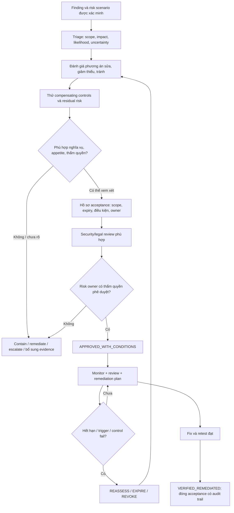
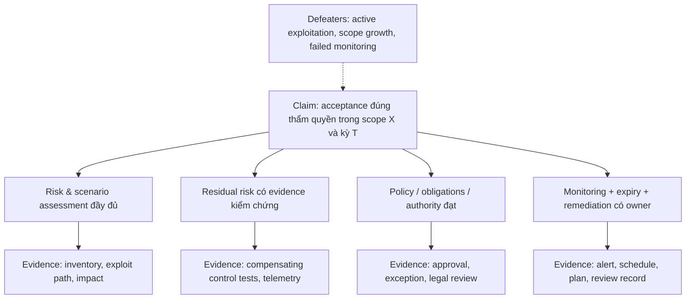
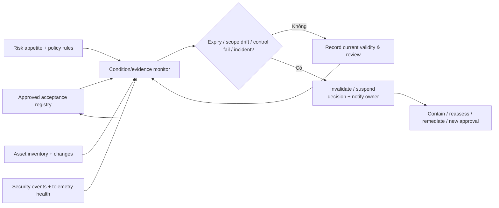

# Risk acceptance: chấp nhận rủi ro tồn dư có thẩm quyền và có bằng chứng

## 1. Risk acceptance là gì?

**Risk acceptance (chấp nhận rủi ro)** là quyết định có thẩm quyền rằng tổ chức sẽ **tiếp tục một hoạt động, dịch vụ hoặc trạng thái hệ thống dù còn một mức rủi ro đã được nhận diện**, trong những điều kiện và giới hạn được xác định. Quyết định phải dựa trên hiểu biết về kịch bản rủi ro, tài sản chịu ảnh hưởng, biện pháp kiểm soát hiện có, hậu quả có thể xảy ra, phương án thay thế, mức rủi ro tồn dư và năng lực quản trị rủi ro của tổ chức.

Trong chương **Remediation** của module **SECURITY_SECURITY_ASSURANCE**, risk acceptance là một nhánh của quá trình xử lý phát hiện bảo mật: **không phải cách đánh dấu một finding là đã được sửa**. Chương trình security assurance cần chứng minh bằng bằng chứng rằng quyết định được đưa ra theo đúng thẩm quyền, dựa trên dữ kiện đáng tin, áp dụng cho đúng phạm vi, có điều kiện giám sát, có hạn hiệu lực và được xem xét lại khi bối cảnh thay đổi.

Ví dụ: dịch vụ xử lý hóa đơn chưa kịp nâng cấp thư viện bị phát hiện có lỗ hổng ở một chức năng chỉ dùng nội bộ. Nhóm vận hành có thể giới hạn đường truy cập, tắt chức năng dễ bị khai thác, kiểm tra hiệu quả biện pháp giảm thiểu và đề nghị **chấp nhận rủi ro tồn dư trong một khoảng thời gian ngắn** cho tới khi triển khai bản vá. Việc chấp nhận chỉ phù hợp nếu rủi ro sau các biện pháp đó nằm trong mức có thể được phê duyệt và không trái các nghĩa vụ bắt buộc.

Ngược lại, một API đang cho phép tenant A đọc hóa đơn của tenant B và có dấu hiệu khai thác thực tế không thể được coi “đã an toàn” chỉ vì business owner muốn giữ hệ thống hoạt động. Cần cân nhắc containment, incident response, hạn chế chức năng, sửa lỗi và yêu cầu pháp lý; quyết định rủi ro không làm biến mất nguy cơ hoặc nghĩa vụ phải thực hiện.

### Mục tiêu học tập

Sau bài này, người học có thể:

1. Phân biệt risk acceptance với remediation, mitigation, exception, risk transfer, risk avoidance và việc đánh dấu finding đã đóng.
2. Xác định **inherent risk**, **residual risk**, risk appetite, risk tolerance và điều kiện phê duyệt.
3. Xây hồ sơ chấp nhận rủi ro có owner, scope, phương pháp đánh giá, điều kiện, ngày hết hạn, monitoring và bằng chứng.
4. Thiết kế biện pháp bù trừ có khả năng kiểm chứng, không chỉ ghi lời cam kết.
5. Phân biệt quyết định quản trị rủi ro hợp lệ với trường hợp cần containment hoặc phải tuân thủ nghĩa vụ không thể miễn trừ.
6. Theo dõi rủi ro được chấp nhận qua thời gian, trigger thay đổi, tái đánh giá và kết thúc.
7. Viết kết luận assurance trung thực, không chuyển `RISK_ACCEPTED` thành `CONTROL_PASSED`.

## 2. Phân biệt các lựa chọn xử lý rủi ro

Khi một finding xuất hiện, tổ chức không bắt buộc phải sửa đúng bằng một kỹ thuật duy nhất. Nhưng mỗi lựa chọn có ý nghĩa khác nhau và cần một **quyết định được ghi nhận**.

| Lựa chọn | Ý nghĩa | Ví dụ | Điều phải chứng minh |
| --- | --- | --- | --- |
| **Remediate** | Xử lý nguyên nhân/điều kiện khiến control không đáp ứng | Sửa lỗi authorization để chặn cross-tenant access | Retest ở đúng phạm vi xác nhận lỗi không còn |
| **Mitigate** | Giảm xác suất hoặc tác động bằng control | Chặn endpoint từ Internet, giảm quyền token, tăng detection | Control mới thực sự hoạt động và còn hiệu lực |
| **Avoid** | Ngừng hoạt động gây rủi ro | Tắt tính năng export chưa thể bảo vệ | Không còn đường sử dụng hoặc phụ thuộc gây rủi ro đó |
| **Transfer/share** | Chuyển hoặc chia sẻ một phần hậu quả/quyền xử lý theo thỏa thuận | Hợp đồng bảo hiểm, dịch vụ quản lý, điều khoản bồi thường | Phạm vi chuyển giao có hiệu lực và rủi ro còn lại vẫn được quản lý |
| **Accept** | Đồng ý tiếp tục với phần rủi ro còn lại | Vận hành chức năng nội bộ dưới hạn chế trong một khoảng thời gian | Đánh giá residual risk, approval, scope và monitoring |
| **Compensating control** | Biện pháp thay thế đáp ứng phần mục tiêu an toàn khi control chuẩn chưa dùng được | Just-in-time access và giám sát chặt khi legacy system chưa hỗ trợ cơ chế chuẩn | Khả năng giảm rủi ro được kiểm thử; không chỉ có policy |
| **Exception/waiver** | Cho phép sai khác với một requirement đã áp dụng theo cơ chế quản trị | Miễn tạm thời một baseline, có điều kiện | Thẩm quyền, thời hạn, yêu cầu liên quan và risk decision |

**Một exception có thể đi kèm risk acceptance**, nhưng hai khái niệm không đồng nhất. Ngoại lệ trả lời “vì sao tạm không phải thực hiện đúng yêu cầu X”; risk acceptance trả lời “ai chấp nhận hậu quả có thể xảy ra, trong điều kiện nào và tại mức rủi ro nào”.

**Risk transfer không xóa trách nhiệm còn lại.** Một hợp đồng chuyển một phần trách nhiệm tài chính không làm dữ liệu khách hàng tự an toàn hoặc loại bỏ nghĩa vụ điều tra, báo cáo, giám sát đối tác khi có sự cố.

### 2.1. Bốn phát biểu phải được giữ tách biệt

- `FINDING_OPEN`: một điều kiện hoặc hành vi không đáp ứng yêu cầu đang tồn tại.
- `MITIGATION_VERIFIED`: có bằng chứng biện pháp giảm thiểu được triển khai và hoạt động trong phạm vi đã thử.
- `RISK_ACCEPTED`: người được ủy quyền đã chấp nhận phần rủi ro còn lại theo điều kiện xác định.
- `REMEDIATION_VERIFIED`: phép kiểm thử phù hợp đã xác nhận điều kiện gây finding được loại bỏ hoặc xử lý đạt tiêu chí đóng.

Một finding có thể vừa `FINDING_OPEN`, vừa có `MITIGATION_VERIFIED` và `RISK_ACCEPTED`. Điều đó **không đồng nghĩa** `REMEDIATION_VERIFIED`.

## 3. Khi nào cân nhắc chấp nhận rủi ro?

Risk acceptance có thể là lựa chọn hợp lý khi tổ chức hiểu được rủi ro và có lý do thực tế để tiếp tục hoạt động. Những điều kiện thường cần được cân nhắc:

1. **Rủi ro đã được mô tả rõ:** asset, threat, vulnerability/control gap, attack path, consequences và scope cụ thể.
2. **Mức tồn dư đã được đánh giá:** có evidence về control hiện có, giả định và uncertainty; không dùng một nhãn severity mơ hồ làm quyết định duy nhất.
3. **So sánh phương án:** remediation, temporary mitigation, isolation, disable feature, thay kiến trúc hoặc tránh rủi ro đã được đánh giá.
4. **Phù hợp risk appetite và thẩm quyền:** không vượt ngưỡng chỉ vì người sở hữu hệ thống đồng ý.
5. **Không làm trái nghĩa vụ bắt buộc:** security assurance phải phối hợp legal/privacy/compliance khi luật, hợp đồng hoặc quy định đặt nghĩa vụ không thể đơn phương miễn trừ.
6. **Có điều kiện kiểm soát:** monitoring, alert, access restriction, backup, response plan hoặc biện pháp bù trừ khi phù hợp.
7. **Có giới hạn và ngày xem xét lại:** rõ expiry hoặc điều kiện kích hoạt đánh giá lại; không để ngoại lệ “vĩnh viễn” theo thói quen.
8. **Có bằng chứng và người chịu trách nhiệm:** quyết định lưu trong registry, có review, audit trail và liên kết findings.

Nếu thiếu thông tin quan trọng về bề mặt tấn công, dữ liệu đang bị lộ hoặc nguồn giám sát, tổ chức có thể **chưa đủ căn cứ** để chấp nhận. Trạng thái phù hợp là `INSUFFICIENT_INFORMATION` hoặc `PENDING_ASSESSMENT` và cần hành động giảm rủi ro thích hợp trong khi điều tra.

### 3.1. Những tình huống cần escalation khác với quy trình acceptance thông thường

| Tình huống | Vì sao không thể chỉ “ký chấp nhận”? | Hướng xử lý |
| --- | --- | --- |
| Có khai thác đang diễn ra | Rủi ro không còn chỉ là giả thuyết | Incident response, containment, forensics, bảo vệ bằng chứng |
| Có khả năng lộ dữ liệu khách hàng đáng kể | Ảnh hưởng đến bên không trực tiếp chấp thuận | Risk owner, security, privacy/legal, business response |
| Trái nghĩa vụ bắt buộc không cho phép miễn | Quyết định nội bộ không làm mất nghĩa vụ | Legal/compliance review, bắt buộc khắc phục hoặc ngừng hoạt động |
| Safety hoặc availability trọng yếu bị đe dọa | Tác động vượt phạm vi người phê duyệt thông thường | Kích hoạt governance/escalation đặc biệt |
| Không biết nguồn dữ liệu nào đang bị truy cập | Không đánh giá được residual risk đáng tin | Hạn chế quyền/luồng, điều tra và bổ sung evidence |
| Rủi ro vượt appetite và không có thẩm quyền | Ký tên sai cấp không hợp thức hóa quyết định | Escalate tới cấp quản trị phù hợp hoặc thay phương án xử lý |
| Compensating control bị tắt hoặc không kiểm chứng được | Giả định giảm rủi ro không còn đúng | Invalidate decision theo điều kiện đã thỏa thuận |

Một chính sách nội bộ có thể quy định **những tình huống không được phép acceptance** dù có lãnh đạo đồng ý ở cấp thông thường. Phải áp dụng chính sách thực tế và nghĩa vụ bắt buộc có liên quan.

## 4. Inherent risk, current risk và residual risk

Để ra quyết định, cần tách mức nguy cơ trước/sau control, cùng các điều không chắc chắn.

- **Inherent risk:** rủi ro trước khi xét các controls cụ thể thuộc phạm vi đánh giá, theo phương pháp tổ chức sử dụng.
- **Current risk:** rủi ro dựa trên hệ thống và controls **đã xác minh đang vận hành** ở thời điểm đánh giá.
- **Residual risk:** rủi ro còn lại sau khi áp dụng những biện pháp xử lý/giảm thiểu được đề xuất hoặc đã thực hiện, trong bối cảnh xác định.
- **Target risk:** mức mong muốn đạt được sau remediation dài hạn; chưa thể xem là mức hiện tại nếu chưa có evidence triển khai.

Không nên tự hạ residual risk chỉ vì một remediation task đã được tạo. Phải biết biện pháp nào **đã triển khai, đã kiểm tra, có thể bị bypass hay không và bao phủ đúng tài sản nào**.

### 4.1. Ví dụ thang định tính nội bộ

Một tổ chức *giả định* chấm likelihood và impact theo thang `1–5`, với điểm tổng `likelihood × impact` để hỗ trợ thảo luận:

| Giai đoạn | Likelihood | Impact | Điểm | Giải thích |
| --- | ---: | ---: | ---: | --- |
| Inherent, không xét control trong mô hình | 3 | 4 | 12 | Khả năng xảy ra ở mức 3, hậu quả ở mức 4 |
| Hiện tại, trước mitigation mới | 3 | 4 | 12 | Control hiện hữu chưa giảm được kịch bản đủ tin cậy |
| Sau hạn chế network và token scope **đã kiểm chứng** | 2 | 4 | 8 | Dự kiến/quan sát likelihood giảm, hậu quả nếu vẫn xảy ra không giảm |
| Sau sửa nguyên nhân và retest | Cần đánh giá lại | Cần đánh giá lại | Không điền trước | Mức mới chỉ xác lập khi có bằng chứng thực tế |

Trong ví dụ này, phép nhân là **thang xếp hạng tương đối**, không phải xác suất tổn thất tiền tệ. Điểm `12` không có nghĩa 12% xảy ra; điểm `8` không phải “an toàn 8/25”. Việc likelihood giảm từ 3 xuống 2 cần **lập luận và bằng chứng** về giảm đường khai thác, không chỉ là phép tính.

### 4.2. Rủi ro không chắc chắn

Nếu scanner phát hiện một CVE nhưng chưa xác định code path có thể truy cập, đừng giả định “không khai thác được”. Ghi những yếu tố chưa kiểm chứng và thiết kế bước điều tra.

Nếu một endpoint có thể đọc chéo tenant trong test, không nên chấm likelihood thấp chỉ vì chưa thấy alert. **Không có alert có thể do monitoring thiếu coverage**, không chứng minh không có truy cập trái phép.

Một đánh giá tốt có thể ghi `confidence=MEDIUM`, `unknowns=[service-token scope chưa đối chiếu, vendor log thiếu]` và gắn điều kiện phải hoàn thiện trước khi ra quyết định.

## 5. Risk appetite, risk tolerance và acceptance threshold

**Risk appetite** là mức độ hoặc loại rủi ro tổ chức sẵn sàng chịu đựng để đạt mục tiêu, thường do cấp quản trị xác lập. **Risk tolerance** có thể mô tả biên độ chấp nhận quanh mục tiêu hoặc giới hạn cụ thể cho từng loại hoạt động. **Acceptance threshold** là quy tắc vận hành cho biết khi nào một hồ sơ có thể được xét chấp nhận và ở cấp nào.

Chúng có quan hệ nhưng không hoàn toàn đồng nghĩa. Trong thực tế, các khái niệm có thể được định nghĩa khác nhau trong chính sách doanh nghiệp; hãy dùng thuật ngữ nhất quán với governance đã được phê duyệt.

### 5.1. Ví dụ ma trận thẩm quyền giả định

| Mức rủi ro tồn dư | Khả năng acceptance | Người/phân cấp xem xét | Điều kiện bổ sung |
| --- | --- | --- | --- |
| **Low** | Có thể xem xét theo quy trình chuẩn | Service/business risk owner được ủy quyền | Scope, thời hạn và evidence |
| **Medium** | Cần review kỹ và giới hạn | Risk owner + security reviewer | Compensating control, monitoring, plan |
| **High** | Chỉ theo cơ chế ngoại lệ đặc biệt nếu policy cho phép | Cấp có thẩm quyền cao hơn, có thể risk committee | Lý do không còn phương án tốt hơn, biện pháp giảm thiểu và rà soát thường xuyên |
| **Critical / prohibited category** | Có thể bị cấm acceptance trong chính sách thông thường | Escalation theo governance và nghĩa vụ bắt buộc | Containment, avoidance, remediation hoặc xử lý khác |

Bảng chỉ là **mẫu thiết kế**, không phải quy tắc chung. Không tự suy “CISO luôn có quyền chấp nhận mọi rủi ro”; thẩm quyền phụ thuộc policy, phân cấp tổ chức, mức ảnh hưởng, nghĩa vụ pháp lý và người thực sự sở hữu hậu quả kinh doanh.

### 5.2. Risk appetite không phải một điểm tổng duy nhất

Ngay cả khi hai vấn đề cùng điểm `8`, tổ chức có thể không cho phép chấp nhận rủi ro ảnh hưởng quyền riêng tư hoặc an toàn con người, nhưng cho phép rủi ro tài liệu ở sandbox. Cần quy tắc **hard stops** theo loại hậu quả, độ nhạy cảm dữ liệu, tài sản trọng yếu hoặc cam kết hợp đồng bên cạnh risk score.

### 5.3. Tổng hợp rủi ro được chấp nhận

Mười ngoại lệ “Low” trên cùng shared identity provider có thể tạo rủi ro hệ thống lớn hơn từng ngoại lệ riêng lẻ. Risk owner cần xem:

- Nhiều exceptions cùng phụ thuộc một control và có common failure mode không?
- Có cùng service account, key, cloud account, subprocessor hay recovery site không?
- Nhiều đường bypass nhỏ có thể kết hợp thành attack chain lớn không?
- Đã có rủi ro cùng loại được chấp nhận nhưng chưa hết hạn không?
- Tác động tổng có vượt risk appetite dù từng mục nhỏ hơn threshold không?

**Không đánh giá acceptance hoàn toàn độc lập theo ticket** khi cùng tác động đến tài sản hoặc mục tiêu bảo mật chung.

## 6. Ai có quyền chấp nhận rủi ro?

Quyết định phải do người được tổ chức ủy quyền **chịu trách nhiệm với tác động rủi ro**, không mặc định thuộc về người viết ticket, developer sửa lỗi hoặc reviewer security.

| Vai trò | Trách nhiệm |
| --- | --- |
| **Business/risk owner** | Chịu trách nhiệm rủi ro nghiệp vụ, ra quyết định nếu có thẩm quyền |
| **Asset/service owner** | Xác định phạm vi và hệ thống ảnh hưởng, kế hoạch vận hành, owner thực thi |
| **Control owner** | Giải thích control không đạt, biện pháp bù trừ và khả năng khắc phục |
| **Security assurance/reviewer** | Kiểm chứng rủi ro, evidence, scope, tính đầy đủ của điều kiện; đưa ý kiến độc lập phù hợp |
| **Risk management function** | Đảm bảo quy trình, risk appetite, phân cấp, risk register và xu hướng tổng hợp |
| **Legal/privacy/compliance** | Xem nghĩa vụ pháp lý, hợp đồng, dữ liệu và phạm vi không thể miễn trừ khi áp dụng |
| **Internal audit** | Có thể đánh giá độc lập quy trình và chất lượng bằng chứng theo kế hoạch kiểm toán |
| **Incident commander / SecOps** | Điều phối phản ứng khi phát hiện exploitation hoặc sự cố đang diễn ra |
| **Risk committee/cấp quản trị** | Quyết định các trường hợp vượt thẩm quyền thông thường theo governance |

### 6.1. Phân tách nhiệm vụ

Một người có thể đề nghị chấp nhận rủi ro vì hiểu rõ khó khăn kỹ thuật; nhưng **không nên vừa là người đề xuất, người tự đánh giá mọi evidence, vừa là người duy nhất phê duyệt rủi ro lớn**. Segregation of duties làm giảm thiên lệch “rẻ hơn nếu không sửa”.

Security reviewer có thể đưa ra kết luận `NOT_RECOMMENDED`, nhưng quyết định cuối cần theo thẩm quyền. Nếu lãnh đạo phê duyệt ngoài khuyến nghị security, lưu rõ **lý do, điều kiện, residual risk và ý kiến bất đồng**, không viết lại review thành “security confirmed safe”.

### 6.2. Người sở hữu phải có quyền tác động

Nếu risk owner không thể cấp nguồn lực, hạn chế chức năng hoặc yêu cầu remediation, tổ chức cần làm rõ cơ chế ủy quyền và escalation. Một người chỉ có tên trên biểu mẫu nhưng không nhận trách nhiệm thực tế sẽ khiến acceptance biến thành thủ tục.

## 7. Phạm vi quyết định phải nhỏ và kiểm tra được

Một hồ sơ yếu thường ghi “chấp nhận rủi ro về bảo mật cho ứng dụng A”. Phạm vi quá rộng khiến khó hiểu điều gì được phép, điều gì vẫn phải xử lý.

| Chiều phạm vi | Ví dụ cụ thể |
| --- | --- |
| **Service/capability** | `invoice-export` của nền tảng thanh toán |
| **Environment** | Production, không bao gồm sandbox và các workload khác |
| **Deployment/build** | Release/digest hiện tại, với quy tắc re-evaluate khi đổi |
| **Account/region/tenant** | Một cloud account, một region, danh sách tenant trong scope |
| **Asset/identity** | Một service token hoặc nhóm API endpoint cụ thể |
| **Data classification** | Metadata hóa đơn không chứa nội dung thanh toán, theo kiểm chứng |
| **Failure/threat scenario** | Token bị lộ có thể đọc metadata ngoài vai trò cần thiết |
| **Duration** | Từ thời điểm phê duyệt tới mốc hết hạn |
| **Conditions** | Chặn egress không cần thiết, allowlist, logging và alert |
| **Exclusions** | Không cho phép đọc nội dung hóa đơn chéo tenant; không áp dụng cho export API mới |

Nếu quyết định dựa trên giả định “chỉ ảnh hưởng metadata” mà điều tra phát hiện có thể truy cập dữ liệu hóa đơn đầy đủ, hồ sơ **không còn áp dụng** cho rủi ro mới. Trigger phải đưa trường hợp về trạng thái đánh giá lại hoặc vô hiệu acceptance.

### 7.1. Tránh scope creep

Mỗi lần sản phẩm thêm API, region, tenant, data type hoặc subprocessor, cần xem phạm vi acceptance còn khớp không. Đừng tự kéo dài một quyết định từ dịch vụ thử nghiệm sang production, hoặc từ một account sang mọi account.

Nguyên tắc ưu tiên là **giới hạn có thể kiểm chứng**, cho phép business tiếp tục trong phạm vi được ủy quyền thay vì biến một ngoại lệ thành “vé thông hành” cho cả hệ thống.

## 8. Compensating controls: cần kiểm chứng hiệu quả, không chỉ tuyên bố

**Compensating control** là biện pháp thay thế nhằm giảm rủi ro khi yêu cầu hoặc control chuẩn chưa thể triển khai đúng hạn. Một biện pháp bù trừ không nhất thiết mang lại mức bảo vệ tương đương hoàn toàn; phải đánh giá nó giải quyết những bước nào trong attack path.

### 8.1. Ví dụ với service token quá rộng

Rủi ro: một service token của dịch vụ xuất dữ liệu có thể đọc nhiều loại metadata hơn nhu cầu.

| Biện pháp | Tác dụng dự kiến | Kiểm chứng cần có | Hạn chế |
| --- | --- | --- | --- |
| Giới hạn endpoint allowlist | Giảm đường gọi ngoài chức năng cần thiết | Request tới endpoint cấm bị từ chối từ chính workload | Không bảo đảm token không bị dùng trong endpoint còn cho phép |
| Restrict network egress/ingress | Giảm bề mặt có thể khai thác | Network policy effective-state và thử đường bị chặn | Kẻ tấn công trong cùng trust boundary vẫn có thể hoạt động |
| Thay token bằng short-lived credentials | Giảm thời gian lộ credential có giá trị | Token expiry/rotation và negative test token cũ | Chưa chắc giải quyết quyền quá rộng khi token còn sống |
| Tăng audit và detection | Rút ngắn thời gian phát hiện truy cập bất thường | Synthetic event end-to-end tới alert và on-call | Detection không trực tiếp chặn truy cập đã xảy ra |
| Cắt/tắt tính năng nhạy cảm | Loại bỏ hoặc giảm attack path | Kiểm tra routing, worker, queue và callback không còn tác dụng phụ | Có thể ảnh hưởng mục tiêu nghiệp vụ |
| Review quyền thủ công tăng tần suất | Phát hiện sai lệch theo lịch | Record review, diff, owner và remediation | Không thay được enforcement liên tục |

**Biện pháp bù trừ phải có acceptance criteria.** “Chúng tôi bật monitoring” không đủ để kết luận likelihood giảm nếu collector mất dữ liệu hoặc alert không tới người xử lý.

### 8.2. Control bù trừ có thể thất bại sau khi được chấp thuận

Một risk acceptance có thể được phê duyệt khi WAF rule và source audit còn hoạt động. Sau một thay đổi hạ tầng, WAF bị bypass hoặc log collector mất quyền. Khi đó **căn cứ đánh giá residual risk đã thay đổi**. Hồ sơ phải được đánh giá lại, có thể yêu cầu containment, chứ không giữ trạng thái `APPROVED` chỉ vì chưa tới ngày hết hạn.

### 8.3. Tránh double-count hiệu quả

Nếu hai controls phụ thuộc cùng network proxy hoặc cùng alert pipeline, không thể giả định chúng là hai lớp độc lập. Threat model cần kiểm tra common-mode failure, khả năng attacker né kiểm soát và coverage của negative tests.

## 9. Quy trình từ finding đến quyết định risk acceptance

Một chu trình có thể được thiết kế theo các bước rõ trách nhiệm:



Sơ đồ này có **hai nhánh khác nhau**: một nhánh quyết định chấp nhận rủi ro tạm thời, một nhánh kiểm chứng remediation. Risk acceptance không phải bước bắt buộc trong mọi finding; finding có thể được sửa nhanh, cô lập hoặc loại bỏ exposure mà không cần acceptance.

### 9.1. Bước 1 — Xác minh finding và threat scenario

- Ghi nguồn phát hiện, ID, thời điểm, bằng chứng và mức độ tin cậy.
- Nêu asset/dữ liệu/tenant, điểm yếu, quyền attacker cần có, đường khai thác và hậu quả.
- Xác định dấu hiệu khai thác thực tế; nếu có, xem incident response phù hợp.
- Kiểm tra finding trùng hoặc có chung root cause, tránh che rủi ro tổng.
- Phân biệt **đã có bằng chứng control fail** với **chưa có evidence để biết control có hoạt động không**.

### 9.2. Bước 2 — So sánh lựa chọn xử lý

Lập ít nhất các phương án khả thi: sửa ngay, giảm thiểu tạm, tắt tính năng, hạn chế người dùng/phạm vi, thay service/architecture hoặc chấp nhận trong thời hạn. Với mỗi phương án ghi:

- Mức giảm rủi ro có thể chứng minh và phần còn lại.
- Ảnh hưởng nghiệp vụ, downtime, dependency và chi phí.
- Thời gian triển khai, thời gian kiểm chứng và rủi ro thay đổi.
- Những quyền hoặc nghĩa vụ mà lựa chọn không giải quyết.
- Bằng chứng dùng để so sánh và những giả định chưa chắc chắn.

Không nên đưa ra lựa chọn giả “hoặc không sửa, hoặc ngừng toàn công ty” khi còn phương án giảm quyền, cô lập endpoint hay triển khai hotfix.

### 9.3. Bước 3 — Kiểm tra ngưỡng và quyền hạn

Cần đối chiếu risk appetite, policy exception, legal/privacy/contract obligations và tổng rủi ro liên quan. Nếu không đạt, điều chỉnh phương án hoặc escalation. **Không tự hạ severity** để đủ điều kiện phê duyệt.

### 9.4. Bước 4 — Phê duyệt có điều kiện

Decision record phải nêu **đúng người, đúng phạm vi, mốc hiệu lực, mốc hết hạn, biện pháp yêu cầu, deadline và trigger thu hồi**. Nếu cần chữ ký điện tử hoặc workflow đặc thù, tuân thủ hệ thống doanh nghiệp.

### 9.5. Bước 5 — Theo dõi và kết thúc

Giữ finding mở hoặc ở trạng thái quản trị rủi ro phù hợp, tiếp tục đo aging và kiểm chứng controls. Khi remediation đạt, ghi retest evidence rồi đóng phần rủi ro đã được xử lý. Nếu rủi ro tăng, decision có thể bị thu hồi hoặc yêu cầu phê duyệt lại **trước expiry**.

## 10. Mẫu hồ sơ risk acceptance cần có những trường nào?

| Trường | Ý nghĩa và tiêu chí |
| --- | --- |
| `decision_id` | ID duy nhất, version và trạng thái |
| `finding_ids`, `risk_id` | Liên kết findings và risk register có nguồn |
| `service`, `assets`, `environment` | Scope và tính trọng yếu |
| `data_types`, `business_process` | Tài sản/nghiệp vụ chịu hậu quả |
| `risk_scenario` | Threat, vulnerability, exploit path, outcome |
| `inherent/current/residual_risk` | Mức rủi ro và phương pháp đánh giá |
| `uncertainty`, `assumptions` | Điều chưa biết và điều kiện để lập luận đúng |
| `policy_refs`, `obligations` | Internal standards, contractual/legal constraints liên quan |
| `alternative_options` | Lựa chọn đã xem và lý do chưa áp dụng |
| `compensating_controls` | Biện pháp thực tế và evidence chứng minh hiệu quả |
| `acceptance_criteria` | Điều kiện để được vận hành và hard stop |
| `requested_by`, `recommended_by` | Người đề nghị và người thẩm định |
| `approved_by`, `approval_authority` | Người được ủy quyền chịu trách nhiệm |
| `effective_at`, `expires_at` | Cửa sổ hiệu lực chính xác có timezone |
| `review_at`, `change_triggers` | Lịch và sự kiện bắt buộc xem lại |
| `remediation_owner`, `target_fix_at` | Người sửa và mục tiêu khắc phục |
| `monitoring_owner`, `detection_ref` | Người theo dõi và nguồn tín hiệu |
| `evidence_refs`, `review_record` | Nguồn độc lập, thời kỳ, người kiểm tra |
| `renewal_history`, `risk_decision_history` | Số lần gia hạn, lý do, thay đổi |
| `termination_conditions` | Khi nào tự hết hiệu lực/thu hồi |
| `reporting_visibility` | Đưa vào các báo cáo risk/assurance nào |

**Các trường không nhất thiết nằm trong một file.** Có thể dùng risk register, finding system, exception workflow và evidence store có ID liên kết, miễn là truy vết không bị đứt.

### 10.1. Hồ sơ nên ghi ở ngữ nghĩa nào?

- `accepted` mô tả **quyết định quản trị**.
- `compliant` mô tả **mức đáp ứng yêu cầu được đánh giá**.
- `mitigated` mô tả **mức giảm rủi ro có bằng chứng**.
- `remediated` mô tả **điều kiện gây finding đã được xử lý theo tiêu chí**.
- `verified` mô tả **phép đánh giá cụ thể đã hoàn thành và có bằng chứng**.

Không gộp các trường này vào một cờ `is_closed=true`.

## 11. Ví dụ hồ sơ có cấu trúc bằng YAML

Ví dụ chỉ phục vụ mô hình hóa, **không phải phê duyệt hoặc tình trạng bảo mật của một hệ thống có thật**:

```yaml
risk_acceptance:
  id: RA-INVOICE-2026-006
  version: 1
  status: PENDING_APPROVAL
  risk_id: RISK-TENANT-METADATA-17
  finding_ids:
    - FIND-IAM-421
  scope:
    service: invoice-export
    environment: production
    cloud_account: prod-invoice-a
    regions:
      - region-a
    identities:
      - invoice-export-worker
    data_types:
      - invoice-metadata
    exclusions:
      - payment-card-data
      - cross-tenant-invoice-content
  scenario:
    threat: "A compromised service token may read unnecessary invoice metadata"
    preconditions:
      - "Attacker gains the worker token"
    consequence: "Possible excess metadata disclosure within stated scope"
  assessment:
    methodology: "Internal risk rubric version 3"
    inherent_score: 12
    current_score: 12
    projected_residual_score: 8
    projected_score_verified: false
    uncertainties:
      - "Service token use outside known endpoints requires revalidation"
  compensating_controls:
    - id: CC-ALLOWLIST-01
      goal: "Restrict worker to approved endpoints"
      evidence_ref: "pending:negative-api-access-test"
      status: PENDING_TEST
    - id: CC-DETECTION-02
      goal: "Alert on abnormal token use"
      evidence_ref: "pending:end-to-end-alert-test"
      status: PENDING_TEST
  obligations:
    legal_privacy_review: PENDING
    policy_exception_review: PENDING
  decision:
    requested_by: invoice_service_owner
    reviewed_by: security_assurance_team
    approved_by: null
    authority_ref: null
    effective_at: null
    expires_at: null
    conditions:
      - "No acceptance until compensating controls are verified"
      - "No new tenant or data category without reassessment"
      - "Reassess immediately on suspected exploitation"
  plan:
    remediation_owner: invoice_platform_team
    target_fix_at: "2026-12-12T00:00:00Z"
    reviewer: security_assurance_team
  monitoring:
    owner: security_operations
    telemetry_health: PENDING
    next_review_at: null
```

Điểm quan trọng: `projected_residual_score: 8` **không được xem là thực tế** khi `projected_score_verified: false`. `PENDING_APPROVAL` cùng `approved_by: null` nghĩa là **không có quyền hoạt động dựa trên quyết định risk acceptance này**. Việc có mẫu YAML không tạo ra thẩm quyền, không thay pháp lý và không cho phép tiếp tục khi điều kiện vận hành bắt buộc chưa đáp ứng.

### 11.1. Một hồ sơ được phê duyệt hợp lệ khác mẫu pending thế nào?

Phải có:

- Evidence rằng compensating controls **đã triển khai và test đạt** trong phạm vi phê duyệt.
- Residual risk **được đánh giá lại** sau kết quả test, không chỉ copy giá trị dự kiến.
- Policy/legal review liên quan hoàn tất và không có nghĩa vụ bị bỏ qua.
- Người có quyền quyết định được xác minh qua approval matrix.
- Thời gian hiệu lực/expiry, review trigger và monitoring có nguồn hoạt động.
- Lập trường chính thức về việc finding vẫn mở/chờ fix, cùng ngày target và stop conditions.

## 12. Case study: rủi ro service token trong SaaS hóa đơn đa tenant

### 12.1. Bối cảnh

Một nền tảng SaaS có `invoice-api`, `invoice-export-worker`, service account và cơ sở dữ liệu nhiều tenant. Đội security phát hiện service token của `invoice-export-worker` có quyền đọc **metadata của các hóa đơn** ngoài tập cần thiết. Chưa có bằng chứng đọc được **nội dung hóa đơn của tenant khác**, nhưng vấn đề phải được điều tra vì ranh giới tenant rất quan trọng.

Một hotfix giảm quyền được lên lịch, nhưng cần kiểm thử với một tích hợp legacy. Business owner đề nghị vận hành chức năng export thêm **14 ngày**. Các yêu cầu về bảo vệ dữ liệu, truy vết đặc quyền và khách hàng có thể ảnh hưởng quyết định.

Đây là **tình huống giả định**; các số liệu, ngày và mức độ rủi ro dùng để học cách lập hồ sơ, không phải ngưỡng thực tế.

### 12.2. Những câu hỏi cần trả lời trước khi cân nhắc

| Câu hỏi | Evidence mong đợi | Hành động nếu chưa có |
| --- | --- | --- |
| Token được cấp quyền gì? | Effective permissions, API/DB access paths | Inventory token và test quyền |
| Có đọc dữ liệu chéo tenant không? | Negative tests với tenant A/B, traces và dữ liệu giả | Tạm hạn chế export nhạy cảm |
| Lỗ hổng có thể khai thác từ đâu? | Network reachability, trust boundary, threat model | Xác minh attack path, cô lập khi cần |
| Có dấu hiệu lạm dụng không? | Audit logs đủ phạm vi, alert coverage | Điều tra source health và bảo toàn log |
| Biện pháp tạm giảm rủi ro là gì? | Scoped credentials, allowlist, negative tests | Không tự hạ risk score khi chưa test |
| Có ràng buộc không thể miễn không? | DPA, hợp đồng và review legal/privacy phù hợp | Chuyển đúng người thẩm định |
| Ai chịu trách nhiệm và hạn sửa? | Remediation plan, deployment/test window | Chưa đủ điều kiện chấp nhận |
| Nếu control bù trừ hỏng? | Stop condition và incident contact | Thiết lập quy trình containment |

### 12.3. Risk assessment theo dữ kiện giả định

Đánh giá ban đầu dùng rubric `1–5`:

- `likelihood = 3`, `impact = 4`, `score = 12`.
- Dự kiến triển khai allowlist, giảm scope service identity và test alert, có thể làm likelihood xuống `2`, score còn `8`.
- Tổ chức trong ví dụ **chỉ xem xét** acceptance khi score xác minh không vượt `8`, không có hard stop và người có thẩm quyền duyệt; đây là giả định chính sách của bài tập.
- Security reviewer phải kiểm chứng đường đọc metadata, các endpoint khác, ảnh hưởng nhiều tenant và sức khỏe audit pipeline.
- Business owner không được công bố “risk đã giảm xuống 8” trước khi những controls thực sự đạt phép thử.

Nếu negative test cho thấy token vẫn đọc được dữ liệu ngoài phạm vi nghiêm trọng hoặc phát hiện evidence truy cập chéo tenant đáng kể, phải cập nhật threat/impact và **dừng kế hoạch acceptance thông thường** để triage/containment.

### 12.4. Ví dụ timeline quyết định và theo dõi

| Mốc giả định UTC | Sự kiện | Điều kiện nghiệm thu |
| --- | --- | --- |
| `2026-11-28 08:00` | Finding được xác minh, service owner đề xuất ngoại lệ | Finding ID, threat scenario, scope và owner |
| `2026-11-28 10:00` | Test giới hạn quyền/allowlist và pipeline audit | Negative test PASS, telemetry khỏe |
| `2026-11-28 12:00` | Security và legal/privacy review | Đánh giá residual risk và nghĩa vụ liên quan |
| `2026-11-28 14:00` | Risk owner được ủy quyền quyết định | Approval record, expiry, conditions |
| `2026-11-29` | Kiểm tra vận hành và monitor | Không có bypass hoặc source failure chưa xử lý |
| `2026-12-05` | Review giữa kỳ | Risk unchanged, work progress và evidence mới |
| `2026-12-12 14:00` | Hết hiệu lực nếu quyết định có hạn 14 ngày từ 28/11 14:00 | Không tự động gia hạn |
| Sau fix | Retest chức năng và security trên production scope | VERIFIED_REMEDIATED, đóng acceptance theo lịch sử |

Khoảng từ `2026-11-28 14:00 UTC` đến `2026-12-12 14:00 UTC` bằng **14 ngày theo 24 giờ liên tục**. Không suy ra tính hợp pháp từ lịch này; thời gian hiệu lực thực tế do chính sách và quyết định được ký quy định.

### 12.5. Kết luận an toàn

**Nếu tất cả conditions đạt:** có thể ghi “Tổ chức đã chấp nhận phần rủi ro tồn dư của service token trong phạm vi được chỉ định, có thời hạn và kèm controls đã xác minh; việc sửa nguyên nhân vẫn đang mở”.

**Nếu chưa kiểm chứng controls:** “Hồ sơ đang chờ đánh giá; không đủ bằng chứng để xác nhận residual risk nằm trong ngưỡng của ví dụ; không có phê duyệt acceptance”.

**Nếu phát hiện cross-tenant data read thực sự:** đây là **phản chứng quan trọng** đối với đánh giá ban đầu. Phải điều tra và đánh giá lại rủi ro, ảnh hưởng dữ liệu và khả năng incident; không dùng quyết định dựa trên giả định metadata-limited để bao phủ dữ liệu thực tế ngoài phạm vi.

## 13. Nhận diện rủi ro không nên “chấp nhận cho xong”

Một số tổ chức bị áp lực tiến độ hoặc uptime và biến risk acceptance thành phím tắt thay remediation. Cần kiểm tra các phản biện sau:

- Có giải pháp **isolation/disable** ít ảnh hưởng hơn mà chưa được xem xét không?
- Severity có bị hạ chỉ vì chậm tiến độ không?
- Risk owner có thực sự được ủy quyền cho loại rủi ro và vùng tác động này không?
- Có tenant, khách hàng, đối tác hoặc bên chịu ảnh hưởng khác không tham gia được vào quyết định không?
- Các nghĩa vụ bắt buộc có thể yêu cầu hành động dù tổ chức muốn chấp nhận không?
- Compensating control có dựa vào một nguồn log đang lỗi không?
- Có khai thác đang diễn ra hoặc tín hiệu đáng ngờ bị loại khỏi đánh giá không?
- Có nhiều ngoại lệ cùng chủ đề tạo ra rủi ro hệ thống không?
- Quyết định có bị gia hạn liên tục mà không đưa ra kế hoạch sửa thực tế không?
- Control owner có đưa evidence thiếu thành “risk accepted” để dashboard chuyển xanh không?

### 13.1. Một số quyết định cần ghi `REJECTED`

Hồ sơ acceptance bị bác bỏ không phải thất bại của governance; nó có thể chứng minh hệ thống quyết định rủi ro đang hoạt động.

Ví dụ: proposal chấp nhận lỗ hổng API cho phép đọc hóa đơn chéo tenant vì “chưa từng thấy khai thác”. Nếu có negative test xác nhận dữ liệu được trả trái quyền, reviewer nên mô tả **rủi ro thực tế, giới hạn monitoring và hậu quả**; quyết định có thể yêu cầu tắt endpoint hoặc sửa trước khi tiếp tục.

Để chứng minh quyết định đúng, lưu lý do, thẩm quyền, phương án thay thế, phương án containment và thời gian đánh giá lại, không chỉ ghi `REJECTED` rồi bỏ đó.

## 14. Risk acceptance và assurance case

Trong chương trình security assurance, quyết định acceptance cũng cần một lập luận có bằng chứng, nhưng **không phải assurance case chứng minh control đã an toàn tuyệt đối**.

Một cấu trúc claim–argument–evidence có thể dùng:

- **Claim quản trị:** quyết định chấp nhận rủi ro tồn dư trong phạm vi X từ T1 tới T2 được ban hành đúng quy trình và trong giới hạn đã duyệt.
- **Argument 1:** rủi ro, assets, threat, impacts và uncertainty đã được xác định đủ để quyết định.
- **Argument 2:** controls và biện pháp giảm thiểu làm mức tồn dư nằm trong ngưỡng xét duyệt, có evidence.
- **Argument 3:** không bỏ qua hard stop hoặc nghĩa vụ không thể miễn.
- **Argument 4:** người chấp thuận có đúng thẩm quyền và hiểu điều kiện/rủi ro.
- **Argument 5:** monitoring, review, expiry, revoke triggers và remediation plan có chủ sở hữu.
- **Evidence:** risk report, source finding, negative tests, network policy/config, audit health, approval record, review schedule.

### 14.1. Một sơ đồ assurance



Mọi nhánh cần có bằng chứng thực tế. Nếu không có audit source health, nhánh monitoring có thể chưa đủ. Nếu chưa có legal review cho dữ liệu cá nhân mà policy yêu cầu, không được gắn `APPROVED` chỉ vì các nhánh còn lại đạt.

### 14.2. Assurance claim không được đánh tráo mục tiêu

**Đúng:** “Decision process đối với risk R đã được thực hiện theo policy version P trong scope S; controls bù trừ C được xác minh vào T; còn rủi ro R được chấp nhận bởi A đến hạn E, sẽ review nếu trigger F”.

**Sai:** “Risk đã accepted nên hệ thống compliant và không còn lỗ hổng”.

Ngay cả khi acceptance hợp lệ, finding có thể vẫn tồn tại, việc tuân thủ điều khoản cụ thể có thể vẫn là ngoại lệ và rủi ro có thể xảy ra trong khoảng chấp nhận.

## 15. Quản lý evidence và audit trail

Một decision record cần đủ để reviewer độc lập xác minh những gì người phê duyệt đã biết **tại thời điểm phê duyệt**. Không được chỉnh sửa bằng chứng gốc sau đó để khiến quyết định quá khứ trông hợp lý hơn.

| Nhóm evidence | Ví dụ | Yêu cầu chất lượng |
| --- | --- | --- |
| **Finding source** | Scan, pentest, alert, bug report, audit | Phạm vi, thời gian, phiên bản, cách tái hiện |
| **Risk analysis** | Threat model, data flow, impact assessment | Assumptions, likelihood/impact rationale, unknowns |
| **Options analysis** | Fix/disable/mitigate proposals | Trade-off, owner, deadline, khả năng triển khai |
| **Compensating control** | Policy snapshot, negative tests, alert replay | Đúng production scope và source được xác minh |
| **Approval** | Signed decision, workflow record | Identity, authority, time, conditions |
| **Monitoring** | Dashboard query, detection test, collector health | Nguồn/coverage và thời gian kiểm tra |
| **Remediation** | Change, deployment, security regression/retest | Bằng chứng fix đúng asset, không chỉ ticket DONE |
| **Review/renewal** | Risk reassessment, exception delta, approval mới | Không che đổi scope, severity, expiry |
| **Expiry/closure** | Termination record, verified remediation | Lý do, người xác minh và hồ sơ lịch sử |

### 15.1. Evidence phải mới và đúng phạm vi

Một pentest của build cũ hoặc một ảnh chụp IAM trong staging không đủ chứng minh residual risk của production hiện tại. `observed_at`, `collected_at`, `reviewed_at` và `period_end` có ý nghĩa khác nhau.

Khi relevant control thay đổi, có thể cần invalidate hoặc revalidate evidence **trước expiry**. Không kéo dài hạn bằng cách upload lại báo cáo cũ.

### 15.2. Bảo vệ hồ sơ acceptance

Risk register có thể tiết lộ lỗ hổng chưa sửa, endpoint, vùng mạng, service identities, mức rủi ro và kế hoạch khai thác để kiểm thử. Cần:

- Giới hạn quyền theo vai trò và mục đích hợp pháp.
- Không chèn secret, private key, token hay PII thô vào ticket.
- Lưu artifact gốc trong kho có versioning/audit/retention phù hợp.
- Dùng ID tham chiếu và bản trích xuất đã che thông tin nhạy cảm khi chia sẻ.
- Ghi mọi thay đổi người phê duyệt, hạn, scope, risk tier và điều kiện.
- Giữ các phiên bản trước để có thể tái dựng quyết định và tránh sửa lịch sử.

Hash/checksum bảo vệ tính toàn vẹn của artifact trong phạm vi, không tự chứng minh nguồn hoặc kết luận chính xác.

## 16. Continuous monitoring và điều kiện thu hồi chấp nhận

Risk acceptance **không chỉ được kiểm tra vào ngày hết hạn**. Cần giám sát những giả định làm quyết định trở nên hợp lệ.



### 16.1. Những trigger cần lưu trong hồ sơ

| Trigger | Ví dụ | Hành động |
| --- | --- | --- |
| **Expiry** | Đến hết cửa sổ 14 ngày | Không tiếp tục dựa trên quyết định cũ |
| **Risk tier tăng** | Có exploit PoC mới và đường tấn công đã xác minh | Reassess, escalate, cập nhật containment |
| **Active exploitation** | Alert và evidence nghi vấn truy cập trái quyền | Incident response và đánh giá thu hồi |
| **Scope change** | Thêm tenant, API, environment hoặc data type | Yêu cầu đánh giá theo phạm vi mới |
| **Control failure** | Allowlist bị bypass hoặc key rotation thất bại | Dừng/giảm chức năng và sửa control |
| **Source outage** | Audit collector mất quyền hoặc mất dữ liệu | Giảm độ tin cậy, tăng kiểm tra/containment |
| **Business impact change** | Dịch vụ trở thành critical hoặc lượng dữ liệu tăng mạnh | Đánh giá lại tác động/risk appetite |
| **New obligation** | Hợp đồng, yêu cầu privacy hoặc internal policy thay đổi | Legal/compliance review và chỉnh quyết định |
| **Remediation milestone missed** | Không deploy được bản sửa vào hạn | Escalation và xem xét gia hạn nếu còn hợp lệ |
| **Related exception accumulation** | Nhiều ngoại lệ trên cùng identity provider | Reassess aggregated risk |

Khi quyết định bị vô hiệu, không nhất thiết mọi hệ thống phải tự tắt ngay một cách thiếu an toàn; hành động phải theo **contingency plan** đã được phê duyệt, bảo vệ dữ liệu và giảm tác động. Tuy nhiên, không được tiếp tục coi acceptance cũ có hiệu lực khi điều kiện căn bản đã thay đổi.

### 16.2. Review và auto-expiry

Có thể triển khai tự động:

- Alert trước hạn và tại expiry.
- Bắt buộc người phê duyệt xem lại dựa trên evidence mới.
- Chặn việc “renew” bằng thao tác đổi ngày không có approval.
- Ghi number of renewals, original expiry, approved extension và lý do.
- Tạo ticket khi control bù trừ chưa được test hoặc telemetry không còn healthy.
- Báo các acceptance quá hạn tới risk committee.

Một **lịch hẹn review đã tồn tại** không chứng minh review đã diễn ra. Cần review record, outcome và người thực hiện.

## 17. Gia hạn risk acceptance: không tạo ngoại lệ vô thời hạn

Gia hạn là **một quyết định mới hoặc quyết định bổ sung được ủy quyền**, không chỉ sửa giá trị `expires_at`.

### 17.1. Đầu vào bắt buộc trước khi gia hạn

1. Đối chiếu risk scenario, scope và assumptions còn đúng không.
2. Xem evidence mới, incident/change, detection health và test compensating controls.
3. Kiểm tra tiến độ remediation; tại sao chưa đạt, blocker ở đâu, có phương án khác?
4. Đánh giá tác động tích lũy của thời gian phơi nhiễm và related exceptions.
5. Xác minh nghĩa vụ bên ngoài và mức risk appetite hiện tại.
6. Xác nhận cấp phê duyệt, điều kiện/expiry mới và kế hoạch theo dõi.
7. Ghi số lần gia hạn, so với original due và original expiry.
8. Công bố quyết định mới với người liên quan và update dashboards.

### 17.2. Không reset tuổi finding

Một finding được phát hiện ngày 1 nhưng được chấp nhận tạm từ ngày 5 tới ngày 12 rồi gia hạn tới ngày 19 vẫn có **finding age tính từ ngày 1** theo clock đã định nghĩa. Ngày acceptance có hiệu lực chỉ là **decision age**, không thay `detected_at`.

Nếu công ty đo `overdue` theo hạn remediation, gia hạn acceptance không tự động đổi `remediation_due_at`. Thay hạn sửa cần quyết định riêng theo policy; nên lưu **original due** và **current approved due** để audit được tình trạng kéo dài.

## 18. Risk acceptance và remediation aging

Acceptance nên được hiển thị như một **thuộc tính của rủi ro còn mở**, không phải cách xóa khỏi backlog.

| Metric | Cách tính/hiển thị | Cảnh báo |
| --- | --- | --- |
| **Open finding count** | Bao gồm finding chưa verified fix, kể cả có accepted risk | Loại ngoại lệ khỏi mẫu số làm backlog đẹp giả |
| **Finding age** | Từ phát hiện đến as-of/verified close | Approval không reset tuổi |
| **Accepted-risk count** | Số hồ sơ đang có hiệu lực trong đúng scope | Không gộp pending/expired vào active |
| **Accepted-risk aging** | Thời gian từ effective date tới as-of/expiry | Khác với tuổi finding |
| **Expiring soon** | Quyết định có hạn trong cửa sổ cảnh báo | Cần owner và kế hoạch trước expiry |
| **Expired without resolution** | Hồ sơ hết hạn mà finding chưa verified fix | Tín hiệu escalation cao |
| **Repeated renewals** | Số lần extension và tổng thời gian chấp nhận | Có nguy cơ exception trở thành vĩnh viễn |
| **Residual risk by tier** | Tổng hợp rủi ro được chấp nhận theo loại/hậu quả | Rủi ro cùng dependency có thể cộng hưởng |
| **Compensating-control health** | Bằng chứng controls còn hoạt động đúng scope | Không suy từ một dashboard xanh mà source offline |
| **Unverified acceptance count** | Hồ sơ thiếu review, source, test hoặc authority | Không đánh `APPROVED_VALID` |

### 18.1. Định nghĩa tỷ lệ rõ mẫu số

Giả sử có 40 findings chưa verified close tại ngày báo cáo; trong đó 6 có risk acceptance hợp lệ, 3 hồ sơ acceptance hết hạn, 5 đang chờ phê duyệt và 26 không có acceptance.

- **Open findings = 40**, không phải 34.
- **Accepted active = 6/40 = 15%** trên tập finding còn mở; đây là tỷ lệ *quyết định được phê duyệt*, không phải tỷ lệ compliant.
- **Expired acceptance = 3**, cần escalation/đánh giá lại.
- **Pending approval = 5**, không được coi active.
- **Unaccepted/open khác = 26**, cần remediation/giảm rủi ro theo trạng thái thực tế.

Không nên cộng 6 accepted vào số `REMEDIATION_VERIFIED` hay report rằng “6 finding đã xử lý” khi chưa có retest.

### 18.2. Phân tích quyết định theo giá trị nghiệp vụ

Báo cáo leadership nên thể hiện: cái gì đang phơi nhiễm, vì sao tạm chấp nhận, điều kiện bảo vệ đang hoạt động không, tác động nếu control thất bại, ai chịu trách nhiệm và khi nào kết thúc. Một danh sách 200 exceptions dài không có priority và owner không giúp quyết định nguồn lực.

## 19. Kiểm thử hệ thống quản lý risk acceptance

Để bảo đảm governance hoạt động thực chất, cần test cả **logic phê duyệt** và **chất lượng evidence**.

| Test ID | Tình huống | Kết quả mong đợi |
| --- | --- | --- |
| **RAK-01** | Hồ sơ thiếu risk scenario hoặc affected assets | Không thể phê duyệt; yêu cầu bổ sung |
| **RAK-02** | Người đề xuất tự phê duyệt rủi ro vượt thẩm quyền | Từ chối; audit event và escalation |
| **RAK-03** | Residual score dự kiến giảm nhưng controls chưa test | Trạng thái `PENDING_EVIDENCE`, không coi risk đã giảm |
| **RAK-04** | Scope chỉ region A nhưng workload chuyển region B | Invalidate hoặc yêu cầu đánh giá mới |
| **RAK-05** | Compensating allowlist bị bypass | Thu hồi/tạm dừng điều kiện, containment |
| **RAK-06** | Alert pipeline ngừng, không còn coverage như giả định | Monitoring trigger và reassessment |
| **RAK-07** | Hồ sơ hết hạn nhưng finding chưa sửa | `EXPIRED`, không auto-renew, escalate |
| **RAK-08** | Gia hạn ngày nhưng không có decision/approval | Không công nhận expiry mới |
| **RAK-09** | Rủi ro mới vượt appetite sau threat intelligence | Reassess, không giữ approval cũ |
| **RAK-10** | Bằng chứng khai thác active xuất hiện | Incident response/containment theo policy |
| **RAK-11** | Data classification tăng sau onboarding tenant | Reassess obligations và impact |
| **RAK-12** | Chính sách mới cấm acceptance của category đó | Re-evaluate theo effective date/transition |
| **RAK-13** | Review required nhưng quá hạn không thực hiện | Alert, invalid/needs review theo policy |
| **RAK-14** | Finding có acceptance nhưng chưa verified fix | Vẫn nằm trong remediation backlog |
| **RAK-15** | Retest xác minh remediation đạt | Đóng finding theo evidence và ghi end-of-acceptance |
| **RAK-16** | Fix claim chỉ dựa trên PR merge ở staging | Không coi production đã verified |
| **RAK-17** | Có hai acceptance cho cùng dependency với scope chồng lấn | Cảnh báo aggregated risk và review |
| **RAK-18** | Acceptance policy thiếu due date hoặc owner | `INCOMPLETE`, không có approval hợp lệ |
| **RAK-19** | Tài liệu audit cũ được upload lại hôm nay | Freshness dựa observation/period, không phải upload time |
| **RAK-20** | Reviewer không thể xem raw evidence chứa secret | Dùng cơ chế review bảo mật, không phát tán secret |
| **RAK-21** | Risk owner phê duyệt trong khi legal review bắt buộc còn pending | Không cho hiệu lực theo workflow |
| **RAK-22** | Một exception được rút trước expiry | `REVOKED`, lưu lịch sử và stop conditions |
| **RAK-23** | Finding bị reopen do fix vẫn fail | Không reset finding age bằng cách tạo decision mới |
| **RAK-24** | Dashboard tính accepted như compliant | Test thất bại; tách decision và control statuses |

### 19.1. Kiểm thử end-to-end

Một bài diễn tập có thể:

1. Tạo finding giả với rủi ro medium đã được mô tả.
2. Đề xuất biện pháp giảm thiểu và đính kèm test evidence.
3. Cố ý gửi phê duyệt sai cấp để kiểm tra enforcement.
4. Yêu cầu phê duyệt đúng cấp sau khi controls đã được kiểm chứng.
5. Giả lập change event làm mất hiệu lực một giả định.
6. Xác minh hệ thống cảnh báo và chuyển trạng thái `NEEDS_REASSESSMENT`.
7. Thực hiện remediation giả định, chạy retest và bảo toàn tất cả approval/version histories.
8. Đối chiếu dashboard: finding vẫn mở cho tới khi verified fix, acceptance không tạo PASS.

Khi test, không sử dụng production vulnerability thật hoặc thao tác gây gián đoạn không được phê duyệt; dùng môi trường, dữ liệu mô phỏng và quyền kiểm thử phù hợp.

## 20. Những sai lầm phổ biến

| Sai lầm | Hậu quả | Cách xử lý |
| --- | --- | --- |
| “Business đã chấp nhận” nhưng không có risk assessment | Không rõ hậu quả và scope | Ghi threat, impact, residual risk, uncertainty |
| Coi acceptance là remediation | Che vulnerability/control failure | Tách state và tiếp tục retest/finding tracking |
| Hạ severity để đủ threshold | Mất trung thực về rủi ro | Risk rubric version, review độc lập |
| Control bù trừ chỉ có trên giấy | Mức tồn dư bị đánh giá thấp | Negative tests, health monitoring |
| Không xem nghĩa vụ legal/contract | Quyết định nội bộ có thể trái nghĩa vụ | Review theo phạm vi áp dụng |
| Không có expiry hoặc review | Ngoại lệ kéo dài vô thời hạn | Time-bound decision và triggers |
| Gia hạn âm thầm bằng sửa ticket | Che chậm trễ và trách nhiệm | Versioned renewal, approval và history |
| Người xử lý tự phê duyệt rủi ro lớn | Conflict of interest | Authority matrix/segregation of duties |
| Không mô tả attacker path | Likelihood chỉ là cảm giác | Threat model và dữ kiện khai thác |
| Xem “không có alert” là an toàn | Log/collector có thể không hoạt động | Test coverage/telemetry health |
| Chấp nhận cho một account rồi áp toàn cloud | Scope không đúng | ID, region, account, asset, role boundaries |
| Không liên kết nhiều exceptions | Bỏ qua common failure/aggregate risk | Dependency graph và risk portfolio review |
| Đánh dấu ngoại lệ là N/A | Yêu cầu bắt buộc biến mất | Exception khác applicability |
| Báo cáo approved mà không ghi conditions | Không biết khi nào quyết định hết hiệu lực | Acceptance criteria và stop conditions |
| Đóng finding khi đã deploy nhưng chưa retest | Lỗ hổng có thể còn | Verified closure có evidence |
| Lưu dữ liệu nhạy cảm trong workflow | Tạo rủi ro mới | Restricted evidence store, redaction, references |
| Kết luận risk accepted là “đảm bảo an toàn” | Assurance claim vượt bằng chứng | Ngôn ngữ có phạm vi và giới hạn |

## 21. Bài tập thực hành

Bạn là security assurance reviewer của nền tảng SaaS đa tenant, có payment API, hóa đơn, IAM, KMS, logging và một nhà cung cấp xử lý báo cáo. Doanh nghiệp đang cân nhắc chấp nhận tạm thời các finding sau (tất cả là dữ liệu giả định):

- **F-101:** Service token của export worker có quyền đọc metadata nhiều tenant; đã giới hạn network nhưng chưa có negative authorization test, không biết source audit có đầy đủ không.
- **F-102:** API khách hàng đôi khi trả nội dung hóa đơn tenant B cho token tenant A trong một negative test; service business owner muốn giữ endpoint hoạt động vì có khách hàng sử dụng.
- **F-103:** DR restore test thất bại do KMS key policy sai; đã sửa key policy ở staging nhưng chưa kiểm tra khả năng restore tại môi trường phù hợp.
- **F-104:** Một tài liệu access review định kỳ bị nộp muộn; IAM event log và access review record đầy đủ, chưa thấy sai lệch quyền, nhưng việc trễ đã vi phạm standard nội bộ.
- **F-105:** Third-party vendor không thể cung cấp một báo cáo mới cho tính năng export vừa ra mắt; còn nhiều control chưa được xác minh, vendor muốn ký exception cho “toàn bộ hệ thống”.

Chính sách giả định cho phép risk owner được ủy quyền xem xét rủi ro tồn dư Low/Medium có điều kiện; High cần cấp quản trị cao hơn; những trường hợp đang lộ dữ liệu khách hàng rõ ràng phải xử lý theo incident response và không đi theo quy trình ngoại lệ thông thường. Các thời hạn phải do policy phê duyệt.

### Nhiệm vụ

1. Phân loại từng tình huống: control failure, compliance gap, assurance gap, incident signal hoặc kết hợp nhiều loại.
2. Đề xuất disposition cho từng finding: remediate, mitigate, avoid, transfer/share hay risk acceptance; có cần containment không?
3. Viết risk scenario đầy đủ cho F-101 và F-102: assets, threat, exploit path, impact, scope và unknowns.
4. Đề xuất những **compensating controls có test** cho F-101, nêu rõ control nào giảm khả năng khai thác và control nào chỉ tăng detection.
5. Chỉ ra vì sao F-102 không thể được đơn giản “accepted” khi negative test đã trả dữ liệu trái tenant; xác định investigation/escalation phù hợp.
6. Giải thích vì sao F-103 chưa được xem đã khắc phục sau khi sửa key policy staging; cần restore/retest evidence gì?
7. Với F-104, xác định vi phạm policy và khả năng xem xét exception theo governance mà không nói control đã đạt nếu requirement chưa thực hiện đúng.
8. Với F-105, giải thích vì sao thiếu evidence không tự chứng minh control fail, nhưng **không đủ cơ sở** chấp nhận “toàn bộ hệ thống”.
9. Tạo hồ sơ acceptance giả định cho F-101 với 12 trường quan trọng: scope, residual risk, owner, conditions, expiry, monitoring, approval, remediation, evidence, triggers.
10. Xây approval matrix phân quyền cho Low/Medium/High và hard stop theo quy trình giả định; minh họa ý kiến reviewer khác với quyết định risk owner.
11. Thiết kế workflow review/expiry và năm ca kiểm thử: wrong authority, expired decision, failed control, scope growth và verified fix.
12. Viết risk acceptance dashboard có cả accepted risk aging và remediation finding aging, không đếm ngoại lệ như closure.
13. Viết một assurance statement cho F-101 khi controls còn pending và một statement khác sau khi controls đã test đạt nhưng finding vẫn chưa fix.
14. Mô tả điều kiện làm quyết định mất hiệu lực trước hạn và hành động containment hoặc reassessment tương ứng.

### Gợi ý hướng giải

- F-101 **chưa đủ căn cứ** phê duyệt nếu negative tests và audit health chưa đạt; phải hoàn thành đánh giá trước khi hạ residual score.
- F-102 có bằng chứng bypass quan trọng: cần containment/incident triage, không được dùng business deadline để khẳng định chấp nhận an toàn.
- F-103 cần retest khôi phục ở đúng scope, với key availability, integrity và quyền giải mã hợp lệ.
- F-104 có thể là **compliance finding** dù chưa phát hiện hành vi cấp quyền trái phép; cần xác minh bối cảnh và thẩm quyền ngoại lệ.
- F-105 là **assurance gap**, không đồng nghĩa vendor hoàn toàn không an toàn, nhưng không thể phê duyệt tùy tiện cho toàn sản phẩm.
- Một decision được phê duyệt không đổi kết quả `CONTROL_FAILED` thành `CONTROL_PASSED` và không reset remediation aging.

**Tiêu chí đạt bài:** reviewer có thể truy vết từ **finding → security objective → risk assessment → alternatives → residual risk → compensating-control evidence → authority/conditions/expiry → monitoring → remediation → retest**, chỉ rõ điều gì đã được kiểm chứng và điều gì còn chưa chắc chắn.

## 22. Ghi nhớ

**Risk acceptance là quyết định chịu trách nhiệm về rủi ro tồn dư có phạm vi và điều kiện, không phải chứng nhận rằng hệ thống đã an toàn hoặc finding đã được sửa.** Chỉ xem xét khi hiểu rủi ro, có evidence về controls, phù hợp risk appetite, nghĩa vụ và thẩm quyền, có monitoring, thời hạn, trigger và kế hoạch khắc phục. Hãy giữ **trạng thái quyết định rủi ro** tách khỏi **trạng thái compliance/control** và **verified remediation**; tiếp tục đo aging và quản lý history cho tới khi fix được kiểm chứng. Trong **SECURITY_SECURITY_ASSURANCE**, risk acceptance có chất lượng là một phần của chuỗi **rủi ro → kiểm soát → kiểm thử → evidence → phê duyệt có trách nhiệm → giám sát → remediation**, giúp tổ chức duy trì security assurance liên tục trong phát triển và vận hành.
