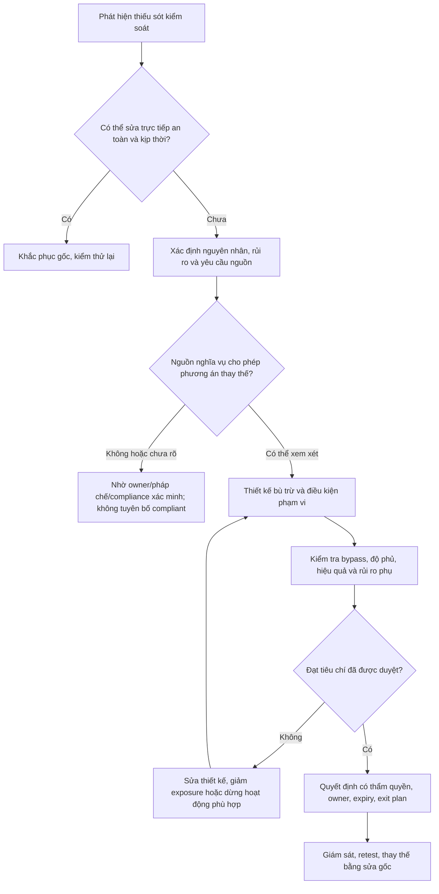
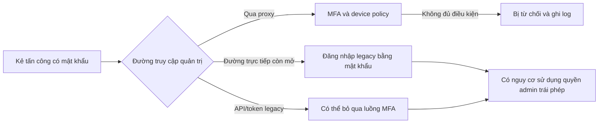
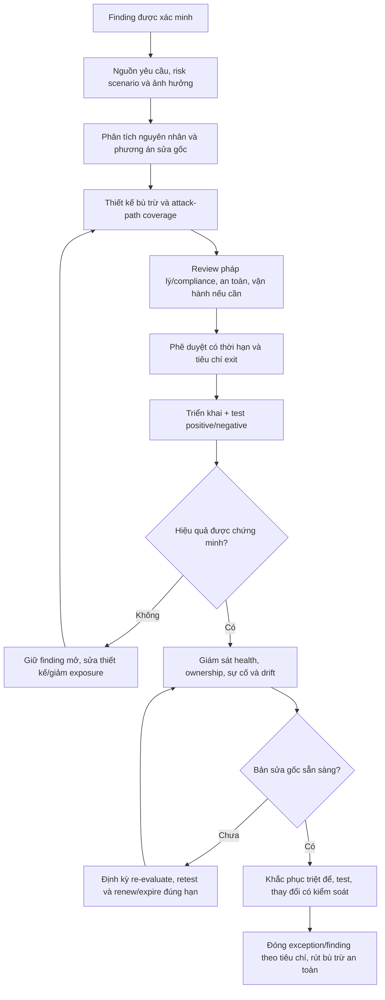

# Biện pháp bù trừ (Compensating Controls): giảm rủi ro khi kiểm soát chính chưa thể đáp ứng

## 1. Biện pháp bù trừ là gì?

**Biện pháp bù trừ (compensating control)** là biện pháp bảo mật được thiết kế nhằm **giảm hoặc kiểm soát rủi ro liên quan tới một yêu cầu mà kiểm soát dự kiến không thể thực hiện, chưa thực hiện đầy đủ hoặc chưa đạt hiệu quả cần thiết**. Nó cung cấp một đường bảo vệ thay thế hoặc bổ sung trong điều kiện cụ thể, thay vì mặc định cho phép hệ thống tiếp tục hoạt động mà không xử lý thiếu sót.

Ví dụ, một ứng dụng cũ chỉ hỗ trợ mật khẩu và không thể tích hợp trực tiếp xác thực nhiều yếu tố (MFA). Tổ chức có thể xem xét **đặt ứng dụng sau cổng truy cập đã xác thực mạnh**, chỉ cho phép truy cập từ thiết bị được quản lý và giảm quyền tài khoản. Nhưng chỉ có một cổng MFA không đủ để khẳng định đã giải quyết rủi ro: cần kiểm tra **còn đường đăng nhập trực tiếp, API, tài khoản dịch vụ hoặc giao diện quản trị nào đi vòng qua cổng hay không**.

Trong chương **Remediation** của module **SECURITY_SECURITY_ASSURANCE**, mục tiêu là **đánh giá có bằng chứng hệ thống đáp ứng các mục tiêu bảo mật**, từ phân tích rủi ro, xác định yêu cầu và security controls đến kiểm thử, audit và khắc phục phát hiện. Biện pháp bù trừ phải được xem là **một quyết định xử lý rủi ro có thể kiểm tra**, có phạm vi, người chịu trách nhiệm, thời hạn, điều kiện áp dụng, phép thử, bằng chứng và giới hạn; không phải một câu giải thích nhằm làm biến mất finding.

Sau bài này, người học có thể:

- Phân biệt **compensating control**, kiểm soát chính, kiểm soát bổ sung, workaround, exception, risk acceptance và remediation dài hạn.
- Xác định khi nào cần xem xét bù trừ và khi nào không thể coi bù trừ là đáp ứng nghĩa vụ bắt buộc.
- Thiết kế biện pháp bù trừ theo **mục tiêu kiểm soát, đường tấn công, phụ thuộc và hậu quả nghiệp vụ**.
- Đánh giá tính tương đương về hiệu quả, độ phủ, khả năng duy trì, rủi ro mới và rủi ro còn lại.
- Xây hồ sơ quyết định, kiểm thử bằng chứng, giám sát, ngày hết hạn và điều kiện dỡ bỏ biện pháp.

## 2. Vì sao cần biện pháp bù trừ?

Trong vận hành, một thiếu sót bảo mật không phải lúc nào cũng khắc phục bằng thay đổi trực tiếp ngay lập tức:

- Một ứng dụng legacy không hỗ trợ giao thức xác thực hoặc chính sách mã hóa mới.
- Một bản vá cần thời gian thử tương thích vì hệ thống phục vụ nghiệp vụ quan trọng.
- Một sản phẩm của nhà cung cấp không cung cấp đầy đủ log hoặc khả năng phân quyền mong muốn.
- Một thành phần OT/thiết bị công nghiệp khó cập nhật vì thời gian dừng có thể ảnh hưởng an toàn con người.
- Một dịch vụ đang di chuyển kiến trúc, nhưng trong giai đoạn chuyển tiếp vẫn có điểm phơi nhiễm.
- Một lỗ hổng phụ thuộc vào bản vá chưa được phát hành hoặc quy trình thay thế hệ thống cần nhiều giai đoạn.

Dù lý do chính đáng, **rủi ro không biến mất chỉ vì chưa thể sửa ngay**. Biện pháp bù trừ cho phép tổ chức giảm khả năng khai thác, hạn chế hậu quả, tăng phát hiện hoặc rút ngắn thời gian phản ứng trong lúc triển khai giải pháp phù hợp hơn.

Tuy nhiên, “không kịp tiến độ” hoặc “không có ngân sách” **không mặc nhiên đủ để chấp nhận biện pháp yếu**. Cần trình bày trở ngại, so sánh các phương án và để người có thẩm quyền quyết định dựa trên tác động.

### 2.1. Một ví dụ xuyên suốt

Giả sử nền tảng học trực tuyến sử dụng dịch vụ báo cáo cũ. Dịch vụ này cần tài khoản quản trị nhưng không hỗ trợ MFA. Đội phát triển dự kiến thay thế sau ba tháng. Trong thời gian chờ đợi, nhóm Security phát hiện người dùng có thể truy cập giao diện quản trị từ Internet.

Các bước hợp lý:

1. Ghi nhận **finding**: giao diện quản trị chưa đáp ứng yêu cầu xác thực mạnh.
2. Xác định rủi ro: credential stuffing, phishing, chiếm tài khoản và sửa/xuất dữ liệu.
3. Đánh giá khả năng khắc phục trực tiếp: tích hợp MFA, nâng cấp, thay dịch vụ hoặc tắt giao diện.
4. Xem xét bù trừ nếu chưa thể xử lý ngay: cổng truy cập MFA, chặn đường truy cập trực tiếp, giới hạn mạng, quản lý tài khoản và giám sát đăng nhập.
5. Thử cả **đường hợp lệ và đường bypass** rồi đánh giá rủi ro còn lại.
6. Phê duyệt có thời hạn và tiếp tục theo dõi kế hoạch thay thế ứng dụng.

Nếu vẫn còn một API quản trị truy cập trực tiếp bằng mật khẩu, phương án trên **chưa che phủ đầy đủ**. Hồ sơ phải ghi rõ thiếu sót và không được báo “MFA đã đạt” dựa trên một lần đăng nhập qua cổng.

## 3. Phân biệt các quyết định thường bị nhầm

| Khái niệm | Ý nghĩa | Ví dụ |
|---|---|---|
| **Primary control** | Kiểm soát chính được chọn để đáp ứng yêu cầu | Ứng dụng thực thi MFA trực tiếp cho phiên đăng nhập quản trị |
| **Compensating control** | Biện pháp thay thế/bổ sung để giảm rủi ro của thiếu sót trong hoàn cảnh cụ thể | Cổng MFA bắt buộc, cô lập truy cập và kiểm soát đường bypass |
| **Supplementary / defense-in-depth control** | Thêm lớp bảo vệ dù kiểm soát chính vẫn hoạt động | Monitoring bất thường bên cạnh MFA đã hoạt động |
| **Corrective control** | Khôi phục trạng thái an toàn sau sai lệch | Thu hồi credential đã lộ, vô hiệu tài khoản |
| **Mitigation / temporary workaround** | Hành động giảm nguy cơ hoặc khôi phục tạm thời; có thể là biện pháp bù trừ nếu được thiết kế/kiểm chứng phù hợp | Hạn chế chức năng nhập liệu cho tới khi sửa lỗ hổng |
| **Exception / waiver** | Quyết định quản trị cho phép lệch một chính sách trong phạm vi/thời gian và thẩm quyền xác định | Cho phép dùng hệ thống legacy ba tháng với điều kiện |
| **Risk acceptance** | Chấp nhận rủi ro còn lại theo thẩm quyền | Chủ rủi ro chấp nhận phần phơi nhiễm còn lại đã đánh giá |
| **Permanent remediation** | Loại bỏ nguyên nhân thiếu sót bằng sửa đổi bền vững | Nâng cấp ứng dụng để có MFA native, loại bỏ đường truy cập cũ |

**Biện pháp bù trừ không đồng nhất với ngoại lệ.** Ngoại lệ là quyết định quản trị; biện pháp bù trừ là việc thực hiện kiểm soát nhằm xử lý rủi ro. Một ngoại lệ có thể yêu cầu biện pháp bù trừ, nhưng hồ sơ ngoại lệ không thay thế kết quả triển khai và kiểm thử.

**Chấp nhận rủi ro không đồng nghĩa tuân thủ.** Một quyết định nội bộ không tự miễn nghĩa vụ theo pháp luật, hợp đồng, yêu cầu của khách hàng hoặc điều kiện chứng nhận. Nếu nguồn nghĩa vụ chỉ chấp nhận các phương pháp cụ thể hoặc yêu cầu quy trình đánh giá bù trừ riêng, tổ chức phải tuân thủ điều kiện đó; nếu không, trạng thái nghĩa vụ có thể vẫn là **chưa đáp ứng**, dù rủi ro đã giảm.

## 4. Khi nào có thể xem xét biện pháp bù trừ?

Một biện pháp bù trừ đáng xem xét khi **tất cả những điểm cốt lõi** sau được làm rõ:

1. Có **yêu cầu hoặc mục tiêu bảo mật cụ thể** mà kiểm soát dự kiến không đáp ứng đầy đủ.
2. Có lý do được xác minh cho việc **chưa thể khắc phục trực tiếp ngay**.
3. Biện pháp đề xuất có **cơ chế giảm rủi ro có thể giải thích**, không chỉ là lời hứa “giám sát chặt”.
4. Phạm vi và những đường tấn công mà biện pháp **bao phủ hoặc chưa bao phủ** được xác định.
5. Có thể vận hành, giám sát và **kiểm thử bằng chứng** trong thời hạn cần thiết.
6. Rủi ro còn lại và rủi ro do biện pháp mới tạo ra đã được xem xét.
7. Người có thẩm quyền theo quy định nguồn nghĩa vụ và chính sách nội bộ có thể ra quyết định thích hợp.
8. Có kế hoạch **sửa triệt để hoặc đánh giá lại lâu dài**, với mốc rà soát và điều kiện kết thúc bù trừ.

Không nên coi bù trừ là giải pháp hợp lệ nếu biện pháp chỉ **đổi tên rủi ro**, dễ bị bypass trong kịch bản quan trọng, không có owner, không có cách chứng minh hoạt động hoặc bị cấm bởi nghĩa vụ hiện hành.

### 4.1. Cây quyết định sơ bộ



Sơ đồ chỉ là luồng suy nghĩ. Trong một tình huống nguy hiểm đang diễn ra, có thể cần **containment hoặc dừng dịch vụ có kiểm soát ngay** theo playbook và quyền hạn, thay vì chờ đủ vòng phê duyệt thông thường.

## 5. Bắt đầu từ mục tiêu kiểm soát và nguồn yêu cầu

Chìa khóa đánh giá là **mục tiêu của kiểm soát gốc**, không phải việc biện pháp mới có tên nghe tương tự.

Ví dụ:

| Yêu cầu cần đáp ứng | Nguyên nhân chưa đáp ứng | Mục tiêu cần giữ |
|---|---|---|
| Đăng nhập quản trị phải được xác thực mạnh | Ứng dụng cũ không hỗ trợ MFA | Chặn chủ thể không được ủy quyền dù mật khẩu bị lộ |
| Hệ điều hành phải vá lỗ hổng trong hạn | Thiết bị OT không thể patch trong cửa sổ vận hành | Giảm đường khai thác và hậu quả của lỗ hổng |
| Dữ liệu nhạy cảm phải được bảo vệ khi lưu | Hệ thống legacy không hỗ trợ cơ chế mã hóa mong muốn | Ngăn truy cập trái phép đến plaintext hoặc phương tiện lưu trữ |
| Sự kiện quản trị phải được ghi nhận | Vendor SaaS không xuất đầy đủ audit event | Có khả năng quan sát và điều tra sự kiện quan trọng |
| Dữ liệu phải khôi phục được theo RPO/RTO | Nguồn dữ liệu chưa hỗ trợ chiến lược backup dự kiến | Bảo đảm phục hồi dữ liệu và nghiệp vụ trong ngưỡng |
| Quyền của vendor phải bị thu hồi khi chấm dứt | Tích hợp không có tự động deprovision | Không để quyền hoặc đường truy cập tồn tại trái phép |

Nên lưu **source requirement ID, phiên bản, ngày hiệu lực, loại nghĩa vụ và người chịu trách nhiệm diễn giải**. Một yêu cầu nội bộ linh hoạt khác với một điều khoản hợp đồng cứng; không nên dùng cùng một cơ chế phê duyệt cho mọi nguồn.

### 5.1. Mục tiêu, cơ chế và bằng chứng khác nhau

Đối với MFA:

- **Mục tiêu:** kẻ xấu chỉ có mật khẩu không được sử dụng quyền quản trị.
- **Kiểm soát chính:** MFA được enforce tại điểm xác thực của ứng dụng.
- **Bù trừ ứng viên:** bắt buộc truy cập qua identity-aware proxy với MFA + xác thực thiết bị + chặn kết nối trực tiếp.
- **Bằng chứng thiết kế:** network path, IAM configuration, role policy, danh sách mọi endpoint.
- **Bằng chứng vận hành:** test đăng nhập, test đường bypass, log truy cập thành công/thất bại, kết quả kiểm tra ngoại lệ.
- **Giới hạn:** API token cũ, local admin, service identity hoặc kênh bảo trì nếu nằm ngoài proxy.

Chỉ gọi tên “MFA proxy” chưa nói gì về rủi ro nếu **ứng dụng vẫn chấp nhận kết nối trực tiếp** hoặc proxy bị bypass.

## 6. Threat modeling: bù trừ phải chặn đường tấn công nào?

Để thiết kế đúng, lập **threat scenario**: điều kiện, điểm vào, quyền kẻ tấn công có thể có, tài sản đích và hậu quả.

Ví dụ ứng dụng legacy có đăng nhập password-only:



Mô hình này cho thấy bảo vệ một nhánh không đủ nếu **đường còn lại vẫn dẫn tới hậu quả**. Biện pháp bù trừ có thể cần kết hợp:

- Loại bỏ/chặn route trực tiếp.
- Chỉ cho phép kết nối từ network segment hoặc proxy được bảo vệ.
- Bảo vệ và thu hồi credential/token không cần thiết.
- Giới hạn quyền ứng dụng, thời gian truy cập, thiết bị, danh tính và nghiệp vụ.
- Giám sát hoạt động có rủi ro cao và định nghĩa ứng phó khi bất thường.

### 6.1. Đánh giá attack-path coverage

Một bảng attack-path thường hữu ích:

| Đường khai thác | Kiểm soát gốc thiếu | Bù trừ ứng viên | Test xác nhận | Tình trạng |
|---|---|---|---|---|
| Browser login qua proxy | MFA native | MFA ở proxy | Đăng nhập khi chỉ có mật khẩu | Có thể được chặn |
| Browser login trực tiếp qua IP | MFA native | ACL/firewall chặn ingress | Thử truy cập từ mạng không được phép | Phải kiểm chứng |
| Admin API bằng token cũ | MFA native | Thu hồi/giới hạn token, network policy | Thử API với token cũ trong lab | Cần kiểm chứng |
| Tài khoản hỗ trợ vendor | MFA native | JIT/PAM, quyền giới hạn, giám sát | Test quyền và log khi hết thời hạn | Cần kiểm chứng |
| Truy cập từ host đã bị chiếm trong mạng tin cậy | MFA native | Segmentation, device trust, least privilege | Tình huống giả lập nội bộ | Có thể còn rủi ro |

Không phải mọi đường đều có thể thử trực tiếp trên production. Có thể sử dụng môi trường mô phỏng, kiểm tra cấu hình, truy vấn inventory và thử nghiệm có thẩm quyền. **Giới hạn phép thử là giới hạn của kết luận assurance.**

## 7. Phân biệt preventive, detective, corrective và recovery

Một biện pháp bù trừ không nhất thiết cùng loại với kiểm soát gốc, nhưng **hiệu quả bù trừ phải được chứng minh theo mục tiêu**.

| Loại | Cơ chế | Ví dụ | Điểm phải cân nhắc |
|---|---|---|---|
| **Preventive** | Ngăn hành vi hoặc giảm khả năng khai thác | Segmentation, allowlist, proxy MFA, quyền tối thiểu | Có đường bypass hoặc privileged path không? |
| **Detective** | Phát hiện sự kiện rủi ro | EDR, detection rule, giám sát truy cập bất thường | Có đủ độ phủ, độ trễ phát hiện và người trực không? |
| **Corrective** | Xử lý sai lệch đã xảy ra | Tự động thu hồi quyền rủi ro, cô lập host | Có quyền và thời gian sửa đủ nhanh không? |
| **Recovery** | Giảm hậu quả và thời gian gián đoạn | Backup độc lập, rollback, DR rehearsal | Có thể khôi phục sạch, đúng RPO/RTO không? |
| **Administrative/governance** | Điều phối trách nhiệm và điều kiện cho phép | Dual approval, time-bound exception, review thủ công | Có được thực hiện đầy đủ và tránh bypass không? |

**Detective không tự tương đương preventive.** Ví dụ, thay MFA bắt buộc bằng việc “báo email khi admin login” chỉ phát hiện **sau khi quyền có thể đã bị lạm dụng**. Nếu mục tiêu là ngăn đăng nhập bằng mật khẩu bị lộ, biện pháp giám sát phải được đánh giá về **thời gian phát hiện, phản ứng và hậu quả có thể đã xảy ra**, chứ không mặc định đáp ứng cùng mục tiêu.

Ngược lại, với một yêu cầu tập trung vào **khả năng phát hiện nhanh**, một giám sát thay thế có đủ telemetry, test và trực vận hành có thể có ích hơn việc thêm một policy chặn mạng không liên quan tới tín hiệu cần phát hiện.

## 8. Nguyên tắc kiến trúc cho biện pháp bù trừ

Một số nguyên tắc xuyên suốt:

1. **Độc lập tương đối:** không phụ thuộc hoàn toàn vào cùng điểm lỗi hoặc cùng quyền admin của kiểm soát gốc.
2. **Bao phủ đường bypass:** kiểm tra cả API, service account, mạng nội bộ, phương thức legacy và quyền break-glass.
3. **Giảm blast radius:** giới hạn quyền, dữ liệu, mạng, thời gian và nhóm người có thể ảnh hưởng.
4. **Có thể quan sát:** phát hiện khi biện pháp bị tắt, lỗi, hết hiệu lực hoặc mất dữ liệu giám sát.
5. **Có cơ chế fail-safe phù hợp:** khi biện pháp bù trừ hỏng, kết quả được xác định và cân nhắc tính sẵn sàng/an toàn.
6. **Không tạo rủi ro mới lớn hơn:** một proxy mới hoặc quy trình quản trị thủ công có thể trở thành single point of failure.
7. **Khả thi trong vận hành:** có owner, năng lực trực, runbook, thay đổi và bảo trì.
8. **Có hạn và lộ trình thoát:** tránh biến một workaround rủi ro thành kiến trúc mặc định nhiều năm.
9. **Bảo vệ evidence:** logs, test result và phê duyệt không bị sửa/xóa tùy tiện bởi chính nhóm được kiểm tra.
10. **Truy vết về yêu cầu:** mỗi bước bù trừ có liên kết rõ với control objective và risk scenario.

Không phải nguyên tắc nào cũng mang giá trị tuyệt đối trong mọi kịch bản. Chẳng hạn **fail-closed** ở một hệ thống kiểm soát an toàn công nghiệp có thể tạo hậu quả khác với một ứng dụng web; quyết định phải đánh giá cả **safety và availability**.

## 9. Quy trình triển khai bù trừ từ finding đến retest



### Bước 1 — Xác minh finding và yêu cầu

Ghi rõ **criterion** (yêu cầu nào), **condition** (hiện trạng), phạm vi, bằng chứng, hậu quả và nguyên nhân nếu biết. Phân biệt thiếu bằng chứng với một lỗi kiểm soát đã được chứng minh.

### Bước 2 — Đánh giá rủi ro và các phương án

Ưu tiên xem xét **khắc phục trực tiếp, ngừng chức năng nguy hiểm, giới hạn phạm vi hoạt động** trước khi mặc định phải có bù trừ. So sánh chi phí, gián đoạn, hậu quả, tính khả thi và thời gian triển khai.

### Bước 3 — Xác định mục tiêu bù trừ

Diễn đạt một **claim có thể kiểm tra** như: “Trong khi endpoint legacy chưa có MFA native, các đường đăng nhập admin được định nghĩa chỉ chấp nhận người dùng sau khi kiểm tra MFA tại điểm kiểm soát, không có đường truy cập admin trực tiếp còn mở ngoài phạm vi được quản trị.”

Claim này khác với “đã bật proxy” vì có điều kiện **bao phủ toàn bộ đường truy cập**.

### Bước 4 — Thiết kế và đánh giá sự phụ thuộc

Lập bản đồ đường truy cập, owner, quyền, các lớp kiểm soát, lỗ hổng còn lại và dữ liệu cần theo dõi. Review kiến trúc với team vận hành, security, nghiệp vụ và các bên chịu nghĩa vụ.

### Bước 5 — Phê duyệt quyết định và thời hạn

Người có thẩm quyền đánh giá **rủi ro còn lại, sự phù hợp nghĩa vụ, khả năng vận hành, hạn rà soát và lộ trình sửa gốc**. Ghi rõ ai được quyền gia hạn, trong điều kiện nào và khi nào phải dừng dịch vụ nếu không còn chấp nhận được.

### Bước 6 — Triển khai, kiểm thử và đo lường

Chạy kiểm tra **positive, negative, bypass, lỗi phụ thuộc và health monitoring**; ghi rõ phạm vi test. Kết quả không đạt phải giữ finding mở và sửa trước khi tuyên bố biện pháp hoạt động hiệu quả.

### Bước 7 — Theo dõi và thay thế

Giám sát khi kiến trúc, quyền, traffic, nhà cung cấp hoặc threat model thay đổi. Khi đã sửa triệt để, kiểm thử yêu cầu gốc, thu hồi cấu hình bù trừ không cần thiết và **đóng hồ sơ bằng evidence**.

## 10. Đánh giá hiệu quả: có thể bù trừ đến mức nào?

Không nên khẳng định biện pháp bù trừ **“tương đương”** chỉ vì có nhiều lớp bảo vệ. Cần so sánh theo **mục tiêu và khả năng chống kịch bản rủi ro quan trọng**.

| Tiêu chí | Câu hỏi đánh giá |
|---|---|
| **Objective preservation** | Biện pháp có thực sự đạt mục tiêu an toàn của yêu cầu gốc không? |
| **Threat coverage** | Những đường khai thác và điều kiện tiên quyết nào còn mở? |
| **Population coverage** | Tất cả hệ thống, tài khoản, địa điểm, dữ liệu thuộc scope đã được bao phủ chưa? |
| **Strength** | Độ khó bypass, quyền tấn công cần có và hậu quả khi thất bại? |
| **Timeliness** | Ngăn/phát hiện/khắc phục có kịp trước hậu quả không thể chấp nhận không? |
| **Independence** | Kiểm soát có cùng tài khoản, khóa, mạng hoặc điểm lỗi với hệ thống yếu không? |
| **Reliability** | Khi lỗi, quá tải hoặc mất nguồn dữ liệu, còn tác dụng không? |
| **Operational viability** | Có được duy trì liên tục qua ca trực, bảo trì và thay đổi không? |
| **Evidence quality** | Có test có thể tái lập cho cả trường hợp bình thường và bypass? |
| **Residual risk** | Phần rủi ro còn lại là gì và ai chấp nhận trong giới hạn nào? |

**Mạnh ở một chiều không thay thế được yếu ở chiều khác.** Ví dụ, nhiều cảnh báo có thể giúp phát hiện truy cập bất thường nhưng không ngăn kẻ tấn công tải dữ liệu trong vài giây. Nếu hậu quả xảy ra trước khi SOC phản ứng, tính kịp thời của detective control có thể không đáp ứng mục tiêu preventive ban đầu.

### 10.1. Không dùng điểm rủi ro giả như xác suất

Có thể dùng thang nội bộ **cao/vừa/thấp** cho khả năng, tác động và hiệu quả kiểm soát khi đã có quy tắc. Nhưng không được tự gán “WAF giảm 90% rủi ro” hoặc “segmentation giảm xác suất tấn công từ 60% xuống 10%” chỉ vì có một sản phẩm. Định lượng xác suất cần dữ liệu và mô hình phù hợp; nếu không đủ cơ sở, nên trình bày **điều kiện giảm phơi nhiễm có thể kiểm tra và bất định còn lại**.

## 11. Ví dụ 1 — Legacy application không hỗ trợ MFA

**Hiện trạng:** ứng dụng quản trị nội bộ không tích hợp SSO/MFA, nhưng đang giữ dữ liệu nhân sự nội bộ. Chính sách tổ chức yêu cầu xác thực mạnh đối với truy cập đặc quyền.

**Finding:** đăng nhập admin bằng mật khẩu trên một số đường truy cập; chưa đáp ứng yêu cầu đã phê duyệt.

**Phương án bù trừ ứng viên:**

- Chuyển mọi truy cập tương tác qua **identity-aware proxy** bắt buộc xác thực mạnh.
- Chặn route trực tiếp từ Internet và những mạng không được phép; kiểm tra kết nối tới backend chỉ từ proxy hoặc thành phần cần thiết.
- Áp dụng allowlist danh tính/thiết bị hoặc policy phù hợp; giảm số tài khoản và quyền.
- Quản lý riêng quyền hỗ trợ vendor, session và break-glass; phân loại non-human identities theo cơ chế tương ứng.
- Ghi log truy cập qua proxy, backend và hoạt động admin; cảnh báo bypass attempt hoặc cấu hình bị thay đổi.
- Có kế hoạch tích hợp native MFA, nâng cấp hoặc thay ứng dụng theo mốc đã duyệt.

| Test | Mục đích | Kỳ vọng |
|---|---|---|
| Đăng nhập bằng mật khẩu đúng nhưng chưa qua MFA | Kiểm tra yêu cầu xác thực mạnh | Không được vào giao diện admin |
| Đường trực tiếp qua IP/domain cũ | Kiểm tra bypass proxy | Không truy cập được ngoài đường đã cho phép |
| Truy cập API/CLI với credential legacy | Kiểm tra kênh khác | Bị giới hạn/thu hồi hoặc kiểm soát tương ứng |
| Đăng nhập hợp lệ qua proxy | Kiểm tra chức năng | Hoạt động đúng, có log và role phù hợp |
| Mất proxy hoặc IdP | Kiểm tra failure mode | Chế độ an toàn theo BIA/BCP, không tự mở backend |
| Thay firewall rule trái phép | Kiểm tra giám sát drift | Cảnh báo và xử lý đúng owner |
| Break-glass | Kiểm tra đường khẩn | Có quyền hạn, kiểm soát và hậu kiểm được duyệt |

**Giới hạn:** nếu có tài khoản local admin không thể thu hồi và truy cập được từ host nội bộ bị chiếm, vẫn có rủi ro. Không báo “mọi admin được MFA” cho đến khi xác định và kiểm tra tất cả kênh thuộc scope hoặc có căn cứ hợp lệ về phương án thay thế.

## 12. Ví dụ 2 — Chưa thể vá lỗ hổng trên hệ thống legacy/OT

**Tình huống:** một thành phần phần mềm có lỗ hổng nghiêm trọng, nhưng bản vá cần kiểm thử tương thích hoặc thiết bị thuộc hệ thống điều khiển khó dừng.

**Các lựa chọn có thể đánh giá:**

1. **Giảm exposure:** ngắt kết nối Internet không cần thiết, cô lập VLAN/zone, giới hạn luồng đến từ hệ thống được phép.
2. **Giảm chức năng rủi ro:** tắt endpoint, protocol hoặc tính năng dễ bị lạm dụng nếu không cần cho nghiệp vụ.
3. **Giảm quyền:** service account tối thiểu, không để process chạy quyền cao nếu không cần, hạn chế quyền đối với tài sản khác.
4. **Lọc đầu vào tại biên:** WAF/virtual patching khi loại lỗ hổng và lớp giao thức phù hợp; cần kiểm tra các biến thể có thể bypass.
5. **Phát hiện và phản ứng:** giám sát log, traffic, endpoint phù hợp khả năng thiết bị; quy định containment an toàn.
6. **Phục hồi:** backup cấu hình và dữ liệu, diễn tập recovery trong điều kiện kiểm soát.
7. **Lập lịch sửa gốc:** phê duyệt cửa sổ bảo trì, test regression, áp bản vá hoặc thay thiết bị.

**Không xem WAF là bản vá.** WAF có thể hạn chế một nhóm payload hoặc đường khai thác web, nhưng không sửa lỗi bên trong hệ thống; có thể không bảo vệ giao thức nội bộ, đường API khác hoặc khai thác sau xác thực.

Với môi trường OT, cần phối hợp với nhóm **safety và vận hành công nghiệp**, tuân thủ quy trình an toàn; việc scan hoặc chặn traffic chủ động trên thiết bị nhạy cảm có thể gây gián đoạn. Test phải dùng mô phỏng hoặc phương pháp được chấp thuận khi không an toàn để thử trực tiếp.

### 12.1. Hồ sơ minh họa kiểm tra đường tiếp xúc

| Đường tiếp xúc | Trước bù trừ | Sau bù trừ đề xuất | Bằng chứng |
|---|---|---|---|
| Internet tới dịch vụ | Mở trực tiếp | Không còn route công khai | Network inventory, firewall test |
| Hệ thống quản trị được phép | Truy cập rộng | Chỉ qua jump host đã xác thực | ACL, PAM log, test truy cập |
| Mạng vận hành nội bộ | Nhiều host có thể kết nối | Chỉ các luồng được chấp thuận | Segmentation tests, flow logs |
| Lỗ hổng ứng dụng | Vẫn tồn tại | **Chưa được loại bỏ** | Vulnerability finding vẫn mở |
| Phát hiện hành vi bất thường | Không có cảnh báo phù hợp | Detector được triển khai/test theo scope | Synthetic alert test, case timeline |

Điểm cuối cùng quan trọng: **rủi ro có thể giảm nhưng bản thân lỗ hổng vẫn tồn tại**. Hồ sơ phải giữ finding và kế hoạch patch/thay thế, không gắn nhãn “vulnerability fixed” do đã chặn một số đường mạng.

## 13. Ví dụ 3 — SaaS không cung cấp đầy đủ audit log

**Hiện trạng:** một SaaS lưu tài liệu khách hàng chỉ cung cấp một phần sự kiện truy cập, trong khi yêu cầu nội bộ cần điều tra được hoạt động chia sẻ và sửa quyền.

Những biện pháp ứng viên:

- Thu thập sự kiện khả dụng từ **SSO/IdP, CASB, gateway, API integration hoặc endpoint** theo phạm vi có thể quan sát.
- Giảm quyền chia sẻ, hạn chế link công khai, đặt approval cho hoạt động nhạy cảm.
- Dùng **periodic reconciliation** giữa danh mục quyền chia sẻ và thay đổi thực tế.
- Bổ sung cảnh báo cho sự kiện khả dụng, cùng quy trình yêu cầu vendor hỗ trợ điều tra.
- Hạn chế dữ liệu hoặc chức năng không thể giám sát đến khi tìm được giải pháp tốt hơn.
- Xem lại hợp đồng/khả năng export log và lộ trình thay vendor nếu mục tiêu không thể đáp ứng.

**Giới hạn quan trọng:** IdP nhìn thấy đăng nhập nhưng có thể **không thấy thao tác chia sẻ file nội bộ trong SaaS**. CASB cũng có thể không có quyền hay độ phủ với mọi hành động. Do đó, dù một số nguồn log được bổ sung, claim “mọi hoạt động đều có audit” có thể vẫn **không được hỗ trợ**.

Một thiết kế tốt phải lập **ma trận sự kiện yêu cầu → nguồn telemetry thực → khoảng trống → biện pháp bù/giảm chức năng**. Mọi phần “không quan sát được” cần có owner và quyết định, không mặc định giá trị rỗng là không có rủi ro.

## 14. Ví dụ 4 — Mã hóa và bảo vệ dữ liệu

**Yêu cầu:** dữ liệu nhạy cảm trong phạm vi cần được bảo vệ khi lưu và truy cập.

Một hệ thống cũ không có tính năng mã hóa ở lớp ứng dụng có thể được bao quanh bằng:

- Mã hóa ở **lớp storage/database** có quản lý key phù hợp.
- Hạn chế người đọc plaintext và phân tách quyền vận hành hệ thống với quyền truy cập dữ liệu.
- Tokenization hoặc **giảm dữ liệu nhạy cảm lưu** ở hệ thống legacy.
- Cô lập đường truy cập và kiểm tra data export, backup, logs, file tạm.
- Giám sát truy cập bất thường và quản lý khóa với vòng đời/khả năng khôi phục.

Nhưng phải kiểm tra **threat model và mục tiêu nguồn**. Mã hóa disk có thể bảo vệ dữ liệu trên thiết bị mất cắp, trong khi **ứng dụng đã chạy và tài khoản bị chiếm có thể vẫn đọc plaintext**. Nếu mục tiêu là chống truy cập trái phép từ ứng dụng, chỉ mã hóa disk khó được coi là biện pháp tương đương.

Tương tự, backup được mã hóa chưa chứng minh dữ liệu trong **object export, file tạm, cache hoặc log ứng dụng** không bị lộ. Biện pháp bù trừ cần bao phủ đường đi dữ liệu thực tế và có quyết định phù hợp nghĩa vụ.

## 15. Ví dụ 5 — Backup chưa đạt mục tiêu phục hồi

**Tình huống:** BIA đã phê duyệt **RPO 15 phút**, nhưng hệ thống legacy chỉ có full backup hằng đêm. Đội kỹ thuật chưa thể nâng cấp database ngay.

Các phương án cần cân nhắc:

- Giảm tốc độ tạo giao dịch trên hệ thống legacy hoặc chuyển bớt nghiệp vụ sang nguồn có khả năng khôi phục tốt hơn.
- Tạo **transaction journal độc lập** hoặc cơ chế lưu sự kiện nhất quán để hỗ trợ replay/đối soát, nếu kiến trúc cho phép.
- Bổ sung backup gần thời gian thực, snapshot/log shipping tương thích và xác minh tính nhất quán.
- Thiết kế **thủ tục tái tạo nghiệp vụ** từ hệ thống nguồn khác, có xử lý duplicate và transaction ordering.
- Giảm mức sử dụng/dữ liệu chịu rủi ro nếu chưa thể khôi phục đủ.
- Lập kế hoạch nâng cấp hoặc thay hệ thống, thử DR end-to-end.

Đối với mục tiêu RPO, **quy trình thủ công không tự tương đương**. Nếu mất một ngày giao dịch không thể tái tạo, việc có nhiều nhân sự trực chưa chứng minh đáp ứng RPO 15 phút. Phải thử phục hồi trên dữ liệu có kiểm soát và đo điểm dữ liệu nhất quán thực tế, bao gồm khả năng đối soát giữa nhiều hệ thống.

Nếu yêu cầu RPO không thể đạt, có thể cần **tạm giảm phạm vi nghiệp vụ**, đề xuất thay đổi phương án kinh doanh hoặc quyết định quản trị theo đúng thẩm quyền; không được tự sửa RPO để dashboard chuyển xanh.

## 16. Ví dụ 6 — Kiểm soát third-party và quyền truy cập từ xa

Một vendor hỗ trợ hệ thống sản xuất nhưng công cụ của họ chưa tương thích cơ chế cấp quyền just-in-time (JIT) của tổ chức.

Phương án có thể xem xét:

- Buộc truy cập qua **jump host/PAM** do tổ chức quản lý.
- Cấp quyền theo ca/ticket, có thời hạn và phê duyệt theo rủi ro; thu hồi sau phiên.
- Chặn kết nối trực tiếp từ môi trường bên ngoài không thuộc mạng hoặc thiết bị được duyệt.
- Ghi nhận session, lệnh hoặc thao tác phù hợp, phân quyền hạn chế tới hệ thống cần hỗ trợ.
- Có giám sát và kênh khẩn khi quyền vendor bị sử dụng bất thường.
- Lập điều khoản/chương trình thay đổi công cụ vendor hoặc giảm nhu cầu quyền thường trực.

**Điểm còn lại:** session recording chỉ tăng khả năng điều tra, chưa ngăn vendor thực hiện thao tác gây thiệt hại trong phiên. Cần đánh giá liệu một số thao tác nhạy cảm đòi hỏi **dual control**, phê duyệt theo thay đổi hoặc hạn chế quyền kỹ thuật.

Trong trường hợp bên thứ ba chịu trách nhiệm một phần kiểm soát, hồ sơ cần phân định **shared responsibility**, bên sở hữu test, nguồn evidence và quyền thực tế để thu thập chứng cứ.

## 17. Kiểm thử biện pháp bù trừ: từ thiết kế đến vận hành

Biện pháp bù trừ phải được kiểm tra không chỉ bằng việc xem **cấu hình đang bật**, mà còn bằng **tình huống hoạt động, bypass, lỗi và thay đổi**.

| Nhóm kiểm tra | Câu hỏi | Ví dụ |
|---|---|---|
| **Design review** | Cơ chế đề xuất có giải quyết mục tiêu và các attack path quan trọng? | Review threat model, sơ đồ tuyến truy cập |
| **Configuration verification** | Policy/ACL/role được áp dụng đúng tài sản trong phạm vi? | IAM export, firewall rules, role mapping |
| **Positive path** | Người dùng/ứng dụng hợp lệ có hoạt động an toàn? | Truy cập admin qua cổng MFA với quyền đúng |
| **Negative path** | Hành vi không được phép có bị chặn/phát hiện đúng? | Mật khẩu đúng nhưng chưa xác thực mạnh |
| **Bypass attempt** | Đường API, IP trực tiếp, VPN cũ hoặc token có bỏ qua không? | Thử các đường đã liệt kê trong test plan |
| **Failure injection** | Khi proxy/collector/vault lỗi, hệ thống phản ứng thế nào? | Giả lập mất health feed trong lab |
| **Detection-to-response** | Nếu detective bù trừ, có alert, người nhận và quyết định kịp? | Event thử → alert → case → ack |
| **Coverage reconciliation** | Mọi asset/identity/traffic path thuộc scope có được bao phủ? | So inventory, routes và policy |
| **Drift/change regression** | Thay config, deploy hoặc mở endpoint mới có làm mất kiểm soát? | Test sau thay đổi IaC/DNS/role |
| **Exit verification** | Sau khi sửa gốc, có thể gỡ bù trừ mà không mở lại rủi ro? | Test yêu cầu gốc trước và sau gỡ |

Cần ghi **kết quả thực tế và giới hạn phép thử**. Một buổi demo chỉ thử một trình duyệt trên một tenant không đủ chứng minh tất cả đường truy cập của hệ thống.

### 17.1. Kiểm thử không được làm tăng rủi ro production

Những thử nghiệm phá hoại, tắt kiểm soát, mô phỏng bypass hoặc chuyển hướng traffic cần có phạm vi và thẩm quyền rõ. Có thể dùng môi trường cô lập, test fixture, staging sát production hoặc kiểm tra tĩnh cấu hình. Nếu không thể mô phỏng đầy đủ, hãy ghi **độ chênh với production** và mức confidence của kết luận.

Đặc biệt với hệ thống phục vụ an toàn con người hoặc dịch vụ trọng yếu, cần phối hợp owner và sử dụng cơ chế thử phù hợp. Không sử dụng bài kiểm thử bù trừ như lý do để vô hiệu hóa kiểm soát đang bảo vệ production.

## 18. Bằng chứng assurance cho quyết định bù trừ

Hồ sơ đủ cho một bên độc lập kiểm tra thường có:

1. **Finding gốc:** mã, nguồn yêu cầu, criterion, hiện trạng, phạm vi và hậu quả.
2. **Justification:** vì sao chưa thể sửa trực tiếp; dữ liệu và quyết định hỗ trợ.
3. **Risk assessment:** kịch bản, mức phơi nhiễm trước bù trừ, đường tấn công, tài sản, dữ liệu và tác động.
4. **Compensation design:** các kiểm soát, kiến trúc, owner, quyền và phụ thuộc.
5. **Mapping tới objective:** từng mục tiêu/đường khai thác được xử lý bởi phần nào.
6. **Limitations:** những đường chưa bao phủ, điều kiện môi trường, giả định và rủi ro mới.
7. **Approval:** người có thẩm quyền, ngày, phạm vi, thời hạn và điều kiện.
8. **Implementation evidence:** change record, policy export, cấu hình thực tế và audit trail.
9. **Test evidence:** test case, dữ liệu vào, kết quả thực, thời điểm, phạm vi, pass/fail/inconclusive.
10. **Monitoring evidence:** health signal, cảnh báo drift, ticket xử lý, sự cố, kỳ review.
11. **Risk decision:** rủi ro còn lại, chủ rủi ro và quyết định trong giới hạn cho phép.
12. **Permanent remediation/exit plan:** owner, mốc sửa gốc, tiêu chí retest và điều kiện dỡ bù trừ.

Một báo cáo dài không thay thế được **bằng chứng đúng nguồn và có thể tái tạo**. Khi test thất bại hoặc bằng chứng không đầy đủ, hồ sơ phải giữ trạng thái tương ứng; không nên sửa kết quả “fail” thành “approved” vì đã có chữ ký của lãnh đạo.

### 18.1. Ma trận traceability

| Mục tiêu | Bù trừ | Bằng chứng | Tiêu chí nghiệm thu |
|---|---|---|---|
| Ngăn admin password-only từ Internet | Proxy MFA + chặn ingress trực tiếp | Identity policy, network paths, test | Mọi đường admin thuộc scope không bypass |
| Hạn chế quyền khi account bị chiếm | Least privilege, JIT, network segments | Role export, grant events, access test | Không có quyền thừa trái quy tắc |
| Phát hiện sai lệch | Log và rule giám sát được thử | Source coverage, test event, alert ID | Phát hiện và chuyển cấp theo tiêu chí |
| Có đường khôi phục khi hệ thống bị ảnh hưởng | Backup/DR và test | Restore report, checksum, RTO/RPO | Phục hồi đủ năng lực theo BIA |
| Trở lại trạng thái chuẩn | Kế hoạch sửa gốc | Change record, retest và closure approval | Yêu cầu ban đầu đạt, bù trừ có thể gỡ |

## 19. Đo hiệu quả định lượng khi có dữ liệu

Có thể dùng các metric hỗ trợ **theo dõi phơi nhiễm và khả năng vận hành**, nhưng không tùy ý quy đổi thành “% rủi ro giảm”.

Ví dụ với biện pháp segmentation tạm cho 40 máy chủ legacy:

| Trạng thái kiểm chứng | Số máy |
|---|---:|
| Có bằng chứng segmentation đúng | 34 |
| Có bằng chứng policy chưa áp dụng đúng | 3 |
| Chưa xác minh vì inventory/config thiếu | 3 |
| **Tổng** | **40** |

Ta có:

\[
\mathrm{Coverage}_{\mathrm{verified}} = \frac{34}{40}\times100\%=85\%
\]

\[
\mathrm{KnownGap} = \frac{3}{40}\times100\%=7{,}5\%
\]

và **7,5% chưa xác minh**. Không được coi 37 máy còn lại đã được bảo vệ nếu ba máy thiếu dữ liệu vẫn chưa rõ trạng thái. Cũng không nên báo “rủi ro đã giảm 85%”: đó là **tỷ lệ độ phủ đã xác minh**, khác xác suất hoặc hậu quả tấn công.

### 19.1. Metric vận hành hữu ích

- Số **finding đang dùng bù trừ** phân tầng theo criticality và hạn.
- Tỷ lệ bù trừ có **test evidence còn hiệu lực** trên scope đã phê duyệt.
- Số attack path quan trọng **chưa được bao phủ hoặc chưa test**.
- Số trường hợp **drift/control outage** và thời gian không được bảo vệ.
- Số **ngoại lệ quá hạn**, gia hạn nhiều lần và không có kế hoạch sửa gốc.
- Tỷ lệ **permanent remediation** đã được retest thành công.
- Số **compensating-control failures** gây incident, finding hoặc đổi mức rủi ro.
- Số lần owner không còn phù hợp do thay đổi team/supplier.

KRI có thể là **số hệ thống trọng yếu đang dùng bù trừ đã hết hạn**; KPI có thể là **tỷ lệ review đúng lịch**; KCI có thể là **tỷ lệ rule segmentation hoạt động đúng**. Các tên gọi cần được định nghĩa theo mục đích thay vì gán máy móc.

## 20. Hồ sơ YAML minh họa cho biện pháp bù trừ

Đây là **mẫu dữ liệu quản trị nội bộ**, không phải cấu hình tự động cho firewall, identity proxy hay một framework tuân thủ cụ thể. ID, thời gian và trạng thái hoàn toàn giả định.

```yaml
compensating_control:
  id: COMP-IAM-007
  version: "1.0"
  title: "MFA gateway for legacy administration"
  lifecycle_status: "proposed"
  finding_ref: FIND-IAM-042
  risk_scenario_ref: RISK-PRIV-COMPROMISE-009
  source_requirement_ref: REQ-ADMIN-AUTH-001

scope:
  environments: [production]
  application_ids: [legacy-reporting]
  interactive_admin_paths:
    - "approved identity-aware proxy"
  api_paths:
    - "to be inventoried and assessed"
  out_of_scope:
    - "unapproved paths must not be implicitly excluded"

gap:
  current_condition: "Legacy application lacks native MFA"
  why_primary_fix_is_delayed: "Replacement under approved migration plan"
  current_risk: "Credential theft may allow unauthorized administration"

design:
  preventive_controls:
    - "MFA enforced at gateway"
    - "Direct network access to backend blocked"
    - "Least privilege for admin identities"
  detective_controls:
    - "Backend/admin access logging and drift detection"
  corrective_controls:
    - "Revoke access and isolate per incident runbook"
  dependencies:
    - "identity-provider"
    - "network-policy-controller"
    - "central-logging"

assurance:
  key_claim: >
    No in-scope interactive administrative access can
    bypass the approved gateway authentication controls.
  tests:
    - id: TEST-COMP-01
      scenario: "Valid password without strong authentication"
      expected: "deny"
    - id: TEST-COMP-02
      scenario: "Direct backend access"
      expected: "deny"
    - id: TEST-COMP-03
      scenario: "Legacy API or local admin path"
      expected: "mapped_and_controlled_or_reported_as_gap"
    - id: TEST-COMP-04
      scenario: "Loss of gateway or logging"
      expected: "approved_failure_behavior_and_alert"
  test_status: "not_tested"
  evidence_refs: []
  uncovered_paths: ["legacy API verification pending"]

governance:
  risk_owner: "business-service-owner"
  control_owner: "identity-platform-owner"
  technical_implementer: "platform-team"
  compliance_reviewer: "security-assurance"
  approved_by: null
  approval_status: "pending"
  review_at: "2027-01-15"
  expires_at: "2027-03-01"
  permanent_fix_ref: CHANGE-LEGACY-REPLACE-010
  exit_criteria:
    - "Native MFA or approved replacement meets requirement"
    - "All access paths retested"
    - "No unresolved material exposure"
    - "Evidence reviewed before temporary controls are withdrawn"
```

Trong hồ sơ thực, `approval_status: pending`, `test_status: not_tested` và `uncovered_paths` là **trạng thái chưa đủ điều kiện tuyên bố đã bù trừ thành công**. Dù YAML chứa cả thiết kế và ngày hết hạn, không thể coi biện pháp đạt nếu chưa được thực hiện, test và phê duyệt.

Các mốc ngày minh họa không phải SLA chung. Mọi gia hạn phải được đánh giá lại theo **rủi ro và nghĩa vụ áp dụng**, thay vì tự động nâng ngày hết hạn để giữ dashboard xanh.

## 21. Quản trị ngoại lệ và phê duyệt theo thẩm quyền

Một biện pháp bù trừ có thể cần được quản lý qua **exception workflow**. Cần tách các quyết định:

| Quyết định | Chủ thể thích hợp | Kết quả hồ sơ |
|---|---|---|
| Xác nhận finding và yêu cầu | Control owner và Security/Compliance | Criterion, condition, scope, evidence |
| Xác nhận chưa thể sửa trực tiếp | System/business owner, technical owner | Nguyên nhân, các phương án và lộ trình |
| Đánh giá bù trừ về kỹ thuật | Security architecture, engineering, vận hành | Threat coverage, khả năng test và limitation |
| Đánh giá nghĩa vụ bên ngoài | Legal/Compliance hoặc chủ hợp đồng | Có cho phép cách áp dụng không? Điều kiện nào? |
| Quyết định rủi ro còn lại | Risk owner được ủy quyền | Risk acceptance/mitigation decision và hạn |
| Phê duyệt thay đổi production | Change authority phù hợp | Change record và rollback plan |
| Xác nhận vận hành | Control owner và independent reviewer khi cần | Test result, evidence và việc còn phải làm |
| Đóng bù trừ | Các owner theo chính sách | Retest sửa gốc, kiểm tra không tái mở rủi ro |

**Không cùng một người tự đề xuất, tự bỏ qua điều kiện và tự xác nhận hiệu quả** nếu mô hình quản trị yêu cầu độc lập. Người vận hành có thể cung cấp chứng cứ, nhưng kết luận assurance cần reviewer phù hợp với mức rủi ro.

Các trạng thái hồ sơ có thể gồm:

- `proposed`: đang thiết kế, chưa được sử dụng làm cơ sở kết luận.
- `pending_validation`: đã triển khai một phần, đang test và đánh giá rủi ro.
- `approved_active`: đã có quyết định đúng thẩm quyền, điều kiện và evidence hiện còn phù hợp.
- `monitoring_degraded`: biện pháp còn chạy nhưng thiếu giám sát hoặc lỗi thành phần.
- `expired`: quá hạn, cần xử lý và không mặc định tiếp tục hợp lệ.
- `rejected`: không đáp ứng mục tiêu hoặc nghĩa vụ.
- `superseded/retired`: đã thay bằng biện pháp khác hoặc sửa gốc thành công.

Một exception đã hết hạn có thể khiến **quyết định chấp thuận tạm thời không còn hiệu lực**, nhưng việc kiểm soát vẫn đang chạy không biến nó tự động thành được phê duyệt. Nên báo cả trạng thái vận hành và trạng thái quản trị riêng.

## 22. Giám sát thay đổi và duy trì hiệu lực

Trong nhiều trường hợp, biện pháp bù trừ phụ thuộc một tổ hợp policy, route và tài sản. Chỉ một thay đổi nhỏ cũng có thể tạo đường bypass:

- Tài nguyên mới được tạo mà chưa thuộc firewall policy.
- IdP có tenant/role mới nhưng proxy chỉ áp dụng với nhóm cũ.
- Địa chỉ IP/domain mới được publish mà không qua gateway.
- Vendor nâng cấp ứng dụng và mở thêm API.
- Log collector bị tắt hoặc đổi schema, detector không còn phát hiện.
- Admin mới có quyền thay cả kiểm soát và evidence.
- Nhà cung cấp thay contract, chức năng hoặc shared-responsibility boundary.
- Hệ thống legacy được thay nhưng dữ liệu và token cũ chưa bị thu hồi.

Do đó cần:

1. **Inventory reconciliation** theo phạm vi mới và nguồn độc lập.
2. **Policy-as-code/config check** nếu thích hợp, có version và review.
3. **Monitoring health** cho các thành phần kiểm soát, dữ liệu và alert.
4. **Change impact assessment** gắn vào quy trình deploy, cloud changes và vendor changes.
5. **Periodic retest** theo mức rủi ro và sau thay đổi trọng yếu.
6. **Exception review** trước ngày hết hạn, xem rủi ro và tiến độ sửa gốc.
7. **Evidence retention** để một người khác có thể xác minh tại thời điểm quyết định.

Không chỉ đặt alert “proxy down”. Khi proxy bị lỗi, cần biết backend phản ứng **fail-open hay fail-closed**, quyền truy cập khẩn hoạt động thế nào và điều gì được ghi log trong thời gian gián đoạn.

## 23. Exit plan: kết thúc bù trừ một cách an toàn

**Biện pháp tạm thời cần điều kiện kết thúc rõ.** Nếu chỉ ghi “đợi đội phát triển xử lý”, ngoại lệ có thể tiếp tục nhiều năm mà không được xem lại.

Một kế hoạch exit nên gồm:

- **Fix gốc:** nâng cấp hệ thống, tích hợp tính năng bảo mật native, thay vendor, patch hoặc bỏ tài sản.
- **Tiêu chí đạt:** test requirement ban đầu với population và kỳ phù hợp; không chỉ ticket triển khai hoàn tất.
- **Dependency review:** việc dỡ proxy, chặn route, detector hoặc policy có mở lại đường nguy hiểm không?
- **Data/identity cleanup:** thu hồi token, tài khoản legacy, network routes và quyền không còn cần.
- **Rollback:** nếu việc thay thế thất bại, đường khôi phục an toàn và giới hạn thời gian nào được phép.
- **Approval/record:** người xác nhận test, chủ rủi ro, người phê duyệt đóng ngoại lệ và ngày hiệu lực.
- **Post-change monitoring:** giám sát một kỳ thích hợp sau khi chuyển đổi, cập nhật inventory, audit và runbook.

Ví dụ, ứng dụng legacy đã thêm native MFA nhưng vẫn giữ cổng proxy MFA: có thể tiếp tục lớp bảo vệ phụ như defense-in-depth. Tuy nhiên, trước khi **đóng finding MFA**, phải chứng minh **native MFA và mọi đường đăng nhập cần thiết thực sự đáp ứng requirement**, hoặc có bằng chứng quyết định mô hình kiểm soát khác được phê duyệt đúng thẩm quyền.

Gỡ bù trừ cần theo **change control** để không vô tình ngắt dịch vụ hoặc tái mở đường tấn công. Không xóa hồ sơ lịch sử chỉ vì trạng thái đã đóng.

## 24. Các lỗi phổ biến cần tránh

| Sai lầm | Hệ quả | Biện pháp cải thiện |
|---|---|---|
| Gọi mọi workaround là compensating control | Không xác định mục tiêu và cơ chế giảm rủi ro | Viết claim, threat scenario và test |
| Xem ngoại lệ là bằng chứng đã an toàn | Quyết định giấy tờ che giấu thiếu sót | Phân biệt approval, implementation và hiệu quả |
| Thay preventive bằng alert mà không xét thời gian phản ứng | Hậu quả có thể xảy ra trước khi điều tra | Đo detection-to-response, bổ sung giới hạn/kiểm soát chặn |
| Không kiểm tra bypass hoặc API | Một nhánh truy cập không được bảo vệ | Attack-path map và negative tests |
| Cùng admin có thể xóa cả backup và policy bù trừ | Thiếu độc lập, dễ bị vô hiệu hóa đồng thời | Tách quyền/failure domain phù hợp |
| Không có owner hoặc ngày hết hạn | Giải pháp tạm thành vĩnh viễn | Governance, review và exit plan |
| Dùng sản phẩm WAF để tuyên bố đã patch | Lỗ hổng vẫn còn trong phần mềm | Giữ finding, kế hoạch patch, scope test |
| Dùng encryption-at-rest để thay mọi bảo vệ dữ liệu | Plaintext vẫn lộ khi ứng dụng chạy | So threat model, dữ liệu và quyền truy cập |
| Chỉ thử happy path | Bỏ sót lỗi và đường bypass | Negative/failure/regression tests |
| Không xác minh population | Chỉ một phần tài sản được bảo vệ | Đối chiếu inventory, unknown và exclusions |
| Không kiểm tra hiệu lực nghĩa vụ | Báo compliant khi điều khoản không cho thay thế | Review nguồn áp dụng với chủ nghĩa vụ |
| Coi test lab là chứng minh toàn production | Kết luận vượt phạm vi evidence | Ghi parity, limitations, scope |
| Đóng finding ngay khi triển khai bù trừ | Không giải quyết nguyên nhân gốc hoặc compliance gap | Giữ trạng thái thiếu sót và quản lý exception riêng |
| Gia hạn tự động để tránh quá hạn | Không đánh giá rủi ro mới và năng lực sửa gốc | Reapproval dựa trên evidence và tiến độ |
| Tháo biện pháp khi chưa test fix gốc | Tái mở lỗ hổng | Exit criteria, retest và rollback |
| Dùng điểm phần trăm “giảm rủi ro” không có mô hình | Gây hiểu nhầm về xác suất | Báo độ phủ, kịch bản, kết quả test và bất định |

## 25. Case study tổng hợp: ứng dụng thanh toán legacy và bản vá chậm

### 25.1. Bối cảnh giả định

Một doanh nghiệp vận hành ứng dụng thanh toán cũ trong production. Một lỗ hổng xử lý đầu vào đã được xác nhận ảnh hưởng endpoint quản trị. Nhà cung cấp chưa công bố bản vá tương thích với plugin nghiệp vụ. Hệ thống được BIA đánh giá quan trọng, thời gian ngừng dịch vụ bị giới hạn.

**Finding:** endpoint quản trị có nguy cơ bị khai thác; không đáp ứng chính sách cập nhật bảo mật trong hạn.

**Phạm vi:** ứng dụng thanh toán phiên bản cụ thể, hai instance production, các đường network/admin API và kết nối phụ thuộc.

### 25.2. Các lựa chọn xử lý

| Phương án | Lợi ích | Hạn chế và điều kiện |
|---|---|---|
| Patch/nâng cấp ngay | Giải quyết nguyên nhân ở sản phẩm nếu tương thích | Cần test nghiệp vụ/rollback, rủi ro gián đoạn |
| Tắt endpoint quản trị | Loại đường khai thác nếu không cần | Ảnh hưởng tác vụ vận hành; cần phương án thay thế |
| Giới hạn network + PAM | Giảm người và hệ thống có thể chạm endpoint | Không bảo vệ nếu máy được phép đã bị chiếm |
| WAF/virtual patch | Có thể hạn chế payload đi qua lớp proxy phù hợp | Có đường bypass, false negative, không sửa lỗ hổng |
| Logging/alert | Phát hiện dấu hiệu khai thác | Có thể phát hiện sau khi hậu quả xảy ra |
| Backup/restore | Giảm tác động gián đoạn hoặc mất dữ liệu | Không ngăn khai thác, cần test sạch và nhất quán |

Phương án quyết định có thể kết hợp **tắt đường Internet trực tiếp, bắt buộc PAM và segmentation, giám sát khai thác, giữ backup và chuẩn bị cửa sổ patch**. Sự kết hợp chỉ được đánh giá sau khi test coverage và hậu quả.

### 25.3. Bộ kiểm thử có thể tái hiện

1. Xác định inventory của hai instance và mọi route đến endpoint, kể cả IP riêng và admin API.
2. Kiểm tra từ mạng không được phép không thể truy cập endpoint.
3. Kiểm tra từ jump host có quyền hợp lệ chỉ đi theo flow được phê duyệt; ghi log/approval.
4. Kiểm tra lỗ hổng còn tồn tại trong phạm vi hệ thống nhưng không thể chạm qua các đường đã bị chặn; nêu rõ đường chưa kiểm chứng.
5. Test cảnh báo với tín hiệu mô phỏng an toàn trong lab hoặc theo kế hoạch đã duyệt.
6. Kiểm tra policy không bị sửa trái phép và có alert khi drift.
7. Chạy thử thay đổi/patch trên môi trường phù hợp và xác định tiêu chí chuyển sang fix gốc.

### 25.4. Kết luận assurance đúng

Giả sử test cho thấy **đường Internet đã bị chặn, PAM hoạt động**, nhưng một **tài khoản hỗ trợ nội bộ có quyền truy cập admin API chưa được giám sát**. Khi đó:

- Có bằng chứng một số **lớp bù trừ hoạt động**.
- **Attack-path coverage chưa đầy đủ**; đường internal API là một defeater quan trọng.
- Không thể tuyên bố “lỗ hổng đã khắc phục” hoặc “bù trừ đạt mọi mục tiêu”.
- Cần giới hạn quyền tài khoản, giám sát/khoanh vùng và test lại; risk owner quyết định phương án tạm thích hợp với nghĩa vụ và tác động.

Ngay cả khi sau đó tất cả đường truy cập được bảo vệ theo tiêu chí bù trừ, **finding lỗ hổng gốc vẫn nên được quản lý** tới khi bản vá/thay thế và retest hoàn tất. Trạng thái giảm phơi nhiễm không phải sự xóa bỏ tự động của yêu cầu remediation.

## 26. Bài thực hành: thiết kế và kiểm chứng biện pháp bù trừ

**Bối cảnh:** nền tảng học trực tuyến có ba thành phần:

- **A:** hệ thống quản trị nội dung legacy không hỗ trợ MFA native, được dùng để quản lý tài liệu nội bộ.
- **B:** máy chủ phân tích phục vụ nghiệp vụ chưa thể áp bản vá trong tháng do tương thích thư viện.
- **C:** ứng dụng SaaS có khả năng xuất audit log hạn chế, nhưng đang xử lý thông tin học viên.

Tổ chức có chính sách xác thực mạnh với admin, vá lỗ hổng theo rủi ro và ghi nhận các sự kiện quản trị. Chưa có dữ liệu nào cho phép kết luận các phương án thay thế là compliant đối với mọi nguồn nghĩa vụ.

**Yêu cầu thực hành:**

1. Với mỗi hệ thống, viết **finding gốc**, yêu cầu liên quan, scope, risk scenario và hậu quả nghiệp vụ.
2. Phân biệt **biện pháp sửa gốc** với **ít nhất hai biện pháp bù trừ ứng viên**; nêu vì sao không thể sửa trực tiếp ngay.
3. Lập một **attack-path map** cho hệ thống A, xét đường trực tiếp, proxy, API, tài khoản dịch vụ và truy cập vendor.
4. Với hệ thống B, đề xuất segmentation, giảm chức năng hoặc control phù hợp và nêu **điều gì vẫn có thể bypass**.
5. Với hệ thống C, xây ma trận **loại sự kiện bắt buộc → nguồn log thực tế → khoảng trống**; không coi log IdP là bằng chứng toàn bộ hoạt động SaaS.
6. Viết **claim bù trừ có thể kiểm tra** cho từng hệ thống, có điều kiện, phạm vi và kỳ.
7. Thiết kế ít nhất **hai positive tests, ba negative/bypass tests và một failure-mode test** cho bộ biện pháp.
8. Phân loại test result thành **pass, fail và inconclusive**; nêu khi nào phải sửa thiết kế trước phê duyệt.
9. Tạo hồ sơ **owner, người phê duyệt, ngày review/hết hạn, finding ID, risk decision và permanent-fix plan**.
10. Đề xuất ít nhất ba KRI/KCI để theo dõi biện pháp bù trừ; tính toán độ phủ với dữ liệu giả định: 34/40 máy xác nhận được bảo vệ, 3 máy fail, 3 máy unknown.
11. Thiết kế **exit criteria** cho việc nâng cấp hệ thống A, patch B và thay đổi hợp đồng/chức năng của C; nêu bằng chứng cần có trước khi đóng exception.
12. Viết báo cáo assurance một trang nêu rõ **mức độ được hỗ trợ, sai lệch, giới hạn evidence và quyết định tiếp theo**, không dùng cụm “đạt 100%” nếu còn đường chưa kiểm chứng.

**Tiêu chí đạt:** từng biện pháp có quan hệ rõ với mục tiêu bảo mật, giảm phơi nhiễm có cơ sở, bao phủ các đường tấn công quan trọng, có phép kiểm thử đáng tin, đánh giá rủi ro còn lại và quyết định theo đúng thẩm quyền; không đánh đồng tạm giảm rủi ro với sửa xong finding gốc.

## 27. Ghi nhớ

**Biện pháp bù trừ là cách xử lý một khoảng trống kiểm soát bằng lớp bảo vệ khác có thể chứng minh được**, chứ không phải “giấy phép” bỏ qua yêu cầu. Giá trị của biện pháp phụ thuộc vào **mục tiêu gốc, mô hình đe dọa, phạm vi đường khai thác, độ mạnh và độ kịp thời, khả năng duy trì, bằng chứng kiểm thử và rủi ro còn lại**.

Chuỗi áp dụng:

**Finding/requirement → threat scenario và nguyên nhân → phương án xử lý → compensating control → test coverage và bypass → approval/risk decision → monitoring và review → permanent remediation → retest và exit.**

Trong **SECURITY_SECURITY_ASSURANCE**, một biện pháp bù trừ chỉ tạo giá trị assurance khi người đánh giá có thể trả lời: **nó bù cho điều gì, ngăn hoặc giảm hậu quả qua cơ chế nào, đã thử trên những đường nào, những gì chưa biết, ai chịu trách nhiệm, đến khi nào và bằng chứng nào chứng minh việc sửa triệt để về sau**. Mọi kết luận phải nêu đúng phạm vi và giữ ranh giới giữa **giảm rủi ro**, **được phê duyệt ngoại lệ** và **đáp ứng nghĩa vụ tuân thủ**.
