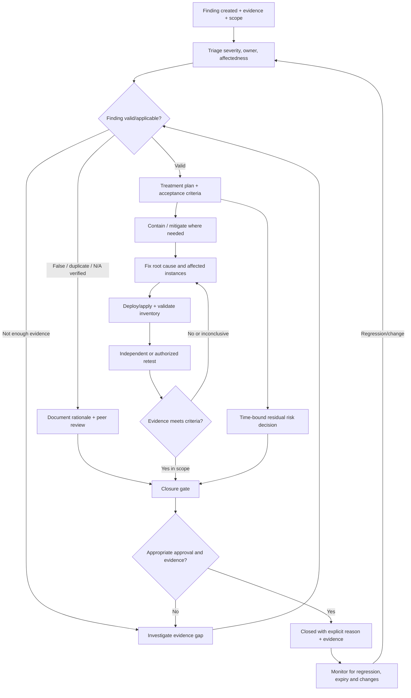
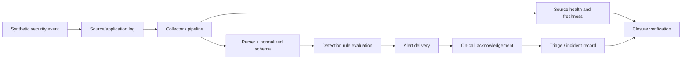

# Đóng finding: xác minh khắc phục, quản lý rủi ro còn lại và lưu bằng chứng

## 1. Vì sao đóng finding là quyết định security assurance, không phải thao tác đổi trạng thái ticket?

Một nền tảng học tập Java/Spring Boot phát hiện lỗi **Broken Object Level Authorization (BOLA)**: giảng viên của trường A có thể yêu cầu xuất báo cáo điểm của trường B. Nhóm phát triển sửa một controller, merge pull request, pipeline báo xanh và chuyển ticket từ `OPEN` sang `DONE`.

Hai tuần sau, sự cố tương tự tái diễn. Nguyên nhân: production vẫn chạy một image cũ trong CronJob xuất báo cáo; endpoint đồng bộ đã trả `403` nhưng một event trái quyền vẫn được ghi vào queue trước khi kiểm tra authorization. Người xử lý ticket đã xác minh code change, **chưa xác minh security property trên các đường thực thi liên quan**.

Một finding chỉ nên được đóng với lý do, thẩm quyền và bằng chứng phù hợp:

- Rủi ro hoặc sai lệch ban đầu đã được giải quyết **trong phạm vi kiểm chứng**, hay chỉ được giảm tạm thời?
- Root cause và các đường gây ảnh hưởng đã được xác định và xử lý tới mức cần thiết chưa?
- Fix có thật sự được triển khai ở environments, versions, identities và resources bị ảnh hưởng không?
- Tests có xác minh cả hành vi hợp lệ và hành vi bị cấm, cùng các side effects không?
- Residual risk và những phần không kiểm chứng đã được đánh giá và quyết định bởi đúng người chưa?
- Ai có quyền phê duyệt đóng, có tách biệt với người tự sửa hay không?
- Có thể tái lập kết luận từ records, logs, test reports, artifact IDs và thời điểm thực tế không?

**Đóng finding (finding closure)** là hoạt động đánh giá, ra quyết định và ghi nhận rằng một phát hiện đã đạt **điều kiện kết thúc được quy định cho một loại xử lý cụ thể**, với bằng chứng xác minh tương ứng, quyền phê duyệt và quản trị phần rủi ro còn lại. Đóng finding không mặc nhiên có nghĩa “đã vá hoàn toàn”, “không còn lỗ hổng” hoặc “hệ thống an toàn tuyệt đối”.

Trong chương **Remediation** thuộc module **SECURITY_SECURITY_ASSURANCE**, việc đóng finding phải phục vụ mục tiêu **đánh giá có bằng chứng**: từ rủi ro, yêu cầu và security controls tới kiểm thử, audit, khắc phục và revalidation liên tục.

### Mục tiêu học tập

Sau bài này, bạn có thể:

1. Phân biệt **fixed, mitigated, risk accepted, false positive, duplicate, not applicable, deferred, verified, closed, reopened**.
2. Chuyển một finding thành **security invariant và acceptance criteria** có thể kiểm chứng.
3. Hiểu sự khác nhau giữa **remediation completed**, **retest passed**, **risk decision** và **closure approval**.
4. Thiết kế lifecycle có ownership, segregation of duties, immutable history và trạng thái rõ.
5. Chuẩn bị evidence pack về source/version, runtime, configuration, tests, population, side effects và residual risk.
6. Chọn phương pháp xác minh tương ứng với findings từ SAST/SCA, DAST, penetration test, audit, IAM, logging, cloud, privacy, vendor và DR.
7. Thực hiện retest hợp lệ bằng synthetic data và quy trình an toàn trên Java/Spring Boot đa tenant.
8. Kiểm soát các đường async như queue/CronJob/worker, cloud IAM, storage và legacy API.
9. Xử lý false positives, duplicates, exceptions và scope limitations **mà không “xóa” phát hiện gốc**.
10. Thiết kế metrics về closure quality, reopened findings, residual exposure và overdue risk.

## 2. Từ vựng cần nắm chính xác

| Thuật ngữ | Ý nghĩa đúng | Cách hiểu sai thường gặp |
|---|---|---|
| **Finding** | Phát hiện về rủi ro, control deviation hoặc evidence gap có scope | “Lỗi code cần sửa một dòng” |
| **Remediation** | Sửa nguyên nhân/điều kiện gây rủi ro | Chỉ merge PR |
| **Mitigation** | Giảm khả năng/tác động rủi ro bằng biện pháp, có thể tạm | Chắc chắn đã xóa lỗ hổng |
| **Containment** | Hạn chế tác động/exposure đang xảy ra | Root cause đã được sửa |
| **Risk acceptance** | Quyết định có thẩm quyền về residual risk theo điều kiện | Tự chuyển ticket sang Done |
| **Compensating control** | Control thay thế/bổ sung để giảm rủi ro khi chưa đạt yêu cầu gốc | Bất kỳ workaround nào cũng đủ |
| **Validation** | Kiểm tra dữ liệu/thiết kế/điều kiện một bước | Đã xác minh end-to-end toàn bộ |
| **Verification/retest** | Kiểm thực tế fix/mitigation đáp ứng acceptance criteria | Developer nói “đã sửa” |
| **Residual risk** | Rủi ro còn sau treatment trong phạm vi | Bằng 0 nếu test pass |
| **Closure** | Trạng thái kết thúc theo lý do/criteria/approval/evidence | Một loại outcome “Fixed” duy nhất |
| **Reopen** | Mở lại do regression, evidence sai hoặc assumptions thay đổi | Chứng tỏ người trước cố ý làm sai |
| **False positive** | Tín hiệu ban đầu không phản ánh vấn đề đã nêu, có evidence bác bỏ | Finding khó sửa nên bỏ |
| **Duplicate** | Hai records mô tả cùng vấn đề/đường rủi ro đã được quản lý | Có tiêu đề hoặc CVE giống nhau là trùng |
| **Not applicable** | Requirement/vulnerability không áp dụng với scope, có rationale | Không muốn làm nên N/A |
| **Evidence gap** | Thiếu dữ liệu cần cho kết luận | Không có lỗi |
| **Exception/waiver** | Sai lệch được xem xét theo thẩm quyền và điều kiện | Miễn trừ tự động làm compliance đạt |

### 2.1. Closure reason khác lifecycle status

Một ticket có thể có `status: CLOSED` nhưng `closure_reason: VERIFIED_FIXED`, `closure_reason: ACCEPTED_RISK` hoặc `closure_reason: FALSE_POSITIVE`. Đây **không phải các kết quả bảo mật tương đương**; báo cáo cần tách riêng. Nếu hệ thống quản lý không hỗ trợ nhiều lý do, bổ sung controlled fields hoặc linked risk decision, không gom vào một chữ Done.

### 2.2. “Resolved” có thể chỉ là tuyên bố của bên sửa

Một nhóm application nói “resolved” sau merge; SRE xác minh image đã deploy; AppSec chạy retest; risk owner duyệt residual risk; auditor kiểm evidence. Các bước tạo **những loại xác nhận khác nhau**. Doanh nghiệp cần định nghĩa ai được ra quyết định cuối đối với từng finding.

### 2.3. Fix vs suppression

Tắt SAST rule, suppress CVE hoặc xóa alert có thể thay đổi **tín hiệu đo** nhưng không nhất thiết thay đổi **risk condition**. Nếu suppress có căn cứ false positive, cần ghi method/evidence; nếu chỉ che lỗi, không được ghi `VERIFIED_FIXED`.

## 3. Một finding tốt cần đủ ngữ cảnh trước khi có thể đóng

Nếu finding quá mơ hồ, test lại sẽ không có tiêu chí rõ. Không nên chỉ ghi “API insecure” rồi yêu cầu reviewer chứng minh “đã an toàn”.

### 3.1. Minimum finding record

| Trường | Câu hỏi |
|---|---|
| **Finding ID** | Identifier ổn định xuyên tools và reports? |
| **Source** | Từ audit, pentest, SAST/SCA, detection, incident hay assessment nào? |
| **Criteria/control** | Security requirement/policy nào cần đáp ứng? |
| **Risk scenario** | Threat, asset, business/data impact cụ thể? |
| **Affected scope** | Application/service, tenant, environment, region, API version, artifact? |
| **Evidence original** | Request/response, logs, config, sample và timestamps có nguồn? |
| **Reproduction conditions** | Cần identity, fixture, precondition và authorized test method nào? |
| **Severity/priority** | Ai xếp, dựa exposure/impact/exploitability nào? |
| **Owner** | Người sửa, người xác minh, người quyết định rủi ro? |
| **Due date/SLA** | Theo risk và chính sách nào? |
| **Acceptance criteria** | Kết quả nào phải đạt để xử lý/đóng? |
| **Related changes** | PR, IaC, patch, releases, incidents, exceptions? |
| **Status/history** | Khi nào thay đổi và ai cho phép? |

### 3.2. Phạm vi ảnh hưởng không chỉ từ proof-of-concept

Nếu tester chứng minh teacher A đọc được result B ở API v1, finding có thể liên quan cả lớp authorization trong service/worker. Cần xác định affected population trước khi chọn **closure scope**. Nếu chỉ sửa một route, phải giải thích vì sao các routes khác không bị ảnh hưởng hoặc vẫn có findings riêng.

### 3.3. Không nhầm severity với closure condition

Một finding Low cũng cần disposition có evidence; finding Critical có thể cần independent retest sâu hơn và escalation trước khi tiếp tục vận hành. Nhưng **mọi closure reason phải trung thực**, không “tự hạ severity để đóng nhanh”.

## 4. Vòng đời chuẩn: từ phát hiện đến đóng và giám sát tiếp



### 4.1. Các mốc quan trọng

1. **Intake:** ghi record nguyên vẹn, nguồn và scope.
2. **Triage:** xác minh finding thực, risk, owner và deadline.
3. **Treatment selection:** fix, mitigate, transfer/avoid, accept có điều kiện hoặc disposition không áp dụng.
4. **Execution:** sửa code/config/process, xử lý mọi affected instances.
5. **Verification:** retest phù hợp threat scenario và effective deployment.
6. **Closure review:** reviewer kiểm acceptance, completeness và exceptions.
7. **Closure record:** reason, approver, evidence, residual risk, timestamp.
8. **Post-closure:** monitoring, regression triggers, reopened workflow.

### 4.2. Các vai trò

| Vai trò | Trách nhiệm chủ yếu |
|---|---|
| **Finding owner** | Theo dõi đến quyết định cuối, cập nhật ticket và follow-up |
| **Engineering/control owner** | Sửa nguyên nhân, test kỹ thuật, cung cấp thay đổi |
| **Security/AppSec/assurance reviewer** | Xác nhận criteria, evidence và retest phù hợp |
| **SRE/Cloud owner** | Xác minh config/image/permissions thực đang chạy |
| **Business/data owner** | Xác định ảnh hưởng workflow/dữ liệu, điều kiện chấp nhận |
| **Risk owner** | Phê duyệt residual risk/exception theo authority |
| **Incident response** | Xử lý exposure thực, containment và forensics khi cần |
| **External assessor/auditor** | Đánh giá kết luận theo phạm vi và quyền của engagement |

**Người tạo fix không nên tự có quyền duy nhất tuyên bố security finding đã được xác minh**, nhất là khi critical hoặc liên quan compliance. Mức độ independent review có thể phân tầng theo risk và policy; không phải mọi low-risk ticket bắt buộc một auditor ngoài công ty.

## 5. Các trạng thái lifecycle cần phân biệt

| Status được đề xuất | Ý nghĩa và bước tiếp theo |
|---|---|
| `NEW` | Chưa triage |
| `TRIAGE_PENDING` | Chưa xác định affectedness/risk/owner |
| `VALIDATED_OPEN` | Finding đã được xác nhận |
| `IN_REMEDIATION` | Đang sửa nguyên nhân/control |
| `MITIGATED_PENDING_FIX` | Có giảm thiểu tạm, root cause còn |
| `FIX_CLAIMED` | Bên sửa xác nhận đã thay đổi, chưa kiểm hiệu lực |
| `DEPLOYMENT_PENDING` | Fix chưa được áp vào toàn bộ runtime scope |
| `RETEST_PENDING` | Đã apply, chưa có verification |
| `RETEST_FAILED` | Thử lại phát hiện sai lệch còn |
| `INCONCLUSIVE` | Kết quả kiểm không đủ hoặc tool/source lỗi |
| `CLOSURE_REVIEW` | Có evidence, chờ reviewer/approval |
| `CLOSED_VERIFIED_FIXED` | Xác minh remediation trong phạm vi đã định |
| `CLOSED_FALSE_POSITIVE` | Evidence bác bỏ finding ban đầu |
| `CLOSED_DUPLICATE` | Được liên kết tới canonical finding |
| `CLOSED_NOT_APPLICABLE` | Requirement không áp dụng, có rationale |
| `CLOSED_ACCEPTED_RISK` | Quyết định chấp nhận risk theo policy, không phải fixed |
| `CLOSED_NO_LONGER_EXPOSED` | Exposure chấm dứt có xác minh, risk lifecycle xử lý |
| `REOPENED` | Điều kiện/giả định thay đổi hoặc regression |

Tên trạng thái chỉ là **một mô hình triển khai**, không phải tiêu chuẩn bắt buộc. Đơn vị dùng `status=CLOSED` và `reason=...` cũng được nếu báo cáo phân biệt được các loại và có audit trail.

### 5.1. Không dùng một “Closed” tổng để báo cáo vá lỗi

Nếu 100 findings Closed gồm 20 risk accepted, 10 false positive, 5 duplicate và 65 verified fixed, metric “100 vulnerabilities fixed” **sai**. Báo cáo nên tách disposition, risk outcome và closure evidence.

### 5.2. Một finding có thể đóng khi rủi ro chưa bị loại bỏ?

Có thể có **administrative closure do risk acceptance** nếu quy định tổ chức/hợp đồng cho phép và đúng authority, nhưng risk vẫn phải ở register và được giám sát tới expiry. Với regulatory/contractual nonconformity, waiver nội bộ **không tự làm yêu cầu bắt buộc được đáp ứng**.

### 5.3. Các trạng thái cho exception cần expiry

Risk acceptance không nên tồn tại vô hạn: phải có effective date, expiry/reassessment triggers, compensating controls, affected assets, risk owner và theo dõi. Khi hết hạn, không thể giữ màu xanh chỉ vì ticket kỹ thuật đã được đóng.

## 6. Closure criteria: điều kiện nào phải đạt?

Một finding closure gate cần kiểm đủ **tính hợp lệ của sửa chữa** và **tính hợp lệ của kết luận**.

### 6.1. Bộ điều kiện nền tảng

1. **Original condition understood:** criteria, trigger, affectedness và root cause được xác định ở mức phù hợp.
2. **Treatment documented:** fix/mitigation/exception/not-applicable có reason, owner, change.
3. **Affected scope addressed:** mọi assets/versions/roles/regions trong closure claim được áp hoặc loại trừ có căn cứ.
4. **Technical/business acceptance defined:** không chỉ “tests green”, mà kiểm được security invariant.
5. **Evidence trustworthy:** source, timestamps, provenance, method, coverage và integrity.
6. **Effective operation verified:** active runtime/config thực đáp ứng tests trong scope.
7. **Residual risk documented:** phần chưa kiểm, dependency, temporary controls và exception nếu có.
8. **Approval authorized:** người ra quyết định đúng thẩm quyền và mức độc lập.
9. **Reporting consistent:** status/reason/metric/audit không mâu thuẫn.
10. **Future triggers defined:** change/expiry/incident/regression có thể mở lại hoặc revalidate.

### 6.2. Không biến checklist thành ritual

Nếu finding về expired certificate, không nhất thiết cần same evidence như BOLA. Nhưng phải có **chứng cứ certificate/trust path đã được thay đúng mọi endpoints trong scope, client TLS validation hoạt động**. Với finding về access review, cần control operating records trong assessment period; một test HTTP không thay toàn bộ evidence.

### 6.3. “Done” của engineering là điều kiện cần, không luôn đủ

PR đã merge, ticket change approved, image built là milestones hữu ích. **Closing security finding** cần kiểm fix đã được triển khai, behavior đáp ứng criteria và không có paths trái phạm vi được tự tuyên bố an toàn.

## 7. Quyết định closure theo loại xử lý

| Disposition | Điều kiện bắt buộc trước khi đóng | Residual risk/reporting |
|---|---|---|
| **Verified fixed** | Root cause hoặc affected condition đã xử lý; retest đúng scope pass; deployment/config được xác minh | Nêu remaining limitations/monitoring |
| **Mitigated, root cause outstanding** | Control bù đắp có design/operation evidence và được quản trị | Thường để remediation finding mở hoặc đóng theo policy với linked risk |
| **Accepted risk** | Risk owner đúng quyền, evidence impact, conditions, expiry, không trái nghĩa vụ bắt buộc | Ghi accepted exposure rõ, không gọi fixed |
| **False positive** | Kết quả tái hiện/analysis chứng minh tín hiệu ban đầu sai trong scope | Lưu nguồn, test và rationale |
| **Duplicate** | Mapping root cause/affected population đủ trùng với canonical record | Canonical finding vẫn được theo dõi |
| **Not applicable** | Requirement/component không thực tồn tại/không áp dụng trong scope | Nêu applicability proof và change trigger |
| **No longer exposed** | Tài sản/service/version/permission bị xóa/disable trong phạm vi và negative tests phù hợp | Kiểm residual copies, old jobs và access |
| **Partially fixed** | Chỉ một phần affected paths được xử lý | Không đóng toàn bộ finding như Fixed |
| **Vendor claimed fixed** | Vendor tuyên bố đã sửa, chưa có independent/customer verification nếu cần | Chưa đủ để Verified fixed |
| **Evidence insufficient** | Không có test hoặc nguồn bị lỗi | Inconclusive; không được đóng Fixed |

### 7.1. Có cần root cause analysis cho mọi finding?

Độ sâu tùy severity, recurrence và hệ quả. Với lỗi config một lần, có thể tìm nguyên nhân ở IaC drift hoặc change process. Với multi-tenant authorization ảnh hưởng nhiều paths, thường cần tìm **class-level root cause** và design control bảo vệ tất cả entry points, không chỉ thay một câu lệnh.

### 7.2. Một record có thể trùng nhưng phạm vi khác

Hai scanners tìm cùng CVE trong hai services không nhất thiết là duplicate nếu mỗi service cần triển khai/retest khác. Có thể dùng parent finding với linked affected instances; không được đóng cả hai chỉ vì cùng CVE ID khi một instance còn exposed.

### 7.3. False positive phải có evidence phản biện

Ví dụ scanner báo cấu hình TLS sai trên hostname không thuộc service scope; chủ tài sản, DNS, endpoint và actual TLS behavior được kiểm trong phạm vi; assessor xác nhận asset attribution sai. **Đóng false positive cần tài liệu rõ**, không chỉ một bình luận “không ảnh hưởng”.

## 8. Xác định phạm vi khắc phục và phạm vi đóng finding

**Affected scope** là các assets, environments và execution paths bị ảnh hưởng. **Verified closure scope** là phần đã có bằng chứng về treatment/outcome. Hai tập này phải được đối chiếu, không được âm thầm giả định giống nhau.

### 8.1. Những chiều cần kiểm

| Chiều | Câu hỏi khi đóng |
|---|---|
| **Service/API** | REST v1/v2, GraphQL, admin, internal API có cùng defect? |
| **Data/tenant** | Các tenant, object classes, dữ liệu nhạy cảm có được bảo vệ? |
| **Identity/role** | Learner, teacher, tenant admin, system admin, workload, vendor support? |
| **Environment** | Production, staging, DR, sandbox, temporary test deployments? |
| **Region/account** | Primary/secondary, cloud account, namespace và network paths? |
| **Runtime version** | Image digest, library/JDK version, IaC revision thực chạy? |
| **Async processing** | Queue, worker, CronJob, retry/DLQ, delayed callback? |
| **Storage/cache** | DB, object storage, cache, signed URL, search index, replication? |
| **Time window** | Từ khi nào exposure tồn tại; fix bắt đầu hiệu lực lúc nào? |
| **Dependencies** | Third-party APIs, IdP, KMS, proxies, service mesh? |
| **Business behavior** | Positive workflows còn hoạt động, không bypass security? |

### 8.2. Affected population cần authoritative evidence

Nếu scanner phát hiện container image có package lỗi trên ba workloads, không được chỉ đọc file Maven trong một repo. Cần kết nối artifact digest với registry, deployed images, replicas, CronJobs, failed rollouts và DR cluster trong scope; xác minh **mọi running/potentially runnable instance** thuộc closure claim.

### 8.3. Partial remediation

Ví dụ controller v2 đã sửa BOLA nhưng API v1 vẫn dùng được; trạng thái phù hợp là **partially remediated** với affected path còn mở, trừ khi v1 đã được disable/decommission và evidence xác minh toàn bộ traffic/identity paths không còn tiếp cận được. Có thể tách finding theo service nếu tracking giúp rõ ownership, nhưng giữ liên kết và không ghi “overall fixed” khi vẫn còn exposure.

### 8.4. Không suy từ staging sang production

Staging test PASS có thể chứng minh fix design và behavior với một cấu hình, nhưng production có gateway, IdP, secrets, caches, storage IAM hoặc release khác. Closure cần kết hợp staging negative tests với **runtime/config identity evidence**, và controlled production verification nếu risk/method yêu cầu và được phép.

### 8.5. Không suy từ thời điểm sang cả kỳ

Finding audit về quyền truy cập admin không được review trong quý trước có thể được khắc phục tương lai bằng review và process mới. Việc fix hiện tại **không xóa deviation lịch sử**; kết luận compliance của kỳ cũ theo assessment methodology vẫn có thể ghi phát hiện.

## 9. Chọn acceptance criteria trước khi thực thi remediation

Acceptance criteria phải mô tả **security outcome có thể quan sát**, không phải tên công việc sẽ thực hiện.

### 9.1. Ví dụ yếu và mạnh

| Yếu | Chặt hơn, có thể kiểm |
|---|---|
| “Thêm check permission” | Unauthorized actor bị từ chối trước DB/queue/storage side effects trên routes trong scope |
| “Nâng JDK” | Workloads đang chạy đúng bản runtime được chấp thuận, các vulnerable versions/old jobs đã được xử lý và kiểm lại affectedness |
| “Bật MFA” | Eligible privileged human login paths yêu cầu MFA theo policy, invalid/fallback attempts bị từ chối |
| “Fix logs” | Synthetic critical event đi qua source→collector→rule→on-call, có timestamp và audit trail |
| “Sửa backup” | Restore vào môi trường cô lập đạt workflow/data integrity/RPO theo BIA và test method |
| “Tối ưu secrets” | Credential lộ đã được revoke/rotate, effective old credential tests bị từ chối, các consumers dùng secret mới |
| “Đóng finding audit” | Có corrective action, operating evidence theo kỳ/phương pháp và assessor/risk reviewer quyết định phù hợp |

### 9.2. Những phần nên có trong một testable criterion

- **Precondition:** phiên bản, môi trường, test actor, dữ liệu và trạng thái.
- **Input/attack or failure condition:** request sai tenant, token revoked, event giả, outdated image, collector failure...
- **Expected behavior:** deny, validate, alert, restore hoặc quarantine.
- **Side-effect invariant:** không tạo unauthorized DB row, queue message, object hoặc grant.
- **Success guardrail:** request hợp lệ/workflow nghiệp vụ tiếp tục hoạt động theo policy.
- **Evidence source:** test report, runtime config, audit event, population, timestamps.
- **Scope limitation:** những paths/regions/configs chưa nằm trong test.
- **Retest trigger:** release, role, vendor, pipeline, data-flow hoặc infra change.

### 9.3. Lưu ý với các chỉ số phần trăm

Đóng một finding cụ thể thường dựa trên **điều kiện control/risk rõ ràng**, không phải “overall coverage tăng từ 95% lên 98%”. Một failed critical invariant có thể vẫn cần xử lý khẩn dù tổng số test pass cao.

## 10. Phương pháp retest: kiểm lại đúng điều kiện lỗi, không chỉ chạy lại scanner

### 10.1. Một retest đáng tin có nhiều lớp

1. **Source/design review:** fix có giải quyết root cause thay vì chỉ một symptom?
2. **Build/artifact mapping:** version đã fix có được build, ký/định danh và deploy?
3. **Configuration check:** policies, feature flags, environment variables và IAM có đúng?
4. **Reproduction retest:** kịch bản phát hiện ban đầu không còn xuất hiện.
5. **Related abuse cases:** các biến thể tương tự có được kiểm?
6. **Negative assertions:** hành vi trái quyền bị chặn trước side effects.
7. **Positive regression:** nghiệp vụ hợp lệ không bị phá.
8. **Monitoring verification:** audit/detection vẫn hoạt động hoặc tăng coverage.
9. **Scope completeness:** các affected services/instances được đối chiếu.
10. **Independent review:** người có thẩm quyền xác nhận outcomes và limitations.

### 10.2. Retest có thể dùng nhiều công cụ

| Finding source | Retest thích hợp |
|---|---|
| SAST code finding | Code-path review + focused tests + active artifact verification |
| SCA/CVE | Affectedness + dependency/image runtime scan + patch/mitigation validation |
| DAST/API finding | Reproduce authorized request + negative/positive regression |
| Penetration-test finding | Test lại exploit conditions theo rules of engagement, kiểm class-level fix |
| IAM/config finding | Inspect effective permissions + allowed/denied tests |
| Logging/detection finding | Synthetic event end-to-end + collector health |
| Privacy/data-flow finding | Approved data payload/retention/deletion verification |
| Vendor finding | Vendor evidence + customer integration/control verification |
| Compliance audit finding | Corrective evidence + design/operating assessment theo engagement |
| Backup/DR finding | Restore, business transaction/RTO/RPO và data reconciliation |

### 10.3. Retest tools có thể thất bại

Một scanner báo không tìm thấy vulnerability có thể do:

- Resource không scan được hoặc token scan hết hạn.
- Endpoint bị loại nhầm khỏi scope.
- API path đổi nên test không chạm affected behavior.
- Signature/payload chưa phù hợp với phiên bản exploit.
- Detection rule hoặc report query bị tắt.
- Fix được kiểm ở staging còn production chưa deploy.

Trong những trường hợp này, outcome **INCONCLUSIVE**, không tự biến thành PASS.

### 10.4. False negatives và bypass

Nếu chỉ test lại PoC cũ sau fix, defect có thể tồn tại qua alternate path. Cần xét **threat model, trust boundaries và family của lỗi**. Với IDOR, thử read/update/export, roles, tenants, nested resource IDs, async workers và download links; không nhất thiết cần fuzz toàn Internet, nhưng phải đủ để hỗ trợ claim đã đặt.

### 10.5. Không sử dụng test trái phép

Retest cần authorization, rate/data safety, scope, time window, stop conditions. Dùng synthetic tenants, mock callbacks, isolated restore hoặc approved production probes; không khai thác dữ liệu thật hoặc tấn công third-party không được phép để chứng minh closure.

## 11. Xác minh fix đã tới đúng runtime

### 11.1. Chuỗi change-to-runtime

```text
Finding F-123
  -> approved remediation plan
  -> source change PR-456 / commit SHA
  -> build/test run ID
  -> artifact identity (image SHA-256 digest)
  -> deployment approval/change ID
  -> actual running workload/image/config version
  -> security retest in affected environment
  -> approved closure record
```

Nếu thiếu liên kết từ artifact được test tới **runtime đang chạy**, claim “đã triển khai fix” còn yếu.

### 11.2. Vì sao tag không đủ?

Container tag có thể bị thay nội dung tùy registry/policy. Để đối chiếu, dùng image digest hoặc immutable artifact identity thực tế. Nhưng digest chỉ chứng minh đúng artifact, không bảo đảm không có vulnerability logic; cần behavioral tests.

### 11.3. Những workload bị quên

- Legacy deployments hoặc inactive replicas có thể scale trở lại.
- Kubernetes CronJob controller có thể tạo Pod từ template/image cũ.
- DR cluster hoặc region dự phòng chưa cập nhật.
- Worker xử lý từ queue riêng.
- Lambda/serverless function vẫn tham chiếu version cũ.
- Old container instances chưa được drain hoặc rollout lỗi.
- Cache/config secrets gây behavior cũ dù artifact mới.

### 11.4. Read-only inventory minh họa

```bash
# Minh họa lệnh QUAN SÁT trong Kubernetes context được cấp quyền.
# Không tự tạo outage, restart hoặc xóa tài nguyên.
kubectl -n learning get deployments,statefulsets,cronjobs,jobs -o wide
kubectl -n learning get pods -o wide
kubectl -n learning get pods \
  -o jsonpath='{range .items[*]}{.metadata.name}{"\t"}{range .status.containerStatuses[*]}{.name}{"="}{.imageID}{" "}{end}{"\n"}{end}'
```

Những lệnh này **không tự chứng minh** tenant authorization, release provenance, security policy hoặc toàn bộ cluster/region đều được kiểm; cần đối chiếu với inventory và tests đã định.

### 11.5. IaC drift

Terraform/Kubernetes manifest đã sửa không tự bảo đảm effective IAM hoặc network state đúng. Cần xem apply/change result, runtime policy, resource trust, associated roles và test quyền. Nếu manual override tồn tại, finding phải xem root cause ở change governance.

## 12. Case A: đóng BOLA finding cho REST API đa tenant

### 12.1. Original finding

Trong hệ thống báo cáo điểm, một API trả dữ liệu giả của tenant B cho principal thuộc tenant A.

| Trường | Nội dung minh họa |
|---|---|
| Finding | `F-RESULT-042` |
| Requirement | Mọi access result phải kiểm role + tenant + object ownership |
| Endpoint | `GET /api/v1/results/{id}` |
| Test actor | Synthetic teacher tenant A |
| Target | Synthetic result tenant B |
| Original observation | HTTP 200 và data không thuộc quyền |
| Root-cause hypothesis | Controller query theo ID, bỏ object authorization |
| Affected class | Read/update/export/download paths cần điều tra |
| Risk | Confidentiality/integrity của dữ liệu kết quả học viên |

### 12.2. Design fix không phụ thuộc client-supplied tenant

Một giải pháp là thực hiện **server-side verified actor → tenant membership → resource ownership policy** trước khi trả dữ liệu hoặc tạo side effects.

```java
// Mã minh họa Spring Boot; các interfaces và kiểu dữ liệu là abstraction.
@Service
public class ResultAccessService {
    private final ResultRepository results;
    private final ResultAuthorizationPolicy policy;

    public ResultAccessService(ResultRepository results,
                               ResultAuthorizationPolicy policy) {
        this.results = results;
        this.policy = policy;
    }

    @Transactional(readOnly = true)
    public ResultDto read(VerifiedActor actor, UUID resultId) {
        var result = results.findById(resultId)
            .orElseThrow(ResultNotFoundException::new);

        // Kiểm object-level authorization ở trusted server boundary.
        // Không dùng X-Tenant-ID do client tự nhập làm quyền.
        policy.requireCanRead(actor, result);
        return ResultDto.fromAuthorized(result);
    }
}
```

Đoạn code **không đủ để production-ready**: `VerifiedActor` và `ResultAuthorizationPolicy` là giả định, cần kiểm caching, permission changes, owner mapping, privacy logs và các entry points khác. Kỹ thuật query có thể bị khác biệt nếu dữ liệu cần không được đưa vào memory trước khi authorize; thiết kế thực phải bảo vệ cả những đường khác và hiệu quả truy cập.

### 12.3. Retest phải gồm cả positive và negative

```java
// Pseudocode Spring Boot integration test.
// SyntheticFixtureFactory, TestTokenIssuer, SideEffectProbe do hệ thống tự định nghĩa.
@SpringBootTest
@AutoConfigureMockMvc
class ResultAuthorizationClosureIT {
    @Autowired MockMvc mvc;
    @Autowired SyntheticFixtureFactory fixture;
    @Autowired TestTokenIssuer tokenIssuer;
    @Autowired SideEffectProbe effects;

    @Test
    void sameTenantValidReadStillWorks() throws Exception {
        var teacherA = fixture.teacherIn("tenant-A");
        var resultA = fixture.resultIn("tenant-A");

        mvc.perform(get("/api/v1/results/{id}", resultA.id())
              .header("Authorization",
                      "Bearer " + tokenIssuer.forActor(teacherA)))
           .andExpect(status().isOk());
    }

    @Test
    void otherTenantReadDeniedWithoutSideEffects() throws Exception {
        var teacherA = fixture.teacherIn("tenant-A");
        var resultB = fixture.resultIn("tenant-B");
        var before = effects.snapshot(resultB.id());

        mvc.perform(get("/api/v1/results/{id}", resultB.id())
              .header("Authorization",
                      "Bearer " + tokenIssuer.forActor(teacherA)))
           .andExpect(status().isForbidden());

        assertThat(effects.snapshot(resultB.id()))
              .isEqualTo(before);
    }
}
```

Đây là **pseudocode**, không compile ngay nếu chưa triển khai helpers. `MockMvc` có thể bỏ qua gateway, IdP và production network; closure claim phải nêu giới hạn và thêm tests/end-to-end evidence khi cần.

### 12.4. Matrix trường hợp cần xem

| Case | Expected |
|---|---|
| Teacher A đọc result A được cấp quyền | Allowed |
| Teacher A đọc result B | Deny, không lộ payload |
| Student A sửa điểm A khi không có quyền | Deny |
| Teacher A tạo export job của class B | Deny trước DB/queue |
| Worker nhận job bị giả tenant | Refuse/quarantine |
| Download URL trỏ tới report B không được phép | Deny/expire theo policy |
| Token sai issuer/audience/expiry | Deny |
| Tenant role bị thu hồi | Deny theo session/token semantics đã thiết kế |
| API v1/v2 và internal route | Không tồn tại bypass trong scope |
| Redis/cache result cũ | Không làm mất enforcement |

### 12.5. Closure evidence

- Original PoC/test case và expected invariant.
- Source fix/PR/commit review, API/worker code coverage.
- Release image digest và observed deployment trong affected scope.
- Synthetic negative/positive test reports, fixtures, timestamps.
- DB/queue/storage before/after hoặc event reconciliation.
- Runtime authorization/audit verification.
- Explicit limitations và residual-risk assessment.
- Verification reviewer và closure approval.

### 12.6. Khi nào chưa được đóng?

Nếu v1 pass nhưng v2 hoặc worker chưa test, không thể đóng finding toàn diện nếu affected class gồm những paths đó. Nếu chỉ có HTTP `403` sau khi tạo unauthorized job, retest phải **FAIL**. Nếu fixture bị lỗi hoặc app down nên tất cả requests `403`, retest **INCONCLUSIVE**, không phải security PASS.

## 13. Case B: queue, worker và side effects sau một HTTP 403

### 13.1. Lỗi time-of-check/time-of-use

Một hệ thống có thể nhận request, tạo export job, enqueue event rồi mới kiểm authorization và trả denied response. Worker sau đó chạy theo metadata trong message. Kết quả là **HTTP 403 nhưng dữ liệu vẫn bị xử lý trái quyền**.

### 13.2. Invariant cần giữ

“Không có tài nguyên mới ngoài quyền được tạo/đọc/ghi sau unauthorized request; event replay không tạo unauthorized effects; mọi worker xác minh trusted job ownership/state trước processing.”

### 13.3. Test strategy

1. Chuẩn bị test tenants A/B với data giả có stable IDs.
2. Lưu trạng thái DB export jobs, queue event IDs và object storage keys liên quan.
3. Gửi unauthorized export request bằng user A cho result B.
4. Xác nhận HTTP deny và **không có row/event/file trái quyền**.
5. Chờ bounded window theo async architecture; kiểm delayed effects.
6. Inject một giả event/duplicate vào **test queue được cấp phép**, kiểm worker reject/quarantine.
7. Retry/replay event đã xử lý; kiểm idempotency.
8. Chạy positive export của tenant A để xác nhận business workflow đúng.
9. Ghi job IDs, trace IDs, artifact digest, test fixtures, evidence hash.

### 13.4. Worker có thể tin message tới đâu?

Message trong queue nội bộ không tự bảo đảm tenant/actor claim là đúng. Producer có thể bị bypass, event bị replay hoặc dữ liệu từ worker cũ. Worker cần validate **job stored state, trusted ownership, allowed transitions**, và dùng service identity chỉ có quyền phù hợp. Không coi “queue chỉ có service gọi được” là authorization cho mọi object.

### 13.5. Pseudocode tránh duplicate effect

```java
// Pseudocode, không giải quyết đầy đủ DB/external storage atomicity.
@Transactional
public ProcessOutcome process(ExportEvent event) {
    ExportJob job = exportJobs.findByIdForUpdate(event.jobId())
        .orElseThrow(UnknownJobException::new);

    exportPolicy.requireWorkerCanProcess(job);

    if (job.isCompleted()) {
        return ProcessOutcome.alreadyCompleted(job.resultRef());
    }

    // External side effects cần stable object key, idempotency và reconciliation.
    return exportCoordinator.processWithRecoveryChecks(job);
}
```

### 13.6. Tại sao “queue depth 0” không đủ?

Queue trống có thể do worker đã xử lý đúng, đã ACK rồi mất side effect, hoặc messages bị drop. Closure nên dựa trên **business effect and data integrity reconciliation**, không chỉ queue metrics.

## 14. False positive, duplicate và not applicable: đóng mà không xóa lịch sử

### 14.1. False positive là một kết luận cần chứng minh

Một SAST tool báo dùng `Random` trong tạo token bảo mật, nhưng thực tế code chỉ tạo màu nền trong UI thử nghiệm và không đi vào authentication path. Cần:

- Kiểm source, data flow, caller và trust boundary.
- Xác nhận version/code path và mục đích.
- Xem có path khác dùng cùng value cho security token không.
- Ghi evidence và rationale.
- Reviewer kiểm, sau đó mới đánh dấu `FALSE_POSITIVE` hoặc `NOT_APPLICABLE` phù hợp định nghĩa.

Không suppress cả rule cấp repository nếu chỉ có một benign instance; suppression rộng có thể che các findings thật về sau.

### 14.2. Duplicate với canonical finding

Hai scanners cùng phát hiện **cùng một root cause/instance** và evidence điều tra đủ mapping có thể duplicate. Canonical finding phải chứa union các affected assets, sources, priorities và closure conditions. Duplicate record liên kết `duplicate_of`; không mất nguồn audit.

### 14.3. Not applicable

Một vulnerability chỉ ảnh hưởng feature/module không build, không load hoặc service không sử dụng trong điều kiện xác định có thể không áp dụng, nếu vendor advisory, build/runtime evidence và affectedness analysis hỗ trợ. Cần retention/recheck trigger khi feature bật lại hoặc release thay đổi.

### 14.4. Decommission cũng cần kiểm

Tắt API v1 trên gateway chưa chắc loại bỏ đường internal URL, CronJob, background process hoặc object link cũ. Nếu closure reason là `NO_LONGER_EXPOSED`, cần inventory, effective deny/disable tests và dữ liệu/credential cleanup phù hợp.

### 14.5. Không được đổi một finding khó thành “duplicate”

Nếu cùng CVE nhưng xuất hiện ở primary và DR workloads, mỗi nơi cần evidence fix/removal. Nếu canonical finding không bao phủ DR, đóng record DR như duplicate sẽ bỏ lỡ risk thực.

## 15. Risk acceptance và compensating controls không đồng nghĩa đã sửa

### 15.1. Bốn cách phản ứng với risk

Tùy khung quản trị, có thể **reduce/mitigate, avoid, transfer/share, accept**. Chuyển một phần chi phí/hợp đồng sang bên khác không xóa accountability về dữ liệu/nghĩa vụ. Với security finding, điều quan trọng là **treatment nào được chọn, vì sao phù hợp risk criteria và evidence cho effectiveness**.

### 15.2. Một exception record nên có gì?

```yaml
risk_exception_id: "RISK-EX-DEMO-015"
finding_id: "F-VENDOR-SDK-026"
disposition: "ACCEPTED_WITH_CONDITIONS"
status: "ILLUSTRATIVE_NOT_APPROVED"
scope:
  vendor_component: "<exact-library-and-version>"
  services: ["<affected-service>"]
  environments: ["<affected-environment>"]
inherent_risk: "<approved-risk-assessment>"
residual_risk: "<assessment-after-compensating-controls>"
reason: "<documented-business-justification>"
compensating_controls:
  - control: "<scope-limited-technical-mitigation>"
    verification: "restricted://<valid-test-evidence>"
limitations:
  - "Root cause remains until vendor patch"
owner: "<control-owner>"
risk_owner: "<authorized-acceptor>"
decision_at: "<UTC-timestamp>"
valid_until: "<policy-based-expiry>"
reassessment_triggers:
  - "vendor-patch-available"
  - "new-known-exploitation"
  - "change-in-exposure-or-data"
remediation_reference: "<linked-open-plan>"
evidence_refs: []
```

### 15.3. Khi nào risk acceptance không phù hợp?

Nếu một luật, tiêu chuẩn, hợp đồng hoặc quy định yêu cầu control bắt buộc không có cơ chế ngoại lệ hợp lệ, risk owner nội bộ không thể tự “miễn” rồi tuyên bố compliance PASS. Một exception có thể hỗ trợ quyết định vận hành tạm thời, nhưng **không làm biến mất nonconformity** trong external assessment.

### 15.4. Compensating control có hiệu quả hay chỉ tồn tại?

Ví dụ chưa thể vá third-party SDK có known vulnerability; tổ chức hạn chế endpoint bằng network rules và giảm quyền service. Cần kiểm **actual exposure/reachability, permission deny, config drift monitoring**, không chỉ có lời tuyên bố “đã firewall”.

### 15.5. Theo dõi sau closure

Exception expiry, thay đổi risk, vendor advisory hoặc new exploit trigger phải tạo review/reopen. Nếu system quản lý ticket không hỗ trợ automatic reopen, một risk register liên kết và reminder vẫn cần tồn tại, không làm finding mất dấu.

## 16. Đóng finding SCA/CVE và patch runtime

### 16.1. Mức ảnh hưởng phải được xác định trước

Một CVE trong dependency graph có thể:

- Ảnh hưởng runtime/library thật đang chạy.
- Chỉ có trong test scope hoặc build-only tool.
- Được vendor backport bản vá dù version string không thay như dự kiến.
- Yêu cầu cấu hình/feature mà ứng dụng không bật.
- Có reachable vulnerable code path hoặc cần điều kiện exploit đặc biệt.

Không tự khẳng định **affected** hay **unaffected** chỉ từ một chuỗi version. Cần vendor advisory, runtime/build evidence, affectedness, exploit preconditions và scope.

### 16.2. Closure acceptance

| Bước | Evidence |
|---|---|
| **Affected instances** | Dependency/SBOM + services/containers/assets + versions/digests |
| **Treatment** | Patch/update/backport/mitigation rationale, change |
| **Deployment** | Active runtime artifact/version trong mọi affected instances |
| **Technical retest** | Scanner/applicability check và behavior test thích hợp |
| **Regression** | Application functional tests và security checks |
| **Residual exposure** | Remaining versions, DR/old image, constraints, exceptions |
| **Approval** | Security reviewer và risk decision nếu incomplete |

### 16.3. Maven dependency example

```xml
<!-- Ví dụ minh họa version management, KHÔNG hàm ý phiên bản
     dưới đây là lỗ hổng hay phiên bản sửa lỗi cho một CVE cụ thể. -->
<dependency>
    <groupId>org.example</groupId>
    <artifactId>example-library</artifactId>
    <version>APPROVED_VERSION_PLACEHOLDER</version>
</dependency>
```

Update version chỉ là một phần. Pipeline phải xây image mới, kiểm digest, deploy, xác minh JVM actually uses dependency version trong artifact, và test behavior. Nếu classpath còn jar cũ, config thay nhưng risk chưa hết.

### 16.4. Khi scanner không còn report

Phải kiểm scanner có đủ credential, asset inventory, signature/advisory cập nhật và nguồn dữ liệu tốt. “0 findings” khi scan failed không là proof fixed. Nếu tool không phân tích được runtime, dùng alternative evidence có phương pháp và ghi limitation.

### 16.5. Old images và rollback

Version cũ còn tồn tại trong registry không nhất thiết đang exposed, nhưng nếu rollback policy hoặc CronJob template có thể deploy lại, risk of reintroduction cần được quản trị. Có thể chặn artifact deploy, cập nhật templates, giám sát drift hoặc xử lý theo retention/incident recovery requirements.

## 17. Đóng finding IAM, MFA và credential exposure

### 17.1. Một ví dụ access revocation

Security tìm thấy API key của một vendor trong commit history. Developer xóa key khỏi source và đổi secret trong Kubernetes. **Finding chưa chắc được giải quyết**, vì key cũ có thể vẫn còn hiệu lực tại vendor, logs có thể đã chứa bản sao, các workers cũ tiếp tục dùng và quyền của key mới vẫn quá rộng.

### 17.2. Tiêu chí closure cho leaked credential

1. Xác nhận loại key, scope, active services và source exposure.
2. Điều tra theo incident policy nếu có dấu hiệu unauthorized use.
3. Thu hồi/vô hiệu credential cũ ở authoritative system.
4. Rotate sang scoped replacement, bảo vệ trong secret manager.
5. Kiểm old credential không thể dùng theo token/session revocation semantics.
6. Cập nhật consumers và đảm bảo business workflow hợp lệ vẫn hoạt động.
7. Tìm các bản sao trong logs/artifacts/CI/caches theo khả năng được phép; hạn chế quyền và retention.
8. Thêm preventive controls (secret scanning, restricted scopes, no logging).
9. Lưu effective tests, change history và residual risk.

### 17.3. MFA enrollment khác effective enforcement

Một screenshot “MFA enabled” chưa chứng minh mọi privileged human login path phải qua MFA. Cần kiểm:

| Đường | Verification |
|---|---|
| Primary IdP login | User không đủ MFA bị deny theo policy |
| Recovery console/fallback | Không bypass yêu cầu đặc quyền |
| Break-glass | Có kiểm soát tương ứng, audit và expiry |
| Privileged role assumption | Approval/MFA/context conditions theo architecture |
| Active sessions | Revocation/session refresh semantics được xử lý |
| Service accounts | Workload identity controls thay vì giả áp user MFA |

### 17.4. Privilege removal

Thay IAM policy file không đủ nếu resource policy, trust policy, group inheritance, session credentials hoặc cross-account role còn cho phép action. Closing cần **effective allow/deny tests** cho affected principals/resources và logging theo quyền.

### 17.5. Không phá production để test deny

Kiểm bằng test identities và synthetic resources được cấp quyền; không thu hồi một admin service principal đang vận hành trực tiếp rồi thử “hệ thống có sập không” nếu chưa có runbook/authorization. Closure verification phải cân đối rủi ro và tính sẵn sàng.

## 18. Đóng finding logging, detection và security monitoring

### 18.1. Fix rule YAML không đồng nghĩa detect được

Một SIEM rule có thể parse đúng nhưng application không còn phát `tenant_id`; collector lỗi; alert bị route sai on-call. Finding chỉ đóng khi **đường giám sát cần thiết hoạt động thực trong phạm vi**.

### 18.2. End-to-end evidence



### 18.3. Những tests cần có

- Known synthetic malicious behavior tạo event có trace/test ID.
- Event có actor, resource/tenant, action, outcome/timestamp đúng policy.
- Collector ở affected region/account ingest event và latency được đo.
- Parser không làm mất critical fields, rule phát hiện expected scenario.
- Alert tới đúng queue/on-call, người nhận acknowledge và triage.
- Benign synthetic event không tạo incident giả không cần thiết (theo rule criteria).
- Collector/source failure tạo health alert hoặc trạng thái thiếu evidence.
- Retention, access control và redaction của logs còn đúng.

### 18.4. Vì sao 0 alerts là một metric nguy hiểm?

Không có alert có thể do không có malicious events, detector miss, source down, logging disabled hoặc query sai. **Không được dùng 0 alerts thay closure evidence** cho detection finding. Positive known-case test và source coverage phải đi cùng.

### 18.5. Historical gap có thể không được sửa ngược

Nếu mất 6 giờ logs vào tuần trước và không có source để backfill, việc sửa collector hôm nay **không khôi phục evidence lịch sử**. Finding có thể có two-part outcome: current control restored, historical gap/impact assessed và residual limitations documented. Báo cáo kỳ cũ không được viết lại là “no gap”.

## 19. Đóng finding cloud misconfiguration, TLS, encryption và data handling

### 19.1. Public storage exposure

Nếu bucket bị public do sai cloud policy, closure không chỉ là bật một setting. Cần:

- Xác định resources/objects/access paths bị ảnh hưởng và exposure time.
- Đánh giá logs về truy cập trái phép theo khả năng quan sát, kích hoạt IR/privacy khi cần.
- Sửa bucket/IAM/resource policy, public access controls, cache/CDN links và IaC.
- Kiểm effective anonymous/unauthorized requests bị deny trong phạm vi được phép.
- Đảm bảo authorized service/user requests còn được phép.
- Kiểm storage replicas, signed URLs hoặc alternative hostnames.
- Ghi residual uncertainty, monitoring và approval.

### 19.2. TLS/certificate finding

Một certificate được renew nhưng app còn dùng `trust-all hostname verifier` không có nghĩa TLS identity validation an toàn. Retest cần client kết nối thành công với trusted server đúng hostname và **từ chối wrong certificate/hostname** theo policy, trên các endpoints và clients affected.

### 19.3. Encryption/key management

Việc bật encryption at rest là control quan trọng nhưng không thay authorization. Một finding về KMS grants quá rộng cần **effective permission test**; tránh lộ raw key material trong evidence. Rotate/delete keys không được phá backup restore hoặc dữ liệu hiện hữu, phải theo change/safety plan.

### 19.4. Data minimization và deletion

Một webhook gửi PII ngoài purpose đã được duyệt cần fix outbound payload, logs/queues/backups và vendor retention khi applicable. Closure phải xác định **which copies are controlled**, deletion evidence, contractual exceptions và những nơi không quan sát trực tiếp. Không nói “mọi bản sao đã biến mất” nếu chỉ thấy code mới không gửi field nữa.

### 19.5. Configuration as code vs effective state

Một policy/network rule trong Git có thể chưa apply, bị override hoặc deploy sai account. Closure cần active cloud audit/config evidence và test, không chỉ review IaC.

## 20. Đóng finding backup, DR và business continuity

### 20.1. Backup completed chưa phải recoverability

Một finding “PostgreSQL backup không thể restore vì thiếu KMS grant ở recovery region” không được đóng chỉ vì hôm sau backup job thành công. Cần kiểm **khả năng restore và business workflow** phù hợp yêu cầu.

### 20.2. Retest scenario

1. Approved exercise scope/environment với synthetic data và checkpoints.
2. Xác nhận backup/recovery point, key policy và retention.
3. Restore vào isolated recovery resources.
4. Ghi start/end UTC timestamps cho actual steps.
5. Xác nhận app DB schema, constraints, role/tenant ownership và data reconciliation.
6. Kiểm acknowledged submissions và RPO theo business requirement.
7. Kiểm student login, exam submission, teacher result read/export theo rights.
8. Kiểm TLS/IAM/KMS/audit không bị nới lỏng để đạt availability.
9. Đánh giá observed RTO đến business-ready time, không chỉ Pod Running.
10. Ghi limitations: staging/simulated vs production, capacity, vendor outages.

### 20.3. RTO/RPO được đo khác nhau

Nếu primary gián đoạn lúc 10:00, infrastructure lên lúc 10:25, ứng dụng nộp bài hoạt động lúc 10:47 và recovery point là 09:55:

- **Observed business recovery duration:** 47 phút theo start/end definition từ 10:00 đến 10:47.
- **Recovery-point age:** 5 phút so với disruption.
- **Đánh giá ACK integrity:** còn cần đối soát những giao dịch đã được xác nhận.

Một mục tiêu đạt RTO không tự bù cho RPO fail hoặc cross-tenant authorization regression.

### 20.4. Failback và split-brain

Nếu DR fix chỉ kiểm failover nhưng khi primary hồi phục hai vùng cùng ghi dẫn tới divergence, closure claim phải có limitation/remaining risk. Với finding nêu thiếu controlled failback, cần test write ownership/fencing và reconciliation theo design, không đóng sau failover alone.

### 20.5. Bằng chứng diễn tập có các cấp

Tabletop xác minh decision/process; restore drill xác minh thành phần dữ liệu; functional/full technical exercise xác minh phạm vi rộng hơn. **Không dùng simulated-only exercise để claim technical recovery verified** nếu bước đó không chạy.

## 21. Đóng finding bên thứ ba và báo cáo external assurance

### 21.1. Vendor nói “fixed” có đủ không?

Không nhất thiết. Phải phân biệt:

- Vendor-operated control: cần evidence trong contract/assurance scope, notice/report và đôi khi independent assessment.
- Customer-operated control: cần customer-specific API config/credential/webhook tests.
- Shared control: cả hai bên có nghĩa vụ cần verify.

Nếu vendor nói “SOC report renewed” thì chỉ là evidence cho những controls/period trong report, không tự sửa webhook HMAC verification của customer.

### 21.2. Ví dụ vendor webhook

Finding: callback từ PDF vendor không được validate signature. Vendor phát hành security guide mới; team customer thêm HMAC code. Closure cần:

1. Xác minh implementation theo **signature specification thực của vendor** (raw bytes, encoding, timestamp/signing input).
2. Key management, rotation và replay window đúng.
3. Invalid/tampered/stale/replayed callbacks bị từ chối.
4. Known job/tenant binding và no unauthorized side effects.
5. Valid callbacks vẫn hoạt động, duplicates idempotent.
6. Runtime identity/clients/config đã được triển khai; logs không lộ secret.

### 21.3. External audit finding

Một auditor phát hiện privileged access review đã bỏ sót một account trong kỳ. Team thực hiện access review hôm nay là hành động đúng, nhưng **historical period deviation** vẫn có thể phải báo cáo. Corrective action có thể gồm authoritative population reconciliation, owner training và evidence vận hành ở kỳ sau. Ai được xác nhận closure theo external audit scheme/hợp đồng phải tuân thủ engagement, không chỉ ticket nội bộ.

### 21.4. Vendor dependency và concentration

Nếu một third-party mất availability và không có continuity alternative, việc ký lại SLA hoặc mở support ticket không tự chứng minh control đã được sửa. Cần BIA-driven fallback, contract scope, approved risk acceptance hoặc tested alternative workflow.

### 21.5. Subprocessor/data location

Một vendor thêm subprocessor chưa được review: closure cần change notice, updated data flow, legal/privacy/contract assessment, policy decision và actual configuration controls khi applicable. Không suy location chỉ từ địa chỉ trụ sở vendor hoặc một statement ngoài scope.

## 22. Giới hạn của automated closure

### 22.1. Automation có thể làm gì tốt?

- Liên kết finding ID ↔ PR/change ↔ build ↔ deployment ↔ test run.
- Kiểm evidence freshness/required fields.
- Phát hiện runtime image/config drift.
- Rerun authorized tests sau release/change.
- Mở lại finding khi scanner hoặc test phát hiện regression.
- Đưa missing evidence hoặc expired exception vào queue.
- Tạo đề xuất reviewer review, không tự giả lập approval.

### 22.2. Điều automation không được tự suy

| Signal | Không được tự kết luận |
|---|---|
| PR merged | Vulnerability fixed in production |
| Pipeline green | Security requirement passed trên mọi affected assets |
| Scanner không còn báo | No vulnerability |
| Ticket Closed | Verified risk reduction |
| Vendor status Operational | Customer integration healthy |
| IAM policy text updated | Effective permission revoked |
| Backup job succeeded | Business RTO/RPO satisfied |
| Invalid request returned 403 | No data/queue/storage side effects |
| Risk acceptance created | Compliant hoặc risk-free |

### 22.3. Auto-close nên yêu cầu guardrails

Với low-risk, deterministic issue có phép, một workflow tự đóng có thể phù hợp nếu:

- Scope/criteria/rule version đã được review.
- Source health và population đầy đủ.
- Positive/negative automated retest đạt.
- Deployment/applicability được xác minh.
- Audit trail và reviewer policy cho phép.
- Có mechanism reopen và human escalation.

**Không áp auto-close rộng cho những findings bảo mật trọng yếu** chỉ dựa một tín hiệu tool mà không có multi-source evidence và appropriate authority.

### 22.4. Risk of tool gaming

Nếu team được chấm bằng số tickets Closed, họ có thể suppress rules, sửa severity, xóa scanner targets hoặc đóng duplicate tùy tiện. Tốt hơn đo **verified fixes, reopen rate, exposure age, critical residual risk và evidence quality**.

## 23. Thiết kế closure evidence pack

### 23.1. Một gói đủ để reviewer độc lập kiểm

| Nhóm hồ sơ | Thành phần |
|---|---|
| **Original finding** | ID, source, criteria, scope, PoC đã redacted, severity, thời điểm |
| **Affectedness** | Inventory/release/tenant/asset map, excluded paths có rationale |
| **Root cause** | Analysis và ảnh hưởng tới các instances cùng lớp |
| **Treatment decision** | Fix, mitigation, acceptance, false positive, duplicate... |
| **Changes** | PR, IaC, change approvals, code review, vendor notice |
| **Runtime identity** | Active image/config/permissions, regions và deployments |
| **Verification procedure** | Preconditions, test data, negative/positive/side effects |
| **Results** | Test report, raw observation, pass/fail/inconclusive, timestamps |
| **Data-quality check** | Scanner/source/collector health, completeness |
| **Residual risk** | Unknowns, coverage limitations, time-bound exception |
| **Approval** | Reviewer identity, authority, date, decision |
| **Post-close monitoring** | Regression triggers, alerts, exception expiry, responsible owner |

### 23.2. Evidence pack JSON/YAML cần integrity

Những references có thể tới restricted artifact store. Hash giúp phát hiện file thay đổi so với digest, nhưng **không chứng minh nguồn ban đầu đúng**. Bản redacted phải cho thấy kết quả test đủ xét; raw evidence nếu giữ phải theo access/retention/IR legal hold.

### 23.3. Mẫu closure record YAML

```yaml
closure_record_id: "CLOSE-EXAMPLE-023"
finding_id: "F-RESULT-042"
finding_source: "authorized-security-assessment"
control_id: "CTRL-OBJECT-AUTHORIZATION"
closure_status: "PENDING_REVIEW"
proposed_reason: "VERIFIED_FIXED"
assessed_scope:
  service: "result-and-report-api"
  environments: ["isolated-staging"]
  api_versions: ["v1", "v2"]
  tenant_fixtures: ["tenant-A", "tenant-B"]
  active_artifact: "sha256:<observed-digest>"
  assessed_at_utc: "<actual-time>"
original_condition:
  security_invariant: "Reject cross-tenant access without side effects"
  evidence_ref: "restricted://<redacted-original-finding>"
root_cause:
  assessment_ref: "restricted://<root-cause-review>"
  affected_instance_inventory: "restricted://<scope-reconciliation>"
treatment:
  change_id: "<approved-change-record>"
  source_revision: "<reviewed-commit>"
  runtime_observed: false
verification:
  method: "authorized-positive-negative-regression-and-side-effect-check"
  test_run: "<actual-test-run-id>"
  positive_result: "NOT_ASSESSED"
  negative_result: "NOT_ASSESSED"
  async_side_effect_result: "NOT_ASSESSED"
  data_quality_status: "PENDING"
  evidence_refs:
    - "restricted://<test-results>"
    - "restricted://<deployment-observation>"
residual_risk:
  unknown_paths: ["<explicit-exclusions>"]
  risk_owner_decision: "PENDING"
closure_review:
  prepared_by: "<fix-owner>"
  verified_by: "<authorized-security-reviewer>"
  approved_by: "<closure-authority>"
  approved_at_utc: "<actual-time>"
reopen_triggers:
  - "authorization-policy-change"
  - "api-worker-or-release-change"
  - "regression-detection"
evidence_handling:
  classification: "restricted"
  retention_policy: "<approved-policy>"
```

**Mẫu này chưa có kết quả thật.** Không tự thay các placeholders thành PASS; chỉ sau khi có evidence/approval mới ghi `CLOSED_VERIFIED_FIXED`.

## 24. Chất lượng và bảo vệ bằng chứng đóng finding

### 24.1. Evidence phải hỗ trợ đúng claim

Một screenshot chứa dòng “test passed” chỉ cho biết một chương trình có thể đã báo pass. Để kết luận security defect đã được khắc phục, reviewer cần biết:

| Thuộc tính | Câu hỏi |
|---|---|
| **Relevance** | Bằng chứng có đánh đúng risk scenario/original finding? |
| **Completeness** | Tập affected assets/entry points đã đủ? |
| **Provenance** | Source, tool, collector identity, reviewer là ai? |
| **Integrity** | Có log, hash, revision và kiểm soát chỉnh sửa? |
| **Freshness** | Được tạo trên release/config hiện tại sau khi fix? |
| **Accuracy** | Test outcome có đúng với behavior thật, không chỉ UI status? |
| **Reproducibility** | Có preconditions, fixtures và phương pháp để chạy lại? |
| **Independence** | Reviewer có khoảng cách phù hợp với team tự sửa? |
| **Confidentiality** | Evidence chứa PII/secrets có được bảo vệ/redact? |
| **Limitations** | Những phần chưa test hoặc thiếu source nào? |

### 24.2. Chain of custody

Với findings từ incident/forensic/external audit, evidence có thể cần bảo quản chặt:

1. Lưu original artifact và event IDs không sửa.
2. Ghi collector identity, source và UTC timestamps.
3. Áp hạn chế truy cập và retention theo policy/legal hold.
4. Lưu hash/integrity metadata khi hữu ích.
5. Ghi transform/redaction bằng method có phiên bản.
6. Lưu danh sách ai đã xem/chia sẻ/chỉnh metadata.
7. Không sửa logs/PoC cũ để tạo lại “lịch sử không có lỗi”.
8. Cung cấp reviewer quyền đọc phù hợp, không gửi key/raw student records.

**Hash chỉ xác nhận bytes so với digest**, không chứng minh evidence thật, không giả mạo nguồn hoặc population đầy đủ. Cần kiểm provenance và trust.

### 24.3. Evidence không nên tiết lộ dữ liệu nhạy cảm

Ví dụ cross-tenant read test nên dùng dữ liệu điểm thi giả. Không đưa actual student grades, email, JWT, signed URLs còn hiệu lực hay secret keys vào tickets công khai hoặc chat nhóm. Lưu restricted evidence và dùng redacted summaries.

### 24.4. Evidence đã bị xóa do retention

Nếu original finding hoặc logs không còn vì retention, không thể giả dữ liệu cũ. Có thể:

- Reconstruct bằng alternative source được xác minh.
- Dùng controlled re-test hiện tại, ghi rõ historical evidence limitation.
- Đánh giá ảnh hưởng đến compliance/IR obligations.
- Mark INCONCLUSIVE khi không thể kết luận.

Không coi “không tìm được record” là “control không có lỗi”.

## 25. Quy trình review và phân tách trách nhiệm khi đóng

### 25.1. Four-eyes principle theo mức rủi ro

Một số tổ chức yêu cầu ít nhất hai vai trò: người thực hiện remediation và người xác minh/duyệt. Mức độ separation of duties nên tương xứng severity, compliance và khả năng tạo xung đột lợi ích. **Critical BOLA/PII exposure** cần kiểm sâu hơn một low-risk typo trong policy reference.

### 25.2. Ma trận phân quyền minh họa

| Hoạt động | Responsible | Accountable/approver | Consulted |
|---|---|---|---|
| Triage finding | Security triage | Security/control owner theo policy | Business/technical owner |
| Xác định affected scope | Engineering/AppSec | Finding owner/reviewer | SRE, data owner |
| Sửa code/config | Engineering/platform | Change authority | Security, QA |
| Retest | Independent test role hoặc authorized security reviewer | Closure verifier theo risk | Fix author |
| Chấp nhận residual risk | Risk owner | Đúng mức authority | Security, legal/privacy |
| Phân loại false positive | Qualified analyst/reviewer | Security reviewer | Source/scanner owner |
| Đóng administrative record | Ticket owner theo procedure | Closure approval authority | Compliance/audit |
| Reopen regression | Security/monitoring | Finding owner | App/SRE |

Đây là một **RACI hướng dẫn**, không thay governance/approval policy của một tổ chức.

### 25.3. Closure reviewer nên hỏi gì?

1. Bản ghi original finding còn nguyên và liên kết được không?
2. Criterion đóng có được xác định trước và phù hợp risk?
3. Coverage affected instances có được xác minh?
4. Fix có được triển khai thực hay còn trong PR?
5. Negative/positive và side-effect tests có đúng preconditions?
6. Data sources/test harness có hoạt động không?
7. Có ảnh hưởng tới user hợp lệ, performance và business continuity?
8. Control design/operation phù hợp hay chỉ chặn PoC cụ thể?
9. Có remaining unknowns hay time-bound exceptions?
10. Người phê duyệt có đúng authority và timestamp?
11. Có điều kiện nào sẽ khiến conclusion stale/mở lại?

### 25.4. Tình huống reviewer không đồng ý

Developer báo fix nhưng AppSec phát hiện API v1 chưa deploy. Không cần tranh luận cá nhân: đối chiếu release IDs, runtime digests, test results. Nếu finding đang chứa nhiều affected services, có thể split/track child instances và ghi **partially fixed** nhưng không đóng toàn bộ với lý do verified fixed.

### 25.5. External auditor/pen-tester có quyền nào?

Trong một engagement, bên đánh giá độc lập có thể yêu cầu retest/approval trước khi công bố closure theo hợp đồng/scheme. Một internal ticket chuyển sang Closed **không tự thay kết luận độc lập** của report trước đó hoặc tạo ra certificate mới.

## 26. SLA, thời gian exposure và phép đo chất lượng closure

### 26.1. Chọn mốc thời gian cho đúng

| Mốc | Ý nghĩa |
|---|---|
| `t_detected` | Finding lần đầu được phát hiện và ghi nhận |
| `t_triaged` | Có risk/affectedness/owner |
| `t_contained` | Biện pháp hạn chế exposure được áp và verified |
| `t_fix_started` | Remediation bắt đầu |
| `t_fix_merged` | PR/config change được merge |
| `t_deployed` | Fix xuất hiện ở runtime affected scope |
| `t_retested` | Verification đủ evidence trong scope |
| `t_approved` | Closure decision được phê duyệt |
| `t_closed` | Ticket chuyển trạng thái đóng |
| `t_regression` | Bằng chứng control tái lỗi hoặc assumptions đổi |

### 26.2. MTTR có nhiều định nghĩa

“Mean Time To Remediate” có thể được tổ chức định nghĩa là phát hiện→deploy, phát hiện→verified fix, hoặc finding opened→ticket close. Những điểm cuối này khác nhau. **Metric contract** phải nói rõ numerator, denominator, exclusions, paused clocks và time windows.

Một metric meaningful hơn có thể là **time to verified risk reduction**, nhưng cần nhận diện trường hợp đã mitigate trước khi fix, nhiều affected instances có rollout khác nhau và treatment bằng exception.

### 26.3. Exposure age không phải ticket age

Một CVE có thể tồn tại trước khi scanner phát hiện, hoặc một token bị lộ trước khi incident được báo. `t_detected` không nhất thiết là thời điểm bắt đầu exposure. Báo cáo nên ghi uncertainty về first-exposed time và risk assumptions, tránh kết luận lịch sử từ một timestamp.

### 26.4. Những chỉ số nên theo dõi

| Metric | Mục đích | Bẫy |
|---|---|---|
| **Verified closure rate** | Findings có closure evidence/approval phù hợp | Cần phân biệt dispositions |
| **Time to verified fix** | Tốc độ giảm risk thật, theo affected scope | Ticket close không bằng runtime fix |
| **Critical exposure aging** | Những risks trọng yếu còn mở bao lâu | Severity/affectedness thay đổi |
| **Reopen/regression rate** | Chất lượng fix và coverage | Reopen nhiều đôi khi phản ánh monitoring tốt |
| **Unverified closure count** | Tickets đóng không có evidence | Không phải mọi disposition cần cùng retest |
| **Partial remediation count** | Scope chưa xử lý hết | Đừng gộp vào Fixed |
| **Overdue accepted risks** | Exceptions quá expiry | Không được biến waiver thành vĩnh viễn |
| **Closure evidence freshness** | Record áp dụng current runtime? | New release có thể làm stale ngay |
| **Root-cause recurrence** | Same class of finding trở lại | Chỉ trùng CVE/name chưa chứng minh same cause |
| **Retest coverage** | Critical assets/routes có tests theo criteria? | Tests có thể không đại diện production |
| **Vendor pending verification** | Vendor “fixed” nhưng chưa có evidence | Hợp đồng và shared responsibility |
| **Finding distribution by disposition** | Fixed vs accepted vs false-positive/duplicate | Không nói “100% fixed” từ 100% closed |

### 26.5. Tính tỷ lệ đúng mẫu số

Giả sử một tháng 100 findings được chuyển `Closed`:

| Closure reason | Số lượng |
|---|---:|
| Verified fixed | 62 |
| Accepted risk | 12 |
| False positive | 14 |
| Duplicate | 8 |
| Not applicable | 4 |

**Tỷ lệ Closed theo workflow = 100%** nhưng **verified fixed chỉ 62/100 = 62% của tập closed**, không có nghĩa 38 findings còn lại đều chưa được xử lý đúng. Mỗi disposition có outcome riêng. Để tính fix rate meaningful phải xác định **eligible valid-remediation findings** và reporting population; không lấy mọi false positives làm “đáng lẽ phải vá”.

### 26.6. Tránh phần thưởng cho ticket churn

Nếu KPI chỉ là số ticket đóng, teams có thể suppress scanner, hạ severity, duplicate hóa, xóa old tickets hoặc đóng khi PR mới merge. Kết hợp **critical exposure, verified remediation, repeat findings, risk acceptance expiry và evidence quality** với mục tiêu không tạo động lực xấu.

## 27. SQL minh họa báo cáo closure không gộp sai các dispositions

Giả sử hệ thống quản lý findings có một snapshot kiểm toán gồm `finding_id`, `closure_reason`, `verified_at`, `scope_status`, `risk_exception_expiry` và trạng thái active. SQL minh họa ý tưởng kiểm tra quality, không phải lược đồ một sản phẩm có sẵn.

```sql
-- PostgreSQL pseudocode, chỉ chạy ở kho dữ liệu được cấp quyền.
-- Schema/tên cột là ví dụ, cần điều chỉnh theo hệ thống thật.
SELECT
    closure_reason,
    COUNT(*) AS closed_count,
    COUNT(*) FILTER (
      WHERE closure_reason = 'VERIFIED_FIXED'
        AND verified_at IS NOT NULL
        AND scope_status = 'COMPLETE'
    ) AS verified_fixed_with_scope_evidence,
    COUNT(*) FILTER (
      WHERE closure_reason = 'ACCEPTED_RISK'
        AND risk_exception_expiry < :as_of_utc
    ) AS expired_risk_acceptances,
    COUNT(*) FILTER (
      WHERE verification_status IN ('INCONCLUSIVE', 'NOT_TESTED')
        AND closure_reason = 'VERIFIED_FIXED'
    ) AS suspicious_fixed_closures
FROM finding_closure_snapshot
WHERE status = 'CLOSED'
  AND closed_at >= :period_start_utc
  AND closed_at < :period_end_utc
GROUP BY closure_reason
ORDER BY closure_reason;
```

### 27.1. Cảnh báo về query

- `verified_at IS NOT NULL` chỉ là **metadata quality check**, không chứng minh test chạy đúng.
- `scope_status = COMPLETE` phải dựa trên authoritative affected-instance inventory.
- Accepted risk có expiry chưa đủ; phải có approver đúng thẩm quyền, residual-risk assessment và monitored triggers.
- Cần định nghĩa **as-of snapshot** để tránh status thay đổi hồi tố và đảm bảo trends nhất quán.
- `CLOSED_DUPLICATE` chỉ hợp lệ nếu có linked canonical finding không bị mất trong aggregate.
- Nếu query bỏ các finding chưa closed, “closure quality” không thể nói toàn bộ exposure risk.

### 27.2. Chỉ số cần drill down

Mỗi bucket nên liên kết tới restricted finding IDs và evidence với access controls. Report gửi leadership có thể dùng aggregate và những material risks; không công khai exploit details, student records hoặc credentials.

## 28. State machine trong Java: chặn đóng finding khi thiếu evidence

### 28.1. Phân biệt closure proposal và approval

Một workflow có thể để engineering gửi **proposal** rồi security reviewer quyết định. Sử dụng một transition guard giảm nguy cơ ticket bị đóng bởi tool automation khi retest chưa có.

```java
// Mô hình minh họa cho bài học, không phải complete domain model.
public enum FindingState {
    OPEN,
    FIX_CLAIMED,
    RETEST_PENDING,
    CLOSURE_REVIEW,
    CLOSED,
    REOPENED
}

public enum ClosureReason {
    VERIFIED_FIXED,
    FALSE_POSITIVE,
    DUPLICATE,
    NOT_APPLICABLE,
    ACCEPTED_RISK
}

public record ClosureEvidence(
        boolean scopeVerified,
        boolean technicalRetestPassed,
        boolean reviewerAuthorized,
        boolean riskAcceptanceApproved,
        boolean reasonSpecificProofPresent) {}

public final class ClosureGate {
    public static boolean mayClose(ClosureReason reason, ClosureEvidence e) {
        if (reason == null || e == null || !e.reviewerAuthorized()) {
            return false;
        }
        return switch (reason) {
            case VERIFIED_FIXED ->
                e.scopeVerified() && e.technicalRetestPassed();
            case ACCEPTED_RISK ->
                e.riskAcceptanceApproved() && e.reasonSpecificProofPresent();
            case FALSE_POSITIVE, DUPLICATE, NOT_APPLICABLE ->
                e.reasonSpecificProofPresent();
        };
    }
}
```

### 28.2. Tại sao code trên chỉ là gợi ý?

Các booleans có thể bị người dùng hoặc một service giả mạo nếu không có authorization, verified evidence linkage và durable audit trail. **Một production implementation** còn cần:

- Access control cho ai được gửi closure proposal/approval.
- Validation evidence type/period/version/source.
- Immutable status transitions hoặc tamper-evident history.
- Reviewer independence/risk-tier policy.
- Transaction/concurrency constraints để không close sau khi finding bị reopen.
- Reason-specific checks: duplicate_of ID, exception expiry, false-positive proof...
- Integration với change management, scanner, runtime/test results.
- Alert/reopen khi evidence stale hoặc critical test fails.

### 28.3. Không dùng auto-close theo `lastScanFound == false`

Nếu scan không chạy, `found == false` vẫn có thể là default của lỗi API. Một closure gate tốt cần explicit **scan completed + source healthy + scope complete + applicable test result**; không suy PASS từ sự vắng mặt của lỗi.

## 29. Case study xuyên suốt: đóng một finding “API trả 403 nhưng vẫn lộ báo cáo”

### 29.1. Bối cảnh

Một nền tảng học tập phục vụ nhiều trường:

- `identity-service`/IdP xác minh danh tính.
- `exam-api` và `result-api` là Java/Spring Boot services.
- `report-api` nhận yêu cầu xuất PDF.
- `report-worker` xử lý queue; có CronJob retry.
- PostgreSQL lưu exam results và export jobs.
- Object storage chứa reports và signed links.
- CI/CD xây container images, triển khai primary và DR clusters.
- Audit events từ API/worker tới collector/SIEM.

Trong một authorized penetration test với dữ liệu giả, teacher A gọi `POST /api/v1/reports/export` cho class B. API trả `403`, nhưng test observer phát hiện DB có row export job và worker đã tạo PDF của B.

### 29.2. Original finding

```yaml
finding_id: "F-REPORT-EXAMPLE-029"
title: "Unauthorized cross-tenant report export side effect"
source: "authorized-security-test"
status: "VALIDATED_OPEN"
criteria: "Cross-tenant export must not create or expose data"
affected:
  service: "report-api"
  api_versions: ["v1"]
  worker_and_queue: "INVESTIGATE"
  environments: ["isolated-staging"]
  data: "synthetic-grade-records"
observed:
  http_status: 403
  unauthorized_export_job_created: true
  unauthorized_pdf_created: true
root_cause_status: "UNDER_INVESTIGATION"
remediation_owner: "report-service-team"
security_reviewer: "application-security"
risk_owner: "learning-platform-business-owner"
closure_acceptance:
  - "authorization before DB/queue side effects"
  - "worker validates job ownership and state"
  - "cross-tenant requests leave no unauthorized artifact"
  - "valid same-tenant exports still succeed"
  - "affected runtime versions verified"
```

Đây là **record giả** để học cách mô tả finding chính xác. Không có dữ liệu học viên thật hoặc proof-of-exploitation ngoài môi trường thử.

### 29.3. Timeline giả định

| Mốc | Diễn biến | Nhận định |
|---|---|---|
| Ngày 1 | Test xác nhận API 403 nhưng PDF trái tenant được tạo | Finding valid; risk/incident impact cần triage |
| Ngày 1 | SRE tạm dừng export endpoint v1 trong scope cho phép | Containment, chưa phải root fix |
| Ngày 2 | Dev sửa controller thêm object-level check | Fix claimed, chưa kiểm async |
| Ngày 3 | PR merge và unit test pass | Source verified một phần |
| Ngày 4 | Staging integration test deny request, DB không tăng row | Evidence improved trong scope |
| Ngày 5 | Queued event cũ được retry, worker vẫn xuất file | Retest FAIL, finding tiếp tục OPEN |
| Ngày 6 | Dev sửa worker policy và job state machine | Remediation mở rộng |
| Ngày 7 | Negative queue replay/cross-tenant test pass | Async behavioral evidence |
| Ngày 8 | Primary deployment lên image mới, DR CronJob vẫn image cũ | Deployment incomplete; chưa close all scope |
| Ngày 9 | Cập nhật DR CronJob template và xác minh effective images | Runtime inventory reconciled |
| Ngày 10 | Authorized end-to-end tests pass ở staged/approved scopes | Chờ review coverage và limitations |
| Ngày 11 | AppSec review source, artifacts, tests, residual risks | Closure review |
| Ngày 12 | Decision theo scope và policy, ghi approved closeout | Có thể close verified fixed trong phạm vi đã chứng minh |

**Các mốc, kết quả và số ngày đều là ví dụ**, không phải SLA của tổ chức hay bằng chứng một hệ thống thật.

### 29.4. Vì sao ngày 3 chưa được đóng?

Pull request được merge chứng minh source đã sửa, nhưng finding ban đầu là **unauthorized export job/PDF side effects**. Trong khi không có tests ở worker/retry, không có observed runtime và chưa kiểm all affected paths, acceptance criteria chưa đạt.

### 29.5. Vì sao ngày 5 phải giữ finding mở?

Một negative HTTP test pass ở request path, nhưng queued event cũ còn có thể tạo file. Đây là **retest failure**, không phải “một finding mới không liên quan” nếu nó thuộc same threat/root cause class. Cần điều chỉnh root-cause assessment, affected scope và remediation plan.

### 29.6. Vì sao ngày 8 chưa được đóng toàn bộ?

Primary đã sửa nhưng DR CronJob còn version cũ; nếu được kích hoạt, risk có thể tái xuất hiện. Không nên báo “fixed globally” khi một affected instance chưa được xử lý. Có thể đóng một child instance primary nếu quy trình dùng granular findings, nhưng canonical finding còn active cho DR.

### 29.7. Cách viết closure statement sau ngày 12

Một kết luận phù hợp:

> “Đối với các routes/worker/config trong inventory đã review và các environments được kiểm tại release digests D1/D2, negative/positive tests với synthetic tenants A/B xác nhận unauthorized export requests bị từ chối trước DB/queue/storage side effects, bao gồm retry/replay cases thuộc test suite. Primary và DR deployments trong scope đã được đối chiếu. Những API/features, dữ liệu production hoặc threat variants chưa được thử được ghi rõ trong limitations; các thay đổi sau đây sẽ kích hoạt regression testing.”

**Không phù hợp:** “Không còn BOLA, hệ thống tuyệt đối an toàn.”

### 29.8. Assurance claim theo từng đối tượng

| Claim | Evidence cần | Kết luận hợp lệ |
|---|---|---|
| Source fix đúng | Code review, commit | Design implementation reviewed |
| New version deployed | Runtime digest mapping | Applied on observed workloads |
| Request denial | Negative/positive test | Verified behavior on tested routes |
| No unauthorized export effects | DB/queue/object state, bounded async tests | Tested side-effect invariant |
| Worker replay safe | Known job/tenant/replay tests | Replay behavior tested |
| Monitoring records attempts | Synthetic event source→sink | Detection/audit chain in tested scope |
| All environments fixed | Inventory primary/DR/cronjobs | Only if full affected population verified |

### 29.9. Remaining limitations

Nếu test chỉ trên staging và configuration differs production, phải ghi limitation và approved plan cho production verification tương ứng. Không kết luận “production fully verified” chỉ từ staging tests, dù PR có merge vào main.

### 29.10. Hành động sau closure

- Regression suite chạy khi API/worker/auth policy thay đổi.
- Kubernetes/registry admission guard kiểm image digest cũ không deploy lại theo policy.
- SIEM monitor cross-tenant denial và unexpected export job lifecycle.
- Risk owner review nếu third-party data flow/storage scope đổi.
- Reopen nếu behavior regression hoặc evidence mới phủ định conclusion.

## 30. Thực hành review hồ sơ đóng với các tình huống đối lập

Một reviewer nên thử phân biệt **fix thật**, **giảm thiểu tạm**, **không áp dụng** và **thiếu evidence**, không mặc định một nhãn cho mọi ticket.

### 30.1. Matrix tình huống

| Tình huống | Closure decision hợp lý ban đầu | Việc còn thiếu |
|---|---|---|
| PR fix SQL injection, chưa deploy | RETEST/DEPLOYMENT_PENDING | Active release + exploit-case negative test |
| Critical CVE scanner biến mất sau khi credential scan lỗi | INCONCLUSIVE | Source health và runtime affectedness |
| Public bucket fixed nhưng old signed link còn truy cập được | NOT_FIXED/PARTIAL | Effective deny + link/ACL review |
| Vendor báo resolved nhưng customer webhook chưa test | FIX_CLAIMED | Customer-specific tests và vendor evidence |
| MFA enrollment 100%, fallback login không yêu cầu MFA | FAILED | Enforcement fix + negative tests |
| Duplicate scanner records cùng affected instance | CLOSED_DUPLICATE nếu mapping đủ | Canonical linkage và affectedness |
| Vulnerability không nằm trong deployed artifact, evidence đủ | NOT_APPLICABLE/false positive theo criteria | Report scope và change trigger |
| SOC report renewed nhưng customer CUEC chưa làm | CUEC finding còn mở | Customer implementation/operating evidence |
| Backup job pass, restore test thất bại | OPEN | KMS/restore/business integrity retest |
| SIEM rule fixed, collector nghỉ 1 giờ | PARTIAL/INCONCLUSIVE | Source coverage, backfill/impact |
| Fix trên primary, DR image cũ | PARTIAL | DR rollout/retest |
| Deprecated API bị tắt ở gateway nhưng internal port còn mở | NOT_FIXED | All access paths blocked/decommissioned |
| Ticket accepted risk không có expiry | NOT_VALID_ACCEPTANCE | Risk authority, conditions, expiry |
| Unauthorized response trở thành 403 nhưng DB vẫn mutated | FAILED | No unauthorized side effects |
| Current control fixed, historical audit period lệch | CURRENT_FIXED; historical deviation retained | Assessment/management response |

### 30.2. Không dùng cùng một retest mẫu cho tất cả

Phát hiện về policy review cần evidence process/operation trong thời gian; phát hiện BOLA cần behavioral tests; finding data retention cần verification copies/processors; finding DR cần restore/application integrity. Chọn phương pháp theo **control objective và failure mode**, không theo công cụ nào sẵn nhất.

### 30.3. Reviewer cần tránh kết luận hai cực đoan

Không phải mọi finding buộc mãi ở trạng thái mở nếu nguyên nhân nằm ngoài tổ chức và có risk acceptance đúng luật/policy; cũng không phải mọi trường hợp có “fix claimed” được đóng. **Tính minh bạch của disposition và residual risk** là trọng tâm.

## 31. Mở lại finding: khi nào và bằng chứng nào?

### 31.1. Những trigger thường gặp

- Regression test fail sau một release, rollback hoặc feature flag change.
- Old vulnerable artifact được deploy lại ở CronJob/DR.
- Vendor advisory mới làm thay đổi affectedness.
- Phát hiện quyền/endpoint/asset trước đó bị bỏ sót.
- Exception hết hạn hoặc compensating control không còn hiệu lực.
- Source/collector lỗi khiến evidence closure ban đầu không đáng tin.
- Threat intelligence xuất hiện exploit path mới liên quan same root cause.
- Incident thực cho thấy fix không ngăn được điều kiện ban đầu.
- Data flow/tenant model/IdP/KMS thay đổi làm giả định closure mất hiệu lực.

### 31.2. Reopen không được ghi đè lịch sử

Giữ original finding, original closeout evidence, closure reason/date và reviewer. Tạo **reopen event** với timestamp, trigger, new evidence, scope và affected versions. Không xóa test pass cũ hoặc viết lại trạng thái quá khứ cho đẹp.

### 31.3. Cùng lỗ hổng hay finding mới?

Nên liên kết cả hai trong trường hợp:

- Cùng root cause và affected component được fix rồi regress → **reopen hoặc regression child** theo workflow.
- Attack path mới thuộc **class-level gap chưa được giải quyết** → mở rộng/reopen canonical finding.
- Root cause độc lập tạo security property failure tương tự → finding mới, liên kết related-risk.

Quy tắc cần được định nghĩa để tránh đếm double hoặc che recurrence.

### 31.4. Revalidation theo thay đổi

Một policy đã test trên Spring Boot release R có thể stale khi nâng phiên bản auth framework, thêm proxy, đổi issuer/audience, tách DB tenant hoặc thêm worker. Closure vẫn là **lịch sử đúng trong scope/kỳ**, nhưng một claim về hiện tại cần được cập nhật/revalidated.

### 31.5. Một ví dụ lifecycle

```text
2026-10-03  Finding F-REPORT-EXAMPLE-029 observed in staging R1
2026-10-07  Fix applied in R2, test suite passed within documented scope
2026-10-09  Closure approved, reason VERIFIED_FIXED, evidence E1..E7
2026-11-01  R1 image reintroduced to DR CronJob unexpectedly
2026-11-01  Regression alert linked to original finding, status REOPENED
2026-11-02  Authorized containment and new remediation plan initiated
```

Các ngày trên là **tình huống minh họa**, không phản ánh một sự cố thật hay lịch hiện tại của tổ chức.

### 31.6. Nguyên tắc quản trị

**Reopen rate** cao có thể do fix kém, scope yếu hoặc chương trình phát hiện tốt hơn. Đừng phạt việc phát hiện regression; khuyến khích early disclosure, root-cause correction và evidence đúng.

## 32. Những sai lầm thường gặp khi đóng finding

| Sai lầm | Vì sao sai | Thực hành đúng |
|---|---|---|
| Ticket Done = security finding Fixed | Workflow status không là runtime evidence | Có closure reason, retest, approval |
| PR merged = đã vá | Chưa build/deploy và có thể thiếu instances | Map commit→artifact→active runtime |
| Test HTTP 403 = không bị truy cập trái quyền | Side effect có thể xảy ra trước deny | DB/queue/storage negative assertions |
| Test staging pass = production pass | IAM/gateway/runtime/config khác | Explicit scope và production applicability |
| Scanner hết cảnh báo = đã fix | Tool có thể lỗi/asset thiếu | Source health + affectedness + retest |
| Chỉ scan một cluster | DR, CronJob hoặc serverless bỏ sót | Authoritative affected-instance inventory |
| Chỉ sửa PoC cũ | Alternate path cùng root cause còn | Class-level threat model và test matrix |
| Sửa rule SIEM = detection đã hoạt động | Source/parser/routing có thể lỗi | Synthetic source→analyst end-to-end |
| 0 alerts = không còn incident | Telemetry blind spots | Heartbeat, coverage và known-case tests |
| MFA enabled UI = mọi admin enforced | Fallback/role/session paths có bypass | Effective privileged path tests |
| Đổi key trong config là đã revoke | Old key/token có thể vẫn dùng được | Old credential denied + consumer review |
| Gỡ CVE khỏi build file là đủ | Old runtime image vẫn deploy | Actual image/version + policy guard |
| Rename endpoint là decommission | Internal route/old clients vẫn tồn tại | All access paths disabled/verified |
| Tắt một feature bảo mật không được review | Bypass do workaround | Scoped approved mitigation + retest |
| Vendor nói “resolved” là đủ | Customer integration có thể lỗi | Customer verification trong scope |
| Backup job success = DR finding closed | Restore/app integrity chưa thử | Observed business restore/RTO/RPO |
| SOC report mới đóng mọi compliance gaps | CUECs/customer controls còn thiếu | Shared responsibility mapping |
| Không có evidence thì ghi false positive | Unknown không chứng minh không có lỗi | INCONCLUSIVE hoặc evidence gap |
| Duplicate chỉ vì cùng CVE | Affected instances chưa trùng | Canonical linkage và union scope |
| Đóng Not Applicable vì không thấy exploit | Missing exploit ≠ non-applicable | Affectedness/preconditions evidence |
| Risk accepted = risk removed | Exposure vẫn còn | Risk register, owner, expiry, monitoring |
| Waiver nội bộ = đạt yêu cầu bắt buộc | Không thay luật/contract/certification criteria | Residual nonconformity được ghi đúng |
| Reviewer là người duy nhất viết fix | Self-review/conflict ở high risk | Review independence theo policy |
| Hash report chứng minh report đúng | Hash chỉ bảo vệ bytes so với digest | Provenance/accuracy/completeness |
| Sửa historical audit record | Mất chain of custody | Immutable original + correction linked |
| Gắn PASS cho tool timeout | Test chưa kết luận | INCONCLUSIVE và repair harness |
| Lưu PII/tokens trong ticket | Tạo exposure mới | Synthetic data và restricted evidence |
| Đóng finding để đạt KPI cuối kỳ | Che risk, tạo incentive sai | Verified remediation, critical exposure age |
| Không theo dõi sau closure | Regression/exception expiry bị bỏ sót | Change-driven revalidation và reopen |
| Tách findings nhỏ để giảm severity | Có thể đánh mất systemic root cause | Parent/child linked risk và review |
| Không kiểm positive workflow | Fix deny-all làm hỏng availability | Positive and negative regression tests |
| Chỉ đo số Closed | Accepted/false positive không phải fixed | Report by disposition + verified state |

### 32.1. Finding “đóng” vẫn có thể cần follow-up

Ngay cả khi remediation verified, có thể còn cần monitoring, post-incident legal obligations, data subject notifications hoặc review access logs. **Technical closure**, **incident closure**, **audit closure** và **regulatory closure** có thể là các workflows riêng; không dùng trạng thái một hệ thống làm bằng chứng mọi nghĩa vụ đều kết thúc.

### 32.2. Không được thổi phồng security assurance

Một retest trên vài synthetic accounts không bảo đảm tất cả actors, inputs, environments và future changes. Báo cáo tốt nêu **đã kiểm gì, chưa kiểm gì và điều kiện để kết luận mất hiệu lực**.

## 33. Checklist trước khi chuyển finding sang Closed

### 33.1. Scope và criteria

- [ ] Finding ID, source, original evidence và criteria đầy đủ?
- [ ] Risk/business/data impact và criticality đã được triage?
- [ ] Affected services/versions/regions/identities/tenants được nhận diện?
- [ ] Legacy APIs, queues, workers, CronJobs, DR, storage paths được xem khi áp dụng?
- [ ] Root cause class đã được hiểu tới mức phù hợp với severity?
- [ ] Closure reason được chọn rõ, không gộp accepted/false-positive vào fixed?
- [ ] Acceptance criteria là security outcome có thể test, không chỉ work item?

### 33.2. Fix và effective implementation

- [ ] Code/config/patch/IaC changes có approval và source/version?
- [ ] Test artifact digest/commit được mapping tới runtime thực?
- [ ] Có verified rollout ở mọi affected instances không?
- [ ] Old images/deployment templates/DR environment được xử lý?
- [ ] Effective IAM/network/TLS/secret policies đúng theo yêu cầu?
- [ ] Không tạo feature bypass hoặc weakened control để đạt nhanh?
- [ ] Fix có bảo đảm positive business workflows hoạt động?

### 33.3. Verification và evidence

- [ ] Original reproduction condition được retest với điều kiện rõ?
- [ ] Related attack paths/threat variants thuộc scope được kiểm?
- [ ] Negative tests xác nhận không có unauthorized side effects?
- [ ] Positive tests xác nhận hợp lệ vẫn hoạt động?
- [ ] Async state có được quan sát đủ thời gian/đúng consistency model?
- [ ] Tool/source/collector health và test fixtures hợp lệ?
- [ ] Logs/test results có provenance, timestamps, query/test version?
- [ ] Evidence có scope/limitations và access controls?
- [ ] Verification độc lập phù hợp severity/engagement?
- [ ] Test failure/inconclusive không bị đổi thành PASS?

### 33.4. Closure decision

- [ ] Residual risk và unverified paths có được ghi?
- [ ] Temporary mitigation/exception có owner, expiry và retest triggers?
- [ ] Risk owner/closure approver đúng thẩm quyền?
- [ ] External audit/contractual obligations được giữ nguyên nếu áp dụng?
- [ ] False positive/N/A/duplicate có rationale và linking evidence?
- [ ] Report/metrics phản ánh đúng closure reason, không báo sai fixed?
- [ ] Ghi người/giờ phê duyệt cùng actual evidence refs?
- [ ] Có monitoring để phát hiện regression hoặc reintroduced version?
- [ ] Có điều kiện mở lại khi controls/architecture thay đổi?

### 33.5. Khi một câu chưa thể trả lời

Không mặc định “chắc là đã sửa”. Ghi **unknown hoặc inconclusive** với reason, owner, deadline và scope. Nếu risk đang cao, cân nhắc containment, risk escalation hoặc incident response theo policy trước khi tiếp tục vận hành.

## 34. Bài tập thực hành: đóng finding theo bằng chứng

### 34.1. Kịch bản tổng hợp

Một nền tảng học tập dùng Java 21/Spring Boot, Kubernetes, PostgreSQL, IdP SaaS và vendor xử lý PDF. Các sự kiện dưới đây đều **giả định**, xảy ra trên môi trường bài tập trừ nơi được nói rõ.

1. Finding `F-A`: API báo cáo trả HTTP 403 cho teacher A đọc tenant B, nhưng DB export job vẫn được tạo.
2. Dev sửa controller rồi merge PR; worker vẫn tin tenant từ queue message.
3. Test HTTP pass; job replay vẫn tạo PDF trái tenant.
4. Staging đã lên image mới nhưng production một replica vẫn chạy digest cũ.
5. DR CronJob template dùng image cũ và có thể chạy sau failover.
6. Finding `F-B`: scanner báo CVE trong thư viện Java; dependency được update trong Maven, nhưng container cũ còn chạy.
7. Scanner token hết hạn nên báo “0 critical vulnerabilities” dù chưa scan 30% workloads.
8. Finding `F-C`: tài khoản vendor support có cloud admin scope rộng và không có expiry.
9. IAM policy file được sửa, nhưng trust policy vẫn cho phép cross-account assume role.
10. Finding `F-D`: SIEM thiếu một số alert khi unauthorized job xuất PDF.
11. Rule trong Git được sửa, nhưng collector region DR bị 401.
12. Finding `F-E`: leaked vendor API key được xóa khỏi source; old key vẫn có thể gọi API.
13. Finding `F-F`: backup job 100% success, staging restore fail do KMS grant.
14. Finding `F-G`: vendor công bố đã fix HMAC webhook; customer callback endpoint vẫn chấp nhận invalid signature.
15. Finding `F-H`: SAST báo sử dụng `Random` cho animation UI không liên quan security token; reviewer có data-flow evidence chứng minh benign path.
16. Finding `F-I`: hai scanners báo cùng một public endpoint config issue nhưng một ticket bổ sung DR resource chưa thuộc canonical scope.
17. Finding `F-J`: leadership chấp nhận temporary risk một vulnerability trong 30 ngày, approval đúng authority nhưng không có recheck trigger khi có exploit mới.
18. Một external audit report đã kết luận access review trong kỳ cũ có một nonconformity; management đã tổ chức review đầy đủ trong kỳ mới.
19. SRE đề xuất đóng mọi tickets vì sprint kết thúc, để dashboard “100% remediated”.
20. Một security engineer đề xuất negative retest, full runtime inventory và reason-specific closure package.

### 34.2. Nhiệm vụ

1. Xác định original security objective và affected scope cho `F-A`.
2. Giải thích vì sao `403` chưa đủ chứng minh denial nếu DB job đã tạo.
3. Viết test matrix cho API v1/v2, worker replay, storage, positive/negative actor cases.
4. Thiết kế effective runtime verification cho production replicas và DR CronJob.
5. Tạo sequence `PR → build digest → deployed image → retest → closure` cho `F-A`.
6. Xác định trạng thái `F-A` sau các giai đoạn merge, staging pass và DR image cũ.
7. Phân tích affectedness của `F-B`, bao gồm SBOM, build artifact và runtime jar.
8. Giải thích vì sao scanner báo zero do token hết hạn là `INCONCLUSIVE`.
9. Viết acceptance criteria cho `F-C` về effective IAM grants/trust policies.
10. Thiết kế synthetic event end-to-end để retest `F-D` từ API tới on-call.
11. Liệt kê các bước revoke/rotate và effective denial test cho `F-E`.
12. Lập restore drill để kiểm RTO/RPO/data integrity cho `F-F`.
13. Thiết kế negative/positive webhook tests (signature, timestamp, replay, job binding) cho `F-G`.
14. Viết false-positive closure rationale đủ căn cứ cho `F-H`.
15. Đánh giá `F-I` có thể đóng duplicate toàn bộ hay cần mở rộng canonical scope.
16. Bổ sung required fields cho risk acceptance `F-J`, nhất là new exploit trigger.
17. Giải thích vì sao access review hôm nay không xóa deviation của audit kỳ cũ.
18. Phân loại 10 findings vào Verified Fixed, Partial, Mitigated, False Positive, Duplicate, Accepted, Inconclusive theo evidence hiện có.
19. Thiết kế closure evidence record YAML cho ít nhất một finding kỹ thuật.
20. Viết approval workflow có segregation of duties và authority cho critical finding.
21. Tính và giải thích `100% closed` khác `% verified fixed` khi có false positives và accepted risks.
22. Đề xuất ba signals có thể tự động reopen một finding sau closure.
23. Chỉ ra trường hợp nào cần security incident escalation thay vì chờ review sprint.
24. Viết một executive summary 150–200 từ cho lãnh đạo, **không thổi phồng** mức khắc phục.
25. Đề xuất dashboard với critical open risks, unverified scopes, exceptions expiry và verified closures.
26. Lập kế hoạch follow-up khi vendor không cung cấp thêm evidence trong kỳ.
27. Phân biệt historical audit closure, technical closure và residual-risk acceptance trong bài tập.
28. Giải thích vì sao việc sửa test để loại bỏ false cases là sai về assurance.

### 34.3. Gợi ý chấm bài tập

Một bài làm tốt sẽ:

- Giữ `F-A` mở cho tới khi **worker/DR/runtime và DB/queue/storage side effects** được xác minh, không coi 403 hoặc merge PR là đã sửa.
- Không đóng `F-B` chỉ vì thay Maven dependency; kiểm image thực chạy và scanner data quality.
- Đối chiếu trust/resource/identity policies ở `F-C`, không chỉ một IAM text file.
- Đánh giá `F-D` theo đường synthetic event → collector → rule → on-call và trạng thái source.
- Với `F-E`, yêu cầu old key thật sự bị vô hiệu và assessment exposure/incident.
- Với `F-F`, không dùng 100% backup success để thay actual restore.
- Với `F-G`, kiểm customer webhook runtime dù vendor nói đã fix.
- Với `F-H`, lưu data-flow evidence để đóng false positive.
- Với `F-I`, không bỏ qua DR resource trong duplicate mapping.
- Với `F-J`, giữ linked residual risk với thời hạn, trigger và decision.
- Không xóa historical nonconformity bằng một action mới.

## 35. Câu hỏi tự ôn tập

1. Đóng finding khác với hoàn tất một task phát triển như thế nào?
2. Có những closure dispositions nào, vì sao không thể gộp tất cả vào “fixed”?
3. Finding record phải chứa dữ liệu gì để retest hợp lệ?
4. Sự khác biệt giữa affected scope và verified closure scope?
5. Vì sao root cause analysis cần xem cả các đường cùng lớp lỗi?
6. Khi nào một mitigation chỉ cho phép giảm exposure mà chưa đóng verified fixed?
7. Một risk acceptance hợp lệ cần owner, authority, expiry và evidence gì?
8. Risk acceptance có tự xóa regulatory/audit nonconformity không?
9. False positive và not applicable khác nhau ở điều kiện đánh giá nào?
10. Vì sao hai findings có cùng CVE không luôn duplicate?
11. Cần gì để chứng minh một API đã decommission không còn exposed?
12. Vì sao một PR merge chưa chứng minh runtime fix?
13. Image tag và image digest khác nhau như thế nào trong closure evidence?
14. Những workloads nào thường bị bỏ sót khi vá dependency?
15. Vì sao staging test pass chưa chắc production đã được bảo vệ?
16. Positive test có tác dụng gì ngoài negative test?
17. Vì sao HTTP 403 chưa đủ nếu queue/DB/storage vẫn thay đổi?
18. Async event replay/idempotency liên quan closure thế nào?
19. Test scanner báo zero sau authentication error có thể kết luận gì?
20. Bằng chứng nào cần cho patch một thư viện Java có CVE?
21. Vì sao đổi credential trong config chưa chắc key cũ bị thu hồi?
22. Làm sao kiểm effective IAM permissions thay vì policy text?
23. MFA enrolled khác MFA enforced cho privileged logins như thế nào?
24. Việc bật SIEM rule có chứng minh phát hiện đúng một sự kiện không?
25. Mất historical logs ảnh hưởng closure và assessment period thế nào?
26. Restore job pass có chứng minh RPO/RTO/data integrity không?
27. Vendor report hay statement “resolved” có đủ đóng customer integration finding?
28. Evidence pack cần những thuộc tính nào để audit lại?
29. Hash artifact có thể chứng minh gì và không chứng minh gì?
30. Vì sao không nên để duy nhất fix author tự approve critical finding?
31. Một reviewer nên làm gì khi retest có kết quả inconclusive?
32. Khi nào có thể áp auto-close với security finding?
33. MTTR đến ticket Closed khác time to verified remediation?
34. Vì sao verified closure rate phải phân loại closure reason?
35. Historical audit finding có thể được khắc phục hồi tố không?
36. Khi nào một finding đã đóng cần reopen?
37. Làm sao giữ historical evidence khi reopen do regression?
38. Dashboard cần biểu diễn residual risk sau accepted closure ra sao?
39. Một positive service regression test tránh loại failure nào?
40. Khi nào phải kích hoạt incident response trong quá trình retest?
41. Vì sao cần provenance của bằng chứng ngay cả khi công cụ hiển thị PASS?
42. Vì sao closure phải có revalidation triggers khi architecture thay đổi?

## 36. Tổng kết, mẫu ra quyết định nhanh và tài liệu tham khảo

### 36.1. Quy tắc đóng finding trong một phút

Khi reviewer nhận yêu cầu chuyển finding sang Closed, hãy kiểm những câu hỏi theo thứ tự:

1. **Đúng finding?** ID/source/criteria/original risk và affected instances đủ rõ?
2. **Đúng lý do đóng?** Fixed, mitigated/accepted, false positive, duplicate hay not applicable?
3. **Đúng phạm vi?** API versions, worker, region, role, data, deployment/tenant không bị bỏ sót?
4. **Đúng runtime?** Source fix đã được áp vào actual running artifacts/config?
5. **Đúng hành vi?** Original failure và related cases được retest, positive/negative/side-effect invariants đạt?
6. **Đúng bằng chứng?** Sources healthy, tests có preconditions, timestamp, provenance, limitations?
7. **Đúng thẩm quyền?** Verifier, risk owner/closure approver có quyền và độc lập phù hợp?
8. **Đúng phần còn lại?** Open risk/exception/unknown có owner và follow-up?
9. **Đúng lịch sử?** Original findings, test failures và audit records không bị sửa để che?
10. **Đúng tương lai?** Regression, vendor notice, patch rollback, expiry và change triggers có theo dõi?

Nếu không đủ evidence để trả lời một câu hỏi quan trọng, **không tuyên bố verified fixed chỉ vì dashboard đã xanh**.

### 36.2. Mẫu quyết định ngắn

| Câu hỏi | Nếu Có | Nếu Không/Chưa biết |
|---|---|---|
| Finding thật và áp dụng trong scope? | Remediation/treatment workflow | False positive/N/A cần evidence; unknown thì investigate |
| Fix/root cause đã xử lý các affected instances? | Retest | Partial/open |
| Runtime/config thực áp đúng change? | Behavior test | Deploy/verify |
| Relevant positive/negative tests và side effects đạt? | Reviewer đánh giá | Failed/inconclusive; không close fixed |
| Residual risk được quản trị? | Closure gate | Risk review/exception |
| Approval/evidence đạt? | Close với reason rõ | Pending closure review |
| Sau closure có change/regression? | Revalidate/reopen | Continue monitored status |

### 36.3. Điều cần ghi nhớ

- **Finding closure là một quyết định assurance có bằng chứng**, không phải chỉ thao tác chuyển ticket sang Done.
- **Fix claimed, deployed, verified và approved** là các mốc riêng; không gộp thành một status để tạo chỉ số tốt.
- **Mỗi closure reason có ý nghĩa khác nhau**: verified fixed, accepted risk, false positive, duplicate, not applicable... Báo cáo không được tính tất cả là “vulnerabilities fixed”.
- **Closure scope phải khớp affected scope.** Kiểm APIs, tenants, roles, workers, queue replay, storage, regions, CronJobs và runtime versions khi áp dụng.
- **Negative tests cần kiểm cả side effects** và positive tests giữ business operation; HTTP 403 một mình không đủ.
- **Không chuyển sự thiếu dữ liệu thành PASS**: scanner/collector hỏng, incomplete inventory hoặc test harness lỗi dẫn tới INCONCLUSIVE.
- **Technical retest phải xem implementation thực chạy**, không chỉ review source/CI configuration hoặc vendor claim.
- **Risk acceptance cần authority, conditions, expiry và tracking**, không tự biến requirement bắt buộc thành compliant.
- **External audit và historical deviations có thể cần quản lý riêng** với current remediation; không xóa lịch sử bằng hành động hôm nay.
- **Evidence phải có provenance, freshness, completeness, integrity và confidentiality**, kèm reviewer và limitations.
- **Post-closure là một phần của assurance liên tục**: regression triggers, monitoring, revalidation và việc reopen phải được thiết kế từ đầu.

### 36.4. Tài liệu tham khảo định hướng

- **NIST SP 800-53 — Security and Privacy Controls for Information Systems and Organizations:** các control families về assessment/authorization, audit, configuration, incident response, system integrity và các yêu cầu tương ứng.
- **NIST SP 800-53A — Assessing Security and Privacy Controls:** các thủ tục kiểm examine, interview, test, hữu ích khi thiết kế verification evidence.
- **NIST SP 800-37 — Risk Management Framework:** risk decisions, control assessments và ongoing authorization/monitoring.
- **NIST SP 800-137 — Information Security Continuous Monitoring:** theo dõi trạng thái controls sau khắc phục và trigger revalidation.
- **NIST SP 800-40 — Guide to Enterprise Patch Management Planning:** chiến lược patching và operational assurance khi thích hợp.
- **NIST SP 800-61 — Incident Response Guidance:** ứng phó incident, containment, recovery và lessons learned theo phiên bản tổ chức áp dụng.
- **NIST SP 800-34 — Contingency Planning Guide:** backup, restore, recovery planning và testing.
- **NIST Cybersecurity Framework (CSF) 2.0:** quản trị rủi ro theo Govern, Identify, Protect, Detect, Respond và Recover.
- **ISO/IEC 27001 và ISO/IEC 27002:** ISMS, quản lý controls, findings/corrective actions theo yêu cầu và phạm vi áp dụng.
- **ISO 19011 — Guidelines for auditing management systems:** đánh giá evidence, findings và follow-up audits.
- **OWASP Application Security Verification Standard (ASVS):** security requirements và verification criteria cho ứng dụng.
- **OWASP API Security Top 10:** BOLA, broken authentication/authorization và API attack surfaces.
- **OWASP Cheat Sheet Series — Authorization, Logging, Vulnerability Disclosure và Secrets Management:** hướng dẫn thiết kế/kiểm controls theo chủ đề.
- **CISA Known Exploited Vulnerabilities Catalog, NVD/CVE và vendor security advisories:** thông tin để triage vulnerability affectedness và risk; không tự chứng minh hệ thống cụ thể bị ảnh hưởng hay đã sửa.
- **Kubernetes Documentation — Workloads, CronJobs, RBAC và NetworkPolicy:** kiểm runtime/deployment scope và configuration.
- **PostgreSQL Documentation — Backup/Restore và Transaction Management:** xem data integrity, recovery và transaction semantics theo bản sử dụng.
- **Cloud provider IAM/Shared Responsibility/Backup/Security Monitoring documentation:** thực hiện kiểm permissions và controls do khách hàng vận hành.
- **Hợp đồng, policies, remediation SLA, risk acceptance standards và external assessment rules of engagement** được tổ chức phê duyệt: cơ sở chính thức cho deadline, approval và closure evidence.

Những tài liệu trên cần được đối chiếu phiên bản và context pháp lý/hợp đồng hiện hành. Không có tiêu chuẩn chung yêu cầu mọi finding phải đóng trong một số ngày hoặc một loại test duy nhất.

**Kết luận:** Một finding được “đóng tốt” khi reviewer có thể trả lời bằng bằng chứng **cái gì từng sai, vì sao, đã thay đổi điều gì, bản nào đang chạy, đã kiểm thử ra sao, phần rủi ro nào còn lại, ai đã chấp thuận và điều gì có thể làm kết luận mất hiệu lực**. Đó mới là nền tảng để chương trình remediation giảm rủi ro thực tế và để security assurance tiếp tục đáng tin qua các lần phát triển, vận hành và audit.
