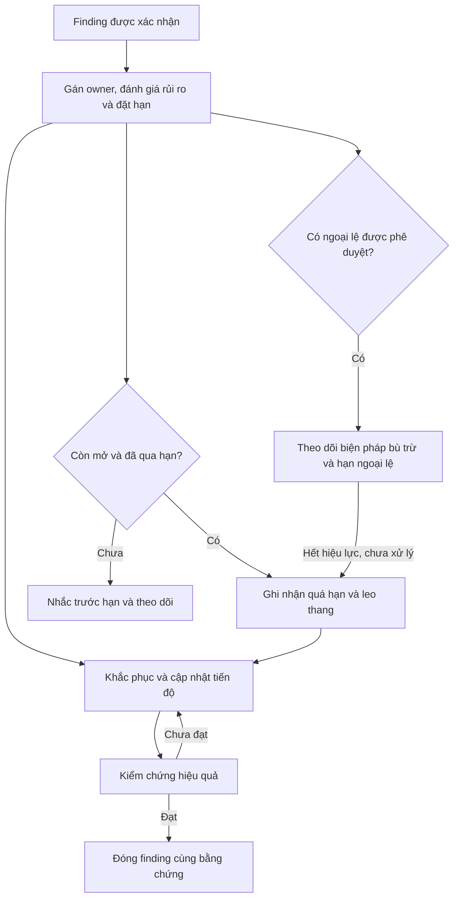

# Theo dõi quá hạn trong Security Remediation

## 1. Theo dõi quá hạn là gì và vì sao cần thiết?

Trong chương trình **Security Assurance**, finding (phát hiện) có thể đến từ đánh giá rủi ro, kiểm thử bảo mật, rà soát cấu hình, quét lỗ hổng, pentest hoặc audit. Tạo ticket khắc phục mới chỉ là bước đầu: tổ chức cần biết **phát hiện nào đã vượt hạn cam kết, rủi ro còn tồn tại ở đâu, ai chịu trách nhiệm và quyết định tiếp theo là gì**.

**Theo dõi quá hạn (overdue tracking)** là quá trình xác định, ghi nhận, cảnh báo và leo thang các hành động khắc phục chưa hoàn thành đúng hạn. Kết quả phải có bằng chứng, có thể tái lập tại một thời điểm báo cáo và phục vụ cả vận hành lẫn kiểm toán.

Ví dụ: một ứng dụng công khai có lỗ hổng cho phép truy cập dữ liệu ngoài thẩm quyền. Nhóm phụ trách cam kết hoàn thành trước 17:00 ngày 24/11. Đến 12:00 ngày 28/11, bản vá chưa được kiểm chứng. Finding này đã quá hạn và rủi ro vẫn đang hiện hữu. Hệ thống cần nhận diện tình trạng ấy, gắn người chịu trách nhiệm, thông báo cấp có thẩm quyền và theo dõi biện pháp giảm thiểu tạm thời.

Trong chủ đề **Remediation**, theo dõi quá hạn là mắt xích nối *finding → cam kết xử lý → kết quả kiểm chứng → bằng chứng assurance*. Chỉ đếm số ticket đã đóng không cho thấy việc kiểm soát rủi ro có đúng thời hạn hay không.

### Phân biệt các khái niệm

| Khái niệm | Ý nghĩa | Hệ quả khi báo cáo |
| --- | --- | --- |
| `Due date` / hạn xử lý | Thời điểm cuối cùng phải hoàn tất theo cam kết hoặc chính sách | Cơ sở so sánh với thời điểm hiện tại |
| `SLA` / thời hạn theo mức độ rủi ro | Quy tắc quy định khoảng thời gian xử lý được phép, ví dụ theo severity | Dùng để tính hoặc kiểm tra due date |
| `Due soon` / sắp đến hạn | Chưa vượt hạn nhưng nằm trong cửa sổ cảnh báo | Cần nhắc việc trước khi phát sinh vi phạm |
| `Overdue` / quá hạn | Đã qua due date, chưa có kết quả hoàn thành được công nhận | Phải theo dõi tồn đọng và leo thang |
| `Historical SLA breach` / từng vi phạm hạn | Đã hoàn thành, nhưng thời điểm hoàn thành muộn hơn hạn cam kết | Vẫn phải hiện trong báo cáo tuân thủ lịch sử |
| `Approved exception` / ngoại lệ được phê duyệt | Quyết định chấp nhận hoặc xử lý rủi ro theo cách khác trong phạm vi và thời gian rõ ràng | Báo cáo riêng; không đồng nghĩa đã vá xong |
| `Aging` / tuổi tồn đọng | Thời gian finding đã tồn tại hoặc thời gian vượt hạn | Giúp ưu tiên backlog theo rủi ro và độ trễ |

## 2. Dữ liệu tối thiểu cho mỗi finding

Một finding phải được quản lý như đối tượng có định danh ổn định, lịch sử và quan hệ với tài sản chịu ảnh hưởng.

| Nhóm dữ liệu | Trường gợi ý | Mục đích |
| --- | --- | --- |
| Định danh | `finding_id`, nguồn phát hiện, liên kết ticket | Tránh đếm trùng khi đồng bộ nhiều công cụ |
| Bối cảnh rủi ro | Tài sản/dịch vụ, mức độ nghiêm trọng, mức phơi nhiễm, ảnh hưởng kinh doanh | Xác định thứ tự xử lý |
| Trách nhiệm | `remediation_owner`, `risk_owner`, nhóm vận hành, người phê duyệt | Đảm bảo có người chịu trách nhiệm hành động và quyết định rủi ro |
| Mốc thời gian | `discovered_at`, `created_at`, `original_due_at`, `effective_due_at`, `verified_at` | Tính hạn, theo dõi thay đổi và báo cáo đúng |
| Tiến độ | Trạng thái, hành động kế tiếp, ETA, nguyên nhân chậm, phụ thuộc | Phát hiện bế tắc và chuẩn bị leo thang |
| Bằng chứng | Kết quả quét lại, pull request, bản ghi triển khai, kết quả kiểm thử, người xác nhận | Chứng minh rủi ro đã được xử lý |
| Ngoại lệ | Loại ngoại lệ, người phê duyệt, lý do, biện pháp bù trừ, hạn hết hiệu lực | Kiểm soát rủi ro khi chưa thể khắc phục |
| Truy vết | Mốc đổi owner/due date/status, người thực hiện, thời điểm, lý do | Cho phép audit tái dựng quyết định |

Nên chuẩn hóa múi giờ khi lưu và so sánh thời gian (chẳng hạn lưu UTC, hiển thị theo múi giờ người dùng). Đừng chỉ lưu ngày mà không xác định thời điểm kết thúc của ngày: “hạn 28/11” có thể được hiểu khác nhau ở các hệ thống.

`original_due_at` là mốc gốc cần được **giữ bất biến**. `effective_due_at` là mốc tác nghiệp đang có hiệu lực sau khi một thay đổi hợp lệ được phê duyệt. Báo cáo nên hiển thị cả hai để không làm mất dấu trễ hạn bằng cách lùi ngày trong ticket.

## 3. Quy tắc xác định và phân loại quá hạn

### 3.1. Thiết lập hạn theo rủi ro

Thời hạn có thể đến từ chính sách nội bộ hoặc cam kết trong kế hoạch khắc phục. Bảng sau **chỉ minh họa**, không phải SLA bắt buộc của mọi tổ chức:

| Mức độ finding | SLA minh họa từ thời điểm xác nhận | Cách giám sát |
| --- | --- | --- |
| Critical | 7 ngày lịch | Cảnh báo ngay khi phát hiện, theo dõi mỗi ngày và leo thang nhanh |
| High | 30 ngày lịch | Theo dõi thường xuyên, cảnh báo trước hạn |
| Medium | 60 ngày lịch | Theo dõi theo chu kỳ và kiểm soát backlog |
| Low | 90 ngày lịch | Rà soát định kỳ, gộp vào kế hoạch bảo trì phù hợp |

Chính sách thực tế phải quy định rõ điểm bắt đầu tính SLA (phát hiện hay xác nhận), ngày lịch hay ngày làm việc, giờ kết thúc, kỳ nghỉ, phạm vi áp dụng, ngoại lệ và cách xử lý tài sản không thể vá ngay. Mức độ nghiêm trọng kỹ thuật chỉ là một đầu vào; tài sản quan trọng, khả năng khai thác thực tế, mức phơi nhiễm Internet và tác động kinh doanh cũng có thể yêu cầu hạn ngắn hơn.

### 3.2. Quy tắc xác định trạng thái tại thời điểm báo cáo

Gọi `as_of` là thời điểm chốt báo cáo và `due_at` là hạn có hiệu lực:

- **Chưa quá hạn:** finding còn mở và `as_of <= due_at`.
- **Quá hạn hiện tại:** finding chưa được xác minh hoàn thành, `as_of > due_at` và không nằm trong ngoại lệ hợp lệ theo chính sách đã công bố.
- **Hoàn thành trễ:** finding đã được xác minh hoàn thành, nhưng `verified_at > due_at` tại kỳ SLA tương ứng.
- **Ngoại lệ còn hiệu lực:** được phê duyệt trước hoặc theo đúng quy trình, có phạm vi, người chịu trách nhiệm và thời hạn hết hiệu lực. Cần theo dõi ở hàng đợi ngoại lệ riêng.
- **Thiếu hạn xử lý:** không đủ dữ liệu để kết luận quá hạn; phải đưa vào hàng đợi lỗi chất lượng dữ liệu, không mặc nhiên coi là đạt SLA.

Quy tắc nên quy định rõ hoàn thành có nghĩa gì. Đối với finding cần kiểm chứng kỹ thuật, việc developer đẩy code hoặc đánh dấu “đã sửa” thường **chưa đủ**. Mốc hoàn thành dùng cho SLA có thể là thời điểm kiểm tra lại thành công và được chấp nhận; phải áp dụng thống nhất theo loại finding.

Có thể đo độ trễ theo giờ chính xác và hiển thị số ngày quy đổi:

```text
overdue_hours = max(0, (as_of - due_at) / 1 giờ)
overdue_days  = ceil(overdue_hours / 24)
```

Công thức trên dùng **ngày lịch 24 giờ**; nếu chính sách sử dụng ngày làm việc thì cần hàm lịch làm việc riêng. Đối với ticket đóng trễ, thay `as_of` bằng `verified_at` để tính số giờ vi phạm trong lịch sử. Cần công bố quy tắc làm tròn vì một phút quá hạn sẽ thành một ngày nếu dùng `ceil`.

### 3.3. Không đánh đồng trạng thái ticket với kết quả assurance

Ví dụ một vòng đời thường gặp:



Các trạng thái nên có ý nghĩa rõ:

- `OPEN`: finding được xác nhận, chưa bắt đầu xử lý.
- `IN_PROGRESS`: đang thực hiện kế hoạch khắc phục.
- `PENDING_VERIFICATION`: đã triển khai, đang chờ kiểm tra độc lập hoặc bước xác minh theo quy trình.
- `CLOSED_VERIFIED`: kiểm chứng đạt và bằng chứng được gắn vào hồ sơ.
- `EXCEPTION_APPROVED`: ngoại lệ/rủi ro đã được cấp thẩm quyền phê duyệt, đang được giám sát riêng; không thể hiện rằng lỗ hổng đã hết.
- `INVALIDATED`: phát hiện bị bác bỏ có căn cứ (chẳng hạn false positive), có bằng chứng và phê duyệt phù hợp.

Một ticket `PENDING_VERIFICATION` vẫn có thể quá hạn. Nếu finding được mở lại vì cách sửa không hiệu quả, phải ghi nhận sự kiện reopen và quy tắc tính SLA cho chu kỳ mới; không xóa lịch sử đã đóng hay vi phạm trước đó.

## 4. Cảnh báo, leo thang và xử lý khi quá hạn

Theo dõi chỉ có giá trị khi dẫn đến hành động cụ thể. Quy trình vận hành có thể tổ chức theo nhịp:

1. **Trước hạn:** gửi thông báo cho remediation owner với số ngày còn lại, mức rủi ro, hành động kế tiếp và các blocker; yêu cầu cập nhật ETA có căn cứ.
2. **Vừa quá hạn:** ghi nhận sự kiện `SLA_BREACHED`, lưu snapshot và thông báo chủ finding, quản lý trực tiếp, đầu mối security assurance.
3. **Quá hạn kéo dài:** leo thang theo mức rủi ro và thời gian; yêu cầu kế hoạch phục hồi có owner, mốc, biện pháp giảm thiểu và quyết định xử lý phụ thuộc.
4. **Nguy cơ cao tức thời:** nếu có khả năng bị khai thác hoặc ảnh hưởng nghiêm trọng, cân nhắc biện pháp giảm phơi nhiễm (chặn truy cập, vô hiệu hóa tính năng, tăng giám sát, cô lập dịch vụ) theo quy trình incident/change phù hợp.
5. **Sau khi hoàn thành:** kiểm tra độc lập, đóng bằng bằng chứng và vẫn giữ sự kiện vi phạm SLA trong báo cáo lịch sử.

Ví dụ ma trận leo thang nội bộ (cần điều chỉnh theo chính sách và mức độ criticality):

| Mốc | Người nhận/đầu mối | Hành động cần có |
| --- | --- | --- |
| Trước hạn 7 ngày | Remediation owner | Xác nhận tiến độ, rủi ro và khả năng đạt hạn |
| Ngày đầu quá hạn | Owner + trưởng nhóm | Lý do trễ, ETA mới, tác động, kế hoạch khắc phục |
| Quá hạn từ 3 ngày | Quản lý dịch vụ + Security Assurance | Xác nhận ưu tiên, tháo gỡ blocker, quyết định biện pháp tạm thời |
| Quá hạn từ 7 ngày | Risk owner + cấp quản trị được chỉ định | Xem xét rủi ro tồn dư, nguồn lực, quyết định và thời hạn xử lý |

Với finding Critical, ngưỡng leo thang có thể nhanh hơn đáng kể. Không nên để một ma trận cứng khiến finding rủi ro cao phải chờ đủ 7 ngày mới được chú ý.

Mỗi cảnh báo cần chứa `finding_id`, tài sản, severity, chủ sở hữu, due date, số giờ/ngày quá hạn, hành động bắt buộc, hạn phản hồi và liên kết bằng chứng. Thiết lập chống gửi trùng, nhưng đừng làm mất cảnh báo cấp cao khi rủi ro tăng hoặc khi ngoại lệ hết hiệu lực.

## 5. Gia hạn và chấp nhận rủi ro có kiểm soát

Đổi ngày đến hạn trực tiếp trong ticket có thể làm chỉ số trông đẹp hơn dù thời gian phơi nhiễm tăng. Việc gia hạn phải có **yêu cầu, lý do, đánh giá ảnh hưởng, người phê duyệt có thẩm quyền, hạn mới và nhật ký thay đổi**.

Ví dụ sự kiện thay đổi được lưu trong hệ thống (dữ liệu minh họa):

```json
{
  "finding_id": "R-205",
  "event_type": "DUE_DATE_CHANGE_APPROVED",
  "old_due_at": "2026-11-26T17:00:00+07:00",
  "new_due_at": "2026-11-30T17:00:00+07:00",
  "approved_at": "2026-11-24T09:30:00+07:00",
  "approved_by_role": "Risk Owner",
  "reason": "Phụ thuộc lịch bảo trì hệ thống lõi",
  "compensating_control": "Hạn chế truy cập từ Internet và tăng cảnh báo",
  "evidence_ref": "CHANGE-205"
}
```

Trong báo cáo có thể hiển thị đồng thời: **hạn gốc**, **hạn đang được phê duyệt**, **số lần đổi hạn**, **thời gian phơi nhiễm kéo dài** và **tình trạng đạt/trễ so với hạn gốc**. Việc gia hạn không được âm thầm xóa vi phạm đã phát sinh.

Nếu tổ chức chấp nhận rủi ro hoặc phê duyệt ngoại lệ:

- Phải ghi rõ phạm vi, tài sản, tác động, người có thẩm quyền, ngày phê duyệt, ngày hết hiệu lực, lý do và biện pháp kiểm soát bù trừ.
- Ngoại lệ có hiệu lực có thể được loại khỏi **hàng đợi quá hạn tác nghiệp** theo chính sách, nhưng vẫn phải nằm trong **báo cáo rủi ro còn mở/ngoại lệ**. Không được tính là finding đã khắc phục thành công.
- Khi ngoại lệ hết hiệu lực, phải cảnh báo và đánh giá lại ngay. Nếu finding chưa được xử lý và hạn vẫn đã qua, nó quay vào hàng đợi quá hạn theo quy tắc đã công bố.
- Không tự động “dừng đồng hồ SLA” vì ticket chuyển sang `BLOCKED` hoặc đang đợi vendor. Cơ chế tạm dừng, nếu có, phải được chính sách quy định và ghi bằng chứng.

## 6. Ví dụ phân loại tại một thời điểm cụ thể

Chốt dữ liệu lúc **12:00 ngày 28/11/2026 (UTC+07:00)**; các mốc đều theo cùng múi giờ. Giả sử chính sách sử dụng ngày lịch và chỉ công nhận hoàn thành sau bước kiểm chứng.

| Finding | Hạn xử lý | Tình trạng tại thời điểm chốt | Kết luận |
| --- | --- | --- | --- |
| `R-101`, Critical, ứng dụng công khai | 24/11, 17:00 | Đang xử lý, chưa có bằng chứng kiểm chứng | **Quá hạn 3 ngày 19 giờ**; hiển thị 4 ngày nếu làm tròn lên |
| `R-102`, High, cấu hình IAM | 28/11, 17:00 | Đang xử lý, còn 5 giờ tới hạn | **Chưa quá hạn**; cần cảnh báo sát hạn |
| `R-103`, Medium, thiếu kiểm soát truy cập | 20/11, 17:00 | Ngoại lệ được phê duyệt, hết hiệu lực 05/12, 17:00 | **Rủi ro còn mở trong danh sách ngoại lệ**; theo chính sách ví dụ, chưa đưa vào queue quá hạn tác nghiệp |
| `R-104`, High, cấu hình lưu trữ | 22/11, 17:00 | Đã xác minh khắc phục lúc 23/11, 08:00 | **Đã đóng nhưng vi phạm hạn 15 giờ**; vẫn ghi nhận SLA breach lịch sử |

Trong ví dụ này có **1 finding quá hạn hiện tại / 2 finding còn mở chịu SLA thông thường = 50%**. `R-103` được báo cáo riêng là ngoại lệ còn hiệu lực; `R-104` thuộc thống kê đóng trễ trong quá khứ. Chỉ số 50% phải đi cùng định nghĩa mẫu số; nếu trộn ngoại lệ, ticket đã đóng và ticket đang hoạt động vào một mẫu số, người đọc có thể hiểu sai mức độ kiểm soát.

## 7. Tự động hóa truy vấn và phát hiện sai lệch

Một hệ thống có thể tính danh sách quá hạn từ snapshot bất biến hoặc truy vấn cơ sở dữ liệu. Ví dụ **PostgreSQL**, giả sử đã có bảng `remediation_findings` chứa các trường như mô tả (tên bảng, trạng thái chỉ là mẫu):

```sql
WITH params AS (
    SELECT TIMESTAMPTZ '2026-11-28 12:00:00+07' AS as_of
)
SELECT
    f.finding_id,
    f.severity,
    f.remediation_owner,
    f.original_due_at,
    f.due_at AS effective_due_at,
    CEIL(
        EXTRACT(EPOCH FROM (p.as_of - f.due_at)) / 86400.0
    )::integer AS overdue_days
FROM remediation_findings AS f
CROSS JOIN params AS p
WHERE f.due_at IS NOT NULL
  AND f.due_at < p.as_of
  AND f.status NOT IN ('CLOSED_VERIFIED', 'INVALIDATED')
  AND NOT (
      COALESCE(f.exception_status, '') = 'APPROVED'
      AND f.exception_expires_at IS NOT NULL
      AND f.exception_expires_at > p.as_of
  )
ORDER BY f.due_at ASC, f.severity ASC;
```

**Giới hạn của truy vấn:** Đây là logic minh họa cho danh sách quá hạn hiện tại. Trong triển khai thật cần làm rõ trạng thái `NULL`, quyền thay đổi hạn, ngoại lệ được phê duyệt hợp lệ, mức severity và các trạng thái tái mở. Kết quả ở `as_of` quá khứ phải dựa trên **lịch sử sự kiện/snapshot tương ứng**, không thể chỉ truy vấn trạng thái hiện tại rồi suy ngược thời gian.

Nên chạy thêm các quy tắc chất lượng dữ liệu để phát hiện:

- Finding chưa đóng nhưng thiếu `due_at` hoặc `remediation_owner`.
- `verified_at` có giá trị nhưng thiếu bằng chứng kiểm chứng hoặc người xác nhận.
- `effective_due_at` thay đổi mà thiếu sự kiện/phê duyệt.
- Ngoại lệ còn được tính là hợp lệ dù đã hết hạn hoặc thiếu ngày hết hiệu lực.
- Hai hệ thống cùng ghi nhận một finding nhưng sai lệch trạng thái hoặc tài sản.
- Finding Critical tồn tại lâu mà không có cập nhật tiến độ và biện pháp giảm thiểu.

Tự động hóa nên đối chiếu ticket với nguồn kỹ thuật (scanner, test report, cấu hình thực tế) và nguồn tài sản (CMDB/asset inventory). Một bản vá được merge nhưng chưa triển khai lên sản xuất không nên tự động được xem là đã xử lý rủi ro của hệ thống đang vận hành.

## 8. Dashboard và các chỉ số theo dõi

Các chỉ số hữu ích cho Security Assurance gồm:

| Chỉ số | Cách tính/đọc | Lưu ý |
| --- | --- | --- |
| `Overdue count` | Số finding còn mở và quá hạn tại `as_of` | Nên phân nhóm severity, tài sản và đơn vị |
| `Overdue rate` | Số finding quá hạn / số finding còn mở thuộc tập SLA áp dụng | Công bố rõ cách xử lý ngoại lệ và dữ liệu thiếu |
| `Overdue aging` | Trung vị, P95 hoặc phân nhóm 1–7, 8–30, >30 ngày quá hạn | Giúp tìm tồn đọng kéo dài |
| `High/Critical overdue` | Số và thời gian quá hạn của finding rủi ro cao | Ưu tiên theo phơi nhiễm và tác động thực tế |
| `SLA breach on closure` | Số finding xác minh hoàn thành sau due date / số finding đóng trong kỳ | Tránh “xóa lịch sử” khi backlog giảm |
| `Extension/exception exposure` | Số lần gia hạn, số ngoại lệ đang hoạt động và sắp hết hiệu lực | Theo dõi rủi ro được trì hoãn |
| `Reopen rate` | Tỷ lệ finding đã đóng bị mở lại trong kỳ | Phát hiện chất lượng khắc phục thấp |
| `Evidence completeness` | Tỷ lệ finding đóng có bằng chứng kiểm chứng đạt yêu cầu | Đo khả năng chứng minh hiệu quả kiểm soát |

Với độ trễ lớn, trung vị có thể che giấu một nhóm finding rất lâu chưa xử lý; do đó cần xem cả P95 hoặc bucket tuổi. Chỉ số tổng cộng cũng dễ che mức rủi ro của vài tài sản trọng yếu: nên lọc theo dịch vụ công khai, dữ liệu nhạy cảm, môi trường production và mức criticality.

Dashboard hiệu quả thường có ba góc nhìn: **vận hành** (ai cần làm gì hôm nay), **quản lý rủi ro** (đâu là phơi nhiễm tồn dư và các quyết định ngoại lệ), **kiểm toán** (bằng chứng, thời gian, người phê duyệt, vi phạm lịch sử). Số liệu nên ghi thời điểm chốt và phiên bản quy tắc tính.

## 9. Quy trình kiểm soát định kỳ và bằng chứng

Một nhịp vận hành tham khảo:

1. **Hằng ngày:** đồng bộ nguồn finding, chuẩn hóa owner/due date, tính tập sắp hạn và quá hạn, gửi thông báo đúng người, ghi snapshot.
2. **Trong buổi triage:** xem từng finding rủi ro cao, xác nhận lý do trễ, phụ thuộc, ảnh hưởng, ETA và biện pháp giảm thiểu; tạo hành động có người chịu trách nhiệm.
3. **Hằng tuần:** Security Assurance cùng service owner rà soát backlog, các ngoại lệ sắp hết hiệu lực, ticket bị mở lại và sai lệch dữ liệu.
4. **Hằng tháng hoặc theo kỳ quản trị:** báo cáo xu hướng, các vi phạm kéo dài, thời gian phơi nhiễm, tỷ lệ hoàn thành đúng hạn, điểm nghẽn và quyết định phân bổ nguồn lực.
5. **Khi hoàn thành:** thu thập bằng chứng kỹ thuật, kiểm chứng lại, ghi thời điểm xác nhận, cập nhật trạng thái, giữ lịch sử SLA và xuất báo cáo có thể truy vết.

Bộ bằng chứng cho một finding quá hạn nên trả lời được: **ai phát hiện, tại sao có hạn này, đến thời điểm nào chưa xử lý, ai nhận cảnh báo, quyết định gì đã được đưa ra, biện pháp tạm thời nào có hiệu lực và cuối cùng việc sửa được xác minh ra sao**.

Có thể lưu các sự kiện `FINDING_CONFIRMED`, `OWNER_ASSIGNED`, `DUE_DATE_APPROVED`, `SLA_BREACHED`, `ESCALATED`, `EXCEPTION_APPROVED`, `EXCEPTION_EXPIRED`, `VERIFICATION_PASSED` và `CLOSED`. Mỗi sự kiện có thời điểm, tác nhân và tham chiếu bằng chứng. Quyền sửa và xóa nhật ký cần được kiểm soát để giữ tính tin cậy cho audit.

## 10. Những sai lầm thường gặp và cách phòng tránh

**Đổi due date để hết đỏ dashboard.** Việc thay đổi ngày trực tiếp khiến thống kê quá hạn giảm giả tạo. Giải pháp: lưu hạn gốc, chỉ cho thay hạn có phê duyệt, báo cáo đồng thời cả hạn gốc và hạn được duyệt.

**Đóng ticket ngay khi code được merge.** Cách sửa có thể chưa chạy trong môi trường mục tiêu hoặc chưa xử lý hết các đường tấn công. Giải pháp: xác định tiêu chí kiểm chứng, ghi bằng chứng triển khai và quét/kiểm thử lại phù hợp.

**Ngoại lệ vô thời hạn.** Chấp nhận rủi ro lâu dài nhưng thiếu ngày hết hạn làm mất động lực xử lý. Giải pháp: mọi ngoại lệ phải có scope, owner, người phê duyệt, biện pháp kiểm soát và lịch đánh giá lại.

**Gửi nhiều cảnh báo nhưng không có hành động.** Owner có thể bỏ qua thông báo trùng lặp. Giải pháp: thông báo có mức ưu tiên, yêu cầu hành động cụ thể, hạn phản hồi và kênh leo thang.

**Chỉ xem số lượng quá hạn.** Mười finding Low trong môi trường thử nghiệm có thể không nguy hiểm bằng một finding Critical trên hệ thống công khai. Giải pháp: phân lớp mức rủi ro, tài sản và thời gian phơi nhiễm.

**Sai múi giờ hoặc cách làm tròn.** Một finding bị đánh dấu trễ sớm hoặc muộn do sai cách tính. Giải pháp: lưu timestamp có múi giờ, định nghĩa ngày lịch/ngày làm việc và kiểm thử các mốc sát hạn.

## 11. Bài tập vận dụng

Giả sử một finding High có `due_at` là **17:00 ngày 30/11/2026**, vẫn ở `PENDING_VERIFICATION` lúc **09:00 ngày 01/12/2026** và không có ngoại lệ được phê duyệt. Người triển khai nói rằng bản vá đã được đưa lên production từ 29/11 nhưng chưa có kết quả quét lại.

Để xử lý đúng, người phụ trách nên:

1. Đánh dấu finding **quá hạn 16 giờ** theo quy tắc lấy mốc hoàn thành là thời điểm xác minh; số ngày quy đổi làm tròn lên là **1 ngày**.
2. Yêu cầu kiểm chứng và liên kết bằng chứng triển khai, kiểm tra lại rủi ro còn tồn tại, xác nhận ETA và người chịu trách nhiệm.
3. Thực hiện cảnh báo/leo thang theo chính sách đang áp dụng, ghi sự kiện `SLA_BREACHED`.
4. Nếu kiểm chứng đạt vào 10:00 ngày 01/12, đóng finding với `verified_at` này và vẫn ghi nhận **vi phạm hạn 17 giờ** trong lịch sử.

Câu hỏi then chốt không chỉ là “ticket có màu đỏ hay không”, mà là **tại thời điểm báo cáo, rủi ro nào còn mở, quyết định nào đã được phê duyệt và tổ chức có bằng chứng nào chứng minh kiểm soát của mình hoạt động**.

---

**Ghi nhớ:** Theo dõi quá hạn đáng tin cậy cần một thời hạn rõ ràng, trạng thái có thể kiểm chứng, ngoại lệ có thời hạn và lịch sử không bị ghi đè. Khi kết nối các dữ liệu ấy với owner, cơ chế leo thang và bằng chứng kiểm thử, tổ chức mới có thể chứng minh quá trình remediation đang giảm rủi ro một cách có kiểm soát.
