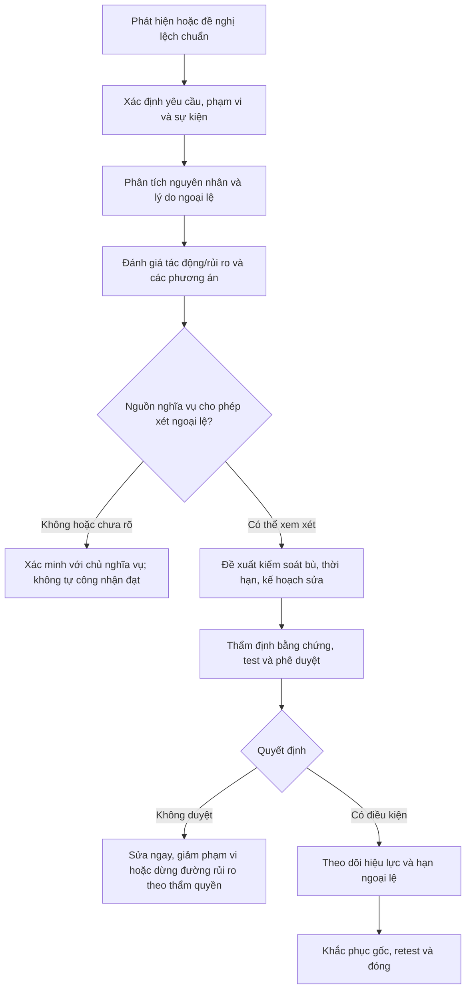
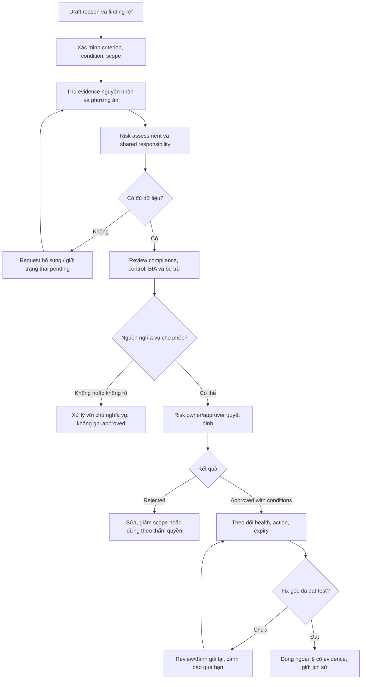

# Lý do ngoại lệ: xây dựng căn cứ có thể kiểm chứng trong Exception Management

## 1. Lý do ngoại lệ là gì?

**Lý do ngoại lệ** (*exception rationale* hoặc *justification*) là phần giải thích **vì sao một yêu cầu, chính sách, tiêu chuẩn hoặc kiểm soát đang áp dụng chưa thể được đáp ứng theo cách đã quy định trong một phạm vi và khoảng thời gian xác định**, kèm theo căn cứ cho việc đề nghị xử lý khác với quy trình thông thường. Lý do tốt không chỉ mô tả khó khăn; nó phải cho phép người có thẩm quyền hiểu **điều gì lệch chuẩn, nguyên nhân, rủi ro, các phương án đã xét, tính tạm thời và bằng chứng của từng nhận định**.

Ví dụ, một đơn vị viết:

> “Ứng dụng cũ nên chưa bật MFA. Đề nghị ngoại lệ trong sáu tháng.”

Đây chưa phải căn cứ đủ mạnh. Không rõ ứng dụng cũ ở phiên bản nào, có những loại tài khoản và đường đăng nhập nào, đã kiểm tra phương án tích hợp MFA hay chưa, vì sao chọn sáu tháng, dữ liệu nào bị ảnh hưởng, ai chịu rủi ro, và dùng kiểm soát gì trong khi chờ sửa.

Một lý do có thể kiểm tra hơn:

> “Dịch vụ báo cáo nội bộ phiên bản X dùng cơ chế đăng nhập không hỗ trợ giao thức SSO bắt buộc theo chuẩn IAM hiện hành. Nhóm ứng dụng đã thử tích hợp qua giao thức Y vào ngày T nhưng thất bại ở luồng phiên quản trị, có kết quả thử đính kèm. Việc nâng cấp dự kiến hoàn tất vào mốc M sau kiểm thử tương thích. Trong thời gian chuyển đổi, các đường quản trị thuộc phạm vi sẽ được đưa qua cổng xác thực mạnh và chặn truy cập trực tiếp; những đường chưa được chứng minh bao phủ phải được ghi riêng. Đề nghị ngoại lệ **có hạn**, sau khi được đánh giá và phê duyệt đúng thẩm quyền.”

Ngay cả đoạn sau **chưa chứng minh ngoại lệ được phép hay kiểm soát bù trừ có hiệu quả**; nó chỉ tạo nền tảng để đánh giá.

Trong chương **Exception management** của module **SECURITY_SECURITY_ASSURANCE**, mục tiêu học tập là **xây dựng cách đánh giá có bằng chứng rằng hệ thống đáp ứng mục tiêu bảo mật**: từ rủi ro, yêu cầu và kiểm soát, đến kiểm thử, audit và khắc phục phát hiện. Vì vậy, lý do ngoại lệ là **đối tượng assurance** chứ không phải văn bản hợp thức hóa một lỗ hổng.

Sau bài này, người học có thể:

- Phân biệt lý do ngoại lệ với **nguyên nhân gốc, ngoại lệ được phê duyệt, kiểm soát bù trừ, chấp nhận rủi ro và khắc phục**.
- Viết lý do cụ thể, dựa trên bằng chứng, chỉ rõ giới hạn và tính khả thi của các phương án.
- Phân tích nghĩa vụ nguồn để biết **có quyền xét ngoại lệ hay không**.
- Liên kết reason với risk scenario, business impact, thời hạn, owner, điều kiện bù trừ và kế hoạch sửa gốc.
- Kiểm thử tính hợp lý của reason, quản lý thay đổi và truy vết quyết định trong kỳ đánh giá.

## 2. Lý do ngoại lệ giữ vai trò gì trong vòng đời xử lý rủi ro?

Khi một kiểm soát chưa đáp ứng, có hai câu hỏi khác nhau:

1. **Sự thật kỹ thuật/vận hành:** điều kiện nào chưa đạt và vì sao?
2. **Quyết định quản trị:** tổ chức có thể tiếp tục hoạt động trong điều kiện nào, trong bao lâu và ai có thẩm quyền?

**Lý do ngoại lệ trả lời câu hỏi thứ nhất và cung cấp đầu vào cho câu hỏi thứ hai**, nhưng không tự tạo quyền đi lệch tiêu chuẩn.



Sơ đồ biểu diễn luồng thông thường. Nếu đang có tấn công hoặc sự cố nguy hiểm, đội phản ứng có thể cần **containment khẩn cấp theo playbook** trước khi hoàn tất chu kỳ quản trị thông thường.

### 2.1. Các hồ sơ liên quan nhưng không giống nhau

| Hồ sơ | Vai trò | Điều không được suy ra |
|---|---|---|
| **Finding / deviation** | Ghi hiện trạng lệch một yêu cầu hoặc tiêu chí | Chưa tự chứng minh ngoại lệ được phép |
| **Root-cause analysis** | Xác định nguyên nhân kỹ thuật, quy trình hoặc tổ chức | Nguyên nhân hợp lý không đồng nghĩa rủi ro được chấp nhận |
| **Exception rationale** | Giải thích có căn cứ vì sao chưa thể đáp ứng như quy định | Không thay cho phê duyệt và bằng chứng bù trừ |
| **Exception request** | Đề nghị chính thức với scope, thời gian, phương án và risk | Chưa là ngoại lệ có hiệu lực |
| **Exception approval** | Quyết định có điều kiện của người có thẩm quyền | Không tự xóa nghĩa vụ bên ngoài |
| **Compensating control** | Biện pháp giảm/phòng ngừa/phát hiện hậu quả rủi ro | Chưa phải bản sửa gốc hoặc bằng chứng hoàn toàn tương đương |
| **Risk acceptance** | Quyết định quản trị đối với rủi ro còn lại | Không biến vi phạm pháp lý/hợp đồng thành compliant |
| **Remediation plan** | Hành động đưa hệ thống trở lại đáp ứng yêu cầu | Có kế hoạch chưa chứng minh đã sửa |
| **Retest evidence** | Xác nhận hiệu quả biện pháp hoặc bản sửa gốc | Chỉ hỗ trợ scope/kỳ đã thử |

Trong báo cáo, phải tách **trạng thái của ngoại lệ**, **trạng thái kiểm soát**, **trạng thái tuân thủ**, **tình trạng sửa gốc** và **rủi ro còn lại**. Một hồ sơ có thể đang được phê duyệt dùng tạm, trong khi requirement vẫn *not met*.

## 3. Bắt đầu từ một độ lệch được định nghĩa chính xác

Không nên viết lý do khi chưa xác định được **yêu cầu nào, từ đâu và điều gì không đáp ứng**.

Một phát hiện có thể biểu diễn theo cấu trúc:

> **Criterion:** yêu cầu/tiêu chuẩn cụ thể, phiên bản và hiệu lực.  
> **Condition:** hiện trạng đã quan sát, có evidence.  
> **Population:** hệ thống, danh tính, giao dịch hoặc sự kiện thuộc phạm vi.  
> **Period:** mốc hoặc kỳ mà sai lệch tồn tại.  
> **Impact:** rủi ro và hậu quả nếu duy trì hiện trạng.

Ví dụ:

- **Criterion:** chuẩn nội bộ yêu cầu xác thực mạnh cho mọi đường đăng nhập quản trị production.
- **Condition:** ứng dụng báo cáo X có đường quản trị password-only, chưa đi qua IdP.
- **Population:** hai instance production, bảy tài khoản admin con người, một tài khoản hỗ trợ vendor và một admin API.
- **Period:** sai lệch phát hiện ngày T; thời điểm bắt đầu chưa xác định nên cần điều tra.
- **Impact:** khi mật khẩu bị đánh cắp, kẻ tấn công có thể truy cập dữ liệu và sửa cấu hình.

Lý do “do công nghệ legacy” chỉ có ý nghĩa sau khi ta biết **legacy theo khía cạnh nào**: không hỗ trợ giao thức, bị giới hạn bởi phần cứng, cấu hình không tương thích, phụ thuộc nhà cung cấp, hoặc đội vận hành chưa thực hiện thay đổi.

### 3.1. Mô tả đúng trạng thái bằng chứng

- **Confirmed deviation:** có bằng chứng một tiêu chí không đạt.
- **Evidence gap:** chưa có dữ liệu để kết luận, ví dụ log quá hạn retention.
- **Not applicable:** yêu cầu thực sự không áp dụng theo phạm vi/điều kiện nguồn, có quyết định được kiểm tra.
- **Approved alternative:** phương thức khác được nguồn nghĩa vụ/chủ sở hữu cho phép, có evidence phù hợp.
- **Exception candidate:** đang xin lệch chuẩn, chưa có quyết định.

Không biến **thiếu bằng chứng** thành lý do ngoại lệ về kỹ thuật nếu chưa biết kiểm soát thực tế có đang hoạt động hay không.

## 4. Bảy thành phần của một lý do ngoại lệ có chất lượng

Một rationale nên trả lời đủ bảy phần:

| Thành phần | Câu hỏi kiểm tra | Dạng bằng chứng |
|---|---|---|
| **1. Lệch gì?** | Requirement nào chưa đạt, phiên bản và condition? | Policy/contract ref, finding, cấu hình |
| **2. Vì sao?** | Rào cản cụ thể và nguyên nhân đã xác minh? | Compatibility test, issue, vendor statement |
| **3. Tại sao chưa sửa ngay?** | Thử sửa gốc hoặc các lựa chọn thay thế đã xét? | Test result, change impact, phân tích phương án |
| **4. Rủi ro gì?** | Attack path, dữ liệu, nghiệp vụ, hậu quả và phần chưa biết? | Threat model, BIA, risk assessment |
| **5. Trong giới hạn nào?** | Asset, account, người dùng, thời kỳ và điều kiện nào? | CMDB/IAM inventory, scope snapshot |
| **6. Giảm rủi ro bằng gì?** | Bù trừ có cơ chế, owner, test và giới hạn không? | Design, policy export, test/monitoring evidence |
| **7. Bao giờ và bằng cách nào kết thúc?** | Fix gốc, mốc, phụ thuộc, dấu hiệu phải dừng/gia hạn? | Project milestone, change request, exit criteria |

Không nhất thiết gộp cả bảy vào một đoạn văn; với các quan hệ phức tạp nên dùng một **câu tóm tắt lý do ngắn** và các trường dữ liệu/bằng chứng liên kết.

### 4.1. Một mẫu câu gợi ý

> “Yêu cầu **[ID, phiên bản]** chưa đạt với **[đối tượng/phạm vi]** vì **[nguyên nhân/ràng buộc được xác minh]**. Các phương án **[A, B, C]** đã được đánh giá; việc sửa gốc hiện bị giới hạn bởi **[phụ thuộc hoặc tác động có chứng cứ]** đến **[mốc dự kiến]**. Rủi ro chính là **[scenario và hậu quả]**, được đề nghị giảm bằng **[kiểm soát và test]**; còn **[giới hạn]**. Đề nghị quyết định trong **[thời hạn, điều kiện]** với **[risk owner/approval]**, sau đó khắc phục và kiểm thử lại.”

Mẫu này chỉ giúp tổ chức thông tin, **không tự biến một đề nghị thành hợp lệ**.

## 5. Loại lý do thường gặp và điều kiện chứng minh

| Nhóm lý do | Ví dụ | Căn cứ nên thu thập | Cảnh báo |
|---|---|---|---|
| **Giới hạn kỹ thuật** | Phần mềm không hỗ trợ MFA native | Phiên bản, tính năng, test tương thích, xác nhận kỹ thuật | Chưa thử phương án native không đồng nghĩa “không hỗ trợ” |
| **Phụ thuộc nhà cung cấp** | Chờ bản vá hoặc tính năng export log | Case vendor, release plan, workaround, cam kết có điều kiện | Ngày dự kiến vendor có thể thay đổi |
| **Rủi ro vận hành/safety** | Patch thiết bị OT cần cửa sổ dừng đặc biệt | BIA, safety review, test lab, maintenance window | Tránh test phá hoại trên môi trường nhạy cảm |
| **Chuyển đổi kiến trúc** | Di dời cơ sở dữ liệu, thay nền tảng IAM | Project plan, dependency, milestone, rollback | Kế hoạch dự án không chứng minh đã giảm rủi ro |
| **Khả năng tương thích** | Bật mã hóa làm dịch vụ không hoạt động | Reproducible test, lỗi, ticket, thử phiên bản thay thế | Phải kiểm tra đường khác, không chỉ một case |
| **Ràng buộc năng lực/tài nguyên** | Thiếu nhân sự chuyên môn trong kỳ | Kế hoạch nguồn lực, các lựa chọn, mức tác động | Không phải lý do mặc định cho rủi ro critical |
| **Khẩn cấp nghiệp vụ** | Cần hỗ trợ phục hồi dịch vụ theo BCP | Incident/DR record, thời gian, thẩm quyền | Không nên cấp quyền vĩnh viễn từ quyết định khẩn |
| **Mâu thuẫn yêu cầu** | Điều kiện kỹ thuật và ràng buộc hợp đồng khó đồng thời | Các điều khoản nguồn, phân tích cách diễn giải | Cần owner/pháp chế, không tự chọn bỏ nghĩa vụ |

**Chi phí hoặc áp lực tiến độ có thể là dữ kiện của quyết định**, nhưng chỉ nêu “tốn kém” hoặc “không đủ thời gian” thường không giải thích mức rủi ro được chấp nhận. Cần so sánh với tác động, các lựa chọn ít rủi ro hơn và trách nhiệm ra quyết định.

### 5.1. Dấu hiệu của lý do yếu

- “Hệ thống cũ” nhưng không ghi phiên bản hoặc hạn chế cụ thể.
- “Vendor chưa hỗ trợ” nhưng không có case, hợp đồng hoặc kiểm tra thực tế.
- “Không có thời gian” nhưng không có kế hoạch sửa và hạn.
- “Chúng tôi chưa gặp incident” nên cho rằng rủi ro thấp.
- “Có firewall” nhưng chưa chứng minh chặn đúng đường khai thác.
- “Đã được cấp trên duyệt bằng miệng” nhưng không có quyết định có thể truy vết.
- “Chỉ còn vài tài khoản” nhưng không biết chúng có quyền root hay dữ liệu gì.
- “Không có log cho thấy xâm nhập” trong khi telemetry đang thiếu.

Những câu này có thể là **tín hiệu cần điều tra**, không phải căn cứ khép lại đánh giá.

## 6. Phân tích nguyên nhân gốc trước khi xin lệch chuẩn

**Root cause** là cơ chế dẫn đến hiện trạng sai lệch; **justification** giải thích vì sao tổ chức đang đề nghị dùng phương án khác thay vì xử lý ngay. Hai khái niệm liên hệ nhưng không giống nhau.

Ví dụ: một máy chủ thiếu EDR.

- **Triệu chứng:** EDR agent không hoạt động trên host.
- **Nguyên nhân trực tiếp:** agent không cài được phiên bản hệ điều hành.
- **Nguyên nhân sâu hơn:** host chưa được đưa vào lộ trình loại bỏ OS hết hỗ trợ.
- **Rào cản sửa ngay:** ứng dụng nghiệp vụ phụ thuộc driver chỉ có trên OS hiện tại.
- **Lý do xin ngoại lệ:** cần một giai đoạn chuyển đổi có bảo vệ tạm, kèm lịch thay host và tiêu chí thử.
- **Rủi ro còn lại:** kẻ tấn công có thể thực thi mã trên host với khả năng phát hiện hạn chế.

Nếu chỉ nêu “EDR không tương thích” mà không tìm nguyên nhân nền, tổ chức có thể duy trì hàng loạt ngoại lệ tương tự không có điểm kết thúc.

### 6.1. Dùng 5 Whys có giới hạn

Một chuỗi ví dụ:

1. Vì sao host không có EDR? Vì agent mới không cài được.
2. Vì sao không cài được? Vì OS không được hỗ trợ.
3. Vì sao vẫn dùng OS đó? Vì ứng dụng phụ thuộc driver legacy.
4. Vì sao chưa thay ứng dụng? Vì kế hoạch nâng cấp không được gắn với deadline hết hỗ trợ.
5. Vì sao không có deadline? Vì quy trình asset lifecycle thiếu trigger security review.

Kết luận không chỉ là “cần một exception”, mà có thể cần **cải tiến asset lifecycle** song song với phương án bù trừ cho host hiện tại.

**5 Whys là kỹ thuật gợi mở**, không phải phép chứng minh duy nhất. Nguyên nhân có thể nhiều nhánh: kỹ thuật, vendor, quy trình, con người và ngân sách. Cần kiểm chứng bằng evidence, không dừng ở một câu chuyện nghe hợp lý.

## 7. Yêu cầu nguồn: có được quyền xét ngoại lệ không?

Trước khi viết lý do dài, kiểm tra **thẩm quyền và loại nghĩa vụ**.

| Nguồn yêu cầu | Phải làm gì? | Có thể lưu ý |
|---|---|---|
| **Chính sách nội bộ** | Xem quy trình exception, quyền phê duyệt và điều kiện | Có thể cho phép quyết định có thời hạn, tùy chính sách |
| **Tiêu chuẩn/cơ chế chứng nhận** | Kiểm tra bản nguồn có hiệu lực, phạm vi audit và cơ chế control thay thế | Không tự cho rằng mọi kiểm soát đều có quyền miễn |
| **Hợp đồng khách hàng/nhà cung cấp** | Kiểm tra điều khoản, cơ chế chấp thuận sửa đổi/ngoại lệ | Phê duyệt nội bộ không sửa hợp đồng |
| **Pháp luật/quy định** | Xác định phạm vi áp dụng và đường tuân thủ hợp lệ với Legal/Compliance | Không dùng risk acceptance để miễn nghĩa vụ |
| **Risk-based requirement** | Kiểm tra risk appetite, owner và điều kiện chấp nhận | Cần kết quả đánh giá rủi ro còn lại và phương án xử lý |
| **Thiết kế kỹ thuật nội bộ** | Xem control objective, khả năng dùng biện pháp thay thế | Nếu bản thay thế phù hợp theo quy tắc, có thể là alternative design chứ không phải ngoại lệ |

Không có một quy tắc chung kiểu “CISO có thể miễn mọi yêu cầu”. Phải dựa trên **nguồn, phiên bản, điều khoản cụ thể, đối tượng và người có quyền quyết định**.

### 7.1. Phân biệt not applicable và exception

**Not applicable** nghĩa là điều kiện của nguồn **không áp dụng** cho đối tượng, phải có căn cứ và được xác minh. Ví dụ một control chỉ áp dụng dữ liệu thanh toán mà dịch vụ không xử lý dữ liệu thanh toán theo định nghĩa nguồn; đây có thể là quyết định applicability, không phải ngoại lệ.

**Exception** nghĩa là yêu cầu có áp dụng, nhưng đối tượng **chưa hoặc không đáp ứng** theo cách quy định, và tổ chức đang xin quản lý lệch chuẩn trong điều kiện cụ thể.

Không ghi `N/A` chỉ vì việc triển khai khó, thiếu công cụ hoặc đang chờ vendor. Đó thường là vấn đề **implementation gap**, cần xử lý khác.

## 8. Xác định phạm vi nhỏ nhất có thể chấp nhận

Một rationale mạnh không yêu cầu miễn trừ rộng hơn sự thật kỹ thuật.

Các chiều cần ghi:

- **Tài sản:** asset ID, ứng dụng, server, database, cloud account hoặc tenant; phiên bản và owner.
- **Môi trường:** production, staging, development, disaster recovery, khu vực.
- **Dữ liệu:** loại dữ liệu, mức nhạy cảm, nơi xử lý, đối tác liên quan.
- **Danh tính/quyền:** người dùng, admins, service accounts, vendor, break-glass.
- **Hành động/luồng truy cập:** browser, API, CLI, batch, network, integration.
- **Yêu cầu:** điều khoản, trường hợp không đạt và các mục vẫn bắt buộc.
- **Thời gian:** bắt đầu, ngày hết hạn, cửa sổ bảo trì và lịch kiểm tra lại.
- **Loại trừ:** đối tượng không áp dụng, lý do và người xác nhận.

Ví dụ, không đề nghị “ngoại lệ MFA cho toàn bộ phòng tài chính” nếu rào cản chỉ tồn tại ở **một ứng dụng báo cáo trên hai endpoint**. Có thể tách quyền quản trị ứng dụng đó khỏi các ứng dụng khác đã hỗ trợ MFA.

### 8.1. Không mở rộng ngoại lệ theo tên nhóm

Một nhóm tài khoản có thể đổi thành viên, một autoscaling group sinh thêm máy và một SaaS bổ sung tenant mới. Nếu phạm vi được viết “mọi tài sản của đội X”, ngoại lệ có thể tự lan sang những tài sản **chưa được đánh giá rủi ro**. Cần dùng danh sách/tiêu chí động có kiểm soát và trigger rà soát khi xuất hiện đối tượng mới.

## 9. Phân tích rủi ro đi kèm rationale

Lý do chưa thể sửa và rủi ro của việc chưa sửa là **hai nội dung độc lập**. Với mỗi ngoại lệ, phải mô tả kịch bản rủi ro:

> **Do [điều kiện], [tác nhân hoặc sự kiện] có thể dẫn tới [hành vi bất lợi] trên [tài sản], gây [hậu quả tới tính bí mật, toàn vẹn, khả dụng hoặc nghiệp vụ].**

Ví dụ cho ứng dụng thiếu MFA:

> “Do giao diện quản trị sử dụng mật khẩu không có yếu tố xác thực bổ sung, tài khoản bị phishing có thể được dùng từ mạng có đường truy cập tới hệ thống để sửa hoặc trích xuất dữ liệu báo cáo khách hàng.”

Đánh giá cần xem:

1. **Khả năng tiếp xúc:** Internet-facing hay nội bộ? Có đường truy cập qua vendor, VPN, API?
2. **Điều kiện khai thác:** chỉ cần mật khẩu, quyền network, thiết bị được quản lý hay lỗ hổng khác?
3. **Tài sản và dữ liệu:** hệ thống có ảnh hưởng dây chuyền tới cloud account, secret hoặc khách hàng?
4. **Hậu quả:** dữ liệu, nghĩa vụ, uy tín, gián đoạn, BIA và khả năng khôi phục.
5. **Kiểm soát hiện có:** những lớp nào đã hoạt động; **bằng chứng của hiệu quả**?
6. **Rủi ro tồn dư:** vẫn có đường khai thác hoặc thiếu khả năng phát hiện nào?
7. **Bất định:** dữ liệu nào chưa biết và giả định nào cần xác minh?

Không dùng “chưa từng bị tấn công” làm bằng chứng nguy cơ thấp khi không có đủ telemetry hoặc giai đoạn quan sát quá ngắn.

### 9.1. Risk score không thay bằng chứng

Nếu tổ chức dùng thang `Low/Medium/High`, cần ghi tiêu chí và owner. Không tự báo biện pháp bù “giảm 90% xác suất” nếu không có dữ liệu định lượng hoặc mô hình hợp lệ.

Một chỉ số **độ phủ policy** chỉ cho biết bao nhiêu đối tượng đã được kiểm tra; nó không đồng nghĩa phần trăm giảm thiểu rủi ro. Có thể nêu rõ **attack paths đã chặn**, **điểm thử còn fail** và **tác động nghiệp vụ được bảo vệ** thay vì tạo con số xác suất không có căn cứ.

## 10. Phải so sánh các phương án, không chỉ kể khó khăn

Một lý do được đánh giá nghiêm túc cần cho thấy **tại sao phương án lệch chuẩn là lựa chọn hợp lý trong thời hạn đề nghị**, thay vì lựa chọn an toàn hơn đã bị bỏ qua.

Bảng phân tích minh họa:

| Phương án | Tác dụng với rủi ro | Giới hạn/chướng ngại | Evidence cần |
|---|---|---|---|
| Sửa cấu hình ngay | Có thể loại bỏ sai lệch | Có ảnh hưởng tương thích hay không? | Test, change impact, rollback plan |
| Nâng cấp/patch | Xử lý nguyên nhân kỹ thuật | Chờ vendor hoặc cần maintenance | Version, vendor case, regression test |
| Tắt chức năng nguy hiểm | Cắt đường khai thác | Ảnh hưởng nghiệp vụ | BIA, business sign-off, thử chức năng thay thế |
| Thu hẹp scope sử dụng | Giảm dữ liệu/người bị ảnh hưởng | Có chuyển nghiệp vụ được không? | Access/data inventory, cutover plan |
| Compensating control | Giảm exposure tạm trong điều kiện cụ thể | Có bypass, phụ thuộc, chi phí duy trì? | Threat model, test, monitoring |
| Chấp nhận rủi ro tạm | Quyết định quản trị khi các lựa chọn có giới hạn | Chỉ trong thẩm quyền và nghĩa vụ cho phép | Risk decision, lý do, expiry |
| Thay sản phẩm/vendor | Loại bỏ phụ thuộc lâu dài | Mất thời gian di chuyển và kiểm thử dữ liệu | Project plan, exit/data portability test |

**Không phải phương án nào cũng có thể được quyết định bởi một risk owner duy nhất.** Ví dụ tắt hệ thống thanh toán ảnh hưởng khách hàng cần business authority; thay hợp đồng cần chủ hợp đồng; thay đổi kiểm soát production cần change authority.

### 10.1. Minh họa quyết định cho hệ thống cần duy trì dịch vụ

Giả sử bản vá sẵn sàng nhưng chỉ có thể áp sau khi thử tương thích với hệ thống xử lý đơn hàng. Rationale nên trả lời:

- Đã chạy test trên bản build nào và thất bại cụ thể ở bước nào?
- Có cách patch theo từng node/rolling upgrade để tránh dừng toàn bộ không?
- Có thể chặn endpoint gây rủi ro mà vẫn giữ chức năng cốt lõi không?
- Cửa sổ bảo trì đầu tiên có thể thực hiện an toàn là khi nào?
- Dựa trên BIA, dừng hệ thống bao lâu là không chấp nhận được?
- Nếu có khai thác đang diễn ra, quyết định **không patch** có còn hợp lý không?

Điểm cuối khiến ngoại lệ **không được phê duyệt vĩnh viễn**: khi threat và điều kiện thay đổi, phải xét lại quyết định.

## 11. Lý do nghiệp vụ, chi phí và tiến độ: dùng đúng mức

Một yêu cầu ngoại lệ có thể phát sinh từ ưu tiên nghiệp vụ, nhưng cần phân biệt **lý do trì hoãn** và **điều kiện chấp nhận rủi ro**.

Một business case nên có:

- Quy trình nghiệp vụ được phục vụ và **tác động của việc sửa ngay** theo BIA.
- Các phương án thay thế, phụ thuộc, chi phí và thời gian ước tính có căn cứ.
- Hậu quả bảo mật khi trì hoãn, gồm rủi ro tấn công và rủi ro không đáp ứng nghĩa vụ.
- Nguồn lực và lịch sửa gốc đã được cam kết.
- Kịch bản thay đổi tình hình buộc phải **thu hồi ngoại lệ sớm**.
- Người chịu trách nhiệm rủi ro và người chịu trách nhiệm hệ thống.

Ví dụ, “không có ngân sách” không trả lời vì sao hệ thống phải giữ quyền admin công khai trên Internet. Có thể giảm bề mặt tấn công với chi phí thấp, tạm ngừng giao diện quản trị hoặc bố trí quyền truy cập theo lịch.

Nếu chỉ số chi phí được dùng, nên ghi **giả định, phạm vi và nguồn ước tính**. Không tự đổi chi phí tài chính thành một “điểm rủi ro” rồi dùng đó làm cơ sở duy nhất của phê duyệt.

## 12. Phân tích tính tạm thời và đề xuất thời hạn

Một lý do tốt phải giải thích vì sao cần **đúng khoảng thời gian** xin ngoại lệ.

Tối thiểu:

| Thông tin thời gian | Ý nghĩa |
|---|---|
| `detected_at` | Thời điểm phát hiện lệch chuẩn, không mặc nhiên là thời điểm bắt đầu |
| `requested_start` | Ngày muốn quyết định có hiệu lực |
| `requested_expiry` | Thời điểm hết hiệu lực đề nghị |
| `next_review` | Ngày kiểm tra rủi ro/tiến độ trước khi hết hạn |
| `permanent_fix_target` | Mốc triển khai sửa gốc hoặc thay thế |
| `dependencies` | Vendor release, change window, migration, nhân sự, thiết bị |
| `early_revocation_triggers` | Điều kiện phải thu hồi hoặc đánh giá ngay |

Ví dụ dự án thay hệ thống gồm: tuần 1–2 phân tích thiết kế, tuần 3–5 thử nghiệm tích hợp, tuần 6–7 chuyển đổi, tuần 8 retest. Đề nghị ngoại lệ đến cuối tuần 8 phải có **mốc được cam kết, buffer hợp lý và review giữa kỳ**, không tự suy ra cần tám tuần chỉ vì kế hoạch ghi tám tuần.

**Thời hạn không phải ngày đảm bảo hoàn thành.** Nếu tiến độ trượt, cần ghi lý do, cập nhật risk và phê duyệt lại trước khi tiếp tục. Không chỉnh ngày hết hạn trong hệ thống theo cách mất lịch sử.

### 12.1. Tính toán thời gian phơi nhiễm minh họa

Giả sử sai lệch được phát hiện **01/11/2026**, đề nghị duy trì đến **01/12/2026**. Theo cách tính khoảng nửa mở, cửa sổ đề nghị dài **30 ngày lịch**. Nhưng nếu dấu hiệu từ log cho thấy thiếu sót đã xuất hiện từ 15/10/2026, thì **thời gian thực tế trước phát hiện dài hơn**. Rationale và đánh giá assurance phải phân biệt các mốc; không xem ngày request là ngày rủi ro bắt đầu.

Nếu một tài khoản admin mới được thêm vào ngày 20/11, sự kiện đó có thể thay đổi scope cần kiểm tra; không tự được phép theo một ngoại lệ trước đó chỉ vì ứng dụng có cùng tên.

## 13. Compensating control là phần xử lý, không phải lý do tự thân

Một rationale như “ngoại lệ vì đã có firewall” đặt sai quan hệ logic. **Firewall là biện pháp**; lý do cần giải thích tại sao yêu cầu gốc chưa thể đạt và firewall sẽ giảm phần nào của rủi ro.

Đánh giá kiểm soát bù trừ qua:

1. **Objective:** yêu cầu gốc muốn ngăn hoặc phát hiện điều gì?
2. **Attack-path coverage:** kiểm soát bao phủ những đường nào, còn bypass nào?
3. **Control strength:** khả năng chặn, giới hạn quyền, phát hiện và tốc độ xử lý.
4. **Failure domain:** có cùng credential, tài khoản admin hoặc điểm lỗi với hệ thống yếu không?
5. **Population:** mọi asset/identity/endpoint trong scope đã được áp dụng không?
6. **Monitoring:** khi biện pháp bị tắt hoặc drift có ai biết?
7. **Test:** đã thử happy path, negative, bypass, failure mode và regression?
8. **Residual risk:** rủi ro nào còn tồn tại; có chấp nhận được theo thẩm quyền không?

Ví dụ **proxy MFA** có thể giảm khả năng lạm dụng credential trên browser, nhưng không tự kiểm soát API token, local admin, tài khoản máy hoặc đường backend còn mở. Một kết quả “đăng nhập qua proxy thành công” chưa đủ để chứng minh mục tiêu ngăn truy cập trái phép.

### 13.1. Không đánh đồng preventive với detective

Nếu yêu cầu muốn **ngăn** đăng nhập trái phép, việc phát email cho SOC sau khi admin đã đăng nhập là biện pháp phát hiện; cần xem liệu kẻ tấn công có thể gây hậu quả trước khi đội trực phản ứng không. Detector có thể là lớp bổ sung hữu ích, nhưng **không tự tương đương preventive control** nếu mục tiêu nguồn không cho phép.

## 14. Thẩm quyền phê duyệt và tính độc lập

Lý do ngoại lệ có thể được người đề nghị lập, nhưng cần **review và quyết định đúng vai trò**.

| Vai trò | Trách nhiệm |
|---|---|
| **Requestor / system owner** | Nêu sai lệch, rào cản, phương án, dữ liệu và kế hoạch sửa |
| **Control owner** | Xác nhận requirement, hiệu quả kỳ vọng và phạm vi kiểm soát |
| **Security assurance / reviewer** | Kiểm tra lập luận, evidence, giả định, test và giới hạn |
| **Risk owner** | Xem hậu quả và mức rủi ro còn lại, quyết định trong thẩm quyền |
| **Business owner** | Xác nhận tác động nghiệp vụ và khả năng thay đổi phạm vi dịch vụ |
| **Legal / Compliance / Contract owner** | Giải thích nghĩa vụ bên ngoài và điều kiện có thể chấp thuận |
| **Technical implementer / SRE** | Thực thi bù trừ/sửa gốc, cung cấp test và health records |
| **Exception coordinator** | Theo dõi trạng thái, hạn, thay đổi, phê duyệt và evidence repository |
| **Independent audit** | Kiểm tra thiết kế, hoạt động và tính trung thực của kết luận |

Không có mô hình phê duyệt duy nhất cho mọi tổ chức. Nhưng nếu **cùng người đề xuất, tự đánh giá rủi ro, tự phê duyệt và tự đóng finding** mà thiếu cơ chế độc lập, assurance rất dễ bị xung đột lợi ích.

Đặc biệt: **người có quyền chấp nhận rủi ro không mặc nhiên có quyền miễn một nghĩa vụ pháp lý/hợp đồng**. Tổ chức cần phân định quyền ra quyết định theo nguồn yêu cầu.

## 15. Workflow từ draft reason đến quyết định



Một bộ trạng thái gợi ý: `draft`, `submitted`, `clarification_required`, `risk_review`, `approved_active`, `approved_conditional`, `rejected`, `expired`, `revoked`, `closed_after_remediation`. Tên chính xác phụ thuộc hệ thống quản trị.

**Request đang được xem xét không có nghĩa đã được duyệt.** Trong thời gian chưa có quyết định, owner vẫn phải quản lý exposure và nghĩa vụ liên quan theo quy trình; không tự xem trạng thái `pending` là một ngoại lệ có hiệu lực.

### 15.1. Quyết định có điều kiện phải kiểm chứng được

Một quyết định có thể ghi: chỉ có hiệu lực khi **tất cả đường ingress trực tiếp bị chặn** và **test bypass đạt**. Nếu điều kiện chưa hoàn tất, phải giữ rõ rằng phê duyệt chưa được kích hoạt theo quy tắc quyết định hoặc trạng thái **đang có điều kiện chưa đạt**, thay vì báo “approved” chung chung.

## 16. Evidence: chứng minh lý do là sự thật

Chất lượng rationale phụ thuộc khả năng người khác **xác thực lại** các nhận định.

| Nhận định trong rationale | Bằng chứng có giá trị | Chưa đủ nếu chỉ có |
|---|---|---|
| “Không hỗ trợ MFA native” | Version/features, vendor docs/case, kết quả thử tương thích | Email nói “app cũ” |
| “Patch làm lỗi chức năng thiết yếu” | Test case, môi trường, logs, expected/actual, business impact | Một câu “đã test không được” |
| “Không thể dừng hệ thống hôm nay” | BIA, capacity, change window, tác động có căn cứ | “Nghiệp vụ không đồng ý” không giải thích |
| “Có phương án bù trừ” | Sơ đồ, export config, test negative/bypass, monitor health | Screenshot bật firewall hoặc WAF |
| “Tài sản nằm trong scope” | Inventory, CMDB, IAM/export, reconciliation | Danh sách lập thủ công không có nguồn |
| “Sẽ sửa trong hai tháng” | Project plan, owner, milestone, nguồn lực, blocker | ETA không có người nhận trách nhiệm |
| “Risk đã được review” | Risk record, scenario, tiêu chí, reviewer, quyết định | Cột `risk: low` không có căn cứ |
| “Ngoại lệ có thể được phê duyệt” | Policy/contract/legal interpretation và quyền phê duyệt | “Lần trước đã cho phép” |

Bằng chứng cần có **source system, thời điểm, phiên bản, người thu thập, scope, query/filter hoặc phương thức, ID bản ghi và quyền truy cập phù hợp**. Bản chụp mới không tự chứng minh trạng thái của kỳ trước.

### 16.1. Làm gì khi không thể cung cấp chứng cứ?

Không bịa kết quả test, không tạo phê duyệt lùi ngày hoặc điền “không có rủi ro” khi nguồn log đã mất. Có thể:

1. Ghi chính xác dữ liệu thiếu và nguyên nhân.
2. Kiểm tra nguồn thay thế có thể hỗ trợ nhưng không suy diễn quá mức.
3. Đánh giá tác động đến rủi ro và kết luận.
4. Xác định owner, hạn cung cấp và cải thiện data collection.
5. Giữ `inconclusive` hoặc từ chối rationale nếu thiếu căn cứ trọng yếu.

**Evidence gap** có thể là một vấn đề assurance độc lập, cần khắc phục ngay cả khi thiếu sót kỹ thuật chính đã được sửa.

## 17. Mẫu hồ sơ lý do ngoại lệ có cấu trúc

Một hồ sơ có thể chia làm **bản tóm tắt để quyết định** và **chi tiết kỹ thuật để kiểm chứng**.

| Nhóm trường | Những thông tin tối thiểu |
|---|---|
| Nhận dạng | Exception request ID, finding ID, requestor, owner |
| Nguồn | Requirement ID, version, type, effective date, applicability |
| Hiện trạng | Condition, asset IDs, environment, dữ liệu, thời gian |
| Lý do | Rào cản cụ thể, root cause và evidence |
| Phương án | Fix ngay, thay thế, hạn chế nghiệp vụ, bù trừ; vì sao chọn |
| Rủi ro | Scenario, impact, likelihood theo phương pháp đã duyệt, unknown |
| Bù trừ | Control IDs, owner, attack-path coverage, test results, gap |
| Thời hạn | Requested start/expiry, review date, fix target, milestones |
| Quyết định | Reviewer, approver, authority basis, decision, conditions |
| Theo dõi | Monitoring/KRI, change triggers, incidents, expiry flags |
| Đóng | Permanent fix, retest, risk/contract review, closure evidence |

Khi hệ thống có khả năng version hóa, **không ghi đè rationale cũ**; tạo revision có lý do, người sửa và mốc hiệu lực. Nếu không, sau một incident sẽ khó xác định ai biết gì ở thời điểm phê duyệt.

## 18. Mẫu YAML minh họa

Ví dụ sau là **mô hình hồ sơ nội bộ phục vụ học tập**, không phải cấu hình tự động của GRC/IAM, cũng không phải chuẩn bắt buộc. Tên và ngày đều giả định.

```yaml
exception_request:
  id: EXC-IAM-0021
  version: "1.0"
  status: submitted
  title: "Temporary legacy application authentication deviation"
  finding_ref: FIND-IAM-0087
  requestor: service-platform-owner
  business_owner: customer-reporting
  security_reviewer: security-assurance

source_requirement:
  id: REQ-PRIV-MFA-001
  version: "3.0"
  type: internal_policy
  applicability_ref: APP-DEC-0039
  authority_to_approve_ref: POLICY-EXCEPTION-WORKFLOW

scope:
  environment: production
  applications: [legacy-report-service]
  tenant_ids: [tenant-a]
  privileged_identities_ref: "IAM-PRIV-INVENTORY-2026-11"
  admin_paths_ref: "ADMIN-PATH-MAP-007"
  data_classification: confidential
  included: "Approved interactive admin paths on listed application"
  unknown_or_unverified:
    - "Legacy admin API path pending verification"

deviation:
  condition: "Application lacks native approved MFA"
  detected_at: "2026-11-01T09:30:00Z"
  observed_evidence_refs: [EV-CONFIG-008, EV-TEST-014]

rationale:
  immediate_cause: "Legacy authentication component is incompatible"
  root_cause_ref: RCA-LEGACY-IAM-004
  constraints:
    - "Supported replacement requires a tested migration"
  verified_by:
    - "Vendor capability statement EV-VENDOR-002"
    - "Compatibility test EV-TEST-015"
  options_assessed_ref: "OPT-APP-REPLACEMENT-009"
  why_immediate_fix_is_not_viable: >
    Replacement cannot be deployed until integration testing
    and rollback validation are completed.

risk:
  scenario_ref: RISK-ADMIN-CREDENTIAL-THEFT-003
  assessment_ref: RA-2026-014
  residual_risk: "review_pending"
  unresolved_questions:
    - "API bypass exposure"

proposed_conditions:
  compensating_control_refs:
    - COMP-IDENTITY-PROXY-001
    - COMP-NETWORK-ACL-002
    - COMP-ADMIN-AUDIT-003
  required_tests:
    - "All admin access routes inventoried"
    - "Unauthorized direct access denied"
    - "MFA enforced on interactive admin path"
    - "API and service-identity access reviewed"
  test_status: not_completed

timebox:
  requested_start: "2026-11-05T00:00:00Z"
  requested_expiry: "2027-01-31T23:59:59Z"
  next_review_at: "2026-12-01T00:00:00Z"
  permanent_fix_target: "2027-01-15T00:00:00Z"
  permanent_fix_ref: CHANGE-LEGACY-REPLACE-021

decision:
  status: pending
  approved_by: null
  conditions: []
  risk_acceptance_ref: null
  evidence_refs: []

closure:
  exit_criteria:
    - "Primary requirement met and independently retested"
    - "All legacy admin paths revoked or brought into scope"
    - "Risk owner and security reviewer confirm closure"
  closure_evidence_refs: []
```

Trong mẫu, `status: submitted` và `decision.status: pending` cho thấy **ngoại lệ chưa được duyệt**, `test_status: not_completed` và câu hỏi về API bypass cho thấy **bù trừ chưa chứng minh đủ**. Không được dùng mẫu này như giấy phép tiếp tục vận hành trái chính sách.

Khi đưa vào hệ thống thật, mọi `*_ref` phải trỏ tới evidence hoặc record hiện diện, có quyền truy cập phù hợp và lịch sử. Giá trị `residual_risk` phải tuân theo phương pháp đánh giá rủi ro của tổ chức, không coi một nhãn là bằng chứng.

## 19. Case study 1 — Lý do ngoại lệ MFA cho ứng dụng legacy

### 19.1. Lý do yếu

> “Hệ thống đã vận hành lâu và người dùng không thích thay đổi. Đề nghị miễn MFA đến khi có thời gian.”

Vấn đề: thiếu thông tin về rào cản thực, scope, rủi ro, phương án, trách nhiệm và hạn.

### 19.2. Lý do có thể kiểm tra

**Criterion:** chính sách nội bộ yêu cầu xác thực mạnh cho admin production.

**Condition:** giao diện quản trị của ứng dụng X phiên bản L chỉ hỗ trợ mật khẩu, ghi nhận qua test và cấu hình tại tenant T.

**Constraint:** tích hợp IdP trực tiếp không được phiên bản L hỗ trợ; kiểm thử chuyển sang phiên bản M phát hiện lỗi với plugin báo cáo nghiệp vụ, có reproduction steps. Không có căn cứ bỏ qua các ứng dụng khác.

**Alternatives:** tích hợp SSO trực tiếp, đặt qua proxy, khóa giao diện khi không dùng, chuyển nghiệp vụ sang sản phẩm mới. Các phương án đã được so sánh về an toàn và tác động.

**Risk:** lộ mật khẩu có thể dẫn tới xuất dữ liệu báo cáo; đường API và local admin cần được xác minh.

**Proposed temporary safeguards:** proxy MFA, chặn truy cập backend trực tiếp, giảm quyền, cảnh báo đăng nhập, quản lý break-glass, test bypass.

**Timebox:** yêu cầu từ ngày được duyệt tới mốc thay thế đã được quản lý dự án xác nhận; review giữa kỳ; expiry tự tạo cảnh báo.

**Exit:** chuyển đổi sang nền tảng mới hoặc triển khai native strong authentication, xác minh toàn bộ đường quản trị, đóng finding sau retest.

### 19.3. Kết luận assurance

Nếu test proxy đạt nhưng **admin API vẫn chấp nhận mật khẩu từ một host nội bộ**, rationale có thể vẫn đúng rằng ứng dụng cũ không hỗ trợ MFA; tuy nhiên **đề xuất biện pháp bù trừ chưa đủ hiệu quả**. Kết luận phải tách **chất lượng căn cứ** khỏi **quyết định có thể phê duyệt**.

Không báo ứng dụng “MFA compliant” khi yêu cầu nguồn chưa được đáp ứng hoặc phương án tương đương chưa được xác nhận đúng thẩm quyền.

## 20. Case study 2 — Xin trì hoãn vá lỗ hổng nghiêm trọng

**Bối cảnh giả định:** hệ thống xử lý đặt hàng phát hiện lỗ hổng ở thành phần web, bản vá đã có nhưng thử nghiệm ở staging khiến chức năng đồng bộ đơn hàng thất bại. Hệ thống có tác động kinh doanh lớn.

Lý do cần phân tích:

1. **Technical evidence:** phiên bản trước/sau, CVE hoặc finding có căn cứ, cách tái hiện lỗi tương thích, log và môi trường thử.
2. **Exploitability:** đường public, tính năng bị ảnh hưởng, quyền cần có, trạng thái khai thác đã biết theo nguồn có thẩm quyền tại thời điểm đánh giá.
3. **Business impact:** BIA về hệ thống và hậu quả của một bản vá sai, cùng phương án downtime có kiểm soát.
4. **Immediate alternatives:** có thể tắt endpoint, chặn route, giới hạn IP, segmentation, WAF hoặc chuyển chức năng sang node không bị ảnh hưởng không?
5. **Temporary control tests:** kiểm tra đường bypass, nguồn nội bộ, API, regression và monitoring.
6. **Fix commitment:** sửa tương thích, phối hợp vendor và change window có owner.

Bảng so sánh:

| Nhận định | Chứng cứ | Kết luận đúng |
|---|---|---|
| Bản vá làm lỗi một tính năng thiết yếu | Reproducible integration test | Có căn cứ về rủi ro triển khai ngay |
| WAF rule đang bật | Cấu hình WAF | Chưa đủ chứng minh chặn mọi biến thể khai thác |
| Host không còn public | Kiểm tra external attack surface | Có thể giảm một đường tấn công |
| Vẫn có đường nội bộ tới endpoint | Network flows | Có residual exposure cần xử lý |
| Kế hoạch patch đã duyệt | Milestone, owner, rollback plan | Có lộ trình; bản vá vẫn chưa được triển khai |

**Không đổi finding thành “đã vá” sau khi chặn mạng.** Lý do ngoại lệ có thể hỗ trợ một giai đoạn giảm phơi nhiễm có kiểm soát, nhưng lỗ hổng phần mềm vẫn tồn tại cho tới khi được xử lý và xác minh.

## 21. Case study 3 — Thiếu audit log từ SaaS

Một SaaS hỗ trợ khách hàng chỉ cung cấp log đăng nhập và cập nhật tài khoản, chưa xuất đủ sự kiện chia sẻ/xuất dữ liệu mà tiêu chuẩn nội bộ yêu cầu.

**Lý do có thể được nêu:** nhà cung cấp chưa hỗ trợ API export cho nhóm sự kiện X; có ticket/roadmap xác nhận, các sản phẩm thay thế cần giai đoạn chuyển dữ liệu.

Những thông tin vẫn phải kiểm tra:

- Dịch vụ có dữ liệu khách hàng gì, ai có quyền chia sẻ/xuất?
- Tổ chức có thể giảm tính năng chia sẻ hoặc giới hạn dữ liệu nhạy cảm không?
- IdP log chỉ cho thấy đăng nhập hay có thể thực sự quan sát hành vi chia sẻ?
- CASB, API, DLP hoặc vendor attestation có bao phủ được sự kiện cần điều tra không?
- Thời hạn và điều kiện thay vendor hoặc sửa hợp đồng?
- Nguồn nghĩa vụ có cho phép phương pháp thay thế hay không?

**Nguy cơ ngộ nhận:** thu thập log từ SSO rồi ghi “đã có audit đầy đủ”. Log SSO không nhất thiết chứng minh hành động nội bộ SaaS. Rationale cần ghi **sự kiện không quan sát được, hậu quả điều tra và giới hạn assurance**.

Nếu không có dữ liệu chứng minh khả năng phát hiện sự kiện quan trọng, phần claim liên quan có thể **inconclusive hoặc not met** tùy tiêu chí, dù đề nghị ngoại lệ được tiếp nhận.

## 22. Case study 4 — RTO/RPO và phương án khôi phục

**Bối cảnh giả định:** BIA yêu cầu cơ sở dữ liệu giao dịch có **RPO 10 phút**. Database legacy chưa hỗ trợ lưu transaction log tách biệt theo cách đang thiết kế; full backup hiện chạy hằng đêm.

Lý do “chúng tôi có backup hằng đêm” **không giải thích vì sao RPO 10 phút không đạt**. Cần làm rõ:

- Khả năng tạo điểm dữ liệu nhất quán của hệ thống.
- Có thể bổ sung journal/event sourcing, replicate được kiểm soát, chuyển giao dịch sang nguồn khác hoặc tạm giảm phạm vi không?
- Mất tới 24 giờ giao dịch sẽ ảnh hưởng doanh thu, dữ liệu khách hàng và nghĩa vụ nào?
- Có khả năng tái tạo giao dịch từ nguồn độc lập và đối soát không?
- Thời gian triển khai/kiểm thử giải pháp mới và dependency nào?
- Ai có thẩm quyền quyết định nếu RPO đã được phê duyệt là giới hạn không thể vượt?

Giả sử một diễn tập kết thúc với **RPO thực tế 32 phút**. Kết quả này **không đạt RPO 10 phút**; không thể đổi nhãn thành “an toàn vì backup chạy thành công”. Một rationale tốt nêu rõ rủi ro không đạt và phương án thu hẹp hoặc sửa gốc; **quyết định chấp nhận tạm không tự sửa BIA**.

## 23. Đánh giá reason bằng một ma trận chất lượng

Reviewer có thể dùng thang **đạt/chưa đạt/thiếu dữ liệu** cho mỗi tiêu chí:

| Tiêu chí | Đạt khi | Dấu hiệu phải yêu cầu bổ sung |
|---|---|---|
| **Source and applicability** | Điều khoản/phiên bản và scope được xác minh | Chỉ ghi tên framework, không có clause |
| **Fact of deviation** | Có condition và evidence tin cậy | Không xác định điều gì thật sự sai |
| **Root cause** | Rào cản có bằng chứng kỹ thuật/quy trình | “Legacy”, “vendor issue” không có căn cứ |
| **Alternatives** | Đã so sánh phương án với rủi ro và tác động | Không xét tắt chức năng hoặc sửa trực tiếp |
| **Risk scenario** | Có đường tấn công/hậu quả và mức bất định | Chỉ ghi “rủi ro thấp” |
| **Scope control** | Danh mục asset/account/data và exclusions cụ thể | Ngoại lệ cho cả phòng ban không giới hạn |
| **Compensation** | Có mapping objective, test, owner và limitations | Chỉ liệt kê tên sản phẩm |
| **Timebox** | Mốc, milestones, dependency, expiry và trigger | “Tới khi vendor sửa” không có ngày rà |
| **Governance** | Thẩm quyền và quyết định có thể truy vết | Phê duyệt không rõ người/quyền |
| **Exit and retest** | Tiêu chí về trạng thái chuẩn, thử lại và đóng | Đề nghị vô thời hạn |

Không cần cho điểm tổng theo kiểu cộng số rồi tự động duyệt. Một thiếu sót **trọng yếu** như không có thẩm quyền miễn nghĩa vụ hoặc đường bypass nguy hiểm có thể khiến đề nghị phải bị từ chối dù những mục khác tốt.

### 23.1. Những câu hỏi phản biện reviewer nên đặt

1. Nếu lý do “không thể vá”, **bằng chứng nào sẽ khiến nhận định đó sai**?
2. Nếu giảm phạm vi xuống một hệ thống, còn đường ảnh hưởng nào sang dữ liệu/hệ thống khác?
3. Nếu một tài khoản bị chiếm, kiểm soát bù trừ có còn hiệu quả không?
4. Nếu vendor giao bản vá sớm, ngoại lệ có được rà soát trước hạn không?
5. Nếu biện pháp giám sát ngừng hoạt động, ai phát hiện và hệ thống phản ứng thế nào?
6. Nếu không có incident trong ba tháng, điều đó phản ánh an toàn hay thiếu telemetry?
7. Ai hưởng lợi từ quyết định và ai chịu hậu quả? Có đủ độc lập không?
8. Khi nào tổ chức **phải từ chối gia hạn** và dừng đường rủi ro theo thẩm quyền?

## 24. Giám sát reason sau khi được phê duyệt

**Lý do hôm nay có thể không còn đúng ngày mai.** Ví dụ vendor phát hành bản vá, dữ liệu nhạy cảm mới được đưa vào, API mới mở ra, threat intelligence thay đổi hoặc thiết bị legacy không còn người hỗ trợ.

Trigger rà soát gồm:

- Phạm vi hệ thống, account, môi trường hoặc data classification đổi.
- Lộ đường bypass/khai thác mới; sự cố hoặc thử nghiệm chỉ ra bù trừ kém hiệu quả.
- Vendor phát hành bản vá hoặc sản phẩm hỗ trợ chức năng mà rationale nói “chưa hỗ trợ”.
- Deadline sửa gốc, mốc kiểm thử hoặc nghĩa vụ theo hợp đồng thay đổi.
- BIA/risk appetite thay đổi do ảnh hưởng nghiệp vụ lớn hơn.
- Hết hiệu lực approval, owner thay đổi hoặc không còn giám sát health.
- Kiểm toán phát hiện căn cứ không đủ hoặc bằng chứng giả định sai.

Mỗi trigger phải đi đến **người chịu trách nhiệm, SLA/khung xử lý theo mức rủi ro và hồ sơ cập nhật**. Không coi quyết định phê duyệt là bất biến trong toàn bộ thời hạn nếu các điều kiện nền đã thay đổi.

### 24.1. Một ví dụ thay đổi tình trạng

Ngày 01/11, đề nghị ngoại lệ patch vì bản vá mới gây lỗi nghiệp vụ. Đến ngày 15/11, vendor cung cấp hotfix tương thích và kết quả thử chấp nhận. Lý do “không có bản sửa dùng được” **không còn đứng vững** dù expiry vẫn là 31/12. Phải mở review, điều chỉnh kế hoạch, thời điểm áp và risk decision. Không đợi tới cuối năm chỉ vì biểu mẫu còn hiệu lực.

## 25. Trạng thái, KRI/KPI và báo cáo lên quản trị

Báo cáo cần nhìn được cả **mức độ lệch chuẩn** và **chất lượng các lý do**.

| Chỉ số | Giá trị quản trị | Lưu ý diễn giải |
|---|---|---|
| Số ngoại lệ đang hoạt động theo criticality | Nơi phơi nhiễm được quản lý tạm | Không tự bằng số incident |
| Ngoại lệ hết hạn hoặc chưa được review | Phát hiện thiếu quản trị | Không tự gia hạn để giảm backlog |
| Số request thiếu evidence nguyên nhân | Chất lượng justification | Có thể cần bổ sung thông tin chứ chưa chắc sai lệch kỹ thuật |
| Số ngoại lệ cùng root cause | Vấn đề cấu trúc cần sửa | Tránh xử lý từng host mà bỏ lỗi lifecycle |
| Tỷ lệ bù trừ có test còn hiệu lực | Kiểm soát tạm có bằng chứng hoạt động | Test pass chỉ trong scope/kỳ cụ thể |
| Số attack path chưa được kiểm chứng | Giới hạn assurance/rủi ro còn lại | Không gộp unknown vào protected |
| Số lần gia hạn và tuổi ngoại lệ | Dấu hiệu workaround trở thành vĩnh viễn | Cần xem criticality và tiến độ sửa gốc |
| Tỷ lệ permanent fixes retested | Tiến triển về trạng thái chuẩn | Đóng ticket không đồng nghĩa sửa xong |
| Phơi nhiễm critical đang chờ quyết định | Nhu cầu escalation ngay | Phải phân quyền và thời hạn rõ |

Ví dụ có **40 tài sản** cần áp dụng control bù trừ, trong đó 34 tài sản test pass, 3 fail và 3 unknown. Chỉ có **34/40 = 85% độ phủ đã xác minh**; **3/40 = 7,5% fail** và **3/40 = 7,5% chưa xác định**. Không được báo “rủi ro giảm 85%”, vì độ phủ không phải xác suất giảm thiểu rủi ro.

Dashboard cấp quản trị nên thể hiện **reason ngắn, nguồn yêu cầu, risk owner, ngày hết hạn, trạng thái test, blocker sửa gốc, phần unknown và quyết định tiếp theo**; không chỉ hiển thị nút xanh “approved”.

## 26. Cách xử lý khi lý do ngoại lệ không còn hợp lệ

Một rationale nên bị **xem lại hoặc bác bỏ** khi:

- Hóa ra control gốc có thể triển khai trực tiếp trong điều kiện an toàn nhưng owner chưa thử.
- Trở ngại kỹ thuật đã được giải quyết, hoặc nhà cung cấp đã có bản hỗ trợ.
- Có exploit hoặc sự cố nghiêm trọng khiến risk scenario thay đổi đáng kể.
- Biện pháp bù trừ mất hiệu lực, bị bypass hoặc chưa từng kiểm thử đủ phạm vi.
- Tài sản/dữ liệu nằm ngoài scope ban đầu đã được thêm vào.
- Ngày hết hạn hoặc thời hạn review bị bỏ qua.
- Điều khoản bên ngoài không cho phép ngoại lệ, hoặc việc diễn giải nguồn ban đầu sai.
- Phê duyệt không đúng thẩm quyền, có xung đột lợi ích chưa được xử lý.
- Bằng chứng nền tảng bị xác định không chính xác hoặc không còn truy vết được.

Hướng xử lý tùy mức rủi ro và thẩm quyền: **thu hẹp phạm vi, sửa ngay, áp biện pháp khác, dừng chức năng nguy hiểm, kích hoạt IR/BCP khi thích hợp hoặc escalated decision**. Mọi thay đổi phải có hồ sơ mới, không sửa lịch sử để che lý do cũ.

### 26.1. Không dùng lý do mới để viết lại kết luận cũ

Nếu kỳ Q3 một exception được duyệt dựa trên giả định “không có đường API”, nhưng sang Q4 phát hiện API đó đã tồn tại từ Q3, cần điều tra ảnh hưởng tới **kết luận assurance Q3**. Việc bổ sung test Q4 không tự làm cho chứng cứ Q3 trở nên đầy đủ. Phải ghi việc đánh giá lại, giới hạn và finding nếu có.

## 27. Bài thực hành: kiểm tra lý do ngoại lệ cho nền tảng học trực tuyến

**Bối cảnh giả định:** nền tảng học trực tuyến có ba dịch vụ:

- **A — Ứng dụng quản trị khóa học legacy:** không hỗ trợ MFA native, đang có 6 admin và một API cũ.
- **B — Máy chủ xử lý bài kiểm tra:** chưa áp bản vá vì nhóm vận hành báo kiểm thử thất bại, nhưng chưa cung cấp log.
- **C — SaaS hỗ trợ học viên:** thiếu khả năng export một số audit event; hợp đồng được gia hạn trong hai tháng tới.

Ban đầu các owner cung cấp ba câu:

1. A: “Ứng dụng cũ nên xin miễn MFA sáu tháng.”
2. B: “Vá lỗi sẽ gây downtime, xin ngoại lệ ba tháng.”
3. C: “Vendor chưa có log, nhưng đã có SSO nên không cần lo.”

Hãy thực hiện:

1. Viết lại **criterion và condition** cho từng trường hợp; chỉ rõ điều gì chưa có bằng chứng xác nhận.
2. Với A, xác định scope danh tính, đường browser/API/vendor, loại dữ liệu và requirement MFA; đặt câu hỏi về native/SSO/proxy alternatives.
3. Với B, yêu cầu bộ bằng chứng đủ để **tái hiện lỗi tương thích**; đề xuất phương án maintenance, isolation, giảm chức năng hoặc rollback.
4. Với C, tạo **ma trận loại hành động cần audit → nguồn hiện có → hành động không quan sát được**; kiểm tra vai trò IdP log.
5. Viết ít nhất **hai risk scenario** cho mỗi ngoại lệ, nêu hậu quả và giả định cần kiểm chứng.
6. Chọn mỗi trường hợp **ba lựa chọn xử lý**, phân tích ưu/nhược theo bảo mật, vận hành và nghĩa vụ.
7. Viết một đoạn rationale có cấu trúc cho mỗi trường hợp, sử dụng **bảy thành phần** ở phần 4.
8. Thiết kế các control bù trừ và test **positive, negative, bypass, failure mode**; ghi điều kiện nghiệm thu.
9. Đặt thời hạn đề nghị theo các milestone có căn cứ và **một trigger thu hồi sớm**.
10. Phân biệt **request owner, control owner, risk owner, Compliance/Legal reviewer và approver**.
11. Tạo hồ sơ YAML rút gọn gồm `finding_ref`, `requirement_ref`, `rationale`, `scope`, `risk`, `evidence`, `decision`, `expiry`, `fix_ref`.
12. Giả sử test A phát hiện **API bypass có thể đăng nhập chỉ bằng mật khẩu**. Viết quyết định review: điều gì chưa đạt, bước tiếp theo, có được gọi ngoại lệ “đã bù trừ hiệu quả” không?
13. Xây một dashboard nhỏ cho ngoại lệ: `id, severity, reason, expiry, owner, test_status, unknown, permanent_fix_progress`.
14. Thiết kế **retest/exit criteria** sau khi A thay ứng dụng, B patch và C thay đổi chức năng hoặc nhà cung cấp.

**Tiêu chí đạt:** người review khác có thể xác minh **vì sao cần ngoại lệ, vì sao phương án tốt hơn chưa thực hiện ngay, rủi ro còn lại là gì, tại sao thời hạn có căn cứ, bằng chứng nào hỗ trợ, ai quyết định và khi nào ngoại lệ phải kết thúc**. Không được dùng một quyết định phê duyệt để che sai lệch chưa xử lý.

## 28. Ghi nhớ

**Lý do ngoại lệ không phải lời xin miễn trách nhiệm.** Nó là một **lập luận có bằng chứng** về lý do hiện trạng lệch yêu cầu, tính khả thi của các phương án, rủi ro của việc trì hoãn, phạm vi và thời gian cần xem xét. Chất lượng rationale quyết định khả năng tổ chức **phê duyệt, từ chối, thu hẹp, giám sát hoặc dừng** một tình huống lệch chuẩn trên cơ sở có thể kiểm tra lại.

Chuỗi ghi nhớ:

**Requirement có hiệu lực → deviation và root cause → phương án đã xét → risk scenario/BIA → scope/timebox → bù trừ và test → thẩm quyền quyết định → giám sát thay đổi → sửa gốc/retest → đóng hồ sơ.**

Trong **SECURITY_SECURITY_ASSURANCE**, một ngoại lệ có giá trị quản trị khi người đánh giá phân biệt được **lý do có thật**, **quyết định có thẩm quyền**, **kiểm soát bù có hiệu lực** và **nghĩa vụ đã đáp ứng hay chưa**. Khi thiếu bằng chứng hoặc điều kiện thay đổi, phải ghi giới hạn và đánh giá lại; không tự chuyển trạng thái thành “đạt” chỉ vì request đã được lập hoặc từng được ký duyệt.
