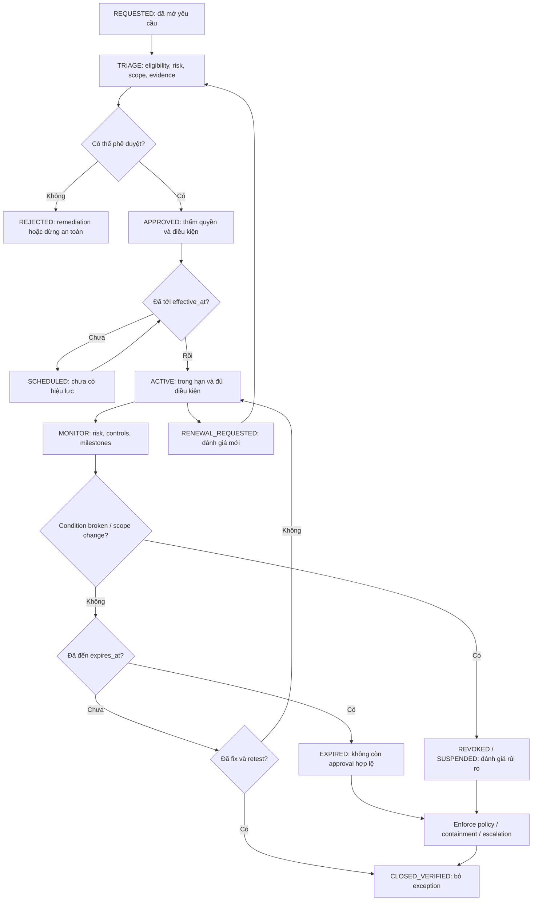
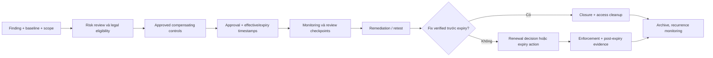

# Thời hạn ngoại lệ: Thiết kế, theo dõi và kết thúc ngoại lệ bảo mật có kiểm soát

## 1. Vì sao ngoại lệ bảo mật bắt buộc phải có thời hạn?

Trong quản trị bảo mật, **ngoại lệ (security exception)** là một quyết định có thẩm quyền cho phép **tạm thời lệch khỏi một yêu cầu, tiêu chuẩn hoặc security control được định nghĩa**, trong **phạm vi và điều kiện được phê duyệt**, khi chưa thể khắc phục đúng ngay tại thời điểm ra quyết định. **Thời hạn ngoại lệ (exception validity period)** là khoảng thời gian mà quyết định đó được phép có hiệu lực, cùng các mốc xem xét, điều kiện kết thúc trước hạn và cơ chế xử lý khi hết hạn.

Ví dụ: một ứng dụng cũ chưa hỗ trợ cơ chế xác thực bắt buộc theo baseline. Do rủi ro gián đoạn kinh doanh nếu thay ngay, chủ sở hữu rủi ro có thể **phê duyệt một ngoại lệ có điều kiện trong thời gian ngắn**, kèm giới hạn truy cập, giám sát, kế hoạch nâng cấp và thời điểm kiểm tra lại. Sau mốc kết thúc, tổ chức **không được giả định ngoại lệ tiếp tục hợp lệ** chỉ vì hệ thống cũ vẫn hoạt động.

Trong chương **Exception management** thuộc module **SECURITY_SECURITY_ASSURANCE**, mục tiêu là đánh giá có bằng chứng rằng hệ thống đáp ứng mục tiêu bảo mật, từ yêu cầu và controls tới audit, kiểm thử và khắc phục. Quản lý thời hạn ngoại lệ giúp trả lời:

1. Ai có thể cho phép lệch baseline và **trong bao lâu**?
2. Ngày bắt đầu, ngày kết thúc và **múi giờ** được xác định thế nào?
3. Rủi ro nào đã được chấp nhận, dựa trên **bằng chứng về phạm vi và kiểm soát bù trừ** nào?
4. Cần làm gì **trước, đúng lúc và sau khi hết hạn**?
5. Khi nào được gia hạn, khi nào phải dừng, thu hẹp hoạt động hoặc khắc phục?
6. Bằng chứng nào chứng minh ngoại lệ không âm thầm trở thành cấu hình vĩnh viễn?

**Ngoại lệ có thời hạn không phải một phương pháp sửa lỗi.** Nó là một **quyết định quản trị rủi ro có giới hạn thời gian** trong khi remediation và giám sát tiếp tục diễn ra.

### Kết quả học tập

Sau bài này, người học có thể:

- Phân biệt **exception validity**, thời hạn khắc phục, chu kỳ xem xét và thời gian giữ hồ sơ.
- Định nghĩa **effective_at**, **expires_at**, timezone, trạng thái và trigger kết thúc sớm một cách nhất quán.
- Xây dựng thời hạn theo mức rủi ro, tính cấp bách, khả năng khắc phục và nghĩa vụ bắt buộc.
- Thiết kế phê duyệt, nhắc hạn, gia hạn, hết hạn và đóng hồ sơ **không tự động hợp thức hóa rủi ro**.
- Đo tình trạng ngoại lệ, giám sát kiểm soát bù trừ và lưu bằng chứng cho audit.
- Xử lý các tình huống cloud IAM, tài sản legacy, detection gap, DR và ngoại lệ của bên thứ ba.

## 2. Phân biệt những loại “thời hạn” dễ bị nhầm

Không phải mọi mốc thời gian trong hồ sơ ngoại lệ đều mang cùng ý nghĩa.

| Khái niệm | Mục đích | Ví dụ | Không được suy diễn |
| --- | --- | --- | --- |
| **Exception effective time** | Khi quyết định bắt đầu cho phép sự lệch chuẩn | 09:00 UTC ngày D, sau phê duyệt | Trước thời điểm đó, ngoại lệ không tự có hiệu lực |
| **Exception expiry time** | Thời điểm quyền ngoại lệ **hết hiệu lực** | 09:00 UTC ngày D+14 | Không phải thời điểm mặc nhiên gia hạn |
| **Remediation deadline** | Hạn hoàn thành sửa lỗi và xác minh control | Hoàn tất fix trước D+10 | Không có nghĩa exception hết hạn đúng lúc code merge |
| **Review checkpoint** | Mốc đánh giá lại tình hình rủi ro giữa kỳ | Cập nhật status mỗi 3 ngày | Không tự thay expiry |
| **Compensating-control validity** | Khoảng thời gian kiểm soát bù trừ được xác nhận hiệu lực | Chỉ cấu hình giới hạn mạng đã kiểm thử trong kỳ này | Không bảo đảm luôn đúng sau thay đổi |
| **Approval decision date** | Khi người có thẩm quyền phê duyệt | Phê duyệt lúc 08:30 UTC | Không thay thế effective time được định nghĩa |
| **Incident deadline** | Mốc thời gian xử lý theo incident runbook | Check containment theo ca | Không đồng nhất với exception lifecycle |
| **Legal/contractual deadline** | Hạn do quy định hoặc hợp đồng áp dụng xác định | Nghĩa vụ thông báo/khắc phục chuyên ngành | Không thể tự kéo dài bằng duyệt ngoại lệ nội bộ |
| **Evidence retention period** | Thời gian lưu hồ sơ và bằng chứng | Giữ approval/closure theo chính sách | Không có nghĩa ngoại lệ vẫn có hiệu lực trong thời gian lưu |

Một lỗi phổ biến: ticket ghi `due_date` nhưng không phân biệt đây là **hạn xử lý việc** hay **mốc hết hiệu lực chấp thuận rủi ro**. Cần tên trường và ý nghĩa cụ thể; nếu không, dashboard có thể nhắc trễ trong khi quyền ngoại lệ đã hết.

## 3. Thời hạn ngoại lệ khác với việc chấp nhận rủi ro vô thời hạn

**Risk acceptance** là quyết định chấp nhận rủi ro còn lại theo quyền hạn và khẩu vị rủi ro (*risk appetite*) của tổ chức. Một ngoại lệ security thường cần risk acceptance, nhưng không phải mọi rủi ro được chấp nhận đều là ngoại lệ của một security baseline.

Ví dụ:

- **Exception:** tạm lệch yêu cầu “mọi privileged sessions phải dùng đường xác thực đã duyệt”, giới hạn đúng một service account, hai tuần.
- **Risk acceptance:** lãnh đạo chấp nhận xác suất gián đoạn nhất định từ một dependency bên ngoài theo chiến lược kinh doanh, với review định kỳ; điều này có thể không liên quan một control bị vi phạm.
- **Remediation:** thiết kế và triển khai cơ chế xác thực mới, retest rồi đóng finding.
- **Waiver/permanent deviation:** thay đổi hoặc miễn trừ yêu cầu theo cơ chế quản trị riêng nếu chính sách cho phép; không được dùng ngoại lệ hết hạn rồi gia hạn vô hạn để ngầm biến thành waiver.
- **Not applicable:** control không thuộc phạm vi được định nghĩa với bằng chứng; đó **không** phải ngoại lệ.
- **Legal exemption:** trường hợp được **nguồn pháp luật và thẩm quyền pháp lý** xác nhận có ngoại lệ theo đúng điều kiện; không thể thay bằng phê duyệt nội bộ.

**Giới hạn cốt lõi:** người có thẩm quyền risk acceptance **không thể tự miễn nghĩa vụ pháp luật bắt buộc**. Nếu một yêu cầu xuất phát từ quy định hoặc hợp đồng không cho phép sự lệch chuẩn, quyết định nội bộ không làm nó trở thành hợp lệ. Legal/Compliance phải xác định điều kiện trước khi cấp ngoại lệ, thay vì “tạm duyệt” rồi xử lý pháp lý sau.

## 4. Những đối tượng có thể được cấp ngoại lệ

Ngoại lệ phải gắn với **đúng control và phạm vi**, không cấp chung cho “toàn bộ nền tảng” khi chỉ có một chướng ngại cụ thể.

| Đối tượng | Ví dụ lệch baseline | Điều kiện phải nêu rõ |
| --- | --- | --- |
| **Asset / workload** | Máy chủ cũ chưa hỗ trợ phiên bản OS chuẩn | Asset IDs, môi trường, exposure, owner |
| **Identity / access** | Account khẩn cấp dùng phương thức đăng nhập khác | Principal IDs, quyền, hành động, lịch/phạm vi |
| **Application / API** | Một endpoint chưa hỗ trợ control auth mới | Endpoint, caller, dữ liệu, ingress restriction |
| **Network / segmentation** | Rule mạng tạm cho migration | Source/destination, protocol, TTL, connection review |
| **Logging/detection** | Một nguồn sự kiện chưa thể ingest | Event types, assets, gap, kiểm soát bù trừ |
| **Encryption/key management** | Hệ thống legacy cần chuyển đổi cách dùng key | Data categories, xử lý, loại key, giới hạn sử dụng |
| **Vulnerability** | Patch chưa triển khai kịp vì dependency | CVE/advisory, phiên bản, exploitability, mitigation |
| **Backup/DR** | Một thành phần chưa đạt recovery objective | BIA, RTO/RPO, scope, mức dịch vụ cho phép |
| **Third-party** | Vendor chưa đáp ứng một control cam kết | Hợp đồng, service, dữ liệu, compensating plan |
| **Process** | Tạm thay người phê duyệt thứ hai bằng luồng có kiểm soát | Thẩm quyền, tính độc lập, giám sát và hạn |

Một ngoại lệ cho **một API** không tự cho phép **mọi API** bỏ kiểm soát tương ứng; một ngoại lệ cho **một kỳ bảo trì** cũng không tự áp dụng trong lần bảo trì tiếp theo.

## 5. Vì sao thời hạn phải tỷ lệ với rủi ro?

**Thời hạn càng dài, rủi ro tích lũy càng có thể tăng** vì hệ thống, threat landscape, quyền, dữ liệu và việc sử dụng dịch vụ thay đổi. Rủi ro không luôn tăng tuyến tính; ví dụ trong một chiến dịch khai thác đang hoạt động, thay đổi trong vài giờ có thể quan trọng hơn một tháng hoạt động ổn định trước đó.

Các yếu tố quyết định thời hạn:

1. **Mức độ ảnh hưởng:** tác động tới tiền, dữ liệu nhạy cảm, an toàn con người, availability và trust.
2. **Khả năng bị khai thác:** đường attack, exposed surface, actor capability, sự kiện khai thác đã được xác minh.
3. **Độ trọng yếu của control:** authN/authZ, key protection, data isolation, detection/forensics, recovery.
4. **Phạm vi exposure:** số assets, accounts, tenants, users, geographies; nguy cơ lỗi chung.
5. **Bằng chứng về kiểm soát bù trừ:** được thử, có monitoring và owner hay chỉ là đề xuất.
6. **Khả năng sửa:** phụ thuộc vendor, thời gian thay kiến trúc, migration, rollback và kiểm thử.
7. **Biến động hệ thống:** workload mới, scale, phiên bản, churn nhân sự, asset discovery.
8. **Yêu cầu hợp đồng/pháp lý:** hạn nào thực sự bắt buộc, sự lệch nào không được phép.
9. **Khả năng quan sát:** telemetry đầy đủ hay có khoảng mù làm đánh giá rủi ro kém tin cậy.
10. **Kế hoạch thay thế:** shutdown, disable feature, segmentation hoặc migration nếu remediation thất bại.

**Thời hạn là quyết định có lý do và bằng chứng, không phải số cố định áp dụng cho mọi finding.** Một ngoại lệ cho privileged access ở production có thể không phù hợp với độ dài của ngoại lệ nâng cấp tài liệu runbook ít rủi ro.

## 6. Chính sách thời hạn mẫu dựa trên risk tier

Dưới đây là **ví dụ chính sách nội bộ giả định**, không phải mốc hạn do NIST, ISO hoặc luật bắt buộc.

| Risk tier nội bộ | Thời hạn tối đa mỗi lần duyệt *minh họa* | Checkpoint | Quyết định khi quá hạn |
| --- | --- | --- | --- |
| **Critical** | Thường không được duyệt; nếu có, thời hạn rất ngắn theo cơ chế khẩn cấp | Gần như liên tục / theo ca khi đang có exposure | Kích hoạt hành động khẩn hoặc dừng chức năng rủi ro theo kế hoạch |
| **High** | Tối đa 14 ngày, nếu policy cho phép | Kiểm tra nhiều lần trong kỳ | Escalation, không tự gia hạn |
| **Moderate** | Tối đa 30 ngày | Hằng tuần hoặc khi có trigger | Reassess, hạn chế scope nếu không thể chứng minh an toàn |
| **Low** | Tối đa 90 ngày | Theo kỳ đã duyệt | Thực hiện remediation/review hoặc xử lý lệch chuẩn |

**Đừng dùng các số 14/30/90 ngày như luật hoặc mặc định an toàn.** Trong doanh nghiệp thật, policy phải định nghĩa rõ **ngưỡng và thẩm quyền** theo yêu cầu ngành và hợp đồng. Một finding High có exploit đang xảy ra có thể không được chờ 14 ngày. Một nghĩa vụ pháp lý không cho phép deviation thì **không có thời hạn nào hợp thức hóa ngoại lệ**.

### Xây ma trận thời hạn có kiểm soát

- Đầu tiên phân loại **có thể cấp ngoại lệ không** (eligibility gate).
- Nếu có, xác định **mức rủi ro, compensating controls, scope, thẩm quyền**.
- Giới hạn thời hạn bằng **min của policy cap và điều kiện an toàn đã được phê duyệt**.
- Không để remediation deadline vượt expiry nếu chưa có phương án xử lý hợp lệ khi trễ.
- Các mốc review phải đủ sớm để ra quyết định trước expiry, không đặt sát giờ đến mức không còn hành động được.
- Với rủi ro biến động, dùng **event-driven expiry/review** kết hợp mốc thời gian.

## 7. Bắt đầu, kết thúc, timezone và quy tắc biên

Một quyết định phải xác định **mốc thời gian chính xác**, đặc biệt với cloud multi-region hoặc team nhiều múi giờ.

### Mô hình thời gian đề xuất

- `requested_at`: thời điểm yêu cầu ngoại lệ.
- `reviewed_at`: thời điểm hoàn tất risk/security/legal review.
- `approved_at`: thời điểm người có thẩm quyền phê duyệt.
- `effective_at`: thời điểm bắt đầu hiệu lực; không sớm hơn thời điểm phê duyệt hợp lệ trừ khi có một quy trình xử lý hồi tố được phép và ghi rõ (không nên dùng hồi tố để hợp pháp hóa hoạt động trái yêu cầu).
- `expires_at`: thời điểm hết hiệu lực theo mốc tuyệt đối và timezone có căn cứ.
- `next_review_at`: điểm đánh giá điều kiện giữa kỳ.
- `remediation_due_at`: thời hạn khắc phục và retest.
- `closed_at`: thời điểm quyết định đóng hồ sơ sau khi tiêu chí được đáp ứng.
- `revoked_at`: thời điểm bị thu hồi trước expiry do điều kiện không còn phù hợp.
- `evidence_retention_until`: thời hạn giữ hồ sơ, độc lập với hiệu lực ngoại lệ.

### Khoảng hiệu lực nửa mở

Để tránh nhập nhằng tại thời điểm kết thúc, có thể định nghĩa:

\[
\text{Exception active at }t \iff \text{effective\_at}\leq t < \text{expires\_at}
\]

theo điều kiện **đã phê duyệt, chưa bị thu hồi và mọi điều kiện bắt buộc vẫn đạt**. Dùng khoảng `[effective_at, expires_at)` nghĩa là **đúng tại mốc expires_at, ngoại lệ đã hết**. Đây là quy tắc triển khai được khuyến nghị, không phải ngữ nghĩa mặc định của mọi hệ thống GRC.

Ví dụ:

- `effective_at = 2026-11-28T09:00:00Z`
- `expires_at = 2026-12-12T09:00:00Z`

Tại `2026-12-12T08:59:59Z` có thể còn hiệu lực nếu điều kiện khác đạt. Tại `2026-12-12T09:00:00Z` ngoại lệ **không còn hiệu lực**, kể cả ticket chưa được cập nhật.

### Timezone và sự kiện muộn

- Lưu mốc chính bằng timestamp có offset hoặc **UTC**; hiển thị giờ địa phương kèm timezone rõ.
- Không lưu riêng chuỗi `2026-12-12` rồi suy ra cuối ngày khác nhau theo server.
- Phân biệt `event_time` và `ingested_at` khi các sự kiện có thể tới muộn.
- Kiểm tra clock skew/độ chính xác của nguồn trước khi kết luận đã hết hạn tại thời điểm sự kiện.
- Với một ngoại lệ chỉ áp dụng **trong maintenance window**, lưu lịch cụ thể và điều kiện hoạt động; không dùng ngày hết hạn để tự cho phép 24/7.
- Quy định liệu **DST/timezone offset change** ảnh hưởng lịch địa phương hay không; định nghĩa các mốc tuyệt đối để tránh trùng/thiếu giờ.

## 8. Điều kiện hiệu lực: thời gian chưa đủ

Một ngoại lệ có thể **chưa hết hạn theo đồng hồ nhưng phải dừng sớm** khi những tiền đề hoặc kiểm soát bù trừ không còn đúng.

Ví dụ:

| Điều kiện đã phê duyệt | Trigger invalidation | Hành động |
| --- | --- | --- |
| Quyền đặc biệt chỉ dùng trong network isolated | Segmentation bị mở, route mới xuất hiện | Thu hẹp/dừng quyền ngoại lệ, đánh giá lại |
| Chỉ xử lý dữ liệu thử | Dữ liệu thật hoặc dữ liệu nhạy cảm được đưa vào | Dừng phạm vi mới, privacy/security review |
| Tạm lỗ hổng với WAF rule đã thử | WAF tắt hoặc bypass tồn tại | Rủi ro tăng, containment và reconsideration |
| Vendor đang khắc phục theo milestone | Milestone vỡ hoặc báo cáo thay đổi scope | Escalation, cập nhật quyết định |
| Có monitoring nguồn audit độc lập | Mất log hoặc alert routing | Không còn căn cứ để chấp thuận cùng mức rủi ro |
| System chỉ dùng cho một nhóm khách hàng | Mở production rộng hơn | Ngoại lệ cũ không bao phủ scope mới |
| Threat assumption không có active exploitation | Có bằng chứng khai thác trong thực tế | Khởi động incident/risk reassessment ngay |

**Thời hạn tối đa là upper bound, không phải quyền bất biến.** Một quyết định có thể bị thu hồi trước hạn theo điều kiện explicit trong policy và approval.

## 9. State machine: vòng đời ngoại lệ có thời hạn



Sơ đồ chỉ là **workflow tham khảo**. Trong triển khai, một ngoại lệ có thể hết hạn trước khi fix hoàn tất; lúc đó hồ sơ có thể mang trạng thái **EXPIRED_WITH_OPEN_FINDING**, và đội vận hành phải thực hiện hành động đã định thay vì tự đóng finding.

### Ý nghĩa trạng thái

| Trạng thái | Ý nghĩa | Có cho phép lệch baseline? |
| --- | --- | --- |
| REQUESTED | Đã đề xuất nhưng chưa duyệt | **Không** |
| UNDER_REVIEW | Đang xác định eligibility/risk/compensation | **Không**, trừ khi có emergency process khác hợp lệ |
| APPROVED_SCHEDULED | Đã duyệt nhưng chưa đến effective time | **Không** trước effective time |
| ACTIVE | Trong thời gian và phạm vi cho phép, điều kiện vẫn đạt | **Có điều kiện** |
| SUSPENDED | Tạm dừng vì điều kiện không chắc chắn hoặc rủi ro thay đổi | **Không** theo cơ chế suspension |
| REVOKED | Thu hồi quyết định trước hạn | **Không** |
| EXPIRING_SOON | Cảnh báo phụ, vẫn ACTIVE nếu điều kiện còn đạt | **Có điều kiện**, không phải trạng thái gia hạn |
| EXPIRED | Quá hoặc tới expiry mà chưa có quyết định mới hợp lệ | **Không** |
| RENEWAL_PENDING | Đang đề nghị gia hạn, chưa phê duyệt | **Không sau expiry** |
| CLOSED_VERIFIED | Control được sửa và kiểm tra đạt, ngoại lệ được kết thúc | Không cần lệch baseline |
| CLOSED_SERVICE_REMOVED | Dịch vụ/đường rủi ro đã ngừng và được kiểm chứng | Không còn hoạt động thuộc ngoại lệ |
| CLOSED_RISK_DECISION | Chuyển sang quyết định khác theo quy trình riêng | Không được gọi là verified remediation |

**Trạng thái ACTIVE phải là giá trị được tính hoặc kiểm tra theo thời gian và điều kiện**, không chỉ một nhãn do người dùng đặt từ tháng trước.

## 10. Ai quyết định thời hạn ngoại lệ?

Một ngoại lệ có giới hạn thời gian cần phân biệt **người đề nghị, người xác minh controls và người chấp nhận rủi ro**.

| Vai trò | Trách nhiệm | Bằng chứng |
| --- | --- | --- |
| **Requester / Service Owner** | Mô tả nhu cầu, scope, tác động, thời gian xin cấp | Request, asset map, business justification |
| **Control Owner** | Chỉ ra baseline lệch, acceptance criteria và alternative controls | Control ID/version, control gap |
| **Technical Remediation Owner** | Lập plan, milestones, test và ngày khắc phục | Remediation plan, change IDs |
| **Security Assurance** | Kiểm tra bằng chứng, tính đủ của bù trừ, giám sát và retest | Control assessment, evidence review |
| **Security Risk / GRC** | Đánh giá risk tier, thời hạn theo policy, overdue và exception register | Risk assessment, policy check |
| **Risk Acceptance Authority** | Quyết định cho phép ngoại lệ theo đúng thẩm quyền | Approval, rationale, scope, expiry |
| **Legal/Compliance/Privacy** | Xác định nghĩa vụ bắt buộc/hợp đồng và tính hợp lệ của phương án | Applicability/obligation analysis |
| **Change/Operations Lead** | Đảm bảo rollout, fallback, rollback và tác động khi hết hạn | Change plan, ops runbook |
| **Independent Reviewer / Audit** | Kiểm tra điều kiện và chứng cứ, phát hiện approval thiếu cơ sở | Review notes, test of effectiveness |

Đối với rủi ro lớn, người trực tiếp **muốn tiếp tục triển khai** không nên tự phê duyệt việc chấp nhận rủi ro đó. Nếu tổ chức nhỏ, cần cơ chế review/ủy quyền bù trừ có thể kiểm toán.

### Approval cần đúng thời điểm

Khi request được gửi ngày D nhưng approval đến ngày D+2, đừng tự động lùi `effective_at` về D để che khoảng hoạt động chưa được phép. Nếu phát hiện hành vi đã lệch baseline trước phê duyệt, phải ghi **noncompliance/control gap trong giai đoạn đó**, xử lý theo quy trình; một quyết định mới không thay đổi sự thật lịch sử.

## 11. Điều kiện phê duyệt trước khi bắt đầu đếm thời hạn

**Eligibility gate** nên kiểm tra:

1. Yêu cầu/control được xác định đúng tên, ID, baseline version và nguồn thẩm quyền.
2. Loại ngoại lệ **có thể được phép theo policy và nghĩa vụ pháp luật/hợp đồng**.
3. Scope không vượt tài sản, dữ liệu, quyền và môi trường được đánh giá.
4. Rủi ro vốn có và residual risk sau bù trừ được phân tích.
5. Các **compensating controls đang vận hành**, có bằng chứng và cơ chế giám sát.
6. Remediation plan khả thi, có owner, milestones, deadline, retest.
7. Có hành động **khi điều kiện bù trừ mất hiệu lực** hoặc khi tới expiry.
8. Thẩm quyền phê duyệt tương ứng severity, pháp nhân và bộ phận.
9. Ngày bắt đầu/kết thúc và timezone hợp lệ, thời hạn không vượt cap.
10. Bằng chứng phê duyệt và communication đến đội thực thi đầy đủ.

Một request thiếu risk owner hoặc không mô tả được exposure **chưa đủ điều kiện phê duyệt chỉ vì deadline dự án sắp tới**.

## 12. Thiết kế kiểm soát bù trừ gắn với thời hạn

**Compensating control** phải giảm đúng rủi ro do control chính chưa đạt. Nó không nên chỉ là một biện pháp khác có vẻ liên quan.

Ví dụ cloud IAM chưa áp dụng phương thức MFA bắt buộc cho một access path:

| Loại biện pháp | Khả năng hỗ trợ | Điều phải kiểm tra |
| --- | --- | --- |
| Network restriction / private access | Giảm một số đường tấn công từ mạng ngoài | Kiểm tra ingress/bypass, actual routing |
| Privileged approval và giới hạn thời gian | Giảm sử dụng quyền ngoài mục đích | Log phê duyệt, role expiry và session validity |
| Monitoring đặc quyền | Tăng khả năng phát hiện hành vi bất thường | Source-to-sink event, alert delivery, on-call |
| Rate limiting / deny-by-default | Hạn chế một số phương thức lạm dụng | Negative tests, cấu hình hiệu lực |
| Credential rotation + secret vault | Hạn chế rủi ro secret cũ | Kiểm tra phiên/token cũ, quyền truy cập |
| Giảm scope dữ liệu/quyền | Giảm blast radius nếu control chính thiếu | Effective permissions, data access verification |

**Các biện pháp này không tự tương đương MFA**. Reviewer phải đánh giá liệu residual risk có thể chấp nhận theo policy; có những yêu cầu không chấp nhận giải pháp thay thế.

### Evidence kiểm soát bù trừ

- Config readback từ asset thực, không chỉ ticket “đã bật”.
- Positive/negative tests thể hiện hành vi bảo vệ.
- Monitoring và alert condition để biết bù trừ hỏng giữa kỳ.
- Owner và độ phủ mọi asset trong exception scope.
- Review trigger cho thay đổi quyền, dữ liệu, network, version.
- Kế hoạch thu hồi bù trừ sau khi remediation hoàn tất, nếu không còn cần.

Nếu monitoring bù trừ không hoạt động, **expiry có thể phải được kích hoạt sớm theo điều kiện**, ngay cả khi ngày kết thúc theo lịch vẫn ở tương lai.

## 13. Lịch giám sát trước khi hết hạn

Một lỗi vận hành phổ biến là gửi email **chính ngày hết hạn**, khi kế hoạch khắc phục cần thêm nhiều vòng thử nghiệm và phê duyệt. Hãy lập lịch theo thời gian cần ra quyết định.

### Ví dụ timeline của ngoại lệ 30 ngày

| Mốc minh họa | Hoạt động | Bằng chứng |
| --- | --- | --- |
| **Ngày 0** | Phê duyệt, ghi effective/expiry, công bố điều kiện và owner | Approval record, access/evidence |
| **Ngày 1** | Xác nhận compensating controls hoạt động | Baseline readback, test report |
| **Ngày 7** | Review risk, milestones và trigger | Review note, finding status |
| **Ngày 14** | Kiểm tra tiến độ thực tế, cập nhật blockers | Change plan và dependencies |
| **Ngày 21** | Kiểm tra remediation có kịp verification không | Test readiness, owner và plan B |
| **Ngày 25** | Cảnh báo trước hạn, trình quyết định nếu cần gia hạn | Reminder delivery + acknowledgment |
| **Ngày 28** | Escalation tới risk authority nếu thiếu evidence | Escalation record |
| **Ngày 30** | Expiry gate: quyết định mới hợp lệ hoặc enforcement/hạn chế | Time-based state, policy action |
| **Ngày 31+** | Rà soát vi phạm hoặc tác động tồn đọng nếu cần | Post-expiry control state, incident/finding |

Các mốc chỉ minh họa. Với ngoại lệ một ngày, lịch theo phút/giờ phù hợp hơn. Với ngoại lệ nhiều tháng và rủi ro thấp, có thể review theo giai đoạn. **Điều kiện quan trọng là đủ lead time cho con người quyết định và hệ thống thực thi an toàn trước khi hết hạn**.

### Reminder không phải gia hạn

Một reminder có thể thông báo, mở ticket, gọi on-call hoặc escalation, nhưng **không tự chuyển ngoại lệ thành ACTIVE thêm một kỳ**. Nếu người duyệt không phản hồi, đây là blocker/risk event, không phải sự đồng ý mặc định.

## 14. Escalation khi có nguy cơ không kịp khắc phục

Quy trình hiệu quả phát hiện sớm **expiry risk**, không chờ quá hạn mới báo.

### Các mức escalation tham khảo

1. **Owner review:** remediation milestone có khả năng trễ, cập nhật nguyên nhân và kế hoạch.
2. **Control/risk review:** kiểm tra compensating control còn đủ và rủi ro có tăng.
3. **Decision request:** xác định gia hạn hợp lệ, thu hẹp scope, tắt feature, thay workflow hoặc chấp nhận gián đoạn có kiểm soát.
4. **Executive/incident escalation:** khi tác động lớn, khai thác đang diễn ra, service quan trọng hoặc không có phương án hợp lệ.
5. **Legal/Compliance escalation:** khi liên quan nghĩa vụ không cho phép kéo dài sai lệch.

Nếu ngoại lệ hết hạn mà hệ thống vẫn lệch baseline, cần tách:

- **Exception status:** EXPIRED.
- **Finding/control status:** vẫn OPEN hoặc FAIL/UNKNOWN theo bằng chứng.
- **Risk status:** exposure tiếp tục, có thể cần incident hoặc overdue handling.
- **Operational state:** dịch vụ/identity đang chạy, bị giới hạn hoặc đã bị vô hiệu.
- **Decision:** chưa phê duyệt tiếp hay có phê duyệt mới có phạm vi và mốc rõ.

Báo cáo phải diễn đạt đúng các lớp này, tránh “hệ thống vẫn hoạt động nên ngoại lệ vẫn hợp lệ”.

## 15. Gia hạn ngoại lệ không phải thao tác cộng thêm ngày

**Renewal** (gia hạn) phải là **đánh giá mới tại thời điểm mới**, dựa trên tình hình rủi ro và bằng chứng hiện tại.

### Checklist gia hạn

- Ngoại lệ cũ: ID, trạng thái, scope, approved-at/effective-at/expires-at, số lần gia hạn.
- **Lý do chưa khắc phục:** thay đổi thực tế, dependency, milestone nào không đạt?
- **RCA của việc trễ:** vì sao plan ban đầu chưa có kết quả, có cần thay hướng không?
- **Phạm vi mới:** assets, users, quyền, dữ liệu, region và product features có thay đổi không?
- **Rủi ro mới:** threat context, exploitability, incidents, vulnerabilities, customer impact.
- **Compensating controls:** còn hoạt động không, có test và owner mới?
- **Evidence còn mới:** tình trạng runtime, log, vendor assurance, configuration drift.
- **Thời hạn mới:** có dưới cap và hợp lý theo risk appetite không?
- **Approval:** cùng hay cao hơn thẩm quyền phù hợp chính sách, có Legal khi cần?
- **Exit/plan B:** nếu vẫn không fix được thì phải ngừng hoặc chuyển kiến trúc thế nào?

**Không được giữ nguyên risk review cũ chỉ bằng cách thay một trường ngày.** Mỗi lần gia hạn nên có version/renewal ID, historical references, rationale và trước–sau.

### Gia hạn trước và sau expiry

- **Trước expiry:** nếu review và approval mới hoàn thành trước mốc hết hạn, có thể tạo thời kỳ mới không có gap, theo chính sách.
- **Sau expiry:** khoảng trống giữa mốc hết hạn và approval mới **không tự được hợp thức hóa hồi tố**. Nếu hệ thống tiếp tục lệch baseline, ghi rõ khoảng không có approval và đánh giá hậu quả.
- **Gia hạn yêu cầu nhưng chưa duyệt:** vẫn phải thực hiện expiry action theo policy; một request pending không phải decision.
- **Thay đổi scope lớn:** xem như yêu cầu mới hoặc phải đánh giá mở rộng theo policy, không chỉ sửa ngày của ID cũ.

## 16. Tránh chuỗi ngoại lệ vô tận (exception debt)

**Exception debt** là sự tích tụ những sai lệch liên tục được cho phép mà không khắc phục nguyên nhân. Nó có thể khiến risk posture tệ đi dù dashboard thể hiện từng ngoại lệ “đang trong hạn”.

Dấu hiệu:

1. Ngoại lệ cùng control được gia hạn nhiều lần mà không có retest tiến bộ.
2. Remediation deadline liên tục được dời nhưng không có blocker được giải quyết.
3. Compensating control chưa được thử lại từ lần phê duyệt đầu.
4. Một “ngoại lệ cục bộ” lan ra nhiều assets hoặc thêm khách hàng.
5. Người duyệt và reviewer cùng dùng kết luận cũ dù threat landscape đổi.
6. Số ngoại lệ OPEN giảm nhờ tạo bản ghi mới thay cho bản cũ.
7. Không có exit criteria, dependency owner hoặc phương án giảm chức năng.
8. Lặp lại **đúng một lỗi** do quy trình tạo tài sản mới không có preventive gate.

### Những biện pháp kiểm soát

- Giới hạn **số lần gia hạn** theo risk tier/chính sách và yêu cầu thẩm quyền cao hơn khi vượt ngưỡng.
- Dùng một chuỗi `original_exception_id` / `renewal_parent_id` để nhìn lịch sử thay vì “reset aging”.
- Theo dõi **cumulative exposure days** chứ không chỉ tuổi phiên hiện tại.
- Đánh giá **systemic remediation**: sửa công cụ provisioning, template IaC, controls ở điểm tạo tài sản.
- Định nghĩa **hard stop** khi không được tiếp tục hoặc có dấu hiệu rủi ro vượt appetite.
- Phối hợp kế hoạch ngân sách/roadmap với deadlines thay vì gia hạn do thiếu ưu tiên.

## 17. Khi hết hạn: fail-closed, fail-safe và tác động availability

Mặc định quản trị là: **tới expiry mà không có approval mới, ngoại lệ không còn hợp lệ**. Nhưng hành động kỹ thuật cần dựa trên **mức rủi ro và phương án vận hành đã phê duyệt**, không tự động chạy thao tác nguy hiểm.

### Ba phương án thực thi

| Phương án | Ví dụ | Khi dùng và lưu ý |
| --- | --- | --- |
| **Fail-closed tại gate kiểm soát** | Từ chối tạo privileged session mới khi approval hết hạn | Phù hợp nếu gate được thiết kế và kiểm thử, có emergency fallback hợp lệ |
| **Thu hẹp/disable tính năng theo runbook** | Tắt endpoint nhạy cảm; chuyển chức năng sang read-only | Cần phân tích business impact, comms, rollback |
| **Escalation/containment có giám sát** | Ràng buộc traffic, tách hệ thống, mở incident/risk event | Khi tắt ngay gây tác hại lớn và cần quyết định chuyên môn có thẩm quyền |

**Không tự xóa dữ liệu, revoke toàn bộ keys hoặc tắt thiết bị an toàn công nghiệp chỉ vì tới ngày hết hạn**, nếu hành động đó có thể gây nguy hiểm hoặc mất khả năng phục hồi. Hành động khi expiry phải được thiết kế, phê duyệt và diễn tập **trước** thời điểm đó. Trạng thái rủi ro vẫn không được trình bày là đã phê duyệt khi chưa có quyết định mới.

### Quy tắc default-deny ở tầng logic

Một hệ thống policy gate có thể mặc định **không cho phép tác vụ mới** theo ngoại lệ hết hạn. Nếu không thể cưỡng chế ở tầng kỹ thuật, phải:

1. Đổi trạng thái thành EXPIRED tại nguồn quản trị.
2. Tạo signal tới control owner/risk owner/on-call.
3. Áp dụng hành động an toàn theo runbook và đánh giá sai lệch đang tồn tại.
4. Ghi scope và thời gian exposure ngoài approval.
5. Đặt yêu cầu remediation, risk decision mới hoặc dừng chức năng theo quyền hạn.

Đừng đánh đồng **không còn hiệu lực pháp lý/nội bộ** với **cấu hình đã tự thu hồi thành công**. Hai việc cần chứng cứ độc lập.

## 18. Thời hạn và các thay đổi trong lúc ngoại lệ còn hiệu lực

Một ngoại lệ không được phép tự mở rộng theo:

- Thêm production account/cluster/namespace mới.
- Đưa dữ liệu khách hàng nhạy cảm vào service trước đây chỉ có dữ liệu thử.
- Thay owner/service principal, loại quyền hoặc scope IAM.
- Mở ingress công khai hoặc cho đối tác mới truy cập.
- Thay nhà cung cấp/subprocessor hoặc cloud region.
- Bổ sung feature xử lý dữ liệu hoặc AI.
- Thay framework/baseline, nghĩa vụ hợp đồng hoặc quy định liên quan.
- Phát sinh active exploitation, incident hoặc tình trạng monitoring mất nguồn.

### Event-driven reassessment

Một lần thay đổi phải:

1. Ghi change ID, timestamp, affected assets và data flows.
2. So sánh phạm vi mới với `exception.scope`.
3. Nếu nằm ngoài scope, **không dựa vào ngoại lệ cũ** để cho phép.
4. Nếu thuộc scope nhưng thay risk assumptions, đánh giá lại validity và bù trừ.
5. Nếu cần, đình chỉ/thu hồi hoặc ban hành approval mới có căn cứ.
6. Cập nhật affected security assurance claims và findings.

Không nên dùng phép kiểm đơn giản “một ngày chưa hết hạn” để thay toàn bộ logic hiệu lực.

## 19. Kết nối thời hạn ngoại lệ với remediation plan

**Remediation deadline** và **exception expiry** phải được quản lý cùng nhau nhưng không đồng nhất.

### Kế hoạch tiến độ ví dụ

Giả sử ngoại lệ có thời hạn 14 ngày:

| Mốc giả định | Việc cần hoàn thành |
| --- | --- |
| Ngày 0 | Approval, baseline, risk, scope và compensating control PASS |
| Ngày 2 | RCA và thiết kế fix hoàn tất, review |
| Ngày 6 | Thay đổi được triển khai trong môi trường kiểm thử |
| Ngày 9 | Security, integration và negative tests đạt |
| Ngày 11 | Rollout production với monitoring |
| Ngày 12 | Readback/retest end-to-end và independent review |
| Ngày 13 | Closure decision hoặc chuẩn bị expiry action |
| Ngày 14 | Exception hết hạn; không có im lặng gia hạn |

Lịch cần dự phòng thời gian **retest, rollback và approvals**. Nếu fix deployment vào đúng giờ expiry nhưng chưa kiểm chứng, **không được coi finding đã đóng**.

### Ba tình huống kết thúc

- **Fix hoàn tất và verified trước expiry:** đóng ngoại lệ sớm theo quyền hạn, giữ evidence.
- **Fix triển khai nhưng retest chưa xong:** ngoại lệ vẫn tới expiry như cũ; phải có quyết định đúng hạn hoặc thực thi phương án an toàn.
- **Fix thất bại/rollback:** đánh giá lại risk và điều kiện ngoại lệ; không giữ trạng thái VERIFIED nếu runtime đã trở về trạng thái cũ.

## 20. Exception record: cấu trúc dữ liệu đủ để audit

Một ngoại lệ có thời hạn cần liên kết **yêu cầu → control → risk → approval → duration → compensation → evidence → expiry action**.

| Nhóm | Trường quan trọng | Mục đích |
| --- | --- | --- |
| Identity | `exception_id`, `request_id`, `original_exception_id` | Truy vết chuỗi phê duyệt và gia hạn |
| Source | `policy_id`, `control_id`, `baseline_version` | Xác định chính xác điều kiện bị lệch |
| Scope | `assets`, `identities`, `services`, `environments`, `data_categories` | Không phê duyệt mơ hồ |
| Risk | `inherent_risk`, `residual_risk`, `risk_if_false` | Hiểu tác động/giả định |
| Authority | `requested_by`, `assessed_by`, `approved_by`, `authority_basis` | Bằng chứng quyền quyết định |
| Time | `approved_at`, `effective_at`, `expires_at`, `next_review_at` | Quản lý hiệu lực chính xác |
| Conditions | `compensating_controls`, `invalidation_triggers` | Có thể dừng trước hạn |
| Remediation | `finding_id`, `plan_id`, `due_at`, `milestones` | Tránh exception debt |
| Monitoring | `monitoring_source`, `alert_route`, `last_checked_at` | Kiểm tra liên tục |
| Enforcement | `expiry_action`, `fallback_runbook_ref` | Hành động an toàn khi hết hạn |
| Evidence | `approval_ref`, `test_refs`, `decision_log` | Truy xuất, kiểm toán |
| Lifecycle | `state`, `renewal_count`, `closed_at`, `revoked_at` | Trạng thái và lịch sử |
| Closure | `closure_type`, `verification_ref`, `reviewer` | Không lẫn risk accepted với fix verified |

Một bản ghi chỉ có `owner`, `reason` và `expiry_date` có thể không đủ bảo đảm rằng ngoại lệ **an toàn, được giám sát và không vượt scope**.

## 21. YAML minh họa: policy cho thời hạn ngoại lệ

Dưới đây là **schema quản trị giả định**, không phải cấu hình chạy trực tiếp trên hệ thống GRC hoặc Kubernetes.

```yaml
exceptionPolicy:
  id: SEC-EXCEPTION-TIME-BOUND
  version: "1.0.0"
  owner: Security Risk Management
  defaultState: REQUESTED
  validitySemantics:
    timeZone: UTC
    interval: "[effective_at, expires_at)"
    renewalPendingGrantsAccess: false
    expiryRequiresNewApproval: true
    conditionFailureCanRevokeEarly: true

  eligibility:
    legalOrContractualReviewRequiredWhenApplicable: true
    noBypassOfNonWaivableObligations: true
    required:
      - control-and-baseline-reference
      - explicit-asset-and-identity-scope
      - risk-assessment
      - verified-compensating-controls
      - authorized-approval
      - remediation-and-exit-plan

  # Các ngày tối đa dưới đây chỉ là ví dụ, không phải tiêu chuẩn chung.
  durationCapsIllustrativeDays:
    critical: 0
    high: 14
    moderate: 30
    low: 90

  notifications:
    basedOn: expires_at
    reminderLeadTimes:
      - "7d"
      - "3d"
      - "1d"
    routeTo:
      - technical-owner
      - control-owner
      - risk-owner
    requireAcknowledgmentForHighRisk: true

  renewal:
    independentRiskReviewRequired: true
    requireFreshControlEvidence: true
    requireUpdatedRemediationPlan: true
    preserveParentAndHistory: true
    noAutomaticApproval: true

  onExpiry:
    state: EXPIRED
    escalate: true
    executeOnlyApprovedSafeRunbook: true
    neverSilentlyExtend: true
```

Mọi trường ở đây là thiết kế học tập. `durationCapsIllustrativeDays.critical = 0` mô tả một **ví dụ chính sách không cho phép cấp ngoại lệ Critical thông thường**, không có nghĩa mọi tổ chức bắt buộc đặt 0. Các thông số notification có thể cần tùy biến với ngoại lệ chỉ tồn tại vài giờ; evaluator phải được triển khai thực tế.

## 22. JSON minh họa: ngoại lệ quyền cloud IAM trong 14 ngày

```json
{
  "exceptionId": "EXC-DEMO-2026-018",
  "originalExceptionId": "EXC-DEMO-2026-018",
  "reason": "Migration of a legacy service account",
  "policyId": "SEC-EXCEPTION-TIME-BOUND",
  "policyVersion": "1.0.0",
  "controlId": "PRIVILEGED-IDENTITY-01",
  "scope": {
    "environment": "production",
    "service": "legacy-billing",
    "principals": ["svc-legacy-billing"],
    "operations": ["specific-batch-operation"],
    "additionalPrincipalsAllowed": false
  },
  "risk": {
    "tier": "high",
    "residualRiskAccepted": true,
    "riskOwner": "Cloud Business Risk Owner"
  },
  "approval": {
    "reviewer": "Security Assurance",
    "approvedByRole": "Authorized Risk Owner",
    "approvedAt": "2026-11-28T08:30:00Z",
    "decisionRef": "evidence://exc-demo/approval-018"
  },
  "validity": {
    "effectiveAt": "2026-11-28T09:00:00Z",
    "expiresAt": "2026-12-12T09:00:00Z",
    "nextReviewAt": "2026-12-05T09:00:00Z",
    "renewalCount": 0
  },
  "conditions": {
    "privateNetworkOnly": true,
    "privilegedAccessAuditRequired": true,
    "maxScope": "one-listed-service-principal"
  },
  "compensatingControlEvidence": [
    "evidence://exc-demo/network-negative-test",
    "evidence://exc-demo/iam-readback",
    "evidence://exc-demo/audit-canary"
  ],
  "remediation": {
    "findingId": "FIND-DEMO-122",
    "planId": "REM-DEMO-056",
    "dueAt": "2026-12-10T09:00:00Z"
  },
  "expiryAction": {
    "type": "deny-new-exception-scoped-operations",
    "runbookRef": "evidence://exc-demo/approved-expiry-runbook",
    "safetyReviewRequired": true
  },
  "status": "ACTIVE"
}
```

Đây là **dữ liệu giả định** phục vụ học tập, không chứng minh identity thật có quyền hợp lệ. `status="ACTIVE"` chỉ là trường snapshot; khi đánh giá tại thời điểm mới phải **tính lại thời gian, điều kiện và tình trạng thu hồi**. `residualRiskAccepted = true` không thay thế approval record và việc xác minh thẩm quyền.

## 23. Pseudocode: xác định ngoại lệ còn hiệu lực hay không

Đoạn dưới là **logic minh họa**, không chạy trực tiếp trên production hoặc tự ra quyết định pháp lý.

```text
function evaluate_exception(exception, now_utc):
    if exception.approval is missing_or_invalid:
        return NOT_AUTHORIZED

    if exception.revoked_at is set and now_utc >= exception.revoked_at:
        return REVOKED

    if now_utc < exception.effective_at:
        return SCHEDULED

    if now_utc >= exception.expires_at:
        return EXPIRED

    if exception.scope has changed outside approval:
        return SUSPEND_AND_REASSESS

    if exception.mandatory_conditions_have_failed:
        return SUSPEND_AND_REASSESS

    if required_monitoring_evidence is unavailable:
        return UNKNOWN_REQUIRES_REVIEW

    return ACTIVE_WITH_CONDITIONS

function renewal_request(old, proposed):
    assert proposed has fresh_risk_assessment
    assert proposed has updated_compensating_control_evidence
    assert proposed has remediation_status_and_new_exit_plan
    assert proposed.validity does not exceed approved_policy_caps

    # Pending request is not a new approval.
    proposed.state = UNDER_REVIEW
    proposed.parent_id = old.exception_id
    require_authorized_human_decision(proposed)
```

Cơ chế runtime trong một sản phẩm có thể triển khai nhiều policy states hơn. Quan trọng là **không suy ACTIVE chỉ từ một ngày chưa tới expiry** và **không mở quyền chỉ vì có yêu cầu gia hạn**.

### Giới hạn của tự động hóa

- Đồng hồ ứng dụng có thể sai hoặc event đến muộn; phải có nguồn thời gian đáng tin.
- Monitoring evidence không đầy đủ cần trạng thái UNKNOWN/đánh giá lại, không tự coi PASS.
- Phải xử lý **race conditions** giữa approval mới, revocation, change scope và requests đồng thời.
- Sự kiện “expiry reached” cần **idempotent processing** và audit trail.
- Không dùng automation để tự động revoke tài nguyên có thể gây hại mà chưa được phép trong runbook.
- Không tự động chuyển compliance FAIL thành PASS nhờ có exception.

## 24. SQL đọc báo cáo: ngoại lệ sắp hết hạn, quá hạn và liên tục gia hạn

Ví dụ PostgreSQL dựa trên các bảng **giả định**:

```sql
-- Read-only report: không cập nhật exception state.
SELECT
    e.exception_id,
    e.service_id,
    e.control_id,
    e.risk_tier,
    e.risk_owner,
    e.approved_at,
    e.effective_at,
    e.expires_at,
    e.renewal_count,
    CASE
      WHEN e.revoked_at IS NOT NULL THEN 'REVOKED'
      WHEN CURRENT_TIMESTAMP >= e.expires_at THEN 'EXPIRED'
      WHEN CURRENT_TIMESTAMP < e.effective_at THEN 'SCHEDULED'
      WHEN e.expires_at <= CURRENT_TIMESTAMP + INTERVAL '7 days'
        THEN 'EXPIRING_WITHIN_7_DAYS'
      ELSE 'WITHIN_TIME_WINDOW'
    END AS time_status
FROM security_exceptions AS e
WHERE e.lifecycle_status NOT IN ('CLOSED_VERIFIED', 'REJECTED')
ORDER BY e.expires_at ASC;
```

Đây là **chỉ báo thời gian**, không phải evaluator đầy đủ về eligibility, approval, scope và bù trừ. Bản ghi `WITHIN_TIME_WINDOW` có thể đã bị invalid vì condition failure; phải kết hợp nguồn actual control states và decision history.

### Báo cáo exception debt

```sql
SELECT
    e.original_exception_id,
    COUNT(*) AS approval_versions,
    MAX(e.expires_at) AS latest_expiry,
    MAX(e.renewal_count) AS latest_recorded_renewal_count
FROM security_exceptions AS e
WHERE e.lifecycle_status <> 'REJECTED'
GROUP BY e.original_exception_id
HAVING COUNT(*) > 1
ORDER BY approval_versions DESC, latest_expiry;
```

`COUNT(*)` có thể là số bản ghi, không luôn là số lần gia hạn nếu schema lưu các phiên khác; cần quy ước rõ. Tính **cumulative exposure days** phải xem các khoảng hiệu lực giao nhau và không cộng trùng, đồng thời ghi **gaps không có phê duyệt** riêng.

## 25. Case study A: Cloud privileged access sắp hết hạn

### Bối cảnh

Một công ty có service account legacy đang giữ một quyền đặc biệt để chạy batch billing. Chính sách IAM mới yêu cầu mô hình quyền tối thiểu và xác thực workload theo cơ chế chuẩn, nhưng phần mềm cũ chưa hỗ trợ. Chủ rủi ro chấp thuận ngoại lệ **14 ngày** đối với một principal, một loại tác vụ và một môi trường, kèm network restriction và audit.

### Timeline giả định

| Thời điểm UTC | Sự kiện | Bằng chứng |
| --- | --- | --- |
| 28/11 08:30 | Risk owner phê duyệt ngoại lệ, scope và thời hạn | Approval ID |
| 28/11 09:00 | Bắt đầu hiệu lực | Policy gate audit |
| 01/12 | Remediation team thử cơ chế workload identity mới | PR/test log |
| 05/12 | Checkpoint: vẫn giữ nguyên scope, bù trừ đạt | Runtime readback, canary |
| 09/12 | Release canary mới gây lỗi batch, rollback hợp lệ | Change và rollback record |
| 10/12 | Nhận thấy retest không kịp 12/12 | Escalation và decision request |
| 11/12 | Review lại risk, exploitability, compensating controls | Review + renewal decision |
| 12/12 09:00 | Ngoại lệ cũ hết hạn | Clock/state + enforcement logs |

### Hai khả năng

**Nhánh 1 – Gia hạn hợp lệ trước hạn:** assessment mới cho thấy rủi ro và phạm vi vẫn trong mức có thể chấp nhận, compensating controls PASS; risk owner có thẩm quyền phê duyệt **một quyết định mới** trước 12/12 09:00, với thời hạn mới, plan và evidence cập nhật. Không tự sửa mốc cũ để xóa lịch sử.

**Nhánh 2 – Không có approval mới:** tại 12/12 09:00 ngoại lệ **EXPIRED**. Nếu gate chặn được thao tác mới và giải pháp giảm chức năng đã diễn tập, thực hiện theo runbook. Nếu chặn đột ngột gây rủi ro lớn hơn, escalation tới incident/operations theo phương án an toàn nhưng **không được báo rằng quyền vẫn được phép bởi ngoại lệ cũ**.

### Lessons

- Một lần rollback có thể làm trạng thái bảo mật quay lại như cũ; phải kiểm tra effective permissions.
- Email “xin gia hạn” không tạo permission.
- Mốc expiry cần được chuyển thành **hành động vận hành có kiểm thử**, không chỉ nhắc lịch.
- Fix triển khai nhưng chưa verified thì không được đóng finding.

## 26. Case study B: Detection gap và rủi ro historical blind spot

### Bối cảnh

Hệ thống SIEM chưa nhận management events từ một cloud account quan trọng. Vì công cụ forwarding mới cần thay đổi hạ tầng, tổ chức xem xét ngoại lệ ngắn để hoạt động tiếp với **hạn chế thay đổi IAM, tăng review thủ công và log tại nguồn độc lập**.

### Những điều phải kiểm tra trước approval

1. Có chính sách nào cho phép ngoại lệ về audit coverage không? Có nghĩa vụ bắt buộc cấm thiếu log không?
2. Tập account và các loại event bị thiếu được xác định đầy đủ từ inventory độc lập chưa?
3. Log tại nguồn có thực sự còn tồn tại và truy xuất được hay cũng thiếu?
4. Các thay đổi đặc quyền có cơ chế kiểm soát trước, người phê duyệt và audit thay thế không?
5. Có khoảng lịch sử không thể khôi phục và cần incident assessment không?
6. Kế hoạch onboarding SIEM đã có owner, deadline và thử source-to-sink chưa?
7. Nếu một audit source tiếp tục mất hoặc account mới xuất hiện, ngoại lệ cũ có còn phù hợp không?

### Phân biệt kết luận

- **Exception ACTIVE:** chỉ có nghĩa risk owner cho phép hoạt động có điều kiện trong thời gian cụ thể; **không làm logging control trở thành PASS**.
- **Control finding:** vẫn OPEN/FAIL cho những điều kiện không đạt; các control bù trừ được đánh giá riêng.
- **Historical blind spot:** việc bật log hôm nay **không khôi phục event chưa từng được ghi**.
- **Closure:** cần test event nguồn → collector → parser → SIEM → detection/alert → reviewer; đánh giá look-across và lưu evidence.

Nếu ngoại lệ hết hạn nhưng chưa có giám sát hoạt động, không được mặc định nguồn log đã an toàn vì SIEM dashboard ít báo lỗi.

## 27. Case study C: Lỗ hổng hệ điều hành legacy chưa vá

Một hệ thống nội bộ hỗ trợ nghiệp vụ quan trọng chạy phiên bản OS chưa có patch tương thích. Nhóm vận hành xin ngoại lệ dài hạn vì “vendor chưa phát hành bản sửa”.

### Đánh giá thời hạn

| Câu hỏi | Ý nghĩa với duration |
| --- | --- |
| Host có internet exposure hoặc đường lateral movement không? | Exposure cao có thể buộc giảm thời hạn hoặc không cho ngoại lệ |
| Có active exploitation liên quan lỗ hổng này không? | Thay đổi risk assessment lập tức |
| Network segmentation và application allowlist đã được thử chưa? | Compensating controls có thật không |
| Có EDR/monitoring phù hợp không? | Dễ phát hiện dấu hiệu khai thác hay mù |
| Có vendor support statement và patch ETA có căn cứ không? | Thời hạn remediation có khả thi không |
| Có phương án migrate/retire service không? | Tránh gia hạn không giới hạn |
| Có dữ liệu nhạy cảm hoặc nghĩa vụ cấm tiếp tục sử dụng không? | Có thể buộc dừng thay vì cấp ngoại lệ |

Một timeline hợp lý có thể có các **milestones migration** và điều kiện thu hẹp quyền trước mỗi review, thay vì gia hạn sáu tháng mỗi lần vì “chưa có patch”. Nếu vendor không còn hỗ trợ, quyết định đúng có thể là **ngừng hệ thống hoặc thay kiến trúc**.

### Historical exposure

Bản vá có thể giải quyết vulnerability hiện tại nhưng không chứng minh hệ thống chưa bị khai thác trước đó. Khi có dấu hiệu xâm nhập, cần incident investigation theo nguồn evidence phù hợp, tách khỏi việc đóng ngoại lệ.

## 28. Case study D: Third-party remediation và hợp đồng

Một vendor SaaS quan trọng không cung cấp bằng chứng restore test theo cam kết dịch vụ. Internal risk owner cân nhắc gia hạn ngoại lệ khi vendor lùi lịch.

**Cần phân biệt ba thứ:**

1. **Hợp đồng/vendor obligation:** vendor có nghĩa vụ cung cấp evidence hoặc khôi phục theo điều khoản nào?
2. **Customer-side risk exception:** doanh nghiệp có cho phép tiếp tục sử dụng vendor trong điều kiện chưa có evidence không?
3. **Thời hạn khắc phục của vendor:** milestone họ cam kết và cách xác minh khi hoàn thành.

Một approval nội bộ **không sửa đổi hợp đồng** và không tự gia hạn deadline vendor nếu không có thỏa thuận hợp lệ. Nếu thiếu bằng chứng DR, doanh nghiệp có thể giảm độ phụ thuộc, giữ export định kỳ, chuẩn bị exit, thử restore dữ liệu phía mình hoặc yêu cầu kiểm toán bổ sung, tùy scope.

Khi ngoại lệ hết hạn, nếu chưa có bằng chứng và exit quá khó, điều đó là **rủi ro concentration/continuity chưa được quản lý tốt**, không phải lý do tự động gia hạn. Cần leadership, legal/vendor management và risk owner quyết định phương án phù hợp.

## 29. Case study E: DR exception có thể ảnh hưởng hoạt động liên tục

Một Payment API có mục tiêu RTO 120 phút, nhưng bài DR exercise đo **140 phút** tới business acceptance; vậy control về RTO chưa đạt theo tiêu chí giả định. Đội vận hành xin ngoại lệ trong lúc xây lại workflow khôi phục.

### Vấn đề thời hạn

Một ngoại lệ có thể tạm chấp nhận việc RTO chưa đạt nếu policy và nghĩa vụ cho phép, nhưng phải có:

- BIA, impact analysis và business owner xác nhận mức ảnh hưởng.
- Biện pháp business continuity/manual fallback **được phép và đã kiểm thử**.
- Remediation plan rút ngắn phát hiện, khai báo, restore và security acceptance.
- Milestones diễn tập lại, không chỉ thay đổi cloud config.
- Thời hạn đủ gần để tránh tiếp tục duy trì một recovery plan không đáng tin.
- Decision khi hết hạn: thu hẹp hoạt động, tăng dự phòng hoặc phương án được phê duyệt khác.

**Không chấm RTO PASS chỉ vì ngoại lệ còn trong hạn.** Kiểm soát vẫn FAIL theo test; ngoại lệ là decision về rủi ro, còn một lần retest end-to-end đạt mới là bằng chứng phục hồi.

## 30. Evidence chain: chứng minh ngoại lệ không vượt hạn

Một kết luận “ngoại lệ được quản trị đúng” cần **một chuỗi hồ sơ**, không chỉ ngày trong spreadsheet.

### Chuỗi evidence



### Bằng chứng cụ thể

| Điều cần chứng minh | Nguồn bằng chứng có thể dùng |
| --- | --- |
| Approval hợp lệ | Identity/role của approver, quyết định, timestamp, scope |
| Thời hạn không vượt policy | Baseline/risk tier, cap, start/end được tính theo UTC |
| Bù trừ thực sự hoạt động | Runtime readback, positive/negative tests, audit events |
| Checkpoint được thực hiện | Review notes, tình trạng remediation, owner acknowledgments |
| Reminder/escalation hoạt động | Notification IDs, delivery và response records |
| Không âm thầm gia hạn | Versioned approval history và state transitions |
| Expiry được xử lý đúng | Enforcement logs, policy gate, runbook execution |
| Finding được sửa | Change, readback, test results, independent validation |
| Historical risk được theo dõi | Exposure window, incident assessment, limitations |
| Kho bằng chứng đáng tin | Provenance, timestamp, access logs, integrity và retention |

Cần giữ bản gốc có quyền truy cập phù hợp, không ghi raw secrets hoặc dữ liệu khách hàng vào báo cáo được chia sẻ rộng. Hash giúp kiểm tra file không bị thay đổi theo phương pháp phù hợp, **không tự chứng minh nội dung file là sự thật**.

## 31. Kiểm thử chương trình quản lý thời hạn ngoại lệ

Một workflow ngoại lệ muốn đáng tin cần được **diễn tập và kiểm thử** giống các security controls khác.

| Test ID | Kịch bản | Kết quả cần chứng minh |
| --- | --- | --- |
| **EX-T01** | Request mới chưa được duyệt | Không được coi ACTIVE |
| **EX-T02** | Approval có effective time trong tương lai | SCHEDULED cho đến đúng mốc |
| **EX-T03** | Ngay tại `expires_at` | EXPIRED theo quy tắc biên đã định |
| **EX-T04** | Renewal requested, chưa approved | Không kéo dài hiệu lực ngoại lệ cũ |
| **EX-T05** | Gia hạn được duyệt trước hạn | Có quyết định và version mới; không xóa lịch sử |
| **EX-T06** | Gia hạn phê duyệt sau hạn | Ghi gap không có approval; không backdate im lặng |
| **EX-T07** | Scope asset/principal mở rộng giữa kỳ | Chặn scope mới hoặc yêu cầu đánh giá lại |
| **EX-T08** | Compensating control ngừng hoạt động | SUSPEND/REVOKE hoặc escalation theo policy |
| **EX-T09** | Owner không nhận reminder | Escalation có thể kiểm tra |
| **EX-T10** | Giờ địa phương đổi DST hoặc offset | So sánh trên timestamps chuẩn |
| **EX-T11** | Clock skew hoặc event giao trễ | Ghi ambiguity, không báo sai có bằng chứng tuyệt đối |
| **EX-T12** | Fix được deploy nhưng chưa retest | Không CLOSED_VERIFIED |
| **EX-T13** | Rollback đưa quyền quá rộng trở lại | Reopen finding, reassess exception validity |
| **EX-T14** | Ngoại lệ bị revoke trước hạn | Gate không tiếp tục cho phép |
| **EX-T15** | Một ngoại lệ được tạo mới để che renewal count | Liên kết lineage và cumulative exposure |
| **EX-T16** | Risk tier Critical nhưng policy cấm ngoại lệ | Rejected, safety/incident escalation |
| **EX-T17** | Legal obligation không cho deviation | Risk approval nội bộ không vượt eligibility gate |
| **EX-T18** | Expiry trigger có thể gây mất dịch vụ | Thực hiện approved safe runbook, không chạy thao tác phá hoại |
| **EX-T19** | Evidence portal không truy cập được | UNKNOWN/evidence gap, không giả định PASS |
| **EX-T20** | Vendor lùi remediation lần nữa | Reassess và decision có thời hạn, không auto-extend |

### Quy trình tổ chức test

1. Chọn **môi trường thử** với đồng hồ giả lập hoặc dữ liệu thời gian mô phỏng, không thay giờ production.
2. Tạo hồ sơ mẫu có scope, approvals, controls và nhiều kiểu thời hạn.
3. Kiểm tra **boundary values** ngay trước/tại/sau effective và expiry.
4. Đưa sự kiện thay đổi scope, bù trừ thất bại, renewal chưa duyệt và clock/event delay.
5. Xem state, policy decisions, notifications, enforcement events và audit logs.
6. Kiểm thử **hành động hết hạn an toàn** với canary/fallback, không cố tình gây gián đoạn production.
7. Thu evidence, đánh giá PASS/FAIL/UNKNOWN và mở finding nếu workflow không đạt.
8. Sửa rule, nâng phiên bản, chạy retest và xác nhận người chịu trách nhiệm.

Tabletop có thể đánh giá thẩm quyền và quyết định, nhưng **không chứng minh gate kỹ thuật thực thi đúng tại mili giây hết hạn**. Cần thêm functional tests cho thời gian và state transitions nếu đó là control bắt buộc.

## 32. Dashboard và metrics về thời hạn ngoại lệ

| Chỉ số | Ý nghĩa | Cảnh báo diễn giải |
| --- | --- | --- |
| **Active exceptions by risk** | Ngoại lệ còn hiệu lực theo risk tier và service | Active status phải tính cả thời gian/conditions |
| **Expiring within review window** | Sắp đến expiry chưa có plan/decision | Review window phải đủ lead time thực tế |
| **Expired but exposed** | Ngoại lệ đã hết, hệ thống vẫn lệch control | Quan trọng hơn số ticket trễ |
| **Renewal count & cumulative duration** | Tần suất và thời gian chấp thuận kéo dài | Không reset khi tạo ID mới |
| **Approvals without valid expiry** | Hồ sơ thiếu thời điểm hết hạn đáng tin | Lỗi governance cần xử lý ngay |
| **Compensating control coverage** | Ngoại lệ có bù trừ đã thử / tập yêu cầu | Không coi “có control” là “control PASS” |
| **Remediation before expiry** | Finding được verified trước hạn | Phân biệt deploy với retest |
| **Time to authorized decision** | Thời gian từ trigger tới approval/rejection | Nhanh không đồng nghĩa đánh giá đủ |
| **Time past expiry** | Khoảng không có approval hợp lệ nhưng exposure còn | Cần tính theo event time và uncertain windows |
| **Repeated exception debt** | Nhóm control/service được gia hạn nhiều lần | Tìm root cause hệ thống |
| **Evidence completeness** | Hồ sơ có nguồn, approval, test, closure đủ | Không đồng nghĩa mọi control đạt |
| **Invalidation response time** | Từ khi bù trừ hỏng tới suspension/action | Không chờ expiration theo lịch |
| **Unauthorized scope expansion** | Trường hợp assets mới sử dụng exception cũ | Scope phải gắn asset/identity IDs ổn định |

### Ví dụ diễn giải báo cáo

Có 20 ngoại lệ được mở trong một kỳ: 8 đóng sau verified remediation, 5 còn ACTIVE đúng hạn và đủ điều kiện, 3 đã EXPIRED nhưng hệ thống vẫn lệch baseline, 2 đang renewal review và chưa tới hạn, 2 bị REVOKED.

- **Verified remediation closure:** 8/20 = **40%**.
- **Expired but still exposed:** 3/20 = **15%**.
- **Tỷ lệ hồ sơ đang ACTIVE hợp lệ trong tổng:** 5/20 = **25%**, nếu đầy đủ evidence.
- **Renewal pending:** không được tính như đã gia hạn nếu chưa có approval.

Các tỷ lệ này mô tả **trạng thái hồ sơ trong một tập giả định**; không phải tỷ lệ security compliance của tổ chức. Cần đánh trọng số theo risk và hiển thị từng service Critical riêng.

## 33. Những sai lầm cần tránh

1. **Không ghi expiry:** ngoại lệ biến thành quyền vĩnh viễn.
2. **Chỉ ghi ngày không có timezone:** nhiều đội hiểu khác giờ kết thúc.
3. **Gọi remediation due date là exception expiry:** chưa rõ quyết định nào mất hiệu lực khi nào.
4. **Cho ngoại lệ hồi tố bằng cách sửa effective_at:** che khoảng thời gian không có approval.
5. **Tự động gia hạn khi ticket còn mở:** thời hạn không còn ý nghĩa kiểm soát.
6. **Renewal chỉ sửa một ô ngày:** không kiểm tra risk, controls và scope mới.
7. **Bỏ qua sự kiện tăng rủi ro giữa kỳ:** ngoại lệ tiếp tục dù tiền đề đã sai.
8. **Compensating control chỉ là cam kết:** không có bằng chứng runtime và negative test.
9. **Dùng số ngày chuẩn một cách máy móc:** Critical active exploitation bị cho chờ quá lâu.
10. **Một exception cho tất cả assets:** không thể thấy scope mới hoặc look-across gap.
11. **Không có owner khi nhân sự đổi:** đến hạn không ai ra quyết định.
12. **Chỉ nhắc đúng ngày expiry:** không còn thời gian cho review và phương án thay thế.
13. **Coi request pending là approval:** vô tình cho phép hành động chưa được ủy quyền.
14. **Không kiểm tra policy gate kỹ thuật:** nhãn EXPIRED nhưng quyền vẫn có hiệu lực.
15. **Tự động revoke nguy hiểm:** gây outage hoặc làm mất dữ liệu mà không có runbook an toàn.
16. **Đóng finding vì có exception:** nhầm risk acceptance với remediation.
17. **Báo control PASS khi exception ACTIVE:** che sự lệch chuẩn đang được chấp nhận có điều kiện.
18. **Giấu gia hạn trong ticket mới:** exception debt trông như đã giảm.
19. **Không đo cumulative exposure:** nhiều kỳ ngắn cộng lại thành nhiều tháng rủi ro.
20. **Không có hard stop hoặc kế hoạch exit:** legacy debt không bao giờ hết.
21. **Không kiểm tra hợp đồng/pháp luật:** phê duyệt ngoại lệ trái nghĩa vụ bắt buộc.
22. **Tin rằng không có alert nghĩa là bù trừ hiệu quả:** monitoring có thể bị mất nguồn.
23. **Không tách historical exposure:** fix hôm nay không xóa tác động ngày hôm qua.
24. **Không ghi revocation khi risk thay đổi:** ngoại lệ tiếp tục theo ngày dù không còn đủ điều kiện.
25. **Không giữ audit trail/version:** không thể tái dựng ai cho phép điều gì vào thời điểm nào.
26. **Không xử lý clock skew và event delay:** kết luận sai về việc có approval tại thời điểm thao tác.
27. **Không kiểm tra privileges tồn tại sau expiry:** sessions/token cũ vẫn tiếp tục được sử dụng.
28. **Lẫn retention hồ sơ với hiệu lực ngoại lệ:** tài liệu được lưu thêm nhiều năm không có nghĩa approval còn sống.
29. **Không cập nhật dashboard khi rollback:** ngoại lệ bị đóng dù control đã quay về trạng thái lỗi.
30. **Bỏ qua subprocessor/vendor dependency:** thời hạn nội bộ không tự buộc vendor hoàn thành đúng cam kết.

## 34. Bài tập thực hành

1. Soạn hồ sơ ngoại lệ cho một service account production cần duy trì quyền rộng trong 7 ngày. Nêu `effective_at`, `expires_at`, scope, owner, compensating controls, remediation và expiry action.
2. Giải thích vì sao approval lúc 10:00 không thể tự hợp thức hóa việc dùng quyền lúc 09:00; làm thế nào ghi exposure trước approval?
3. Một exception hết hạn `2026-12-12T09:00:00Z`. Xác định trạng thái tại `08:59:59Z`, `09:00:00Z` và `09:00:01Z` theo mô hình nửa mở, nếu không có revocation/renewal.
4. So sánh remediation deadline với exception expiry cho một finding có fix deploy thành công nhưng chưa retest.
5. Một ngoại lệ High có thời hạn 14 ngày nhưng phát hiện active exploitation vào ngày thứ 2. Những điều kiện nào buộc đánh giá sớm?
6. Một nhân viên yêu cầu gia hạn trước expiry, risk owner phản hồi sau expiry hai ngày. Hãy mô tả trạng thái và việc xử lý khoảng không được phê duyệt.
7. Một khách hàng phản ánh hệ thống không còn đáp ứng chính sách privacy; có thể dùng risk acceptance nội bộ để “tạm miễn” nghĩa vụ pháp luật không? Phân biệt giải pháp đúng.
8. Một exception cho một cloud account được mở rộng thành năm account. Hãy lập checklist reassessment scope và acceptance.
9. Một detector giữ status green nhưng log source bị mất một giờ. Compensating control có còn được coi đủ không? Cần evidence nào?
10. Thiết kế một workflow gửi reminders trước hạn, kiểm tra acknowledgment và escalation nếu owner vắng mặt.
11. Một chương trình đã gia hạn cùng control 6 lần bằng cách tạo 6 tickets mới. Thiết kế data model theo original ID và metrics cumulative duration.
12. Lập RACI cho approval, control testing, remediation, renewal, expiry enforcement và independent closure.
13. Một ngoại lệ OS legacy cần patch nhưng vendor không còn hỗ trợ. Đề xuất exit strategy thay vì gia hạn vô hạn.
14. Một DR exception cho RTO không đạt được duyệt tới cuối tháng. Cần những kiểm chứng BIA/BCP nào trong suốt kỳ?
15. Thiết kế policy cap theo Critical/High/Moderate/Low của tổ chức giả định, nêu rõ các tiêu chí khiến ngoại lệ không được phép dù còn trong cap.
16. Viết một YAML exception record dựa trên schema bài học, chú ý điều kiện invalidation và expiry action.
17. Thiết kế SQL read-only tìm ngoại lệ quá hạn nhưng vẫn có service active; nêu vì sao cần hai nguồn dữ liệu độc lập.
18. Một policy gate chỉ đọc cột `status = 'ACTIVE'` từ database mà không kiểm tra `expires_at`. Phân tích lỗi thiết kế và sửa logic.
19. Tổ chức nhận hàng loạt event đến muộn do message queue tắc. Làm sao đánh giá mốc hết hạn có sai lệch đồng hồ mà không tạo kết luận giả?
20. Viết test plan cho boundary time trước/tại/sau expiry, including renewal_pending, revoked và condition_failure.
21. So sánh các cách hành động khi hết hạn với một identity IAM, một máy chủ legacy và một hệ thống an toàn vật lý.
22. Một chủ nghiệp vụ đề xuất tự động xoá backup khi exception hết hạn. Hãy phân tích nguy cơ mất dữ liệu, legal hold và thiết kế safe runbook.
23. Dựa trên 20 ngoại lệ minh họa, tính verified closure, expired-but-exposed và ACTIVE đúng điều kiện; nêu vì sao không phải compliance pass rate.
24. Một vendor không cung cấp bằng chứng DR dù internal exception còn hiệu lực. Tổ chức phải quản lý hợp đồng và rủi ro tiếp tục như thế nào?
25. Lập decision record khi một ngoại lệ sắp hết hạn nhưng remediation bị rollback. Cần phê duyệt, kiểm soát bù trừ và thông báo gì?
26. Thiết kế event-driven trigger khi team đổi dữ liệu từ test sang production, ảnh hưởng hiệu lực approval ra sao?
27. Khi ngoại lệ được đóng sớm nhờ fix verified, cần thu hồi những quyền/bù trừ tạm thời nào và bằng chứng nào xác nhận?
28. Một bộ kiểm tra chỉ đếm số exception chưa hết hạn. Vì sao nó không đánh giá được sự hiệu quả của kiểm soát bù trừ?
29. Tạo một **evidence package** để auditor tái dựng quyết định cho phép lệch baseline vào một timestamp cụ thể, kể cả previous renewals.
30. Một ngoại lệ có hai phê duyệt chồng thời gian với phạm vi khác nhau. Hãy đề xuất quy tắc ưu tiên, scope evaluation và cách tránh permission escalation.

**Tiêu chí bài làm:** kết nối được **control baseline → finding/risk → điều kiện eligibility → thẩm quyền approval → phạm vi và khoảng thời gian chính xác → compensating controls → remediation plan → monitoring/review/renewal → expiry enforcement → evidence và closure**. Không được dùng một timestamp còn hạn để tự kết luận mọi yêu cầu bảo mật đã đạt.

## 35. Tài liệu tham khảo

- **NIST SP 800-53**: tham khảo các họ **RA** (Risk Assessment), **CA** (Assessment, Authorization, and Monitoring), **CM** (Configuration Management), **AC** (Access Control), **AU** (Audit and Accountability), **SI** (System and Information Integrity) và **PM** (Program Management) cho quản lý rủi ro, quyết định ngoại lệ và kiểm tra controls.
- **NIST SP 800-37 – Risk Management Framework (RMF)**: tham khảo vòng đời authorization, monitoring và quyết định rủi ro trong bối cảnh hệ thống.
- **NIST SP 800-30 – Guide for Conducting Risk Assessments**: phương pháp phân tích tác động, khả năng xảy ra và mức độ bất định.
- **NIST Cybersecurity Framework (CSF) 2.0**: tư duy quản trị rủi ro và continuous monitoring; không mặc định quy định một chu kỳ exception cố định.
- **ISO/IEC 27001 và ISO/IEC 27002**: tham khảo quản lý ISMS, kiểm soát bảo mật, nonconformity/corrective actions và quản lý thay đổi trong phạm vi áp dụng.
- **NIST SP 800-61 và hướng dẫn incident response đang được tổ chức sử dụng**: hỗ trợ xử lý sự kiện khẩn, containment và hoạt động follow-up; không coi incident closure tự thay thế exception closure.
- **Chính sách quản lý rủi ro và ngoại lệ nội bộ**: nguồn có thẩm quyền xác định loại ngoại lệ được phép, limits, reviewer, escalation, expiry action và thẩm quyền gia hạn.
- **Baseline và remediation register hiện hành**: nguồn xác định đúng control, assets, status, due date, kế hoạch khắc phục và retest.
- **Luật, quy định chuyên ngành, hợp đồng và thỏa thuận dịch vụ thực tế**: phải do Legal/Compliance xác nhận hiệu lực và khả năng cho phép deviation đối với từng tình huống; không suy ra từ tài liệu học tập.

**Thời hạn ngoại lệ là một security control về quản trị rủi ro, không chỉ là ngày hẹn trên ticket.** Một chương trình assurance đáng tin kiểm chứng **ai đã cho phép điều gì, từ khi nào đến khi nào, trong điều kiện nào, bằng bằng chứng gì và hệ thống sẽ làm gì khi quyền đó chấm dứt**. Ngoại lệ chỉ là cầu nối tạm thời tới remediation hoặc một quyết định rủi ro mới hợp lệ; **nó không thể trở thành con đường âm thầm biến lệch chuẩn thành trạng thái thường trực**.
