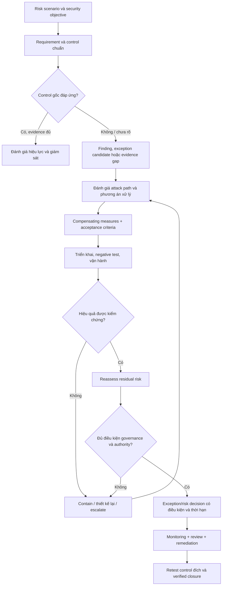
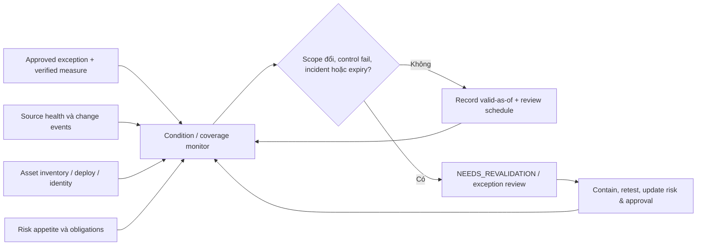

# Compensating measure: thiết kế, kiểm chứng và quản lý biện pháp bù trừ trong ngoại lệ bảo mật

## 1. Compensating measure là gì?

**Compensating measure** (biện pháp bù trừ) là một hành động, cơ chế kiểm soát hoặc tập hợp biện pháp được sử dụng để **giảm rủi ro khi control chuẩn hoặc yêu cầu bảo mật chưa thể được đáp ứng đầy đủ theo cách dự kiến**. Biện pháp đó có thể mang tính kỹ thuật, quy trình, tổ chức hoặc vận hành; phải gắn với một **risk scenario** và security objective cụ thể, chứ không chỉ là một hoạt động “có vẻ liên quan tới bảo mật”.

Trong chương **Exception management** của module **SECURITY_SECURITY_ASSURANCE**, compensating measure giúp tổ chức trả lời câu hỏi: nếu tồn tại ngoại lệ với security policy, standard hoặc baseline, **cơ sở nào cho thấy rủi ro đã được giảm tới mức có thể xem xét**, ai chịu trách nhiệm và bằng chứng nào chứng minh biện pháp đang thực sự vận hành?

Ví dụ: một hệ thống legacy có giao diện quản trị chưa hỗ trợ xác thực đa yếu tố (MFA) tại ứng dụng. Thay vì mở quyền trực tiếp từ Internet, tổ chức có thể yêu cầu truy cập qua một cổng nhận dạng với xác thực mạnh, giới hạn mạng, quyền theo vai trò, phiên làm việc được giám sát và quy trình thu hồi truy cập. Đây là một **phương án bù trừ cần được kiểm thử**: nếu admin vẫn có thể truy cập trực tiếp qua địa chỉ nội bộ, API hoặc tài khoản dịch vụ để bỏ qua cổng, thì biện pháp chưa giải quyết đầy đủ đường tấn công.

**Điểm cốt lõi:** một biện pháp bù trừ có thể làm giảm likelihood, impact hoặc khoảng thời gian phơi nhiễm, nhưng **không tự biến yêu cầu gốc thành đã tuân thủ**, không tự khắc phục root cause và không tự cho phép tiếp tục vận hành. Ngoại lệ, risk acceptance và verified remediation là các quyết định/trạng thái khác nhau.

### Kết quả học tập

Sau bài này, người học có thể:

1. Phân biệt compensating measure với control gốc, mitigation, containment, exception, risk acceptance và remediation.
2. Chọn biện pháp bù trừ theo risk scenario, security objective, trust boundary và attack path.
3. Phân tích các thành phần preventive, detective, corrective; xác định giới hạn và phụ thuộc chung.
4. Thiết kế acceptance criteria, negative tests, operational tests và evidence để chứng minh hiệu quả.
5. Đánh giá residual risk sau khi biện pháp đã được triển khai/kiểm chứng thay vì chỉ có kế hoạch.
6. Xây decision record về ngoại lệ có owner, scope, hạn, điều kiện, monitoring và trigger tái đánh giá.
7. Trình bày assurance claim có giới hạn, không ghi nhận biện pháp chưa kiểm chứng là `CONTROL_PASSED`.
8. Thiết kế dashboard và test matrix giúp phát hiện biện pháp bù trừ hết hạn, bị bypass hoặc mất nguồn quan sát.

## 2. Đặt biện pháp bù trừ đúng chỗ trong vòng đời assurance

Một chương trình security assurance xây dựng lập luận từ **rủi ro → security objective → security requirement → control → test/evidence → conclusion → remediation**. Compensating measure được đề xuất khi một phần chuỗi này có **khoảng trống**, chẳng hạn không triển khai kịp control gốc hoặc khả năng đáp ứng chưa đạt.



Đây là mô hình tư duy, không bắt buộc mọi finding phải đi qua ngoại lệ. Một lỗ hổng có thể được sửa ngay mà không cần compensating measure; một tình huống đang bị khai thác có thể cần containment tức thì theo incident response trước bất kỳ quy trình phê duyệt thông thường nào.

### 2.1. Năm trạng thái khác nhau

| Trạng thái | Có ý nghĩa gì? | Không được suy ra điều gì? |
| --- | --- | --- |
| `PRIMARY_CONTROL_FAILED` | Control bắt buộc chưa đạt tiêu chí được kiểm tra | Chưa kết luận các biện pháp khác đều thất bại |
| `COMPENSATING_MEASURE_PROPOSED` | Đã có giải pháp bù trừ dự kiến | Không chứng minh giải pháp đã được triển khai |
| `COMPENSATING_MEASURE_VERIFIED` | Biện pháp đạt các test đã định trong phạm vi và kỳ | Không chứng minh rủi ro bằng 0 hoặc control gốc đã đạt |
| `EXCEPTION_APPROVED` | Được cho phép sai khác với requirement theo điều kiện/quyền hạn | Không biến sai lệch thành compliant theo yêu cầu gốc |
| `REMEDIATION_VERIFIED` | Root cause/điều kiện phát hiện đã được xử lý theo tiêu chí đóng | Không tự xóa lịch sử ngoại lệ hoặc risk decision |

Trường hợp control gốc chưa đạt và biện pháp bù trừ đã kiểm chứng, báo cáo nên thể hiện **cả hai sự thật**. Không đổi `PRIMARY_CONTROL_FAILED` thành `PASS` chỉ vì ngoại lệ đang còn hiệu lực.

## 3. Phân biệt compensating measure, compensating control và các phương án khác

Thuật ngữ **compensating measure** có thể bao gồm một hoặc nhiều **compensating controls**. Trong nhiều tổ chức, hai cách gọi được dùng gần nhau; cần thống nhất định nghĩa trong chính sách.

| Khái niệm | Câu hỏi | Ví dụ |
| --- | --- | --- |
| **Primary/baseline control** | Biện pháp dự kiến để đáp ứng yêu cầu là gì? | MFA trực tiếp cho privileged login |
| **Compensating control** | Control khác giảm rủi ro tương ứng như thế nào? | Identity-aware proxy yêu cầu MFA, chống truy cập trực tiếp |
| **Compensating measure** | Tập hành động thay thế có thể gồm nhiều controls/quy trình nào? | Proxy + network restriction + session audit + JIT access |
| **Mitigation** | Điều gì làm giảm khả năng hoặc hậu quả? | Thu hẹp token scope, network isolation |
| **Containment** | Hành động ngăn rủi ro/sự cố lan rộng ngay lúc này? | Tắt endpoint bị lạm dụng, thu hồi credential |
| **Remediation** | Điều gì loại bỏ hoặc khắc phục root cause? | Nâng cấp ứng dụng hỗ trợ MFA và sửa luồng auth |
| **Exception/waiver** | Ai cho phép sai khác với requirement gốc, trong phạm vi nào? | Quyết định có thời hạn cho hệ thống legacy |
| **Risk acceptance** | Ai chịu trách nhiệm với phần rủi ro vẫn còn? | Risk owner chấp thuận vận hành có điều kiện tới hạn |
| **Risk avoidance** | Có thể ngừng hoạt động tạo ra rủi ro không? | Không bật tính năng export trước khi đạt authorization |
| **Risk transfer/share** | Có thể phân chia hậu quả hoặc trách nhiệm nào? | Hợp đồng/bảo hiểm, vẫn còn phần rủi ro bên sử dụng phải quản lý |

Không phải mọi compensating measure đều là **“tương đương hoàn toàn”** với control gốc. Một WAF rule giảm một đường khai thác chưa chắc thay thế kiểm tra authorization phía server; log và alert không ngăn dữ liệu bị tiết lộ ngay lần truy cập đầu tiên.

**Ngoại lệ không phải là biện pháp bù trừ.** Ngoại lệ là một quyết định quản trị; biện pháp bù trừ phải thực sự thay đổi rủi ro có thể xảy ra.

## 4. Bắt đầu từ mục tiêu bảo mật và đường tấn công

Đừng bắt đầu bằng câu “chúng tôi có WAF, logging và VPN nên đủ”. Trước tiên phải xác định **yêu cầu nào không được đáp ứng, vì sao yêu cầu đó tồn tại và attacker có thể gây hại theo đường nào**.

### 4.1. Risk scenario có cấu trúc

Một risk scenario nên mô tả:

- **Asset:** dữ liệu, nghiệp vụ, tài khoản, hệ thống hoặc service nào cần bảo vệ?
- **Security objective:** confidentiality, integrity, availability hoặc mục tiêu khác?
- **Threat actor/event:** ai hoặc điều gì có thể khởi phát sự cố?
- **Weakness:** thiếu control nào và nó tạo điều kiện gì?
- **Attack/failure path:** qua entry point, trust boundary, actor/identity và dependency nào?
- **Consequences:** mất dữ liệu, gian lận, gián đoạn dịch vụ, lạm dụng đặc quyền, ảnh hưởng nhiều tenant?
- **Exposure:** có public-facing không, có quyền lớn không, có khai thác thực tế không?
- **Existing controls:** đã triển khai và kiểm chứng những gì?
- **Unknowns:** điều nào chưa đo được hoặc source telemetry nào chưa đầy đủ?

Ví dụ:

> “Kẻ tấn công có được access token của `invoice-export-worker` có thể gọi API đọc metadata của nhiều tenant vì token hiện có scope rộng hơn nhiệm vụ. Nếu token bị lộ, dữ liệu hóa đơn có nguy cơ bị truy cập trái thẩm quyền. Chưa xác định toàn bộ endpoint hỗ trợ token này và chưa kiểm chứng đường đọc dữ liệu qua batch job.”

Một biện pháp chỉ giảm truy cập từ Internet nhưng token cũng được sử dụng trong mạng nội bộ **chưa xử lý hết risk scenario**. Cần kiểm tra cả những đường không đi qua cổng Internet.

### 4.2. Mapping theo attack path

| Điểm trong đường tấn công | Control gốc bị thiếu | Biện pháp bù trừ có thể cân nhắc |
| --- | --- | --- |
| Lộ credential | Không có short-lived identity/rotation | Giảm tuổi token, rotate, vault, phát hiện sử dụng bất thường |
| Sử dụng từ nguồn ngoài | Không có trusted network boundary | Restrict ingress/egress và workload identity |
| Gọi API vượt nhiệm vụ | Scope token quá rộng | Gateway allowlist và resource-level authorization ở lớp bổ sung |
| Đọc chéo tenant | Thiếu ownership check phía server | Chặn chức năng nhạy cảm; đặt server-side policy enforcement mới; negative tests |
| Phát hiện truy cập sai | Logging/monitoring yếu | Audit end-to-end, alert và response |
| Rò rỉ dữ liệu đã xảy ra | Không có cách hoàn tác | Incident response, containment, điều tra và nghĩa vụ thông báo phù hợp |

**Các lớp có tác dụng khác nhau.** Tăng detection sau khi dữ liệu đã lộ không nhất thiết đủ để bù cho việc thiếu phòng ngừa ở ranh giới tenant. Nếu rủi ro quá cao hoặc hậu quả không thể phục hồi, **tắt/cô lập chức năng có thể là phương án phù hợp hơn việc chấp nhận ngoại lệ**.

## 5. Tiêu chí đánh giá một biện pháp bù trừ

Biện pháp được đề xuất nên qua một rubric rõ ràng:

| Tiêu chí | Câu hỏi đánh giá | Evidence dự kiến |
| --- | --- | --- |
| **Objective alignment** | Giảm đúng nguy cơ mà requirement gốc nhằm kiểm soát? | Risk-to-control mapping, threat model |
| **Scope coverage** | Bao phủ đúng assets, identities, tenants, regions và pathways? | Inventory, config, route analysis |
| **Preventive effectiveness** | Chặn được hành vi cần ngăn trước hậu quả? | Negative access/control tests |
| **Detective capability** | Phát hiện được hành vi hoặc thất bại trọng yếu? | Synthetic events, alert delivery tests |
| **Corrective readiness** | Có thể containment/restore/revoke nhanh và an toàn? | Runbook/tabletop, restore/revocation test |
| **Resistance to bypass** | Có route, API, direct access, fallback hoặc break-glass bypass? | Abuse-case testing, attack-path review |
| **Independence** | Có phụ thuộc cùng hệ thống đang lỗi không? | Dependency graph, trust-boundary analysis |
| **Operational reliability** | Ai duy trì, monitor, phản ứng ngoài giờ và xử lý lỗi? | Owner, coverage, on-call, health metrics |
| **Measurability** | Có expected result, test frequency, failure signal? | Test plan, acceptance thresholds |
| **Time bound** | Áp dụng đến khi nào, trigger nào làm mất hiệu lực? | Exception record, effective/expiry, change triggers |
| **Residual risk** | Phần rủi ro nào vẫn còn và có nằm trong ngưỡng? | Reassessment, risk owner decision |
| **Auditability** | Reviewer khác có kiểm tra lại nguồn và quyết định được? | Evidence IDs, approvals, versions |

### 5.1. Biện pháp “có vẻ mạnh” nhưng không giải quyết đúng mục tiêu

- **Mã hóa lưu trữ** không sửa lỗi authorization khiến API trả plaintext cho tenant trái quyền.
- **WAF** không mặc nhiên chặn mọi lỗi logic nghiệp vụ hoặc IDOR/BOLA, nhất là đường nội bộ.
- **SIEM alert** không chặn một lệnh chuyển tiền gian lận đã thành công.
- **Backup thành công** không chứng minh phục hồi được với key hiện có hoặc dữ liệu vẫn toàn vẹn.
- **SAST PASS** không chứng minh policy đang được thực thi trên phiên bản production.
- **Báo cáo SOC 2 của vendor** không tự chứng minh tính năng mới, account/region mới hoặc trách nhiệm khách hàng đã đáp ứng.
- **Network segmentation** không nhất thiết bảo vệ trước lạm dụng bởi workload đã nằm trong vùng tin cậy.

Một biện pháp chỉ có giá trị khi có **argument và evidence** liên hệ trực tiếp với risk scenario.

## 6. Phân tầng preventive, detective và corrective

Biện pháp bù trừ vững thường không phải một control đơn lẻ. Nên kết hợp các lớp phù hợp với nguy cơ:

| Lớp | Mục tiêu | Ví dụ | Giới hạn cần công bố |
| --- | --- | --- | --- |
| **Preventive** | Giảm cơ hội gây hại trước sự kiện | Least privilege, allowlist, JIT access, segmentation | Có thể bị bypass nếu enforcement không bao phủ mọi route |
| **Detective** | Phát hiện hành vi/rủi ro hoặc control failure | Audit event, anomaly detection, drift alert | Có độ trễ, false negatives, dependency nguồn |
| **Corrective** | Hạn chế hậu quả và khôi phục | Token revocation, feature disable, restore, rollback | Không thể hoàn tác dữ liệu đã bị tiết lộ |
| **Administrative** | Bảo đảm trách nhiệm và giới hạn vận hành | Review thủ công, approval, đào tạo, runbook | Phụ thuộc con người, lịch trực, tính nhất quán |
| **Assurance/verification** | Chứng minh các lớp trên đang hoạt động | Negative tests, log-health tests, restore drill | Chỉ đúng với scope, version và thời điểm kiểm tra |

Có thể dùng thiết kế **defense in depth**, nhưng không nên cộng cơ học “3 lớp bù trừ = an toàn”. Nếu tất cả lớp phụ thuộc vào cùng IdP, proxy, service token hoặc collector, một lỗi chung có thể làm cả ba mất tác dụng.

### 6.1. Common-mode failure

Ví dụ: hệ thống legacy bắt buộc đi qua proxy có MFA, nhưng cả monitoring và chức năng chặn truy cập trực tiếp đều lấy cùng danh sách host từ một inventory lỗi. Khi một host mới không được ghi vào inventory, proxy policy, network rule và audit test có thể cùng bỏ sót nó.

Một chương trình assurance tốt đặt câu hỏi: **những giả định chung nào khiến cả các control bù trừ cùng thất bại?** Có thể cần thêm nguồn inventory độc lập, test truy cập trực tiếp từ network phù hợp và cơ chế phát hiện workload mới.

## 7. Chọn biện pháp nào: sửa gốc, giảm thiểu, cô lập hay chấp nhận?

Không phải mọi ngoại lệ đều cần cùng loại giải pháp. Hãy đánh giá phương án theo tiêu chí bảo mật và nghiệp vụ.

| Phương án | Khi nào nên xem xét | Điều phải xác minh |
| --- | --- | --- |
| **Remediation ngay** | Lỗi có đường khai thác rõ, fix khả thi và ít ảnh hưởng | Đúng root cause, scope và retest |
| **Temporary hardening** | Có thể giảm attack path nhanh trước fix dài hạn | Effective state, bypass tests, monitor |
| **Restrict use** | Chỉ một nhóm user/tenant cần chức năng rủi ro | Enforcement của phạm vi được phép |
| **Disable feature** | Hậu quả khai thác vượt ngưỡng hoặc chưa hiểu rủi ro | API, worker, queue, cache và đường phụ cũng đã tắt |
| **Isolation / segmentation** | Lỗi cần giảm khả năng truy cập tới service | Network identity/path, test từ các vùng liên quan |
| **Vendor coordination** | Control thuộc trách nhiệm bên thứ ba | Cam kết, evidence, milestone và escalation |
| **Compensating controls + exception** | Control gốc chưa thể triển khai, residual risk được đánh giá | Approval, thời hạn, điều kiện, test/monitor |
| **Do not proceed** | Không thể giảm rủi ro/không đủ thông tin hoặc trái hard stop | Quyết định từ chối, phương án containment |

**Chi phí và độ khó sửa lỗi là đầu vào của lựa chọn, không phải bằng chứng giảm rủi ro.** “Nâng cấp trong quý sau sẽ đắt” không chứng minh rủi ro hiện tại an toàn.

### 7.1. Sự khác biệt giữa tạm thời và chiến lược lâu dài

Một biện pháp bù trừ có thể được duy trì nhiều kỳ nếu phù hợp governance và rủi ro, nhưng mỗi lần gia hạn cần đánh giá lại. Không mặc định mọi biện pháp bù trừ chỉ hữu dụng trong vài ngày; cũng không mặc định được giữ vô hạn. Quyết định phụ thuộc requirement, risk appetite, nghĩa vụ áp dụng, thay đổi hệ thống và hiệu quả đã được kiểm chứng.

## 8. Các ví dụ theo lĩnh vực security assurance

### 8.1. Identity assurance và privileged access

**Khoảng trống:** giao diện quản trị legacy chưa hỗ trợ MFA trực tiếp.

**Biện pháp có thể cân nhắc:** identity-aware gateway yêu cầu MFA, chỉ cấp truy cập qua hardened jump host, chặn direct port, just-in-time role, audit session và review break-glass.

**Không được kết luận sớm:** “Ứng dụng đã có MFA” nếu còn API, CLI, service port hoặc private hostname bypass. Cần test toàn bộ đường vào theo inventory; IdP policy và proxy logs phải khớp với traffic thực tế.

### 8.2. Access control và phân tách tenant

**Khoảng trống:** authorization tại một API chưa kiểm tra resource ownership.

**Biện pháp có thể cân nhắc:** vô hiệu hóa endpoint, thêm enforcement ở gateway/middleware với tenant binding tin cậy và từ chối theo tài nguyên, thu hẹp service identity và kiểm tra mọi side effect.

**Không thể chỉ dùng:** tăng logging, geoblocking hoặc rate limit để thay server-side ownership check nếu kẻ tấn công vẫn có thể đọc dữ liệu chéo tenant. Có thể yêu cầu sửa gốc trước khi tiếp tục, tùy mức hậu quả/khai thác.

### 8.3. Data protection và key management

**Khoảng trống:** dữ liệu nhạy cảm legacy chưa đáp ứng yêu cầu mã hóa lưu trữ theo cách chuẩn.

**Biện pháp có thể cân nhắc:** mã hóa ở lớp volume/database, cô lập storage và host, hạn chế quyền đọc plaintext, bảo vệ khóa/KMS, giám sát key use và giảm retention dữ liệu. Cần phân tích nơi plaintext vẫn tồn tại trong memory, logs, exports, backups và nơi khóa có thể bị truy cập.

**Không được đánh đồng:** volume encryption với field-level encryption hoặc end-to-end encryption. Chỉ chấp nhận nếu mục tiêu rủi ro cụ thể được giảm đủ và policy cho phép biện pháp thay thế.

### 8.4. Secure development và vulnerability management

**Khoảng trống:** chưa thể nâng cấp dependency có lỗ hổng vì incompatibility.

**Biện pháp có thể cân nhắc:** tắt vulnerable feature, block attack vector, thu hẹp network exposure, process isolation, sandboxing, tăng alert và tập trung vào hotfix. Phải xác nhận vulnerable code path có còn reachable, cấu hình workaround có hoạt động trên build đang chạy không.

**Không nên tin tuyệt đối:** “WAF virtual patching” sẽ xử lý mọi payload hoặc đường nội bộ. Phải có negative tests và phân tích đường bypass, không chỉ báo rule enabled.

### 8.5. Security logging và detection

**Khoảng trống:** ứng dụng chưa phát đủ audit event cho một hành động đặc quyền.

**Biện pháp có thể cân nhắc:** collect ở API gateway, IdP, database audit hoặc OS/runtime cho các hành động tương ứng, correlate actor/tenant/resource và bảo vệ integrity/retention. Phải kiểm tra **đủ nguồn, ngữ nghĩa sự kiện, hiệu quả correlation và khả năng phát hiện khi một nguồn mất**.

**Giới hạn:** một lớp log thay thế có thể không biết hành động logic bên trong ứng dụng. Nếu requirement cần phân biệt thao tác như “export hóa đơn”, HTTP access log đơn thuần có thể không đủ.

### 8.6. Backup, recovery và availability

**Khoảng trống:** chưa đạt kiến trúc DR mục tiêu hoặc không thể khôi phục trong thời hạn đã duyệt.

**Biện pháp có thể cân nhắc:** giới hạn tính năng không thiết yếu, tăng khả năng backup độc lập, kiểm thử restore định kỳ, chuẩn bị manual workaround và failover plan, giảm dependency một vùng. Tuy nhiên backup success không tự chứng minh RTO/RPO; cần DR drill, integrity checks, quyền truy cập và khả năng giải mã dữ liệu sau recovery.

### 8.7. Third-party assurance

**Khoảng trống:** vendor không cung cấp đủ một loại audit evidence theo security addendum.

**Biện pháp có thể cân nhắc:** đánh giá trực tiếp có kiểm soát, audit report khác đúng phạm vi, technical integration restrictions, giảm dữ liệu/credential chia sẻ, tăng giám sát phía khách hàng, contract remediation milestone.

**Giới hạn:** bằng chứng thay thế của vendor có thể chỉ giải quyết **assurance gap**, chưa chắc giảm rủi ro kỹ thuật. Phải phân biệt “đã có bằng chứng tốt hơn” với “control đã được tăng cường”.

## 9. Thiết kế acceptance criteria trước khi triển khai

Một compensating measure nên có **testable acceptance criteria** ngay khi được đề xuất, thay vì gắn kết luận sau khi thực hiện một số công việc.

| Thành phần | Câu hỏi cần trả lời |
| --- | --- |
| **Requirement/claim** | Chính xác yêu cầu gốc và security objective là gì? |
| **Measure design** | Cơ chế nào chặn, phát hiện hoặc giảm hậu quả? |
| **Coverage** | Tất cả API, ports, identity types, tenants, regions hay subset nào? |
| **Trigger** | Khi nào control thực thi? Mỗi request, session, change hay theo lịch? |
| **Expected outcome** | Đường truy cập nào phải bị deny; event nào phải alert? |
| **Failure behavior** | Khi proxy/IdP/collector lỗi, chặn, giảm chức năng hay cảnh báo? |
| **Time** | Thời điểm test, thời hạn re-test, thời gian cảnh báo/phản ứng? |
| **Evidence** | Test result, config, logs, deployment, owner, version nào? |
| **Exceptions** | Break-glass được kiểm soát thế nào? Có thử bypass? |
| **Residual gap** | Điều gì biện pháp không giải quyết được và ai chấp nhận? |

### 9.1. Ví dụ viết tiêu chí rõ ràng

**Câu yếu:** “Truy cập legacy admin được bảo vệ bởi VPN và monitoring.”

**Tiêu chí có thể kiểm tra hơn:**

> “Trong environment production thuộc inventory phiên bản I, mọi tương tác privileged với giao diện quản trị L phải được định tuyến qua gateway P có xác thực mạnh, với identity gắn được vào user, role và session. Các đường truy cập trực tiếp từ những network zone đã định nghĩa và các tài khoản không đủ điều kiện phải bị từ chối. Truy cập hợp lệ và bị từ chối phải tạo audit event có khả năng tra cứu, đồng thời hệ thống cảnh báo khi gateway hoặc audit pipeline mất coverage. Các ngoại lệ break-glass chỉ được thực hiện qua workflow được phê duyệt và hậu kiểm.”

Tiêu chí cần được điều chỉnh cho sản phẩm thật: không phải mọi hệ thống có thể đi qua cùng một gateway, và **network zones cụ thể phải nằm trong test plan**. Khi không thể test một đường, ghi `NOT_TESTED`, không suy nó đạt.

## 10. Thiết kế phép thử cho compensating measure

Phép thử phải kiểm tra cả **hành vi mong muốn**, **hành vi cần từ chối** và **lỗi của chính biện pháp**.

### 10.1. Positive testing

- User được cấp quyền đúng vẫn truy cập được phần việc được phép.
- Service identity hợp lệ sử dụng đúng API scope vẫn vận hành.
- Gateway/proxy áp dụng policy và gắn identity đúng actor.
- Backup/restore hoặc runbook dự phòng vẫn xử lý được yêu cầu nghiệp vụ trong kịch bản cho phép.
- Event cần giám sát đi qua collector, rule và kênh tiếp nhận.

Positive test kiểm tra tính khả dụng nhưng **không đủ** chứng minh khả năng ngăn truy cập trái phép.

### 10.2. Negative/abuse-case testing

- User không có role gọi privileged endpoint phải bị từ chối.
- Actor của tenant A thử resource tenant B qua GET, batch, export, indirect lookup và background job trong scope.
- Truy cập direct host/port bypass proxy phải thất bại.
- Token đã revoke hoặc hết hạn không còn truy cập được.
- Break-glass không có approval hoặc ngoài window phải bị deny/alert theo quy trình.
- Tắt collector hoặc làm rule không khớp để xác nhận health alert thay vì dashboard vẫn xanh.
- Một service account ở vùng mạng được tin cậy vẫn không thể vượt quyền data plane.
- Rule virtual patching phải được thử với payload/phương án encode hoặc route phù hợp threat model.

Mọi test cần authorization, phạm vi và dữ liệu phù hợp; dùng dữ liệu giả hoặc môi trường test kiểm soát, tránh thử gây rò rỉ hoặc gián đoạn production không được phê duyệt.

### 10.3. Reliability và fail-safe behavior

Biện pháp bù trừ có thể trở thành **single point of failure**. Ví dụ identity proxy mất kết nối với IdP: hệ thống fail-open cho mọi admin hay fail-closed làm dừng vận hành? Phải phân tích tác động availability và rủi ro confidentiality/integrity. Không có câu trả lời đúng chung cho mọi dịch vụ; **behavior phải được xác định, kiểm thử và có phương án khẩn cấp**.

### 10.4. Truy vết test evidence

Một test có chất lượng nên ghi:

- `test_id`, `test_case_version`, `control_id`, `finding_id`, `measure_id`.
- Environment, resource/endpoint IDs, actor/tenant type, network zone.
- Build digest/config version, policy/rule revision và trạng thái rollout.
- Expected và actual result, cả response body, side effects và log khi cần.
- Test run time, operator/automation identity, artifact refs.
- Scope, skipped cases, data quality, limitations và retest trigger.

Chỉ ảnh chụp “PASS 20/20” không đủ cho một assurance claim nếu không biết **20 test đó bao phủ những đường nào**.

## 11. Bằng chứng triển khai và bằng chứng hiệu lực vận hành

Cần phân biệt **có cấu hình**, **đã triển khai** và **đang vận hành hiệu quả**.

| Lớp kiểm tra | Evidence điển hình | Không được kết luận quá mức |
| --- | --- | --- |
| **Design** | Threat model, diagram, policy, acceptance criteria | Chưa chứng minh control được bật |
| **Implementation** | IaC state, production config, image digest, gateway bindings | Chưa chứng minh không bị bypass |
| **Functional effectiveness** | Positive/negative tests, forced failure, test traces | Chỉ theo test scope và thời điểm |
| **Operational effectiveness** | Event logs theo kỳ, config drift checks, access review, on-call test | Cần coverage, thời kỳ, sự kiện missing |
| **Independent assessment** | Reviewer/pentest/audit có scope rõ | Không bao phủ tất cả các đường tấn công chưa biết |
| **Remediation closure** | Evidence fix gốc trên runtime và retest | Không tự xóa lịch sử exception |
| **Risk governance** | Approval, residual risk assessment, expiry, legal/policy review | Không tự biến control thành compliant |

### 11.1. Evidence freshness

Một cấu hình gateway được chụp lúc 09:00 có thể lỗi thời khi 09:15 có route mới được thêm và bypass gateway. Cần xem `observed_at`, `collected_at`, `test_run_at`, `period_end` cùng **change triggers**, không dùng ngày upload file làm freshness duy nhất.

Một chứng nhận hoặc báo cáo audit của vendor mới phát hành có thể chỉ bao phủ giai đoạn trước khi vendor thay đổi sản phẩm. Phải kiểm tra **pháp nhân, sản phẩm, môi trường, kỳ báo cáo và exclusions**.

### 11.2. Provenance, integrity và quyền truy cập

Evidence thường chứa policy nội bộ, danh tính account, endpoints, cấu hình và kết quả kiểm thử. Không lưu token/private key hay dữ liệu cá nhân thô trong ticket phổ biến. Dùng kho đã kiểm soát quyền, có audit/versioning/retention; giữ ID tham chiếu và bản trích xuất đã redacted khi cần.

Hash có thể hỗ trợ kiểm tra artifact không bị thay đổi sau mốc lưu trữ, nhưng **không tự chứng minh nguồn đáng tin hoặc nội dung đúng**. Nếu collector bị xâm nhập, cần nguồn đối chứng hoặc kiểm tra trust boundary.

## 12. Đánh giá residual risk sau khi triển khai biện pháp

Một compensating measure chỉ có thể được dùng làm cơ sở đánh giá **rủi ro hiện tại** khi đã triển khai và có evidence đáng tin. Nếu mới đề xuất, chỉ nên gọi là **projected residual risk**.

| Mốc đánh giá | Điều kiện | Ý nghĩa |
| --- | --- | --- |
| `INHERENT` | Xem kịch bản trước các control được tính | Mức nguy cơ làm căn cứ |
| `CURRENT_BEFORE_MEASURE` | Tính những controls đã có và đã xác minh | Rủi ro hiện tại trước bù trừ |
| `PROJECTED_AFTER_MEASURE` | Chưa test, mới có thiết kế/kỳ vọng | Không được coi như trạng thái thực |
| `VERIFIED_AFTER_MEASURE` | Có test đúng scope, vận hành và giới hạn | Cơ sở xem xét residual risk sau bù trừ |
| `AFTER_PRIMARY_REMEDIATION` | Đã sửa gốc và retest | Mức mới có thể khác, cần đánh giá lại |

### 12.1. Rubric điểm minh họa

Giả sử nội bộ dùng thang likelihood `1–5`, impact `1–5`, và điểm tương đối `L × I`:

| Bối cảnh | Likelihood | Impact | Điểm |
| --- | ---: | ---: | ---: |
| API token quá rộng, trước biện pháp mới | 4 | 4 | 16 |
| Dự kiến có short-lived token + allowlist, chưa test | 2 (dự kiến) | 4 | 8 (dự kiến) |
| Negative tests, runtime policy và alert đã kiểm chứng | 2 (theo đánh giá) | 4 | 8 (theo đánh giá) |
| Sau sửa scope token ở root cause | Cần đánh giá lại | Cần đánh giá lại | Không tự điền trước |

**Điểm số là thang xếp hạng tương đối, không phải xác suất tổn thất.** Việc điều chỉnh likelihood từ 4 xuống 2 phải có lập luận về attack path, tính tin cậy và hiệu quả thực nghiệm. Không mặc định một control reduce likelihood theo đúng một bậc cố định.

Nếu test phát hiện bypass, nguồn alert mất hoặc một endpoint chưa kiểm kê, **không được dùng điểm 8 đã dự kiến** để khẳng định đạt risk appetite. Cần ghi uncertainty và mở finding/đánh giá lại.

### 12.2. Phân tích rủi ro hệ thống và dependencies

Có thể có ba exceptions liên quan cùng `legacy-admin-proxy`. Mỗi hồ sơ nhìn riêng có vẻ low/medium, nhưng proxy lỗi sẽ làm nhiều service mất bảo vệ cùng lúc. Đánh giá residual risk phải xem **cumulative exposure, shared identity, common network zones, privileged accounts và blast radius**.

Một tiêu chí chấp nhận tốt cần xem xét cả risk appetite theo **loại hậu quả**, không chỉ điểm số: rủi ro safety, dữ liệu cá nhân, ảnh hưởng hệ thống thanh toán hoặc nghĩa vụ bắt buộc có thể đặt giới hạn chặt hơn.

## 13. Quy trình quản lý ngoại lệ với compensating measure

Compensating measure không tự thay thế **exception management workflow**. Hồ sơ ngoại lệ hợp lệ phải có đề xuất, review, approval, vận hành và chấm dứt.

### 13.1. Bước 1 — Yêu cầu ngoại lệ

Người đề xuất mô tả requirement/baseline chưa đáp ứng, bằng chứng finding, tài sản, nguyên nhân, kế hoạch sửa và phương án bù trừ. Không dùng câu “không thể triển khai control vì hạn release” mà không có risk assessment.

### 13.2. Bước 2 — Thiết kế và kiểm tra

Control owner và technical owner thiết kế measure có phạm vi, owner, test acceptance và failure behavior. Security reviewer đánh giá threat coverage, kiểm tra đường bypass, monitoring và chất lượng nguồn.

### 13.3. Bước 3 — Risk, policy và legal review

Risk owner nhận đánh giá rủi ro tồn dư và các phương án thay thế. Policy owner xác định exception có nằm trong phạm vi cho phép. Legal/privacy/compliance phải xem các nghĩa vụ không thể miễn trừ khi liên quan. Nếu tình huống đang có exploitation hoặc ảnh hưởng khách hàng, phải xử lý incident response/containment theo quy trình; không chờ phê duyệt ngoại lệ để hành động an toàn.

### 13.4. Bước 4 — Phê duyệt có thẩm quyền

Chỉ phê duyệt khi **có căn cứ** về hiệu quả measure và residual risk phù hợp policy. Quyết định phải gắn giới hạn, mốc hiệu lực/hết hạn, những điều kiện bắt buộc, reviewer, monitoring và hành động khi vi phạm.

### 13.5. Bước 5 — Vận hành và đánh giá lại

Sau approval, theo dõi source health, config drift, scope, findings liên quan, incident indicators và milestone remediation. Tái đánh giá nếu có thay đổi material dù chưa hết hạn.

### 13.6. Bước 6 — Kết thúc có bằng chứng

Khi primary control được triển khai đúng yêu cầu và retest đạt, đóng finding theo quy tắc, kết thúc ngoại lệ và **cân nhắc gỡ measure tạm mà không tạo regression**. Nếu vẫn cần measure để tăng defense in depth, ghi nó thành control vận hành thường xuyên với owner và maintenance rõ ràng; không giữ exception khi requirement gốc đã đáp ứng.

## 14. Ma trận trách nhiệm

| Công việc | Business/risk owner | Technical/control owner | Security assurance | Policy/legal chức năng liên quan | SecOps |
| --- | --- | --- | --- | --- | --- |
| Xác định hậu quả và ưu tiên | **Accountable** theo thẩm quyền | Cung cấp kiến trúc | Tư vấn rủi ro | Review nghĩa vụ cần thiết | Cung cấp tình hình threat/incident |
| Thiết kế compensating measure | Quyết định giới hạn nghiệp vụ | **Responsible** về thiết kế/triển khai | Review testability và mục tiêu | Kiểm tra phù hợp yêu cầu | Review giám sát/vận hành |
| Kiểm chứng hiệu lực | Nhận giới hạn | Cung cấp test/config | **Đánh giá độc lập phù hợp** | Review khi cần | Test detection/on-call |
| Phê duyệt exception | **Người có quyền theo policy** | Không tự duyệt rủi ro lớn của mình | Ý kiến chuyên môn | Kiểm tra quyền và nghĩa vụ | Tham vấn |
| Theo dõi hàng ngày | Nhận báo cáo rủi ro | Kiểm tra drift/health | Review evidence freshness | Theo yêu cầu | **Phát hiện và escalation** |
| Remediate và đóng | Phê duyệt tác động nghiệp vụ | **Triển khai fix** | **Xác minh retest** | Xác định kết thúc ngoại lệ đúng quy trình | Bảo đảm log/monitoring |

**Vai trò thực tế phụ thuộc tổ chức.** Tránh một người tự đề xuất, tự xác nhận hiệu quả, tự phê duyệt ngoại lệ rủi ro cao và tự đóng finding nếu có thể phân tách. Quan trọng nhất là ai **chịu trách nhiệm kết quả và có quyền hành động**, không chỉ tên trong bảng RACI.

## 15. Hồ sơ compensating measure và mapping evidence

Một hệ thống nên quản lý **biện pháp** độc lập với **ngoại lệ**, vì một ngoại lệ có thể yêu cầu nhiều measures và một measure có thể bảo vệ nhiều assets. Dùng ID liên kết để tránh sao chép kết quả PASS sang sai phạm vi.

| Trường | Mục đích |
| --- | --- |
| `measure_id`, `version` | Định danh và quản lý phiên bản |
| `requirement_id`, `control_id` | Control gốc/điều khoản cần bù trừ |
| `finding_id`, `risk_id`, `exception_id` | Liên kết vấn đề, rủi ro và quyết định |
| `security_objective`, `threat_scenario` | Vì sao measure có thể giảm rủi ro |
| `service`, `environment`, `assets`, `identities` | Scope chính xác |
| `design`, `enforcement_point`, `dependencies` | Cơ chế và trust boundaries |
| `acceptance_criteria`, `test_ids` | Khi nào được xem là hoạt động |
| `evidence_refs`, `observed_at`, `reviewed_at` | Nguồn, thời gian và review |
| `primary_control_status` | Requirement gốc còn thiếu hay đã đạt |
| `measure_status`, `health` | Proposed, implemented, verified, degraded |
| `residual_risk`, `assumptions`, `uncertainties` | Phần rủi ro còn lại và điều chưa biết |
| `owner`, `monitoring_owner`, `retest_owner` | Ai vận hành/giám sát/kiểm tra |
| `effective_at`, `expires_at`, `next_review_at` | Điều kiện thời gian |
| `invalidation_triggers` | Những thay đổi buộc xem lại |
| `remediation_plan`, `target_fix_at` | Giải pháp sửa gốc và hạn dự kiến |
| `approval_ref`, `decision_status` | Quyết định có thẩm quyền, tách khỏi kết quả test |

### 15.1. Mẫu YAML — chưa phải quyết định có hiệu lực

```yaml
compensating_measure:
  id: CM-LEGACY-ADMIN-006
  version: 1
  status: PENDING_VERIFICATION
  original_requirement:
    id: SEC-IAM-PRIV-MFA
    scope: "Privileged interactive access in production"
    primary_control_status: NOT_MET
  finding:
    id: FIND-LEGACY-IAM-015
    risk_id: RISK-ADMIN-ACCESS-014
  scope:
    service: legacy-admin
    environment: production
    regions: ["region-a"]
    assets: ["legacy-admin-host-01"]
    identities: ["named-human-administrators"]
    excluded_paths:
      - "Service-to-service and background jobs: separate review required"
  threat_scenario:
    attacker_goal: "Unauthorized privileged session using stolen password"
    trust_boundaries:
      - "Untrusted network to management network"
      - "Identity-aware gateway to legacy service"
  design:
    measures:
      - "Gateway with phishing-resistant MFA where supported"
      - "Deny direct management access except reviewed break-glass"
      - "JIT privileged access and session audit"
    dependencies:
      - "IdP"
      - "Gateway routing"
      - "Network segmentation"
      - "Audit pipeline"
    failure_behavior: "Defined in controlled operations runbook"
  acceptance:
    required_tests:
      - T-CM-LOGIN-01
      - T-CM-DIRECT-02
      - T-CM-REVOKED-03
      - T-CM-LOG-HEALTH-04
    expected_coverage: "All inventoried interactive admin paths"
    status: PENDING_TEST
  evidence:
    refs: []
    last_observed_at: null
    reviewed_at: null
  residual_risk:
    assessment_status: PENDING
    uncertainties:
      - "Non-interactive routes need separate coverage evidence"
  exception:
    id: EXC-LEGACY-2026-006
    approval_status: PENDING_APPROVAL
    approved_by: null
    effective_at: null
    expires_at: null
  operations:
    control_owner: legacy_platform_team
    assurance_reviewer: security_assurance_team
    monitoring_owner: security_operations
    next_review_at: null
    invalidation_triggers:
      - "New admin route"
      - "Gateway or IdP outage"
      - "Direct access allowed outside approved path"
      - "Security incident involving admin credentials"
  remediation:
    target: "Native privileged authentication modernization"
    owner: legacy_platform_team
    due_at: "2026-12-31T00:00:00Z"
```

Các ID, tài sản, ngày và control là **dữ liệu minh họa**. Vì `status: PENDING_VERIFICATION`, chưa có evidence refs và exception chưa được phê duyệt, **không thể dùng YAML này như bằng chứng rằng vận hành được phép dựa trên biện pháp bù trừ**.

### 15.2. Khi xác minh đạt vẫn phải giới hạn claim

Một bản test có thể cho thấy proxy chặn truy cập trực tiếp tới `legacy-admin-host-01`. Điều này **không tự chứng minh** các host khác, các tài khoản service hoặc một API được thêm trong tuần sau cũng được bảo vệ. Evidence phải gắn chính xác scope, build, policy version và thời điểm.

## 16. Case study: giao diện quản trị legacy chưa hỗ trợ MFA trực tiếp

### 16.1. Bối cảnh

Một dịch vụ `legacy-admin` quản lý cấu hình cho hệ thống giao dịch. Standard nội bộ yêu cầu tài khoản privileged phải dùng cơ chế xác thực mạnh; nhưng giao diện hiện tại chỉ hỗ trợ password và cần thay đổi kiến trúc để hỗ trợ IdP trực tiếp. Việc nâng cấp được lên kế hoạch theo chu kỳ, business owner muốn giữ chức năng vận hành.

Đội kỹ thuật đề xuất:

1. Tất cả quản trị viên truy cập qua identity-aware gateway dùng MFA.
2. Chặn truy cập trực tiếp từ mạng văn phòng/VPN thông thường, Internet và các segment không được duyệt.
3. Giới hạn admin identities theo allowlist, dùng JIT và session logging.
4. Thiết kế break-glass có phê duyệt, lưu audit, kiểm tra sau sử dụng.
5. Bật health alerts cho IdP, gateway, network rules và audit pipeline.
6. Lập kế hoạch sửa gốc để hệ thống hỗ trợ xác thực và authorization phù hợp.

Đây là **đề xuất**, không phải kết luận tương đương tuyệt đối với MFA trực tiếp.

### 16.2. Thử nghiệm phát hiện lỗ hổng của phương án

Giả sử test từ network production phát hiện cổng quản trị trực tiếp của `legacy-admin-host-01` vẫn mở đối với một subnet ứng dụng. Một tài khoản có password có thể đi thẳng tới dịch vụ mà không qua gateway.

Kết luận kỹ thuật phải là:

> “Compensating gateway đã hỗ trợ MFA trên đường được định tuyến qua gateway; nhưng direct path từ subnet ứng dụng là một bypass đã xác minh. Biện pháp bù trừ chưa đạt tiêu chí bao phủ toàn bộ interactive admin paths và không đủ căn cứ chấp nhận residual risk theo giả định ban đầu.”

Đừng nói “gateway hoạt động nên hệ thống compliant”; một đường bypass trọng yếu có thể làm lập luận phòng ngừa không còn đúng.

### 16.3. Các bước xử lý khả thi

- Xác nhận direct route có nằm trong phạm vi và vì sao còn tồn tại.
- Chặn hoặc giới hạn kết nối trực tiếp theo thay đổi được phê duyệt; xem xét impact để không vô ý làm mất khả năng phục hồi.
- Test từ từng network zone, identity type, endpoint và đường break-glass.
- Kiểm tra audit record gắn được actor, target, session, action và thời gian.
- Kiểm tra khi gateway/IdP/collector mất nguồn: có phát alert, logic từ chối và runbook không?
- Cập nhật threat model và residual risk; chỉ sau đó mới xem xét exception approval.
- Theo dõi change triggers, expiry và milestone nâng cấp native authentication.

### 16.4. Bảng kết quả kiểm chứng minh họa

| Test | Expected | Observed giả định | Trạng thái |
| --- | --- | --- | --- |
| `T-CM-LOGIN-01` | User có MFA và role phù hợp được phép | Session qua gateway thành công, ghi audit | `PASS` trong route đã thử |
| `T-CM-DIRECT-02` | Direct admin port từ subnet ứng dụng bị từ chối | Kết nối trực tiếp thành công | `FAIL` |
| `T-CM-REVOKED-03` | User bị revoke không thể mở session mới | Bị từ chối | `PASS` |
| `T-CM-LOG-HEALTH-04` | Mất nguồn event tạo alert trong thời gian quy định | Chưa thử | `NOT_TESTED` |
| `T-CM-BREAKGLASS-05` | Emergency access phải qua quy trình và hậu kiểm | Workflow đã mô tả, chưa có drill | `PENDING_EVIDENCE` |

**Không lấy số PASS/5 để kết luận “đã an toàn X%”.** Bypass đã được chứng minh là điều quan trọng, và thiếu kiểm thử log-health/break-glass còn là assurance gap.

## 17. Khi biện pháp bù trừ cũng phải bảo vệ tính sẵn sàng

Các controls bổ sung có thể giảm rủi ro confidentiality nhưng làm tăng phụ thuộc và gây gián đoạn:

- Gateway MFA gặp sự cố có thể khiến vận hành không thể quản trị hệ thống thiết yếu.
- Chặn network đột ngột có thể làm chết luồng backup, recovery hoặc maintenance.
- Chính sách fail-closed sai phạm vi có thể làm mất dịch vụ cho người dùng hợp lệ.
- Kích hoạt intensive audit có thể gây quá tải hoặc sinh log chứa dữ liệu nhạy cảm.
- Token rotation quá nhanh có thể phá tích hợp chưa hỗ trợ refresh.

Vì vậy khi chọn compensating measure, phải đánh giá cả **security objectives bị ảnh hưởng thứ cấp**, bao gồm availability và integrity. Thiết kế contingency, safe rollback, emergency access và giám sát cho biện pháp mới.

### 17.1. Thử failure mode của chính biện pháp

| Failure mode | Bằng chứng cần thu |
| --- | --- |
| IdP không khả dụng | Mô tả fail behavior; tabletop hoặc test có kiểm soát |
| Gateway bị bypass | Negative test các route và network zones |
| Admin chưa được revoke khỏi allowlist | Identity lifecycle và negative login test |
| Audit collector bị mất quyền | Synthetic event/last-seen alert |
| Network rule drift | Effective policy diff và drift detection |
| Break-glass bị lạm dụng | Approval, hạn dùng, audit và hậu kiểm |
| Phần mềm legacy thay version | Revalidation đường auth và routing |
| Vendor thay dependency | Impact assessment và test cập nhật |

Trong hệ thống trọng yếu, không nên thử fault injection destructive trên production nếu thiếu phê duyệt. Có thể dùng môi trường tương đương, replay và kiểm tra read-only, đồng thời công bố giới hạn.

## 18. Theo dõi hiệu lực liên tục và trigger vô hiệu hóa

Một biện pháp bù trừ từng đạt có thể mất hiệu lực trước hạn ngoại lệ do thay đổi kiến trúc, quyền, sản phẩm, hạ tầng hoặc con người.



### 18.1. Những trigger thường gặp

| Trigger | Vì sao quan trọng? | Hành động |
| --- | --- | --- |
| Thêm API/port/direct route | Có bypass mới ngoài test scope | Inventory + negative test + reassess |
| Thêm admin/service account | Identity population thay đổi | Access review, test auth và audit |
| Đổi IdP, gateway, network policy | Enforcement/failure behavior thay đổi | Revalidate và kiểm tra availability |
| Collector/SIEM mất nguồn | Không xác nhận hoạt động detective measure | Khắc phục nguồn, báo assurance gap |
| Thay data classification | Impact của rủi ro tăng | Reassess residual risk và obligations |
| Có active exploitation hoặc incident | Giả định “chưa bị khai thác” không còn đúng | Incident response/containment |
| New dependency hoặc subprocessor | Scope và shared responsibility thay đổi | Đánh giá lại hợp đồng và bằng chứng |
| Audit/penetration finding mới | Bằng chứng phản bác effectiveness | Mở finding hoặc thu hẹp claim |
| Đến hạn review/expiry | Quyết định cũ hết cửa sổ đã duyệt | Không tự gia hạn, escalation |
| Sửa xong control gốc | Không còn cần ngoại lệ theo lý do cũ | Retest, đóng finding, kết thúc exception |

### 18.2. Khi nguồn monitoring bị mất

“Không thấy alert” là tín hiệu yếu nếu collector hoặc detection rule không hoạt động. Đối với measure dựa vào detection, source health là **một phần điều kiện hiệu lực**. Nếu nguồn bị tắt, có thể cần nâng mức giám sát thay thế, thu hẹp quyền hoặc tạm dừng hoạt động rủi ro; lựa chọn cụ thể theo preapproved contingency/risk decision.

Không được tự đặt `measure_status=VERIFIED` chỉ vì khoảng thời gian vừa qua không phát sinh incident được báo cáo.

## 19. Gia hạn, chấm dứt và di sản của biện pháp bù trừ

### 19.1. Gia hạn ngoại lệ

Gia hạn không phải thao tác sửa `expires_at`. Cần:

1. Xác minh nguyên nhân chưa triển khai control gốc còn hợp lý.
2. Đánh giá đã có threat intelligence, incident, vuln hoặc thay đổi exposure chưa.
3. Kiểm tra lại controls bù trừ và health trong kỳ vừa qua.
4. So sánh scope cũ và hiện tại; nếu mở rộng phải có decision mới phù hợp.
5. Tính **thời gian phơi nhiễm tích lũy** và các ngoại lệ cùng dependency.
6. Xác định target remediation, milestone, owner và lý do trễ.
7. Xem có vi phạm nghĩa vụ nội bộ/hợp đồng/pháp lý không.
8. Xin approval theo đúng phân cấp, ghi quyết định, thời hạn và điều kiện mới.

**Không reset ngày phát hiện finding** khi gia hạn ngoại lệ. Remediation aging là metric riêng; approval mới không tự làm vấn đề trẻ lại.

### 19.2. Khi remediation gốc hoàn tất

Cần kiểm chứng:

- Security requirement gốc đã đáp ứng theo test trên đúng production scope.
- Những đường truy cập, dữ liệu, identity và môi trường trong finding đã được bao phủ.
- Measure tạm có thể giữ như defense in depth hoặc gỡ bỏ an toàn theo change management.
- Việc gỡ gateway/rule/monitor không tạo lại attack path hoặc giảm khả năng audit.
- Exception và risk acceptance được đóng theo decision history, không xóa record cũ.
- Finding chuyển sang `VERIFIED_CLOSED` với evidence retest và reviewer, không chỉ `PR_MERGED`.

### 19.3. Biện pháp bù trừ trở thành control lâu dài

Nếu measure đã chứng minh giảm rủi ro và trở thành kiến trúc chính thức, tổ chức có thể thiết kế lại standard/requirement qua governance hợp lệ. Tuy nhiên thay đổi policy phải xuất phát từ threat/risk analysis và tính hợp lệ của control, **không phải sửa policy để biến vi phạm thành PASS**.

## 20. Metrics và reporting cho compensating measures

Dashboard cần kết hợp tình trạng ngoại lệ, mức rủi ro và hiệu quả vận hành. Chỉ số “số biện pháp đã triển khai” không trả lời được liệu chúng có bảo vệ đúng đường tấn công.

| Metric | Cách đo/đọc | Điểm cần cảnh giác |
| --- | --- | --- |
| **Measures proposed/implemented/verified** | Số theo lifecycle, có scope | Implemented không đồng nghĩa verified |
| **Coverage ratio** | Số asset/path cần bảo vệ có evidence đủ / tổng bắt buộc | Không loại missing paths khỏi mẫu số |
| **Negative-test pass rate** | Pass / các phép thử trong matrix đã định | Một bypass trọng yếu không được che bởi tỷ lệ cao |
| **Control health uptime** | Thời gian các dependency còn đáp ứng tiêu chí | Monitoring cùng dependency có thể sai |
| **Change-trigger revalidation lag** | Thời gian từ thay đổi trọng yếu tới retest/decision | Đừng chỉ dựa ngày review định kỳ |
| **Open findings with approved exceptions** | Số finding chưa verified fix nhưng có quyết định hợp lệ | Không cộng vào remediation closures |
| **Exception expiry/overdue** | Quyết định sắp/hết hạn và chưa được xử lý | Không auto-renew |
| **Remediation aging** | Tuổi finding tính từ mốc phát hiện theo policy | Acceptance không reset đồng hồ |
| **Repeated extension count** | Số lần và tổng thời gian gia hạn | Phát hiện biện pháp tạm kéo dài |
| **Unverified measure count** | Có thiết kế nhưng thiếu test/evidence | Phải báo UNKNOWN/PENDING, không PASS |
| **Compensating control failures** | Số lần bypass, drift, collector outage, test FAIL | Phân tầng theo rủi ro/tác động |
| **Residual risk distribution** | Rủi ro còn lại theo service, tier, dependency | Rủi ro chồng lấn không tự cộng điểm đơn giản |

### 20.1. Ví dụ mẫu số đúng

Giả sử chương trình có **20 ngoại lệ đang được đề nghị/duy trì**; 12 biện pháp bù trừ đã có evidence đầy đủ và được review, 3 đã triển khai nhưng chưa test, 2 test FAIL và 3 chưa triển khai.

- **Verified measures = 12/20 = 60%** theo đơn vị hồ sơ giả định, không phải “60% hệ thống an toàn”.
- **Unverified/failed/not implemented = 8/20 = 40%** cần phân loại theo risk tier và owner.
- Hai measure FAIL có thể nghiêm trọng hơn nhiều measure Pending; chỉ số tổng không đủ quyết định.
- Nếu nhiều measure phục vụ một ngoại lệ, phải chỉ rõ **đơn vị đếm** là exception, measure hay control–asset pair; không trộn mẫu số.

Không công bố “compliance rate” từ tỷ lệ verified measures khi control gốc vẫn chưa đáp ứng policy. Một measure verified chỉ là bằng chứng về **cơ chế giảm rủi ro được kiểm chứng trong phạm vi xác định**.

## 21. Ma trận kiểm thử chương trình quản lý biện pháp bù trừ

Ngoài test kỹ thuật của từng measure, cần test hệ thống exception management và assurance reporting.

| Test ID | Tình huống | Kết quả mong đợi |
| --- | --- | --- |
| **CM-01** | Chỉ có phương án thiết kế, chưa triển khai | `PROPOSED`, không được tính VERIFIED |
| **CM-02** | Biện pháp có cấu hình nhưng thiếu negative test | `PENDING_VERIFICATION`, không dùng làm cơ sở risk reduction đã xác nhận |
| **CM-03** | Admin đi qua gateway MFA thành công | PASS cho positive path, chưa đủ coverage |
| **CM-04** | Admin đi trực tiếp qua port bỏ qua gateway | FAIL, finding và reassess |
| **CM-05** | Tài khoản đã revoke vẫn mở session mới | FAIL của identity control |
| **CM-06** | Gateway tắt nhưng direct path mặc định mở | Fail-safe test FAIL; activate contingency |
| **CM-07** | Collector mất quyền, dashboard vẫn không alert | Detection/source-health assurance gap |
| **CM-08** | New endpoint/host ngoài inventory | Change trigger, scope review và kiểm thử |
| **CM-09** | Access test dùng staging policy nhưng claim nói production | OUT_OF_SCOPE, phải có production-equivalent evidence |
| **CM-10** | Một rule chỉ chặn GET, batch export vẫn đọc được | Coverage FAIL; không tính số test PASS để che |
| **CM-11** | Compensating control được review bởi chính người tự phê duyệt ngoại lệ lớn | Bắt buộc kiểm tra authority/SoD theo policy |
| **CM-12** | Ngoại lệ hết hạn nhưng biện pháp còn hoạt động | Measure có thể hoạt động; approval không còn hiệu lực |
| **CM-13** | Gia hạn expiry không có decision record | Không công nhận hạn mới; escalation |
| **CM-14** | Risk score giảm trên slide nhưng các test còn Pending | Projected risk, không current verified |
| **CM-15** | Control gốc đã sửa ở code, chưa deploy production | Finding chưa verified remediation |
| **CM-16** | Control gốc đã retest PASS, gỡ proxy làm mở direct route | Rollback/thay đổi không an toàn, yêu cầu review |
| **CM-17** | Một IdP làm dependency chung của ba measures | Aggregate/common-mode risk review |
| **CM-18** | Audit report vendor mới upload nhưng sai sản phẩm/kỳ | Không hỗ trợ claim hiện tại |
| **CM-19** | Test event có HTTP 403 nhưng response body lộ PII | FAIL theo acceptance criteria đầy đủ |
| **CM-20** | API không có logged events do collector offline | UNKNOWN coverage, không coi “không có lạm dụng” |
| **CM-21** | Compensating measure ảnh hưởng availability khi IdP outage | DR/continuity impact review và safe failure behavior |
| **CM-22** | Dữ liệu/tenant/region được thêm sau approval | Scope drift, yêu cầu re-approval theo policy |
| **CM-23** | Penetration test phát hiện bypass sau khi measure đã Verified | Reopen evaluation, finding và containment theo risk |
| **CM-24** | Auditor chọn một metric “verified measures” để kiểm tra ngược | Truy được owner, claim, requirement, test, artifact, scope, review |

### 21.1. Phép thử auditability

Reviewer chọn một hồ sơ ngoại lệ và trả lời tuần tự:

1. Requirement nào chưa được đáp ứng, phiên bản và effective date?
2. Risk scenario nào biện pháp phải giảm và bằng chứng nào cho finding?
3. Các đường tấn công/trust boundary nào đã được liệt kê?
4. Measure nào là preventive, detective, corrective, có phụ thuộc chung nào?
5. Acceptance criteria và test matrix đầy đủ tới mức nào?
6. Evidence có đúng production scope, thời gian và build không?
7. Đường bypass/negative tests có kết quả PASS, FAIL, SKIP hay UNKNOWN?
8. Residual risk sau measure đã đánh giá bằng dữ liệu nào, có uncertainty gì?
9. Ai phê duyệt, theo policy nào, thời hạn và điều kiện nào?
10. Nếu control hỏng hoặc expiry đến, ai phát hiện, ai hành động và trong bao lâu?
11. Finding root cause và remediation aging còn được theo dõi không?
12. Có thể tái tạo quyết định tại một thời điểm trong quá khứ không?

Nếu không trả lời được, có **assurance gap** ngay cả khi tính năng kỹ thuật hiện hoạt động.

## 22. Các sai lầm điển hình

| Sai lầm | Hệ quả | Cách khắc phục |
| --- | --- | --- |
| Gọi bất kỳ control bổ sung nào là bù trừ | Không giảm đúng rủi ro | Mapping threat path → objective → measure |
| “Có VPN/WAF/logging” là đủ | Không biết bypass/coverage | Acceptance criteria và negative tests |
| Xem detection là prevention | Có thể phát hiện sau khi mất dữ liệu | Phân tầng preventive/detective/corrective |
| Không phân biệt ngoại lệ và measure | Approval được hiểu như security PASS | Hai hồ sơ/status riêng nhưng liên kết |
| Chấm điểm residual risk trước test | Tạo false confidence | Projected vs verified risk |
| Test ở staging rồi nói production đạt | Sai environment/version | Build/config mapping, runtime verification |
| Chỉ kiểm thử happy path | Bỏ qua quyền trái phép và direct routes | Negative, abuse-case và failure-mode tests |
| Không kiểm tra nguồn monitoring | Dashboard xanh khi collector ngừng | Heartbeat, last-seen, synthetic events |
| Không quản lý inventory mới | Workload mới nằm ngoài biện pháp | Scope monitoring và change triggers |
| Một dependency cho mọi lớp mà không đánh giá | Common-mode failure | Independent source/segmentation/redundancy |
| Không cân nhắc availability/safety | Measure mới tạo outage nghiêm trọng | Impact analysis, fail behavior, rollback |
| Biện pháp bù trừ không có owner/expiry | Trở thành ngoại lệ vĩnh viễn | RACI, review/expiry và alerts |
| Gia hạn mà không đánh giá lại | Rủi ro thay đổi nhưng phê duyệt cũ | New evidence và decision version |
| Không theo dõi finding gốc | Remediation aging mất khỏi backlog | Link IDs và verified closure |
| Retest fix nhưng xoá test FAIL lịch sử | Mất auditability | Evidence version và finding history |
| Coi báo cáo nhà cung cấp là giảm rủi ro thực tế | Có thể chỉ cải thiện evidence | Phân biệt assurance gap và control mitigation |
| Chỉ tính test PASS trong mẫu số | Che skipped/failed paths | Population và expected test matrix đầy đủ |
| Thu thập raw evidence quá mức | Tăng nguy cơ lộ secrets/PII | Data minimization và restricted artifacts |
| Một approval áp dụng toàn bộ doanh nghiệp | Sai scope và authority | Bound scope, owner, conditions |
| Tuyên bố hệ thống “đã an toàn” nhờ ngoại lệ | Kết luận vượt chứng cứ | Assurance claim có giới hạn |

## 23. Bài tập thực hành: thiết kế biện pháp bù trừ cho hệ thống legacy đa tenant

Bạn phụ trách security assurance cho một nền tảng có `legacy-admin`, `invoice-api`, `export-worker`, IdP, CI/CD, hệ thống logging và vendor xử lý backup. Đội nghiệp vụ muốn giữ dịch vụ chạy trong khi sửa bốn vấn đề:

- **F-01:** giao diện `legacy-admin` chưa hỗ trợ MFA trực tiếp; hiện có gateway dùng MFA nhưng chưa kiểm tra direct port.
- **F-02:** `export-worker` có token đọc metadata nhiều tenant; network allowlist đã triển khai nhưng chưa thử authorization theo resource.
- **F-03:** hệ thống audit của `invoice-api` không ghi một loại event quan trọng; đề xuất lấy log từ gateway nhưng gateway log không chứa tenant/resource ID.
- **F-04:** test khôi phục DR thất bại do key policy; vendor thông báo backup job vẫn thành công và đề nghị dùng backup status làm evidence thay thế.

Tổ chức giả định có chính sách cho phép ngoại lệ **có thời hạn**, phân cấp phê duyệt theo mức rủi ro và yêu cầu legal/privacy review nếu phạm vi dữ liệu khách hàng bị ảnh hưởng.

### Nhiệm vụ

1. Viết **risk scenario riêng** cho F-01…F-04; mô tả objective, affected assets, trust boundaries và hậu quả.
2. Phân biệt F-03 là **control gap** hay **assurance gap**, và giải thích vì sao thiếu một trường log có thể làm mất khả năng điều tra sự kiện.
3. Với F-01, thiết kế ít nhất ba measures khác nhau, gồm preventive, detective và operational; kiểm tra direct port, break-glass và source health.
4. Với F-02, giải thích vì sao network allowlist không thay resource-level authorization; đề xuất hai negative tests cross-tenant.
5. Với F-03, tạo phép thử đối chiếu event gateway/IdP/DB để xem nguồn thay thế có đủ actor, action, resource và tenant context không.
6. Với F-04, chỉ ra vì sao backup success không chứng minh restore với đúng key, data integrity, access control và RTO/RPO; thiết kế retest.
7. Lập **measure register** cho ít nhất hai findings, nêu control gốc, requirement, owner, scope, dependencies, expected behavior, evidence và triggers.
8. Viết **acceptance criteria** cho từng measure trước khi chạy test; không dùng mô tả mơ hồ.
9. Phân loại evidence thành design, implementation, functional, operational và risk-governance evidence.
10. Đánh giá **projected vs verified residual risk** và những unknowns; không tự giảm risk score cho controls chưa test.
11. Lập exception request có approval chain, scope, original due, expiration, next review, failure handling và remediation plan.
12. Tạo một test matrix ít nhất tám ca, gồm bypass, source outage, drift, expired exception và post-fix regression.
13. Viết assurance statement cho trường hợp F-01 chưa test direct route; sau đó viết lại khi direct route đã bị chặn và retest đạt.
14. Nêu tình huống nào cần containment/incident response thay vì risk acceptance thông thường, đặc biệt khi test đọc được dữ liệu tenant khác.
15. Thiết kế dashboard đo measures verified, unknown coverage, open findings, expiration và remediation aging.

### Gợi ý hướng giải

- F-01 **chưa đủ căn cứ** xem MFA gateway là bù trừ đạt nếu direct port chưa test. Cần kiểm tra các đường quản trị ngoài gateway.
- F-02 có khả năng cần thay đổi quyền ở API/resource layer; network restriction chỉ là lớp bổ sung.
- F-03 cần evidence cho **đúng hành động bảo mật**, không phải bất kỳ HTTP access log nào.
- F-04 cần phục hồi dữ liệu được kiểm chứng về khả năng giải mã, toàn vẹn, hiệu lực quyền và mục tiêu continuity; job backup PASS không thay thế restore evidence.
- `EXCEPTION_APPROVED` chỉ xác nhận một quyết định có điều kiện; không chuyển `PRIMARY_CONTROL_FAILED` thành `COMPLIANT`.
- Một biện pháp được test PASS nhưng bị invalidated sau thay đổi scope phải revalidate trước khi tiếp tục dùng làm căn cứ.

**Tiêu chí hoàn thành:** reviewer độc lập lần được **risk → requirement → primary control gap → compensating measures → test/evidence → residual risk → authority/exception → monitoring → remediation/retest**, thấy rõ phần nào đã xác minh và phần nào chưa đủ bằng chứng.

## 24. Ghi nhớ

**Compensating measure là biện pháp giảm rủi ro có chủ đích khi control chuẩn chưa đáp ứng, chứ không phải một nhãn hợp thức hóa ngoại lệ.** Biện pháp có giá trị phải giải quyết đúng security objective và attack path; có scope, owner, acceptance criteria, negative/operational tests, evidence, failure behavior, monitoring và trigger đánh giá lại. Hãy phân biệt preventive–detective–corrective, projected–verified residual risk và exception approval–verified remediation. Trong **SECURITY_SECURITY_ASSURANCE**, chỉ khi nối được **rủi ro → yêu cầu → control gap → biện pháp bù trừ → bằng chứng → quyết định có trách nhiệm → khắc phục** thì exception management mới đóng góp thực chất cho security assurance liên tục trong phát triển và vận hành.
