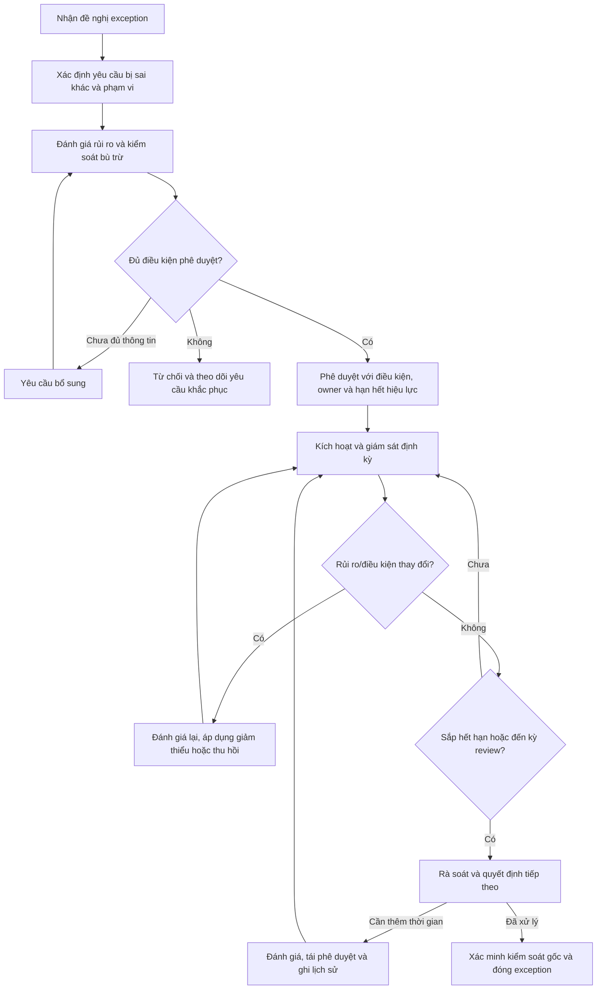

# Theo dõi exception trong Security Assurance

## 1. Exception cần được theo dõi như một rủi ro có thời hạn

Trong chương trình **Security Assurance**, tổ chức dùng yêu cầu bảo mật, chính sách, chuẩn kiểm soát, đánh giá rủi ro, kiểm thử và audit để tạo bằng chứng rằng hệ thống đáp ứng mục tiêu bảo mật. Trong thực tế, một tài sản hoặc quy trình đôi khi chưa thể đáp ứng ngay một yêu cầu: ứng dụng cũ chưa hỗ trợ cơ chế xác thực mong muốn, hệ thống cần mở kết nối mạng tạm thời khi chuyển đổi, hoặc một biện pháp bảo vệ phải triển khai theo nhiều giai đoạn.

**Exception (ngoại lệ)** là trường hợp sai khác có phạm vi xác định so với một yêu cầu, chính sách, chuẩn hoặc security control mà tổ chức **xem xét và cho phép có điều kiện** theo thẩm quyền và thời gian được quy định. Việc được phép tạm thời không có nghĩa rủi ro đã biến mất hay yêu cầu bảo mật hết hiệu lực.

**Theo dõi exception** là hoạt động liên tục xác định ngoại lệ nào đang được xem xét, đã được phê duyệt, đang có hiệu lực, sắp hết hạn, quá hạn rà soát, vi phạm điều kiện, đã hết hiệu lực hoặc đã được đóng. Với từng ngoại lệ, phải xác định **rủi ro tồn dư, người chịu trách nhiệm, biện pháp bù trừ, mốc đánh giá lại, quyết định tiếp theo và bằng chứng**.

Ví dụ: dịch vụ tích hợp với đối tác chưa triển khai được mutual TLS (mTLS) đúng hạn. Risk owner đồng ý ngoại lệ trong 30 ngày cho **đúng một điểm kết nối**, với điều kiện giới hạn IP đối tác, giám sát lưu lượng bất thường và hoàn thành kế hoạch chuyển đổi. Nếu IP cho phép được mở rộng, rule giám sát bị tắt hoặc thời hạn 30 ngày kết thúc, ngoại lệ phải được đánh giá lại ngay; không thể mặc định tiếp tục hợp lệ vì có ticket phê duyệt cũ.

### 1.1. Phân biệt các đối tượng liên quan

| Đối tượng | Câu hỏi chính | Ý nghĩa trong quá trình theo dõi |
| --- | --- | --- |
| **Finding** (phát hiện) | Kiểm thử/audit cho thấy vấn đề gì? | Ghi nhận sai lệch hoặc điểm yếu cần xử lý |
| **Remediation** (khắc phục) | Ai sửa, sửa bằng cách nào, khi nào kiểm chứng xong? | Theo dõi việc đưa hệ thống về trạng thái đáp ứng yêu cầu |
| **Exception** (ngoại lệ) | Sai lệch nào được phép tạm thời, với điều kiện gì? | Theo dõi phạm vi, thời hạn, phê duyệt và nghĩa vụ đi kèm |
| **Risk acceptance** (chấp nhận rủi ro) | Ai có thẩm quyền chấp nhận mức rủi ro tồn dư và trong bao lâu? | Là một quyết định quản trị có thể làm căn cứ cho exception; phụ thuộc chính sách |
| **Compensating control** (kiểm soát bù trừ) | Biện pháp nào đang giảm rủi ro trong lúc chưa tuân thủ yêu cầu gốc? | Phải được giám sát hiệu quả và có bằng chứng, không chỉ được mô tả |
| **Waiver/variance** | Tổ chức có thuật ngữ ngoại lệ riêng cho loại yêu cầu này không? | Cần ánh xạ rõ về cùng một quy trình kiểm soát để tránh bỏ sót |

Một finding có thể liên kết với một exception hợp lệ nhưng vẫn còn mở. **Đóng exception** và **đóng finding** là hai quyết định khác nhau; finding chỉ được xác nhận đã khắc phục khi tiêu chí xử lý và bằng chứng tương ứng đạt yêu cầu.

## 2. Mục tiêu và nguyên tắc theo dõi

Theo dõi exception hiệu quả cần đáp ứng đồng thời các mục tiêu:

1. **Nhìn thấy rủi ro:** biết tài sản, dịch vụ, dữ liệu và yêu cầu nào đang bị ảnh hưởng, mức rủi ro tồn dư và thời gian phơi nhiễm.
2. **Bảo đảm trách nhiệm:** mỗi exception có owner quản lý tiến độ và risk owner chịu trách nhiệm quyết định rủi ro; việc phê duyệt thuộc đúng cấp có thẩm quyền.
3. **Ràng buộc bằng điều kiện:** ghi biện pháp bù trừ, tiêu chí hiệu lực, cách kiểm tra, trigger đánh giá lại và mốc hết hiệu lực.
4. **Có thời hạn và khả năng kết thúc:** ngoại lệ phải có kế hoạch đóng, chuyển đổi hoặc quyết định tiếp theo, tránh tồn tại vô thời hạn.
5. **Có bằng chứng:** người kiểm tra có thể tái dựng quyết định, bối cảnh tại thời điểm phê duyệt, diễn biến trong thời gian hiệu lực và lý do đóng/gia hạn.
6. **Phát hiện thay đổi sớm:** sự cố, thay đổi kiến trúc, tài sản, môi trường, nhà cung cấp hoặc hoạt động của kiểm soát bù trừ có thể khiến quyết định cũ không còn phù hợp.

Các nguyên tắc nền tảng:

- Quyết định phải có **phạm vi cụ thể và thời điểm rõ ràng**; không phê duyệt chung chung kiểu “toàn bộ hệ thống” nếu chỉ có một kết nối cần ngoại lệ.
- Một ngoại lệ đã được duyệt không tự động hợp lệ cho mọi hệ thống, môi trường hoặc tài khoản tương tự.
- Không thể chỉ gia hạn ngày hết hiệu lực trong ticket mà xóa dấu vết quyết định trước đó.
- Dữ liệu quản lý ngoại lệ cần phân biệt **trạng thái phê duyệt** với **tình trạng giám sát hiện tại**, bởi một phê duyệt lịch sử có thể đã hết hạn hoặc không còn đáp ứng điều kiện.
- Việc ngoại lệ được quản lý bằng công cụ không thay thế đánh giá độc lập của Security Assurance hoặc quyết định từ chủ sở hữu rủi ro.

## 3. Hồ sơ exception và các trường dữ liệu tối thiểu

Một **exception register** (sổ đăng ký ngoại lệ) là nguồn thống nhất cho việc theo dõi. Có thể triển khai trong hệ thống GRC, issue tracker hay cơ sở dữ liệu, miễn có khả năng quản lý quyền, sự kiện và bằng chứng.

| Nhóm | Dữ liệu cần có | Lý do |
| --- | --- | --- |
| Định danh | `exception_id`, loại ngoại lệ, ticket liên kết | Truy vết và tránh trùng giữa các công cụ |
| Yêu cầu bị sai khác | Mã control/chính sách/chuẩn, phiên bản, nội dung yêu cầu | Biết chính xác điểm không đáp ứng |
| Phạm vi | Ứng dụng, asset ID, môi trường, tài khoản, kết nối, dữ liệu, khu vực áp dụng | Ngăn ngoại lệ bị sử dụng ngoài phạm vi |
| Lý do | Trở ngại kỹ thuật/nghiệp vụ, phương án đã đánh giá, tác động nếu không cấp ngoại lệ | Cơ sở ra quyết định |
| Rủi ro | Kịch bản đe dọa, khả năng xảy ra, tác động, rủi ro trước/sau kiểm soát, mức rủi ro tồn dư | Xác định mức chấp nhận và ưu tiên giám sát |
| Trách nhiệm | Requester, exception owner, remediation owner, risk owner, approver, security reviewer | Thông báo và leo thang đúng người |
| Điều kiện | Kiểm soát bù trừ, chỉ số/nguồn kiểm tra, tiêu chí đạt, nghĩa vụ báo cáo | Đo tính hiệu lực thực tế |
| Thời gian | `requested_at`, `approved_at`, `starts_at`, `expires_at`, `next_review_at`, `closed_at` | Xác định hiệu lực, quá hạn và lịch sử |
| Kế hoạch kết thúc | Việc cần làm, milestone, due date, xác nhận triển khai và kiểm chứng | Hạn chế việc phụ thuộc kéo dài |
| Quyết định | Phê duyệt/từ chối/thu hồi, thẩm quyền, phạm vi phê duyệt, lý do, phiên bản | Minh chứng quyền chấp nhận rủi ro |
| Bằng chứng | Tài liệu đánh giá, log kiểm soát, kết quả test, change record, biên bản review | Phục vụ assurance/audit |
| Sự kiện | Lần rà soát, thay đổi scope/risk/control, gia hạn, cảnh báo, escalation, quyết định mới | Tái dựng vòng đời mà không ghi đè lịch sử |

Dùng timestamp có múi giờ; ví dụ lưu UTC và hiển thị theo `Asia/Ho_Chi_Minh`. Quy ước **hiệu lực nửa mở** `[starts_at, expires_at)` nghĩa là ngoại lệ có hiệu lực từ `starts_at` và **hết hiệu lực ngay tại** `expires_at`. Khi chính sách chỉ ghi ngày, tổ chức cần xác định rõ giờ và múi giờ để tránh “còn hiệu lực” khác nhau ở các hệ thống.

Tài liệu và bằng chứng có thể chứa thông tin nhạy cảm về lỗ hổng, điểm truy cập và kiến trúc; việc xem, sửa và xuất hồ sơ phải tuân thủ phân quyền, có audit log. Không đưa mật khẩu, private key hoặc secret vào mô tả exception.

## 4. Vai trò và phân tách trách nhiệm

| Vai trò | Trách nhiệm chính | Điểm kiểm soát |
| --- | --- | --- |
| **Requester** | Đề nghị ngoại lệ và cung cấp căn cứ nghiệp vụ/kỹ thuật | Mô tả rõ phạm vi, lý do và ngày cần thiết |
| **Exception owner** | Duy trì hồ sơ, cập nhật tình hình, theo dõi điều kiện và mốc rà soát | Không để hồ sơ mất owner hoặc thiếu thông tin |
| **Remediation owner** | Thực hiện phương án xử lý gốc hoặc kế hoạch thay thế | Báo tiến độ, phụ thuộc, ETA và bằng chứng triển khai |
| **Control owner / service owner** | Xác minh và vận hành kiểm soát bù trừ trên tài sản có liên quan | Cung cấp bằng chứng kiểm soát vẫn hoạt động |
| **Risk owner** | Đánh giá và chịu trách nhiệm với mức rủi ro tồn dư trong phạm vi quyền hạn | Xem lại quyết định nếu rủi ro vượt ngưỡng hoặc điều kiện thay đổi |
| **Security Assurance/GRC** | Kiểm tra đầy đủ, hỗ trợ đánh giá, theo dõi tuân thủ điều kiện, báo cáo | Có thể yêu cầu đánh giá lại/leo thang; quyền phê duyệt do chính sách quy định |
| **Approver có thẩm quyền** | Chấp thuận, từ chối, thu hồi hoặc tái phê duyệt theo ma trận quyền | Không để requester tự phê duyệt ngoại lệ của chính mình |
| **Internal audit/independent reviewer** | Rà soát mẫu hồ sơ, bằng chứng và hiệu lực của quy trình | Tính độc lập theo yêu cầu quản trị |

Một người có thể giữ nhiều vai trò nếu quy mô tổ chức nhỏ, nhưng phải có biện pháp xử lý xung đột lợi ích. Ví dụ, quyền đề nghị và quyền chấp thuận cần được phân tách hoặc bổ sung cấp kiểm soát độc lập.

## 5. Vòng đời exception và các trạng thái cần quan sát

### 5.1. Quy trình điển hình



Việc phê duyệt nên dựa trên **thời gian tối thiểu cần thiết**, có kế hoạch loại bỏ sai lệch. Một ngoại lệ có thể bị từ chối nếu rủi ro tồn dư vượt ngưỡng, thiếu biện pháp bù trừ bắt buộc hoặc người yêu cầu không cung cấp căn cứ.

### 5.2. Trạng thái quyết định khác với trạng thái giám sát

Nên lưu riêng hai nhóm thông tin:

**Trạng thái quyết định/quy trình** (ví dụ): `DRAFT`, `SUBMITTED`, `NEEDS_INFO`, `APPROVED`, `REJECTED`, `REVOKED`, `CLOSED`.

**Tình trạng giám sát được suy ra** (có thể đồng thời xuất hiện): `NOT_YET_EFFECTIVE`, `ACTIVE`, `EXPIRING_SOON`, `EXPIRED`, `REVIEW_OVERDUE`, `CONTROL_FAILED`, `EVIDENCE_STALE`, `SCOPE_CHANGED`.

Ví dụ một hồ sơ có `decision_state=APPROVED`, nhưng nếu `expires_at` đã qua thì `monitoring_state=EXPIRED`. Việc hiển thị “APPROVED” đơn độc sẽ khiến người vận hành tưởng rằng ngoại lệ vẫn còn hiệu lực.

Không ép mọi cảnh báo vào một trạng thái duy nhất. Một ngoại lệ có thể **vừa sắp hết hạn, vừa quá kỳ review, vừa có bằng chứng kiểm soát bù trừ thất bại**. Dashboard nên cho phép xem nhiều cờ cảnh báo trên một hồ sơ.

### 5.3. Khi nào một ngoại lệ đang có hiệu lực?

Tại thời điểm chốt `as_of`, điều kiện tối thiểu thường gồm:

1. Có quyết định **APPROVED** còn được công nhận, do cấp có thẩm quyền ban hành.
2. `starts_at <= as_of < expires_at` và hai mốc thời gian hợp lệ.
3. Chưa bị thu hồi hoặc đóng; phạm vi đang kiểm tra thực sự nằm trong phạm vi đã duyệt.
4. Các điều kiện bắt buộc về kiểm soát bù trừ và vận hành được đáp ứng theo chính sách.

Một review quá hạn là **sự kiện cần leo thang**. Việc nó có tự động làm ngoại lệ hết hiệu lực hay không phải được chính sách nêu rõ, thay vì ngầm suy diễn. Ngược lại, vi phạm điều kiện trọng yếu đã được chỉ rõ trong quyết định có thể khiến ngoại lệ phải bị đình chỉ/thu hồi hoặc cần quyết định khẩn cấp.

## 6. Cơ chế giám sát định kỳ và theo sự kiện

Theo dõi exception không nên dừng ở một reminder gửi trước hạn. Nó gồm **kiểm tra thời gian**, **kiểm tra điều kiện** và **kiểm tra sự thay đổi rủi ro**.

### 6.1. Lịch giám sát tham khảo

| Thời điểm hoặc tín hiệu | Việc cần kiểm tra | Kết quả/hành động |
| --- | --- | --- |
| Ngay sau phê duyệt | Owner, scope, thời hạn, quyền phê duyệt, lịch review, kiểm soát bù trừ, bằng chứng nền | Chỉ kích hoạt nếu hồ sơ đủ điều kiện |
| Hằng ngày (tự động) | Ngoại lệ sắp hết hạn, đã hết hạn, review quá hạn, thiếu owner hoặc thiếu timestamp | Cảnh báo cho owner, GRC và cấp phù hợp |
| Hằng tuần hoặc theo mức rủi ro | Sức khỏe kiểm soát bù trừ, sự kiện bảo mật và tiến độ kế hoạch đóng | Ghi kết quả và yêu cầu hành động |
| Trước hạn 14/7/3 ngày (minh họa) | Khả năng hoàn thành trước hết hạn, phương án thay thế, hồ sơ xin gia hạn | Mở quy trình tái đánh giá từ sớm |
| Khi có thay đổi đáng kể | Thay đổi asset, endpoint, kết nối đối tác, quyền truy cập, dữ liệu, môi trường, threat exposure | Xác nhận có còn trong scope và ngưỡng rủi ro được duyệt |
| Khi có sự cố hoặc kiểm soát bù trừ lỗi | Mức rủi ro tăng, khả năng bị khai thác, dữ liệu bị ảnh hưởng | Đưa vào triage khẩn cấp, cân nhắc thu hồi hoặc áp dụng biện pháp giảm thiểu |
| Đúng mốc `expires_at` | Ngoại lệ đã được đóng hoặc tái phê duyệt đúng quy trình chưa | Nếu chưa, ghi `EXPIRED` và báo rủi ro không còn được ngoại lệ bao phủ |
| Khi đóng | Yêu cầu gốc đã được đáp ứng hay đã có quyết định quản trị khác hợp lệ | Thu bằng chứng kiểm chứng, lưu lý do đóng và lịch sử |

Các mốc nhắc việc, chu kỳ review và tốc độ leo thang phải **tỷ lệ với rủi ro** và khả năng tổ chức vận hành; bảng chỉ là minh họa. Ngoại lệ liên quan hệ thống Internet-facing hoặc dữ liệu nhạy cảm có thể yêu cầu giám sát liên tục hoặc review sớm hơn.

### 6.2. Theo dõi kiểm soát bù trừ bằng bằng chứng

Ví dụ ngoại lệ áp dụng cho kết nối API chưa hỗ trợ mTLS:

| Điều kiện phê duyệt | Tín hiệu kỹ thuật/nguồn bằng chứng | Cách phản ứng khi sai |
| --- | --- | --- |
| Chỉ cho IP đối tác truy cập | Bản cấu hình allowlist và kết quả kiểm tra rule từ môi trường thật | Chặn truy cập ngoài scope và kiểm tra lại rủi ro |
| Giám sát truy cập bất thường | Log tập trung, cảnh báo phát hiện, bằng chứng giám sát được tiếp nhận | Kích hoạt kênh xử lý an ninh, khôi phục khả năng phát hiện |
| Giới hạn quyền của dịch vụ tích hợp | Kết quả rà soát quyền, cấu hình IAM và kiểm thử | Thu hẹp quyền, xem xét mức tác động |
| Hoàn thành mTLS trước ngày hết hạn | Change plan, trạng thái triển khai, kết quả kiểm thử kết nối | Leo thang nguy cơ quá hạn, đề xuất quyết định xử lý |

Điều kiện cần đo được. Câu “đã tăng cường giám sát” không đủ làm bằng chứng nếu không biết **đang giám sát cái gì, qua nguồn nào, bằng tiêu chí nào và kết quả lần kiểm tra gần nhất**.

Một ngoại lệ chưa hết hạn vẫn có thể yêu cầu hành động khẩn cấp khi kiểm soát bù trừ thất bại. Theo dõi ngày tháng đơn thuần sẽ bỏ sót loại rủi ro này.

### 6.3. Tái đánh giá khi bối cảnh thay đổi

Hồ sơ phải nêu các **review trigger**. Ví dụ:

- Một endpoint được công khai Internet trong khi phê duyệt ban đầu chỉ áp dụng nội bộ.
- Dữ liệu xử lý chuyển từ dữ liệu thử nghiệm sang dữ liệu cá nhân/nhạy cảm.
- Nhà cung cấp, giao thức hoặc vùng triển khai thay đổi.
- Lỗ hổng mới xuất hiện khiến rủi ro tồn dư vượt ngưỡng chấp nhận ban đầu.
- Thiết bị/nguồn log giám sát bị gián đoạn, hoặc phát hiện hành vi khai thác.
- Owner nghỉ việc/chuyển nhóm; không còn cá nhân chịu trách nhiệm theo dõi.

Khi trigger xảy ra, phải ghi sự kiện, đánh giá lại phạm vi và rủi ro, áp dụng biện pháp giảm thiểu thích hợp, lấy quyết định mới nếu cần. Thời hạn cũ không phải lý do để hoãn xử lý rủi ro mới.

## 7. Gia hạn, hết hiệu lực, thu hồi và đóng

### 7.1. Gia hạn là một quyết định mới

Yêu cầu gia hạn nên được nộp **trước ngày hết hạn**, kèm: lý do chưa hoàn thành, tiến độ so với kế hoạch, ảnh hưởng đến tài sản, đánh giá rủi ro tồn dư cập nhật, kết quả kiểm soát bù trừ, mốc hoàn thành mới và người chịu trách nhiệm.

Quy trình phê duyệt lại phải dựa trên **quyền tại thời điểm phê duyệt**. Việc một người từng đồng ý ngoại lệ không có nghĩa họ luôn có quyền gia hạn khi mức rủi ro đã tăng.

Lưu cả `original_expires_at` và chuỗi quyết định theo phiên bản. Một phép chỉnh `expires_at` mà không lưu `old_expires_at`, người phê duyệt, căn cứ và thời điểm ra quyết định sẽ làm mất lịch sử thời gian phơi nhiễm.

### 7.2. Khi ngoại lệ hết hiệu lực

Tại hoặc sau `expires_at`, nếu chưa có quyết định mới hợp lệ, hồ sơ chuyển sang **EXPIRED theo góc nhìn giám sát**. Nó không còn là căn cứ hợp lệ để nói sai lệch “đã được chấp nhận” trong phạm vi và thời gian hiện tại.

Quy trình tiếp theo có thể bao gồm: xác nhận ngay biện pháp giảm thiểu, ưu tiên remediation, thông báo risk owner và quản lý dịch vụ, áp dụng hạn chế hoạt động nếu rủi ro yêu cầu, hoặc tái đánh giá khẩn cấp theo cơ chế quản trị có thẩm quyền. Không tự động coi một yêu cầu xin gia hạn đang chờ duyệt là quyết định đã được phê duyệt.

### 7.3. Thu hồi hoặc đình chỉ

Một ngoại lệ có thể bị thu hồi khi vi phạm điều kiện trọng yếu, thay đổi scope ngoài phê duyệt hoặc rủi ro vượt ngưỡng cho phép. Quyền thu hồi và hậu quả vận hành phải do chính sách quy định. Hồ sơ lưu **ai thu hồi, lúc nào, vì sao, thông báo tới ai và biện pháp xử lý tiếp theo**.

### 7.4. Đóng exception đúng nghĩa

Đóng khi sai lệch đã được giải quyết và kiểm chứng, hoặc khi có kết quả quản trị hợp lệ khác theo quy trình của tổ chức. Một hồ sơ đóng cần có:

- Bằng chứng hệ thống đáp ứng yêu cầu gốc (cấu hình, triển khai, kiểm thử lại, kết quả audit nếu áp dụng).
- Người xác minh, thời điểm xác minh và tiêu chí đạt.
- Liên kết finding/remediation và tác động đến các hồ sơ liên quan.
- Lý do đóng rõ ràng; giữ bản ghi những lần gia hạn, cảnh báo và vi phạm lịch sử.

Nếu finding chưa được sửa nhưng ngoại lệ bị đóng vì chuyển giao trách nhiệm, phải có quyết định và hồ sơ thay thế để không tạo khoảng trống quản lý.

## 8. Ví dụ exception được theo dõi theo mốc thời gian

Giả sử **EXC-014** liên quan ứng dụng tích hợp đối tác ở môi trường production, chưa đáp ứng yêu cầu mTLS đối với endpoint `/partner/sync`.

| Thông tin | Giá trị minh họa |
| --- | --- |
| Yêu cầu sai khác | API đối tác phải sử dụng mTLS |
| Phạm vi duyệt | Một endpoint production và IP đối tác đã đăng ký |
| Mức rủi ro tồn dư | High sau khi đã cân nhắc kiểm soát bù trừ |
| Người chịu trách nhiệm | Integration Team (owner), Application Risk Owner (risk owner) |
| Biện pháp bù trừ | Allowlist IP, giới hạn quyền API, giám sát truy cập và rate limit |
| `approved_at` | 15/11/2026, 10:00 (UTC+07) |
| `starts_at` | 16/11/2026, 08:00 (UTC+07) |
| `expires_at` | 16/12/2026, 08:00 (UTC+07) |
| `next_review_at` | 30/11/2026, 17:00 (UTC+07) |
| Kế hoạch kết thúc | Triển khai và kiểm chứng mTLS trước ngày hết hạn |

Diễn biến kiểm soát:

1. **28/11, 12:00:** thời hạn phê duyệt chưa kết thúc, các điều kiện đang có bằng chứng đạt; EXC-014 đang `ACTIVE`, kỳ review kế tiếp là 30/11.
2. **01/12, 12:00:** chưa có biên bản review. Hệ thống gắn cờ `REVIEW_OVERDUE` vì quá mốc 30/11, đồng thời vẫn hiển thị cửa sổ thời gian phê duyệt chưa hết. Security Assurance leo thang yêu cầu rà soát.
3. **05/12, 14:00:** phát hiện allowlist có thêm IP chưa nằm trong scope. Gắn `SCOPE_CHANGED`, kiểm tra liệu điều kiện đã bị vi phạm và yêu cầu đánh giá lại rủi ro; có thể thu hồi/đình chỉ nếu chính sách yêu cầu.
4. **10/12, 12:00:** còn **5 ngày 20 giờ** đến `expires_at`. Nếu điều kiện đã được khôi phục và phê duyệt vẫn hợp lệ, hệ thống gắn thêm `EXPIRING_SOON`, nhắc owner cập nhật kế hoạch xử lý.
5. **16/12, 08:00:** nếu chưa sửa và không được tái phê duyệt, chuyển `EXPIRED` ngay tại thời điểm này. Risk owner cần quyết định cách xử lý sai lệch chưa được bao phủ.
6. **Khi triển khai mTLS:** cập nhật evidence ref cho bản phát hành và kiểm thử handshake trong môi trường thực tế; người được giao kiểm chứng xác nhận đạt, sau đó mới đóng hồ sơ theo quy trình.

Ví dụ nhấn mạnh ba đồng hồ khác nhau: **thời hạn cho phép ngoại lệ**, **hạn rà soát điều kiện** và **hạn hoàn tất khắc phục**. Ba mốc có thể trùng hoặc khác nhau, nhưng cần theo dõi riêng.

## 9. Tự động hóa phát hiện cảnh báo

### 9.1. Quy tắc tính tại thời điểm chốt

Chọn `as_of` làm thời điểm báo cáo. Các cờ sau nên được tính độc lập:

- `WITHIN_APPROVAL_WINDOW`: có phê duyệt và `starts_at <= as_of < expires_at`, chưa bị thu hồi/đóng; chỉ biểu thị **cửa sổ thời gian**.
- `EXPIRED`: đã qua `expires_at` trong khi ngoại lệ vẫn được theo dõi, không có quyết định thay thế hợp lệ.
- `EXPIRING_SOON`: thời điểm hiện tại nằm trong khoảng cảnh báo trước hạn và chưa hết hạn.
- `REVIEW_OVERDUE`: `next_review_at < as_of` mà chưa có kỳ review mới được ghi nhận hợp lệ.
- `CONTROL_FAILED`: kiểm tra kiểm soát bù trừ có kết quả không đạt.
- `DATA_GAP`: thiếu dữ liệu cơ bản như scope, owner, thời điểm, approver hoặc bằng chứng.
- `SCOPE_CHANGED`: cấu hình/tài sản hiện tại không khớp danh sách đã được phê duyệt.

`WITHIN_APPROVAL_WINDOW` **không đủ** để kết luận ngoại lệ đang đáp ứng tất cả điều kiện. Các cờ `CONTROL_FAILED`, `SCOPE_CHANGED` và `REVIEW_OVERDUE` cần được đánh giá theo điều khoản phê duyệt và chính sách. Không che cảnh báo chỉ vì hồ sơ có nhãn “đã duyệt”.

### 9.2. Ví dụ truy vấn PostgreSQL

Giả sử bảng `security_exceptions` có cột như ở ví dụ sau; đây là schema minh họa, cần điều chỉnh theo hệ thống thực tế. Truy vấn được thiết kế để **trả nhiều cờ đồng thời**, không dồn các trường hợp vào một trạng thái duy nhất:

```sql
WITH params AS (
    SELECT TIMESTAMPTZ '2026-11-28 12:00:00+07' AS as_of
)
SELECT
    e.exception_id,
    e.exception_owner,
    e.risk_rating,
    e.decision_state,
    e.starts_at,
    e.expires_at,
    e.next_review_at,
    (
        e.decision_state = 'APPROVED'
        AND e.revoked_at IS NULL
        AND e.closed_at IS NULL
        AND e.starts_at <= p.as_of
        AND e.expires_at > p.as_of
    ) IS TRUE AS within_approval_window,
    (
        e.decision_state = 'APPROVED'
        AND e.revoked_at IS NULL
        AND e.closed_at IS NULL
        AND e.expires_at <= p.as_of
    ) IS TRUE AS expired,
    (
        e.decision_state = 'APPROVED'
        AND e.expires_at > p.as_of
        AND e.expires_at <= p.as_of + INTERVAL '7 days'
        AND e.revoked_at IS NULL
        AND e.closed_at IS NULL
    ) IS TRUE AS expiring_soon,
    (
        e.decision_state = 'APPROVED'
        AND e.next_review_at < p.as_of
        AND e.revoked_at IS NULL
        AND e.closed_at IS NULL
    ) IS TRUE AS review_overdue,
    (
        e.decision_state = 'APPROVED'
        AND e.control_health = 'FAIL'
        AND e.revoked_at IS NULL
        AND e.closed_at IS NULL
    ) IS TRUE AS control_failed,
    (
        e.exception_owner IS NULL
        OR e.expires_at IS NULL
        OR e.starts_at IS NULL
        OR e.approver_id IS NULL
        OR e.scope_ref IS NULL
    ) AS data_gap
FROM security_exceptions AS e
CROSS JOIN params AS p
ORDER BY e.risk_rating, e.expires_at;
```

Vì `NULL` có ngữ nghĩa đặc biệt trong SQL, biểu thức `IS TRUE` giúp cờ boolean không trả ra trạng thái không xác định. Nếu tổ chức muốn đánh dấu review không được lên lịch, hãy thêm cờ riêng `next_review_at IS NULL` trong hàng đợi chất lượng dữ liệu.

**Giới hạn quan trọng:** Truy vấn dựa trên snapshot dữ liệu hiện thời. Để tái tạo đúng trạng thái tại một `as_of` trong quá khứ, phải truy vấn **phiên bản quyết định, phạm vi, kiểm soát và sự kiện** có hiệu lực tại thời điểm đó. Không được dùng dữ liệu hiện tại rồi kết luận rằng một ngoại lệ lịch sử đã hợp lệ hay không hợp lệ ở quá khứ.

### 9.3. Tổ chức thông báo và leo thang

Một cảnh báo hữu ích nên có `exception_id`, risk rating, asset/scope, owner, điều kiện nào không đạt, thời gian còn lại hoặc mức quá hạn, bằng chứng gốc, yêu cầu hành động và hạn phản hồi.

Ví dụ chính sách leo thang mang tính tham khảo:

| Tình huống | Người nhận chính | Hành động |
| --- | --- | --- |
| Ngoại lệ sắp hết hạn | Exception owner, remediation owner | Cập nhật tiến độ đóng hoặc nộp đề nghị tái phê duyệt |
| Đến kỳ review nhưng chưa có kết quả | Exception owner, Security Assurance | Thu thập bằng chứng, thực hiện review và ghi quyết định |
| Hết hiệu lực mà chưa có quyết định hợp lệ | Risk owner, quản lý dịch vụ, Security Assurance | Đánh giá rủi ro chưa được bao phủ, quyết định giảm thiểu/khắc phục |
| Điều kiện trọng yếu thất bại hoặc scope bị mở rộng | Risk owner, control owner, bộ phận security/incident phù hợp | Kiểm soát phơi nhiễm và xem xét tạm dừng/thu hồi |
| Gia hạn nhiều lần, kéo dài lâu | Risk committee hoặc cấp quản trị theo chính sách | Xem lại nguyên nhân gốc, nguồn lực, ngưỡng chấp nhận rủi ro |

Cần chống gửi trùng cảnh báo cùng loại, nhưng **không dập tắt cảnh báo mới** khi rủi ro tăng, kiểm soát thất bại hoặc một ngoại lệ được thu hồi.

## 10. Dashboard và chỉ số assurance

Dashboard của một chương trình exception cần phục vụ ba nhóm quyết định: **hôm nay ai phải hành động**, **rủi ro tồn dư được quản trị ra sao**, và **bằng chứng có đủ để chứng minh quy trình hoạt động không**.

| Chỉ số | Cách đọc/định nghĩa gợi ý | Lưu ý diễn giải |
| --- | --- | --- |
| Active exceptions | Số ngoại lệ được phê duyệt và còn trong cửa sổ hiệu lực, thỏa các điều kiện cần thiết theo chính sách | Nêu rõ cách xử lý control failure/review overdue |
| Expiring soon | Số ngoại lệ sẽ hết hạn trong N ngày | N thay đổi theo mức rủi ro và chính sách |
| Expired open exceptions | Số hồ sơ đã hết hạn nhưng chưa được đóng hoặc có quyết định mới hợp lệ | Ưu tiên theo rủi ro, mức phơi nhiễm |
| Review overdue rate | Số exception đến hạn review nhưng chưa review / số exception đến hạn review trong tập đo | Phân biệt thiếu chứng từ với thật sự chưa review |
| Compensating-control failure | Số ngoại lệ có ít nhất một điều kiện bắt buộc không đạt | Có thể trùng với expired/expiring; đừng cộng cờ thành số lượng hồ sơ |
| Repeated extensions | Số ngoại lệ gia hạn trên một ngưỡng xác định, hoặc tổng số lần gia hạn mỗi ngoại lệ | Hỗ trợ tìm vấn đề hệ thống chưa giải quyết |
| Exception aging | Tuổi hồ sơ từ khi phê duyệt, và tổng thời gian ngoại lệ có hiệu lực theo các phiên bản | Đừng “reset tuổi” khi gia hạn |
| Closure evidence completeness | Tỷ lệ hồ sơ đóng có kết quả kiểm chứng cùng các quyết định và bằng chứng đầy đủ | Đo khả năng audit, tránh đóng hình thức |
| Residual risk exposure | Phân bố ngoại lệ theo risk rating, tài sản trọng yếu, môi trường và thời gian | Không cộng điểm severity tùy ý nếu chưa có phương pháp định lượng chuẩn |

Ví dụ tại một thời điểm có 20 ngoại lệ còn hiệu lực: 4 sắp hết hạn, 3 quá hạn review và 2 bị lỗi kiểm soát bù trừ. Ba nhóm này có thể giao nhau; vì vậy tổng **4 + 3 + 2 = 9** là tổng số *cờ cảnh báo*, không thể khẳng định có 9 hồ sơ khác nhau. Báo cáo cần sử dụng tập `exception_id` duy nhất để đếm số hồ sơ bị ảnh hưởng.

Để tránh chỉ số đẹp giả tạo, nên lưu cả **số ngoại lệ phát sinh mới**, **số đóng có kiểm chứng**, **số tái phê duyệt**, **xu hướng rủi ro còn mở** và **thời gian thực tế tồn tại**. Báo cáo phải ghi rõ `as_of`, múi giờ, chính sách áp dụng và cách tính mẫu số.

## 11. Bằng chứng, audit trail và chất lượng dữ liệu

Một auditor hoặc reviewer độc lập phải có thể trả lời:

- Yêu cầu bảo mật nào đã bị sai khác và trên tài sản nào?
- Ai nêu đề nghị và ai có thẩm quyền phê duyệt?
- Rủi ro trước/sau biện pháp bù trừ được đánh giá ra sao?
- Điều kiện nào được phê duyệt, có được kiểm tra xuyên suốt kỳ hiệu lực không?
- Trong kỳ có sự cố, thay đổi phạm vi hoặc vi phạm điều kiện nào? Ai đã nhận cảnh báo và quyết định gì?
- Ngoại lệ được gia hạn dựa trên căn cứ nào, với phiên bản và giới hạn thời gian nào?
- Khi đóng, bằng chứng nào chứng minh yêu cầu gốc đã được đáp ứng hoặc đã có quyết định phù hợp?

Nên quản lý các sự kiện có cấu trúc như `EXCEPTION_REQUESTED`, `RISK_ASSESSED`, `APPROVED`, `ACTIVATED`, `CONDITION_CHECKED`, `REVIEW_COMPLETED`, `SCOPE_CHANGED`, `CONTROL_FAILED`, `EXPIRE_WARNING_SENT`, `EXPIRED`, `RENEWAL_APPROVED`, `REVOKED`, `CLOSED_VERIFIED`. Từng sự kiện nên có timestamp, actor, loại thay đổi, giá trị trước/sau, lý do và `evidence_ref`.

Một mẫu bản ghi (giá trị giả định):

```json
{
  "event_id": "EVT-EXC-014-009",
  "exception_id": "EXC-014",
  "event_type": "REVIEW_COMPLETED",
  "occurred_at": "2026-11-30T16:30:00+07:00",
  "actor_role": "Security Assurance Reviewer",
  "decision_version": 1,
  "control_health": "PASS",
  "residual_risk": "HIGH",
  "next_review_at": "2026-12-09T17:00:00+07:00",
  "evidence_ref": "GRC-EVIDENCE-014-REVIEW-02"
}
```

Audit trail cần hạn chế sửa/xóa, có cơ chế lưu phiên bản và phân quyền. Chỉ lưu URL bằng chứng có thể mất truy cập chưa đủ; nên quản lý tính toàn vẹn, thời hạn lưu, phiên bản tài liệu và quyền đọc theo chính sách lưu trữ.

### Kiểm tra chất lượng dữ liệu

Các lỗi cần tạo hàng đợi xử lý riêng:

1. Hồ sơ đã APPROVED nhưng thiếu thời gian bắt đầu/kết thúc, owner, approver hoặc scope.
2. Risk owner không còn chịu trách nhiệm tài sản mà chưa có người thay thế.
3. Kiểm soát bù trừ được mô tả nhưng không có người xác nhận, nguồn tín hiệu hoặc bằng chứng cập nhật.
4. Ngoại lệ hết hạn nhưng hệ thống vẫn hiển thị “đang tuân thủ nhờ exception”.
5. Lần gia hạn đổi ngày trên ticket nhưng không có sự kiện quyết định mới.
6. Một ngoại lệ được gắn cho tài sản chưa từng nằm trong phạm vi duyệt.
7. Hồ sơ đã CLOSED nhưng finding liên quan còn mở mà không có biên bản giải thích.

## 12. Các sai lầm phổ biến

**Chỉ quản lý ngày hết hạn.** Ngoại lệ vẫn có thể trở nên nguy hiểm trước ngày đó nếu bối cảnh rủi ro hoặc hiệu quả của kiểm soát bù trừ thay đổi. Cần theo dõi cả điều kiện và các sự kiện kích hoạt đánh giá lại.

**Dùng phê duyệt quá khứ làm bằng chứng hiệu lực hiện tại.** Một quyết định APPROVED không tự đảm bảo đủ phạm vi, đúng thời điểm và còn đáp ứng điều kiện. Cần tính trạng thái giám sát tại thời điểm báo cáo.

**Gia hạn âm thầm, không đánh giá rủi ro lại.** Điều này làm giảm số lượng hết hạn trên dashboard nhưng kéo dài phơi nhiễm. Cần lưu lịch sử, người phê duyệt, tình trạng kiểm soát bù trừ và kế hoạch đóng cập nhật.

**Biến exception thành cách né remediation.** Một exception có thể hợp lệ trong thời gian nhất định, nhưng vẫn phải giám sát mục tiêu giảm sai lệch. Các ngoại lệ gia hạn nhiều lần cần review ở cấp cao hơn theo chính sách.

**Không phân biệt thiếu bằng chứng với kiểm soát thất bại.** `UNKNOWN` vì thiếu log và `FAIL` do rule không hoạt động đòi hỏi hành động khác nhau. Cả hai đều cần xử lý, không nên quy về `PASS`.

**Báo cáo chỉ cộng các cờ cảnh báo.** Một hồ sơ có thể có nhiều cờ; dashboard cần phân biệt số lượng hồ sơ duy nhất với số lượng cảnh báo.

## 13. Bài tập tình huống

Một ứng dụng nội bộ được phê duyệt ngoại lệ cho yêu cầu MFA từ **08:00 ngày 01/11/2026** đến **08:00 ngày 01/12/2026**. Phạm vi duyệt chỉ gồm nhóm tài khoản service do công cụ cũ chưa hỗ trợ MFA; điều kiện bắt buộc là tài khoản không truy cập trực tiếp Internet, giới hạn quyền và ghi log đầy đủ. Kỳ review gần nhất phải xong trước **17:00 ngày 25/11/2026**.

Tại **12:00 ngày 28/11/2026**, phát hiện ba vấn đề:

- Hồ sơ vẫn `APPROVED` nhưng không có biên bản review của kỳ 25/11.
- Một tài khoản service thuộc phạm vi ngoại lệ vừa được cấp thêm quyền quản trị.
- Team vận hành đề nghị kéo dài thêm một tháng vì nâng cấp chưa hoàn tất, nhưng chưa có kết quả đánh giá rủi ro mới.

**Yêu cầu thực hành:** xác định cờ giám sát, người cần nhận cảnh báo, bằng chứng cần thu thập và điều kiện để xem xét gia hạn.

**Gợi ý lời giải:**

1. Trong cửa sổ ngày tháng, ngoại lệ **chưa hết hạn**; còn **2 ngày 20 giờ** tới `expires_at`. Gắn `EXPIRING_SOON` nếu cấu hình cảnh báo ở ngưỡng 7 ngày; đồng thời gắn `REVIEW_OVERDUE`.
2. Việc tăng quyền tạo sự kiện thay đổi điều kiện/rủi ro. Gắn cờ kiểm tra phạm vi và kiểm soát (ví dụ `CONTROL_FAILED` nếu điều kiện “giới hạn quyền” được xác minh đã bị vi phạm), không coi phê duyệt cũ là cho phép tự động.
3. Thông báo exception owner, control owner, risk owner và Security Assurance; nếu có nguy cơ cao cần xử lý tức thời theo quy trình tổ chức. Thu log thay đổi IAM, danh sách quyền hiện tại, bằng chứng cô lập truy cập, kết quả rà soát và kế hoạch khắc phục.
4. Đề nghị gia hạn phải có **đánh giá rủi ro tồn dư cập nhật**, bằng chứng kiểm soát bù trừ còn hiệu lực, thời gian gia hạn có căn cứ, kế hoạch đóng và quyết định mới từ approver có thẩm quyền. Đề nghị đang chờ duyệt không làm kéo dài hiệu lực.
5. Nếu đến 08:00 ngày 01/12 mà chưa có quyết định mới hợp lệ và chưa giải quyết sai lệch, phải ghi nhận `EXPIRED` và xử lý rủi ro hiện hữu theo chính sách.

---

**Ghi nhớ:** Một exception được quản trị đúng là một quyết định **có phạm vi, có thẩm quyền, có điều kiện, có thời hạn và có khả năng kiểm chứng**. Theo dõi exception cung cấp bằng chứng rằng rủi ro tồn dư vẫn được giám sát, điều kiện phê duyệt còn được đáp ứng và các sai lệch cuối cùng có quyết định xử lý rõ ràng trong chương trình Security Assurance.
