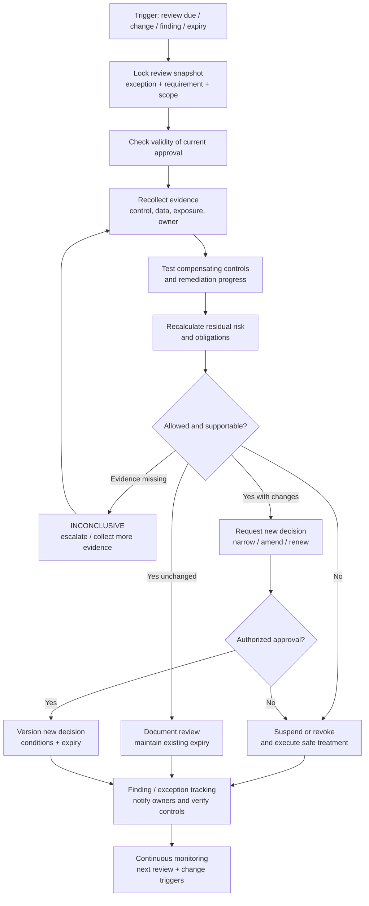

# Đánh giá lại exception trong Security Assurance: xác minh điều kiện, rủi ro và quyết định tiếp tục

## 1. Vì sao exception phải được đánh giá lại?

Một hệ thống production sử dụng giao thức xác thực cũ chưa hỗ trợ MFA theo baseline. Nhóm bảo mật đã chấp nhận **exception có thời hạn** vì dịch vụ quan trọng chưa thể nâng cấp ngay. Điều kiện chấp nhận gồm truy cập chỉ qua mạng quản trị, tài khoản có quyền tối thiểu, giám sát phiên đặc quyền và kế hoạch loại bỏ giao thức cũ.

Một thời gian sau, ứng dụng được mở thêm API Internet-facing, nhân sự quản trị thay đổi và công cụ thu thập log ngừng gửi dữ liệu. Nếu chỉ nhìn vào giấy phê duyệt ban đầu rồi tự gia hạn exception, tổ chức đang dùng **quyết định rủi ro của hoàn cảnh cũ** cho một **hệ thống đã thay đổi**.

**Đánh giá lại exception (exception reassessment/review)** là quá trình **kiểm tra lại căn cứ, phạm vi, điều kiện, hiệu lực của các biện pháp bù trừ, mức rủi ro còn lại và thẩm quyền phê duyệt** đối với một ngoại lệ đã được ghi nhận, nhằm quyết định nó có được tiếp tục, phải chỉnh sửa, cần khắc phục hoặc phải thu hồi.

Trong chương **Exception management** của module **SECURITY_SECURITY_ASSURANCE**, mục đích không phải kéo dài sự tồn tại của ngoại lệ. Mục đích là **duy trì một lập luận bảo đảm có bằng chứng** rằng các mục tiêu bảo mật vẫn được kiểm soát trong phạm vi được chấp thuận, đồng thời theo dõi những findings chưa khắc phục, quyết định rủi ro và trạng thái kiểm chứng sau thay đổi.

**Nguyên tắc nền tảng:** exception có hiệu lực **không có nghĩa control đã PASS**. Nếu yêu cầu MFA vẫn chưa được đáp ứng, kết quả đánh giá control có thể là `FAIL`, còn hồ sơ exception ghi rằng **rủi ro của sai lệch đó được người có thẩm quyền chấp nhận tạm thời trong những điều kiện cụ thể**. Hai trạng thái phải được quản lý riêng.

### Kết quả học tập

Sau bài này, người học có thể:

1. Giải thích **vì sao, khi nào và ai** phải đánh giá lại một exception.
2. Phân biệt **periodic review, event-driven reassessment, renewal, scope change, suspension, revocation và closure**.
3. Kiểm tra tính hợp lệ của **requirement, scope, time-bound approval, finding, ownership, compensating controls và residual risk**.
4. Thiết kế phương pháp quyết định **giữ nguyên, gia hạn có điều kiện, thu hẹp, sửa đổi, từ chối gia hạn hoặc thu hồi**.
5. Xây dựng evidence package, workflow, trạng thái, lịch sử phê duyệt và các chỉ số có mẫu số rõ.
6. Viết kế hoạch hành động và retest để đưa hệ thống **trở lại baseline** thay vì biến ngoại lệ thành một trạng thái vĩnh viễn.

## 2. Những thuật ngữ cần phân biệt

| Thuật ngữ | Ý nghĩa thực hành | Điều không nên nhầm |
|---|---|---|
| **Baseline/requirement** | Điều kiện bảo mật, tuân thủ hoặc vận hành được phê duyệt | Không phải hướng dẫn tùy chọn nếu đã thuộc phạm vi bắt buộc |
| **Finding** | Sai lệch đã được quan sát so với điều kiện cần đạt | Không tự biến mất khi được chấp nhận rủi ro |
| **Exception** | Hồ sơ chấp thuận một sai lệch cụ thể theo điều kiện và phạm vi | Không phải giấy phép bỏ qua mọi control |
| **Risk acceptance** | Quyết định chịu một mức residual risk được hiểu rõ | Không đồng nghĩa legal waiver hoặc control PASS |
| **Compensating control** | Biện pháp thay thế/bổ sung làm giảm rủi ro của sai lệch | Không tự tương đương yêu cầu bắt buộc |
| **Exception review** | Kiểm tra định kỳ xem điều kiện vẫn hợp lệ | Không tự tạo phê duyệt gia hạn |
| **Reassessment** | Đánh giá lại rủi ro và evidence, nhất là sau thay đổi | Không chỉ cập nhật ngày hết hạn |
| **Renewal/extension** | Quyết định mới tiếp tục ngoại lệ trong một khoảng có hạn | Không mặc nhiên hợp lệ nếu approval cũ hết hiệu lực |
| **Revocation** | Thu hồi quyền tiếp tục áp dụng exception | Không đồng nghĩa hệ thống đã được khắc phục |
| **Suspension** | Tạm dừng cho phép dựa vào exception trong lúc điều tra/ra quyết định | Cần rõ biện pháp an toàn và thẩm quyền |
| **Verified closure** | Sai lệch đã được sửa, retest đạt điều kiện và hồ sơ đóng đúng quyền | Khác với “risk accepted/closed by decision” |

Các tổ chức có thể dùng tên trạng thái khác nhau, nhưng cần giữ được **hai trục độc lập**: tình trạng **security control/finding** và hiệu lực **quyết định ngoại lệ**.

## 3. Exception không phải một giải pháp bảo mật vĩnh viễn

Một exception có thể hợp lý trong giai đoạn chuyển đổi: hệ thống legacy chưa hỗ trợ tính năng mới, vendor chưa thể cung cấp control đúng hạn, phụ thuộc phần cứng khiến việc thay đổi cần lịch bảo trì dài hoặc một tính năng chưa có phương án thay thế khả thi.

Nhưng nếu exception cứ được gia hạn mà không có cập nhật rủi ro và chứng cứ, nó có thể trở thành **nợ bảo mật không được quản trị**.

| Dấu hiệu ngoại lệ được quản lý tốt | Dấu hiệu phải xem xét lại ngay |
|---|---|
| Requirement và gap được mô tả chính xác | Không biết sai lệch gốc thuộc yêu cầu nào |
| Có owner, risk owner và approver hợp lệ | Owner nghỉ việc hoặc không xác định ai chịu trách nhiệm |
| Phạm vi asset/data/service được giới hạn | Hệ thống mở rộng nhưng hồ sơ exception không đổi |
| Có điều kiện chấp thuận và biện pháp bù trừ được kiểm thử | Compensating control bị tắt hoặc không có evidence |
| Có hiệu lực và ngày hết hạn rõ | Không có expiry, hoặc đã hết hạn mà vẫn dùng |
| Có remediation milestones và review trigger | Gia hạn liên tục không có kế hoạch sửa |
| Có quyết định và review trail | Chỉ thay ngày trên file và giữ chữ ký cũ |

**Đánh giá lại không nên chỉ đặt câu hỏi “có cần gia hạn không?”**, mà phải xem **ngoại lệ còn được phép tồn tại không, có thể giảm phạm vi không, đã sẵn sàng sửa chưa và rủi ro nào tăng so với lần duyệt trước**.

## 4. Xác định đúng đối tượng của một lần đánh giá lại

Một exception cần được xác định bằng ID và gắn với **đối tượng, điều kiện vi phạm, phiên bản requirement, khoảng hiệu lực và quyết định có thẩm quyền**.

| Thuộc tính | Câu hỏi phải trả lời |
|---|---|
| `exception_id` | Đây là ngoại lệ nào, đã có revision/decision nào? |
| `finding_id` / `control_id` | Sai lệch gốc nào vẫn tồn tại? |
| `requirement_source_version` | Yêu cầu ban đầu còn hiệu lực hoặc đã thay đổi? |
| `environment` / `service_id` | Production, staging, tenant, API, region cụ thể nào? |
| `asset_ids` / `data_classification` | Đối tượng và dữ liệu nào được phép lệch baseline? |
| `approved_deviation` | Chính xác điều gì được cho phép, đến mức nào? |
| `conditions` | Những điều kiện bắt buộc phải duy trì khi dựa vào ngoại lệ? |
| `compensating_control_ids` | Biện pháp nào được coi là hỗ trợ giảm rủi ro? |
| `approved_at` / `expires_at` | Cửa sổ hiệu lực và thời hạn review? |
| `risk_owner` / `approver` | Ai có quyền chấp nhận và quyết định lại? |
| `finding_owner` / `implementer` | Ai theo dõi và thực hiện khắc phục? |
| `last_review_at` / `next_review_due_at` | Lịch kiểm tra độ phù hợp của quyết định? |

Nếu không xác định được chính xác **scope của exception**, người đánh giá không nên tự suy rằng một phê duyệt cho `prod-a` bao gồm cả `prod-b`. Mở rộng scope là **quyết định mới cần review**, không phải thay đổi câu chữ hành chính.

## 5. Phân biệt ba đồng hồ: review, expiry và remediation

Một lỗi thường gặp là dùng một ngày cho tất cả mốc.

- **Review due date:** hạn phải xem xét lại căn cứ, rủi ro, evidence và điều kiện.
- **Exception expiry:** thời điểm quyền áp dụng ngoại lệ theo approval hiện hành kết thúc.
- **Remediation due date:** hạn hoàn thành hành động sửa gap theo plan và nghĩa vụ áp dụng.

Ví dụ giả định:

| Mốc | Thời điểm UTC | Ý nghĩa |
|---|---|---|
| Exception approved | 01/10/2026 09:00 | Bắt đầu khoảng cho phép |
| Periodic review due | 15/11/2026 09:00 | Phải kiểm tra lại dù chưa hết hạn |
| Remediation target | 30/11/2026 18:00 | Kế hoạch sửa dự kiến |
| Exception expires | 15/12/2026 18:00 | Quyết định chấp thuận cũ hết hiệu lực |

Nếu kỳ review 15/11 bị bỏ lỡ thì đó là **review overdue** ngay cả khi exception chưa hết hiệu lực tới 15/12. Nếu plan sửa lỡ 30/11, cần re-plan/escalation; việc ngoại lệ còn hiệu lực không tự hợp thức hóa milestone trễ.

Nếu tới 15/12 vẫn chưa được phê duyệt lại đúng thẩm quyền, **không coi quyết định cũ được tự động gia hạn**. Quy trình cần kích hoạt biện pháp xử lý phù hợp: dừng sử dụng đường lệch baseline, giới hạn dịch vụ, containment, chặn triển khai, escalation hoặc hoạt động chuyển tiếp được phê duyệt riêng. Không tự ý thực hiện thay đổi production gây gián đoạn khi chưa theo quy trình an toàn.

## 6. Đánh giá lại theo lịch và theo sự kiện

Cần kết hợp **periodic review** với **event-driven reassessment**. Lịch review giúp hạn chế việc ngoại lệ tồn tại quá lâu; trigger giúp phát hiện những thời điểm rủi ro thay đổi trước hạn.

### 6.1. Periodic review

Kỳ review dựa trên severity, dữ liệu, exposure, sự ổn định của môi trường và nghĩa vụ. Ví dụ tổ chức có thể đánh giá exception rủi ro cao thường xuyên hơn exception nhỏ; **không có chu kỳ 30/60/90 ngày mặc định phù hợp mọi nơi**.

Review theo lịch cần xác nhận **condition monitoring**, **effective compensating control**, **residual risk**, **remediation progress** và **thẩm quyền tiếp tục**.

### 6.2. Event-driven reassessment

Những sự kiện có thể buộc đánh giá lại ngay:

- Tài sản/dữ liệu thuộc scope được mở rộng, thay phân loại dữ liệu hoặc quy trình kinh doanh.
- Mở Internet-facing endpoint, thêm quyền quản trị, trust boundary, tenant, region hoặc cloud account.
- Phát hiện CVE/exploit mới, một cuộc tấn công thực tế hoặc sự cố liên quan.
- Compensating control mất hiệu lực, SIEM không có event, MFA gateway bị bypass hoặc key không còn sử dụng được.
- Thay baseline, tiêu chuẩn, hợp đồng, thời hạn nghĩa vụ hoặc cách diễn giải đã được phê duyệt.
- Nhà cung cấp đổi kiến trúc, data location, subprocessor hoặc khả năng hỗ trợ control.
- Remediation milestone bị trễ hoặc retest FAIL/INCONCLUSIVE.
- Risk owner, service owner, approver hoặc tổ chức vận hành thay đổi.
- Ngoại lệ gần hết hạn, đã quá hạn, hoặc có bằng chứng phê duyệt ban đầu sai phạm vi.
- Phương án kỹ thuật mới khả thi, chi phí rủi ro/đánh đổi đã thay đổi đáng kể.

**Không chờ kỳ review kế tiếp** nếu trigger ảnh hưởng trực tiếp đến giả định đã dùng để chấp nhận rủi ro.

## 7. Quy trình end-to-end của một lần reassessment



Sơ đồ mô tả quy trình logic; không thay thế **authority matrix** hay quy tắc xử lý sự cố. Việc suspend hoặc revoke có thể cần biện pháp thay thế để tránh gây hại cho dịch vụ quan trọng; chỉ người được ủy quyền thực hiện thay đổi production.

### Các cổng kiểm soát cần tách rõ

1. **Review initiated:** có lý do, thời điểm và review owner.
2. **Evidence qualified:** dữ liệu đúng scope, còn mới, có nguồn và đủ để đánh giá.
3. **Risk assessed:** so với lần phê duyệt trước và yêu cầu hiện hành.
4. **Decision proposed:** giữ, sửa, gia hạn, thu hồi hay đóng sau retest.
5. **Approval verified:** người có đúng thẩm quyền quyết định mới.
6. **Conditions deployed:** các biện pháp mới, milestones và monitoring được xác minh.
7. **Decision recorded:** version, hiệu lực, expiry, người duyệt, căn cứ và trigger tiếp theo.

Không nhập nhằng giữa “review đã hoàn tất” và “renewal đã được duyệt”.

## 8. Ai tham gia reassessment? RACI theo từng quyết định

Một lần review thường cần nhiều vai trò, nhưng không có nghĩa finding owner có quyền tự chấp nhận residual risk.

| Hoạt động | Exception coordinator | Finding/control owner | Security assessor | Risk owner | Legal/compliance | Business/service owner |
|---|---|---|---|---|---|---|
| Lập lịch và mở review | **R/A** | C | C | I | I | I |
| Xác nhận scope/requirement | R | **R** | C | C | **A** khi thuộc nghĩa vụ pháp lý | C |
| Thu evidence và thực hiện tests | R | **R** | **A** đối với kết luận kiểm tra độc lập | I | C | C |
| Đề xuất remediation/bù trừ | R | **A/R** | C | C | C | C |
| Đánh giá residual risk | R | C | C | **A** | C | C |
| Gia hạn/chấp nhận risk trong quyền hạn | R | C | C | **A** | C, có thể cần approval riêng | C |
| Phê duyệt rollout hoặc dừng dịch vụ | C | R | C | C | C | **A** theo change authority |
| Xác minh hoàn thành và đóng finding | R theo dõi | R cung cấp | **A/R** về verification | I | I | I |

Bảng là ví dụ phân quyền: tổ chức có thể có review board, risk committee hoặc nhiều cấp approval. **Một hoạt động có thể có authority khác nhau theo severity, loại dữ liệu, hợp đồng và vùng pháp lý**. Cần ưu tiên authority matrix thực tế.

### Những xung đột cần kiểm soát

- Người triển khai compensating control không nên là người duy nhất xác nhận hiệu quả control.
- Người xin exception không mặc nhiên có quyền approve exception.
- Risk owner có thể chấp nhận residual risk trong quyền được giao, nhưng **không thể đơn phương loại bỏ nghĩa vụ bắt buộc bên ngoài**.
- Khi người duyệt rời tổ chức, không được để approval cũ kéo dài vô hạn; cần xác minh cơ chế kế nhiệm/thẩm quyền.

## 9. Reassessment kiểm tra lại requirement và tính hợp lệ như thế nào?

Trước khi đánh giá risk, phải xác minh ngoại lệ vẫn thuộc **loại yêu cầu có thể được chấp thuận theo quy trình áp dụng**.

Kiểm tra:

1. Requirement source: chính sách nội bộ, hợp đồng, tiêu chuẩn chứng nhận hay pháp luật.
2. Version, ngày hiệu lực và điều khoản cụ thể, không chỉ tên framework.
3. Scope: đối tượng, dữ liệu, loại tài sản, khu vực hoạt động, role và các trường hợp loại trừ.
4. Tính bắt buộc và các điều kiện riêng về ngoại lệ/alternative control.
5. Ai có authority chấp nhận deviation và điều kiện thông báo/phê duyệt bổ sung.
6. Ngoại lệ có liên quan cam kết đã ký với khách hàng, đối tác, regulator hay auditor không.
7. Có yêu cầu **chấm dứt sai lệch** trong thời hạn pháp định/hợp đồng không.

**Ví dụ:** một chính sách nội bộ yêu cầu log giữ 90 ngày; exception cho giữ 30 ngày có thể được xem xét theo governance nếu rủi ro được phê duyệt. Nhưng nếu một hợp đồng dịch vụ đang áp dụng **bắt buộc giữ 90 ngày**, quyết định risk acceptance nội bộ **không tự làm hợp đồng cho phép 30 ngày**. Cần xử lý nghĩa vụ hợp đồng bằng người có thẩm quyền, không đổi trạng thái thành compliant chỉ vì đã có exception.

Bài học trình bày **phương pháp assurance**, không thay thế ý kiến pháp lý theo một quy định cụ thể.

## 10. Revalidate scope: ngoại lệ áp cho cái gì hôm nay?

Một ngoại lệ ban đầu cho một cluster staging có thể vô tình được dùng để hợp thức hóa cùng cấu hình trong production. Hoặc exception cho 10 service accounts đã được kéo dài tới 50 accounts mà không phê duyệt phạm vi.

### Mẫu bảng so sánh scope

| Thuộc tính | Scope được duyệt | Scope quan sát hiện tại | Hành động |
|---|---|---|---|
| Environment | `staging-a` | `staging-a` + `production-a` | Production nằm ngoài phê duyệt, cần xử lý riêng |
| Tài sản | 10 máy chủ | 14 máy chủ | Xác minh 4 máy mới, không tự thêm vào scope |
| Principal type | Service accounts không tương tác | Thêm human privileged users | Tăng rủi ro; phải review yêu cầu MFA |
| Data class | Internal | Thêm dữ liệu khách hàng nhạy cảm | Cần risk/privacy review mới |
| Access path | VPN-only | Thêm API công khai | Kiểm tra toàn bộ reasoning của approval cũ |
| Region | Region A | Region A và DR region B | Reassess data flow/retention và control ở DR |

**Scope drift** là trigger cần đánh giá lại ngay. Không xử lý bằng cách mở rộng `asset_ids` trong hồ sơ mà giữ nguyên chữ ký cũ; nếu cần thay đổi, phải ghi **revision + risk assessment + new approval**.

### Tính đầy đủ của inventory

Nguồn dùng để so phạm vi phải có quyền đọc đúng account/tenant/region, pagination, thời điểm và ID bất biến. Nếu inventory không đầy đủ, kết luận “không có scope drift” là **INCONCLUSIVE**, không phải PASS.

## 11. Kiểm chứng các điều kiện phê duyệt ban đầu

Một exception có thể được chấp nhận chỉ **khi** các điều kiện bắt buộc đúng. Đánh giá lại phải kiểm tra từng điều kiện như kiểm tra một control độc lập.

| Condition ban đầu | Evidence phù hợp | Nếu không đạt |
|---|---|---|
| Chỉ truy cập từ mạng quản trị | Effective network ACL, routing, access/negative test | Phạm vi tiếp xúc đã tăng |
| Mọi truy cập qua bastion có MFA | Identity policy, session logs, bypass negative tests | Bù trừ có thể mất giá trị |
| Chỉ có 2 admin được cấp quyền | Role binding, access review và principal inventory | Điều kiện giới hạn quyền bị vi phạm |
| Mỗi phiên privileged đều có audit log | Source events + pipeline health + correlation test | Không thể bảo đảm phát hiện/điều tra |
| Chưa có Internet-facing endpoint | Attack surface inventory, gateway config, scan được duyệt | Assumption của approval sai |
| Có milestone migrate giao thức cũ | Change records, release plan, test/rollback | Rủi ro ngoại lệ tồn tại lâu hơn dự kiến |
| Review khi có vulnerability nghiêm trọng | Advisory/threat intelligence theo phạm vi sản phẩm | Cần xem lại trước expiry |
| Không lưu dữ liệu nhạy cảm | Data classification và data-flow map hiện hành | Rủi ro dữ liệu đã đổi |

Một condition bị vi phạm có thể làm **phê duyệt ngoại lệ không còn được phép dựa vào**, tùy chính sách/điều khoản đã duyệt. Không mặc nhiên để ngoại lệ có hiệu lực tới ngày expiry khi **điều kiện cần đã không còn đúng**.

### Design và operating evidence khác nhau

- Văn bản “access chỉ qua VPN” là **design/intent evidence**.
- ACL/routing hiện tại cho thấy **implementation**.
- Negative test từ đường ngoài VPN và session logging cho thấy **hành vi kiểm soát trong kịch bản đã thử**.

Muốn kết luận condition thực sự được duy trì qua một kỳ, cần xem **change history, logs, coverage hoặc kiểm thử có tính đại diện**; ảnh chụp hiện tại không chứng minh cả ba tháng trước đều đúng.

## 12. Đánh giá hiệu lực thực tế của compensating controls

Một compensating control chỉ hữu ích nếu **giảm được đường gây rủi ro của gap gốc** trong failure model đang xét.

Ví dụ gap là **legacy admin login không enforce MFA**:

- **Giải pháp bù trừ đề xuất:** admin chỉ truy cập ứng dụng từ bastion có MFA, session recording, network isolation và privileged access có thời hạn.
- **Điểm cần kiểm tra:** không còn đường đăng nhập trực tiếp bỏ qua bastion; mọi privileged identity thật sự bị giới hạn; audit event và alert tới được người xử lý; tài khoản khẩn cấp có cơ chế giám sát riêng.
- **Điều làm biện pháp mất tác dụng:** một API admin mới cho phép truy cập từ Internet, firewall rule mở rộng hoặc session logging bị ngừng.

| Tầng | Claim cần chứng minh | Cách thử |
|---|---|---|
| Design | Những control bù trừ đủ giảm threat path đã nêu | Architecture/risk review và counterexample analysis |
| Config | Network/IAM/session control đã bật và áp đúng scope | Read-only effective config, inventory, exception list |
| Behavior | Không có bypass trong những kịch bản được phép thử | Authorized negative tests, source auth events |
| Monitoring | Vi phạm/điều kiện suy giảm được phát hiện kịp | Alert delivery test, SIEM data completeness |
| Governance | Thay quyền và thay route đều được review | Change tickets, access review, exception triggers |

**Không tự coi controls bù trừ là tương đương với yêu cầu** chỉ vì cùng góp phần giảm rủi ro. Một số yêu cầu/tiêu chuẩn quy định cách đánh giá biện pháp thay thế riêng và có thể không cho phép dùng controls bù trừ; cần người chịu trách nhiệm compliance xác minh.

## 13. Đo lại residual risk và so với approval gốc

Risk assessment lúc gia hạn phải nhìn **tình trạng hiện tại**, không sao chép bảng risk rating đã được duyệt trước đây.

### Các chiều cần so sánh

| Chiều | Cần so điều gì? |
|---|---|
| Asset/data value | Giá trị dữ liệu và quy trình có tăng không? |
| Threat/exploitability | Tấn công mới, CVE, kỹ thuật bypass, threat intelligence có thay đổi không? |
| Exposure | Đường truy cập, Internet reachability, quyền admin, số người dùng |
| Vulnerable population | Số assets/tenants/principals và thời gian phơi nhiễm |
| Compensating control effectiveness | Kết quả test mới, log health, scope và exceptions |
| Detection/response | Khả năng phát hiện, xử lý và giới hạn thời gian tác động |
| Business continuity | Phụ thuộc/RTO/RPO, khả năng rollback/exit và chi phí gián đoạn |
| Obligation impact | Nghĩa vụ hợp đồng/pháp lý, báo cáo và chứng nhận |
| Residual risk owner | Người có authority và mức risk appetite mới nhất |
| Uncertainty | Dữ liệu thiếu, test chưa chạy, giả định chưa xác minh |

### Bảng delta risk minh họa

| Yếu tố | Khi duyệt | Khi đánh giá lại | Nhận định |
|---|---|---|---|
| Exposure | Chỉ private management network | Thêm Internet-facing gateway | Rủi ro tăng |
| Identity | Hai account quản trị | Năm account, có một tài khoản tạm | Population mở rộng |
| MFA bù trừ | Bastion enforce MFA và đã test | Mới có screenshot config, chưa test đường API | Chưa đủ evidence hiện hành |
| Logging | Source-to-SIEM test PASS | Pipeline đã mất event một tuần | Monitoring yếu đi |
| Remediation | Plan nâng cấp trước 30/11 | Vendor hoãn release tới tháng 1 | Thời gian chịu rủi ro tăng |

Trong ví dụ này **không thể tự quyết định renew trên cơ sở risk rating ban đầu**. Cần đánh giá mô hình đe dọa hiện tại, containment, quyền tiếp tục vận hành và phương án thay thế.

### Không làm “score laundering”

Một mô hình cho điểm có thể giúp so sánh, nhưng không được để nhiều controls ít quan trọng “bù điểm” cho một điều kiện critical đã FAIL. Nêu rõ **hard stops**, assumptions và chất lượng evidence thay vì chỉ trình “Risk = Medium” với phương pháp không giải thích.

## 14. Evidence tối thiểu cho một lần reassessment

| Nhóm | Cần lưu | Nguồn/quality check |
|---|---|---|
| **Exception baseline** | Original approval, scope, conditions, effective/expiry | Source/version, approver, authority |
| **Requirement** | Policy/contract/control phiên bản hiện hành | Applicability, legal/compliance interpretation |
| **Finding status** | Expected vs observed, test result, severity | Raw observations, asset IDs, timestamps |
| **Asset/scope inventory** | Tài sản, principal, tenant, region, data-flow | Full population, permissions, pagination |
| **Compensating controls** | Effective config và behavioral tests | Collector identity, scope, logs và negative tests |
| **Threat/risk changes** | New exposure, incidents, CVEs/threat scenarios | Risk rationale, source date, affected product |
| **Remediation** | Tasks, owners, change references, milestones, blockers | Current progress, deployment/test evidence |
| **Risk decision** | Residual risk assessment, limits, proposed treatment | Risk owner, authority, reasoning |
| **Approval** | Approver, decision, time, constraints, next review/expiry | Immutable version and signature/workflow record |
| **Validation & handoff** | Reviewer, result, findings/retest, notification | Evidence refs, change history, audit trail |

Nếu raw evidence chứa secret, nhân sự hoặc kiến trúc nhạy cảm, dùng kho kiểm soát quyền và tham chiếu artifact ID trong hồ sơ, không copy nội dung chưa được che vào ticket/chat công khai.

### Provenance và auditability

Một ảnh dashboard nói “MFA enabled” không chứng minh cả policy scope. Một checksum khớp manifest hỗ trợ tính toàn vẹn tệp nếu manifest đáng tin, **không chứng minh nguồn dữ liệu đúng hay query đã chọn đúng tenant**. Evidence package cần **nguồn, collector, method/version, timestamps UTC, sample/population, limitations và cách tái kiểm tra**.

## 15. Phân loại kết quả kiểm tra: PASS, FAIL, INCONCLUSIVE

Nên đánh giá từng **điều kiện** và **security control** trước khi quyết định toàn bộ exception.

| Kết quả kiểm tra | Khi sử dụng | Hành động |
|---|---|---|
| **PASS** | Bằng chứng đủ, đúng scope/kỳ, điều kiện đã được đáp ứng | Có thể dùng làm input cho risk review |
| **FAIL** | Bằng chứng tin cậy cho thấy control/condition không đạt | Finding và risk escalation; xem xét đình chỉ/thu hồi |
| **INCONCLUSIVE** | Không đủ dữ liệu để kết luận, thiếu quyền, sai scope, test không đại diện | Thu evidence; không tự gọi PASS |
| **NOT_APPLICABLE** | Điều kiện không thuộc scope theo quy tắc đã duyệt | Lưu lý do/approval, không dùng để che tài sản |
| **Accepted exception** | Một sai lệch được risk owner chấp thuận có hạn | Giữ kết quả control thật, theo dõi decision riêng |

**Hai câu hỏi không được trộn:**

1. *Compensating control còn hoạt động theo yêu cầu hay không?* → PASS/FAIL/INCONCLUSIVE theo evidence.
2. *Có chấp thuận tiếp tục chịu rủi ro trong điều kiện mới hay không?* → quyết định của người có thẩm quyền; không thể suy ra từ một “PASS” bù trừ đơn lẻ.

Một condition FAIL có thể làm exception không còn đáp ứng điều kiện ban đầu, dù hồ sơ chưa tới hạn expiry. Một condition INCONCLUSIVE, đặc biệt điều kiện trọng yếu, cần **escalation theo risk tier**, không gia hạn ngầm.

## 16. Decision matrix: duy trì, chỉnh sửa, gia hạn, từ chối hay thu hồi?

| Tình huống đánh giá lại | Đề xuất xử lý | Điều kiện |
|---|---|---|
| Scope/risk/conditions vẫn đúng, approval chưa hết hạn | **Maintain** trong thời hạn hiện có | Ghi review, không tự thay expiry |
| Remediation hoàn tất và retest đạt | **Close verified** gap; kết thúc exception liên quan | Independent validation và evidence đủ scope |
| Risk giảm, có thể thu hẹp phạm vi exception | **Narrow scope** | Revision được duyệt; xử lý các đối tượng bị loại khỏi scope |
| Phải đổi condition/compensating control hoặc tăng scope | **Amend** bằng quyết định mới | Risk assessment và approval phù hợp |
| Còn gap nhưng rủi ro được phép chịu tiếp, có plan đáng tin | **Renew/extend có thời hạn** | Fresh evidence, điều kiện, approver và expiry mới |
| Evidence then chốt thiếu hoặc owner chưa hợp lệ | **Pending/escalate**; không coi là renewed | Tạm giảm exposure hoặc xử lý theo chính sách |
| Điều kiện không còn đúng, risk vượt appetite, obligation không cho phép | **Deny/suspend/revoke** và kích hoạt xử lý an toàn | Thẩm quyền, business continuity và change/IR coordination |
| Exception quá hạn không có quyết định mới | **Expired/non-approved** theo workflow | Không tự áp dụng approval cũ; xử lý gap và operational risk |

**Không coi “REVIEWED” đồng nghĩa “RENEWED”.** Review chỉ là hoạt động đánh giá. Gia hạn là **một quyết định mới**, phải có quyền, mốc hiệu lực và hạn mới.

### Trường hợp điều kiện bắt buộc bị vi phạm

Nếu exception cho truy cập legacy admin **chỉ qua bastion MFA**, nhưng negative test xác nhận có bypass qua public API, thì approval ban đầu **không thể được viện dẫn để che đường bypass ngoài điều kiện cho phép**. Phải báo finding, đánh giá tình trạng rủi ro ngay và thực hiện containment/decision theo authority.

## 17. Gia hạn exception không được làm mất lịch sử

Trường hợp cần gia hạn, nên tạo **decision version mới** thay vì ghi đè approval cũ.

Một hồ sơ gia hạn có chất lượng cần có:

- Original `exception_id` và `previous_decision_id`.
- Review trigger và kết quả kiểm tra điều kiện hiện hành.
- Scope cũ và scope mới dưới dạng diff có thể audit.
- Requirement/baseline version được đối chiếu.
- Evidence của compensating controls, health và negative tests.
- Residual risk hiện tại và thay đổi so với risk rating cũ.
- Remediation milestones thực tế; nguyên nhân trễ và kế hoạch chống tái diễn.
- Approver/risk owner hợp lệ, ý kiến legal/compliance nếu bắt buộc.
- Ngày hiệu lực, expiry mới **không vượt giới hạn** được phép.
- Monitoring, review due và revocation triggers rõ ràng.
- Bằng chứng rằng các điều kiện mới đã được triển khai.

### Không tự nối hiệu lực giữa hai quyết định

Nếu approval cũ hết hạn vào `2026-12-15T18:00:00Z` nhưng quyết định mới chỉ có hiệu lực từ `2026-12-17T09:00:00Z`, tồn tại **khoảng không có approval**. Không được giả định “đã xin gia hạn trước” làm biến mất khoảng này; việc vận hành trong thời gian đó phải được đánh giá riêng.

Khi thời gian/điều kiện thay đổi, cần lưu cả **quyết định cũ, người ký và trạng thái thực tế trong khoảng giao nhau** để auditor có thể truy vết.

## 18. Remediation vẫn là con đường ưu tiên

Một exception thường tồn tại để cho phép **thời gian xử lý gap có kiểm soát**, không phải loại bỏ trách nhiệm sửa.

### Review tiến độ remediation

| Câu hỏi | Evidence phù hợp |
|---|---|
| Root cause đã được xác định chưa? | RCA, threat model, engineering finding |
| Thay đổi triệt để là gì? | Design/PR/change plan, dependency map |
| Các milestone có đạt hạn? | Issue tracker history, deployment plans |
| Fix đã chạy ở đúng môi trường? | Live config, release ID, environment verification |
| Chức năng hợp lệ còn chạy? | Positive test, functional/integration tests |
| Gap cũ đã hết? | Negative test, independent retest |
| Đã ngăn regression? | Policy-as-code, automated checks, alerts |
| Có lý do hợp lệ để tiếp tục exception không? | Risk reassessment, blockers, alternatives và approval |

**“Code merged” không có nghĩa finding đã đóng.** Một fix có thể chưa deploy, sai tenant, chưa áp vào tất cả principals hoặc chưa qua kiểm tra hành vi. Đánh giá lại exception phải cập nhật **actual verified remediation state**, không chỉ số phần trăm task hoàn thành.

Nếu root cause đã được giải quyết và retest đạt, nên **kết thúc ngoại lệ**; không gia hạn “để dự phòng” nếu không có rủi ro và phạm vi cụ thể.

## 19. Exception gần hết hạn: chuẩn bị quyết định thay vì auto-renew

Một workflow tốt bắt đầu review **đủ sớm để kiểm tra evidence, lấy quyết định và chuẩn bị remediation/containment**, nhưng khoảng thông báo phải phù hợp chính sách và rủi ro.

### Ví dụ timeline minh họa

Giả sử exception hết hạn **15/12/2026 lúc 18:00 UTC**:

| Mốc | Hoạt động |
|---|---|
| 15/11 | Gửi review notice tới exception/finding owner và risk owner |
| 20/11 | Chốt asset inventory, hiện trạng requirement và control |
| 25/11 | Thực hiện compensating-control test và đánh giá remediation |
| 28/11 | Hoàn thành risk reassessment và đề xuất quyết định |
| 05/12 | Review board/risk owner đưa ra quyết định nếu đủ evidence |
| Trước 15/12 18:00 | Triển khai điều kiện mới hoặc kế hoạch kết thúc/đình chỉ |
| Sau quyết định | Lưu version, thông báo và đặt trigger review tiếp theo |

Đây **không phải lịch chuẩn bắt buộc**. Với exception critical, evidence/approval có thể cần nhanh hơn. Không gia hạn bằng automation chỉ vì deadline sắp tới; automation nên **nhắc, thu, kiểm tra và escalation**, còn quyết định thuộc người có thẩm quyền.

### Nếu chưa ra được quyết định trước expiry

- Đánh dấu trạng thái **PENDING_DECISION/EXPIRED** theo policy, không ngầm kéo dài.
- Escalate risk và xem lựa chọn containment, hạn chế tính năng, rollback hoặc migration.
- Xác định business/service impact nếu không thể sử dụng đường lệch baseline.
- Áp dụng biện pháp thay đổi production theo change/IR authority, không thực hiện lệnh phá hủy thiếu phê duyệt.
- Lưu mọi decision gap và khoảng thời gian chưa có authorization để audit.

## 20. Các hard stops cần được khai báo trước

Một số trường hợp cần **chặn hoặc buộc escalte ngay**, không xử lý như một gia hạn thông thường:

- Yêu cầu pháp luật/hợp đồng hoặc điều kiện chứng nhận không cho phép ngoại lệ loại đang đề xuất.
- Exception đang được dùng cho **tài sản ngoài scope đã duyệt**.
- Có bằng chứng đang xảy ra khai thác, sự cố hoặc truy cập trái phép thuộc risk path.
- Compensating control bắt buộc bị bypass hoặc không có hiệu lực.
- Risk tăng vượt mức risk appetite/authority của approver hiện tại.
- Không có người chịu trách nhiệm hợp lệ hoặc expiry đã qua mà vẫn dựa vào approval cũ.
- Yêu cầu key material/backup/identity bị lỗi khiến phương án giảm rủi ro không vận hành.
- Có cố ý che giấu evidence FAIL, đổi dữ liệu đánh giá hoặc tạo scope giả để “đạt”.

Hard stop cần dẫn tới **quy trình xử lý an toàn**: escalation tới người có authority, containment, IR nếu cần, thay đổi được phê duyệt và thông báo theo nghĩa vụ. “Revoke” trong sổ quản trị **không tự bảo đảm service đã an toàn**; phải xác minh những hành động thực sự làm ngừng sai lệch hoặc giảm exposure.

## 21. Mẫu bản ghi reassessment YAML

Đây là hồ sơ **giả định phục vụ học tập**, không phải chứng nhận một hệ thống có thật:

```yaml
exception_id: EXC-IAM-2026-008
review_record_revision: 2
service: SECURITY_SECURITY_ASSURANCE
related_finding_id: FIND-IAM-041
requirement:
  source: internal-security-baseline
  id: IAM-PRIV-MFA-01
  version: "4.0"
  expected: "Interactive privileged access must enforce approved MFA"
approved_deviation:
  summary: "Legacy admin interface lacks native MFA"
  environments: [production]
  tenant_ids: [prod-a]
  principal_types: [interactive-admin]
  access_paths: [private-bastion]
  explicit_exclusions: [public-api]
previous_approval:
  decision_id: EXC-DEC-001
  approved_at_utc: "2026-10-01T09:00:00Z"
  expires_at_utc: "2026-12-15T18:00:00Z"
  approver_role: business-security-risk-owner
review:
  review_id: EXC-REVIEW-20261128-01
  triggered_by: "new-public-api-access-path"
  assessed_at_utc: "2026-11-28T05:00:00Z"
  assessor: independent-security-assurance
  decision_owner: business-security-risk-owner
  baseline_current: true
scope_comparison:
  newly_observed_path: public-api
  within_previous_scope: false
  scope_drift: true
conditions:
  - control_id: COMP-MFA-BASTION
    required: "All legacy admin access traverses MFA bastion"
    assessment: FAIL
    reason: "Public API path bypasses bastion"
    evidence_refs:
      - secure-evidence/EXC-008/negative-test-041.json
  - control_id: COMP-AUDIT-LOGGING
    required: "Privileged sessions are auditable end-to-end"
    assessment: INCONCLUSIVE
    reason: "Collector cannot verify all public API audit sources"
    evidence_refs:
      - secure-evidence/EXC-008/collector-errors.json
risk_delta:
  original_residual_risk: medium
  reassessed_risk: high
  rationale: "Internet-facing path and reduced monitoring assurance"
remediation:
  owner: identity-platform
  target_at_utc: "2026-12-05T18:00:00Z"
  containment_proposal: "Restrict public API route pending authorized fix"
  independent_retest_required: true
assessment:
  conditions_result: FAIL
  continuing_approval_supported: false
  recommendation: "Do not rely on prior exception for new public API path"
  decision_state: PENDING_RISK_OWNER
  limitations:
    - "Not all API audit events were independently verified"
evidence:
  manifest_ref: secure-evidence/EXC-008/manifest.sha256
  requirement_ref: secure-evidence/EXC-008/baseline-v4.pdf
  inventory_ref: secure-evidence/EXC-008/current-access-paths.json
  assessment_ref: secure-evidence/EXC-008/risk-reassessment.pdf
governance:
  notified_roles:
    - risk-owner
    - service-owner
    - incident-response-on-call
  next_action: "Decision on containment and exception validity"
  new_approval_id: null
  new_expiry_at_utc: null
```

**Diễn giải đúng:** public API nằm ngoài scope `private-bastion`, negative test xác nhận bypass và logging còn thiếu evidence. Vì vậy **không thể viện dẫn phê duyệt cũ để bảo vệ đường public API**, và tình trạng điều kiện bù trừ là FAIL. Hồ sơ chưa có `new_approval_id` nên **không thể nói đã gia hạn**. Biện pháp hạn chế API là **proposal**, chỉ được triển khai theo change/IR authority.

### Yêu cầu dữ liệu bổ sung khi dùng thực tế

- Dùng ID ổn định và thời gian UTC; ghi cả `effective_from`, `expires_at` và `review_due_at`.
- Lưu từng lần reassessment/decision như **revision hoặc event append-only**, không ghi đè lịch sử.
- Liên kết đầy đủ approval signature/workflow, finding register, evidence refs và scope inventory.
- Ghi method version, collector, reviewer và result riêng cho từng condition.
- Quản lý timezone/clock correctness, quyền truy cập evidence và retention.
- Có policy cho unresolved evidence, overdue review, conflict of interest và delegation.

## 22. Pseudocode kiểm tra lịch và trigger (không tự phê duyệt)

Một chương trình tự động có thể nhận biết exception phải được xem lại. Nó **không** nên tự renew vì đủ tuổi hoặc chỉ vì collector không thấy lỗi.

```text
for exception in active_exception_registry:
    current = load_versioned_decision(exception)
    state = load_authoritative_scope_and_control_evidence(current)

    if now_utc >= current.expires_at_utc:
        mark_approval_as_expired(exception)
        escalate_for_safe_risk_treatment(exception)
        continue

    if now_utc >= current.review_due_at_utc:
        create_reassessment_work_item(exception, "scheduled-review")

    if state.scope_changed or state.requirement_changed:
        create_reassessment_work_item(exception, "scope-or-requirement-drift")

    if state.compensating_control_failed:
        escalate_condition_failure(exception)
        create_reassessment_work_item(exception, "control-failure")

    if state.evidence_missing:
        record_evidence_gap(exception)
        request_collection_or_retest(exception)

    if state.remediation_milestone_overdue:
        notify_finding_owner_and_risk_owner(exception)

on_reassessment_completed(exception, evidence, risk_report):
    require_reviewer_identity_and_artifact_refs()
    require_current_scope_and_requirement_version()

    if not evidence.sufficient:
        return PENDING_EVIDENCE with escalation

    if not risk_report.within_authority:
        return ESCALATE_TO_APPROPRIATE_APPROVER

    return PROPOSE_DECISION_FOR_HUMAN_APPROVAL

on_new_approval_signed(exception, decision):
    verify_authority_and_legal_constraints()
    verify_conditions_and_valid_time_window()
    append_new_decision_revision_without_overwriting_history()
    publish_monitoring_and_expiry_triggers()
```

Pseudocode mô tả logic quản trị, **không phải lệnh vận hành production**. Các ngoại lệ có thể thuộc loại không được phép gia hạn; hệ thống cần kiểm tra `requirement_source` và các hạn chế trước khi đưa ra lựa chọn.

**Chú ý:** nếu một condition critical FAIL, cần escalation/containment phù hợp **ngay cả khi review_due còn xa**. Job quét hằng ngày không thay thế monitoring liên tục cho những rủi ro yêu cầu phản ứng nhanh.

## 23. Tránh renewal loop: các lần gia hạn cần kiểm tra gì thêm?

Một ngoại lệ có thể bị gia hạn nhiều lần vì kế hoạch sửa trễ. Số lần gia hạn là **risk signal**, không phải quy tắc “lần thứ ba tự động bất hợp lệ” nếu tổ chức không có policy đó.

### Truy vấn cần đặt cho lần gia hạn tiếp theo

1. Tại sao root cause vẫn tồn tại và giải pháp chưa deploy?
2. Assumptions nào trong lần phê duyệt cũ đã thay đổi?
3. Có giải pháp mới khả thi hơn hoặc vendor khác không?
4. Các mốc đã cam kết có được giữ đúng không? Nếu không, bằng chứng blocker?
5. Biện pháp bù trừ có hoạt động hiệu quả và đủ coverage suốt kỳ vừa qua?
6. Rủi ro lũy tích do kéo dài exposure đã thay đổi thế nào?
7. Có thể **thu hẹp số lượng assets/đường truy cập** trước khi sửa triệt để không?
8. Quyết định gia hạn có tạo nghĩa vụ thông báo hoặc vi phạm cam kết bên ngoài không?
9. Level approval hiện tại có còn phù hợp khi số lần/duration tăng không?
10. Đã có **stop condition** cụ thể nếu lần gia hạn tới vẫn không sửa được chưa?

### Early exit và giảm nợ bảo mật

Nếu đã nâng cấp 80/100 assets, cần xem **thu hẹp exception còn 20 assets** và test từng asset; không giữ “100 assets exception” cho tiện. Nhưng không tự loại 80 assets khỏi remediation register khi chưa có bằng chứng đạt baseline. Việc **narrow scope** phải dựa vào inventory và verified control state.

## 24. Chuyển chủ sở hữu exception trong khi đánh giá lại

Thay đổi finding owner, exception coordinator, risk owner hoặc business service owner là **trigger governance**. Không phải mọi lần đổi nhân sự đều phải tính lại risk score, nhưng cần xác minh **authority, điều kiện phê duyệt và khả năng vận hành**.

### Handoff checklist

- Xác định chủ cũ, chủ mới, vai trò và quyền hạn phê duyệt.
- Chuyển hồ sơ scope, approved conditions, compensation tests, risk assessment và decisions.
- Chuyển **remediation tasks, blockers, milestone và expiry** mà không reset tùy tiện.
- Có acknowledgement từ owner mới và tuyến escalation khi chưa có người nhận.
- Kiểm tra approver trước đây có quyền ký tại thời điểm ký, approval có bị thu hồi không.
- Bảo vệ audit trail: `owner_changed_at`, `old_owner`, `new_owner`, `approved_by`, `reason`.
- Cập nhật monitoring recipients và lịch báo cáo; không để alert đến tài khoản đã nghỉ.
- Đánh giá lại nếu owner mới không thể duy trì compensating control theo điều kiện.

Một exception có `owner_id` trỏ tới nhân viên đã rời tổ chức **không còn được coi là có ownership vận hành hiệu quả**, ngay cả khi dữ liệu form vẫn có giá trị.

## 25. Third-party exception: vendor đổi điều kiện thì sao?

Ngoại lệ đối với cloud/SaaS thường phụ thuộc vào **shared responsibility** và nghĩa vụ từ nhà cung cấp.

Ví dụ SaaS chưa cung cấp log export đủ chi tiết; tổ chức chấp nhận dùng một kênh API tạm và giám sát bổ sung, trong lúc vendor cam kết nâng cấp.

### Reassessment phải kiểm tra

| Nhóm | Câu hỏi |
|---|---|
| **Vendor service scope** | Đúng sản phẩm/region/tenant đang dùng hay báo cáo của dịch vụ khác? |
| **Subprocessors** | Có nhà xử lý phụ mới, thay nơi lưu dữ liệu hoặc chức năng xử lý không? |
| **SLA/contract** | Deadline, notification, evidence và quyền audit/exit có thay đổi? |
| **Customer-side controls** | Tenant SSO, scopes, monitoring, KMS, API logs đã vận hành theo điều kiện? |
| **Evidence vendor** | Có test report/independent evidence đủ mới cho control thiếu? |
| **Contingency** | Nếu vendor không sửa, có migration/exit/workaround khả thi không? |
| **Residual risk** | Business impact và nghĩa vụ nào tăng theo thời gian? |

Một vendor email “fixed” không chứng minh control đã đạt trong **dịch vụ, kỳ, region và tenant đang dùng**. Internal finding owner và risk owner vẫn chịu trách nhiệm theo dõi risk của tổ chức.

Nếu vendor không cung cấp evidence vì NDA/bảo mật, có thể đánh giá report độc lập, summary có scope, customer-side tests; phải ghi **limitations**, không tự gán PASS.

## 26. Exception với compliance/legal: không được gia hạn bằng giả định

Một số yêu cầu thuộc hợp đồng, quyền riêng tư, retention hoặc luật có thể không cho phép ngoại lệ nội bộ, hoặc chỉ cho phép theo thủ tục/điều kiện cụ thể.

Ví dụ:

- Hợp đồng yêu cầu loại dữ liệu X phải được xóa trong điều kiện/thời hạn đã cam kết.
- Tổ chức muốn giữ bản sao lâu hơn vì quy trình backup chưa hỗ trợ chọn lọc.
- Một risk owner nội bộ ký exception cho retention khác hợp đồng.

**Cần làm:** xác minh nghĩa vụ thực tế, hệ thống và loại dữ liệu áp dụng, cơ chế xử lý bản sao, legal hold nếu có và thẩm quyền thay đổi cam kết. Không coi chữ ký risk owner nội bộ là đủ để sửa nghĩa vụ hợp đồng. Nếu có thể điều chỉnh thỏa thuận, phải thực hiện theo quy trình pháp lý; nếu không, cần sửa kiến trúc/quy trình để đáp ứng.

Tương tự, việc dùng cụm “compensating controls” trong một chương trình đánh giá không tự chứng minh chúng được **chấp nhận theo tiêu chuẩn hoặc regulator**. Assessor chuyên ngành cần xác định điều kiện cho phép và bằng chứng yêu cầu.

## 27. Exception liên quan incident: review khác với phản ứng sự cố

Nếu exception đang bảo vệ một sai lệch có dấu hiệu đã bị khai thác, ưu tiên chuyển sang quy trình **incident response** phù hợp. Exception review không phải nơi ra quyết định containment khẩn thay IR authority.

| Tình huống | Hướng xử lý |
|---|---|
| Dữ liệu audit cho thấy một giao dịch đáng ngờ nhưng chưa xác minh | Triage/IR khi có tiêu chí, giữ evidence và xem lại risk |
| Phát hiện active compromise trên path được exception cho phép | IR/containment, đánh giá lại tính hợp lệ của approval và nghĩa vụ |
| Compensating control bị tắt trong vài giờ | Xác định thời gian phơi nhiễm, điều tra event, test lại và quyết định |
| Đã xử lý incident nhưng root cause gap còn tồn tại | Finding/exception tiếp tục được quản trị, không tự đóng |
| Incident đã dẫn tới sửa và independent retest PASS | Xem đóng finding/exception theo evidence và authority |

**Đừng biến exception thành cơ chế bình thường hóa một sự cố.** Một waiver ban đầu chỉ xét rủi ro **dự kiến**; sự kiện mới có thể làm xác suất/tác động tăng và thay đổi quyết định.

## 28. Theo dõi và dashboard: phải rõ mẫu số

Những chỉ số hữu ích cho chương trình exception management:

| KPI | Định nghĩa đề xuất | Điều không nên suy ra |
|---|---|---|
| **Review coverage** | Exceptions cần review trong kỳ đã có review hợp lệ / tổng exceptions cần review | Rủi ro đã được chấp nhận lại |
| **On-time review rate** | Reviews hoàn tất trước/on due / reviews có hạn trong kỳ | Review có đủ evidence hay không |
| **Active with valid approval** | Exceptions active có approval đang hiệu lực và đủ scope/conditions | Security controls đều PASS |
| **Expired still in use** | Ngoại lệ hết hiệu lực nhưng lệch baseline vẫn đang được sử dụng | Việc revoke record đã dừng exposure |
| **Condition pass coverage** | Điều kiện được kiểm chứng đạt / tổng điều kiện bắt buộc trong scope | Toàn bộ residual risk bằng 0 |
| **Evidence-qualified rate** | Reviews có evidence đủ điều kiện / reviews đã thực hiện | Tỷ lệ review PASS |
| **Renewal count/duration** | Số lần và tổng thời gian ngoại lệ được gia hạn | Vi phạm policy nếu không biết quy tắc |
| **Remediation progress** | Findings đã verified close hoặc thu hẹp hợp lệ / tập cần khắc phục | Dựa riêng vào ticket resolved |
| **Risk-upgrade count** | Exceptions có residual risk tăng | Tăng luôn vì đo tốt hơn, cần giải thích |
| **Unowned/overdue high-risk** | Ngoại lệ High/Critical không có owner hợp lệ hoặc quá review/expiry | Mọi ngoại lệ Medium/Low đã được quản lý |

### Ví dụ số liệu minh họa

Giả sử có **30 exceptions còn được theo dõi** trong tháng 11:

- 20 exception cần review trong kỳ.
- 16 exception đã được review trước/on hạn; 2 review trễ nhưng đã hoàn tất; 2 chưa review.
- Trong 18 review hoàn tất, chỉ 15 có evidence đủ để kết luận.
- Trong 15 review đủ evidence, 9 đủ điều kiện duy trì; 4 cần sửa/gia hạn điều kiện; 2 có hard stop.
- Có 3 ngoại lệ đã hết hạn trong toàn bộ 30 hồ sơ; ít nhất một vẫn được sử dụng.

Các tỷ lệ:

\[
\text{Review completion coverage}=\frac{18}{20}=90\%
\]

\[
\text{On-time review rate}=\frac{16}{20}=80\%
\]

\[
\text{Evidence-qualified share of completed reviews}=\frac{15}{18}\approx83{,}33\%
\]

\[
\text{Maintain-eligible among qualified}=\frac{9}{15}=60\%
\]

**Không được báo “90% exceptions an toàn”** vì 90% chỉ là mức hoàn thành review đúng tập cần review. 3 ngoại lệ hết hạn và 2 hard stops cần được báo riêng. Các nhóm `4 cần sửa` và `2 hard stop` không nên gộp thành “đã phê duyệt”; chúng là **kết quả đánh giá/đề xuất**, không tự tương đương quyết định signed.

## 29. Case study: exception MFA hết điều kiện vì thêm public API

**Bối cảnh:** nền tảng học trực tuyến có giao diện quản trị legacy. Ngày **01/10/2026**, risk owner chấp thuận exception tới **15/12/2026**, với điều kiện mọi truy cập admin qua bastion MFA trên private network, chỉ hai admin được cấp quyền, log được giám sát và migration hoàn thành cuối tháng 11.

Ngày **28/11/2026**, đội security phát hiện ứng dụng đã mở **public API admin** để tích hợp một công cụ support. API được bảo vệ bằng API key, nhưng không đi qua bastion; báo cáo monitoring cũng bị thiếu event của một collector.

### Evidence review

| Mệnh đề | Kết quả | Diễn giải |
|---|---|---|
| Public API có thuộc scope phê duyệt cũ? | **FAIL** | Approval chỉ cho private-bastion path |
| Đường API có bắt buộc qua bastion MFA? | **FAIL** bằng negative test được ủy quyền | Compensating control không phủ đường mới |
| Chỉ hai admin identity có quyền? | **INCONCLUSIVE** | Cần đối chiếu service accounts và API key ownership |
| End-to-end audit logging đủ? | **INCONCLUSIVE** | Thiếu source-to-SIEM evidence từ collector |
| Remediation sắp hoàn tất? | **Chưa xác minh** | Vendor hoãn nâng cấp; cần milestone evidence |
| Có quyền tự gia hạn dựa trên approval cũ? | **Không** | Điều kiện và scope đã thay đổi |

### Quyết định và hành động

Không nên cho `PASS` hoặc `RENEWED` chỉ vì ngày hết hạn chưa tới. Đội chịu trách nhiệm phải **escalate risk ngay**, xác minh ảnh hưởng, xây dựng phương án hạn chế truy cập API hoặc đưa API về đường có control phù hợp theo change/IR authority, đồng thời điều tra log gap. Sau containment và test lại, risk owner có thể đánh giá lại phạm vi có được chấp thuận tạm hay phải chặn route tới khi sửa triệt để.

**Bằng chứng cần đóng gap**: access-path inventory, effective gateway/IAM config, negative/positive tests, source audit events, risk decision, release/rollback records và retest độc lập.

**Bài học:** một ngoại lệ chưa hết hạn vẫn có thể **không còn hợp lệ để dựa vào** khi các điều kiện, phạm vi và giả định của approval bị phá vỡ.

## 30. Case study: exception backup encryption và KMS key

Một dịch vụ có ngoại lệ ngắn hạn vì bản backup cũ chưa áp dụng cơ chế tách key theo baseline. Các bản backup được lưu mã hóa nhưng key và quyền quản trị chưa đủ cách ly. Tổ chức duyệt ngoại lệ với điều kiện: backup immutable theo thiết kế, quyền admin hạn chế, cảnh báo key-policy changes và định kỳ restore test ở site dự phòng.

Trong kỳ review, nhóm vận hành xuất trình:

- IaC đã cấu hình backup encryption.
- KMS key policy có role quá rộng chưa được sửa.
- Immutable backup policy đang enable, nhưng chưa có phép thử xử lý xóa/mutation theo scope.
- Một đợt restore test thất bại vì DR role không có quyền dùng key.
- Tài liệu risk acceptance cũ từ thời điểm dataset nhỏ hơn nhiều.

### Reassessment

| Yếu tố | Kết quả |
|---|---|
| Có bản backup được mã hóa | Có bằng chứng về một số control, chưa chứng minh key isolation |
| KMS access scope | **FAIL** nếu rule baseline yêu cầu giới hạn quyền đã được xác nhận |
| Restore capability ở DR | **FAIL** đối với test đã thực hiện; cần kiểm tra control readiness/RPO theo claim riêng |
| Immutable/isolated copy | **INCONCLUSIVE** nếu chỉ có cấu hình mà yêu cầu evidence hành vi |
| Residual risk | Phải đánh giá lại với dữ liệu, dependency và key failure hiện tại |
| Gia hạn | Không tự động; cần plan, bù trừ hiệu quả, authority và nghĩa vụ cho phép |

Risk owner có thể yêu cầu sửa policy/kế hoạch DR trước khi xem xét tiếp tục. **Việc tồn tại ciphertext không chứng minh recoverability** nếu key không thể dùng tại site dự phòng. Đối với mục tiêu RPO, cần restore đúng thời điểm và kiểm tra transaction consistency, không chỉ backup job success.

## 31. Các lỗi thường gặp khi đánh giá lại exception

| Anti-pattern | Hậu quả | Cách khắc phục |
|---|---|---|
| **Auto-renew khi chưa có quyết định mới** | Approval cũ được áp cho rủi ro chưa kiểm | Review, approval và expiry version riêng |
| **Dùng ngày upload PDF như evidence freshness** | Tài liệu có thể mô tả kỳ cũ | Xác minh event/test period và thay đổi sau kỳ |
| **Không kiểm tra scope drift** | Ngoại lệ mở rộng tới assets không được duyệt | Inventory diff và new approval |
| **Risk score sao chép từ lần trước** | Threat/exposure đã đổi nhưng đánh giá không đổi | Delta risk assessment có lý do |
| **Policy existence = compensating control works** | Bypass hoặc cấu hình sai chưa được phát hiện | Effective config và negative tests |
| **Review PASS được hiểu là control PASS** | Che finding ban đầu | Tách review status/control result/decision |
| **Không ghi hard stops** | Gia hạn sai nghĩa vụ không được miễn trừ | Legal/compliance và authority gate |
| **Renewal count không được theo dõi** | Nợ bảo mật kéo dài vô hạn | Milestones, trend, executive escalation |
| **Thêm tài sản vào scope mà giữ chữ ký cũ** | Approval chưa bao phủ thực tế | Decision revision và scope diff |
| **Chỉ giữ decision mới** | Mất lịch sử gap và khoảng hết hạn | Append-only history |
| **Chưa có owner vẫn tiếp tục mặc định** | Không ai quản lý controls/expiry | Ownership reconciliation |
| **Reviewer cũng là người tự chấm fix** | Có thể thiếu độc lập | Independent validation theo risk |
| **Collector permission denied được coi là PASS** | Thiếu dữ liệu bị che | INCONCLUSIVE, restore collection |
| **Condition FAIL nhưng chờ tới expiry** | Rủi ro không được xử lý kịp | Event-trigger escalation/containment |
| **Không đối chiếu hợp đồng và luật** | Risk acceptance vượt thẩm quyền | Review applicability và nghĩa vụ |
| **Đóng exception vì ticket resolved** | Fix chưa deploy/retest | Verified effective state và closure approval |
| **Thu hồi exception nhưng không xử lý production** | Exposure thực tế vẫn còn | Operational treatment/verification |
| **KPI “tỷ lệ review” được coi là an toàn** | Lẫn năng suất quy trình với rủi ro | Tách quality, decisions, hard stops và exposure |
| **Quên thông báo thay đổi cho vendor/business owner** | Điều kiện không được vận hành | Stakeholder notification và monitoring |
| **Lưu dữ liệu nhạy cảm trong review ticket** | Assurance tạo rủi ro mới | Secure evidence references + access control |

## 32. Bài tập: thiết kế kế hoạch reassessment cho nền tảng học tập

Một doanh nghiệp phát triển hệ thống học trực tuyến sử dụng identity provider, cloud data stores, CI/CD pipeline và một vendor SaaS. Sổ exception hiện có:

| ID | Deviation đã duyệt | Hạn | Tình huống mới |
|---|---|---|---|
| `EXC-01` | Giao diện admin legacy thiếu MFA, buộc qua bastion | 15/12/2026 | API quản trị mới ngoài bastion |
| `EXC-02` | Một nhóm server chưa cài agent audit, bù trừ bằng network sensor | 31/12/2026 | Network sensor đã mất telemetry 48 giờ |
| `EXC-03` | Backup retention chưa đạt policy nội bộ, có kế hoạch nâng cấp | 20/12/2026 | Hợp đồng khách hàng mới có retention commitment cần review |
| `EXC-04` | Vendor chưa cung cấp report vulnerability management | 10/12/2026 | Vendor chuyển hosting region/subprocessor |
| `EXC-05` | Một CI pipeline chưa triển khai secret scanning toàn diện | 05/12/2026 | Scanning đã triển khai ở staging, production chưa retest |

### Yêu cầu học viên

1. Với từng exception, xác định **trigger cần review ngay** và ngày nào là expiry, review due hay remediation due.
2. Lập **current vs approved scope/condition matrix** cho `EXC-01` và `EXC-02`.
3. Thiết kế evidence collection: raw config, transaction/test, pipeline health, inventory, vendor report, hợp đồng và quyền review.
4. Phân loại condition result thành **PASS, FAIL, INCONCLUSIVE**; không đánh thiếu bằng chứng thành PASS.
5. Đề xuất quyết định **maintain, amend, renew, pending, deny/revoke hoặc verified close** theo dữ liệu hiện có, nói rõ điều gì còn cần xác nhận.
6. Viết đề xuất **compensating controls** cho `EXC-01`; chứng minh bằng phép thử vì sao chúng chặn đường bypass, không chỉ policy.
7. Mô tả vì sao `EXC-03` cần đánh giá với legal/compliance và không thể chỉ dựa vào approval nội bộ.
8. Lập **residual risk delta** cho `EXC-04` khi region/subprocessor thay đổi.
9. Xây dựng một `exception_reassessment.yml` giả định có scope, evidence refs, approval, expiry, conditions và next review.
10. Thiết kế dashboard có đúng mẫu số, riêng **overdue review, expired in use, condition FAIL, verified closure**.
11. Đề xuất handoff nếu risk owner của `EXC-02` rời tổ chức.
12. Viết closure test plan cho `EXC-05`: kiểm tra effective scanning trong production và kết quả cố tình đưa secret test giả vào pipeline thử nghiệm được ủy quyền.

### Câu hỏi tự đánh giá

- Tại sao exception chưa hết hạn vẫn cần được review?
- Sự khác nhau giữa review completion và approval renewal là gì?
- Một compensating control được thiết kế hợp lý nhưng chưa test runtime có đủ để renew không?
- Scope drift có cần revision và approval mới không?
- Có thể dùng risk acceptance nội bộ để thay nghĩa vụ hợp đồng không?
- Khi collector ngừng hoạt động, control nào FAIL, claim nào còn INCONCLUSIVE?
- Lý do gì một lần retest PASS ở staging chưa đủ kết luận production đã đạt?
- Vì sao không tự reset ngày phát hiện finding hoặc thời hạn ngoại lệ khi chuyển owner?
- Exception được revoke đã đồng nghĩa đường rủi ro được vô hiệu hóa chưa?
- KPI review completion 90% có bảo đảm 90% exception an toàn không?
- Khi nào phải kích hoạt incident response thay vì chỉ họp exception review?
- Một lần gia hạn nên lưu bao nhiêu lịch sử của các quyết định trước?

## 33. Checklist bàn giao đánh giá lại exception

Trước khi kết luận một exception có được tiếp tục, hồ sơ cần trả lời:

- **Requirement:** nguồn, version, applicability, nghĩa vụ, điều kiện cho phép ngoại lệ và hard stops đã xác minh.
- **Scope:** service, asset IDs, environment, data, principal, region, access paths và những thay đổi so với approval cũ.
- **Time:** approved_at, review_due, remediation_due, expires_at và các khoảng chưa được phê duyệt.
- **Ownership:** exception/finding owner, security reviewer, risk owner, legal/compliance, escalation path và quyền quyết định hiện hành.
- **Conditions:** từng điều kiện của approval có result PASS/FAIL/INCONCLUSIVE với raw evidence và thời điểm.
- **Compensating controls:** hiệu quả thiết kế, cấu hình, hành vi, detection và những counterexamples đã thử.
- **Risk delta:** threat/exposure, likelihood/impact, population, business effects, incident và uncertainty được cập nhật.
- **Remediation:** root cause, milestone, phương án thay thế, progress thực, blockers và retest.
- **Decision:** maintain, narrow, amend, renew, pending, deny/revoke hoặc verified close; lý do, version, approval và ngày hiệu lực.
- **Governance:** không tự gia hạn, không đổi control FAIL thành PASS, không che expired/overdue, theo dõi exception duration.
- **Evidence:** provenance, source identity, collection/test method, raw refs, quality, integrity, reviewer, retention và phân quyền.
- **Operational safety:** khi từ chối/thu hồi, có kế hoạch containment/rollback/IR được phê duyệt và xác minh trong thực tế.
- **Continuous monitoring:** review tiếp theo, change/incident triggers, alert ownership, exception expiry và regression detection.

**Đánh giá lại exception là hoạt động kiểm chứng lại tính hợp lệ của một quyết định chấp nhận rủi ro**, không phải thủ tục gia hạn bằng chữ ký. Một chương trình security assurance trưởng thành phải chứng minh rằng **điều kiện từng dùng để chấp nhận ngoại lệ vẫn đúng, biện pháp bù trừ còn hiệu lực, residual risk nằm trong quyền chấp nhận và yêu cầu áp dụng không bị bỏ qua**. Nếu một mắt xích đã thay đổi, quyết định phải được xem lại bằng chứng mới, xử lý rủi ro hiện tại và giữ nguyên lịch sử. Đích đến vẫn là **remediation đã được retest và verified closure**, không phải một exception được gia hạn mãi mãi.
