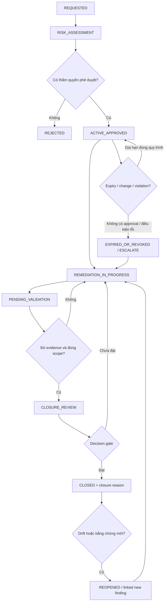
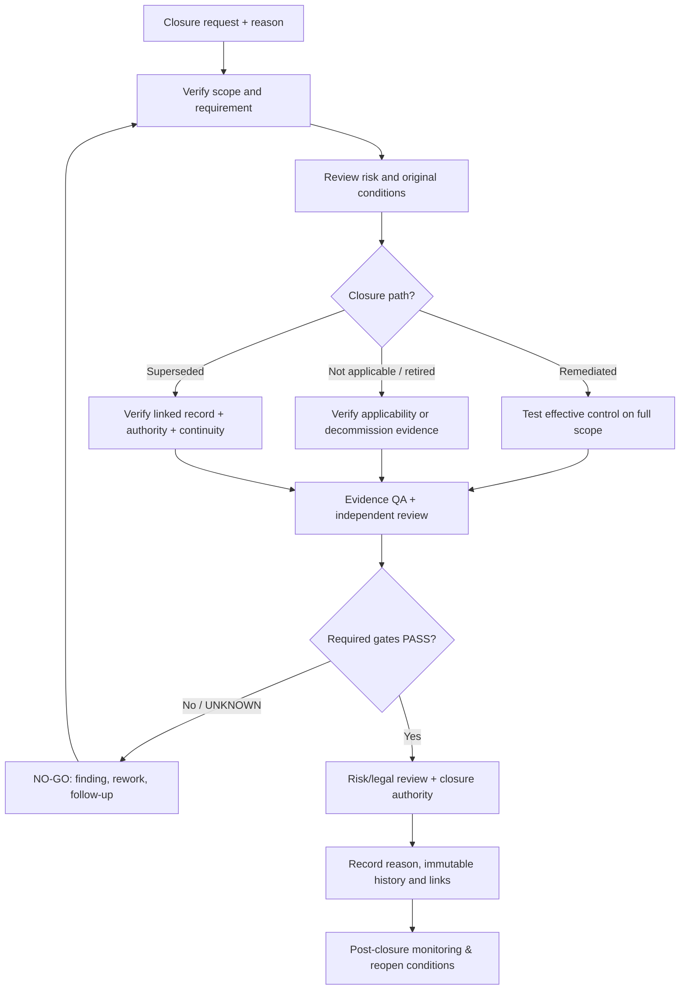

# Đóng exception: Chấm dứt ngoại lệ bảo mật bằng kiểm chứng và quyết định có trách nhiệm

## 1. Mục tiêu học tập

Sau bài học, người học có thể:

- Giải thích **đóng exception** (kết thúc hồ sơ ngoại lệ) trong **exception management** và phân biệt nó với việc ngoại lệ **hết hạn**, **được thu hồi**, **được gia hạn**, **được thay thế**, **được chấp nhận rủi ro** hoặc **chưa còn áp dụng**.
- Xác định điều kiện đóng một ngoại lệ theo **security requirement, control baseline, phạm vi tài sản, lý do ban đầu, rủi ro còn lại, thời hạn và điều kiện phê duyệt**.
- Thiết kế quy trình **remediation → verification → risk assessment → approval → closure → monitoring** với trách nhiệm rõ ràng, phân quyền phù hợp và bằng chứng có thể kiểm toán.
- Đánh giá **design effectiveness** và **operating effectiveness** sau khắc phục; tránh đánh dấu đóng chỉ vì đã tạo ticket, merge pull request, triển khai policy hoặc vendor thông báo “fixed”.
- Tạo **closure evidence package** có dữ liệu trước/sau, phương pháp kiểm, kết quả quan sát, thời điểm, source provenance, coverage, người đánh giá độc lập và điều kiện mở lại.
- Quản lý các trường hợp **không còn áp dụng, decommission, chuyển phạm vi, superseded, compensating control, expiry** mà không xóa rủi ro hoặc nghĩa vụ pháp lý/hợp đồng đang tồn tại.
- Xây dựng bảng trạng thái, bộ tiêu chí GO/NO-GO, audit trail, dữ liệu YAML và truy vấn kiểm soát quá hạn/sẵn sàng đóng.
- Đo hiệu quả đóng exception bằng các KPI/KRI không khuyến khích **đóng giả**, bỏ qua UNKNOWN hoặc che các high-risk findings.
- Thực hành thẩm định một ngoại lệ IAM, logging, disaster recovery hoặc cloud configuration đến khi đủ bằng chứng để kết thúc.

Bài thuộc chương **Exception management** của dịch vụ `SECURITY_SECURITY_ASSURANCE`. Dịch vụ hướng đến **đánh giá có bằng chứng** rằng hệ thống đáp ứng mục tiêu bảo mật, từ phân tích rủi ro, yêu cầu và security controls đến kiểm thử, audit, khắc phục phát hiện; tổ chức duy trì assurance liên tục trong phát triển và vận hành. Vì vậy, **đóng exception không phải thao tác đổi trạng thái cho đẹp**, mà là một quyết định bảo đảm rằng **lý do cần ngoại lệ đã được xử lý hoặc không còn áp dụng theo căn cứ được phê duyệt, và các rủi ro còn lại vẫn được quản trị**.

## 2. Exception là gì và “đóng” có ý nghĩa gì?

Trong bảo mật, **exception** là sai lệch có phạm vi so với **chính sách, tiêu chuẩn, security requirement hoặc control baseline** được quản lý qua quy trình cho phép, thường có **rationale, assessment rủi ro, người chịu trách nhiệm, điều kiện, biện pháp bù trừ và ngày hết hạn**.

Ví dụ: một ứng dụng legacy chưa hỗ trợ cơ chế xác thực quản trị phù hợp baseline. Risk owner cho phép ngoại lệ **có điều kiện** trong một khoảng thời gian, áp dụng riêng với hệ thống đó, yêu cầu giới hạn mạng, tăng audit và triển khai phương án nâng cấp. Đó **không** có nghĩa baseline bị xóa hoặc hệ thống đã đạt control.

**Đóng exception** là kết thúc hiệu lực/nhu cầu theo dõi của **một exception record cụ thể** dựa trên một **closure reason** hợp lệ và bằng chứng, sau khi được những người có thẩm quyền xác nhận. Đóng phải trả lời:

1. Ngoại lệ ban đầu cho phép sai lệch **gì** so với yêu cầu **nào**, trên tài sản/quy trình **nào**?
2. Sai lệch đó còn tồn tại trong **effective state** của hệ thống không?
3. Nếu đã sửa, những phép kiểm nào chứng minh control **thực sự hoạt động**?
4. Nếu phạm vi thay đổi hoặc không còn áp dụng, căn cứ nào chứng minh **toàn bộ nghĩa vụ/tài sản liên quan đã được xử lý**?
5. Những **risk, findings, dependencies** còn lại được đóng, liên kết chuyển tiếp hay đang mở theo hồ sơ nào?
6. Ai đã kiểm độc lập, ai có thẩm quyền ra **quyết định đóng**, và có thể tái lập kết luận không?
7. Sau khi đóng, điều gì sẽ giám sát tái diễn và **khi nào phải mở lại**?

### 2.1. Một ví dụ rất ngắn

**Exception EX-IAM-017:** trong 45 ngày, tài khoản dịch vụ `svc-export` tại môi trường production được phép giữ quyền ghi rộng hơn baseline với điều kiện có audit và network restriction.

- Team triển khai IAM policy mới: đây là **ACTION_TAKEN**.
- Role sau triển khai đã thu hẹp nhưng token cũ vẫn có khả năng sử dụng: **CHƯA ĐỦ ĐIỀU KIỆN ĐÓNG**.
- Token cũ đã bị thu hồi, effective IAM đã kiểm, negative access test từ danh tính cũ bị từ chối, audit vẫn hoạt động; reviewer xác minh đúng toàn bộ scope: **CÓ THỂ ĐỀ NGHỊ ĐÓNG**.
- Người có thẩm quyền kiểm risk và phê duyệt closure, ghi đầy đủ record: **CLOSED_VERIFIED** theo mô hình minh họa.

Trình tự này tránh nhầm **change deployed** với **remediation effective**.

## 3. Phân biệt exception, finding, risk acceptance và closure

| Khái niệm | Bản chất | Điều không được suy ra |
|---|---|---|
| **Security requirement / baseline** | Điều kiện tổ chức cần đáp ứng trong phạm vi áp dụng | Không tự thay đổi vì có ngoại lệ |
| **Finding / nonconformity** | Bằng chứng phát hiện một sai lệch hoặc khoảng trống | Có finding không đồng nghĩa đã có ngoại lệ được duyệt |
| **Exception request** | Đề nghị được tạm thời xử lý khác baseline | Chưa phải approval |
| **Approved exception** | Sai lệch được chấp thuận theo phạm vi, thời hạn, điều kiện | Không phải control PASS hoặc compliance PASS |
| **Risk acceptance** | Quyết định chấp nhận một mức rủi ro theo thẩm quyền | Không tự miễn nghĩa vụ pháp lý/hợp đồng |
| **Compensating control** | Biện pháp giảm rủi ro theo một con đường khác | Không mặc nhiên thay thế yêu cầu gốc trong mọi framework |
| **Remediation** | Hành động sửa nguyên nhân/sai lệch | Triển khai xong chưa chắc đã có hiệu lực |
| **Verification** | Kiểm tra trạng thái thực so với expected | Một test không đúng scope chưa đủ |
| **Closure** | Kết thúc hồ sơ ngoại lệ theo quyết định có căn cứ | Không xóa lịch sử và không tự xóa findings khác |
| **Reopen** | Kích hoạt lại điều tra/quản trị khi kết luận cũ bị vô hiệu | Không được ghi đè bằng chứng cũ |

**Hai hồ sơ có vòng đời khác nhau:** finding có thể theo dõi một control failure còn exception ghi quyết định tạm thời cho sai lệch đó. Đóng exception không tự động đóng finding; cần chứng minh điều kiện đóng của **từng hồ sơ** và giữ liên kết.

### 3.1. Ngoại lệ hợp lệ vẫn có rủi ro

Một tổ chức có thể phê duyệt giữ một endpoint legacy trong 30 ngày vì chưa thể thay thế ngay, với network segmentation và monitoring tăng cường. Trong thời hạn đó:

- **Risk vẫn tồn tại**, dù đã được chấp nhận có điều kiện.
- Requirement/baseline có thể vẫn chưa đạt.
- Compensating controls cần được kiểm định kỳ.
- Exception có thể bị thu hồi sớm nếu điều kiện thay đổi.
- Phải có kế hoạch sửa bền vững và tiêu chí kết thúc.

Vì thế báo cáo “0 open exceptions” **không thể** được hiểu như “0 rủi ro còn lại”.

## 4. Vì sao đóng exception là điểm kiểm soát quan trọng?

Một chương trình exception management cho phép vận hành linh hoạt, nhưng đồng thời có nguy cơ trở thành cơ chế **hợp thức hóa cấu hình yếu lâu dài** nếu thiếu kỷ luật đóng và xác minh.

### 4.1. Các dạng sai lầm thực tế

- Exception hết hạn tự động biến mất khỏi dashboard, trong khi vi phạm baseline vẫn tồn tại.
- Service owner nhấn **Close** sau khi merge PR, không kiểm runtime.
- Control team chỉ chụp ảnh policy mong muốn mà không xác minh quyền **hiệu lực**.
- Dịch vụ đổi tên hoặc chuyển cloud account, exception được đóng dù sai lệch di chuyển theo.
- Đóng finding và exception trong một thao tác chung mà không có evidence độc lập.
- Compensating control ngừng hoạt động trước thời điểm remediation thực sự đạt.
- Vendor gửi email “resolved”, customer không xác minh tenant configuration, token hoặc data.
- Reviewer đồng thời là người tạo và tự phê duyệt thay đổi high-risk.
- Hệ thống dùng một nhãn `CLOSED` nhưng không ghi **lý do** và **nguồn bằng chứng**.

Hậu quả có thể là **audit gap**, **rủi ro chưa ai sở hữu**, **suy giảm assurance** hoặc quyết định sai về mức sẵn sàng nghiệp vụ.

### 4.2. Mục tiêu của closure có chất lượng

Một quy trình tốt cần đồng thời bảo đảm:

1. **Completeness:** không bỏ sót scope, control objectives và actions liên quan.
2. **Correctness:** kết quả dựa trên thực tế, không dựa vào dự định.
3. **Traceability:** từ exception đến requirement, risk, finding, test và evidence.
4. **Accountability:** người thực hiện, reviewer và approver rõ ràng.
5. **Timeliness:** không đóng trễ vô lý nhưng không ép đóng khi thiếu chứng cứ.
6. **Auditability:** giữ bản ghi, thời gian, quyết định và lý do.
7. **Continuity:** có monitoring và điều kiện mở lại khi hệ thống thay đổi.

## 5. Vòng đời exception và trạng thái kết thúc

Trạng thái nên mô tả **thực tế tiến độ** thay vì chỉ cho phép hai nhãn OPEN/CLOSED.



Sơ đồ là **mô hình minh họa**, không phải một workflow bắt buộc của mọi phần mềm. Trong thực tế, `REJECTED`, `EXPIRED` và `REVOKED` có thể là trạng thái kết thúc **của quyền ngoại lệ**, nhưng **rủi ro sai lệch vẫn có thể phải mở finding/escalation**. Không chuyển những trạng thái này thành `CLOSED_VERIFIED`.

### 5.1. Những nhãn nên phân biệt

| Status | Ý nghĩa |
|---|---|
| `REQUESTED` | Chưa phê duyệt ngoại lệ |
| `ACTIVE_APPROVED` | Có phê duyệt còn hiệu lực theo scope/điều kiện |
| `REMEDIATION_IN_PROGRESS` | Đang sửa nguyên nhân hoặc điều kiện thay thế |
| `ACTION_TAKEN` | Đã triển khai thay đổi nhưng chưa xác minh hiệu lực |
| `PENDING_VALIDATION` | Chờ phép kiểm/reviewer |
| `CLOSURE_REVIEW` | Đủ hồ sơ đề nghị quyết định đóng |
| `CLOSED_VERIFIED` | Đóng vì sai lệch đã được xử lý, kiểm đạt trong scope |
| `CLOSED_NOT_APPLICABLE` | Nguồn yêu cầu không còn áp dụng, có review chính thức |
| `CLOSED_SCOPE_RETIRED` | Asset/quy trình liên quan đã decommission có chứng cứ |
| `SUPERSEDED_LINKED` | Hồ sơ được thay bằng cơ chế khác có liên kết và trách nhiệm; không đồng nghĩa rủi ro hết |
| `EXPIRED_UNRESOLVED` | Quyền ngoại lệ hết hạn nhưng vấn đề còn tồn tại |
| `REVOKED_UNRESOLVED` | Approval bị thu hồi nhưng vi phạm/risks chưa đóng |
| `REOPENED` | Kết luận closure bị thách thức bởi drift/evidence mới |

Không cần dùng đúng tên này, nhưng hệ thống phải giữ **ngữ nghĩa** giữa “đã giải quyết sai lệch” và “quyền exception không còn có hiệu lực”.

## 6. Những lý do đóng hợp lệ và giới hạn từng trường hợp

**Closure reason** là thành phần bắt buộc để diễn giải trạng thái cuối.

| Closure reason | Điều kiện cốt lõi | Bằng chứng cần có | Cảnh báo |
|---|---|---|---|
| **REMEDIATED_VERIFIED** | Sai lệch đã được loại bỏ trên toàn scope | Runtime/effective state, test PASS, review | Không dùng chỉ PR merge hoặc screenshot baseline |
| **REQUIREMENT_NOT_APPLICABLE** | Nghĩa vụ/tiêu chí không còn áp dụng theo quyết định có thẩm quyền | Applicability review, source/version, scope | Không chọn chỉ vì chi phí remediation cao |
| **ASSET_RETIRED_VERIFIED** | Tài sản/đường thực thi thật sự ngừng hoạt động và hết quyền/dữ liệu liên quan | Inventory, DNS/routing, IAM, data migration/deletion evidence | Đổi hostname chưa phải decommission |
| **REPLACED_BY_APPROVED_BASELINE** | Baseline/yêu cầu đã thay đổi đúng governance và hệ thống đáp ứng bản áp dụng | Change approval, mapping, control tests | Không sửa policy để hợp thức hóa hậu kiểm |
| **SUPERSEDED_WITH_LINKAGE** | Hồ sơ hành chính được thay bằng exception/risk record có owner, scope và approval phù hợp | Old/new IDs, overlap, effective date, audit decision | Rủi ro **được chuyển tiếp**, không tuyên bố mitigated |
| **REQUEST_WITHDRAWN** | Yêu cầu ban đầu chưa được duyệt hoặc không còn nhu cầu xin ngoại lệ | Request history, reason, reviewer | Nếu đang sai lệch cần finding riêng |

Trong mô hình quản trị chặt chẽ, **SUPERSEDED_WITH_LINKAGE** và **REQUEST_WITHDRAWN** có thể là loại *administrative termination*, **không được cộng** vào “exception remediated successfully”. Nên giữ một taxonomy phân biệt **risk-resolving closure** với **administrative closure**.

### 6.1. Không được “đóng” chỉ vì hết hạn

Ngày hết hạn `expires_at` là **thời điểm chấm dứt phạm vi ủy quyền** nếu không có approval mới. Nó không chứng minh:

- Control đã đạt.
- Rủi ro giảm.
- Compensating controls đã đủ.
- Pháp luật/hợp đồng cho phép tiếp tục vận hành.
- Exception record có bằng chứng closure.

Nếu việc khắc phục chưa xong tại ngày hết hạn, cần **escalate trước deadline hoặc xử lý theo quy trình quá hạn**: hạn chế hoạt động, disable exception path, emergency approval đúng thẩm quyền (nếu được phép) hoặc tiếp tục finding. Không tự tạo gia hạn hồi tố.

### 6.2. Không đổi baseline để che vi phạm

Một policy thay đổi có thể khiến yêu cầu cũ không còn áp dụng, nhưng cần chứng minh đó là **thay đổi được phê duyệt có hiệu lực chung và dựa trên risk review**, không phải xóa tiêu chí sau khi audit phát hiện không đạt. Phải lưu phiên bản policy trước/sau, effective date, phê duyệt và kiểm hệ thống theo baseline mới.

## 7. Preconditions: Điều kiện tối thiểu trước khi xem xét closure

Một hồ sơ ngoại lệ chỉ nên bước vào **closure review** khi có các thông tin sau:

1. **Identity:** exception ID, trạng thái hiện hành, owner, nguyên nhân và quyết định phê duyệt ban đầu.
2. **Requirement:** policy/control/contract clause, phiên bản và phạm vi áp dụng.
3. **Scope:** service, asset IDs, accounts, regions, tenants, data types, principal classes, môi trường.
4. **Risk:** threat scenario, tác động, risk tier, residual risk và người có thẩm quyền.
5. **Mitigation conditions:** compensating controls, monitoring, thời hạn và điều kiện vận hành.
6. **Change record:** action thực hiện, version/config, người thực hiện và thời điểm.
7. **Verification plan:** assertions, population, expected, method, tool/queries và frequency.
8. **Verification results:** observed, evidence IDs, timestamp, completeness, pass/fail/unknown.
9. **Dependencies:** findings, incidents, risk records, vendor tickets, change requests, nested exceptions.
10. **Review:** độc lập tương xứng rủi ro, kiểm exception hết hiệu lực và nghĩa vụ.
11. **Decision:** closure reason, approver, thời điểm, rationale và follow-up.

Nếu không có `requirement_ref` hoặc `approved_scope`, **không thể biết phải kiểm gì**. Đây là một **data-quality blocker**, không phải lý do hạ điều kiện closure.

### 7.1. Decision gate minh họa

```text
GATE A — Identity & applicability: đúng exception, requirement, scope?
GATE B — Authorized path: lý do kết thúc hợp lệ và có quyền phê duyệt?
GATE C — Effective state: sai lệch đã biến mất hoặc scope thực sự không còn?
GATE D — Evidence quality: đủ, đúng kỳ, đúng tài sản, có provenance?
GATE E — Independent review: người xác minh và approver phù hợp?
GATE F — Residual risk: findings, linked exceptions, legal duties có được quản trị?
GATE G — Handover: monitoring, revalidation trigger, audit trail sẵn sàng?
Nếu GATE bắt buộc = FAIL/UNKNOWN -> NO-GO hoặc REVIEW_REQUIRED.
```

Đây là gợi ý nội bộ. Nếu một nghĩa vụ **không cho phép ngoại lệ hoặc cách thay thế được đề xuất**, không thể tạo GO bằng một approval nội bộ.

## 8. Truy vết scope trước và sau: Đóng đúng tài sản

Một exception luôn có **scope**, không phải chỉ một câu mô tả trong ticket.

### 8.1. Những loại scope hay bị thiếu

| Chiều | Ví dụ | Cách đối chiếu |
|---|---|---|
| Business service | Checkout, CRM, analytics | Service registry/BIA |
| Environment | Production/DR/staging | Deployment inventory |
| Cloud | Accounts, projects, regions | Cloud asset inventory |
| Kubernetes | Cluster, namespace, workload, ServiceAccount | Runtime API/IaC |
| Identity | Human/admin/service principal, OAuth grants | Effective IAM, IdP/SSO |
| Network | Ingress, egress, private links, VPN | Route/security policy và tests |
| Data | Dataset, storage, cache, backup, export | Data catalog/lineage |
| Supplier | SaaS tenant, managed platform, subprocessor | Vendor register và trách nhiệm |
| Time | Approval effective_from/expires_at | Decision log và UTC timestamp |
| Control | Requirement/control ID, baseline version | Policy registry và mapping |

Một exception áp dụng cho `cloud-account-prod-a` **không thể** được đóng bằng test của `cloud-account-staging`. Nếu hệ thống đã chuyển sang `cloud-account-prod-b`, phải xác nhận **sai lệch có còn ở account mới không** và có yêu cầu cập nhật scope hay mở hồ sơ mới không.

### 8.2. Scope drift

Giả sử ngoại lệ `EX-NET-021` ban đầu cho phép egress tới một endpoint từ ứng dụng A. Trong quá trình migration, 3 workloads khác dùng lại cùng security group. Nếu chỉ kiểm ứng dụng A, có thể **đóng sai lệch một phần** trong khi quyền egress rộng tồn tại cho 3 workloads mới.

Cần so:

- **Approved exception scope** từ record.
- **Current affected population** từ inventory và effective configs.
- **Intended control scope** theo baseline.
- **Observed remediated population** qua tests.
- **New/out-of-scope exposures** cần finding hoặc exception mới, không được bỏ qua.

### 8.3. Đóng một phần khác đóng toàn bộ

Nếu sai lệch đã sửa ở 8/10 assets, có thể tạo **partial remediation milestone**, nhưng toàn exception **không thể mang nhãn CLOSED_VERIFIED** nếu 2 assets còn thuộc scope bắt buộc. Có thể chia thành những hồ sơ quản lý theo asset nếu được phê duyệt và giữ linkage; không tự loại 2 assets khỏi mẫu số.

## 9. Từ remediation plan đến điều kiện đóng

Khi phê duyệt ngoại lệ, cần thiết kế **closure criteria ngay từ đầu**, không chờ đến ngày hết hạn mới quyết định thế nào là “xong”.

### 9.1. Một remediation plan nên có

| Thành phần | Câu hỏi |
|---|---|
| **Root cause** | Vì sao control chưa đạt? Legacy constraint, design, drift hay ownership? |
| **Target state** | Kết quả đúng theo policy/baseline có version? |
| **Tasks** | Phải sửa code, IAM, network, keys, pipeline hay quy trình nào? |
| **Owner** | Ai thực hiện và ai xác nhận? |
| **Milestones** | Triển khai/test/review trước hạn nào? |
| **Preconditions** | Có downtime, vendor action, access approval cần trước? |
| **Compensating controls** | Trong lúc chưa sửa, biện pháp nào phải còn hoạt động? |
| **Evidence plan** | Thu bằng chứng gì và từ nguồn nào? |
| **Rollback** | Làm sao nếu thay đổi gây sự cố? |
| **Closure gate** | Kiểm nào phải PASS và UNKNOWN nào là blocker? |

### 9.2. “Đã sửa” phải là assertion có thể kiểm

Thay vì: “Đã cập nhật permission”, hãy mô tả:

> “Tất cả principal được liệt kê trong scope `EX-IAM-017` không còn effective permission `storage.objects.delete` trên tài nguyên `bucket-customer-prod`; không tồn tại grant tương đương qua group/service role; token cũ không thể thực hiện thao tác bị cấm và audit vẫn ghi hành vi liên quan theo baseline.”

Từ assertion đó có thể xác định **expected** và **observed**; đồng thời không suy rộng sang buckets hoặc principals ngoài scope.

### 9.3. Phân biệt action, output và outcome

- **Action:** cập nhật IAM policy trong IaC.
- **Output:** pipeline triển khai thành công policy revision.
- **Observed control outcome:** effective permissions và đường thực thi đều đáp ứng baseline.
- **Risk outcome:** đường lạm dụng xác định đã bị chặn trong phạm vi, với bằng chứng và risk review.
- **Closure decision:** approver xác nhận điều kiện kết thúc được đáp ứng.

Bốn tầng đầu hỗ trợ tầng cuối, nhưng không được bỏ bước.

## 10. Verification: Chứng minh control có hiệu lực

**Verification** không chỉ là kiểm cấu hình mong muốn mà là so sánh **trạng thái thực tế** và **hành vi có thể quan sát** với closure assertions.

### 10.1. Các loại evidence khác nhau

| Bằng chứng | Có thể chứng minh | Không tự chứng minh |
|---|---|---|
| Approved change ticket | Hành động đã được yêu cầu/phê duyệt | Control đã hoạt động sau triển khai |
| Merge request/commit | Code/IaC đã thay đổi ở repository | Runtime không drift |
| CI/CD success | Pipeline đã chạy thành công theo điều kiện | Effective permissions hoặc business outcome đúng |
| Configuration snapshot | State tại một mốc từ nguồn có thẩm quyền | Hành vi dưới mọi tình huống/kỳ |
| Audit logs | Một số actions thực được ghi nhận | Không có blind spot trên toàn scope |
| Positive/negative test | Hành vi đạt/chặn trong điều kiện thử | Toàn bộ kịch bản và assets đều đạt |
| Data integrity/reconciliation | Dữ liệu kiểm tra đúng so với source | Không có truy cập trái phép trong mọi kỳ |
| Review sign-off | Người có trách nhiệm đã xem xét hồ sơ | Reviewer có thể chưa có nguồn đúng |
| Independent attestation | Kết quả đối chiếu từ bên phù hợp | Mặc nhiên đúng cho ngoài scope/kỳ |

### 10.2. Thiết kế test đúng closure assertion

Một test record nên có:

- `test_id` và `control_instance_id`.
- `assertion`: điều cần chứng minh.
- `approved_scope`: asset IDs, identities, interfaces, dữ liệu, kỳ.
- `expected`: tiêu chí đạt và ngưỡng.
- `procedure`: bước thử được phép, nguồn, phiên bản công cụ.
- `observed`: kết quả thực và trường hợp ngoại lệ.
- `evidence_refs`: logs/snapshot/result với timestamps và provenance.
- `limitations`: test coverage, dữ liệu thiếu, giờ chạy, quyền hạn.
- `result`: PASS/FAIL/UNKNOWN/NOT_TESTED.
- `tester`, `reviewer` và `checked_at`.

**Một phép kiểm chỉ có ý nghĩa khi phù hợp với mục tiêu, asset scope và thời điểm quyết định đóng**. Test ở staging không tự chứng minh production; kết quả trước khi thay release có thể không còn đủ.

### 10.3. Negative testing

Ví dụ sau khi thu hồi quyền admin của một service account:

- **Positive test:** danh tính được cấp hợp lệ vẫn thực hiện chức năng cho phép.
- **Negative test:** danh tính/token bị thu hồi không thể thực hiện thao tác trái phép.
- **Effective access review:** không còn role/group/trust path tương đương.
- **Audit test:** hành vi denied và thay đổi IAM được ghi theo yêu cầu.
- **Persistence check:** session/token cache và credential ở các môi trường liên quan đã được xử lý.

Nếu chỉ test chức năng hợp lệ vẫn hoạt động, chưa chứng minh đường lạm dụng đã bị chặn.

## 11. Độ đủ và độ tin cậy của closure evidence

Bằng chứng cần được đánh giá **trước khi approver ký**, không chỉ đính kèm đủ số file.

### 11.1. Các chiều chất lượng

| Chiều | Câu hỏi kiểm |
|---|---|
| **Relevance** | Evidence có trực tiếp xác minh lý do exception ban đầu? |
| **Scope completeness** | Có bao phủ tất cả asset/principal/region trong approved scope? |
| **Accuracy** | Event semantics, query, schema và measurement có chính xác? |
| **Timeliness** | Thu sau khi remediation và còn đúng với release hiện hành? |
| **Source provenance** | Evidence đến từ hệ thống nào, ai thu, lúc nào? |
| **Integrity** | Có cơ chế chống sửa trái phép/metadata kiểm tính toàn vẹn? |
| **Reproducibility** | Reviewer có thể kiểm lại phép đo mà không đoán phương pháp? |
| **Independence** | Có nguồn khác hoặc người review độc lập tương xứng rủi ro? |
| **Privacy** | Evidence có loại bỏ secrets, PII không cần thiết? |
| **Known gaps** | Có log loss, unsupported assets, thiếu test hoặc hạn chế khác? |

### 11.2. Quy tắc không suy ra “không có lỗi” từ “không thấy log”

Nếu trước đây ngoại lệ cho phép thiếu security logging, một dashboard không hiển thị sự cố **không đủ chứng minh** sai lệch đã được khắc phục. Phải kiểm **event được tạo và đến protected sink** trong scope, data-source health, pipeline lag, retention và ability to query.

Nếu log chỉ bắt đầu từ hôm qua, không thể dùng chúng để kết luận hoạt động suốt ba tháng trước đều hợp lệ. Trạng thái quá khứ có thể còn **UNKNOWN**, dù control hiện tại đã được sửa; rủi ro và nghĩa vụ điều tra tồn dư cần được giữ riêng.

### 11.3. Evidence sau remediation mới có ý nghĩa cho closure

Một security scan PASS từ trước khi thay đổi kiến trúc có thể không còn phù hợp. Một scan FAIL trước remediation nhưng dashboard hiện giờ không còn finding cũng có thể do scope giảm hoặc tool bị tắt. Cần đối chiếu **trước/sau, phiên bản, assets, source health và test coverage**, không chỉ trạng thái UI.

## 12. Compensating controls: Tiếp tục, thay thế hay tháo bỏ?

Ngoại lệ thường được phê duyệt kèm **compensating controls** để giảm rủi ro trong khi chưa sửa triệt để. Đóng exception không đồng nghĩa có thể xóa ngay các biện pháp này.

### 12.1. Quy tắc xử lý

- Nếu primary control đã được **khôi phục đầy đủ và re-test**, đánh giá compensating controls nào có thể bỏ mà không làm mở lại rủi ro.
- Nếu compensating control đã trở thành **giải pháp lâu dài**, cần đánh giá policy/framework có cho phép tương đương không, quyền phê duyệt thay đổi baseline, coverage và evidence về hiệu lực.
- Nếu còn sai lệch nhưng compensating control hoạt động, đó thường vẫn là **ngoại lệ còn cần quản trị**, không tự chuyển thành `CLOSED_VERIFIED`.
- Nếu compensating control thất bại **trước khi remediation hoàn tất**, có thể phải **revoke exception**, nâng severity hoặc kích hoạt containment.
- Nếu có nhiều exception dùng chung một compensating control, không được tháo bỏ chỉ vì **một** hồ sơ đã đóng.

### 12.2. Ví dụ

`EX-MFA-012` cho phép một cổng admin legacy chưa hỗ trợ MFA, với điều kiện vào qua VPN, bastion, IP restriction và session recording.

Sau khi triển khai MFA:
- Phải kiểm **mọi đường truy cập admin**, gồm direct endpoint và break-glass.
- Phải xác minh MFA không bị bypass qua API/token cũ.
- Phải đánh giá VPN/bastion/session recording còn phục vụ security objectives khác không.
- Nếu bỏ bastion làm xuất hiện admin interface mở internet, việc đóng exception MFA có thể **tạo finding mới**.

Closure nên đánh giá **tác động thay đổi của cả gói controls**, không chỉ nguyên nhân ban đầu theo nghĩa hẹp.

## 13. Expiry, renewal, revoke và closure: Bốn quyết định khác nhau

### 13.1. Expiry

Đến `expires_at`, approval **không còn hiệu lực**, trừ khi có quy tắc gia hạn được phê duyệt trước. Hệ thống cần phát hiện và escalation; bản ghi vẫn có thể `EXPIRED_UNRESOLVED`. **Đừng tự xóa hoặc đánh dấu compliant**.

### 13.2. Renewal

Gia hạn là **quyết định mới** về phạm vi/thời hạn/rủi ro trên cơ sở bằng chứng hiện hành. Cần đánh giá:
- Vì sao remediation chưa xong?
- Rủi ro đã tăng sau incidents/threat changes?
- Compensating controls còn hiệu lực và có evidence?
- Mốc xử lý mới có khả thi, có chủ chịu trách nhiệm?
- Cấp phê duyệt gia hạn có đúng policy và nghĩa vụ không?
- Có lặp lại gia hạn nhiều lần đến mức thành sai lệch thường trực?

Renewal **không phải closure** và không nên xóa lịch sử các lần gia hạn trước.

### 13.3. Revocation

Thu hồi có thể xảy ra khi ngoại lệ bị lạm dụng, scope bị mở rộng trái phép, compensating control thất bại hoặc rủi ro vượt tolerance. Sau revocation cần **xử lý hệ thống**: giảm quyền, chặn luồng, rollback, tạm dừng tính năng hoặc quyết định khẩn cấp theo quy trình; không chỉ đổi trạng thái trong GRC.

### 13.4. Closure

Closure theo dạng **risk-resolving** chỉ khi những điều kiện kết thúc đã được kiểm đạt, còn loại **administrative closure** phải chỉ rõ rủi ro tiếp tục được quản lý ở đâu. Báo cáo cần tách thống kê các loại.

## 14. Ai có quyền đề nghị, kiểm chứng và phê duyệt đóng?

Để tránh xung đột lợi ích, nên có **segregation of duties** tương xứng rủi ro.

| Vai trò | Trách nhiệm |
|---|---|
| **Exception requester / system owner** | Mô tả sai lệch, triển khai remediation, cung cấp evidence |
| **Control owner** | Định nghĩa expected state và kiểm design phù hợp baseline |
| **Security assurance / verifier** | Kiểm test/evidence, scope, freshness, data gaps và kết luận kỹ thuật |
| **Risk owner** | Đánh giá residual risk, điều kiện tồn tại và tác động nghiệp vụ |
| **Compliance/legal/privacy** | Kiểm applicability, nghĩa vụ không thể miễn trừ và yêu cầu bổ sung |
| **Business owner** | Xác nhận ảnh hưởng nghiệp vụ, downtime, phương án thay thế |
| **Change/release manager** | Xác minh deployment/change record và rollback khi liên quan |
| **Final closure approver** | Quyết định theo thẩm quyền, chấp nhận/không chấp nhận kết luận |
| **Audit / independent reviewer** | Có thể kiểm lại tính nhất quán, đầy đủ và tuân thủ quy trình |

Không có quy tắc mọi tổ chức cần đúng 9 người. Trong tổ chức nhỏ có thể kiêm nhiệm, nhưng với ngoại lệ high-risk cần **review độc lập hơn** và minh bạch xung đột lợi ích. Người viết code hoặc owner vận hành **không nên tự cung cấp evidence, tự review và tự phê duyệt closure** khi chính sách yêu cầu tách trách nhiệm.

### 14.1. RACI minh họa

| Hoạt động | System owner | Control/assurance | Risk owner | Legal/compliance | Closure authority |
|---|---|---|---|---|---|
| Đề nghị đóng | R | C | I | I | I |
| Xác định tiêu chí kiểm | C | R | C | C | I |
| Thu runtime evidence | R | C | I | I | I |
| Đánh giá evidence | C | R | C | C khi liên quan | I |
| Đánh giá residual risk | C | C | A/R | C | I |
| Quyết định đóng | I | C | C | C khi liên quan | A/R |
| Theo dõi sau đóng | R | R/C | A theo phạm vi | C khi cần | I |

`R` = thực hiện; `A` = chịu trách nhiệm phê duyệt cuối cho hoạt động; `C` = tham vấn; `I` = được thông báo. Bảng cần điều chỉnh theo cấu trúc quản trị và thẩm quyền của tổ chức.

## 15. Compliance/legal constraints trước khi đóng exception

Một exception nội bộ **không tự miễn nghĩa vụ** từ luật, hợp đồng, quy định ngành hoặc điều kiện chứng nhận/đánh giá. Vì vậy, closure phải phân biệt:

- **Yêu cầu nội bộ có thể điều chỉnh:** chính sách do tổ chức ban hành, quyền thay đổi được quy định.
- **Tiêu chuẩn/framework được lựa chọn:** điều kiện áp dụng, phương pháp đánh giá và có cho phép control thay thế không.
- **Hợp đồng với khách hàng/đối tác:** nghĩa vụ thực tế và thẩm quyền thay đổi/phê duyệt.
- **Luật/quy định:** điều kiện áp dụng do legal/compliance owner xác định, không suy diễn từ tên control.
- **Vendor controls/shared responsibility:** phần bên thứ ba cung cấp và phần tổ chức cần tự kiểm.

### 15.1. Ví dụ không thể đóng bằng risk acceptance đơn thuần

Giả sử một điều khoản hợp đồng yêu cầu báo cáo sự cố từ nhà cung cấp trong thời hạn thỏa thuận. Tổ chức chưa có kênh nhận thông báo dự phòng và được phê duyệt “exception vận hành” trong 30 ngày. Sau 30 ngày, risk owner đồng ý tiếp tục chịu rủi ro.

Quyết định đó **không tự thay đổi nghĩa vụ hợp đồng**. Để kết luận compliance, cần kiểm điều khoản, thỏa thuận sửa đổi nếu có, kênh liên hệ, notification test và vai trò pháp lý của từng bên. Không chuyển ngoại lệ sang PASS vì approval nội bộ được gia hạn.

### 15.2. NOT_APPLICABLE phải có căn cứ

Nếu hệ thống đã ngừng xử lý loại dữ liệu thuộc phạm vi nghĩa vụ, có thể thay đổi applicability. Tuy nhiên cần evidence về **data flows, backups, logs, replicas, vendor copies và đường truy cập**, không chỉ tuyên bố “không còn dùng”. Phạm vi không áp dụng phải được người có thẩm quyền xác nhận theo nguồn yêu cầu hiện hành.

## 16. Bảo toàn bằng chứng và audit trail

Closure là quyết định quản trị có hậu quả, nên hồ sơ cần giữ **trước, trong và sau quyết định**.

### 16.1. Thông tin cần lưu

| Nhóm | Dữ liệu |
|---|---|
| Exception gốc | ID, requirement, scope, risk, requester, approver, effective/expiry dates |
| Conditions | Compensating controls, monitoring, vận hành được phép, breach triggers |
| Change history | Các lần renew, suspend, revoke, scope change, policy change |
| Remediation | Change tickets, code/config release, owner, rollback, timestamps |
| Verification | Test plan, population, evidence refs, results, tester/reviewer |
| Decision | Closure reason, GO/NO-GO, approver, timestamp, rationale |
| Dependencies | Linked risk/finding/incident/asset/vendor/exception IDs |
| Residual risk | Khả năng và tác động còn lại, người sở hữu, follow-up |
| Post-closure | Monitoring, drift triggers, lịch revalidation, reopen rule |
| Integrity | Source provenance, immutable revision, quyền truy cập, retention |

### 16.2. Quy tắc kiểm toán

- Giữ **lịch sử trạng thái** và không ghi đè lý do từ chối đóng.
- Evidence references trỏ tới artifacts có quyền, metadata, timestamp và nguồn tin cậy.
- Hạn chế người có thể sửa `closure_decision` và các mốc phê duyệt.
- Ghi các lần bổ sung evidence sau cutoff bằng **revision** chứ không sửa lịch sử không dấu vết.
- Nếu có tranh chấp hoặc điều tra, áp dụng retention/legal hold theo chính sách và nghĩa vụ.
- Không sao chép secrets hoặc dữ liệu cá nhân không cần thiết vào exception ticket.
- Không tạo “evidence PASS” chỉ vì một command thành công; phải có **test assertion và kết quả observed**.

## 17. Runbook đóng exception: Quy trình từng bước

### Bước 1 — Mở closure request

System owner nêu `exception_id`, closure reason đề xuất, điều kiện kết thúc và thời điểm. Kiểm hồ sơ có approved scope hợp lệ hay không và có liên kết tới finding/risk nào.

**Không tự thay status** khi chỉ nhận yêu cầu.

### Bước 2 — Xác định current state

Đối soát asset inventory, service ownership, runtime configuration, effective permissions và data flows. Kiểm sự khác biệt giữa scope ban đầu và scope hiện hành.

Nếu có thay đổi scope chưa được đánh giá, ghi **SCOPE_REVIEW_REQUIRED**.

### Bước 3 — Đánh giá các điều kiện phê duyệt trước đây

Đọc các điều kiện: compensating controls, expiry, access restrictions, activity logs, remediation milestones và trigger thu hồi. Xác định có vi phạm trong quá trình ngoại lệ tồn tại hay không.

Nếu từng có vi phạm, cần risk/incident/finding follow-up; không để closure **xóa dấu vết**.

### Bước 4 — Kiểm remediation

Kiểm target state theo baseline hiện hành và lịch sử change. Chứng minh bản đang chạy trong production, không chỉ bản trong repository.

### Bước 5 — Chạy verification có thiết kế

Theo test plan đã được duyệt:

- Thu evidence trước/sau.
- Positive tests xác nhận chức năng hợp lệ.
- Negative tests xác nhận đường lệch đã bị chặn.
- Kiểm đủ các asset/identities/interfaces liên quan.
- Kiểm telemetry và audit nếu là điều kiện.
- Ghi unknowns và retry policy nếu nguồn lỗi.

### Bước 6 — Review assurance và residual risk

Assurance reviewer kiểm scope/quality/freshness; risk owner xác định rủi ro còn lại có thuộc hồ sơ khác hay không. Legal/compliance tham gia khi yêu cầu có điều kiện riêng.

### Bước 7 — Quyết định GO/NO-GO

Closure authority xác nhận reason, evidence và phụ thuộc. Nếu thiếu điều kiện bắt buộc, trả lại `PENDING_VALIDATION` hoặc `REMEDIATION_IN_PROGRESS`, không phê duyệt tạm bằng cách giả PASS.

### Bước 8 — Đóng có lý do và giữ liên kết

Ghi final state, timestamp, approver, closure reason, reference tới final tests/evidence, residual-risk owner và những linked findings còn mở. Tạo immutable audit revision theo khả năng hệ thống.

### Bước 9 — Giám sát sau đóng

Đặt drift/reopen triggers, monitor control và review định kỳ theo risk. Đảm bảo closure record có thể được tìm lại trong audit kỳ sau.

### 17.1. Quy trình tổng quan



## 18. Mẫu YAML cho closure assessment

Bản ghi sau **hoàn toàn minh họa**, không phải schema bắt buộc của một GRC platform. Các tham chiếu `evidence://` là giả lập; chỉ được dùng `VERIFIED` nếu thật sự có bằng chứng phù hợp.

```yaml
exception_id: EX-IAM-2026-017
record_version: "3"
program: SECURITY_SECURITY_ASSURANCE
exception:
  requirement_ref: "policy://iam/least-privilege-v3"
  control_id: IAM-LP-01
  original_reason: "Legacy export job requires temporary broad write access"
  approved_scope:
    environment: production
    account_ids: ["cloud-account-prod-a"]
    principal_ids: ["svc-export"]
    resource_ids: ["customer-export-bucket"]
  approved_from: "2026-11-01T00:00:00Z"
  expires_at: "2026-12-15T00:00:00Z"
  approval_ref: "decision://risk/EX-IAM-2026-017"
  risk_owner: business-risk-owner
  compensating_controls:
    - NET-EGRESS-02
    - AUDIT-IAM-03
closure_request:
  requested_by: identity-platform
  requested_at: "2026-11-28T08:00:00Z"
  reason: REMEDIATED_VERIFIED
  remediation_change_ref: "change://iam/2026-201"
  current_scope_review: PASS
verification:
  assertions:
    - id: AS-01
      expected: "Effective write access limited to approved target resources"
      observed: "PENDING independent result"
      status: PENDING_VALIDATION
      evidence_refs: []
    - id: AS-02
      expected: "Legacy credentials and cached sessions cannot bypass restriction"
      observed: "PENDING"
      status: PENDING_VALIDATION
      evidence_refs: []
    - id: AS-03
      expected: "IAM changes and denied access are auditable"
      observed: "PENDING"
      status: PENDING_VALIDATION
      evidence_refs: []
  reviewer: security-assurance
  reviewed_at: null
residual_risk:
  status: PENDING_REVIEW
  linked_findings: ["F-IAM-2026-084"]
  linked_exceptions: []
closure_decision:
  status: PENDING
  approver: authorized-risk-and-control-approver
  decided_at: null
  rationale: null
post_closure:
  monitoring_control_refs: [IAM-DRIFT-01, AUDIT-IAM-03]
  reopen_triggers:
    - "Privilege scope widens outside approved baseline"
    - "Access control test fails after deployment"
    - "Previously unknown grant or credential is discovered"
  next_review_at: null
```

### 18.1. Cách đọc bản ghi cho đúng

- `reason: REMEDIATED_VERIFIED` ở **closure_request** chỉ là **lý do đề xuất**, không xác nhận đã sửa.
- Các tests `PENDING_VALIDATION` nghĩa là **chưa có bằng chứng đóng**.
- `closure_decision.status: PENDING` nghĩa là **chưa phê duyệt**.
- Không được cập nhật trạng thái `CLOSED_VERIFIED` nếu reviewer hoặc scope verification còn thiếu.
- `approval_ref` của ngoại lệ ban đầu **khác** approval cho quyết định đóng.
- `linked_findings` phải được review riêng, không bị xóa sau closure.

### 18.2. Trường nên bắt buộc khi closure thật

Ít nhất phải có:

```text
exception_id
requirement_ref + version
approved_scope + current_scope
closure_reason + rationale
closure_assertions + expected + observed
evidence_refs + provenance + test timestamps
evidence_quality / coverage / limitations
risk_review + linked_finding_status
independent_reviewer + review_timestamp
closure_approver + decision_timestamp
audit_revision + post_closure_monitoring
```

Nếu hệ thống quản trị hồ sơ không có trường, có thể lưu qua liên kết có kiểm soát và đảm bảo auditability, không tự tạo record giả có dữ liệu trống nhưng nhãn PASS.

## 19. Kiểm closure ngoại lệ IAM và quyền đặc quyền

**Tình huống giả định:** một service principal cần quyền admin tạm thời để migration dữ liệu; baseline chỉ cho phép quyền tối thiểu.

### 19.1. Những đường có thể giữ quyền

- IAM role trực tiếp.
- Group membership kế thừa.
- Cross-account trust và role assumption.
- Access key, OAuth grant, service token và refresh token.
- Session đã tạo trước khi role bị thu hồi.
- Privileged service account trong Kubernetes.
- Break-glass hoặc support access.
- IaC drift/automation tái tạo grant sau khi bị gỡ.

### 19.2. Test matrix

| Test | Expected | Evidence |
|---|---|---|
| Scope inventory | Mọi principal/resource trong exception được liệt kê | IAM export, asset registry |
| Effective permission | Không còn quyền vượt baseline trong scope | Effective access analysis |
| Token/session revoke | Credential cũ không còn đường truy cập theo policy | Revocation state + authorized negative test |
| IaC/runtime consistency | State thực khớp baseline approved | IaC diff + cloud runtime |
| Audit coverage | Grant/revoke/deny events được ghi và đến sink | Audit canary, source health |
| Authorized workflow | Nghiệp vụ hợp lệ vẫn chạy với quyền hẹp | Business functional test |
| Drift monitoring | Không có grant mới do controller/automation tái tạo | Rule/collector health + follow-up |
| Independent review | Reviewer xác minh evidence, không chỉ ticket | Signed assessment record |

### 19.3. Kết luận có thể đóng

> “Trong phạm vi principal và tài nguyên được định danh theo `EX-IAM-017`, quyền hiệu lực đã được đối chiếu với baseline; credential cũ không còn được chấp nhận theo các phép thử được duyệt, workflow hợp lệ hoạt động và audit coverage đã kiểm. Những findings còn lại ngoài scope được quản lý riêng. Reviewer xác nhận đủ bằng chứng tại kỳ đánh giá và closure authority đã phê duyệt.”

Đây là **cách viết minh họa**. Nó không khẳng định hệ thống thực đã đạt cho tới khi các evidence references và approvals tồn tại.

### 19.4. Kết luận không được đóng

> “Pull request đã merge và pipeline báo thành công. Service principal hiện không còn được thấy trong trang IAM console.”

Kết luận này thiếu kiểm quyền hiệu lực, session/tokens, đường kế thừa, đủ scope, runtime state và review. Tối thiểu phải để `PENDING_VALIDATION`.

## 20. Đóng ngoại lệ về cloud configuration, logging và detection

Các ngoại lệ cấu hình thường lan sang hệ thống theo **mẫu hạ tầng**, vì vậy đóng cần phát hiện cả drift.

### 20.1. Cloud storage public exposure

Nếu một exception cho phép bucket public tạm thời:
- Kiểm **bucket policy, object-level ACL, access points, CDN/cache, signed links, replicas** theo mô hình thực.
- Xác minh public read không còn hiệu lực bằng phương pháp được phép.
- Kiểm đường data export và credential còn có quyền đọc.
- Đối chiếu IaC và runtime, phát hiện controller/script có thể tạo lại public policy.
- Xem xét dữ liệu đã công bố trong quá khứ: **đóng exposure hiện tại không thu hồi được dữ liệu từng bị sao chép**.

### 20.2. Logging exception

Nếu một cluster trước đây chưa có audit:
- Kiểm collector đã onboard đủ nodes/namespaces/control-plane sources theo yêu cầu.
- Tạo event kiểm chứng an toàn, xác minh event tới protected sink với schema đúng.
- Kiểm retention, permissions, pipeline lag, alert khi collector mất.
- Ghi rõ giai đoạn lịch sử thiếu log vẫn **không thể tái tạo đầy đủ**; nếu cần điều tra tồn dư, giữ finding/risk riêng.
- Không chỉ dùng “không còn lỗi collector” làm bằng chứng.

### 20.3. Detection exception

Nếu ngoại lệ cho phép thiếu một detection use case:
- Chạy positive/negative simulations trong môi trường được phép.
- Đo detection signal đến SOC, không chỉ rule match.
- Kiểm data-source health, false positives và detection coverage.
- Những tình huống chưa phát hiện phải ở `FAIL` hoặc `UNKNOWN` theo test plan, không bị loại khỏi kết quả.
- Sau khi đóng, có plan revalidation khi rule, schema, scope hoặc telemetry thay đổi.

## 21. Đóng exception liên quan Kubernetes và delivery pipeline

Một Kubernetes control có thể “đạt” trong Git nhưng thất bại ở runtime hoặc bị bỏ qua qua đường quản trị khác.

### 21.1. Ví dụ ngoại lệ privileged workload

Ngoại lệ cho phép một workload chạy privileged tạm thời để thực hiện migration. Khi migration xong:

1. Xác nhận controller/deployment thực sự không còn privileged settings.
2. Kiểm **PodSpec đang chạy**, không chỉ manifest.
3. Kiểm ReplicaSets, Jobs/CronJobs hoặc admission bypass liên quan.
4. Thử chính sách chặn privileged workload trong phạm vi được duyệt.
5. Xác nhận service account, RBAC và node permissions không còn quyền vượt baseline.
6. Kiểm audit/admission logs và policy enforcement sau deployment.
7. Ghi digest, cluster/namespace, revision và thời điểm kết quả.
8. Nếu workload đã chuyển cluster, kiểm scope mới và liên kết các findings cần theo dõi.

**Xóa Pod privileged hiện tại chưa đủ** nếu Deployment hoặc CronJob vẫn tạo lại Pod giống vậy.

### 21.2. CI/CD exception

Nếu ngoại lệ tạm cho phép skip security gate để giải quyết sự cố:
- Kiểm pipeline policy và branch protections đã được phục hồi.
- Xác minh artifact đang chạy đã được build theo quy trình được duyệt.
- Phát hiện deployment thủ công hoặc artifact cũ được đưa qua đường bypass.
- Kiểm các findings từ giai đoạn skip, xử lý/retest riêng.
- Không giả định bật lại scanner hôm nay làm những bản release trước trở nên an toàn.

## 22. Đóng exception trong business continuity và disaster recovery

Một ngoại lệ DR thường liên quan **tác động nghiệp vụ**. Ví dụ dịch vụ critical chưa đạt RTO/RPO mục tiêu do thiếu quyền KMS ở recovery region.

### 22.1. Điều kiện kiểm

| Điều kiện | Evidence phù hợp | Không đủ |
|---|---|---|
| RTO đạt | End-to-end DR drill theo BIA, timestamp chuẩn | Server restart trong lab |
| RPO đạt | So dữ liệu đã commit và trạng thái restore | Replication lag dashboard đơn lẻ |
| Data integrity | Business transaction reconciliation, checksums đúng ngữ cảnh | Backup job `SUCCESS` |
| IAM/KMS | DR region có key và role đúng, quyền giới hạn | Chỉ có tài liệu thiết kế |
| Network/DNS | Failover routing/health trong test | Test một URL nội bộ |
| Security gates | Audit, encryption, auth, artifact provenance hoạt động sau restore | “Ứng dụng lên trang chủ” |
| Runbook | Người vận hành thực hiện được với owner và escalation | Runbook được ký nhưng chưa thử |
| Failback | Trạng thái dữ liệu và nguyên tắc writer duy nhất | Chỉ bật lại primary |

### 22.2. Không đóng khi mới đạt một phép đo nhỏ

Nếu RTO target 60 phút nhưng test chỉ đo DB restore trong 20 phút, không thể tuyên bố **dịch vụ đã recover trong 60 phút** nếu chưa đo các bước xác nhận BIA minimum service, routing, identity, audit và business journey.

Một ngoại lệ DR nên đóng theo **đúng failure scenario và business service scope** đã được định nghĩa. Nếu chỉ thử mất một zone nhưng ngoại lệ liên quan mất cả region, phải giữ khoảng chưa kiểm.

## 23. Ngoại lệ với nhà cung cấp và sự thay đổi trách nhiệm

Khi ngoại lệ liên quan cloud/SaaS/vendor, tổ chức cần kiểm **những phần thuộc trách nhiệm của mình** và evidence phù hợp đối với phần provider.

### 23.1. Ví dụ

Ngoại lệ `EX-TPA-009` cho phép vendor support account có quyền truy cập rộng trong thời gian chuyển giao.

Vendor báo đã thu hồi tài khoản support. Trước khi đóng, tổ chức nên:

- Xác định accounts/tenants/grants liên quan trong vendor inventory và contract scope.
- Kiểm vendor report có nêu rõ account ID và thời điểm revocation không.
- Đối soát SSO, OAuth grants, delegated IAM roles và remote-access configurations ở customer side.
- Xác minh không có support session/token còn hiệu lực theo semantics nền tảng.
- Kiểm audit của đường truy cập và các hoạt động trước khi revoke nếu có nghi ngờ.
- Ghi nếu provider không thể cung cấp đầy đủ logs, phạm vi giới hạn và đánh giá rủi ro.
- Theo dõi những permission/customer controls mà vendor không thể kiểm từ phía họ.

“Vendor confirms resolved” chỉ là **một nguồn chứng cứ**, không tự thay thế customer verification khi customer có trách nhiệm kiểm.

### 23.2. Nếu vendor không cung cấp evidence

Có thể cân nhắc alternative assurance evidence theo hợp đồng: báo cáo giới hạn scope, independent attestation, customer-side effective access tests, tenant audit exports hoặc chứng nhận thích hợp. Nếu vẫn không đủ, ghi **UNKNOWN/REVIEW_REQUIRED** hoặc risk decision, không bịa kết quả PASS.

## 24. Ngoại lệ không còn áp dụng hoặc asset decommissioned

Không phải exception nào cũng kết thúc bằng khôi phục control gốc. Có thể hệ thống bị loại khỏi scope hoặc requirement không còn áp dụng. Đây là **closure path khác** và cần bằng chứng riêng.

### 24.1. Asset retired: kiểm những gì?

- Asset ID được đánh dấu retired trong inventory có phê duyệt.
- Runtime endpoints/instances/pods/VMs đã dừng theo kế hoạch.
- DNS, traffic routing, webhooks, scheduled jobs không còn gửi request.
- Quyền human/service principals, tokens và trust relations được thu hồi.
- Dữ liệu được chuyển, xóa hoặc giữ theo nghĩa vụ được xác định; backup/replica/vendor copies được đánh giá.
- Logging/audit retention và legal hold được xử lý theo chính sách.
- Downstream dependencies đã được chuyển an toàn.
- Không còn orphaned resources còn đường lạm dụng.
- Risk/business owner xác nhận kết thúc phạm vi sử dụng.

Một tag `retired=true` tự nó không chứng minh những điều trên.

### 24.2. Requirement no longer applicable

Ví dụ một chính sách áp dụng riêng cho dữ liệu thanh toán nhưng dịch vụ chuyển sang mô hình không còn xử lý dữ liệu thuộc scope đó. Để đóng:
- Data owner xác nhận luồng và các bản sao còn tồn tại.
- Compliance owner xác minh tính áp dụng theo nguồn hiện hành.
- Không có nghĩa vụ tồn dư đối với dữ liệu lịch sử hoặc hợp đồng.
- Ghi evidence và approval, effective date.
- Các controls vẫn cần thiết cho mục tiêu khác được theo dõi riêng.

### 24.3. Không phá vỡ traceability

Nếu chỉ có 1 trong 3 assets retired, ngoại lệ toàn scope vẫn có thể còn cần cho 2 assets khác. Hãy chia subrecords hoặc cập nhật scope có phê duyệt, giữ mapping cũ/mới; không xóa lịch sử để chứng minh “đã đóng hết”.

## 25. Kiểm soát bằng truy vấn dữ liệu: Cảnh báo trước khi đóng

Một hệ thống GRC có thể dùng quy tắc tự động phát hiện các hồ sơ **đủ điều kiện bước vào review**, nhưng **không tự phê duyệt closure chỉ vì truy vấn trả về true**.

Giả sử hệ thống có các bảng giả định:

- `exceptions(exception_id, status, expires_at, requirement_ref, risk_owner, scope_review_status)`.
- `exception_assertions(exception_id, assertion_id, mandatory)`.
- `exception_test_results(exception_id, assertion_id, result, checked_at, evidence_ref, reviewer_id)`.

Ví dụ PostgreSQL chỉ liệt kê exception còn hoạt động mà những assertions bắt buộc có **kết quả gần nhất trong kỳ kiểm đạt**, không thay thế review scope/quality. Truy vấn giả định mỗi assertion có kết quả tối đa cần chọn và lưu lịch sử đúng ID.

```sql
WITH required AS (
    SELECT
        e.exception_id,
        e.expires_at,
        e.requirement_ref,
        e.risk_owner,
        e.scope_review_status,
        a.assertion_id
    FROM exceptions AS e
    JOIN exception_assertions AS a
      ON a.exception_id = e.exception_id
     AND a.mandatory = TRUE
    WHERE e.status IN ('ACTIVE_APPROVED', 'PENDING_VALIDATION')
),
latest_test AS (
    SELECT
        t.exception_id,
        t.assertion_id,
        t.result,
        t.checked_at,
        t.evidence_ref,
        t.reviewer_id,
        ROW_NUMBER() OVER (
          PARTITION BY t.exception_id, t.assertion_id
          ORDER BY t.checked_at DESC
        ) AS row_num
    FROM exception_test_results AS t
),
assessment AS (
    SELECT
        r.exception_id,
        COUNT(*) AS required_assertions,
        COUNT(*) FILTER (
          WHERE t.result = 'PASS'
            AND t.evidence_ref IS NOT NULL
            AND t.reviewer_id IS NOT NULL
        ) AS recorded_pass_assertions,
        COUNT(*) FILTER (
          WHERE t.result <> 'PASS' OR t.result IS NULL
             OR t.evidence_ref IS NULL OR t.reviewer_id IS NULL
        ) AS pending_or_failed_assertions,
        MIN(r.scope_review_status) AS scope_review_status
    FROM required AS r
    LEFT JOIN latest_test AS t
      ON t.exception_id = r.exception_id
     AND t.assertion_id = r.assertion_id
     AND t.row_num = 1
    GROUP BY r.exception_id
)
SELECT
    exception_id,
    required_assertions,
    recorded_pass_assertions,
    pending_or_failed_assertions,
    scope_review_status
FROM assessment
WHERE pending_or_failed_assertions = 0
  AND scope_review_status = 'PASS'
ORDER BY exception_id;
```

### 25.1. Giới hạn lớn của truy vấn

- Chỉ xử lý những exception có **assertions bắt buộc** trong bảng; exception thiếu assertions có thể không xuất hiện — phải báo data-quality gap riêng.
- `recorded_pass_assertions` chỉ chứng minh **có record PASS + evidence reference + reviewer ID**, không kiểm file evidence có tồn tại hay reviewer có đủ thẩm quyền.
- Query không kiểm test có đúng phiên bản requirement/runtime hay **chạy sau remediation**.
- `MIN(scope_review_status)` là cách gộp chuỗi chỉ để minh họa, vì với mỗi exception nên có một trạng thái scope được quản trị; dữ liệu mâu thuẫn cần kiểm riêng.
- Query không kiểm expiry, compensating controls, legal applicability, residual risk, linked findings hoặc segregation of duties. Không dùng output như “approved to close”.
- Những ngoại lệ **không có test**, test lỗi thời hoặc không đủ assertions phải ở nhóm cần bổ sung dữ liệu.
- Nếu có duplicate `checked_at`, cần tie-breaker bằng test ID/sequence thực; không tin ranking không xác định.
- Chỉ dùng truy vấn trên dữ liệu/tenant được ủy quyền, không cần các hành động nhạy cảm hoặc sửa môi trường để tính toán.

### 25.2. Bài toán đầy đủ là workflow, không phải một câu SQL

Để tự động hóa đúng cần kết hợp:
- Rule/data validation.
- Scope reconciliation.
- Evidence freshness/quality.
- Risk, compliance và ownership reviews.
- Approval gate theo thẩm quyền.
- Immutable audit log.
- Theo dõi trigger mở lại.

Tự động hóa thích hợp cho **đề xuất sẵn sàng review và cảnh báo thiếu bằng chứng**; quyết định risk/closure vẫn phải đúng governance.

## 26. Metrics cho chất lượng đóng exception

Đội ngũ thường báo “đã đóng bao nhiêu exception trong tháng”. Số này là **output**, không đủ để đánh giá năng lực bảo mật.

| Chỉ số | Định nghĩa gợi ý | Cảnh báo |
|---|---|---|
| **Verified closure rate** | Ngoại lệ đóng do đã khắc phục/kiểm đạt chia tổng ngoại lệ đến hạn theo scope | Không gộp administrative supersede và expiry |
| **Time to verified closure** | Từ mốc bắt đầu đã định nghĩa đến closure sau re-test | Không tính từ lúc tạo ticket nếu mục đích là khác |
| **Overdue unresolved** | Ngoại lệ hết hạn nhưng sai lệch chưa giải quyết | Không làm biến mất khi approval hết |
| **Reopen rate** | Hồ sơ đóng sau đó mở lại vì drift/evidence mới | Cần phân tích nguyên nhân, không chỉ giảm số |
| **Evidence completeness** | Closure packages có đầy đủ nguồn, scope, tests, reviewer | Đủ file không đồng nghĩa evidence đúng |
| **Independent review coverage** | High-risk closure có reviewer phù hợp / tổng high-risk closure | Kiểm xung đột lợi ích |
| **Compensating-control health** | Ngoại lệ active có biện pháp bù được test đúng kỳ | Không coi config tồn tại là hiệu lực |
| **Residual risk linkage** | Administrative closures có linked active risk/finding hợp lệ | Không đóng ngầm rủi ro |
| **Expired exception exposure** | Thời gian hệ thống tồn tại ngoài baseline sau hết hạn | Phải đo từ thực tế, không chỉ trạng thái |
| **Validation backlog aging** | Thời gian action đã làm nhưng chưa có phép kiểm đạt | Áp lực đóng ticket có thể làm tăng UNKNOWN |
| **Scope drift detection** | Tỷ lệ ngoại lệ phát hiện thay đổi tài sản/quyền phải re-review | Mẫu số phụ thuộc asset registry |
| **Revalidation after change** | Closure chịu thay đổi trọng yếu được kiểm lại theo policy | Không đặt mục tiêu toàn công ty chung nếu rủi ro khác |

### 26.1. Ví dụ cách báo cáo đúng

Trong quý có 20 ngoại lệ kết thúc hồ sơ:
- 11 trường hợp **REMEDIATED_VERIFIED** với test PASS.
- 3 trường hợp **ASSET_RETIRED_VERIFIED** với evidence retirement.
- 2 trường hợp **REQUIREMENT_NOT_APPLICABLE** có approval.
- 4 trường hợp **SUPERSEDED_LINKED** sang hồ sơ khác đang còn risk.

Không nên báo “20 rủi ro đã được loại bỏ”. Chỉ **11** trường hợp được chứng minh khôi phục control theo cách remediation; nhóm retired/NA có căn cứ loại phạm vi, còn 4 rủi ro đã **được chuyển tiếp**. Các số chỉ là **ví dụ**, cần căn cứ dữ liệu thật nếu dùng báo cáo.

### 26.2. Những chỉ số khuyến khích hành vi sai

- “Càng nhiều exceptions đóng càng tốt” có thể gây **premature closure**.
- “Không có exception quá hạn” có thể đạt bằng cách **xóa hồ sơ hoặc liên tục gia hạn**.
- “100% controls compliant” nếu gộp approved exception thành PASS sẽ che sai lệch.
- “Thời gian đóng càng ngắn càng tốt” có thể làm bỏ bớt independent review.

Nên báo metric kèm **risk severity, evidence quality, overdue unresolved, reopen/relapse và scope**, không chỉ tốc độ xử lý.

## 27. Post-closure monitoring và điều kiện mở lại

Đóng không có nghĩa không bao giờ cần đánh giá lại. Một control có thể **drift**, threat model đổi hoặc evidence mới làm vô hiệu kết luận.

### 27.1. Trigger cần quan sát

- IaC/runtime policy thay đổi khiến quyền vượt baseline.
- ServiceAccount, group hoặc OAuth grant mới tái tạo đường truy cập.
- Cloud account, region, namespace hoặc data flow mới được đưa vào scope.
- Detection/logging source mất event hoặc health check thất bại.
- DR runbook thay đổi, KMS key/permission đổi, restore test thất bại.
- Vendor incident làm xuất hiện rủi ro mới với credential/access đã đóng.
- Assumption trước đây sai hoặc forensic evidence mới cho thấy control không hoạt động.
- Policy, luật/hợp đồng hoặc risk appetite được cập nhật.
- Compensating control chung bị tháo bỏ trong khi exception khác còn phụ thuộc.
- Finding sau closure xác nhận hành vi đã tái diễn.

### 27.2. Mở lại hay tạo hồ sơ mới?

- **Reopen:** khi bằng chứng/điều kiện của quyết định đóng **ban đầu bị sai hoặc không còn đạt** trong cùng mục tiêu/phạm vi, theo quy trình của tổ chức.
- **New finding/exception:** khi sự cố mới khác nguyên nhân/scope hoặc chính sách dùng hồ sơ độc lập, nhưng cần **liên kết** với hồ sơ đã đóng.
- **Change review:** khi thay đổi đã được phê duyệt nhưng ảnh hưởng scope/baseline và cần revalidation, có thể không cần mở lại nếu kiểm đạt đúng quy trình.

Quan trọng là **không mất lineage**, biết vì sao trạng thái trước đây hợp lệ và vì sao phải thay đổi bây giờ.

### 27.3. Tuyên bố closure phải giới hạn thời gian

> “Đã xác minh control đáp ứng baseline trong scope được liệt kê tại ngày đánh giá, dựa trên nguồn và phương pháp đã ghi; trạng thái được giám sát theo các change triggers được phê duyệt.”

Không nên nói “không còn rủi ro vĩnh viễn”.

## 28. Case study: Đóng sai ngoại lệ thiếu audit trên Kubernetes

**Bối cảnh giả định:** nền tảng SaaS có cụm Kubernetes production `cluster-prod-a`. Vì một lỗi collector, các audit events quan trọng không tới central sink. Risk owner cho phép ngoại lệ `EX-LOG-2026-014` trong 21 ngày, điều kiện:
- Bật logging cục bộ và bảo vệ quyền đọc.
- Triển khai network monitoring bù.
- Hoàn thành sửa collector trước ngày hết hạn.
- Có test end-to-end chứng minh API audit event đi tới sink.
- Review rủi ro nếu xuất hiện incident hoặc cluster mới.

### 28.1. Diễn biến

- **Ngày 1:** ngoại lệ được phê duyệt cho đúng cluster và nguồn audit.
- **Ngày 8:** team sửa cấu hình collector trong Git.
- **Ngày 9:** pipeline deploy thành công; ticket được chuyển `DONE`.
- **Ngày 10:** exception owner đề nghị đóng, đính kèm screenshot controller `Running`.
- **Ngày 11:** reviewer kiểm thử tạo một audit event có kiểm soát; event không thấy ở protected sink.
- **Ngày 12:** phát hiện schema parser bỏ event loại cập nhật quyền RBAC. Những event thường khác vẫn đến đúng.
- **Ngày 13:** team sửa parser, redeploy; kiểm nhiều loại event và nguồn.
- **Ngày 14:** test đạt ở `cluster-prod-a`; inventory cho thấy một cluster mới `cluster-prod-b` cũng đã dùng cùng exception workaround nhưng chưa khai báo.
- **Ngày 15:** scope review xác nhận `cluster-prod-b` đang thiếu audit, cần xử lý bằng finding và quyết định riêng; không tự động mở rộng ngoại lệ cũ.
- **Ngày 17:** `cluster-prod-b` được onboard, cả hai clusters có canary/health checks PASS, evidence đầy đủ, review rủi ro và scope được hoàn tất.
- **Ngày 18:** closure authority phê duyệt theo điều kiện; monitoring được bàn giao.

### 28.2. Phân tích theo gate

| Mốc | Điều đã có | Thiếu gì? | Trạng thái đúng |
|---|---|---|---|
| Ngày 9 | Deploy success | Chưa có end-to-end event test | ACTION_TAKEN |
| Ngày 10 | Screenshot controller Running | Có thể parser drop event | PENDING_VALIDATION |
| Ngày 11 | Audit canary không đến | Operating effectiveness thất bại | FAIL / remediation tiếp |
| Ngày 14 | Test PASS trên cluster A | Scope drift cluster B cần giải quyết | CLOSURE_REVIEW_BLOCKED |
| Ngày 17 | Test PASS trên đủ scope hiện hành + linked finding xử lý | Reviewer/risk approval cuối | CLOSURE_REVIEW |
| Ngày 18 | Evidence, scope, risk và quyết định đầy đủ | Monitoring liên tục sau đóng | CLOSED_VERIFIED trong phạm vi |

### 28.3. Lập luận assurance

Một claim mẫu:

> “Các audit events bắt buộc về admin và RBAC changes trên các clusters production thuộc phạm vi đã định danh được thu và đưa tới protected sink với schema, quyền và health monitoring đáp ứng baseline trong kỳ kiểm.”

Để hỗ trợ cần evidence:
- Cluster inventory và event catalog.
- Positive canary ở các nguồn bắt buộc.
- Negative/permission tests cho audit sink theo chính sách.
- Collector/parser health và dropped-event metrics.
- Data retention/privileged access policies khi áp dụng.
- Test timestamps, revisions, người review và known gaps.

Một test trên một loại login event **không đủ** chứng minh mọi event quan trọng đã tới sink.

### 28.4. Kết luận học tập

Việc merge PR ngày 8 và controller Running ngày 10 là **output**, không phải outcome. Exception phải tiếp tục mở khi kiểm ngày 11 thất bại. Khi xuất hiện cluster B, nhóm phải **xác định phạm vi và trách nhiệm**, không đơn giản loại cluster này ra khỏi mẫu số. Chỉ sau khi evidence đầy đủ, risk review và closure approval đúng quy trình mới được đóng. Những **khoảng log đã mất trước đó** vẫn có thể là rủi ro điều tra tồn dư, cần được theo dõi nếu có tác động.

## 29. Bài tập: Thẩm định đóng exception đa miền

**Tình huống:** một tổ chức quản lý các ngoại lệ sau:

| ID | Sai lệch ban đầu | Tình trạng hiện tại |
|---|---|---|
| A — `EX-IAM-01` | Service account có admin quyền rộng tạm thời | IaC role đã giảm, token cũ chưa được thử revoke |
| B — `EX-LOG-02` | Cluster chưa đưa audit events đến sink | Controller Running, chỉ thử login, chưa thử RBAC change |
| C — `EX-DR-03` | Chưa đạt RTO checkout | Backup job PASS, chưa có end-to-end DR exercise |
| D — `EX-TPA-04` | Vendor remote support có quyền vào production | Vendor xác nhận revoke, customer IAM grant vẫn active |
| E — `EX-NET-05` | Egress rộng cho workload legacy | Workload bị xóa, CronJob tự tạo lại Pod còn tồn tại |
| F — `EX-DATA-06` | Dataset cần áp dụng policy bảo vệ đặc thù | Data owner nói đã ngừng xử lý; backup/vendor copies chưa kiểm |
| G — `EX-COMP-07` | Logging control cũ chưa đạt | Risk owner ký tiếp tục chấp nhận rủi ro, approval hết hạn hôm qua |
| H — `EX-CICD-08` | Scanner bị tắt khi hotfix | Scanner đã bật, bản release bỏ scan chưa re-assessed |
| I — `EX-APP-09` | API dùng cấu hình authz ngoại lệ | Production đã sửa, staging vẫn lỗi; scope gốc chỉ production |
| J — `EX-KEY-10` | Key rotation chưa đạt baseline | Đã rotate key, một consumer quan trọng không decrypt được dữ liệu |

### 29.1. Nhiệm vụ

1. Với từng ngoại lệ A–J, xác định **có thể đóng ngay, chờ kiểm, phải tiếp tục khắc phục, cần đổi scope hay phải chuyển cấp xử lý**. Nêu lý do và giả định.
2. Viết **closure assertion** và ít nhất 3 phép kiểm với A, B, C, D.
3. Phân biệt **remediation state** và **closure state** đối với G, H và J.
4. Với E, giải thích tại sao xóa Pod/workload hiện tại có thể không loại bỏ nguồn tái tạo sai lệch.
5. Với F, nêu phạm vi dữ liệu và quyền cần kiểm trước khi nói `NOT_APPLICABLE`.
6. Với I, phân biệt đúng phạm vi ngoại lệ gốc với **finding ở môi trường khác**; bảo đảm không âm thầm che lỗi staging.
7. Thiết kế một **evidence register** có source, timestamp, scope, expected/observed, result, reviewer và integrity metadata.
8. Thiết kế **GO/NO-GO** gate có cách xử lý `UNKNOWN`, `EXPIRED`, `REVOKED` và linked findings.
9. Viết một **closure decision record** có approver, closure reason, residual risk, evidence refs, follow-ups, reopen triggers.
10. Đề xuất query/report để tìm ngoại lệ đã quá hạn nhưng chưa verified, ngoại lệ hành chính được supersede và những hồ sơ thiếu independent review.
11. Tính ví dụ: trong 20 exception kết thúc kỳ, có 11 remediated_verified, 3 retired_verified, 2 no_longer_applicable và 4 superseded_linked. Giải thích tại sao **20/20 terminated không phải 20/20 mitigated**.
12. Viết một báo cáo lãnh đạo 150–250 từ về **risk còn mở**, những ngoại lệ có thể sẵn sàng review, các blockers, chủ sở hữu và quyết định cần cấp quản trị.
13. Nêu cách theo dõi **scope drift** và tình huống cần reopen sau khi đã đóng.
14. Thử thiết kế một bảng ánh xạ **exception → requirement → control → test → evidence → finding → closure decision** cho ít nhất ba tình huống.
15. Giải thích tại sao một **risk acceptance nội bộ** không tự làm thay đổi nghĩa vụ pháp lý hoặc hợp đồng.

### 29.2. Gợi ý tự đánh giá

- **A:** cần effective permissions, token/session revoke, negative test và audit; chưa thể đóng.
- **B:** chưa đủ event type/source coverage, cần end-to-end canary; chưa thể đóng.
- **C:** backup job success không thay integrated recovery; chưa chứng minh RTO/RPO.
- **D:** vendor statement không thay customer IAM check; còn quyền active.
- **E:** controller/CronJob có thể tái tạo workload; phải sửa nguồn cấu hình và kiểm runtime.
- **F:** data backup và vendor copies có thể giữ nghĩa vụ; cần data lineage, applicability owner.
- **G:** expiry không phải closure; nếu control chưa đạt cần xử lý rủi ro quá hạn và thẩm quyền.
- **H:** scanner bật lại không thay đánh giá các artifacts từng bypass.
- **I:** có thể xem xét đóng **đúng scope production** nếu verification đầy đủ; staging finding phải quản lý riêng.
- **J:** rotation có thể gây ảnh hưởng availability/integrity; chưa đủ điều kiện đóng an toàn.

Bài đạt yêu cầu phải chỉ rõ **điều kiện bảo mật nào được chứng minh, điều kiện nào còn thiếu, rủi ro nào không thể biến mất bằng đổi status và ai có trách nhiệm xử lý tiếp**.

## 30. Những sai lầm phổ biến khi đóng exception

1. **Đồng nhất expiry với closure:** hết thời hạn phê duyệt không có nghĩa control đã đạt.
2. **Đóng theo ticket Done/PR merge:** triển khai chưa chứng minh hiệu lực.
3. **Chỉ kiểm IaC:** runtime drift, token cache và controller có thể giữ sai lệch.
4. **Không kiểm đúng scope:** test ở staging cho ngoại lệ production.
5. **Loại asset khó kiểm khỏi mẫu số:** tăng tỷ lệ PASS giả.
6. **Không xác minh effective permissions:** direct và inherited grants bị bỏ sót.
7. **Không chạy negative test:** biết workflow hoạt động nhưng không biết đường bị cấm đã chặn.
8. **Bỏ audit coverage:** không thấy event vì log pipeline lỗi.
9. **Coi vendor email là evidence duy nhất:** không review tenant/customer controls.
10. **Coi approved risk như control PASS:** risk acceptance không sửa cấu hình.
11. **Sửa baseline sau phát hiện để đạt KPI:** không có governance hoặc analysis đầy đủ.
12. **Không phân biệt administrative supersede với remediation:** đếm rủi ro chuyển tiếp như đã được giảm.
13. **Xóa findings khi đóng exception:** mất liên kết nguyên nhân và risk.
14. **Không kiểm compensating controls đang được dùng ở nơi khác:** tháo bỏ gây lộ đường tấn công mới.
15. **Đóng khi evidence stale:** phép kiểm không còn gắn release hiện hành.
16. **Đặt UNKNOWN = PASS:** blind spot biến thành false assurance.
17. **Không ghi closure reason:** người đọc không biết vì sao status kết thúc.
18. **Không có independent review:** owner tự chấm hiệu quả thay đổi high-risk.
19. **Không có người phê duyệt đúng thẩm quyền:** record thiếu giá trị quản trị.
20. **Không lưu lịch sử renew/revoke:** audit không thể tái lập quyết định trước đó.
21. **Không xét nghĩa vụ pháp lý/hợp đồng:** approval nội bộ bị hiểu là miễn trừ.
22. **Không xác định residual risk:** rủi ro tiếp tục tồn tại nhưng không có owner.
23. **Không có revalidation trigger:** control drift sau khi đóng không được nhận diện.
24. **Kết luận tuyệt đối:** “rủi ro đã bằng 0”, “mọi hệ thống đều an toàn”.
25. **Không xử lý source-health:** scanner/log không hoạt động nhưng dashboard không có finding.
26. **Đếm tốc độ đóng làm mục tiêu duy nhất:** đội có động lực đóng sớm và thiếu evidence.
27. **Decommission chỉ bằng tag:** orphaned resources, secrets và data copies còn tồn tại.
28. **Gia hạn hồi tố như không có khoảng quá hạn:** bỏ vùng rủi ro thiếu approval.
29. **Không xử lý hậu quả của giai đoạn exception:** dữ liệu đã lộ hoặc log mất không tự trở lại sau sửa control.
30. **Không báo phát hiện trọng yếu khi closure bị từ chối:** escalation quá muộn.

## 31. Checklist rà soát cuối và mẫu kết luận closure

### 31.1. Checklist ngắn

- [ ] Đúng exception ID, policy/requirement version, approved scope và owner.
- [ ] Closure reason hợp lệ, căn cứ và người có thẩm quyền rõ.
- [ ] Toàn bộ asset/current scope được đối chiếu; các scope changes đã được xử lý.
- [ ] Remediation hoặc căn cứ hết áp dụng được xác minh từ nguồn có thẩm quyền.
- [ ] Mọi closure assertions bắt buộc có tests và observed evidence đủ chất lượng.
- [ ] Những kịch bản negative, alternate paths, runtime và drift đã được xét.
- [ ] Không có `UNKNOWN/FAIL/NOT_TESTED` trọng yếu bị đánh dấu PASS.
- [ ] Compensating controls và các exception phụ thuộc được review.
- [ ] Findings, incidents, residual risks và nghĩa vụ tồn dư vẫn có owner/link.
- [ ] Người kiểm và người phê duyệt phù hợp, có audit trail.
- [ ] Hệ thống lưu snapshot trước/sau, timeline và approval evidence.
- [ ] Monitoring, revalidation/reopen triggers và bàn giao sau đóng đã được xác định.

### 31.2. Mẫu lời kết luận có thể tái lập

> “Ngoại lệ `EX-ID` đối với yêu cầu `REQ-ID/version` trên scope `ASSET-SCOPE` được đề nghị kết thúc theo lý do `CLOSURE-REASON`. Những điều kiện bắt buộc `ASSERTION-LIST` đã được đối chiếu qua các phép kiểm `TEST-LIST` tại `TIMESTAMP/ASSESSMENT-PERIOD` với evidence `EVIDENCE-REFS`. Các kết quả và giới hạn được reviewer `REVIEWER-ID` xác nhận; những rủi ro hoặc finding còn mở được liên kết qua `RISK/FINDING-REFS`. Theo quyết định của `APPROVER-ID` tại `DECISION-TIME`, exception được đóng **trong phạm vi đã xác minh**, kèm điều kiện giám sát và mở lại khi `REOPEN-TRIGGERS` xảy ra.”

**Không sử dụng mẫu trên như một xác nhận đã có thật.** Các placeholder phải được thay bằng dữ liệu và bằng chứng thực, không tự điền PASS nếu chưa hoàn tất gate.

## 32. Tổng kết

**Đóng exception** là một **quyết định assurance có bằng chứng**, không phải sự kiện tự động khi đến hạn hoặc khi đội triển khai báo hoàn thành. Tổ chức phải chứng minh đúng **nguyên nhân sai lệch, yêu cầu áp dụng, tài sản và danh tính trong scope, trạng thái hiệu lực của controls, chất lượng bằng chứng, rủi ro còn lại và thẩm quyền phê duyệt**.

Trong `SECURITY_SECURITY_ASSURANCE`, chuỗi truy vết cần được bảo toàn: **risk/threat → requirement và control baseline → exception approval + conditions → remediation → independent verification → closure reason/decision → audit trail → post-closure monitoring**. Exception hết hạn hoặc bị thu hồi có thể làm chấm dứt **quyền sai lệch**, nhưng không tự xóa **vi phạm hoặc rủi ro**; hồ sơ được supersede có thể chuyển trách nhiệm quản trị, nhưng không tự chứng minh risk mitigated. Chỉ khi những điều kiện và bằng chứng phù hợp đã được xác nhận, tổ chức mới có cơ sở nói **ngoại lệ đã được đóng đúng nghĩa, trong phạm vi được kiểm chứng và vẫn được giám sát khi môi trường thay đổi**.
