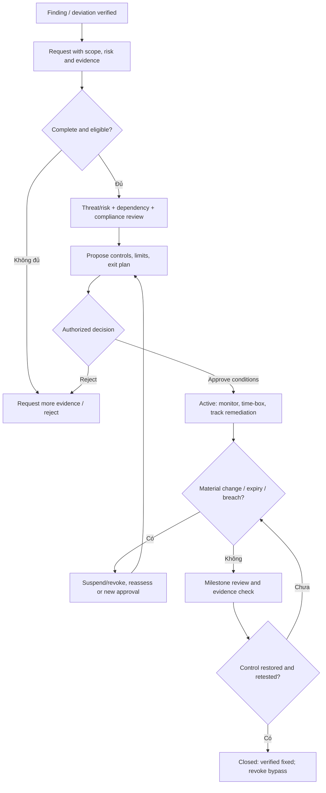

# Không lạm dụng Exception: quản trị ngoại lệ bảo mật có giới hạn và bằng chứng

## 1. Vì sao cần học “Không lạm dụng exception”?

Trong thực tế phát triển và vận hành, không phải lúc nào một hệ thống cũng có thể đáp ứng **mọi security requirement ngay lập tức**. Có những tình huống một bản vá chưa tương thích, dịch vụ bên thứ ba chưa hỗ trợ cơ chế xác thực mới, một cấu hình cũ cần thời gian di chuyển, hoặc một bài kiểm thử phát hiện sai lệch trong khi nhóm đang triển khai phương án thay thế. **Exception** (ngoại lệ có quản trị) có thể là cơ chế tạm thời để ghi nhận và xử lý những tình huống ấy.

Tuy nhiên, ngoại lệ trở nên nguy hiểm khi được dùng làm cách **bỏ qua kiểm soát bảo mật, xóa finding khỏi dashboard, né thời hạn remediation hoặc chuyển rủi ro cho người không có thẩm quyền**. Nếu mọi vấn đề khó đều được “xin exception”, chính sách mất hiệu lực; báo cáo compliance đẹp lên nhưng mức phơi nhiễm của hệ thống có thể tăng.

Trong chương **Exception management** của module **SECURITY_SECURITY_ASSURANCE**, mục tiêu là **xây dựng cách đánh giá có bằng chứng** rằng hệ thống đáp ứng mục tiêu bảo mật: từ risk assessment, requirements và controls đến testing, audit, remediation và cải tiến liên tục. Vì vậy một ngoại lệ hợp lệ phải có **lý do, phạm vi, người chịu trách nhiệm, đánh giá rủi ro, biện pháp giảm thiểu, thời hạn, tiêu chí thoát và bằng chứng kiểm chứng**, chứ không phải một nút “Ignore”.

Ví dụ:

> “Ứng dụng Order API dùng một dependency có lỗ hổng high severity. Nhóm đề nghị tạm thời chưa nâng cấp do lỗi tương thích. Ngoại lệ chỉ dành cho phiên bản artifact cụ thể trong production, tối đa 30 ngày theo thời hạn được phê duyệt, có đánh giá khả năng khai thác và compensating controls được kiểm chứng, với kế hoạch vá và retest.”

Đây **có thể là một yêu cầu ngoại lệ cần xét**, không phải đương nhiên được chấp nhận. Nếu dependency dễ bị khai thác qua Internet và không có biện pháp giảm thiểu đủ tin cậy, reviewer có thể **từ chối**; tiến độ release không tự động đứng cao hơn risk tolerance của tổ chức.

### 1.1. Kết quả học tập

Sau bài học, người học có thể:

1. Phân biệt security exception với finding, false positive, risk acceptance, waiver, emergency change, deviation và compensating control.
2. Xác định **khi nào được phép cân nhắc ngoại lệ**, khi nào phải remediation hoặc escalation mà không được tự ý bypass.
3. Thiết kế quy trình xin, phân tích, phê duyệt, giám sát, gia hạn và kết thúc exception có trách nhiệm.
4. Giới hạn ngoại lệ theo **asset, identity, workload, data, control, version, environment, time window**.
5. Dùng threat/risk context và **bằng chứng thực nghiệm** để đánh giá compensating controls.
6. Thiết lập **separation of duties**, người phê duyệt đúng thẩm quyền, expiry và cơ chế thu hồi.
7. Đưa exception vào CI/CD, configuration management và dashboard mà không làm mất audit trail.
8. Nhận diện metric gaming, exception renewals kéo dài và các dấu hiệu “exception trở thành chính sách ngầm”.
9. Thực hành đánh giá hai case kỹ thuật và viết một hồ sơ ngoại lệ có thể audit.

**Phạm vi bài:** “exception” ở đây là **ngoại lệ đối với security control, requirement, policy hoặc remediation deadline**, không phải Java `try/catch` hoặc exception handling trong ngôn ngữ lập trình. Mọi ID, thời hạn, ngưỡng và dữ liệu minh họa trong bài đều giả lập; chúng **không** thay quy định, nghĩa vụ pháp lý, hợp đồng hay risk appetite của tổ chức cụ thể.

## 2. Phân biệt Exception, Finding, Waiver và Risk Acceptance

Các khái niệm dễ bị gộp sai, khiến một giấy phê duyệt được hiểu là hệ thống đã compliant.

| Khái niệm | Bản chất | Điều được làm | Điều không được tự suy ra |
|---|---|---|---|
| **Security finding/deviation** | Bằng chứng cho thấy control không đáp ứng tiêu chí | Ghi expected–observed, affected scope, severity, owner | Có finding không có nghĩa đã được chấp nhận |
| **False positive** | Kết quả kiểm tra sai với thực tế, được chứng minh qua triage | Đóng/reclassify với lý do và evidence | Không được gọi là false positive vì “khó sửa” |
| **Exception/waiver** | Quyết định cho phép sai lệch **cụ thể, có điều kiện và thời hạn** so với baseline | Tiếp tục hoạt động trong giới hạn đã phê duyệt, thường kèm compensating controls | Không biến control FAIL thành PASS hoặc miễn mọi nghĩa vụ |
| **Risk acceptance** | Quyết định của risk owner chấp nhận residual risk trong thẩm quyền | Ghi rủi ro, phạm vi, thời hạn, điều kiện rà soát | Không phải bằng chứng technical issue đã khắc phục |
| **Compensating control** | Biện pháp thay thế/giảm rủi ro khi control gốc chưa đạt | Giảm một số threat paths, có test và monitoring | Không mặc nhiên tương đương control gốc ở mọi tiêu chí |
| **Emergency change** | Quy trình thay đổi nhanh khi có tình huống khẩn cấp | Thực hiện thay đổi được ủy quyền và hậu kiểm | Không tự là ngoại lệ vô thời hạn cho policy |
| **Remediation deferral** | Dời lịch khắc phục với risk decision rõ | Ghi due date, trigger và owner | Không cho phép im lặng để deadline trôi qua |
| **Not applicable** | Yêu cầu không áp dụng cho đối tượng, có căn cứ | Loại khỏi mẫu số applicable theo quy trình | Không dùng để tránh kiểm soát đang áp dụng |
| **Out of scope** | Đối tượng nằm ngoài cuộc đánh giá đã duyệt | Nêu ranh giới và giới hạn kết luận | Không có nghĩa tài sản không còn rủi ro |

**Một issue có thể đồng thời là finding FAIL và có approved exception còn hiệu lực.** Trong báo cáo, giữ hai trạng thái song song:

```text
Control state:         NONCOMPLIANT / NOT VERIFIED
Risk treatment state:  EXCEPTION_APPROVED_WITH_CONDITIONS
Remediation state:     OPEN / IN_PROGRESS / PENDING_RETEST
Exception lifecycle:  ACTIVE_UNTIL_EXPIRES
```

Nếu chỉ hiển thị “Exception Approved” như một trạng thái xanh duy nhất, người đọc có thể hiểu nhầm exposure đã biến mất.

### 2.1. Vì sao một “waiver” không thể vô hiệu hóa nghĩa vụ bên ngoài?

Tổ chức có thể quyết định chấp nhận một số rủi ro **theo chính sách nội bộ và quyền hạn hợp lệ**, nhưng không thể dùng approval nội bộ để tự tuyên bố miễn trừ điều luật hoặc nghĩa vụ hợp đồng bắt buộc. Khi có regulatory, privacy, contractual hoặc safety obligations, cần **đánh giá yêu cầu áp dụng với bộ phận có thẩm quyền**; một số sai lệch phải dừng, sửa, thông báo hoặc có approval từ bên có quyền phù hợp, chứ không thể đơn thuần “accept risk”.

### 2.2. False positive khác accepted risk

Ví dụ scanner đánh dấu “hardcoded secret” nhưng token đó chỉ là fixture công khai không có quyền và đã được xác minh không tạo access path. Có thể **reclassify false positive** với evidence.

Ngược lại, một API key thật còn hiệu lực trong source code là một vấn đề kỹ thuật; việc “người quản lý cho phép giữ tạm” **không làm scanner sai**. Trường hợp này cần containment/rotation, xử lý exposure và có thể phải incident assessment. Không dùng exception để che khả năng credential đã lộ.

## 3. Exception hợp lệ là công cụ chuyển tiếp, không phải chế độ vận hành mặc định

Một chương trình exception trưởng thành phải đạt **hai điều kiện đồng thời**:

1. Cho phép nhóm xử lý tình huống kỹ thuật hoặc nghiệp vụ có thật một cách có kiểm soát.
2. Không tạo động lực biến ngoại lệ thành đường đi đơn giản hơn so với thực hiện security controls.

### 3.1. Những tình huống có thể cân nhắc

- Có xung đột kỹ thuật được chứng minh, ví dụ nâng dependency ngay gây regression nghiêm trọng nhưng có kế hoạch thay thế và risk mitigation.
- Một nền tảng cũ cần thời gian migration, có vòng đời và resource plan được phê duyệt.
- Nhà cung cấp đang sửa sự cố sản phẩm; tổ chức có cách giảm exposure và điều khoản review.
- Một configuration deviation tạm thời cần phục vụ thay đổi hệ thống có kiểm soát, có rollback đã thử.
- Một bài test không thể chạy do giới hạn kỹ thuật, nhưng có **đánh giá thay thế và giới hạn assurance rõ**; không báo test PASS nếu chưa chạy.

**Có thể cân nhắc ≠ chắc chắn phê duyệt.** Việc cho phép phụ thuộc risk appetite, impact, threat exposure, nghĩa vụ áp dụng, compensating controls, mức độ khẩn cấp và thẩm quyền người duyệt.

### 3.2. Những lý do không đủ để cấp ngoại lệ

| Lý do đưa ra | Vì sao chưa đủ | Điều cần làm |
|---|---|---|
| “Release đang gấp” | Tiến độ không thay đổi severity/exploitability | Xác định risk và phương án giảm thiểu; có thể giữ release |
| “Chưa thấy ai khai thác” | Thiếu incident không chứng minh rủi ro thấp | Kiểm attack surface, exploitability và detection |
| “Scanner báo nhiều quá” | Khối lượng lớn không làm issue thành false positive | Triage có evidence, automation và remediation backlog |
| “Môi trường staging thôi” | Staging có thể dùng prod data, secret hoặc quyền deploy | Kiểm trust boundaries trước khi coi scope thấp |
| “Nhóm khác cũng làm vậy” | Phổ biến không tương đương được phê duyệt | Áp criteria nhất quán và review exceptions tập trung |
| “Có WAF rồi” | WAF chỉ giảm một số payload/path, có thể bypass | Kiểm thực nghiệm threat scenario và coverage |
| “Chúng tôi sẽ sửa sau” | Không có owner, deadline hoặc điều kiện thoát | Action plan, milestones, approval và expiry |
| “Risk đã accepted” | Có thể quá quyền, hết hạn hoặc scope đã đổi | Kiểm risk owner, validity và tình trạng control thực |

### 3.3. Nguyên tắc bắt buộc

Một ngoại lệ nên:

1. **Có căn cứ:** mô tả exact control/requirement đang sai và lý do không sửa ngay.
2. **Tối thiểu:** scope nhỏ nhất có thể về người, tài sản, quyền, môi trường, dữ liệu, phiên bản và thời gian.
3. **Có thời hạn:** expires tự động hoặc buộc review lại; không “until further notice”.
4. **Có chủ sở hữu:** requester, technical owner, risk owner, reviewer và approver.
5. **Có biện pháp giảm thiểu:** controls thay thế phù hợp risk, được kiểm bằng evidence.
6. **Có visibility:** được theo dõi trong risk register, GRC, CI/CD và báo cáo.
7. **Có lối thoát:** remediation plan, milestones, retest và rollback/expiry path.
8. **Có kiểm tra lại:** tái đánh giá khi threat, system, data, tool hoặc policy đổi.
9. **Không xóa findings:** trạng thái technical control vẫn thể hiện đúng thực tế.
10. **Không vượt quyền pháp lý/hợp đồng:** nghĩa vụ bắt buộc cần xử lý theo kênh tương ứng.

## 4. Các dấu hiệu lạm dụng exception

Một ngoại lệ được tạo ra có thể hợp lý ở thời điểm đầu nhưng trở thành vấn đề khi **tái sử dụng quá rộng, gia hạn liên tục hoặc bị dùng thay remediation**.

| Dấu hiệu | Hệ quả | Câu hỏi kiểm tra |
|---|---|---|
| Ngoại lệ không có ngày hết hạn | Sai lệch được giữ vô thời hạn | Khi nào bắt buộc đánh giá lại? |
| Gia hạn nhiều lần không có tiến bộ | “Temporary” trở thành vận hành thường xuyên | Milestones đã hoàn thành và test nào đã PASS? |
| Một exception áp cho toàn cloud organization | Bypass lan sang tài sản chưa được phân tích | Vì sao không giới hạn theo account/resource/identity? |
| Reviewer cũng là requester và approver | Conflict of interest | Có risk owner độc lập và đúng thẩm quyền không? |
| Không có compensating controls | Risk exposure có thể không được giảm | Control thay thế nào đã được kiểm? |
| Bỏ exception khỏi dashboard | Governance không thấy technical gaps | Có báo active/expired/pending và control FAIL riêng không? |
| Cấp exception sau khi bị phát hiện để xóa finding | Thao túng audit lịch sử | Ngày effective approval và evidence trước đó là gì? |
| “Blocker” được giải bằng tắt scanner/alert | Mất khả năng phát hiện sai lệch tiếp theo | Giám sát còn hoạt động không? |
| Group exception chung cho nhiều risk scenarios | Không biết điều kiện nào được chấp nhận | Tách theo control, threat, scope, owner |
| Risk owner chưa rõ hoặc đã đổi | Không có người chịu hậu quả business | Ai được ủy quyền chấp nhận residual risk hiện nay? |
| Không có kế hoạch sửa | Không có đường đi về baseline | Owner, change ID, funding, exit criteria ở đâu? |
| Hết hạn nhưng vẫn được enforcement bỏ qua | Bypass trở thành mặc định | Cơ chế tự hết hạn và audit alert đã thử chưa? |

### 4.1. Hành vi “exception shopping”

Khi một nhóm bị từ chối bởi Security Assurance rồi gửi cùng hồ sơ tới một người duyệt khác với thông tin ít hơn, đó là rủi ro **exception shopping**. Nên có **registry tập trung và decision history** để reviewer thấy các yêu cầu trước đó, lý do từ chối và những thay đổi thật sự của risk/control evidence.

### 4.2. “Exception splitting” để giảm cấp phê duyệt

Thay vì xin exception cho 100 tài nguyên critical (cần cấp cao phê duyệt), nhóm có thể chia thành nhiều ngoại lệ nhỏ. Chương trình cần phát hiện các request **cùng root cause, cùng control, cùng owner hoặc cùng service** để đánh giá **cumulative exposure**, tránh dùng phương pháp chia nhỏ làm giảm mức phê duyệt.

### 4.3. Lạm dụng lý do khẩn cấp

Sự cố thật có thể cần thao tác nhanh, nhưng **emergency exception** vẫn cần kênh ủy quyền, thời hạn ngắn, telemetry và hậu kiểm. “Khẩn cấp” không được thành đường vĩnh viễn để bỏ mọi CI gate hoặc cấp admin role không kiểm soát.

## 5. Mục tiêu bảo mật và ranh giới không thể bỏ qua

Một exception liên quan đến security objective nào? Nếu không chỉ ra được, khó đánh giá residual risk và compensating controls.

| Mục tiêu | Sai lệch thường gặp | Ranh giới cần xét |
|---|---|---|
| **Confidentiality** | Quyền broad read, public bucket, thiếu encryption requirement | PII/confidential data, tenant boundaries, backups, exports |
| **Integrity** | Bỏ code review, unsigned image, CI role quá rộng | Artifact provenance, auditability, deployment approvals |
| **Availability** | Trì hoãn DR test, thiếu backup restore, patch có nguy cơ outage | RTO/RPO/MBCO, failover, dependency, incident impact |
| **Accountability** | Log bị tắt hoặc audit records không lưu | Source categories, retention, tamper resistance, investigation |
| **Least privilege** | Shared admin account, break-glass tồn tại quá hạn | Effective permissions, service/employee identities, expiry |
| **Privacy** | Dùng production data trong lab ngoài policy | Law/contract applicability, consent/basis, access, deletion |
| **Supply-chain assurance** | Deploy artifact chưa verify, dependency có CVE | Image digest, SBOM, signature/provenance, registry boundaries |

### 5.1. Control có mục tiêu, không chỉ có checkbox

Nếu yêu cầu “mọi production deployment phải qua code review”, một đề xuất “bỏ qua review vì CI đang lỗi” làm suy yếu **control ngăn thay đổi trái phép**. Việc thay bằng “developer hứa đã xem” không nhất thiết đáp ứng cùng mục tiêu. Có thể thiết kế **manual peer review có evidence và approval riêng** trong cửa sổ khẩn cấp, nhưng phải đánh giá thẩm quyền, scope và traceability của biện pháp thay thế.

### 5.2. Nghĩa vụ bắt buộc là giới hạn quyền chấp nhận

Nếu dữ liệu thuộc phạm vi điều khoản privacy, hợp đồng hoặc quy định yêu cầu một cách xử lý cụ thể, **không có nghĩa ai đó trong tổ chức cũng có thể ký exception để miễn yêu cầu**. Việc xác định khả năng ngoại lệ phải được kiểm tra với người có thẩm quyền pháp lý/compliance, và report không được gọi nó là compliant nếu điều kiện chưa đạt.

## 6. Xác định đối tượng của exception và blast radius

Một yêu cầu nên mô tả chính xác **đối tượng nào sẽ không tuân theo control nào**, không chỉ ghi tên service:

```text
Security requirement / control ID
  → Risk scenario and impacted business process
    → Assets / workloads / versions / data classes
      → Environment / cloud account / region / tenant
        → Human/service identities / privilege paths
          → Exact deviation and allowed operation
            → Start/end times and constraints
              → Compensating controls, tests and owner
```

### 6.1. Ví dụ scope sai và scope đủ rõ

**Quá rộng:** “Cho phép bỏ vulnerability gate của tất cả Java services trong hai tháng.”

**Cụ thể hơn:** “Chỉ cho phép một deploy có change ticket được phê duyệt đối với image digest `sha256:example...` của `order-worker` tại staging/production đã nêu, chỉ cho finding ID cụ thể được triage, đến thời điểm hết hạn; không bypass scans hoặc các findings khác; bắt buộc runtime monitoring, network restriction và release approval.”

Đây mới là mô tả scope để **xem xét**, không đồng nghĩa có quyền tự bypass; nếu risk cao hoặc control bắt buộc, yêu cầu vẫn có thể bị từ chối.

### 6.2. Các chiều cần giới hạn

| Chiều | Ví dụ | Vì sao quan trọng |
|---|---|---|
| Control/criterion | `CTRL-SDLC-04` | Tránh “miễn tất cả chính sách bảo mật” |
| Finding/risk IDs | `FIND-SEC-217` / `RISK-OPS-042` | Liên kết evidence và treatment |
| Service/application | `order-worker` | Rõ owner và blast radius |
| Artifact/version | Exact immutable image digest | Không tự áp sang mọi phiên bản mới |
| Environment | Production account A, namespace orders | Không lan sang tài nguyên khác |
| Identity/permissions | Service principal và action chính xác | Tránh quyền admin rộng không kiểm soát |
| Data class | Chỉ synthetic/internal, không gồm customer PII | Tác động privacy khác nhau |
| Time window | From/expiry UTC và change window | Không kéo dài âm thầm |
| Dependencies | Database, IdP, CI/CD, KMS, third party | Sai lệch có thể lan qua shared components |
| Traffic/operation | Tối đa nhóm request và chức năng được phép | Giới hạn exposure, có phương án stop |

### 6.3. Cumulative exposure

Hai ngoại lệ độc lập có thể cộng dồn thành nguy cơ cao hơn:

- IAM exception cấp broad admin trên CI agent.
- CI policy exception cho phép deploy artifact chưa qua verification.

Kết hợp cả hai có thể tạo **đường thay đổi production không đáng tin**. Khi review, phải tra **active exceptions theo asset/service/identity/control/threat scenario**, không đánh giá từng hồ sơ trong chân không.

## 7. Quyết định có được xin exception hay không

Trước khi điền form, cần xác định **vấn đề có thực sự cần exception** hay có cách giải quyết trực tiếp mà ít rủi ro hơn.

### 7.1. Thứ tự câu hỏi

1. **Yêu cầu có áp dụng không?** Kiểm scope, policy version, asset/data classification và applicability. Nếu không áp dụng, cần ghi căn cứ `NOT_APPLICABLE` thay vì xin exception.
2. **Finding có đúng không?** Xác minh từ effective configuration, behavior tests hoặc nguồn sự kiện; nếu false positive, xử lý qua triage có evidence.
3. **Đã có cách sửa không?** Xét patch, cấu hình đúng, upgrade, architecture change, alternative deployment hoặc rollback.
4. **Có thật sự không thể sửa trong thời hạn phù hợp?** Yêu cầu bằng chứng tương thích, dependency, incident/change constraints; “chưa phân công người làm” chưa đủ.
5. **Nghĩa vụ có cho phép chấp nhận ngoại lệ không?** Kiểm policy, hợp đồng, privacy, pháp lý và tiêu chí tuân thủ liên quan.
6. **Residual risk có nằm trong thẩm quyền chấp nhận không?** Xem criticality, exploitability, customer impact, existing risks và active exceptions.
7. **Có compensating controls đủ cụ thể và đo được không?** Nếu không, cần cách ly, thay đổi scope, từ chối hoặc escalation.
8. **Có thời hạn và exit plan khả thi không?** Owner, nguồn lực, milestones, test và rollback.

Nếu bất kỳ điều kiện trọng yếu nào chưa rõ, kết quả đúng có thể là **REQUEST_MORE_EVIDENCE** hoặc **REJECT**, không phải default APPROVE.

### 7.2. Ma trận quyết định

| Tình huống | Hướng xử lý ưu tiên | Có cần exception? |
|---|---|---|
| Scanner false positive đã được xác minh | Điều chỉnh finding, lưu evidence và cải thiện rule | Thường **không** |
| Control thật không áp dụng theo scope đã duyệt | Ghi N/A rationale, review | **Không**, nếu N/A hợp lệ |
| Finding đúng, có fix ít rủi ro triển khai ngay | Remediation + verified retest | Thường **không** |
| Fix cần migration có phụ thuộc kỹ thuật thực | Phân tích risk; temporary exception có điều kiện nếu được phép | **Có thể** |
| Nhóm muốn bỏ mọi audit logging để tiết kiệm tài nguyên | Thay kiến trúc/chi phí hoặc giảm tải không mất audit | Thường **không được chấp thuận** |
| Control bắt buộc theo điều kiện pháp lý/hợp đồng, không có cơ sở miễn trừ | Thực hiện nghĩa vụ hoặc xử lý với cơ quan/bên có quyền thích hợp | Không thể **tự cấp** |
| Có suspected active compromise/credential leak | Incident response, containment và security assessment | Không dùng exception để né containment |
| Emergency recovery cần thay đổi có quyền | Emergency change với giới hạn, telemetry, hậu kiểm | Có thể cần emergency approval riêng, không mặc định miễn |

### 7.3. Tiêu chí từ chối cần minh bạch

Một exception có thể bị từ chối khi:

- Không có ownership/approval authority đáng tin.
- Residual risk vượt tolerance hoặc không được phép theo nghĩa vụ.
- Proposed scope quá rộng hoặc không thể giới hạn blast radius.
- Không thể kiểm compensating controls hoặc monitoring bị tắt.
- Có active threat khiến việc duy trì deviation tạo nguy cơ không chấp nhận được.
- Chưa có deadline, kế hoạch sửa hoặc phương án xử lý khi hết hạn.
- Hồ sơ mâu thuẫn, thiếu evidence hoặc đã nhiều lần xin lại không cải thiện.

**Từ chối không có nghĩa bỏ mặc vấn đề.** Cần ghi quyết định, owner và phương án thay thế: rollback, quarantine, disable feature có kiểm soát, fix khẩn cấp, bổ sung nguồn lực hoặc chuyển cấp ra quyết định.

## 8. Lifecycle Exception Management có decision gates

Một exception không nên đi thẳng từ “request” tới “approved forever”. Mô hình state machine giúp ghi đúng thẩm quyền và tự động hóa các yêu cầu.



Sơ đồ là mô hình quản trị, không phải tiêu chuẩn bắt buộc cho mọi tổ chức. Trong thực tế, khi hết hạn hoặc bị thu hồi, một số hệ thống cần **ngăn hành động mới, rollback hoặc quarantine** theo safety policy; không nên tự động làm hỏng hệ thống production khi stop action chưa được thiết kế an toàn.

### 8.1. Các trạng thái khuyến nghị

| Trạng thái | Ý nghĩa | Có cho phép bypass? |
|---|---|---|
| `DRAFT` | Yêu cầu đang chuẩn bị | **Không** |
| `SUBMITTED` | Đã gửi, chưa đánh giá | **Không** |
| `NEEDS_INFORMATION` | Thiếu dữ liệu/threat review | **Không** |
| `UNDER_REVIEW` | Đang xem xét risk và compensating controls | **Không** |
| `REJECTED` | Không đạt điều kiện hoặc thiếu thẩm quyền | **Không** |
| `APPROVED_SCHEDULED` | Đã duyệt, chưa tới thời điểm có hiệu lực | Chỉ khi đến `valid_from` và mọi gate đạt |
| `ACTIVE` | Đang có hiệu lực trong scope/điều kiện | **Có giới hạn chính xác** |
| `SUSPENDED` | Tạm ngừng do vi phạm điều kiện hoặc reassessment | **Không** cho hành động mới, theo cơ chế an toàn |
| `EXPIRED` | Đến hạn mà không có approval mới hợp lệ | **Không** cho hành động mới |
| `REVOKED` | Thu hồi trước hạn | **Không** |
| `CLOSED_VERIFIED` | Control đã đạt, retest và bỏ bypass | **Không cần** |

Một exception `ACTIVE` **không đồng nghĩa finding đã đóng**. Finding, exception và remediation có vòng đời riêng và cần liên kết bằng ID.

### 8.2. Decision gates

| Gate | Điều kiện cần đạt | Nếu không đạt |
|---|---|---|
| G0 — Eligibility | Finding đúng, requirement áp dụng, được phép xem xét ngoại lệ | False positive/N/A path hoặc REJECT |
| G1 — Scope | Resource/version/identity/time được định danh, blast radius nhỏ | Yêu cầu thu hẹp scope |
| G2 — Risk | Threat scenario, impact, residual risk và dependencies rõ | Escalate/NEEDS_INFORMATION |
| G3 — Mitigation | Compensating controls có owner, test và monitoring | Không active khi chỉ là cam kết miệng |
| G4 — Authorization | Phê duyệt đúng thẩm quyền, separation of duties | Chưa active |
| G5 — Enforcement | System gate áp đúng exception ID và expiry, không suppress lỗi khác | Không tạo bypass rộng |
| G6 — Closure | Remediation đạt, retest PASS, bypass gỡ, evidence lưu | Giữ finding mở hoặc tiếp tục review |

### 8.3. Không cho hiệu lực hồi tố để “sửa” lịch sử

Nếu control FAIL trong tháng 7 nhưng exception được ký tháng 8, không được đổi kết quả tháng 7 thành “approved”. Decision record cần giữ **requested_at, approved_at, valid_from, valid_until, actual enforcement times**. Việc audit phát hiện trước khi có phê duyệt vẫn là phát hiện có thật; approval về sau có thể chỉ áp cho **hoạt động sau thời điểm có hiệu lực**.

## 9. Hồ sơ yêu cầu Exception có thể audit

Một ticket “Please whitelist” hoặc “Security approved” không đủ để hỗ trợ kết luận có bằng chứng.

### 9.1. Các trường bắt buộc

| Trường | Ý nghĩa |
|---|---|
| Request/exception ID | Định danh ổn định, liên kết finding và risk scenario |
| Requirement/control ID + revision | Tiêu chí thực sự đang bị sai |
| Observed deviation | Exact behavior/config khác baseline và evidence |
| Business justification | Vì sao cần hoạt động và không thể sửa ngay |
| Alternatives considered | Những cách sửa/giảm phạm vi đã cân nhắc, tại sao chưa dùng |
| Asset/data/identity scope | Service, environment, account, region, resource, principal, artifact/version |
| Threat/impact analysis | Exploit path, potential impact, risk owner, dependencies |
| Existing controls | Những control đang hoạt động, hiệu lực và evidence |
| Compensating controls | Biện pháp bổ sung, giới hạn, test, monitoring |
| Approval records | Reviewer, security, compliance/privacy khi cần, risk owner |
| Time window | `requested_at`, `valid_from`, `expires_at` và review milestones |
| Remediation plan | Owner, change ID, milestones, target và retest |
| Revocation/stop triggers | Khi nào exception bị tạm ngưng hoặc thu hồi |
| Reporting | Ghi ở đâu, ai nhận alert, exception có được cộng trong risk dashboard |
| Evidence retention | Source IDs, permissions, redaction, nơi lưu, audit history |

### 9.2. YAML mẫu

```yaml
# Hồ sơ giả lập dùng cho học tập, KHÔNG phải approval thật
exception_id: SEC-EX-EXAMPLE-010
request_type: temporary_security_control_exception
title: "Deferred library upgrade for order-worker"
service: SECURITY_SECURITY_ASSURANCE
status: under_review
requirement:
  control_id: CTRL-VULN-01
  policy_revision: security-baseline-example-r5
  expected: "Critical findings resolved within approved deadline"
deviation:
  finding_id: VULN-EXAMPLE-271
  description: "A verified vulnerable dependency in one deployed artifact"
  evidence_refs: [EVID-VULN-EXAMPLE-01]
scope:
  application: order-worker
  environment: production
  cloud_account: orders-prod-a
  namespace: orders
  image_digest: "sha256:example-immutable-artifact-digest"
  principals: [orders-worker-runtime]
  data_classification: internal
  excluded:
    - all_other_artifact_digests
    - other_findings
justification:
  blocking_issue: "Regression in updated dependency; test evidence attached"
  alternatives_reviewed:
    - rollback_with_downtime
    - patch_or_upgrade
    - temporary_feature_disable
risk:
  scenario_id: RISK-ORDER-DEPENDENCY-01
  inherent_assessment: high
  residual_assessment: pending_independent_review
  risk_owner: order-business-owner
compensating_controls:
  - id: COMP-NET-EX-01
    description: "Restrict external ingress to affected workload"
    validation_evidence: EVID-NET-TEST-EXAMPLE-01
  - id: COMP-OBS-EX-02
    description: "Validated runtime logging and alert routing"
    validation_evidence: EVID-LOG-TEST-EXAMPLE-01
validity:
  requested_at_utc: "2026-11-28T08:00:00Z"
  valid_from_utc: null
  expires_at_utc: null
review_before_expiry_days: 7
exit_plan:
  owner: order-platform-team
  change_id: CHG-EXAMPLE-927
  expected_fix: "Upgrade and verify new artifact"
  retest: [vulnerability_rescan, application_regression, effective_policy_test]
approval:
  security_reviewer: pending
  compliance_reviewer: pending_if_applicable
  authorized_risk_owner: pending
  final_decision: pending
```

**Hồ sơ trên đang ở trạng thái `under_review` và `valid_from_utc: null`; nó không cấp quyền chạy ngoại lệ.** Trong triển khai thật, cần đặt exact IDs, policy phiên bản thật, evidence có thể kiểm, scope canonical, approval đã ký và thông tin retention. Chuỗi `sha256:example-...` chỉ là placeholder không phải image digest hợp lệ để triển khai.

### 9.3. Định nghĩa “đủ bằng chứng” cho mỗi tuyên bố

Ví dụ:

- **“Nâng cấp gây regression”** → link tới build/dependency version, test cases, logs và runtime behavior.
- **“Không Internet-exposed”** → effective network routes, ingress config và permitted connectivity test.
- **“Có detection”** → event canary/traces từ source tới destination và alert response path.
- **“Sẽ sửa trước hạn”** → committed change ID, owner, milestones, resource plan.
- **“Đã gỡ ngoại lệ”** → evidence policy gate hoạt động lại, absence of active bypass và corrected control test.

Một đoạn mô tả **không thể thay bằng chứng** của control.

## 10. Đánh giá rủi ro: threat scenario trước “mức severity”

Thay vì chỉ viết “High CVE nhưng ít khả năng”, cần đưa ra **đường tấn công/điều kiện khai thác, tài sản bị ảnh hưởng, hậu quả kinh doanh và mức tin cậy của nhận định**.

### 10.1. Câu hỏi trong threat/risk review

1. Attacker cần vị trí/quyền gì? Có đường Internet-facing, nội bộ hay partner access?
2. Dữ liệu, business process, identity hoặc thành phần nào chịu tác động?
3. Control gốc bảo vệ điều gì: prevention, detection, response, recovery hay accountability?
4. Có active exploitation reports hoặc threat intelligence liên quan phiên bản/đường chạy không?
5. Affected code path có được gọi trong production? Có instrumentation để xác minh không?
6. Compensating controls chặn/giảm **đúng attack path** hay chỉ giảm một phần?
7. Failure modes hoặc common-mode dependencies giữa các controls là gì?
8. Nếu người dùng tăng trưởng, asset mới, feature mở rộng, rủi ro còn như cũ không?
9. Security logs, IAM và incident process còn hoạt động khi exception active?
10. Risk owner có căn cứ và quyền để quyết định chấp nhận residual risk không?

### 10.2. Inherent và residual risk

**Inherent risk**: đánh giá theo phương pháp nội bộ trước khi xem xét hiệu lực của những controls cụ thể. **Residual risk**: mức rủi ro còn lại sau khi xét controls đang vận hành và **được xác minh**.

Một bảng likelihood × impact dạng 1–5 có thể dùng như **công cụ thảo luận và xếp hạng**, nhưng điểm nhân của các thang ordinal **không tự là xác suất hay tổn thất**. Không nói “risk giảm 50%” chỉ vì score 20 → 10. Nếu không đủ evidence của compensating control, residual risk phải ghi **uncertain** hoặc theo conservative approach được duyệt, không mặc định giảm.

### 10.3. Đánh giá khả năng khai thác có điều kiện

Ví dụ một vulnerable library tồn tại trong artifact nhưng chỉ được gọi ở admin-only code path. Đây là dữ kiện có thể làm giảm exposure **nếu được kiểm chứng**, nhưng cần xem:

- Admin identity có MFA, least privilege và session control không?
- Có delegated access, service-to-service hoặc internal lateral movement paths?
- Admin endpoint thật sự private hay có network route khác?
- Vulnerable method được gọi trong job, deserialization hay message processor khác?
- Artifact có nhiều runtime instances/versions không?

Không tự đánh “not exploitable” từ một sơ đồ kiến trúc chưa kiểm hoặc chỉ vì code path hiện chưa được biết.

### 10.4. Threat changes trigger reassessment

Nếu xuất hiện bằng chứng exploit đang được sử dụng, asset chuyển ra Internet, dữ liệu đổi phân loại hoặc log source mất, cần **tái đánh giá ngay cả khi chưa tới ngày hết hạn**. Một exception không phải một hợp đồng bất biến với threat landscape.

## 11. Compensating Controls phải kiểm chứng được

**Compensating control** là biện pháp giảm nguy cơ khi primary control chưa đáp ứng. Nó có thể hữu ích nhưng **không tự tương đương** với control gốc: cần xem mục tiêu, đường tấn công, hiệu lực, coverage và residual risk.

### 11.1. Một chuỗi reasoning

```text
Primary control objective
  → Control gap and reachable threat path
  → Proposed compensating control(s)
  → Expected risk reduction mechanism
  → Assets/flows controlled
  → Positive + negative validation
  → Evidence quality + monitoring
  → Residual risk assessment
  → Owner approval and recurring checks
```

### 11.2. Các ví dụ có điều kiện

| Sai lệch tạm thời | Biện pháp có thể xét | Kiểm chứng cần làm | Giới hạn |
|---|---|---|---|
| Dependency có finding chưa nâng được | Giảm exposure network, disable vulnerable feature, runtime monitoring | Effective routes, functional tests, exploit-path review, logs | Network restriction không sửa mã lỗi |
| Không enforce MFA trên legacy flow | Thu hẹp principal/flow, IP/risk restrictions, tăng audit và migration | Allowed/denied test, session review, policy evidence | IP restriction không tương đương MFA |
| Một CI security check đang lỗi | Manual peer approval có traceability, scope limited, mandatory post-deploy scan | PR approvals, artifact ID, release log, delayed scan | Không được bỏ mọi kiểm soát hoặc thay thế gate vĩnh viễn |
| Backup platform chưa có tính năng mong muốn | Cách ly backup, independent copy, restore drills và tăng monitoring | Restore test, KMS access, data integrity | Backup exists không chứng minh RPO/RTO |
| SaaS vendor chưa hỗ trợ customer control | Giới hạn dữ liệu, conditional access, contractual action và roadmap | Data flow, access review, provider evidence | Khách hàng không tự miễn yêu cầu bên ngoài |
| Logging source chưa hỗ trợ event loại mới | Alternative validated source, scoped manual controls, short expiry | Correlated canary, field completeness, retention | Không thể tái tạo event quá khứ chưa từng ghi |

Tất cả ví dụ là **phương án cần đánh giá**, không phải công thức luôn được phê duyệt. Các trường hợp ảnh hưởng audit trail hoặc thông tin nhạy cảm có thể không có giải pháp tạm chấp nhận được.

### 11.3. Positive/negative tests

Ví dụ muốn chứng minh chỉ một service principal được phép truy cập object canary:

- **Positive control:** principal hợp lệ truy cập đúng object do test tạo.
- **Negative control:** principal không có quyền truy cập cùng object bị từ chối.
- **Audit check:** action được ghi với actor, resource, time, result tại log destination.
- **Invalid test:** object không tồn tại nên cả hai trả 404; không chứng minh authorization hoạt động.

Chỉ thực hiện trên **tài nguyên được ủy quyền** và dữ liệu synthetic/canary. Không thử phá dữ liệu thật, quét ngoài phạm vi hoặc làm gián đoạn hệ thống chỉ để tạo chứng cứ.

### 11.4. Độ tin cậy và thời hạn của compensating controls

Ghi **bằng chứng kiểm tra**, phiên bản, timestamp và nguyên tắc hết hiệu lực. Nếu thay ingress policy hoặc cloud account, cần revalidate; không dùng một screenshot tháng trước cho môi trường mới. Nếu log collector lỗi, có thể mất điều kiện phê duyệt exception dù configuration khác chưa đổi.

### 11.5. Biện pháp giảm thiểu cũng có rủi ro riêng

Thêm WAF rule quá rộng có thể chặn khách hàng hợp lệ; tăng quyền operator để manual review có thể tạo lỗ hổng mới; tạm chuyển dữ liệu sang SaaS khác có thể làm phát sinh nghĩa vụ privacy. Review phải xem **negative side effects và dependencies**, không chỉ giảm một chỉ báo kỹ thuật.

## 12. Phê duyệt, trách nhiệm và separation of duties

Một lệnh duyệt exception chỉ có giá trị khi người duyệt **có đủ thông tin và đúng thẩm quyền**. Hình thức ký duyệt không thay khả năng xem xét rủi ro độc lập.

### 12.1. RACI minh họa

| Vai trò | Trách nhiệm chính | Điểm cần tránh |
|---|---|---|
| **Requester / system owner** | Mô tả deviation, business necessity, alternatives, roadmap | Tự phê duyệt request của mình |
| **Technical control owner** | Xác nhận control gap, blast radius, fix feasibility, implementation | Che technical FAIL sau approval |
| **Security Assurance/AppSec** | Review security requirements, threat scenarios, tests, evidence | Đánh “đủ rủi ro” chỉ qua severity label |
| **GRC/compliance/legal/privacy** | Kiểm policy, obligations, contractual boundaries | Cho rằng internal waiver tự loại luật/hợp đồng |
| **Business/risk owner** | Chấp nhận residual risk theo hạn mức và chịu trách nhiệm quyết định | Duyệt ngoài risk appetite hoặc không có dữ liệu |
| **Independent reviewer/audit** | Kiểm lifecycle, approval rights, sampling, exception patterns | Biến review thành checklist hình thức |
| **Platform/DevSecOps** | Enforce exact scope/expiry trong hệ thống, kiểm trạng thái bypass | Tắt toàn bộ quality gate thay vì exception ID |
| **Incident commander** | Quyết định xử lý active threats và emergency stops trong thẩm quyền | Dùng exception để trì hoãn containment |

### 12.2. Nguyên tắc phân quyền

- **Request ≠ approve ≠ enforce ≠ verify**: tách khi rủi ro đủ cao.
- Reviewer phải xem **current evidence, related exceptions và lịch sử từ chối/gia hạn**.
- Không cho service team tự sửa expiry trong registry hoặc trực tiếp whitelist vào production mà không có authorized decision.
- Exception severity/criticality cao cần escalation tương xứng; risk owner cấp thấp không tự chấp nhận rủi ro vượt hạn mức.
- Chữ ký điện tử, approval workflow và decision log cần gắn **exact request revision**, không dùng một approval cũ cho scope mới.
- Dùng principle of **least privilege** cho người triển khai bypass; họ không cần quyền đổi mọi policy.

### 12.3. Cơ chế xử lý trường hợp cấp bách

Emergency path cần nêu:

1. Điều kiện kích hoạt thật (incident, business continuity, customer impact), không chỉ “deadline sắp đến”.
2. Người có thẩm quyền ra quyết định, người ghi timeline và safety stop.
3. Phạm vi và thời hạn **ngắn nhất khả thi** theo policy đã duyệt.
4. Audit trail và monitoring không bị vô hiệu hóa bừa bãi.
5. Hậu kiểm trong thời hạn quy định, có risk review và action plan.
6. Cách quay lại baseline và xác minh bypass được gỡ.

Nếu một emergency change làm phát sinh deviation cần tồn tại lâu hơn cửa sổ khẩn cấp, phải **đưa vào quy trình exception thông thường**; không kéo dài emergency privileges ngầm.

## 13. Time-boxing, expiry, renewal và cơ chế quay về baseline

**Một ngoại lệ không có ngày hết hạn hợp lệ dễ trở thành chính sách thứ hai.** Vì threat landscape, asset topology, business impact và controls thay đổi, quyết định chấp nhận rủi ro chỉ có ý nghĩa trong **điều kiện và thời hạn cụ thể**.

### 13.1. Bốn mốc thời gian không được nhầm

```text
t_request   = thời điểm yêu cầu được tạo
t_approve   = thời điểm người có thẩm quyền ký phê duyệt
t_from      = thời điểm ngoại lệ bắt đầu có hiệu lực
t_until     = thời điểm ngoại lệ hết hiệu lực
t_retest    = thời điểm control được kiểm lại sau khắc phục
```

Điều kiện an toàn:

```text
active_exception_at(t) chỉ có thể true khi:
  status == ACTIVE
  approval còn hợp lệ cho exact request revision
  valid_from <= t < expires_at
  asset / identity / action / control / version khớp exact scope
  các điều kiện bù trừ và safety checks được đáp ứng
```

Đây là đặc tả logic minh họa, không phải chính sách pháp lý hoặc cấu hình có thể tự động triển khai ngay.

### 13.2. Review trước expiry

Nên lên lịch review **trước ngày hết hạn** theo loại rủi ro để có thời gian triển khai fix hoặc thu hẹp scope. Quy trình có thể:

1. Thông báo owner, control owner và reviewer về ngày hết hạn.
2. Kiểm milestones và bằng chứng remediation hiện tại.
3. Chạy lại threat/risk assessment nếu cần, nhất là khi có thay đổi exploitability hoặc external exposure.
4. Kiểm compensating controls còn hiệu lực và telemetry đủ tin cậy.
5. Nếu cần thêm thời gian, gửi **renewal request có justification mới**, không tự gia hạn.
6. Xác nhận decision và cập nhật system enforcement trước khi đến hạn nếu đã duyệt.
7. Nếu không có approval hợp lệ, exception **hết hiệu lực**; xử lý thay thế an toàn theo policy.

### 13.3. Gia hạn phải khó hơn “nhấp nút”

Không có số lần renew “được phép chung” cho mọi tổ chức. Tuy vậy renewal nhiều lần cần **escalation và xem lại root cause**, thay vì tự copy lý do cũ. Một renewal record cần thể hiện:

| Thuộc tính | Câu hỏi reviewer |
|---|---|
| Previous exception ID/version | Ngoại lệ cũ là gì, lúc nào approved và expired? |
| Milestone progress | Điều gì đã hoàn thành, điều gì trễ? Có evidence? |
| Current technical exposure | Scope, severity, exploit path, data và assets có thay đổi? |
| Control health | Compensating controls còn hoạt động? Test gần nhất khi nào? |
| Reasons for delay | Dependency/constraint nào còn tồn tại, do ai xử lý? |
| Alternative plans | Có thể giảm scope, disable feature hoặc cách ly không? |
| Updated time-box | Vì sao thời hạn mới là ngắn nhất phù hợp? |
| Approval escalation | Rủi ro cộng dồn và lịch sử gia hạn có cần cấp cao hơn? |
| Exit evidence | Đến hạn mới sẽ xác minh bằng test nào? |

Một exception được gia hạn năm lần nhưng không hoàn thành milestone nào là tín hiệu có thể cần **thay đổi kiến trúc, ngân sách, quy trình quản lý rủi ro hoặc dừng chức năng**, không chỉ thêm ngày.

### 13.4. Hết hạn phải có hành vi được thiết kế

Ví dụ trong CI/CD, khi exception hết hạn, pipeline **không cho các deployment mới dựa trên exception đó**; không được tự xóa dữ liệu khách hàng hoặc ngắt service production vì hết hạn. Với runtime access permission tạm thời, cần có kế hoạch **revoke effective permission**, thông báo, rollback/cutover và kiểm ảnh hưởng nghiệp vụ phù hợp.

**Fail closed cho hành động mới** là một nguyên tắc hữu ích, nhưng thực hiện fail-closed không được tạo sự cố an toàn không kiểm soát. Trong các hệ thống có rủi ro availability, cần RoE/runbook/approvals rõ cho đường quay về baseline.

### 13.5. Không gia hạn hồi tố

Nếu exception hết hạn lúc 12:00 và được phê duyệt lại lúc 14:00, không được báo suốt khoảng 12:00–14:00 là “đã được ủy quyền”. Các hành vi xảy ra trong khoảng đó cần được đánh giá theo trạng thái thực tế, kể cả khi sau này có approval mới.

## 14. Enforcement: đưa exception vào CI/CD và policy-as-code mà không tắt toàn bộ gate

Trong nhiều pipeline, exception bị lạm dụng vì cách kỹ thuật dễ nhất là **disable rule, skip scan hoặc allow all**. Hướng tốt hơn là giữ control hoạt động, chỉ cho phép **một sai lệch cụ thể** nếu approval còn hiệu lực.

### 14.1. Các ràng buộc của policy engine

Một engine đánh giá exception chỉ nên cho phép khi:

- Exception ID có thật trong **registry đã ký/được tin cậy**.
- Status `ACTIVE`, còn trong thời gian hiệu lực và không bị revoked/suspended.
- Request revision, approvals và risk authority hợp lệ.
- Artifact/resource/identity/action/control/findings khớp **exact scope**.
- Compensating controls required có attestation/test gần đây theo policy.
- Có audit event cho mỗi lần exception được áp dụng.
- Kết quả kiểm tra các **control khác vẫn được enforce**.
- Không có ngữ nghĩa `all_resources`, `all_findings` hoặc `never_expires` nếu policy cấm.

### 14.2. Anti-pattern và cách thay

**Không nên:**

```text
if security_scan_failed:
    skip_all_security_gates()
    deploy_to_production()
```

**Ý tưởng an toàn hơn (pseudocode):**

```text
finding = run_security_checks(artifact, target)

for each deviation in finding:
    exception = trusted_registry.lookup_exact(
        control_id=deviation.control_id,
        finding_id=deviation.finding_id,
        artifact_digest=artifact.digest,
        target_environment=target.environment,
        resource_id=target.resource_id
    )

    if deviation.is_pass:
        continue

    if exception is absent:
        deny_deployment("Missing approved exception")

    if not exception.is_active_at(secure_clock_now()):
        deny_deployment("Exception expired or inactive")

    if not exception.has_valid_approvals_for_this_revision():
        deny_deployment("Approval unavailable")

    if not exception.conditions_verified():
        deny_deployment("Compensating controls not verified")

    record_evidence(
        deviation_id, exception_id, artifact.digest,
        actor, target, time, policy_revision
    )

continue_enforcing_all_other_controls()
```

Đây chỉ là pseudocode giúp hình dung **policy logic**, không phải mã chạy production. Ứng dụng thật cần bảo vệ registry, xác thực chữ ký/phê duyệt, khả năng chống sửa, race conditions, clock integrity, audit logs và failure modes. Đặc biệt, **không dùng boolean do người deploy tự truyền như `SECURITY_APPROVED=true` làm căn cứ duy nhất**.

### 14.3. Exact artifact identity quan trọng

Với container, dùng **immutable digest** để định danh bản artifact; tag `latest` hoặc tên branch có thể thay nội dung sau khi exception được phê duyệt. Một exception cho digest A không tự áp cho digest B, kể cả hai cùng service.

Nếu một bản rebuild thay base image hoặc dependency, cần kiểm xem finding còn tồn tại, threat surface và compensating controls có giữ nguyên không. Phê duyệt theo “mọi version 1.x” có thể quá rộng nếu control requirement liên quan các lỗ hổng và thay đổi code cụ thể.

### 14.4. GitOps/IaC reconciliation

Không nên sửa policy trực tiếp trên console rồi không lưu lịch sử. Nếu ngoại lệ liên quan cấu hình:

1. Link tới approved exception ID và revision.
2. Áp cấu hình đúng scope với audit/change record.
3. Có drift detection khi runtime khác IaC/state mong đợi.
4. Có cơ chế revert sau expiry, test effective state.
5. Review blast radius trước khi rollback tự động, đặc biệt với IAM/network/DR.

Với hệ thống không hỗ trợ tự thu hồi an toàn, cần **manual change task có deadline, monitoring và escalation**, thay vì im lặng để cấu hình tạm thành vĩnh viễn.

### 14.5. Các test bắt buộc cho exception policy

| Test | Expected |
|---|---|
| Approved exception đúng digest/account/finding/time | Chỉ sai lệch được phép đi qua đúng scope |
| Sai artifact digest | Bị từ chối |
| Sai cloud account/region | Bị từ chối |
| Finding thứ hai không nằm trong exception | Vẫn bị block |
| Request chưa có approval | Bị từ chối |
| Exception hết hạn hoặc revoked | Không tạo bypass mới |
| Registry không truy cập được | Không tự coi exception hợp lệ; xử lý theo fallback đã duyệt |
| Compensating control test đã hết hiệu lực | Bị từ chối hoặc bắt buộc review theo policy |
| Audit log event cho bypass | Có đầy đủ actor, resource, control, exception ID, timestamp |

Không thực hiện những test này bằng cách gây lỗ hổng ngoài môi trường được phép. Có thể dùng **test harness/policy simulator** và synthetic artifacts để kiểm logic.

## 15. Monitoring liên tục và điều kiện thu hồi sớm

Một ngoại lệ approved tại thời điểm T có thể trở nên không chấp nhận được ở T+1 khi threat hoặc control environment đổi. Vì vậy exception cần **theo dõi trạng thái và rủi ro**, không chỉ lưu ticket.

### 15.1. Cần theo dõi những gì?

| Nhóm | Tín hiệu | Khi xấu đi |
|---|---|---|
| Scope | Có resource/identity/version mới được áp exception ngoài dự kiến | Dừng mở rộng; điều tra policy matching |
| Threat context | Xuất hiện active exploitation hoặc threat path mới | Reassess risk, cân nhắc thu hồi/contain |
| Technical exposure | Finding tăng severity hoặc trở nên Internet-reachable | Escalate risk owner |
| Compensating controls | WAF/segmentation/EDR/logging không hoạt động | Suspension/review theo điều kiện phê duyệt |
| Time/milestones | Expiry gần, fix trễ, không có progress | Review/escale, chuẩn bị rollback |
| Dependency/data | Dữ liệu chuyển sang nhạy cảm hơn, upstream API đổi | Re-scope và reapprove |
| Audit evidence | Event collection hỏng, thiếu test history | Đánh dấu confidence degraded, sửa telemetry |
| Cumulative exceptions | Nhiều ngoại lệ cùng asset/owner/threat | Risk aggregation và governance review |

### 15.2. Revocation triggers minh họa

- Bằng chứng mới cho thấy exploit path đang được sử dụng.
- Business scope mở rộng vượt approval (thêm production tenant hoặc confidential data).
- Compensating control bắt buộc FAIL hoặc monitoring bị mất quá thời gian được cho phép.
- Hết hạn hoặc approval bị rút.
- Có suspected compromise đòi hỏi containment theo incident response.
- Finding đã sửa và test PASS, ngoại lệ không còn cần thiết.

**Thu hồi không đồng nghĩa tắt service ngay lập tức.** Phải có action plan: chặn hoạt động mới, chuyển traffic, rollback, patch, isolate, hoặc emergency change theo các điều kiện an toàn đã phê duyệt. Từng loại deviation có hậu quả khác nhau khi xử lý.

### 15.3. Monitoring phải có negative control

Nếu exception policy nói “CI worker A chỉ được bỏ qua finding F trên digest D”, chạy test cho:

- `worker A / digest D / F`: được xử lý đúng quyết định ngoại lệ.
- `worker A / digest E / F`: bị block.
- `worker B / digest D / F`: bị block nếu ngoài scope.
- `worker A / digest D / finding G`: bị block.

Thử những ranh giới **không được cho phép** quan trọng ngang với thử case được duyệt. Chỉ nhìn log `approved exception matched` không chứng minh policy không bị match quá rộng.

## 16. Evidence Package và audit trail của exception

Để hỗ trợ **Security Assurance liên tục**, hồ sơ ngoại lệ phải cho phép reviewer độc lập trả lời: vì sao được đề nghị, ai quyết định, trên scope nào, khi nào có hiệu lực, control nào vẫn FAIL, biện pháp giảm rủi ro có thật không và đã gỡ chưa.

### 16.1. Evidence tối thiểu theo lifecycle

| Giai đoạn | Bằng chứng cần có | Kết luận hỗ trợ |
|---|---|---|
| Detection/triage | Scanner/log/test finding, effective config và policy revision | Sai lệch có thực và applicable |
| Justification | Regression/change evidence, business impact, alternatives | Vì sao cần xét tạm hoãn |
| Risk review | Threat scenario, asset/data, exposure, residual risk, dependencies | Ý nghĩa và giới hạn chấp nhận |
| Compensating control | Config, positive/negative tests, telemetry và test revision | Biện pháp thay thế đang hoạt động trong scope |
| Approval | Request revision, signer authority, decision timestamp/conditions | Có quyết định hợp lệ, không hồi tố |
| Enforcement | Policy decision logs, exact resource/digest, matched ID | Bypass áp đúng phạm vi đã duyệt |
| Monitoring/renewal | Control health, events, milestones, risk reassessment | Điều kiện còn hiệu lực hoặc cần thu hồi |
| Closure | Fix/change revision, retest, bypass removal và independent review | Control đã được xác minh khôi phục, không chỉ ticket đóng |

### 16.2. Ví dụ audit trail theo thời gian

```text
2026-11-28 08:00Z  FIND-217 validated, policy CTRL-VULN-01 FAIL
2026-11-28 08:20Z  EX-010 request submitted, scope=digest D / account A
2026-11-28 09:00Z  Network compensating control test PASS
2026-11-28 09:15Z  Security reviewer requests narrower scope
2026-11-28 09:40Z  Request revision 2 submitted
2026-11-28 10:10Z  Authorized risk owner approves revision 2
2026-11-28 10:15Z  Exception effective; policy gate references EX-010/r2
2026-11-28 11:00Z  Deployment audit event contains EX-010 and digest D
2026-12-05 10:00Z  Remediation milestone/review
2026-12-15 10:00Z  Remediation, retest and bypass removal due
```

Đây là timeline giả lập; các mốc cần được thu từ hệ thống thực, không dựng lại về sau như thể đã xảy ra. Nếu một approval đến **sau** deployment, report phải thể hiện đó là noncompliant action trước approval, không sửa timestamp để phù hợp.

### 16.3. Evidence manifest mẫu

```yaml
exception_id: SEC-EX-EXAMPLE-010
request_revision: 2
policy_control: CTRL-VULN-01
finding_id: VULN-EXAMPLE-271
review:
  threat_review_ref: example/evidence/threat-review-r2.json
  alternatives_review_ref: example/evidence/upgrade-regression-tests.json
  compensating_control_tests:
    - example/evidence/egress-policy-positive-negative.json
    - example/evidence/logging-canary-result.json
approval:
  decision_ref: example/approvals/risk-owner-decision-r2.json
  approved_revision: 2
  approval_time_utc: "2026-11-28T10:10:00Z"
enforcement:
  policy_revision: example-policy-r5
  exact_resource: "orders-prod-a/order-worker"
  audit_decision_records:
    - example/evidence/ci-gate-decision-001.json
expiry:
  expires_at_utc: "2026-12-15T10:00:00Z"
  review_due_at_utc: "2026-12-05T10:00:00Z"
closure:
  status: not_yet_verified
  required_evidence:
    - verified_upgrade_runtime_artifact
    - vulnerability_retest
    - exception_bypass_removed
```

Những đường `example/...` chỉ là tham chiếu minh họa, **không phải file được tạo trong bài**. Trong thực tế cần kiểm artifact tồn tại và raw evidence được lưu với quyền phù hợp. Hash có thể hỗ trợ integrity nếu lưu và bảo vệ đúng, nhưng không tự chứng minh nội dung record đúng hoặc nguồn dữ liệu đáng tin.

### 16.4. Bảo vệ thông tin nhạy cảm

Ngoại lệ thường nêu **điểm yếu tồn tại có chủ đích**, do đó registry và bằng chứng có thể tiết lộ attack paths, service account IDs hoặc key material. Cần:

- Áp dụng least-privilege cho hồ sơ, technical annex và raw logs.
- Không lưu token/secret/private keys trong ticket, screenshot hoặc email.
- Redact PII, credentials và thông tin hạ tầng không cần thiết cho cấp quản trị.
- Lưu audit trail theo retention và các nghĩa vụ áp dụng.
- Phân biệt raw và redacted evidence; theo dõi revision và quyền người nhận.
- Không dùng dashboard public để công bố danh sách các control đang được bỏ qua.

**Transparency với governance không đồng nghĩa public disclosure chi tiết các lỗ hổng.**

## 17. Metrics và Risk Trend để phát hiện lạm dụng exception

Nếu chỉ đếm số ngoại lệ “đã được phê duyệt”, chương trình có thể bị khuyến khích duyệt cho xong. Cần các metric thể hiện **mức exposure còn mở, chất lượng decision và tiến độ thực sự khôi phục baseline**.

### 17.1. Những chỉ số nên có

| Metric | Định nghĩa minh họa | Ý nghĩa và giới hạn |
|---|---|---|
| **Active exceptions** | Đếm exceptions còn hiệu lực theo scope/time | Volume, không tự đo rủi ro |
| **Critical exceptions** | Active exceptions liên quan high-impact risks/controls | Cần phân tầng theo business/process |
| **Exception days** | Tổng ngày các exceptions còn active trong kỳ | Đo duration, cần định nghĩa cộng dồn/overlap |
| **Expired but still enforced** | Instances mà bypass vẫn có hiệu lực sau expiry | Cần ưu tiên vì control governance FAIL |
| **Renewal count/rate** | Renewals có approval / exceptions đến kỳ review | Tín hiệu phụ thuộc remediation; renewal không mặc định xấu |
| **Repeated renewal concentration** | Exceptions được gia hạn nhiều lần, theo root cause/owner | Phát hiện “temporary thành vĩnh viễn” |
| **Verified exit rate** | Exceptions đóng sau fix và retest PASS / closure cohort | Phân biệt ticket closure và remediation thật |
| **Compensating-control validation coverage** | Active exceptions có required control tests còn hiệu lực / tất cả active applicable | Chất lượng mitigation |
| **Owner/approval completeness** | Exceptions có risk owner, signer authority và scope hợp lệ / total | Governance gap |
| **Exception-related incidents** | Confirmed incidents liên quan active deviation | Lagging signal, phụ thuộc detection |
| **Accepted-risk age** | Thời gian từ phê duyệt tới review/closure | Báo quá hạn và critical outliers |
| **Affected assets/controls** | Unique asset–control pairs có exception | Tránh 1 exception cho 100 assets bị đếm như 1 risk |

### 17.2. Denominator phải rõ

Ví dụ tại cuối quý có 30 approved exceptions trong registry:

- 18 ACTIVE còn hiệu lực.
- 4 EXPIRED nhưng bypass chưa gỡ.
- 3 SUSPENDED.
- 5 CLOSED_VERIFIED.

**Không được gọi 30 exceptions là “30 rủi ro còn active”**; cũng không được coi chỉ có 18 exceptions cần theo dõi khi còn 4 expired bypass. Nên báo **18 active + 4 expired-enforced exceptions**, trong đó xác định tổng số assets/controls chịu ảnh hưởng và mức độ nghiêm trọng.

### 17.3. Tỷ lệ compensating controls được kiểm

Giả sử 20 active exceptions cần thực hiện validated controls:

- 14 có test hợp lệ và mới.
- 3 có test FAIL.
- 2 test quá cũ.
- 1 chưa test.

\[
\text{Validated mitigation coverage}=\frac{14}{20}\times100\%=70\%.
\]

Không tính 2 test quá cũ hoặc 1 chưa test thành PASS. Cần công bố **3 FAIL, 2 stale và 1 UNTESTED** để risk owner quyết định có giữ ngoại lệ nào.

### 17.4. Renewal và “exception debt”

Giả sử số exception active cuối các tháng tăng 8 → 12 → 16. Có thể do onboarding và phát hiện tốt hơn, hoặc do remediation không hiệu quả. Cần xem:

- Số **new, expired, closed_verified, revoked, renewed** theo từng kỳ.
- **Exception-days** và tuổi của các hồ sơ tồn đọng.
- Tập **Tier-1, Internet-facing, privacy-related** bị ảnh hưởng.
- Tỷ lệ có **milestone tiến triển** và risk review mới.
- Cumulative effect của nhiều exceptions cùng một control/service.

Đếm raw tickets không đủ. Một global exception kéo theo 500 resources có thể nghiêm trọng hơn 10 exceptions trên 10 synthetic lab resources.

### 17.5. Tránh Goodhart và làm đẹp số liệu

| KPI sai | Hành vi nguy hiểm được khuyến khích | Thước đo đối chứng |
|---|---|---|
| “Giảm số exception” | Xóa, rename, gộp hoặc không ghi nhận exceptions | Control deviations và untracked bypass discovery |
| “Duyệt nhanh nhất” | Bỏ risk review/approval | Rejections, evidence completeness, post-approval incidents |
| “Đóng exception nhiều” | Đóng trước khi rollback hoặc retest | Verified exit, reopens, runtime bypass checks |
| “0 expired exceptions” | Tự gia hạn ngay trước expiry dù không tiến bộ | Renewal count, age, root-cause analysis |
| “100% compensated” | Tích ô có control mà không test | Validated mitigation coverage và negative controls |

**Mục tiêu chương trình không phải làm số lượng exception bằng 0 bằng cách ngừng ghi nhận sai lệch**. Mục tiêu là giảm exposure không cần thiết, khôi phục baseline, bảo đảm quyết định rủi ro đúng quyền và giữ khả năng audit.

### 17.6. Không biến ordinal risk scores thành xác suất

Một danh sách exceptions có “risk score 10” và “risk score 20” theo bảng likelihood × impact có thể hỗ trợ xếp hạng, nhưng không thể cộng tùy ý hoặc nói score giảm 50% là tổn thất giảm 50%. Để theo dõi exposure nên có **các metric thực nghiệm**, thời lượng, phạm vi, scenario severity và giải thích giả định.

## 18. Case Study: không biến Vulnerability Exception thành bypass của CI/CD

### 18.1. Bối cảnh

Giả sử một nền tảng Java giả lập gồm `order-api` và `order-worker` chạy container trên Kubernetes. Pipeline build có SCA, SBOM, image scanning, code review và deploy gate. Một phiên bản dependency dùng trong `order-worker` được xác nhận có lỗ hổng high severity; bản vá mới gây regression trong logic đọc message queue. Business owner muốn tiếp tục xử lý đơn trong một cửa sổ ngắn để tránh outage, nhưng không được gây exposure ngoài risk appetite.

**Các nhân tố quan trọng:**

- `order-worker` chỉ cần quyền đọc một queue và ghi trạng thái vào database.
- `order-api` khác workload, có external ingress và dữ liệu khách hàng.
- Affected image có immutable digest `D1`; phiên bản ứng dụng khác là `D2`.
- Security gate yêu cầu không deploy artifact có finding ở mức bị chặn trừ khi có ngoại lệ đúng policy.
- Log pipeline của workload có event processing, auth và privilege monitoring.
- Môi trường sản xuất có yêu cầu availability nhưng cũng có yêu cầu confidentiality/integrity.

### 18.2. Đề xuất sai

> “Tắt toàn bộ SCA và vulnerability scanning của project trong 3 tháng, sau đó vẫn đánh dấu release security gate PASS.”

**Không thể chấp nhận nguyên trạng** vì:

- Bỏ khả năng phát hiện **các findings mới** ngoài finding đã biết.
- Áp dụng cho `order-api` dù issue chỉ liên quan `order-worker`.
- Không khóa artifact/version, nên những image mới cùng chịu bypass.
- Không chứng minh vulnerable path reachable hay không.
- Không có compensating controls, owner, expiry, milestone hoặc approval.
- Báo “PASS” làm mất traceability của control chưa đạt.

### 18.3. Quy trình đánh giá thay thế

**Bước 1 — Xác minh finding:** xác định package/version, SBOM và image digest; phân tích control criteria, runtime usage, threat scenario và điều kiện khai thác. Nếu false positive thật thì triage bằng evidence, không xin exception.

**Bước 2 — Xem phương án sửa:** nâng cấp library, pin bản không lỗi, backport, disable feature, giảm attack surface, rollback có kiểm soát hoặc tách service. Ghi test evidence cho các phương án không khả thi trong cửa sổ được duyệt.

**Bước 3 — Giới hạn scope:** nếu business/risk owner vẫn muốn cân nhắc exception, chỉ cho **finding F** trên **digest D1**, **workload `order-worker`**, cloud account/namespace/role đã định, trong thời gian đã duyệt. `order-api` và digest `D2` tiếp tục áp các controls bình thường.

**Bước 4 — Compensating controls:** ví dụ giảm quyền network đến destinations cần thiết, kiểm quyền service account, xác nhận vulnerable feature path được cách ly nếu khả thi, và duy trì event/logging/detection canary. Từng control có evidence kỹ thuật và negative test.

**Bước 5 — Risk review:** đánh giá impact nếu attacker lợi dụng dependency, blast radius, dữ liệu/queue, thực tế exploitability, phụ thuộc giữa các exceptions và threat intelligence. Đưa ra residual risk **có căn cứ**, không tự trừ severity theo số control đã liệt kê.

**Bước 6 — Decision:** Security Assurance kiểm technical evidence; compliance xem nghĩa vụ; risk owner đúng hạn mức xem business impact và quyết định. Kết quả có thể **REJECT**, **APPROVE_WITH_CONDITIONS** hoặc **NEEDS_MORE_EVIDENCE**.

**Bước 7 — Enforce:** nếu approved, policy gate chỉ nhận exception với đúng digest/F/account/time; scanner vẫn chạy, findings khác vẫn block, audit event ghi exception ID, người thực hiện và artifact.

**Bước 8 — Exit:** fix regression và nâng dependency, deploy artifact mới có test, xác minh vulnerability không còn, negative tests đúng, bỏ bypass và đóng exception `CLOSED_VERIFIED`. Finding trong kỳ cũ vẫn giữ lịch sử.

### 18.4. Ma trận kiểm tra không-bypass-vô-tội-vạ

| Test case | Input | Expected |
|---|---|---|
| T1: đúng ngoại lệ | `order-worker` / `D1` / finding F / account A / time active | Chỉ finding F được quyết định theo exception |
| T2: sai digest | `order-worker` / `D2` / finding F | Block theo control gốc |
| T3: sai service | `order-api` / `D1` / finding F | Block nếu không đúng scope |
| T4: finding khác | `order-worker` / `D1` / finding G | Block |
| T5: hết hạn | `order-worker` / `D1` / F / sau expiry | Không cho bypass mới |
| T6: thiếu approval | Registry record pending | Không cho bypass |
| T7: compensating control FAIL | Network/telemetry test không đạt | Suspend/review theo policy, không mặc định tiếp tục |
| T8: deploy sau khi fix | `order-worker` / digest mới / controls PASS | Không cần exception; verify removal |

**Lưu ý:** `D1`, `D2` và F chỉ là ID giả; trong hệ thống thật phải dùng digest và finding ID thực đã xác minh.

### 18.5. Một report row minh họa

```yaml
finding_id: VULN-EXAMPLE-271
control_id: CTRL-VULN-01
technical_outcome: fail_for_approved_scope_and_period
exception_id: SEC-EX-EXAMPLE-010
exception_state: approved_with_conditions
expiry: "2026-12-15T10:00:00Z"
scope:
  workload: order-worker
  immutable_digest: "sha256:example-d1"
  cloud_account: orders-prod-a
compensating_control_status: validated_on_recorded_test
remediation:
  ticket: CHG-EXAMPLE-927
  owner: order-platform
  verified_fixed: false
reporting:
  show_in_open_finding_backlog: true
  show_in_approved_exception_register: true
```

Hai dòng cuối là quyết định hiển thị quan trọng: **finding vẫn mở và exception vẫn được đếm**. Không giảm compliance denominator hoặc báo issue đã fixed vì đã được approved tạm.

### 18.6. Bài học từ case

Điểm làm ngoại lệ có trách nhiệm không nằm ở việc ai đó ký chữ “APPROVED”, mà nằm ở **phạm vi cụ thể, threat-based assessment, mitigation đã kiểm, enforcement không làm mất các controls khác và kế hoạch exit được thực hiện**. Nếu không thể giảm residual risk đủ, lựa chọn đúng có thể là **không deploy**, dù có áp lực deadline.

## 19. Case Study: Privileged Access Exception và Break-glass

### 19.1. Tình huống

Một nhóm SRE cần truy cập đặc quyền để phục hồi hệ thống đang gián đoạn. Quy trình bình thường yêu cầu **just-in-time elevated access**, approval và audit logging. IdP gặp lỗi khiến quy trình JIT thông thường tạm không dùng được.

Nguy cơ nằm ở việc giải pháp khẩn cấp thường để lại **admin role vĩnh viễn, shared credentials, không có hậu kiểm hoặc không có audit trail**.

### 19.2. Anti-pattern

> “Tạo một admin account dùng chung, cấp quyền owner toàn organization, bỏ MFA và để đó phòng lần sau.”

Đề xuất này có blast radius lớn, thiếu identity accountability và không có expiration. Khi một người rời nhóm, không thể thu hồi quyền riêng của người đó; audit sẽ khó xác định ai thao tác. Việc gọi tên tài khoản là “break-glass” **không làm cho nó an toàn**.

### 19.3. Mô hình kiểm soát cần review

| Mục tiêu | Điều cần xác nhận |
|---|---|
| **Authorization** | Ai có quyền kích hoạt emergency access, trong tình huống nào? |
| **Identity/accountability** | Có gắn hành động với cá nhân hoặc cơ chế truy trách nhiệm phù hợp? |
| **Least privilege** | Quyền chỉ tới systems/actions cần cho khôi phục? |
| **Time-bounded access** | Quyền có được cấp/thu hồi theo cửa sổ ngắn nhất khả thi? |
| **Auditability** | Những thao tác quan trọng được log và giữ ngoài hệ thống đang hỏng khi có thể? |
| **Independent review** | Có review sau sử dụng và xử lý thao tác không cần thiết? |
| **Safety** | Khi thu hồi quyền, rollback/recovery đã hoàn tất chưa? |
| **Risk treatment** | Nếu yêu cầu xác thực thông thường không thể đạt, ai phê duyệt biện pháp thay thế? |

### 19.4. Bảng thực hành đánh giá

| Tình huống | Kết luận sơ bộ |
|---|---|
| Emergency role được kích hoạt theo runbook, identity và audit trail rõ, thời hạn ngắn, scope nhỏ | Có cơ sở xem xét và hậu kiểm |
| Shared root credential không trace được actor, không time-box | Rủi ro cao; không chấp nhận như giải pháp mặc định |
| Quyền được cấp tạm nhưng vẫn còn sau khi hết sự cố | Expired/enforcement failure; cần thu hồi và investigation |
| Team tự kéo dài vì “chưa rảnh” | Gia hạn thiếu justification; escalation tới risk owner |
| Các thao tác có audit record nhưng log collector mất 2 giờ | Evidence limitation; cần review hành động và khôi phục auditability |

### 19.5. Test thu hồi quyền

Sau khi restore xong:

1. Thu hồi privileged grants theo runbook có phê duyệt.
2. Đối chiếu **effective permissions**, không chỉ ticket status.
3. Thực hiện **negative authorization test** trên canary trong scope: principal cũ phải bị từ chối.
4. Kiểm audit events có actor/action/timestamps và không có hành động bất thường chưa review.
5. Ghi reviewer decision, follow-up findings và ngày đóng ngoại lệ.

Nếu có suspected compromise, ưu tiên **incident response và containment**; không dùng exception để hợp thức hóa token bị lộ hoặc chia sẻ.

## 20. Các tình huống khác: Logging, DR, Privacy và Third-party

Một quy trình exception chỉ tốt nếu áp cùng tư duy cho nhiều control domains, nhưng **không đánh đồng các nghĩa vụ**.

### 20.1. Logging exception

**Đề xuất:** tạm tắt data-access logs của bucket production vì phát sinh chi phí lớn.

**Vấn đề:** nếu logs là nguồn duy nhất để phát hiện/truy vết thao tác nhạy cảm, tắt hoàn toàn sẽ tạo **visibility gap không thể bù lịch sử**. Các phương án có thể xem trước: giảm dữ liệu dư thừa theo policy, phân tầng storage, filtering đúng yêu cầu, tối ưu pipeline hoặc phân loại events để giữ những record bắt buộc.

**Quyết định:** nếu một số event categories không được phép mất theo nghĩa vụ, không thể tự phê duyệt waiver nội bộ. Nếu có cách thu thay thế, phải **kiểm canary end-to-end**, event fields, retention và time window. Kết luận “0 suspicious access” trong giai đoạn log thiếu **không đáng tin**.

### 20.2. Disaster Recovery testing exception

**Đề xuất:** hoãn diễn tập failover vì upgrade storage chưa ổn định.

**Cần phân biệt:** hoãn bài test có thể là quyết định kế hoạch, nhưng không làm hệ thống **được chứng minh đạt RTO/RPO**. Risk assessment phải xem critical business process, lịch sử restore, BIA, backup reliability, các phụ thuộc chưa thử và khả năng sự cố xảy ra trước hạn.

Biện pháp tạm có thể gồm **targeted restore test trong lab, backup integrity review, alternate capacity readiness, incident runbook walkthrough**, nhưng phải báo mức coverage thực. Một tabletop không chứng minh full failover; backup job PASS không chứng minh recoverability.

### 20.3. Privacy/data retention exception

**Đề xuất:** giữ bản sao dữ liệu khách hàng trong môi trường lab lâu hơn retention policy vì “QA cần tái hiện lỗi”.

**Risk review:** xác định data class, lawful/contractual basis, nơi lưu, người truy cập, subprocessor và thời điểm xóa. Nếu có nghĩa vụ phải xóa hoặc giới hạn mục đích, approval nội bộ **không tự miễn** yêu cầu. Hướng ưu tiên có thể là **synthetic/redacted fixtures, tối thiểu hóa trường dữ liệu, kiểm soát quyền và thiết kế lại test**.

Không coi việc dữ liệu được mã hóa là lý do đủ để lưu tùy ý; quản lý key, quyền truy cập, thời hạn và mục đích xử lý vẫn quan trọng.

### 20.4. Third-party exception

**Đề xuất:** SaaS provider chưa cung cấp evidence cho một customer security requirement, đội mua sắm muốn coi là pass vì provider có báo cáo assurance khác.

**Cần kiểm:** report của provider có đúng **dịch vụ, thời kỳ, địa điểm, control criteria, exclusions và complementary customer controls** không. Nếu chưa đủ, ghi **third-party evidence gap/risk**, action của vendor owner, hạn thu bổ sung hoặc biện pháp thay thế. Một chứng nhận không bao phủ đúng scope **không tự xóa nghĩa vụ**.

### 20.5. Secure architecture exception

**Đề xuất:** mở inbound firewall từ bất kỳ nguồn nào vào cổng quản trị để xử lý sự cố thuận tiện.

**Thay thế cần xem:** truy cập qua kênh quản trị được phê duyệt, identity-aware access, least-privilege source restrictions, session audit và cửa sổ thay đổi ngắn. Nếu không thể giới hạn exposure an toàn, phải cân nhắc **không thực hiện** hoặc chọn phương án khôi phục khác. “Chỉ mở 15 phút” không tự đủ khi một cổng quản trị nhạy cảm phơi ra Internet.

### 20.6. Exception xung đột nhau

Giả sử cùng thời điểm:

- Team A có exception cho logging source thiếu.
- Team B có exception cho quyền CI/CD quá rộng.
- Team C có exception bỏ gate artifact verification.

Mỗi exception riêng lẻ có thể được mô tả “tạm chấp nhận”, nhưng **cumulative risk** từ thiếu auditability + đặc quyền rộng + artifact chưa xác minh có thể vượt tolerance. Risk owner/reviewer cần xem **intersection của scopes** và có quyền thu hồi hoặc từ chối một/một số ngoại lệ.

## 21. Ngoại lệ trong Audit và Compliance Reporting

Ngoại lệ thường xuất hiện ngay lúc phát hành compliance report. Nếu mô hình dữ liệu gộp **APPROVED_EXCEPTION** với **COMPLIANT**, báo cáo có thể đánh lừa người sử dụng.

### 21.1. Báo riêng technical state và treatment state

| Control–asset unit | Technical result | Exception status | Remediation status | Kết luận hợp lý |
|---|---|---|---|---|
| IAM role A | FAIL | Approved, expires T+14 | In progress | Chưa compliant; risk treatment có điều kiện |
| Storage bucket B | PASS | Không có | Closed verified | Đã kiểm đạt trong scope |
| Log source C | INCOMPLETE | Pending request | Not assessed | Chưa đủ evidence, không được coi PASS |
| CI pipeline D | FAIL | EXPIRED | Fix planned | Không còn exception hợp lệ; escalate |
| DR process E | UNTESTED | None | Exercise scheduled | Không có assurance về objective chưa thử |

Nếu control đạt sau remediation, lưu **retest evidence và ngày đạt**; không tự sửa các kết quả lịch sử tại thời kỳ trước.

### 21.2. Tỷ lệ compliance không được cộng accepted risk thành PASS

Giả sử 40 cặp control–asset applicable trong một kỳ:

- 24 PASS;
- 6 FAIL, trong đó 3 có approved exception;
- 4 INCOMPLETE;
- 6 UNTESTED.

**Verified PASS coverage = 24/40 = 60%**; **decision coverage = (24+6)/40 = 75%**; **pass rate trong các cặp có kết luận = 24/(24+6) = 80%**.

Ba FAIL có exception **vẫn nằm trong 6 FAIL**. Báo thêm “3/6 FAIL được chấp nhận có điều kiện”, không tăng PASS lên 27. Accepted risk không làm yêu cầu chưa được đáp ứng biến thành đã đạt.

### 21.3. Scope limitation khác exception

Nếu auditor không có quyền đọc logs ở account B, kết quả là **evidence limitation** chứ không phải control được miễn. Việc cấp exception cho scanner thiếu quyền không phải cách chứng minh scanner đã kiểm B. Cần khôi phục access phù hợp, bổ sung chứng cứ hoặc công bố **INCOMPLETE** và tác động tới conclusion.

### 21.4. Evidence trên báo cáo

Một dòng exception trong report nên có:

```text
Control and applicable criterion
Affected asset / business service and period
Observed technical deviation and finding ID
Exception ID, status, exact scope and expiry
Risk owner, decision revision and approval time
Compensating controls and validation evidence
Remediation milestones and retest requirements
Residual risk and reporting limitations
```

Nếu báo cáo gửi bên thứ ba, cần bảo vệ thông tin nhạy cảm và tuân theo quyền chia sẻ; bản tóm tắt có thể dùng aliases nhưng vẫn phải giữ **material limitations** rõ.

### 21.5. Không dùng exception thay chương trình remediation

Chương trình **SECURITY_SECURITY_ASSURANCE** đòi hỏi vòng liên tục **risk → requirement → control → test → finding → fix → retest → evidence**. Exception chỉ là một nhánh governance khi control chưa đáp ứng và chưa thể sửa đúng hạn, **không phải nút kết thúc** của vòng đời.

## 22. Bài thực hành: review Exception Request không lạm dụng

### 22.1. Đề bài tổng hợp

Bạn là thành viên nhóm Security Assurance của một nền tảng Java Order Service giả lập. Trong tháng 11/2026, nhóm nhận ba request:

**Request A — Vulnerability exception**

- Service `order-worker` có một dependency high severity; việc upgrade đã làm integration test FAIL.
- Pipeline security gate đang block artifact production.
- Team muốn bỏ qua **mọi SCA findings** của repository trong 90 ngày.
- Workload được khai là internal, nhưng inventory chưa xác nhận outbound/inbound routes hoặc service role permissions.
- Chưa có kế hoạch fix được ký.

**Request B — Temporary admin access**

- Một incident làm IdP JIT flow bị gián đoạn.
- SRE đề nghị cấp quyền admin rộng cho một shared account trong 14 ngày.
- Audit logs hiện chỉ lưu local ở hệ thống đang phục hồi.
- SRE nêu lý do “sẽ thu hồi khi xong”, chưa có xác định người dùng cụ thể hoặc post-use review.

**Request C — DR exercise**

- Business continuity team muốn hoãn full DR exercise hai tuần để nâng cấp storage.
- Có BIA cho business process, nhưng chưa có evidence từ lần restore gần nhất và chưa biết data consistency khi failover.
- Nhóm dự kiến thực hiện tabletop trong thời gian chờ.

**Yêu cầu:** không quyết định APPROVE chỉ vì requester có lý do kinh doanh. Phải xem **applicability, threat scenarios, technical evidence, legal/contract constraints, blast radius, alternative paths, compensating controls, decision authority, expiry và exit test**.

### 22.2. Phần A — Triage từng request

Với từng A/B/C:

1. Liệt kê control ID và **deviation** được mô tả (nếu control ID chưa có, yêu cầu xác định).
2. Xác định thông tin nào còn thiếu để phân loại risk.
3. Xem có phải false positive, N/A, emergency change hay cần exception review không.
4. Liệt kê ít nhất hai phương án **remediate hoặc giảm scope** trước khi cân nhắc ngoại lệ.
5. Phân loại quyết định sơ bộ: `REJECT_AS_WRITTEN`, `NEEDS_INFORMATION` hoặc `POTENTIALLY_ELIGIBLE_WITH_CONDITIONS`.
6. Ghi khi nào phải **escalate** tới risk owner, privacy/compliance, incident commander hoặc cấp quản trị cao hơn.

**Định hướng:** cả ba request như mô tả đều **thiếu điều kiện để chấp thuận ngay**. Request A quá rộng, request B thiếu accountability/time-bound effective rights và logging, request C không cho phép tự kết luận DR objective đã đạt. Sau khi bổ sung bằng chứng/phương án hợp lệ, có thể có những quyết định khác nhau tùy risk appetite và yêu cầu áp dụng.

### 22.3. Phần B — Thiết kế scope và controls

Cho Request A, giả sử phát hiện đúng trên một image digest cụ thể. Hãy thiết kế:

- `exception_id`, `finding_id`, `control_id` và `risk_scenario_id`.
- Exact service, account, namespace, digest, environment và deadline.
- Các actions **được phép** và **không được phép**, bao gồm findings khác.
- Compensating controls theo threat path, validation/monitoring và owner.
- Review cadence, risk owner approval, milestone fix, expiry và exit.
- Các test **positive/negative** nhằm chứng minh gate chỉ bypass đúng finding và artifact.

Với Request B, hãy đề xuất cách **quản trị emergency access có trách nhiệm**, phân biệt technical need với shared permanent privilege; cần chứng minh quyền được thu hồi hiệu lực và audit trail được giữ.

Với Request C, hãy xác định **độ phủ assurance của tabletop**, giới hạn không kiểm business RTO/RPO và việc cần làm để có restore/failover evidence; nếu cần hoãn, phải có risk decision có điều kiện.

### 22.4. Phần C — Bảng quyết định mẫu

| Điều kiện | Request A | Request B | Request C |
|---|---|---|---|
| Exact scope được xác minh | Chưa | Chưa | Một phần |
| Threat/risk analysis | Chưa đủ | Thiếu blast radius | Thiếu failure scenario evidence |
| Compensating controls có evidence | Chưa | Chưa có logging đáng tin | Có thể tabletop, nhưng chưa restore |
| Owner/approver authority | Chưa rõ | Chưa rõ | Cần business/BCM/risk owner |
| Fixed expiry | 90 ngày được đề xuất, chưa duyệt | 14 ngày được đề xuất, chưa duyệt | Hoãn 2 tuần, chưa duyệt |
| Exit plan và retest | Chưa | “khi xong” không testable | Cần lịch DR exercise |
| **Đánh giá ban đầu** | **REJECT_AS_WRITTEN** | **REJECT_AS_WRITTEN** | **NEEDS_INFORMATION** |

Đây là **hướng xử lý học tập**; kết luận cuối cùng phụ thuộc vào policy, evidence, nghĩa vụ và quyền thực tế. “REJECT_AS_WRITTEN” có nghĩa hồ sơ hiện tại không thể approved, không cấm nhóm tạo **request mới được thiết kế đúng**.

### 22.5. Phần D — Xây exception metrics cho chương trình

Một registry giả lập ghi:

| Trạng thái cuối kỳ | Số record |
|---|---:|
| ACTIVE (còn hiệu lực) | 12 |
| EXPIRED, bypass chưa gỡ | 3 |
| SUSPENDED | 2 |
| CLOSED_VERIFIED | 8 |
| **Tổng records** | **25** |

Trong 12 ngoại lệ active, có 8 hồ sơ với compensating-control validation còn hiệu lực, 2 hồ sơ có test FAIL và 2 chưa kiểm đủ.

Tính:

\[
\text{Validated active mitigation coverage}
=\frac{8}{12}\times100\%\approx66{,}67\%.
\]

Việc theo dõi không thể chỉ là “12 active exceptions”: còn **3 expired bypass vẫn tồn tại** cần ưu tiên điều tra và gỡ, và 4/12 active có điều kiện mitigation chưa được xác minh đạt. Tuy nhiên không được tự cộng `12+3=15` rồi gọi là số lượng **accepted risks** nếu một exception có thể liên quan nhiều risks hoặc một risk có nhiều exceptions; cần công bố **đơn vị đếm**.

### 22.6. Phần E — Thiết kế policy tests

Bạn được cung cấp **policy simulator** và các synthetic artifacts, không tác động production.

| Test | Điều cần xác minh | Expected |
|---|---|---|
| `EX-TEST-01` | Scope chính xác của finding trên digest được duyệt | Chỉ finding được chấp nhận theo exception |
| `EX-TEST-02` | Digest khác | Deny |
| `EX-TEST-03` | Account/namespace khác | Deny |
| `EX-TEST-04` | Finding khác | Deny |
| `EX-TEST-05` | Approval pending/rejected | Deny |
| `EX-TEST-06` | Expired/revoked | Deny new bypass |
| `EX-TEST-07` | Required mitigation test stale | Không tự PASS |
| `EX-TEST-08` | Registry unavailable | Không tự approve; fallback theo policy |
| `EX-TEST-09` | Audit event của bypass | Có ID/time/actor/resource/decision |
| `EX-TEST-10` | Fix đã triển khai | Gate bình thường PASS, exception bị gỡ |

Không dùng scanner test ở môi trường thật để cố tạo attack path trái quyền. Policy simulator, synthetic fixture và permitted canary đủ để đánh giá **logic giới hạn exception**.

### 22.7. Worksheet nộp bài

```markdown
# Security Exception Anti-Abuse Review Worksheet

Exception request ID / revision / status:
Requirement / policy / control ID and effective revision:
Observed deviation and source evidence:
Finding ID / risk scenario ID:
Why does this requirement apply to the resource?
Is it a true finding, false positive, N/A or unknown?

Business necessity and alternatives considered:
Why can the primary control not be restored now?
Exact assets / accounts / environments / versions / identities:
Data classification and business criticality:
Allowed operation / forbidden operations:
Relevant active exceptions and cumulative exposure:
Threat model / exploitability / impact:
Inherent and residual risk, assumptions and evidence confidence:

Compensating controls and owner:
Expected threat-path reduction:
Positive/negative technical validation:
Telemetry and monitoring requirements:
Conditions requiring suspension/revocation:

Requester / technical owner:
Security Assurance reviewer:
Compliance/privacy reviewer if applicable:
Authorized risk owner and decision:
Request time / approval time / valid_from / expires_at:
Review cadence and milestone dates:
Exact enforcement rule, registry and audit events:
Remediation owner, change ID, target date:
Exit criteria / test results / bypass removal:

Current technical finding state:
Exception lifecycle state:
Risk treatment state:
Audit report limitations:
Evidence manifest, access control and retention:
Reviewer sign-off / next reassessment trigger:
```

### 22.8. Rubric chấm bài

| Tiêu chí | Đạt | Chưa đạt |
|---|---|---|
| **Hiểu đúng bản chất** | Tách finding, exception, risk treatment và remediation | Có approval là ghi PASS |
| **Eligibility** | Xét false positive, N/A, fix alternatives và nghĩa vụ | Mọi vấn đề khó đều xin exception |
| **Least scope** | Resource/digest/identity/control/time cụ thể | Bỏ toàn bộ scanner/gate/org policy |
| **Threat review** | Có attack path, business impact, dependencies, uncertainty | Chỉ dựa vào severity label hoặc lời hứa |
| **Compensating controls** | Có evidence và positive/negative tests | Chỉ liệt kê “WAF + logs” không kiểm |
| **Governance** | Approver đúng thẩm quyền, review độc lập, không hồi tố | Requester tự ký hoặc dùng approval cũ |
| **Expiry/renewal** | Time-box, review trigger, không gia hạn ngầm | “Cho tới khi có thời gian sửa” |
| **Enforcement** | Chỉ bypass đúng scope, có audit logs và deny tests | Tắt toàn bộ gate |
| **Monitoring** | Control health, escalation, suspension/revocation | Không theo dõi sau approve |
| **Closure** | Fix/retest/runtime verification và bỏ bypass | Đóng ticket rồi coi control đạt |
| **Reporting** | Fail vẫn fail, exception ghi riêng, metrics có mẫu số | Accepted risk tính là compliant |

### 22.9. Câu hỏi kiểm tra nhanh

**Câu 1.** Một exception cho critical finding được approve 30 ngày. Đến ngày thứ 31, CI vẫn cho deploy vì thiếu cơ chế expiry. Đây là vấn đề gì?

**Đáp án:** **Enforcement failure và governance deviation**. Ngoại lệ hết hiệu lực nhưng bypass còn hoạt động; cần chặn bypass mới an toàn, điều tra, xử lý rủi ro và kiểm lại expiry logic.

**Câu 2.** Một developer đề nghị bỏ toàn bộ security scan vì một finding là false positive. Nên xử lý thế nào?

**Đáp án:** Trước tiên xác minh finding có false positive thật bằng evidence. Nếu đúng, triage đúng finding/rule, **không tắt toàn bộ scanner**. Nếu chưa chắc, không gọi false positive; xem test thêm và scope controls.

**Câu 3.** Người quản lý ký accepted risk cho broad admin role, nhưng policy về least privilege vẫn FAIL. Báo cáo compliance có được cộng role này vào số PASS không?

**Đáp án:** **Không.** Technical FAIL giữ nguyên, risk acceptance được ghi riêng với thẩm quyền, scope, expiry và remediation.

**Câu 4.** Ngoại lệ ban đầu chỉ áp cho data synthetic, nhưng nhóm chuyển dữ liệu khách hàng thật vào môi trường đó. Có thể dùng approval cũ không?

**Đáp án:** **Không.** Đây là thay đổi dữ liệu và business impact trọng yếu, phải re-scope/reassess theo privacy/contract obligations; có thể cần revoke và chặn hoạt động.

**Câu 5.** Có 10 exceptions nhỏ trên cùng CI/CD service và cùng control, mỗi cái dưới ngưỡng cần risk committee review. Có thể chấp thuận từng cái mà không xem tổng thể không?

**Đáp án:** **Không nên.** Cần đánh giá cumulative risk, common root cause, privilege/asset overlap và các dấu hiệu exception splitting; authority dựa trên exposure thực, không phải cách chia ticket.

**Câu 6.** Exception bị đóng vì “đã merge fix PR”. Đã đủ chưa?

**Đáp án:** Chưa. Cần kiểm revision đã deploy đúng scope, effective control hoạt động, negative/positive tests PASS, bypass đã gỡ và evidence reviewer chấp thuận.

## 23. Những sai lầm phổ biến và biện pháp chống lạm dụng

| Sai lầm | Hậu quả | Biện pháp khắc phục |
|---|---|---|
| “Exception = compliant” | Báo cáo security posture sai | Tách technical FAIL và risk treatment |
| Dùng exception để né triage false positive | Chấp nhận rủi ro không cần thiết | Triage evidence, reclassify đúng vấn đề |
| Không xác định policy/criterion version | Không biết yêu cầu nào được miễn | Control ID, revision và applicability |
| Không xác định risk scenario | Không hiểu hậu quả và biện pháp thay thế | Threat model theo data/asset/business impact |
| Tắt toàn bộ CI gate vì một finding | Bỏ qua các lỗi mới và control khác | Exact finding/artifact-scoped enforcement |
| Phê duyệt theo tag mutable | Mở rộng bypass sang image mới | Immutable digest và revision matching |
| Scope “mọi production accounts” | Blast radius lớn và khó kiểm | Least-scope resources/roles/regions |
| Giữ quyền admin tạm vô thời hạn | Persistent privileged exposure | JIT/time-bound, effective revocation tests |
| Shared break-glass credential không audit | Không quy trách nhiệm được | Identity/accountability, logs và post-use review |
| Risk owner không đúng thẩm quyền | Quyết định không hợp lệ | Authority matrix và escalation |
| Requester tự approve | Conflict of interest | Separation of duties và independent check |
| Bỏ qua privacy/contract boundary | Không đáp ứng nghĩa vụ bắt buộc | Applicability review bởi bộ phận có thẩm quyền |
| “Có WAF” được xem là giải pháp đầy đủ | Có thể vẫn khai thác qua đường khác | Threat-path tests, coverage và residual risk |
| Compensating control có trong tài liệu nhưng không chạy | False assurance | Positive/negative tests, source evidence |
| Không có log của bypass | Audit không biết ai dùng exception | Decision logging và evidence manifest |
| Không có expiration | Ngoại lệ thành chính sách ngầm | Fixed expiry, review và stop handling |
| Gia hạn tự động không review | Không có cải tiến thực | Renewal as new decision with evidence |
| Gia hạn nhiều lần không escalation | Technical debt kéo dài | Age/renewal metrics, architecture/funding decision |
| Cấp approval hồi tố | Làm sai lịch sử hành động | Giữ approval/effective/event timestamps |
| Loại accepted risk khỏi findings | Che exposure và giảm denominator | Reporting technical backlog song song |
| Tính số tickets thay số affected assets | Không thấy một exception rất rộng | Cặp asset–control và cumulative exposure |
| Dùng “urgent release” làm tiêu chí approve duy nhất | Mất risk governance | Business alternatives, risk tolerance và decision |
| Không kiểm incident/threat change | Approval cũ mất ý nghĩa | Reassessment triggers, revoke/suspend |
| Không kiểm scanner/telemetry health | Missing evidence được xem PASS | Data health và exception monitoring |
| Chỉ sửa code không gỡ bypass | Lỗ hổng policy tồn tại sau fix | Verified closure, policy enforcement retest |
| Không quản lý dependency exceptions | Các ngoại lệ phối hợp tạo đường tấn công | Dependency graph/cross-exception review |
| Không giới hạn quyền đọc registry | Lộ attack paths/identities/weaknesses | Restrict, redact, retention và access audit |
| Chỉ tối ưu “0 exceptions” | Có thể xóa/ẩn deviations | Tracked deviations, verified exit, governance |

## 24. Tổng kết

**Không lạm dụng exception** nghĩa là không dùng ngoại lệ để **làm biến mất security findings, vượt qua controls vô điều kiện hoặc kéo dài việc không tuân thủ bằng approval hình thức**. Exception chỉ nên là một **quyết định quản trị rủi ro có phạm vi hẹp, thời hạn rõ, thẩm quyền phù hợp, mitigation được kiểm chứng và lối thoát cụ thể**.

Trong chương **Exception management** của **SECURITY_SECURITY_ASSURANCE**, chuỗi assurance cần được giữ nguyên:

```text
Risk / applicable security requirement
  → Control and verified deviation
  → Eligibility, alternatives and threat/risk review
  → Exact scope, independent assessment and authority
  → Time-boxed exception + validated compensating controls
  → Narrow enforcement + monitoring + audit evidence
  → Remediation milestones, expiry and renewal review
  → Verified fix + bypass removal + control retest
  → Updated finding, risk register and scoped assurance report
```

Năm nguyên tắc cốt lõi:

1. **Không đổi FAIL thành PASS vì đã được duyệt.** Risk acceptance là một decision riêng, không sửa technical reality.
2. **Không tạo bypass rộng hơn điều cần thiết.** Giới hạn theo exact control, risk, asset, identity, artifact, dữ liệu và thời gian; các controls khác tiếp tục hoạt động.
3. **Không chấp nhận mitigation chỉ trên giấy.** Phải có evidence về hiệu lực, threat-path coverage, monitoring và negative tests.
4. **Không để “tạm thời” thành vĩnh viễn.** Expiry, renewal có review, stop/revoke triggers và exit plan được theo dõi.
5. **Không vượt thẩm quyền hoặc che giấu rủi ro.** Independent review, nghĩa vụ pháp lý/hợp đồng, lịch sử quyết định và reporting trung thực đều là phần của security assurance.

**Kết luận:** một chương trình exception tốt không được đo bằng số lượng phê duyệt, mà bằng khả năng **giới hạn exposure cần thiết, giữ sự trung thực của bằng chứng, đưa hệ thống trở về security baseline và chứng minh remediation đã thực sự hiệu lực**. Khi làm đúng, ngoại lệ giúp hoạt động kinh doanh tiếp tục có trách nhiệm mà không phá vỡ chương trình **Security Assurance liên tục** trong phát triển và vận hành.
