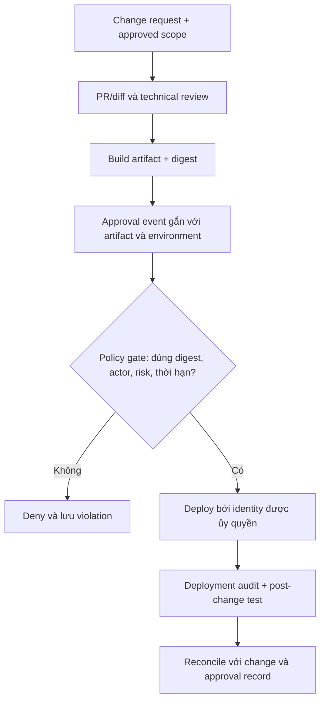

# Change approval: phê duyệt thay đổi có kiểm soát và có bằng chứng

## 1. Change approval là gì?

**Change approval** là hoạt động **đánh giá và quyết định có thẩm quyền rằng một thay đổi cụ thể được phép thực hiện trong phạm vi, điều kiện, thời điểm và mức rủi ro đã xác định**. Trong môi trường công nghệ, đối tượng của quyết định có thể là phát hành ứng dụng, cấu hình hạ tầng, quyền IAM, chính sách bảo mật, thay đổi dữ liệu, dịch vụ cloud hoặc một quy trình vận hành quan trọng.

Phê duyệt đúng không chỉ là nút **Approve** trong ticket. Một quyết định có giá trị cần biết **ai duyệt**, **được phép duyệt theo chính sách nào**, **đã xem xét thông tin gì**, **đang duyệt chính xác thay đổi nào**, **quyết định có hiệu lực khi nào** và **việc triển khai thực tế có đúng nội dung đã duyệt không**.

Ví dụ: đội vận hành xin mở một security group từ mạng quản trị nội bộ tới máy chủ ứng dụng. Ticket được duyệt cho một cổng và nguồn kết nối cụ thể. Nếu sau đó người thực thi sửa security group thành `0.0.0.0/0` hoặc mở thêm cổng quản trị, **quyết định phê duyệt ban đầu không tự động cho phép phần thay đổi mở rộng**.

Trong chương **Change assurance** của module **SECURITY_SECURITY_ASSURANCE**, mục tiêu là **đánh giá có bằng chứng rằng hệ thống đáp ứng các mục tiêu bảo mật**, từ phân tích rủi ro, yêu cầu, kiểm soát đến kiểm thử, audit và khắc phục phát hiện. Vì vậy, change approval phải được thiết kế như một **security control có thể kiểm chứng**, kết nối quy trình quản trị thay đổi với dữ liệu deployment, IAM, CI/CD, cloud logs và kết quả kiểm tra sau triển khai.

Sau bài học, người học có thể:

- Phân biệt change request, review, approval, authorization, deployment và post-change verification.
- Xác định loại thay đổi, risk tier, người duyệt, điều kiện đủ và thời hạn hiệu lực của phê duyệt.
- Thiết kế cơ chế ngăn bypass qua UI, API, CI/CD, cloud console và tài khoản khẩn cấp.
- Liên kết quyết định phê duyệt với **đúng đối tượng triển khai và bản cấu hình/bản phát hành**.
- Kiểm tra đầy đủ population thay đổi, chất lượng bằng chứng, trường hợp khẩn và các sai lệch.
- Xây dựng test cases, chỉ số, báo cáo assurance và cơ chế khắc phục liên tục.

## 2. Vì sao change approval là kiểm soát bảo mật?

Một thay đổi không được xem xét đầy đủ có thể làm **mở rộng quyền, xóa logging, giảm mã hóa, phá kiểm soát truy cập, làm hỏng dữ liệu hoặc ảnh hưởng tính sẵn sàng**. Những lỗi này có thể do cấu hình sai, thiếu hiểu biết về phụ thuộc, thay đổi khẩn hoặc hành vi cố ý.

Kết quả mà change approval muốn đạt không nhất thiết là “không có sự cố sau deploy”. Mục tiêu chính là **đảm bảo quyết định thay đổi được cân nhắc và cho phép bởi đúng người trước khi thực thi**, đồng thời có khả năng kiểm chứng rằng phạm vi triển khai tuân theo điều kiện đó.

Một chuỗi assurance điển hình:

```mermaid
flowchart LR
    R["Risk scenario và mục tiêu bảo mật"] --> Q["Control requirement: phải phê duyệt thay đổi"]
    Q --> D["Design: chính sách, vai trò, workflow và gates"]
    D --> O["Operation: yêu cầu, review, quyết định"]
    O --> X["Execution: deploy/IAM/cloud/config"]
    X --> V["Validation: đối chiếu và thử sau thay đổi"]
    V --> E["Evidence: logs, artifact, approval, findings"]
    E --> C["Assurance conclusion theo scope và kỳ"]
    C --> F["Khắc phục và cải tiến kiểm soát"]
    F --> D
```



Đối với một hệ thống production, câu hỏi security assurance không dừng ở “đã có quy trình change management chưa?”. Cần trả lời thêm:

- Có **đầy đủ mọi đường thay đổi** thuộc phạm vi?
- Tập triển khai thực tế có được đối chiếu với tập request/approval?
- Những quyết định từ chối, hết hạn, thiếu dữ liệu hoặc không đủ thẩm quyền có bị chặn không?
- Phê duyệt có gắn đúng **commit, artifact, policy diff và môi trường** không?
- Có bảo đảm người đề xuất không thể tự cấp quyền duyệt cho chính mình trái quy tắc?
- Có kiểm tra sau triển khai, phát hiện drift và xử lý thay đổi không được phép không?

**Approval là một kiểm soát quan trọng nhưng không thay thế kiểm thử kỹ thuật.** Một người duyệt có thẩm quyền vẫn có thể bỏ sót lỗ hổng; cần thêm các điều kiện như review mã, kiểm thử, policy-as-code, quan sát sau deploy và rollback tùy mức rủi ro.

## 3. Những khái niệm dễ nhầm

| Khái niệm | Mục đích | Không được suy ra |
|---|---|---|
| **Change request** | Mô tả nhu cầu, phạm vi, tác động và đề xuất | Có ticket chưa nghĩa là có quyền triển khai |
| **Technical review** | Kiểm tra tính đúng kỹ thuật, test, dependency và cách triển khai | Review đạt chưa đồng nghĩa phê duyệt kinh doanh/bảo mật |
| **Security review** | Xem tác động confidentiality, integrity, availability, kiểm soát và rủi ro | Không phải cứ có chữ ký Security là đủ mọi thẩm quyền |
| **Approval / authorization** | Cho phép thực hiện theo phạm vi, điều kiện và thời điểm | Không bao trùm diff khác, môi trường khác hay thời điểm khác |
| **Deployment execution** | Thực sự thay đổi runtime, code, quyền hoặc cấu hình | Deploy thành công không chứng minh đã được duyệt |
| **Post-change verification** | Kiểm tra trạng thái sau thay đổi, business function, security guardrails | Test sau deploy không hợp thức hóa phê duyệt bị thiếu |
| **Change record** | Hồ sơ gắn các sự kiện từ đầu tới cuối | Record đầy đủ metadata vẫn có thể chứa approval không hợp lệ |
| **Exception / risk acceptance** | Quyết định quản trị về lệch chuẩn trong điều kiện cụ thể | Phê duyệt ngoại lệ không tự thay một nghĩa vụ bên ngoài |
| **Emergency change** | Cách xử lý được định nghĩa cho thay đổi cấp bách | “Khẩn” không mặc định cho phép bỏ mọi kiểm soát |

Ví dụ “code review” và “change approval” có thể là hai kiểm soát độc lập: reviewer xác nhận diff hợp lý, còn change approver xác nhận **đủ điều kiện đưa diff đó vào production** với dữ liệu, rủi ro và thời điểm đã nêu.

Trong một tổ chức nhỏ, các vai trò có thể kết hợp theo chính sách rủi ro, nhưng kết hợp trách nhiệm phải được xem xét cùng **segregation of duties (SoD)** và kiểm soát độc lập thích hợp.

## 4. Xác định phạm vi thay đổi cần phê duyệt

Một sai lệch thường gặp là chỉ kiểm tra release application nhưng bỏ qua thay đổi cloud console, IAM, firewall hoặc database. Phạm vi có thể gồm:

1. **Application/code:** release, feature flag, rollback, thư viện, cấu hình runtime.
2. **Infrastructure:** network, DNS, load balancer, security group, Kubernetes manifest, cloud resources.
3. **Identity and access:** role grants, privileged groups, service accounts, policy, trust relationship.
4. **Security controls:** WAF, SIEM rules, EDR policy, MFA, key management, logging, backup/retention.
5. **Data and database:** schema migration, data transformation, import/export, data deletion, access migration.
6. **Third-party integrations:** OAuth scope, API connector, SaaS settings, secrets và quyền nhà cung cấp.
7. **Operational process:** thủ tục DR/BCP, lịch runbook, thay đổi nhánh tự động remediation.
8. **Emergency actions:** cô lập tài khoản, khóa cổng, khôi phục phiên bản, chặn luồng độc hại.

Không nhất thiết buộc mọi hoạt động vi mô qua cùng một workflow phức tạp. Chính sách nên **phân loại theo rủi ro và mức có thể dự đoán**, giữ nguyên yêu cầu giám sát/traceability phù hợp.

### 4.1. Ranh giới production và môi trường liên quan

Một thay đổi trên staging có thể không cần cùng mức duyệt với production; nhưng nếu staging **dùng dữ liệu thật, giữ credential production hoặc có quyền lên cloud account thật**, rủi ro có thể tương tự production. Scope phải dựa trên **quyền và tác động thực tế**, không chỉ tên môi trường.

Một thay đổi cho pipeline deploy hoặc identity provider dùng chung cũng có thể ảnh hưởng nhiều production systems. Phải đánh giá **control plane/shared dependency**, không chỉ ứng dụng trực tiếp bị đổi.

## 5. Bắt đầu bằng risk scenario

Một mô hình lý do cho change approval:

> Do người thực thi có thể đưa thay đổi chưa được xem xét hoặc ngoài phạm vi vào production, cấu hình bảo mật hoặc hành vi ứng dụng có thể bị suy giảm, dẫn đến lộ dữ liệu, mất toàn vẹn, gián đoạn hoặc mất khả năng điều tra.

Từ đó có những đường rủi ro:

| Đường thay đổi | Sự kiện bất lợi | Kiểm soát cần xem |
|---|---|---|
| Pull request bị thay sau review | Code chưa được kiểm tra được phát hành | Binding review với commit/diff đã duyệt |
| Pipeline deploy bằng token rộng | Một job bỏ qua environment approval | Policy gate, IAM và audit pipeline |
| Console/IAM trực tiếp | Admin cấp quyền không có request | Preventive IAM policy + detection reconciliation |
| Emergency change | Bypass được dùng ngoài sự cố | Điều kiện kích hoạt, expiry, hậu kiểm |
| Feature flag production | Bật chức năng xử lý dữ liệu mới không review | Quản trị flag như thay đổi theo rủi ro |
| Database migration | Xóa/sửa dữ liệu ngoài phạm vi, không rollback | Data owner, migration test, backup và verification |
| Logging rule change | Tắt detection hoặc tăng suppression | Security-specific approval và regression test |
| Vendor change | Bên thứ ba mở quyền/tích hợp mới | Contract/shared responsibility, review vendor |

**Risk tier không được tính chỉ từ số dòng code hoặc số câu lệnh.** Một thay đổi một dòng mở ACL public có thể nguy hiểm hơn một release có hàng nghìn dòng UI.

## 6. Standard, normal và emergency changes

Nhiều tổ chức phân biệt ba loại nghiệp vụ; tên gọi và tiêu chí chính xác phụ thuộc chính sách của từng đơn vị.

| Loại thay đổi | Đặc trưng | Cách phê duyệt thường phù hợp | Bằng chứng trọng tâm |
|---|---|---|---|
| **Standard / pre-authorized** | Lặp lại, phạm vi hẹp, có quy trình/test và rủi ro được hiểu rõ | Phê duyệt **mẫu quy trình** trước; mỗi lần thực thi theo điều kiện và gate tự động | Mẫu được duyệt, runtime parameters, test, audit thực thi |
| **Normal** | Thay đổi có kế hoạch, tác động cần đánh giá riêng | Review và phê duyệt **trước thực thi** theo risk tier | Phạm vi, diff, risk assessment, approvals, timestamp |
| **Emergency** | Cần hành động nhanh để xử lý tình huống cấp bách | Đường khẩn riêng với giới hạn, thẩm quyền và hậu kiểm | Incident ID, lý do khẩn, quyền, thời điểm, log, retrospective review |

**Pre-authorized standard change không phải “không cần kiểm soát”.** Tổ chức phải phê duyệt một **loại thay đổi cụ thể, điều kiện kích hoạt, tham số được phép, phiên bản runbook, guardrails và cơ chế monitoring**. Một lần thực thi vượt template hoặc phạm vi phải chuyển sang workflow khác.

**Emergency change không phải normal change được đổi nhãn sau khi deploy.** Nếu chính sách cho phép thực hiện trước một số bước duyệt thông thường, phải xác định rõ quyền khẩn, tình huống kích hoạt, bằng chứng sự cần thiết, thời hạn và thời điểm hậu kiểm. Không tự tạo phê duyệt lùi ngày để trông như đã duyệt trước.

### 6.1. Ví dụ thay đổi chuẩn

Một quy trình **rotation credential không làm tăng quyền**, đã được phê duyệt, có thể tự động thực hiện khi thỏa tất cả điều kiện:

- Loại credential, hệ thống, account và ứng dụng nằm trong approved template.
- Không tăng scope hay thay trust boundary.
- Có phương án kiểm tra hệ thống nhận credential mới.
- Có audit event, quyền máy thực thi tối thiểu và khả năng rollback/cấp lại an toàn.
- Mọi trường hợp validation fail đều dừng/đưa vào hàng đợi review.

Nếu rotation cần mở quyền root hoặc đổi account nhận secret, nó không tự thuộc template cũ.

## 7. Nội dung tối thiểu của một change request

| Trường | Câu hỏi | Ví dụ |
|---|---|---|
| `change_id` | ID bền vững để liên kết log và approvals? | `CHG-2026-0142` |
| `title`, `reason` | Tại sao cần thay đổi và kết quả mong muốn? | Hạn chế API admin |
| `requester`, `implementer` | Ai đề xuất và ai thực thi? | Team Platform |
| `business_owner`, `technical_owner` | Ai chịu tác động nghiệp vụ/kỹ thuật? | Product owner, SRE |
| `risk_tier`, `change_type` | Loại/rủi ro và căn cứ? | Normal / High |
| `scope` | Những systems, accounts, environments, regions nào? | Production tenant A |
| `current_state`, `target_state` | Điều gì thay đổi? | Diff cụ thể |
| `artifact_ref` / `commit_sha` | Bản code/config nào được review? | Artifact digest |
| `dependencies`, `impact` | Tác động tới bảo mật và nghiệp vụ? | IAM, data flow, downtime |
| `test_plan`, `test_results` | Kiểm tra trước deploy đủ chưa? | CI run + security review |
| `deployment_plan` | Thao tác, người thực thi, lịch/cửa sổ | Runbook và maintenance window |
| `rollback_or_recovery_plan` | Nếu lỗi thì quay lại/khôi phục thế nào? | Trình tự và điều kiện kích hoạt |
| `approval_policy_ref` | Quy tắc ai được duyệt và điều kiện? | Policy version 3 |
| `approvals` | Actor, vai trò, thời gian, decision, scope | Approval event ID |
| `emergency_or_exception_ref` | Có đường khẩn hoặc ngoại lệ được duyệt? | Incident/exception ID |
| `post_change_validation` | Đã kiểm tra sau thực thi những gì? | Smoke/security test |
| `evidence_refs` | Nguồn log và tài liệu để đánh giá lại | Change log, deploy audit |

**Không thu thập secrets** như token, private key hoặc mật khẩu trong ticket. Chỉ lưu reference đến kho bí mật được phân quyền. Khi cần xem diff cấu hình, redact có kiểm soát để không đánh mất thông tin quan trọng cho quyết định.

## 8. Khi nào một approval hợp lệ?

Một lần nhấn **Approve** chỉ có giá trị đối với control khi thỏa **các điều kiện về người, đối tượng, thời gian và nội dung**.

| Chiều kiểm tra | Điều kiện cần |
|---|---|
| **Identity** | Người duyệt được xác thực, có actor ID truy vết; không phải tài khoản chia sẻ không rõ người |
| **Authority** | Được ủy quyền duyệt đúng loại/tầng rủi ro và scope theo policy có hiệu lực |
| **Independence** | Tuân thủ SoD và các hạn chế tự duyệt; có kiểm soát bù khi mô hình được phép ngoại lệ |
| **Specificity** | Phê duyệt gắn với thay đổi, môi trường, diff và version đúng |
| **Information** | Người duyệt có thông tin tác động, risk, evidence/test đủ theo loại thay đổi |
| **Temporal order** | Với normal change, approval hợp lệ **có trước execution** và chưa hết hiệu lực |
| **Conditions** | Những điều kiện kèm quyết định đã được đáp ứng trước giai đoạn cần thiết |
| **Integrity** | Approval event không thể bị sửa hoặc giả mạo không lưu dấu |
| **Revocation** | Phê duyệt bị thu hồi, thay diff, scope, risk hoặc thời điểm quan trọng phải được xem lại |
| **Accountability** | Có lý do quyết định và quy trình xử lý khi triển khai sai |

Nếu một policy thay đổi sau khi phê duyệt, cần xác định **phiên bản áp dụng tại thời điểm ra quyết định**, và trường hợp nào phải yêu cầu duyệt lại theo chính sách. Không tự đánh giá một quyết định cũ bằng rule mới mà không giải thích mốc hiệu lực.

### 8.1. Phê duyệt không chỉ là một timestamp

Khi so sánh `approved_at <= deployed_at`, phải bảo đảm cả hai mốc sử dụng **thời gian đáng tin**. Nếu hệ thống khác nhau có độ trễ/sai lệch đồng hồ hoặc chỉ ghi giây, timestamp bằng nhau không tự chứng minh approval xảy ra trước execution. Có thể cần **event sequence, transaction ID, audit trail của gate và tính toàn vẹn theo chuỗi**.

Một approval được thêm vào ticket sau deploy không được tính là phê duyệt trước, dù người thực hiện đặt lại ngày trong comment.

## 9. Segregation of Duties (SoD) và người có quyền duyệt

**Segregation of duties** giảm nguy cơ một người tự yêu cầu, tự duyệt, tự triển khai và tự kiểm tra thay đổi rủi ro cao mà không có sự xem xét độc lập.

Các vai trò có thể gồm:

| Vai trò | Quyền/trách nhiệm | Kiểm soát xung đột |
|---|---|---|
| **Requester** | Nêu mục đích, risk, phạm vi và kết quả mong muốn | Không tự khẳng định proposal đã được duyệt |
| **Code/technical reviewer** | Kiểm tra diff, thiết kế, test và tác động kỹ thuật | Review đúng commit đang triển khai |
| **Security reviewer** | Đánh giá risk, access, data, logging, dependency | Không thay cho thẩm quyền nghiệp vụ nếu chính sách yêu cầu |
| **Business owner** | Xác nhận thời điểm, khả năng chấp nhận downtime và tác động | Không tự bỏ điều kiện bảo mật bắt buộc |
| **Change approver / authority** | Phê duyệt theo risk tier và delegation | Quyền phải còn hiệu lực, giới hạn scope |
| **Implementer / pipeline identity** | Thực thi nội dung được duyệt | Không có quyền sửa approval record hoặc tự mở rộng scope |
| **Independent verifier** | Kiểm tra execution, hậu quả và evidence | Không chỉ tin vào status của người deploy |
| **Risk owner / exception approver** | Quyết định với rủi ro còn lại và ngoại lệ đúng thẩm quyền | Không miễn nghĩa vụ bên ngoài tùy ý |

Tùy quy mô và rủi ro, một tổ chức có thể sử dụng các vai trò khác nhau; không có yêu cầu phổ quát rằng **mọi commit phải qua một hội đồng nhiều người**. Điều quan trọng là tránh **xung đột nguy hiểm** và chứng minh cơ chế thay thế hợp lý.

### 9.1. Xung đột quyền trong CI/CD

Một người có thể không tự duyệt PR trên UI nhưng vẫn nắm:

- Quyền quản trị repository để sửa branch protection.
- Quyền sửa workflow pipeline hoặc environment approval.
- Quyền sửa policy-as-code evaluator.
- Quyền truy cập production cloud credentials độc lập với pipeline.
- Quyền sửa/xóa audit log của hệ thống kiểm tra.

Vì vậy SoD phải xét **quyền hiệu lực trên toàn đường triển khai**, không chỉ vai trò ở ticket. Cần phân tách người có quyền thay đổi guardrails với người chịu kiểm soát, có review và log độc lập cho thay đổi các chính guardrails đó.

## 10. Phân tầng rủi ro của change

Một mô hình nội bộ có thể đánh giá các yếu tố:

1. **Bề mặt tấn công:** mở endpoint, quyền Internet, kết nối bên ngoài, trust boundary.
2. **Quyền:** tăng đặc quyền, thay token, service identity hoặc khả năng cross-account.
3. **Dữ liệu:** xử lý dữ liệu nhạy cảm, mục đích sử dụng, chia sẻ hoặc xóa dữ liệu.
4. **Tính quan trọng:** dịch vụ nằm trên đường găng BIA, tác động RTO/RPO, khách hàng.
5. **Khả năng rollback:** có thể quay lại nguyên trạng hay thay đổi bất khả nghịch?
6. **Phạm vi phát tán:** một instance hay nhiều region, tenant hoặc hàng loạt khách hàng.
7. **Độ mới/độ phức tạp:** đổi kiến trúc, schema, vendor hoặc dependency chưa từng thử.
8. **Tình trạng kiểm soát:** automation/test/logging hiện có có đáng tin hay đang có finding?
9. **Tình huống khẩn:** cần xử lý sự cố đang diễn ra hay chỉ gấp vì trễ kế hoạch?

| Risk tier minh họa | Change | Điều kiện review gợi ý |
|---|---|---|
| **Low** | Điều chỉnh text UI không động đến dữ liệu/quyền; quy trình test đầy đủ | Workflow gọn, tự động nếu đúng tiêu chí |
| **Medium** | Thay config feature theo phạm vi nội bộ | Technical owner và các gates phù hợp |
| **High** | Sửa IAM, network, encryption, lưu dữ liệu khách hàng | Security/risk review độc lập theo policy và rollback evidence |
| **Critical** | Đổi root trust, key recovery, delete dữ liệu diện rộng, tắt log trọng yếu | Thẩm quyền cấp cao hoặc đường khẩn đã định nghĩa, điều kiện đặc biệt |

Đây là ví dụ tổ chức risk tier, **không phải quy tắc bắt buộc từ một tiêu chuẩn cụ thể**. Trường hợp đặc biệt như một thay đổi nhỏ nhưng tạo rủi ro lớn phải có **override theo criticality**; không được hạ risk tier vì số dòng diff ít.

## 11. Review nào cần hoàn tất trước khi phê duyệt?

Tùy loại thay đổi, bộ bằng chứng readiness có thể bao gồm:

| Nội dung review | Câu hỏi | Evidence thường có |
|---|---|---|
| **Business need** | Thay đổi phục vụ mục tiêu gì, ai xác nhận tác động? | Business case, issue, BIA |
| **Architecture** | Dependency, failure domain, flow, trust boundary có đổi không? | Diagram, design review |
| **Secure coding** | Có input validation, auth, secrets, dependency risks? | PR review, SAST/DAST khi phù hợp |
| **Access/IAM** | Quyền mới có đúng least privilege, thẩm quyền cấp? | Policy diff, role grant proposal |
| **Data/privacy** | Dữ liệu mới xử lý, nơi lưu, retention, partner mới? | Data flow, classification, privacy review |
| **Infrastructure/availability** | Blast radius, load, capacity, fallback thế nào? | Test, canary plan, rollback |
| **Backup/DR** | Đổi schema/key có ảnh hưởng khả năng phục hồi không? | Backup/restore test và dependency |
| **Logging/detection** | Có làm mất nguồn log hoặc rule, mở khoảng trống giám sát? | Telemetry contract, regression tests |
| **Policy/compliance** | Có yêu cầu bắt buộc hoặc điều kiện ngoại lệ? | Requirement mapping, approval |
| **Implementation readiness** | Có artifact, runbook, owner, điều kiện dừng? | Release checklist, rollout plan |

Không phải một approve click phải tự chứa tất cả tài liệu trên. Approval record có thể **trỏ tới các phiên bản và kết quả review liên quan**; điều quan trọng là reviewer có bằng chứng chúng tồn tại và áp dụng cho **đúng diff**, đúng kỳ.

## 12. Gắn approval với diff, commit và artifact bất biến

Một kiểu bypass nguy hiểm:

1. Commit **A** được review.
2. Người tạo PR bổ sung commit **B** sau review.
3. Pipeline build artifact từ commit B rồi deploy.
4. Ticket vẫn có “Approved” từ bước 1.

Nếu approval chỉ gắn với **tên branch, tên ticket hoặc phiên bản text**, quyết định có thể không còn áp dụng cho nội dung đã triển khai.

Biện pháp kiểm soát:

- PR approval phải bị yêu cầu review lại khi có **thay đổi nội dung có ý nghĩa** theo chính sách.
- Deploy nên gắn với **commit SHA**, artifact digest hoặc manifest version đã qua gate.
- Build provenance phải cho biết artifact được tạo từ nguồn nào, bởi pipeline nào, với input kiểm soát phù hợp.
- Thay đổi release parameters, tenant, environment, quyền triển khai hoặc feature flags có thể cần approval riêng.
- Gate thực thi kiểm tra **approval còn hiệu lực** cho chính đối tượng ở ngay trước deploy.
- Có audit trace từ `change_id` → `approval_event_id` → `artifact_digest` → `deployment_id`.



**Approval không phải chữ ký mật mã trừ khi hệ thống thật có cơ chế chứng thực đó.** Nếu chỉ lưu tên reviewer và digest trong một bảng có thể sửa tự do, vẫn có khả năng giả mạo. Cần xem access control, audit trail, nguồn sự kiện và quyền sửa policy.

## 13. Thiết kế policy gate trong CI/CD

Trong pipeline tự động, cần xác định các điều kiện chặn ngay tại **điểm có quyền đưa thay đổi vào production**, thay vì chỉ cảnh báo sau khi deployment đã xảy ra.

Ví dụ về logic kiểm soát ở mức khái niệm:

```text
function isAuthorizedDeployment(change, artifact, deployment, context):
    assert change.exists
    assert deployment.environment in change.approved_environments
    assert deployment.target_resources subset_of change.approved_resources
    assert deployment.artifact_digest == change.approved_artifact_digest
    assert change.status == "approved"
    assert change.approval_is_effective_at(deployment.time)
    assert change.conditions_are_satisfied
    assert approvers_are_authorized(change.risk_tier, change.scope)
    assert segregation_of_duties_is_satisfied
    assert required_tests_are_valid_for(artifact, context)

    return allow

on failed assertion:
    deny deployment
    record rejection with policy version and reason
```

Đoạn trên là **pseudocode**. Một pipeline thực phải xử lý trạng thái thay đổi đồng thời, race condition, identity, thời gian, sự kiện thu hồi, ngoại lệ và đối tượng ngoài đường pipeline. `subset_of` cũng phải được định nghĩa trên **danh tính tài nguyên và quyền thực tế**, không chỉ so chuỗi tên.

### 13.1. Gate cần tự bảo vệ

Một gate không còn ý nghĩa nếu người thực thi có thể tự:

- Sửa file policy trong cùng branch không cần review.
- Tắt environment protection, branch rule hoặc job validator.
- Thay đường deploy sang workflow không qua gate.
- Dùng static credential có quyền deploy trực tiếp.
- Tạo approval event giả hoặc sửa trạng thái ticket.
- Re-run job với artifact khác sau khi đã duyệt.

Cần áp dụng quyền tối thiểu, bảo vệ sửa guardrails, rotate/revoke credentials, audit cấu hình policy và phát hiện hành động deploy ngoài pipeline. Với các hệ thống trọng yếu, có thể dùng **deployment identity ngắn hạn, bound vào workload/job** và guardrail ở cloud/IAM layer để giảm đường bypass.

## 14. Approval theo thay đổi IAM, network, data và security controls

Các loại thay đổi có tính chất riêng; một checklist chung dễ bỏ sót điều kiện.

### 14.1. IAM/privileged access

- Ai nhận/giữ quyền, vì sao, trong bao lâu?
- Role hiện tại và role mới, permission delta, delegation và inheritance?
- Có tài khoản non-human, API token, emergency access?
- Người duyệt có thẩm quyền với loại quyền và hệ thống này không?
- Grant thực hiện từ đâu (IAM API, cloud console, PAM, IaC)?
- Có expiry, recertification và event log cho quyền mới?
- Có đối chiếu **grant event với approval** và phát hiện quyền cấp ngoài workflow?

Một change phê duyệt cấp read-only không bao phủ quyền `iam:*` được gán thực tế.

### 14.2. Network/security group

- Source/destination, protocol, port, IP range, direction và thời gian?
- Có mở rộng đường từ Internet hoặc vùng ít tin cậy?
- Policy diff có bị thay sau duyệt?
- Có test negative để xác nhận các đường không được phép vẫn bị chặn?
- Có inventory/flow log để phát hiện drift?

### 14.3. Database/schema và dữ liệu

- Có migration script nào, bản checksum, rollback hoặc roll-forward?
- Có thay đổi phân loại/retention, xóa dữ liệu hoặc export sang vendor?
- Có backup và restore test tương ứng với dữ liệu quan trọng?
- Có kiểm tra migration trong môi trường tương đương, đối soát sau khi chạy?
- Người phê duyệt có quyền với dữ liệu và hậu quả nghiệp vụ không?

Một migration xóa cột không tự có rollback an toàn, đặc biệt nếu dữ liệu đã bị mất. Quy trình phải đánh giá **khả năng phục hồi thực**, không chỉ có một câu “rollback available”.

### 14.4. Security logging, detection và policy

- Rule mới có làm giảm coverage, tăng suppression hoặc mất severity?
- Có test positive/negative và kiểm tra nguồn log?
- Việc tắt detector hoặc firewall rule có cần thẩm quyền Security riêng?
- Có baseline của trạng thái trước/sau để phát hiện drift?
- Có kiểm soát khi hệ thống approval/gate chính bị ảnh hưởng bởi chính thay đổi này?

### 14.5. Third-party/vendor change

- SaaS có thêm data flow, OAuth scopes, tài khoản hỗ trợ hoặc subprocessor?
- Hợp đồng, security review và trách nhiệm của khách hàng/vendor có thay đổi?
- Có thông báo theo điều khoản và đường thu hồi truy cập?
- Người approve kỹ thuật và người chấp thuận rủi ro dữ liệu có đúng vai trò?

Việc một vendor đánh dấu “maintenance completed” chưa chứng minh tổ chức đã phê duyệt phần thay đổi trong phạm vi trách nhiệm của mình.

## 15. Normal change workflow từ đề xuất đến đóng

Một quy trình đầy đủ có thể có các bước:

1. **Create:** tạo change ID, owner, mục đích, scope, loại và thời gian dự kiến.
2. **Assess:** đánh giá risk, BIA, data flow, dependencies, rollback/recovery.
3. **Prepare:** có diff, test plan/results, runbook, approvals cần thiết.
4. **Review:** technical/security/business review theo risk tier.
5. **Approve or reject:** quyết định gắn người, thẩm quyền, phạm vi, version, điều kiện và hiệu lực.
6. **Check right before execute:** đảm bảo approval còn hợp lệ; không có thay diff, scope hoặc điều kiện quan trọng.
7. **Execute:** chỉ bằng identity/đường được phép, lưu deployment audit.
8. **Verify:** smoke test, security controls, health, rollback trigger và expected state.
9. **Reconcile:** so actual diff/artifact/deployment với approved change.
10. **Close:** ghi kết quả, deviation, incident, evidence, reviewer và bài học.
11. **Improve:** cập nhật template, policy, monitoring hoặc xử lý bypass.

**Đóng change record không được chỉ dựa trên “pipeline green”.** Ví dụ build pass và deploy success vẫn có thể tạo role quá rộng hoặc mất logging. Với thay đổi rủi ro cao, cần các tiêu chí security validation cụ thể.

### 15.1. Trạng thái và lịch sử

Một tracker có thể dùng `draft`, `submitted`, `under_review`, `approved`, `rejected`, `scheduled`, `in_progress`, `implemented`, `verification_failed`, `closed`, `cancelled` và `superseded`.

**Trạng thái tại một thời điểm không thay thế event history.** Nếu ticket đã `closed`, muốn biết liệu approval có trước deployment hay không vẫn phải xem bản ghi sự kiện có timestamp và version.

## 16. Emergency changes: khẩn cấp nhưng không mất trách nhiệm

Một emergency change có thể cần triển khai nhanh để **ngăn tấn công, khôi phục dịch vụ hoặc giải quyết rủi ro đang hiện thực hóa**. Quy trình phải cho phép phản ứng mà vẫn giữ traceability và kiểm soát tối thiểu phù hợp.

Một mô hình nội bộ có thể quy định:

- Điều kiện rõ để xác định tình huống khẩn; không dùng “trễ deadline” làm lý do duy nhất.
- Mã incident/change liên kết, người chỉ huy, người thực thi và thẩm quyền kích hoạt.
- Phạm vi nhỏ nhất cần thiết, thời hạn hiệu lực và điều kiện khôi phục.
- Ghi nhận quyết định trước thực thi **khi khả thi**, hoặc ghi căn cứ trong đường khẩn đã được phê duyệt.
- Audit event bắt buộc, hạn quyền emergency, kiểm tra hậu quả.
- **Retrospective review/post-implementation review** trong thời hạn được chính sách phê duyệt.
- Điều tra khi một thay đổi được phân loại emergency sai mục đích.

Phải phân biệt ba mốc:

| Mốc | Ý nghĩa |
|---|---|
| `emergency_declared_at` | Bắt đầu tình huống đủ điều kiện emergency |
| `executed_at` | Thao tác thay đổi thực tế diễn ra |
| `retrospective_review_at` | Hậu kiểm tính cần thiết, phạm vi, hậu quả và tuân thủ quy trình khẩn |

Nếu chính sách cho phép retrospective review, việc review sau thực thi có thể là **hợp lệ theo nhánh emergency**. Nhưng nó **không phải “approval trước thực thi”**; báo cáo phải phản ánh đúng loại quyết định.

### 16.1. Ví dụ cô lập một credential bị lộ

Khi nghi credential đang bị lạm dụng, đội IR có thể cần thu hồi ngay và cắt quyền phiên. Đường emergency có thể cho phép actor IR được ủy quyền thực thi với incident ID, log từ IdP, ghi thời gian và review sau. Sau khi an toàn cần xác minh:

- Credential/phiên bị thu hồi ở các hệ thống liên quan.
- Không phá quyền khôi phục dịch vụ trọng yếu ngoài kế hoạch.
- Có khôi phục quyền theo thủ tục kiểm soát khi hết sự cố, không giữ bypass lâu dài.
- Review xác định thay đổi có nằm trong phạm vi sự cố và có cần sửa policy hay không.

Không kéo dài quyền emergency vô thời hạn hoặc dùng cùng quyền đó cho release thường ngày.

## 17. Standard change và approval theo mẫu

Các thay đổi lặp lại có thể được **pre-authorized** khi tổ chức đã xác minh thiết kế, mức rủi ro và điều kiện thực thi.

Ví dụ một template thay cert:

- Chỉ cho phép cert của các dịch vụ đã đăng ký.
- CA và quy tắc khóa/chu kỳ được phê duyệt; không đổi trust policy ngoài phạm vi.
- Tự kiểm tra ngày hết hạn và chain hợp lệ.
- Có canary/smoke, rollback và cảnh báo nếu dịch vụ mất TLS.
- Có record `template_version`, `execution_id`, actor và artifact checksum.
- Khi param ra ngoài tập đã duyệt, tự động **deny/escalate normal review**.

Đánh giá assurance cho standard change gồm **hai tầng**: phê duyệt template (**design control**) và từng lần thực hiện có theo template (**operating control**) hay không.

Một công việc chạy “100 lần không sự cố” không chứng minh đúng phạm vi nếu pipeline vẫn có thể đổi tham số tùy ý hoặc có 20 lần được thực thi ngoài catalog.

## 18. Approval và thay đổi bảo mật nhạy cảm

Một số thay đổi có thể làm suy yếu chính hệ thống kiểm soát change approval, ví dụ:

- Vô hiệu một Git branch protection.
- Bỏ yêu cầu reviewer bảo mật hoặc thay danh sách approved reviewers.
- Nới IAM role của pipeline hoặc service account CI.
- Sửa policy evaluator, thay threshold, cho bypass không ghi log.
- Tắt audit log, giảm retention hoặc sửa quyền xóa evidence.
- Thay khóa ký artifact, repository trust hoặc cơ chế workload identity.

Các thay đổi này nên được coi là **high-risk hoặc critical** theo chính sách, với người duyệt độc lập phù hợp, kiểm thử regression và phát hiện drift.

Một số tổ chức dùng mô hình **break-glass có kiểm soát** cho trường hợp mất hệ thống approval chính. Cần định nghĩa đường khẩn, quyền ngắn hạn, nhật ký độc lập và hậu kiểm; không để break-glass trở thành một tài khoản admin luôn bật không được theo dõi.

## 19. Những tình huống bypass change approval

| Bypass | Hệ quả | Cách phát hiện và giảm thiểu |
|---|---|---|
| Deploy từ máy cá nhân bằng cloud token | Không đi qua pipeline được kiểm soát | Hạn chế direct deploy, audit cloud API, rotate credential |
| Sửa cấu hình thủ công trong console | Drift so với IaC đã duyệt | IaC drift detector, cloud config events |
| Approval dành cho commit A, deploy commit B | Nội dung triển khai không được duyệt | Kiểm tra digest/commit ngay tại gate |
| Người tạo PR tự thêm quyền reviewer | Vi phạm SoD | Quản trị RBAC và policy changes có log |
| Label ticket “approved” bằng automation không có kiểm tra | Phê duyệt giả hoặc thiếu điều kiện | Xác minh approval events, actor/authority, policy |
| Đổi risk tier thành low để né review | Bỏ kiểm tra quan trọng | Rule risk assessment có nguồn, approval khi override |
| Dùng emergency change cho release gấp | Hợp thức hóa việc bỏ quy trình | Theo dõi ratio, retrospective audit |
| Duyệt scope hẹp, triển khai rộng | Quyền/tài nguyên ngoài phạm vi | Compare desired vs approved diff, deployment audit |
| Thay feature flag sau release | Bật chức năng rủi ro chưa review | Flag governance, production change events |
| Change đã bị thu hồi vẫn deploy | Quyết định không còn hiệu lực | Real-time gate và revocation checks |
| Dùng static credential của người đã nghỉ | Thiếu attribution, bypass quyền | Short-lived credentials, identity lifecycle |
| Ghi đè log approval/deployment | Mất chứng cứ kiểm toán | RBAC, append-only/independent logs theo rủi ro |

**Một dashboard hiển thị 100% ticket approved có thể sai lệch nghiêm trọng** nếu mẫu số chỉ gồm các ticket đã tạo. Phải đối soát ngược từ **mọi thay đổi thực tế** để phát hiện các thao tác không có ticket.

## 20. Evidence cho change approval assurance

Cần thu thập chứng cứ cho cả **thiết kế** lẫn **vận hành**:

| Claim cần kiểm chứng | Evidence phù hợp | Hạn chế phải kiểm tra |
|---|---|---|
| Có chính sách và risk tiers | Policy, workflow version, delegation matrix | Không chứng minh quy trình được tuân thủ |
| Người duyệt đủ thẩm quyền | RBAC/delegation history và approval event | Quyền có thể đã thay đổi theo thời gian |
| Review đúng artifact | PR/commit, artifact digest, approval binding | Branch name không đủ |
| Approval trước deploy theo nhánh normal | Approval event và deployment event, thời gian/sequence | Timestamp có thể sai hoặc bị sửa |
| SoD đúng | Reviewer/author/implementer IDs, privileged admin rights | Không chỉ nhìn các trường UI |
| Mọi execution có trace | Cloud/IAM/CI/CD logs và population nguồn | Log có thể không đầy đủ |
| Emergency được xử lý theo quy tắc | Incident ID, reason, authorization, hậu kiểm | Không dùng retrospective để giả trước thời gian |
| Actual change khớp approved scope | Diff, resource IDs, event audit, config snapshot | Có thay đổi ngoài IaC/PR |
| Có khả năng rollback và verification | Test plan/results, deployment health, recovery evidence | Ticket ghi “rollback plan exists” chưa chứng minh khả dụng |
| Ngoại lệ có thẩm quyền | Exception approval, hạn, kiểm soát bù, risk decision | Ngoại lệ không tự chứng minh compliant |

Một file screenshot có nhãn `Approved` không đủ chứng minh actor, thẩm quyền, thời điểm, diff, context hoặc thực thi đúng. Nên có **event IDs và liên kết nguồn**.

### 20.1. Manifest bằng chứng minh họa

```yaml
evidence_bundle:
  audit_period:
    start_inclusive: "2026-10-01T00:00:00Z"
    end_exclusive: "2026-11-01T00:00:00Z"
  scope: "Production environment for service-order-api"
  control_ref: CTRL-CHANGE-APPROVAL-01
  population_source: "deployment-event-stream"
  sources:
    - "change-request-register"
    - "approval-event-log"
    - "ci-deployment-audit"
    - "cloud-api-audit"
  evidence_items:
    - id: EV-CHANGE-POP-01
      description: "All observed production deployment events"
    - id: EV-APPROVALS-02
      description: "Approval decisions, actors, authority and versions"
    - id: EV-ARTIFACTS-03
      description: "Commit and artifact binding records"
    - id: EV-EXCEPTIONS-04
      description: "Emergency and exception cases"
  quality_requirements:
    - "Export query and filters retained"
    - "Population reconciled with independent deployment logs"
    - "Unknown or unmatched events reported separately"
  reviewer: independent-assurance-reviewer
  assessment_status: not_assessed
```

Ví dụ trên là **mô hình dữ liệu**, không phải định dạng chứng cứ bắt buộc. Tất cả ID và kỳ là giả định. Trạng thái `not_assessed` thể hiện tài liệu được liệt kê **chưa phải kết luận control đạt**.

## 21. Population: lấy từ execution, không chỉ ticket

Đây là nguyên tắc quan trọng nhất khi kiểm tra operating effectiveness:

> Muốn biết mọi thay đổi production có được duyệt đúng không, hãy **bắt đầu từ population các thay đổi thực tế**, rồi đối chiếu ngược với yêu cầu và quyết định.

Một nguồn ticket có thể bỏ sót:

- Cloud console/API change ngoài ticket.
- IAM role grant trực tiếp.
- Hotfix khẩn hoặc shell script sửa configuration.
- Đổi feature flag trong SaaS.
- Automated job có thể sửa tài nguyên không cần human review.
- Đối tác/vendor được cấp quyền thay đổi hệ thống.
- Rollback thủ công hoặc thay đổi database ngoài pipeline.

Một quy trình đối soát:

1. Xác định **universe** thay đổi theo scope và kỳ, gồm loại event và tài sản.
2. Thu population từ **nguồn execution có thẩm quyền** (CI/CD, cloud audit, IAM, DB audit...) thay vì chỉ từ change register.
3. Kiểm tra completeness: pagination, log coverage, latency, late events, duplicate, API limits.
4. Chuẩn hóa actor/target, event time, change ID, artifact digest, deploy ID.
5. Phân loại normal/standard/emergency theo bằng chứng và policy.
6. Join các event với change record, approval event và rule phiên bản áp dụng.
7. Phân loại **pass/fail/inconclusive**; điều tra unmatched events.
8. Ghi kết quả, limitation, finding và hành động sau review.

### 21.1. Ví dụ có population chưa đối chiếu

Giả sử cloud/CI/CD logs cho thấy **200 deployment thực tế** trong một kỳ:

| Nhóm | Số |
|---|---:|
| Normal changes với approval hợp lệ trước execution | 186 |
| Standard changes phù hợp template được duyệt | 7 |
| Emergency changes có bằng chứng hợp lệ theo đường khẩn | 3 |
| Có bằng chứng trái quy trình/approval | 2 |
| Chưa đối chiếu đủ (thiếu change ID hoặc log) | 2 |
| **Tổng** | **200** |

Có **196/200 = 98%** event có bằng chứng đáp ứng nhánh áp dụng; **2 fail** và **2 inconclusive**. Nếu requirement nói **mọi thay đổi** phải được kiểm soát theo quy tắc, không được kết luận “toàn bộ compliant 98%” hoặc bỏ hai unknown ra khỏi mẫu số.

Một deployment thuộc nhánh emergency hợp lệ **không được tính là normal change approved before execution**; kiểm tra của nó theo quy tắc riêng.

## 22. Sampling: khi nào cần và giới hạn

Khi một kỳ có hàng chục nghìn thay đổi, có thể dùng nhiều tầng:

- **Automated reconciliation toàn bộ** đối với ID, order, status, scope và các trường có thể xác minh.
- **Risk-based deep review** cho thay đổi IAM, network, key, data, emergency, exception và privileged actors.
- **Random/stratified sampling** cho hoạt động thường, khi phương pháp phù hợp và population đầy đủ.
- **Independent challenge** chọn từ cloud audit hoặc scanner thay vì danh sách do change owner gửi.

Phải ghi rõ **phương pháp chọn mẫu, population, kích thước, tiêu chí sai lệch, giới hạn suy diễn và ngoại lệ đã thử**. Tập mẫu 20 ticket được người quản trị chọn không tự là mẫu đại diện.

### 22.1. Tránh selection bias

Một kiểm toán viên chỉ chọn 50 change record đang `closed` có thể bỏ qua:

- Deploy chưa tạo ticket.
- Ticket bị từ chối nhưng change vẫn thực thi.
- Change đang `in_progress` dù production đã đổi.
- Emergency chưa hậu kiểm.
- Change có record nhưng phần thực thi không khớp scope.

Do đó thủ tục test nên **khởi đầu từ event execution** và chọn thêm mẫu theo các nguồn độc lập; các trường hợp unmatched phải có giải thích, không được lặng lẽ loại ra.

## 23. SQL minh họa đối chiếu deployment và approval

Giả sử có các bảng **đã chuẩn hóa**:

- `deployments(deployment_id, change_id, executed_at, environment, artifact_digest, deploy_type)`.
- `changes(change_id, approved_artifact_digest, approved_environment, change_type)`.
- `approval_events(change_id, actor_id, decided_at, decision, approval_event_id)`.

Truy vấn sau **chỉ kiểm tra một phần điều kiện normal change**: có approval trước deploy cùng artifact/environment. Nó **chưa kiểm chứng thẩm quyền, SoD, expiry, điều kiện approval, dữ liệu nguồn hoặc emergency**.

```sql
WITH normal_deploys AS (
  SELECT d.deployment_id, d.change_id, d.executed_at,
         d.environment, d.artifact_digest
  FROM deployments d
  WHERE d.environment = 'production'
    AND d.deploy_type = 'normal'
    AND d.executed_at >= TIMESTAMPTZ '2026-10-01 00:00:00+00'
    AND d.executed_at <  TIMESTAMPTZ '2026-11-01 00:00:00+00'
),
checks AS (
  SELECT d.deployment_id, d.change_id,
         CASE WHEN c.change_id IS NULL THEN FALSE
              ELSE TRUE END AS change_found,
         CASE WHEN c.approved_artifact_digest = d.artifact_digest
                   AND c.approved_environment = d.environment
              THEN TRUE ELSE FALSE END AS artifact_scope_matches,
         EXISTS (
           SELECT 1
           FROM approval_events a
           WHERE a.change_id = d.change_id
             AND a.decision = 'approved'
             AND a.decided_at < d.executed_at
         ) AS prior_approval_event
  FROM normal_deploys d
  LEFT JOIN changes c ON c.change_id = d.change_id
)
SELECT deployment_id, change_id,
       change_found, artifact_scope_matches, prior_approval_event
FROM checks
ORDER BY deployment_id;
```

**Lưu ý quan trọng:** predicate `prior_approval_event` chỉ chứng minh có một event duyệt *bất kỳ* cho change ID, **chưa chắc chính approval đó gắn với artifact** đang triển khai hoặc còn hiệu lực. Để xây test có thể đưa ra kết luận, schema thực phải liên kết approval đến **change version, artifact digest, scope, actor authority và revocation**. Ví dụ này cố ý để lộ giới hạn để người học không nhầm query đơn giản là assurance hoàn chỉnh.

Với thay đổi thực tế qua nhiều đường, population cũng cần lấy từ cloud/IAM/database events, không chỉ từ `deployments` của CI/CD.

## 24. Kiểm thử thiết kế và vận hành change approval

| Test | Input/tình huống | Kết quả kỳ vọng |
|---|---|---|
| **Normal positive** | Change với diff, tests và authority đúng | Gate cho deploy, lưu approval binding |
| **Normal missing approval** | Deployment không có approval | Gate từ chối hoặc evidence cho thấy bypass cần xử lý |
| **Approval too late** | Approval event sau execution | Được đánh dấu fail theo nhánh normal |
| **Invalid approver** | Actor không có authority với risk tier | Không được coi là approval hợp lệ |
| **Self-approval** | Người đề xuất/implementer tự duyệt trái SoD | Reject hoặc áp dụng đường ngoại lệ được duyệt |
| **Diff changed** | Commit/artifact thay sau duyệt | Approval bị yêu cầu review lại theo policy |
| **Scope changed** | Từ staging sang production, thêm resources | Không kế thừa permission ngoài scope |
| **Revoked approval** | Quyết định bị rút trước deploy | Gate phải deny |
| **Expired window** | Deploy ngoài thời hạn phê duyệt | Không được dùng approval cũ |
| **Bypass CI** | Admin cố đổi config trực tiếp có kiểm soát | Preventive deny hoặc detection và escalation phù hợp |
| **Emergency legitimate** | Incident ID và actor/đường khẩn hợp lệ | Theo policy khẩn, có audit và hậu kiểm |
| **Fake emergency** | Change thường được gắn khẩn để bỏ review | Phát hiện/không hợp lệ, có finding |
| **Standard out-of-template** | Runbook param vượt danh sách được phép | Chuyển normal review hoặc deny |
| **Missing telemetry** | Pipeline/cloud log export thất bại | Test inconclusive và mở data gap |
| **Rollback** | Deploy lỗi, rollback dùng artifact được duyệt | Có kiểm soát và log, xác minh trạng thái cuối |
| **Security regression** | Change tắt logging hoặc nới policy | Test phát hiện, control review và response |
| **Approval system outage** | Hệ thống approval không truy cập được | Fail-safe hoặc đường khẩn theo chính sách, có log độc lập |
| **Post-deploy drift** | Config bị sửa sau khi pipeline pass | Detector báo khác biệt và phân công khắc phục |

Bộ test cần lưu **expected/actual**, setup, scope, thời điểm, owner, evidence và kết quả. Với bài kiểm thử negative/bypass, dùng môi trường test hoặc kế hoạch được phê duyệt; không thực hiện thay đổi phá hoại trên production chỉ để chứng minh hệ thống từ chối.

### 24.1. Phân biệt kết quả test

- **Pass:** có bằng chứng phù hợp về việc điều kiện được đáp ứng trong scope/kỳ.
- **Fail:** có bằng chứng một thay đổi thuộc phạm vi vi phạm điều kiện.
- **Inconclusive:** chưa thể xác minh do thiếu population, provenance, thời gian hoặc mapping.
- **Not applicable:** điều kiện nguồn thực sự không áp dụng theo căn cứ đã duyệt.

Không tự đổi `inconclusive` thành `pass`, cũng không tuyên bố một case emergency fail chỉ vì thiếu approval trước khi chính sách **cho phép và quy định** hậu kiểm.

## 25. Approval failure và quản lý finding

Khi phát hiện thay đổi không được duyệt đúng, hồ sơ finding nên có:

1. **Criterion:** yêu cầu change approval cụ thể và phiên bản có hiệu lực.
2. **Condition:** event nào không có approval, sai diff, sai approver hoặc sai thời điểm?
3. **Scope:** target, môi trường, rủi ro, thời kỳ và population.
4. **Evidence:** log nguồn, artifact, approval history, query và ID truy vết.
5. **Impact:** thay đổi có mở quyền, mất dữ liệu, gián đoạn hoặc mất telemetry không?
6. **Cause:** bypass pipeline, policy sai, quyền quá rộng, thời gian không đáng tin...
7. **Containment:** có cần rollback, giới hạn quyền hoặc kích hoạt IR?
8. **Owner/deadline:** ai chịu trách nhiệm và mốc xử lý theo rủi ro.
9. **Permanent remediation:** sửa quyền, gate, pipeline, workflow hoặc governance.
10. **Retest:** thử lại đường bypass và đối chiếu population sau sửa.

**Phê duyệt bổ sung sau deploy không xóa một vi phạm của requirement “approve before deploy”**. Có thể thực hiện hậu kiểm, đánh giá rủi ro và quyết định xử lý; nhưng kết luận kỳ cũ phải phản ánh sự thật.

Một finding về **thiếu log** không nhất thiết chứng minh ngay một deployment thiếu approval. Cần phân biệt **evidence gap** và **confirmed control failure**, đồng thời xem liệu thiếu audit log có vi phạm yêu cầu quản lý evidence riêng hay không.

## 26. Chỉ số và reporting cho change assurance

| Chỉ số | Mục đích | Lưu ý về độ tin cậy |
|---|---|---|
| **Authorized deployment coverage** | Tỷ lệ execution có approval theo nhánh áp dụng | Mẫu số lấy từ execution, không phải ticket |
| **Unmatched deployments** | Thay đổi không liên kết đủ approval/change | Cần điều tra, không tự coi pass hay fail |
| **Unauthorized change count** | Số thay đổi vi phạm được xác nhận | Phân tầng theo criticality và tác động |
| **Emergency change ratio** | Tín hiệu về mức dùng đường khẩn | Cao không tự là lạm dụng; cần xem bối cảnh |
| **Overdue retrospective reviews** | Nhánh khẩn thiếu hậu kiểm đúng hạn | Đo theo chính sách khẩn có hiệu lực |
| **Approval-to-deploy latency** | Thời gian từ duyệt đến thực thi | Quá dài có thể tạo approval stale, không phải cứ ngắn là tốt |
| **Diff mismatch incidents** | Số deploy không khớp artifact/diff được duyệt | Rủi ro bypass hoặc lỗi supply chain |
| **Self-approval violations** | Rủi ro SoD chưa được kiểm soát | Cần đối chiếu quyền thực tế, không chỉ tên ticket |
| **Policy gate bypass attempts** | Nỗ lực/đường thực thi ngoài gate | Có thể tăng khi detection được cải thiện |
| **Post-change verification failures** | Thay đổi có tác động không mong muốn | Theo risk tier và mức quan trọng |
| **Unknown data coverage** | Thiếu CI/cloud/IAM audit khiến kết luận không đủ | Null/unknown không được tính là compliant |
| **Approval policy drift** | Guardrails bị sửa ngoài quy trình | Cần version và change log riêng |

Để giảm **Goodhart/gaming**, không dùng riêng tỷ lệ `approved tickets / all tickets`. Một team có thể chỉ tạo ticket cho các deploy được duyệt, khiến dashboard luôn 100%. Hãy so **deployment/actual change population** với register, và lưu các trường hợp thiếu ID.

### 26.1. Công thức chỉ số độ phủ

\[
\mathrm{AuthorizedCoverage} =
\frac{\mathrm{VerifiedAuthorizedExecutions}}
{\mathrm{AllConfirmedInScopeExecutions}}\times 100\%.
\]

Đồng thời cần báo:

\[
\mathrm{UnknownRate} =
\frac{\mathrm{ExecutionsWithInsufficientEvidence}}
{\mathrm{AllConfirmedInScopeExecutions}}\times 100\%.
\]

Nếu có **196 authorized**, **2 unauthorized** và **2 unknown** trong **200 execution**, ta được `98%` authorized có bằng chứng và `1%` unknown. Nhưng **độ phủ này chưa biến yêu cầu “mọi change được phê duyệt” thành pass**; phải xử lý hai fail và hai unknown.

## 27. Case study: thay đổi IAM vượt nội dung đã duyệt

**Bối cảnh giả định:** một đội phát hành dịch vụ đặt hàng cần thêm quyền cho ứng dụng đọc một S3 bucket báo cáo. Ticket `CHG-072` được duyệt để service role **đọc** một bucket trong tài khoản production A. Team deploy bằng IaC qua pipeline.

### 27.1. Điều dự kiến và sự kiện thực tế

- **Requested change:** thêm quyền `GetObject` cho bucket X, không thay trust policy.
- **Approval:** một reviewer được ủy quyền phê duyệt commit `A` với môi trường production A.
- **Thay đổi sau phê duyệt:** commit `B` bổ sung quyền ghi/xóa và mở scope tài nguyên.
- **Triển khai:** pipeline build artifact từ commit B và cho deploy vì chỉ kiểm tra ticket ở trạng thái `Approved`.
- **Hậu quả:** role được cấp quyền rộng hơn; log cloud ghi policy update nhưng workflow không báo mismatch.

### 27.2. Những control đã thất bại

| Control | Kỳ vọng | Quan sát | Kết luận |
|---|---|---|---|
| Approval gắn đúng diff | Commit B cần review lại | Approval cũ vẫn được dùng | Fail |
| Artifact/scope gate | Reject nếu digest hoặc policy delta lệch | Chỉ kiểm tra ticket status | Fail |
| Least privilege review | Quyền ghi/xóa cần justification | Không được review trong proposal | Chưa đáp ứng |
| Change execution audit | IAM policy update được ghi nhận | Có event ID và actor | Một phần evidence hữu ích |
| Drift/detection | Phát hiện quyền tăng ngoài scope | Không có alert | Gap cần xác minh |
| Post-change validation | Đối chiếu actual policy với approved scope | Chỉ smoke test ứng dụng | Fail về phạm vi kiểm tra |

### 27.3. Khắc phục và retest

1. Đánh giá ngay quyền tăng có bị sử dụng hoặc cần IR/containment không.
2. Thu hồi/điều chỉnh quyền về phạm vi an toàn theo thẩm quyền; xem các side effects.
3. Liên kết approval với **commit/artifact digest**, environment và IAM policy diff.
4. Cấu hình pipeline yêu cầu review lại khi PR có commit mới và **deny on mismatch**.
5. Hạn chế direct IAM changes ngoài workflow; thêm reconciliation.
6. Test negative khi thay policy thêm quyền ghi sau review: gate phải từ chối.
7. Kiểm tra lại cloud IAM policy và audit event; lưu finding, owner, thời hạn và kết quả.
8. Kiểm tra những deploy khác trong kỳ để đánh giá liệu failure mode xảy ra rộng hơn một case.

**Kết luận assurance:** ticket ban đầu có approval nhưng **không chứng minh deployment B được duyệt**. Đây là một thay đổi ngoài phạm vi được ủy quyền; không được viết “đã phê duyệt bởi reviewer A” cho quyền mới.

## 28. Mẫu change record YAML có khả năng truy vết

Mẫu sau là **mô hình hồ sơ nội bộ minh họa**, không phải API hoặc cấu hình CI/CD sản xuất.

```yaml
change:
  change_id: CHG-2026-0142
  version: "2"
  title: "Restrict admin ingress for order service"
  type: normal
  risk_tier: high
  status: under_review

scope:
  service: order-service
  environment: production
  cloud_account: account-a
  resource_ids:
    - sg-order-admin
  change_window:
    start: "2026-12-02T01:00:00Z"
    end: "2026-12-02T02:00:00Z"

proposed_change:
  source_revision: "source-commit-example"
  artifact_digest: "example-digest-not-a-real-sha256"
  configuration_diff_ref: DIFF-2026-041
  expected_result: "Admin ingress limited to authorized network"
  rollback_plan_ref: RUNBOOK-ROLLBACK-ORDER-01

assessment:
  risk_scenario_ref: RISK-ADMIN-INGRESS-007
  security_impact_review_ref: REV-SEC-2026-058
  required_tests:
    - "positive authorized access"
    - "negative external access"
    - "existing service connectivity"
  test_evidence_refs: []

approval:
  policy_ref: POLICY-CHANGE-APPROVAL-v3
  status: pending
  required_roles:
    - technical-owner
    - security-reviewer
  decision_events: []
  valid_only_for_artifact_digest: "example-digest-not-a-real-sha256"
  auto_invalidate_on_material_diff: true

execution:
  deployment_id: null
  executed_at: null
  execution_actor_ref: null
  artifact_digest: null
  actual_diff_ref: null

verification:
  security_tests: not_run
  business_smoke_tests: not_run
  reconciliation_result: pending
  evidence_refs: []

governance:
  change_owner: platform-team
  business_owner: order-operations
  reviewer: independent-assurance
  audit_trail_ref: AUDIT-CHG-2026-0142
```

Các field `status: under_review`, `approval.status: pending` và `execution.deployment_id: null` nhấn mạnh hồ sơ này **chưa được duyệt, chưa được triển khai**. ID và ngưỡng là dữ liệu giả định.

Trong hệ thống thật, cách biểu diễn approval, policy, artifact và revocation phải được thiết kế với **quyền sửa, bảo vệ audit trail và mốc có hiệu lực**. Một file YAML có thể sửa tự do không đủ làm nguồn phê duyệt đáng tin.

## 29. Bài thực hành: thiết kế Change Approval cho nền tảng học trực tuyến

**Bối cảnh:** nền tảng học tập gồm API phục vụ học viên, dịch vụ thanh toán, hệ thống IAM, cloud network, cơ sở dữ liệu và SIEM. Team triển khai qua Git + CI/CD nhưng vẫn có một số admin đủ quyền sửa trực tiếp cloud console. Đội Security muốn chứng minh **mọi thay đổi production có tác động bảo mật được phê duyệt đúng điều kiện**, đồng thời vẫn cho phép phản ứng sự cố.

Thực hiện:

1. Viết **risk statement**, security objective và **control requirement** cho change approval. Nêu scope và trường hợp loại trừ có căn cứ.
2. Phân loại ít nhất **sáu thay đổi** thành standard, normal hoặc emergency và giải thích theo risk tier: text UI, nâng quyền IAM, thay firewall, rotate cert, tắt detection rule, khóa account khi incident.
3. Với một **change IAM**, tạo request có ID, quyền trước/sau, owner, risk, artifact/diff, test, rollback và thời gian.
4. Xây **approval policy** cho các risk tier, xác định role và SoD; nêu trường hợp cần thẩm quyền Security/business/Legal.
5. Mô tả flow **PR → build → artifact → approval → deploy → verification**, kèm điểm gate phải dừng khi diff thay hoặc approval hết hạn.
6. Lập bảng **đường bypass**: console, API, IaC ngoài pipeline, vendor, emergency, feature flag và DB script.
7. Xác định nguồn population các thay đổi thực tế, không dùng change ticket làm nguồn duy nhất; nêu cách kiểm tra cloud audit completeness.
8. Viết ít nhất **bốn negative tests**: approval sau execution, deploy khác digest, self-approval, cloud role grant trực tiếp. Nêu expected result và evidence.
9. Thiết kế một **standard change template** cho rotate credential, ghi guardrails, giới hạn tham số và cách phát hiện out-of-template.
10. Xây một **emergency flow** cho sự cố lộ credential, gồm incident ID, actor được phép, log, hạn và retrospective review.
11. Dùng dataset giả định: 200 production execution, 186 normal approved, 7 standard đúng template, 3 emergency hợp lệ, 2 unauthorized, 2 unknown. Tính tỷ lệ và diễn giải vì sao không thể kết luận mọi change đạt.
12. Tạo evidence manifest gồm `deployment_id`, `change_id`, `approval_event_id`, `actor`, `artifact_digest`, `executed_at`, `policy_version` và `test_result`.
13. Giả lập một event thiếu log vì collector lỗi; chọn kết quả `pass`, `fail` hay `inconclusive`, nêu kế hoạch xác minh.
14. Soạn finding cho trường hợp policy CI chỉ kiểm tra ticket status, không kiểm tra artifact. Xác định remediation và retest.
15. Thiết kế dashboard gồm authorized coverage, unknown, mismatches, emergency reviews overdue, owner và next action.

**Tiêu chí đạt:** một người đánh giá độc lập có thể xác minh **ai đã cho phép thay đổi cụ thể nào, dựa trên rule và chứng cứ gì, trước/sau mốc nào; thực thi có đúng phạm vi; những đường ngoài workflow đã được phát hiện; trường hợp khẩn được xử lý đúng nhánh; và các sai lệch có owner cùng retest**.

## 30. Ghi nhớ

**Change approval là quyết định có thẩm quyền gắn với một thay đổi cụ thể và điều kiện thực thi**, không phải một nhãn trạng thái `Approved`. Chất lượng control phụ thuộc vào **phạm vi, phân loại rủi ro, đúng người, đúng nội dung/digest, đúng thời điểm, SoD, đường bypass và đối chiếu với sự kiện triển khai thật**.

Chuỗi thực hành:

**Risk/requirement → request + impact/diff → technical/security review → decision có thẩm quyền → gate trước execution → deploy có audit → verify và reconcile → finding/remediation/retest.**

Trong chương trình **SECURITY_SECURITY_ASSURANCE**, một thay đổi chỉ được coi là **đã được quản lý đúng** khi có thể trả lời: *thay đổi nào đã xảy ra, ai chịu trách nhiệm, ai phê duyệt phần nào, quyết định có còn hiệu lực lúc triển khai, nội dung triển khai có khớp, evidence có đầy đủ và những khoảng trống đã được xử lý thế nào*. Không có log không đồng nghĩa không có vi phạm; có ticket không đồng nghĩa đã được phép; approval sau khi triển khai không tự xóa thiếu sót của quy trình phê duyệt trước.
