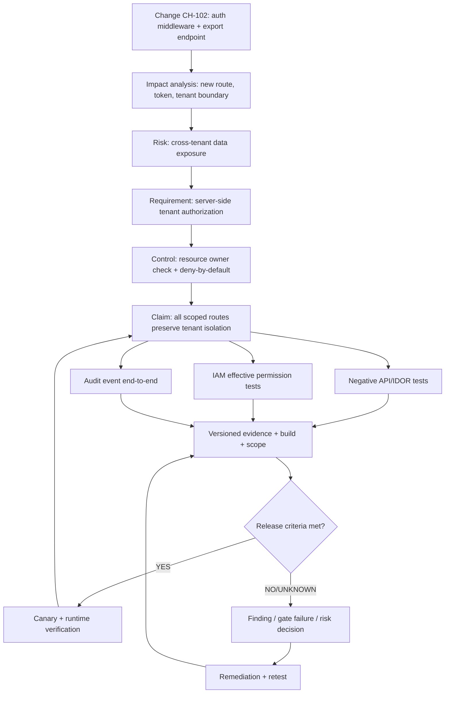
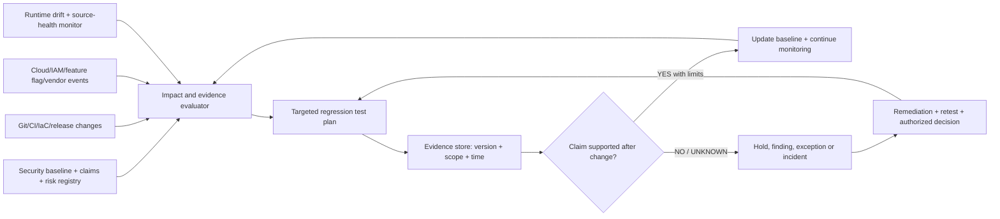

# Security regression: kiểm chứng thay đổi không làm suy yếu các bảo đảm bảo mật

## 1. Security regression là gì?

**Security regression** là sự suy giảm một thuộc tính, yêu cầu hoặc khả năng kiểm soát bảo mật **đã từng được đáp ứng hoặc có bằng chứng hỗ trợ**, xuất hiện sau một thay đổi trong mã nguồn, cấu hình, kiến trúc, hạ tầng, chính sách, dữ liệu, nhân sự hoặc quy trình vận hành. Một regression có thể làm xuất hiện lại lỗ hổng từng khắc phục, mở một đường tấn công mới, nới rộng quyền, vô hiệu hóa logging hoặc khiến bằng chứng assurance cũ không còn đại diện cho hệ thống hiện tại.

Trong chương **Change assurance** của module **SECURITY_SECURITY_ASSURANCE**, phát hiện và phòng ngừa security regression không chỉ là “chạy lại vài bài test trước khi merge”. Đó là một chu trình **dựa trên bằng chứng**, liên kết **risk assessment → security objectives → security controls → thay đổi → impact analysis → test/evidence → quyết định triển khai → monitoring → remediation**. Mỗi claim về bảo mật phải có điều kiện, thời điểm, phạm vi, baseline và bằng chứng đủ tin cậy.

Ví dụ: trước khi nâng cấp `invoice-api`, hệ thống từ chối truy cập hóa đơn của tenant B khi người gọi thuộc tenant A. Sau khi đổi middleware xác thực, endpoint `/invoice/{id}/download` bỏ sót kiểm tra tenant khi tải tệp từ object storage. Các test nghiệp vụ vẫn xanh vì người dùng hợp lệ vẫn tải được hóa đơn; chỉ **negative security regression test** với token của tenant A và tài nguyên của tenant B mới phát hiện quyền đọc sai.

Regression cũng có thể xảy ra khi **không có thay đổi ứng dụng**: một chính sách IAM sửa ngoài IaC cho phép service account truy cập thêm production account; một collector mất quyền khiến audit event không còn đến SIEM; hoặc một dependency thay đổi làm biện pháp mã hóa trước đây không được áp dụng đúng.

**Điều cốt lõi:** “Không phát hiện regression trong các test đã chạy” **không đồng nghĩa** “không tồn tại regression”. Một security assurance statement phải nói rõ **đã kiểm chứng điều gì, trên phiên bản/môi trường nào, trong khoảng thời gian nào, bằng nguồn nào và còn giới hạn gì**.

### Mục tiêu học tập

Sau bài này, người học có thể:

1. Phân biệt security regression với functional regression, vulnerability mới, configuration drift, control degradation và assurance gap.
2. Xây một **security baseline** gồm security invariants, claims, asset scope, policy version và test evidence.
3. Thực hiện change-impact analysis theo rủi ro, trust boundary, data flow, IAM, dependency và control ownership.
4. Thiết kế security regression tests dương/âm, test API authorization, cloud/IaC, logging, encryption, CI/CD và failure modes.
5. Xây release gates với tiêu chí PASS/FAIL/UNKNOWN và quy trình xử lý emergency/bypass đúng thẩm quyền.
6. Kiểm chứng regression ở các giai đoạn trước merge, sau build, trước deploy và khi vận hành; xử lý canary, rollback và retest.
7. Quản lý evidence freshness, traceability, exceptions, finding và remediation không làm giả kết quả kiểm chứng.
8. Báo cáo kết quả security regression dưới dạng assurance case có phạm vi và giới hạn rõ.

## 2. Phân biệt các kiểu thay đổi và suy giảm bảo mật

Không nên gọi mọi scan finding là regression. Nhãn phải gắn với **baseline/claim nào từng đúng** và **sự kiện thay đổi nào làm khác đi**.

| Khái niệm | Đặc điểm | Ví dụ | Điều phải chứng minh |
| --- | --- | --- | --- |
| **Security regression** | Điều kiện bảo mật từng được xác minh mất hoặc giảm sau thay đổi | API từng chặn IDOR nay trả dữ liệu chéo tenant | Baseline trước, trạng thái sau và quan hệ thay đổi |
| **New vulnerability** | Phát hiện lỗ hổng mới; chưa chắc có baseline trước | Service mới không có resource authorization | Finding hiện tại và phạm vi; không tự gọi regression |
| **Reintroduced vulnerability** | Lỗi đã sửa được đưa trở lại | Rollback chứa code từng có SQL injection | Bằng chứng fix cũ và test fail ở phiên bản mới |
| **Configuration drift** | Trạng thái runtime lệch cấu hình/chuẩn mong muốn | Security group bị mở trực tiếp ngoài IaC | Desired state, effective state và thời điểm lệch |
| **Control degradation** | Control vẫn có tên/cấu hình nhưng giảm hiệu quả | Alert rule không match schema mới | Test vận hành hoặc dữ liệu nguồn sau thay đổi |
| **Assurance gap** | Không đủ bằng chứng để biết control còn đáp ứng không | Collector mất quyền ở một account | Source health, coverage và giới hạn kết luận |
| **Functional regression** | Tính năng nghiệp vụ đã có không còn hoạt động đúng | Thanh toán bị lỗi sau release | Test nghiệp vụ; có thể nhưng không bắt buộc là security issue |
| **Risk increase** | Hậu quả hoặc exposure tăng dù control không thay đổi | Mở API nội bộ ra Internet mà policy vẫn như cũ | Threat/exposure reassessment và control coverage |

Một regression có thể gây cả **control failure** và **assurance gap**. Ví dụ thay logging pipeline làm ngừng event quan trọng: vừa suy giảm detection, vừa khiến tổ chức không có đủ evidence để kết luận hoạt động của các control khác.

### 2.1. Bốn dạng regression cần ưu tiên

- **Preventive regression:** cơ chế ngăn hành vi sai bị gỡ hoặc có bypass (authorization, MFA, encryption, network segmentation).
- **Detective regression:** event/alert/collector không còn ghi hoặc phát hiện đúng (audit logging, anomaly detection, integrity monitoring).
- **Corrective/recovery regression:** khả năng thu hồi quyền, rollback, restore, failover hoặc khắc phục bị suy yếu.
- **Governance/assurance regression:** workflow phê duyệt, evidence collection, scope/owner, test coverage hoặc exception gate bị bỏ qua.

Security assurance cần xét cả bốn. Nếu chỉ chạy SAST và DAST, nhiều regression về quyền cloud hoặc DR có thể không được phát hiện.

## 3. Tư duy baseline: điều gì đã được xác nhận trước thay đổi?

**Security baseline** là điểm tham chiếu có kiểm chứng: trạng thái control, security requirements, asset inventory, trust assumptions và evidence của một phiên bản/môi trường/thời kỳ cụ thể. Baseline không phải một checklist bất biến được lưu trong wiki rồi không bao giờ cập nhật.

Một baseline hữu ích ghi:

| Thành phần | Ví dụ |
| --- | --- |
| **Baseline ID/version** | `BL-INVOICE-PROD-2026-11-A` |
| **Security objective** | Tenant confidentiality, integrity của payment operation, availability |
| **Requirement/control IDs** | `REQ-AUTHZ-01`, `CTL-TENANT-BOUNDARY`, `CTL-AUDIT-EXPORT` |
| **Claim/invariant** | “Mọi request đọc invoice phải được server xác minh tenant ownership” |
| **Scope** | `invoice-api`, `export-worker`, cloud accounts, regions, tenant classes |
| **Artifact/config** | Git commit, container digest, IaC version, IAM policy generation |
| **Test/evidence** | Test run IDs, negative test matrix, policy-check reports, runtime snapshots |
| **Quality/limitations** | Những route chưa kiểm, dữ liệu test chưa đủ, collector lag |
| **Observation/period** | `observed_at`, `test_run_at`, assessment period |
| **Assumptions** | IdP identities đáng tin, inventory đầy đủ, deployment đúng digest |
| **Owner/approval** | Người sở hữu control, reviewer và thời hạn review |

### 3.1. Baseline khác policy

**Policy** mô tả điều tổ chức yêu cầu; **baseline** cho biết trạng thái hoặc tiêu chí kiểm soát ở một phạm vi đã được đối chiếu với chính sách. Một API có policy yêu cầu tenant isolation nhưng chưa từng vượt qua negative tests không thể được tuyên bố “regressed from verified compliant” chỉ vì policy tồn tại.

Cần ghi `BASELINE_UNKNOWN` nếu không có thông tin trạng thái trước. Việc phát hiện lỗi sau release vẫn là vấn đề bảo mật quan trọng, nhưng **không nên dựng lại lịch sử PASS không có evidence**.

### 3.2. Baseline có hiệu lực theo phiên bản

Một kết quả test của build `b-17` không tự hỗ trợ claim trên `b-18`; bản IaC của nhánh chính chưa chắc đúng với trạng thái runtime bị sửa ngoài quy trình. Khi mô tả regression, phải tách:

- **Approved baseline**: trạng thái/tiêu chí đã được thông qua.
- **Observed baseline**: trạng thái thực tế đã ghi nhận tại thời điểm trước thay đổi.
- **Target baseline**: trạng thái mà thay đổi dự định tạo ra.
- **Post-change observed state**: trạng thái thực sau rollout.

So sánh phải dùng **đúng đối tượng và cùng định nghĩa đo**. Nếu công cụ scan hoặc scope thay đổi, một chênh lệch số findings chưa chắc phản ánh suy giảm bảo mật.

## 4. Security invariants: phát biểu điều không được phép mất

**Security invariant** là một điều kiện bắt buộc duy trì qua các phiên bản hoặc chuyển trạng thái liên quan. Đây là cơ sở để thiết kế regression tests có chủ đích.

| Nhóm | Security invariant minh họa | Evidence kiểm tra |
| --- | --- | --- |
| **Authentication** | Admin interactive path phải yêu cầu identity hợp lệ và xác thực theo policy | Negative authn tests, IdP policy, session audit |
| **Authorization** | Actor tenant A không đọc/sửa resource của tenant B | Cross-tenant negative tests theo mọi route trong scope |
| **Least privilege** | Service identity chỉ có effective permissions cần thiết | IAM policy diff, permission simulation/test |
| **Data protection** | Secrets không xuất hiện trong response/log; dữ liệu được bảo vệ theo classification | Secret-scan, response/log test, encryption config |
| **Integrity** | Thay đổi cấu hình/payment state chỉ bởi actor có quyền và có audit trail | Negative writes, approval, event verification |
| **Logging/detection** | Sự kiện privileged hành động trong scope tới collector và alert đúng | Synthetic event end-to-end, last-seen/lag |
| **Availability/recovery** | Restore với key/config mới đạt tiêu chí đã duyệt | Restore exercise, consistency và access checks |
| **Supply chain** | Build release tham chiếu đúng source, dependencies và artifact đã được kiểm tra | Provenance, image digest, scan run |
| **Change governance** | Protected change cần review, checks và quyền triển khai đúng | CI branch policy, approval record, deployment audit |

Không viết invariant quá mơ hồ như “hệ thống an toàn”. Ví dụ tốt ghi **actor, action, resource, environment, điều kiện và expected result**.

### 4.1. Invariant có thể dùng test âm và dương

Đối với yêu cầu tenant isolation:

- **Positive:** token tenant A đọc invoice A đã được cấp quyền → nhận đúng dữ liệu được phép.
- **Negative:** token tenant A đọc invoice B → deny và không lộ dữ liệu qua response, cache, file download hoặc side effect.
- **Alternative-path:** token service hoặc admin support gọi route khác có thực thi boundary và audit không?
- **Failure-mode:** khi IdP/authorization service unavailable, có fail-open hay bypass unintended không?

Test dương cho thấy chức năng hợp lệ hoạt động; test âm mới kiểm tra nhiều điều kiện **không được phép xảy ra**. Cần cả hai để tránh “chặn mọi request” cũng được đánh PASS bảo mật.

## 5. Phạm vi thay đổi: không chỉ là Git diff

Một change có thể xuất hiện ở bất kỳ thành phần nào của hệ thống:

| Change surface | Ví dụ | Nguy cơ regression |
| --- | --- | --- |
| **Application code** | Middleware, API handler, caching, background job | Bypass authz, lộ response, thiếu audit |
| **Library/dependency** | Upgrade framework, serializer, crypto provider | Thay default, auth flow, TLS hoặc signature verification |
| **Configuration/feature flag** | Bật export, nới rate limit, tắt logging | Mở attack surface, gây drift |
| **Infrastructure/IaC** | Security group, Kubernetes RBAC, admission policy | Public exposure, privilege escalation |
| **IAM/identity** | Role binding, token claim, IdP policy | Quyền rộng, MFA bypass |
| **Data/schema** | Migration, tenant ID mapping, index | Rò dữ liệu chéo tenant, sai ownership |
| **Secrets/keys** | Rotate KMS/key, change policy | Không thể decrypt backup, cấp key usage quá rộng |
| **CI/CD/build** | Đổi runner, signing key, pipeline gate | Bỏ scan, deploy artifact không kiểm tra |
| **Logging/observability** | Event schema, routing, retention | Silent monitoring gaps |
| **Network/service mesh** | Proxy, ingress, mTLS, DNS | Đường đi không qua policy, service identity sai |
| **Vendor/subprocessor** | API mới, permission mới, dữ liệu mới | Shared-responsibility và evidence scope thay đổi |
| **Process/personnel** | Đổi approver, trực sự cố, emergency path | SoD/approval gap, incident delay |
| **Recovery/BCDR** | Đổi replication, storage, region | RTO/RPO hoặc restore không còn được chứng minh |

### 5.1. Dependency change là một change thật

Nếu ứng dụng không đổi code nhưng base image cập nhật CA trust store hoặc TLS library, một client cũ có thể bắt đầu bỏ qua verification do workaround sai. Nếu vendor thay data-flow hoặc subprocessors, evidence assurance trước có thể không còn đại diện cho phạm vi mới.

Tổ chức cần liên kết **software/infra inventory, dependency graph, deployment metadata và change events**; nếu chỉ lấy danh sách commits từ app repository, sẽ bỏ sót những nguồn regression quan trọng.

## 6. Change-impact analysis theo rủi ro

**Change-impact analysis** là bước xác định những security claims, controls, assets, attack paths và evidence nào có thể bị ảnh hưởng bởi một thay đổi; từ đó chọn kiểm thử và phê duyệt phù hợp. Không phải mọi thay đổi cần full penetration test, nhưng **không được bỏ kiểm thử chỉ vì số dòng code thay đổi ít**.

### 6.1. Quy trình sáu bước

1. **Xác định change:** phạm vi, nguyên nhân, loại change, tickets, components, deploy target và rollback constraints.
2. **Map tài sản/phụ thuộc:** users, tenants, data classes, service identities, cloud accounts, regions, external APIs.
3. **Map security claims:** policy, standard, threats, invariants, controls và findings đã khắc phục liên quan.
4. **Phân tích attack-path delta:** đường mới, quyền mới, trust boundary mới, dữ liệu đi đâu, failure behavior thay đổi không?
5. **Xác định verification plan:** tests bắt buộc, nguồn evidence, môi trường, owner, expected failures và risk thresholds.
6. **Quyết định release:** dựa kết quả, limitations, exception/waiver có thẩm quyền, monitoring và recovery readiness.

### 6.2. Ví dụ risk-driven test selection

| Change | Claims dễ ảnh hưởng | Test và evidence có ưu tiên |
| --- | --- | --- |
| Đổi auth middleware | Authentication, resource authorization | API matrix dương/âm, bypass, session, production mapping |
| Thêm export endpoint | Tenant isolation, data minimization, logging | Inventory delta, cross-tenant read, file ACL, audit event |
| Đổi IAM role `worker` | Least privilege, secrets, audit | Effective permissions diff, deny cases, cloud events |
| Thêm production region | Logging, encryption, privacy, DR | Region inventory, KMS, log pipeline, restore path |
| Thay serializer | Data confidentiality, validation | Response filtering, PII leakage, untrusted input tests |
| Đổi CI gate | Build integrity, code review | Bypass tests, protected branch, provenance, signing |
| Nâng cấp PostgreSQL | Access controls, backup, encryption | Roles/extension config, restore, data integrity |
| Thay vendor API | Third-party scope, data handling | Auth scope, contract controls, subprocessor/change review |

**Cỡ thay đổi không phải risk score.** Một thay đổi một dòng từ `deny` sang `allow` ở trust boundary có thể nghiêm trọng hơn 1.000 dòng refactor UI.

### 6.3. Risk tiers chỉ là một cách điều phối

Tổ chức có thể phân loại change rủi ro thấp/trung bình/cao để quyết định cường độ kiểm chứng, nhưng phải có **hard trigger** cho những thay đổi liên quan admin access, tenant isolation, encryption key, public exposure, CI/CD trust, audit logging và khả năng khôi phục dữ liệu.

Mỗi tier cần có kiểm thử tối thiểu, reviewer và quy tắc xử lý nếu test pipeline unavailable. Không đặt `LOW_RISK` chỉ vì team muốn phát hành nhanh.

## 7. Traceability: thay đổi làm ảnh hưởng claim và evidence nào?

Một security assurance program không dừng ở câu “chạy test suite”. Nó cần **đồ thị truy vết** giữa change, risk, requirement, control, test, evidence và quyết định.



Một claim tổng có thể phụ thuộc nhiều subclaims: inventory đầy đủ, enforcement đúng, code thực chạy đúng artifact, detection không bị tắt, và evidence mới đại diện cho trạng thái hiện tại. Nếu claim phụ thuộc `export-worker` nhưng CI không có test đường export, kết luận `CI_PASSED` chỉ chứng minh **suite đã chạy**, không tự xác nhận tenant isolation.

### 7.1. Coverage nên dựa vào requirement và population

Cần trả lời:

- Có bao nhiêu routes, identities, resources, account/regions **bắt buộc** phải kiểm tra?
- Đã chạy những test nào, có skipped/disabled tests không?
- Có negative tests cho privileged/service paths?
- Kết quả có khớp artifact/deployment thực tế?
- Những routes mới không có owner/test được phân loại thế nào?

**Không đếm các test PASS đã chạy làm toàn bộ mẫu số** nếu có test skipped hoặc tài sản không được khám phá.

## 8. Test pyramid cho security regression

Security regression testing hiệu quả thường kết hợp nhiều tầng. Không có tầng nào tự bao phủ toàn bộ failure modes.

| Tầng | Đối tượng | Tốc độ tương đối | Ví dụ | Giới hạn |
| --- | --- | --- | --- | --- |
| **Static/rule checks** | Code, configuration, dependency, IaC | Thường nhanh | SAST, secret scan, policy-as-code | Không chứng minh runtime effectiveness |
| **Unit/security property** | Logic từng hàm/component | Nhanh | `canReadInvoice(actor,resource)` deny cross-tenant | Có thể mock mất behavior thật |
| **Component/integration** | Middleware, DB, gateway, IdP | Trung bình | Token/role + API + DB access | Environment/test fixtures có thể khác production |
| **Contract/schema** | API/event semantics, downstream consumers | Trung bình | Audit event phải có tenant/resource/actor IDs | Schema valid không đồng nghĩa event đầy đủ |
| **End-to-end/abuse** | Luồng nghiệp vụ và attack path | Chậm hơn | Cross-tenant export, privilege escalation | Không thể thử mọi tổ hợp |
| **Infrastructure/policy** | IAM, K8s, network, KMS, CI/CD | Tùy scope | Effective state, deny path, drift | IaC PASS chưa chứng minh runtime |
| **Post-deploy monitoring** | Production runtime/change/telemetry | Liên tục hoặc theo kỳ | Synthetic transaction, log-health, policy drift | Có độ trễ và false negatives |
| **Independent assessment** | Pentest, targeted review, audit | Theo kế hoạch/rủi ro | Chain of attack, design validation | Chỉ bao phủ thời điểm, phương pháp, scope |

Chọn tầng theo **loại claim và rủi ro**, không chỉ theo tốc độ test. Ví dụ thay encryption KMS policy có thể vượt SAST; thay resource-level authorization cần negative E2E tests và runtime/IAM mapping.

### 8.1. Giảm trùng lặp mà không giảm assurance

Có thể chạy nhiều test ở cùng tầng nhưng vẫn bỏ qua một đường khai thác. Tốt hơn là:

- Unit/property tests bao phủ ma trận quyền và boundary condition.
- Integration tests xác minh môi trường thực hơn với IdP/DB/cache.
- E2E tests tập trung vào các attack paths trọng yếu và những thứ unit tests không thấy.
- Runtime checks phát hiện drift và failure mode sau deploy.

**Test selection theo impact analysis** là bổ sung, không thay những invariant tests bắt buộc phải chạy với mọi release liên quan.

## 9. Thiết kế negative tests: “không được xảy ra” phải đo được

Security regression thường thoát qua vì functional tests chỉ xác nhận thao tác đúng vẫn chạy. Phần khó là mô hình hóa những gì **phải bị từ chối**.

### 9.1. Ma trận actor–action–resource

| Actor/identity | Hành động | Resource | Expected | Tại sao |
| --- | --- | --- | --- | --- |
| Tenant A member | Đọc invoice A đã cấp quyền | Tenant A invoice | ALLOW | Positive control |
| Tenant A member | Đọc invoice B | Tenant B invoice | DENY | Tenant isolation |
| Tenant A member | Sửa invoice B | Tenant B invoice | DENY và không có side effect | Integrity boundary |
| Tenant A support agent | Export dữ liệu ngoài scope | Tenant B export | DENY | Role không vượt tenant |
| Service worker A | Đọc invoice đúng job/tenant | Tenant A invoice | ALLOW trong scope | Workload identity |
| Service worker A | Đọc invoice tenant B | Tenant B invoice | DENY | Không bypass bằng service identity |
| Revoked user | Truy cập bằng session/token đã thu hồi | Protected API | DENY theo chính sách phiên | Revocation |
| Anonymous client | Gọi privileged endpoint | Admin resource | DENY | Authentication |
| Emergency admin | Thao tác ngoài approved window | Restricted resource | DENY/alert theo quy tắc | Break-glass control |

Nếu chỉ nhìn HTTP `403`, test có thể bỏ sót body chứa dữ liệu, redirect có token, cache chứa file trước đó hoặc thay đổi ở database. Cần kiểm tra **response content, authorization decision, side effects, object storage link và audit event** theo acceptance criteria.

### 9.2. Các boundary cases quan trọng

- ID dạng số và UUID, resource IDs đoán được và không đoán được.
- GET và bulk/list/export, pagination, search/filter, async worker và webhook.
- Cache keys, CDN/object storage URLs và signed URLs có TTL.
- User identities, service identities, admin/support, break-glass và integration tokens.
- Thao tác đã được phê duyệt trước đó nhưng quyền vừa thu hồi.
- Tenant transfer, shared organization, project membership và account merge.
- Concurrent requests, stale session/permission cache và retry.
- Feature flag/on-off, canary cohort, rollback và version compatibility.

Một bài test thất bại về cross-tenant read là **tín hiệu control failure đáng xử lý**, không thể bị bỏ qua vì 99 negative tests khác PASS.

### 9.3. Bài test phải dùng các danh tính đúng

Một header `X-Tenant-ID: B` do client tự đặt không nhất thiết phản ánh identity thật. Test phải kiểm tra trust boundary: token/claims từ IdP, tenant context lấy từ nguồn nào, resource ownership được xác thực ở đâu và client có thể tự điều khiển trường nào.

Dùng dữ liệu giả, tenant test và quyền kiểm thử phù hợp; không thử đọc dữ liệu khách hàng thật ngoài phạm vi được ủy quyền.

## 10. Property-based và metamorphic tests

Với nhiều cặp actor/resource, viết từng ví dụ thủ công có thể bỏ sót trường hợp. **Property-based testing** tạo nhiều input theo các ràng buộc; **metamorphic testing** kiểm tra các quan hệ đầu ra khi thay đổi một yếu tố.

### 10.1. Ví dụ thuộc tính authorization

Giả sử `canRead(actor, invoice)` phải phụ thuộc vào quyền hợp lệ **và** tenant ownership. Một thuộc tính:

> Với mọi actor không được cấp quyền cross-tenant và mọi invoice không thuộc scope được phép của actor, `canRead(actor, invoice)` phải trả `false`.

Một test có thể sinh actors, roles, tenant IDs và invoice owners với boundary conditions. Điều kiện generator phải giữ đúng business semantics; nếu tạo dữ liệu vô lý hoặc chỉ dùng một tenant, coverage có thể giả.

### 10.2. Ví dụ metamorphic test

Cho một request hợp lệ `r` đọc invoice A trong tenant A. Thay **chỉ resource ID** bằng invoice cùng cấu trúc nhưng thuộc tenant B, giữ nguyên actor/token. Kết quả mong đợi chuyển từ ALLOW sang DENY, không có dữ liệu B và không tạo side effect.

Những quan hệ hữu ích khác:

- Thu hồi role của actor ⇒ những thao tác phụ thuộc role không còn được phép.
- Giảm scope token ⇒ không được tăng effective permissions.
- Bật một feature flag cho tập tenant A ⇒ không làm tenant B nhận thêm quyền.
- Thêm tenant mới ⇒ các API/controls tự áp dụng quy tắc isolation, không cần mặc định allow.
- Lỗi source log ⇒ dashboard không được hiển thị “không có bất thường” như dữ liệu đầy đủ.

Property tests là **bổ sung**, không thay evaluation thực tế với runtime, network, IdP và phiên bản artifact được deploy.

## 11. Static/security scanning: cần hiểu đúng ý nghĩa kết quả

SAST, dependency scanning, IaC scan và secret scanning có thể đưa ra tín hiệu nhanh sau một change. Nhưng scan report chỉ hỗ trợ claim trong phạm vi scanner đã phân tích.

| Kỹ thuật | Tìm được gì? | Regression risk thường bị bỏ sót |
| --- | --- | --- |
| **SAST** | Mẫu data flow và coding flaws theo rule set | Business authorization logic, runtime policy, unknown routes |
| **SCA/dependency** | Thành phần/phụ thuộc và vulnerability advisory liên quan | Reachability, config/runtime effects, unseen private deps |
| **Secret scanning** | Token/key patterns trong source/artifacts | Secret trong runtime, logs, memory hoặc git history không được scan |
| **IaC scan** | Cấu hình dự kiến trước triển khai | Console drift và effective permissions sau deploy |
| **Container/image scan** | OS/packages trong artifact đã scan | Tag được re-point, artifact deployed khác digest |
| **DAST** | Hành vi có thể khai thác trong target và input đã thử | Paths chưa crawl, authenticated flows, service-to-service |
| **Policy-as-code** | Kiểm tra điều kiện được mã hóa bằng rule | Rule sai ngữ nghĩa hoặc thiếu scope |

### 11.1. Scanner update có thể làm số liệu đổi mà control không đổi

Nếu SAST tăng số findings vì nâng rule set, đó có thể là **tăng khả năng phát hiện**, không chứng minh code vừa regressed. Ngược lại, số findings giảm vì tắt rule/giảm files scanned không chứng minh bảo mật tốt hơn.

Để so sánh, ghi `scanner_version`, `rule_pack_version`, `config`, `source/build digest`, `scope`, `suppression/exclusion` và `run_id`.

### 11.2. Regression của việc khắc phục lỗ hổng

Khi fix một vulnerability, lưu **regression test** tái hiện lỗi trong môi trường được phép và xác nhận fix ngăn nó. Test đó nên trở thành một phần suite cho những thay đổi liên quan.

Một bug ticket chỉ có `fixed=true` nhưng không có test tái hiện hoặc đường triển khai tương ứng khiến lỗi dễ trở lại. Gắn test ID với finding, CVE/weakness nếu có, affected artifacts và acceptance criteria.

## 12. Infrastructure, IAM và configuration regression

Thay đổi hạ tầng có thể làm suy yếu control dù mã ứng dụng không đổi. Cần so sánh **desired state** và **effective state**; đồng thời giám sát thay đổi thủ công ngoài pipeline.

### 12.1. Ma trận bảo vệ

| Control surface | Security invariant | Kiểm thử sau thay đổi |
| --- | --- | --- |
| Cloud storage | Không có public write ngoài policy đã duyệt | Effective ACL/policy và negative access |
| Security group/network | Management ports không public | IaC check + runtime network/path test trong scope |
| IAM | Service role không có action/resource vượt yêu cầu | Role diff, permission simulation, approval link |
| Kubernetes RBAC | Service account không đọc secret ngoài namespace/scope | RBAC evaluation, negative tests |
| Admission controls | Chặn image không đáp ứng signing/policy | Policy version và controlled negative deploy |
| Secrets/KMS | Key access tuân least privilege; key rotation không phá restore | Key policy test, decrypt/restore exercise |
| Cloud audit | Required events được bật, giao tới store | Synthetic events, source heartbeat, retention |
| CI/CD deploy credentials | Runner chỉ được deploy đúng environment | Token scope và protected environment test |

### 12.2. Cẩn trọng với IAM “Allow” và “Deny”

Một policy diff chỉ nhìn các statement có thể không phản ánh **effective permissions** khi quyền đến từ nhiều role, boundary, resource policy, SCP/organization policy hoặc identity federation. Evaluation cần theo mô hình cấp quyền thực tế của nền tảng đang dùng.

Nếu rule mới mở thêm quyền but vẫn có Deny hiệu lực, báo cáo phải nói rõ **effective risk** chứ không tự kết luận chỉ từ số lượng `Allow`. Ngược lại, một test path PASS không chứng minh mọi resource/identity class đã được kiểm tra.

### 12.3. Runtime drift sau IaC PASS

CI đánh PASS cho security group nhưng một admin sửa trực tiếp sau deploy. Vì vậy cần:

- Đối soát desired–actual state với mốc thời gian.
- Bắt change events và owner/approval.
- Thiết lập drift alerts không bị che do collector mất quyền.
- Kiểm tra asset inventory có bao gồm account/region mới.
- Gắn findings với nguồn và trigger revalidation.

**Trạng thái `UNKNOWN` quan trọng:** mất quyền đọc cloud account không được biến thành `PASS` chỉ vì scanner không thấy violations.

## 13. Logging và detection regression

Một thay đổi event schema, parser, correlation rule, queue, retention hoặc access permission có thể khiến detection coverage giảm mà không có lỗi ứng dụng hiển thị.

### 13.1. Regression test cho audit event

Chọn một hành động trọng yếu (ví dụ role grant trong production) và kiểm tra toàn đường:

1. Phát sinh sự kiện kiểm thử có ID riêng, trong phạm vi được phê duyệt.
2. Xác nhận producer phát event đúng actor, action, target, tenant, timestamp.
3. Xác nhận collector nhận event với schema/version hợp lệ.
4. Xác nhận event tới kho và truy vấn được trong độ trễ mong đợi.
5. Xác nhận detection rule match khi hành vi đáp ứng điều kiện.
6. Xác nhận cảnh báo được giao đúng kênh/on-call.
7. Xác nhận collector không còn quyền hoặc source offline thì phát **health alert**.
8. Ghi evidence run, source, thời điểm, end-to-end latency và limitations.

### 13.2. Ba phép kiểm tra độc lập

| Phép kiểm | Câu hỏi |
| --- | --- |
| **Source health** | Có nhận được event từ tất cả nguồn phải giám sát không? |
| **Data/schema correctness** | Event còn đúng field/meaning sau thay đổi không? |
| **Detection effectiveness** | Rule thực sự phát tín hiệu phù hợp với kịch bản test không? |

Một event được lưu nhưng thiếu `tenant_id` có thể không đủ điều tra cross-tenant access. Một rule PASS trong replay vẫn không bảo đảm production events đến đúng queue. Và “không có alert” không có nghĩa hệ thống an toàn nếu source outage chưa được phát hiện.

### 13.3. Coverage theo thời gian

Đối với claim “audit logging vận hành trong cả kỳ”, một synthetic event thành công lúc 10:00 chỉ hỗ trợ một phần. Cần đánh giá log continuity, late events, ingestion gaps, retention và mọi nguồn account/region trong scope. Nếu có gap không backfill được, phải công bố giới hạn.

## 14. Encryption, keys, privacy và data regression

Thay đổi code và hạ tầng dễ phá security properties của dữ liệu mà chưa có test cụ thể.

| Change | Failure mode | Bằng chứng kiểm tra |
| --- | --- | --- |
| Thay KMS key policy | Worker không giải mã backup hoặc user lạ được decrypt | Key access tests và restore |
| Rotate encryption key | App không thể đọc dữ liệu cũ; old key bị lộ quyền | Read/write/rotation/rollback tests |
| Đổi serializer/API response | Lộ PII hoặc trường bị ẩn trước đó | Response schema/field authorization tests |
| Đổi database schema | Tenant filter bị mất trên query mới | Cross-tenant data access negative tests |
| Đổi caching/CDN | Cached response tenant A được trả cho tenant B | Cache key isolation, invalidation test |
| Bật export feature | Dữ liệu ra ngoài mục đích ban đầu | Data-flow review, scope/access/retention |
| Chuyển region/vendor | Privacy/contract scope và access thay đổi | Data inventory, contract obligations review |
| Đổi retention pipeline | Dữ liệu không được xóa đúng lịch hoặc bị xóa sớm | Retention lifecycle và deletion verification |

### 14.1. Mã hóa không thay cho authorization

Nếu API trả hóa đơn của tenant B cho người thuộc tenant A, việc database “đã bật encryption” không khắc phục lỗ hổng. Regression test phải gắn với security objective thật: **dữ liệu chỉ được truy cập bởi actor có quyền**, không phải chỉ “bytes được mã hóa khi lưu”.

### 14.2. Backup và rollback phụ thuộc khóa

Một rollback ứng dụng có thể không đọc được dữ liệu do migration/key rotation đã diễn ra; một restore test cũ không bảo đảm recovery path với KMS policy mới. Cần test khôi phục phù hợp với **keys, versions, IAM permissions, schema, retention và mục tiêu RTO/RPO** hiện hành.

## 15. Supply-chain và dependency regression

Security regression có thể xuất hiện khi build sử dụng dependency, plugin hoặc runner khác:

- Phiên bản thư viện đổi default authorization, validation, TLS hoặc redirect behavior.
- Build image chứa package mới với vulnerability chưa có trong bản trước.
- CI action/plugin được cập nhật và có quyền secrets rộng.
- Base image hoặc package registry mirror bị thay đổi nguồn gốc.
- Artifact được scan khác artifact được deploy vì mutable tag.
- SBOM không bao gồm generated/runtime dependencies.
- Signing/provenance check được chuyển từ bắt buộc sang tùy chọn.

### 15.1. Các bằng chứng nên liên kết

| Evidence | Mục đích |
| --- | --- |
| Source revision/commit + protected branch | Xác định mã và quy trình review |
| Lockfile/dependency resolution | Ghi phiên bản phụ thuộc được dùng |
| Build provenance + toolchain version | Truy ngược ai/cái gì đã tạo artifact |
| Artifact digest | Gắn test, scan, ký số và deployment vào cùng bytes |
| SBOM nếu dùng | Mô tả các thành phần đã nhận diện |
| SCA/image scan result | Cho thấy findings theo rule, scope và thời điểm |
| Signature/verifier result | Xác minh artifact và trust policy được áp dụng |
| Deployment event + runtime digest | Khẳng định đúng artifact đã tới môi trường đích |

**Không suy từ “pipeline xanh” rằng provenance tự động hợp lệ.** Nếu release gate bị disable hoặc runner thay đổi chính sách trust, pipeline vẫn có thể báo thành công mà không kiểm tra đúng bất biến bảo mật.

## 16. Release gates: quyết định từ evidence, không chỉ từ một màu xanh

**Release gate** là quy tắc quyết định liệu thay đổi có được đi tới một môi trường hoặc phân khúc người dùng tiếp theo hay không. Security gate nên kiểm tra kết quả, phạm vi, nguồn evidence và trạng thái exception; không chỉ kiểm tra build job đã kết thúc thành công.

### 16.1. Các điều kiện gate thường gặp

- Test bắt buộc cho security invariants liên quan đã **chạy** và đáp ứng tiêu chí.
- Không có verified critical failure chưa được xử lý theo chính sách.
- SAST/SCA/IaC/secret scan được chạy trên đúng artifact, với rule scope đã được phê duyệt.
- Scan và runtime evidence có provenance, version và freshness chấp nhận được.
- Không có test `SKIP`, `ERROR`, `UNKNOWN` ở nhóm bắt buộc bị tự chuyển thành PASS.
- Phạm vi endpoints/tenants/assets đầy đủ; thay đổi mới có owner và kiểm thử.
- Deployment plan, rollback/roll-forward plan, observability và on-call đã sẵn sàng.
- Ngoại lệ, nếu cho phép, **được phê duyệt đúng thẩm quyền, có điều kiện/hạn và không vi phạm hard stop**.

### 16.2. Bảng trạng thái gate

| Kết quả | Ý nghĩa | Hành động |
| --- | --- | --- |
| `PASS` | Các điều kiện đã xác minh đạt trong scope | Có thể đi tiếp theo change policy |
| `FAIL` | Test/evidence trực tiếp chứng minh tiêu chí không đạt | Chặn hoặc xử lý theo chính sách emergency có kiểm soát |
| `UNKNOWN` | Thiếu coverage, source hoặc test result | Không tự cho phép; điều tra/thu thập |
| `INCONCLUSIVE` | Test đã chạy nhưng không đủ kết luận | Review và chạy lại/đổi phương pháp |
| `SKIPPED_APPROVED` | Test được miễn có phạm vi/hạn/authority rõ | Giữ như ngoại lệ, không biến thành PASS |
| `STALE` | Evidence trước thay đổi không còn đại diện | Revalidate cho change hiện tại |
| `ERROR` | Test infrastructure/tool gặp lỗi | Khắc phục pipeline; không ghi security PASS |

**Gate pass** là điều kiện cần theo chính sách triển khai; nó **không bảo đảm an toàn tuyệt đối**. Production runtime có thể vẫn đổi, nên hậu kiểm rất quan trọng.

### 16.3. Không tạo “fail-open do pipeline lỗi”

Nếu scanner hết quota hoặc artifact store tạm không truy cập, hệ thống không nên tự đánh dấu scan PASS. Với hệ thống rủi ro cao, có thể chặn deployment; với tình huống khẩn cấp cần cơ chế thay thế có phê duyệt, giới hạn và retrospective verification.

Một cơ chế emergency có kiểm soát khác hoàn toàn với việc “tắt gate nếu chạy quá lâu”.

## 17. Ví dụ policy-as-code và test orchestration

Các ví dụ sau là **giả mã YAML cho quy trình nội bộ**, không phải cấu hình drop-in của một nhà cung cấp CI/CD cụ thể.

```yaml
security_regression_gate:
  change_id: CH-102
  target_environment: production
  required_claims:
    - claim_id: CL-TENANT-READ-01
      controls: [CT-AUTHZ-01, CT-LOG-01]
      required_tests:
        - T-AUTHZ-CROSS-TENANT-READ
        - T-AUTHZ-EXPORT-DOWNLOAD
        - T-LOG-EXPORT-E2E
      required_scope:
        services: [invoice-api, export-worker]
        identity_classes: [customer-user, service-worker]
      invalidates_on:
        - api_route_changed
        - authorization_policy_changed
        - service_identity_changed
    - claim_id: CL-CLOUD-IAM-02
      controls: [CT-IAM-PRIV]
      required_tests:
        - T-IAM-EFFECTIVE-PERMISSIONS
  evidence_policy:
    require_build_digest_match: true
    require_complete_test_matrix: true
    reject_unknown_source_health: true
    record_skipped_tests: true
  failure_policy:
    verified_security_failure: BLOCK
    required_test_missing: BLOCK_AND_INVESTIGATE
    evidence_stale: REVALIDATE
    test_infrastructure_error: HOLD_OR_APPROVED_EMERGENCY_PATH
  exception_policy:
    require_authorized_approval: true
    require_expiry: true
    require_scope_and_conditions: true
    hard_stop_categories:
      - confirmed_cross_tenant_data_exposure
```

`hard_stop_categories` là **minh họa chính sách doanh nghiệp**. Mức cấm, quyền và điều kiện thực tế phải do tổ chức phê duyệt, xem các nghĩa vụ liên quan. Không tự suy rằng mọi lỗ hổng có cùng cách xử lý hoặc mọi quy trình cho phép waiver.

### 17.1. Giả mã đánh giá gate

```text
function evaluateChange(change, claims, evidenceSet, policy):
    impact = computeImpact(change, inventory, dependencies, policy)

    for claim in impact.requiredClaims:
        expected = requiredTestsAndControls(claim, impact)
        actual = selectEvidence(evidenceSet, claim, change.targetDigest)

        if not scopeAndPopulationComplete(expected, actual):
            return BLOCK("MISSING_REQUIRED_COVERAGE", claim.id)

        if not sourcesHealthyAndProvenanceVerified(actual):
            return HOLD("UNVERIFIED_EVIDENCE", claim.id)

        if anyRequiredTestSkippedOrErrored(actual):
            return HOLD("REQUIRED_TEST_NOT_VERIFIED", claim.id)

        if anyVerifiedFailureContradictsClaim(actual):
            return BLOCK("SECURITY_REGRESSION", claim.id)

        if relevantChangeAfterEvidence(actual, change):
            return HOLD("EVIDENCE_STALE", claim.id)

    if openHighImpactFindingNotResolvedOrAuthorized(change, policy):
        return BLOCK("UNRESOLVED_RISK_OR_EXCEPTION")

    return PASS_WITH_SCOPE_AND_LIMITATIONS
```

**Pseudocode** bỏ qua nhiều chi tiết vận hành như event ordering, late data, signature verification và policy version; không được dùng nguyên mẫu làm công cụ phê duyệt production. Nó minh họa nguyên tắc `unknown != pass` và **mọi quyết định có reason code**.

### 17.2. Gating không chỉ là CI

Thay đổi ngoài CI (console, manual role grants, feature flags, vendor configuration) vẫn cần kiểm soát. Có thể liên kết Change Management ticket, approval, event stream và runtime policy evaluator để tạo gate tương ứng hoặc **post-change reconciliation**. Một CI pipeline không thấy manual change không thể là nguồn assurance duy nhất cho cả tổ chức.

## 18. Canary, progressive delivery và post-deploy security verification

Một test suite chạy trên staging cho build B không chứng minh đầy đủ trạng thái production. Sau deployment, cần kiểm tra **đúng bản chạy thực tế** và quan sát ảnh hưởng của change trong runtime.

### 18.1. Các bước progressive rollout

1. **Predeploy:** có change-impact, artifact provenance, baseline/claims và test results đạt theo scope.
2. **Canary:** triển khai tới phân khúc đã kiểm soát, xác minh runtime digest/config/IAM, bật guardrails.
3. **Security probes:** chạy synthetic authn/authz/telemetry tests không gây hại với dữ liệu thử, theo giới hạn được phê duyệt.
4. **Observability:** kiểm tra log coverage, error/authz-deny trends, anomaly signals và source health.
5. **Decision:** nếu tiêu chí không đạt, pause/rollback/contain theo kế hoạch; nếu đạt, tiếp tục mở rộng có giám sát.
6. **Full rollout:** đối soát mọi asset/region/tenant cohort và deployment state; kiểm tra drift.
7. **Post-change review:** cập nhật evidence, findings, residual risk và baseline version.

### 18.2. Quan sát khác chứng minh

Một canary không phát alert trong 15 phút **không chứng minh** toàn bộ rủi ro đã biến mất. Có thể canary traffic không đụng tới endpoint nhạy cảm, actor có quyền đặc biệt không xuất hiện hoặc log source chưa hoạt động.

Cần **synthetic negative tests** và đánh giá coverage để biết canary có thực sự thử risk scenario đang được quản lý không. Nếu không thể thử trên production, ghi phạm vi đã mô phỏng và rủi ro còn lại.

### 18.3. Rollback không phải luôn an toàn

Rollback có thể:

- Đưa lại phiên bản ứng dụng có lỗ hổng cũ.
- Không tương thích database schema hoặc message formats đã migrate.
- Khôi phục IAM policy hoặc security group rộng trước đây.
- Làm hỏng key rotation và restore chain.
- Khiến logs/detection mất schema hiện tại.
- Tạo race condition với canary cohort đã xử lý dữ liệu bằng định dạng mới.

Vì vậy nên có **pre-approved rollback security checklist** và, khi rollback không thể an toàn, kế hoạch **roll-forward/feature disable/containment**. Kết quả rollback cũng cần retest và evidence, không tự gọi “đã quay về trạng thái an toàn”.

## 19. Emergency changes và đường bypass có kiểm soát

Trong sự cố bảo mật nghiêm trọng, tổ chức có thể cần hotfix nhanh khi một số test bình thường không kịp hoàn thành. Quy trình phải cho phép phản ứng nhưng không loại bỏ trách nhiệm assurance.

### 19.1. Một emergency change record nên có

- Incident/finding ID, mức ảnh hưởng và lý do cần thay đổi khẩn.
- Phạm vi hệ thống, dữ liệu, tài sản, phiên bản và thời gian.
- Những kiểm tra đã chạy, chưa chạy, hoặc có kết quả không rõ.
- Test tối thiểu **không được bỏ** theo policy cho loại change tương ứng.
- Người phê duyệt theo authority matrix và ý kiến security/risk owner.
- Containment, canary, monitoring và rollback/roll-forward plan.
- Cửa sổ hiệu lực exception và thời hạn bổ sung test sau deploy.
- Điều kiện phải dừng thay đổi, rollback hoặc kích hoạt incident response.
- Post-change verification và retrospective approval/review record nếu policy yêu cầu.

**Đường khẩn cấp không cho phép giả mạo trạng thái PASS.** Nếu một test bắt buộc chưa chạy, giữ `NOT_TESTED`/`RISK_DECISION_APPROVED_FOR_EMERGENCY`, đừng đổi thành `PASSED`.

### 19.2. Ví dụ hotfix authorization

Có chứng cứ production đang cho cross-tenant read. Nhóm cần chặn ngay endpoint bằng feature flag trong khi chuẩn bị fix.

- Việc tắt endpoint có thể là **containment** được thực hiện nhanh theo quyền ứng phó sự cố.
- Cần kiểm tra các route/path phụ, worker queues và cache để chắc feature disable có hiệu quả.
- Không khẳng định control authorization đã sửa khi mới tắt tính năng.
- Sau sửa, test dương/âm và deployment evidence cần xác nhận root cause không còn.
- Giữ event, incident timeline và kết quả FAIL lịch sử cho audit và lessons learned.

## 20. Evidence catalog cho security regression

Một chương trình change assurance cần **có thể tái dựng** tại sao một phiên bản được phê duyệt, những test nào hỗ trợ và điều gì thay đổi sau đó.

| Nhóm metadata | Trường nên có |
| --- | --- |
| **Identity** | `change_id`, `baseline_id`, `claim_id`, `control_id`, `test_run_id`, `evidence_id` |
| **Scope** | `service`, `environment`, `account/region`, `tenant_class`, `asset_population` |
| **Source/build** | `commit`, `build_digest`, `dependency_snapshot`, `IaC_revision`, `rule_version` |
| **Time** | `event_time`, `observed_at`, `collected_at`, `test_run_at`, `reviewed_at`, `period_end` |
| **Coverage** | `required_tests`, `executed`, `passed`, `failed`, `skipped`, `unknown` |
| **Trust** | `source_system`, `collector`, `artifact_ref`, `integrity_ref`, `source_health` |
| **Decision** | `gate_status`, `reason_codes`, `approved_by`, `exception_id`, `deployment_id` |
| **Residual risk** | `open_findings`, `risk_owner`, `assumptions`, `limits`, `retest_due` |
| **Lineage** | `supersedes`, `invalidated_by_change`, `related_incident`, `fix_reference` |

### 20.1. Mẫu evidence YAML

Đây là **mẫu dữ liệu minh họa**, cố ý chưa đủ điều kiện PASS; không phải kết quả kiểm thử thật.

```yaml
security_regression_evidence:
  evidence_id: EVD-CH102-REG-2026-11
  change_id: CH-102
  baseline_id: BL-INVOICE-PROD-2026-11-A
  claim_id: CL-TENANT-READ-01
  target:
    environment: production
    services: [invoice-api, export-worker]
    build_digest: "example-digest-b18"
    regions: [region-a]
    tenant_classes: [customer, service]
  change:
    source_revision: "example-commit-b18"
    impact_analysis_ref: "change-record://CH-102/security-impact"
    changed_surfaces: [authorization_middleware, export_endpoint]
  test_plan:
    version: "regression-matrix-v5"
    required:
      - T-AUTHZ-CROSS-TENANT-READ
      - T-AUTHZ-EXPORT-DOWNLOAD
      - T-LOG-EXPORT-E2E
    results:
      T-AUTHZ-CROSS-TENANT-READ: PASS
      T-AUTHZ-EXPORT-DOWNLOAD: NOT_RUN
      T-LOG-EXPORT-E2E: UNKNOWN_SOURCE_HEALTH
  provenance:
    pipeline_run_ref: "ci://example/security-run-102"
    artifact_ref: "evidence-store://change/CH-102/run-102"
    collected_at: "2026-11-28T10:30:00Z"
    test_run_at: "2026-11-28T10:20:00Z"
    integrity_ref: "pending-verification"
  evaluation:
    required_coverage_complete: false
    source_health_verified: false
    status: HOLD
    reason_codes:
      - MISSING_REQUIRED_TEST
      - UNVERIFIED_LOG_SOURCE
    reviewer: security_assurance_team
    approval_status: NOT_APPROVED
  follow_up:
    owner: invoice_platform_team
    next_action: "Run export negative test and restore log-source evidence"
```

Nội dung trên cố ý đặt `HOLD` vì thiếu test export và nguồn logging chưa được xác minh. Một test PASS trên route khác **không thể suy ra** toàn claim đạt. Các URI/ID dùng để mô tả schema; hệ thống thật phải cung cấp artifact và digest xác thực.

### 20.2. Vì sao cần lưu phiên bản cả evidence và policy?

Sau một quý, rule gate có thể được siết chặt, scanner đổi version, endpoint tăng thêm hoặc risk appetite khác đi. Để hiểu quyết định lịch sử, cần biết **policy version có hiệu lực lúc phê duyệt, evidence được đánh giá lúc đó và mốc deployment thực tế**.

Không ghi đè test FAIL bằng lần PASS sau sửa; lưu cả hai và liên kết `fix/retest`, rồi xác định từ khi nào claim được hỗ trợ trở lại. Một kết luận lịch sử không tự thay đổi chỉ vì dashboard hiện tại hiển thị xanh.

## 21. Tình huống xuyên suốt: nâng cấp `invoice-api` và `export-worker`

### 21.1. Bối cảnh

Nền tảng SaaS nhiều tenant quản lý hóa đơn. Kiến trúc gồm:

- `invoice-api`: đọc/sửa hóa đơn theo tenant.
- `export-worker`: tạo file export trong object storage và trả signed URL.
- IdP và authorization middleware.
- Database có tenant owner references.
- Gateway/ingress, cloud IAM và SIEM.

Baseline `b-17` có test âm tính xác nhận một tập endpoint trong inventory từ chối cross-tenant read; approval và event logs được thu trong phạm vi đã liệt kê. Change `CH-102` triển khai `b-18` để tối ưu xuất hóa đơn và thêm export route.

**Yêu cầu:** thay đổi không làm suy giảm ranh giới tenant, least privilege của worker, audit event và khả năng rollback/recovery.

### 21.2. Những thay đổi và dấu hiệu

Giả sử quá trình đánh giá nhận được:

| Sự kiện giả định | Diễn giải |
| --- | --- |
| CI unit tests PASS cho authorization helper | Hỗ trợ một nhánh logic; chưa chứng minh export route dùng helper |
| 40 integration tests PASS ở staging trên `b-18` | Có evidence cho test cases đã chạy trong staging |
| Production deploy đúng digest `b-18` | Có cầu nối artifact giữa test và runtime, cần xem config khác biệt |
| Export endpoint chưa nằm trong API inventory | **Scope/coverage gap**, chưa đủ chứng cứ cho top claim |
| Negative export test với tenant A nhận URL đọc được file tenant B | **Verified regression** nếu test/identity/scope được xác minh |
| `export-worker` có cloud role `storage.read.*` thay vì prefix hẹp | Cần kiểm tra effective permission và attack path |
| Log collector của worker mất dữ liệu 30 phút | Detection/assurance gap; không thể suy “không có truy cập” |
| Rollback về `b-17` nhưng migration đã đổi object key format | Khả năng rollback an toàn cần được kiểm chứng |

### 21.3. Phân tích claim có chứng cứ

Top claim đề xuất:

> “Tại thời điểm đánh giá, các đường đọc và xuất hóa đơn thuộc inventory phiên bản I trên production build B chỉ trả dữ liệu cho actor có quyền đối với tenant/resource tương ứng; các thay đổi liên quan được giám sát trong những nguồn và kỳ đã xác định.”

Chia thành subclaims:

| Subclaim | Test/evidence | Trạng thái giả định |
| --- | --- | --- |
| `G-1`: API/export inventory đầy đủ | Route scan + gateway + worker inventory | `INSUFFICIENT` do route export thiếu |
| `G-2`: Authorization đúng với actor/resource | Cross-tenant negative API/export tests | `FAIL` nếu export trả file tenant B |
| `G-3`: Worker có quyền tối thiểu | IAM effective policy diff + deny test | `UNDER_REVIEW` |
| `G-4`: Audit/detection hoạt động | Synthetic export event và source health | `UNKNOWN` do 30 phút mất log |
| `G-5`: Tested artifact khớp production | Build provenance + runtime digest | `SUPPORTED` trong phạm vi evidence |
| `G-6`: Có rollback/containment khả thi | Feature disable/rollback drill | `PENDING` vì schema/data format mới |

**Kết luận:** không được báo top claim `SUPPORTED`, dù build và nhiều integration tests PASS. Negative test cho thấy vi phạm trọng yếu; nhiều nhánh khác còn thiếu coverage.

### 21.4. Hành động có thứ tự

1. **Triage/contain:** ngăn export route có thể lộ chéo tenant theo quyền sự cố, bảo vệ logs/objects, xem ảnh hưởng và nghĩa vụ cần đánh giá.
2. **Xác minh:** kiểm tra token test, signed URL, object ACL, response cache, side effects; loại trừ test fixture sai trước khi kết luận phạm vi.
3. **Điều tra IAM:** xác định vì sao worker role rộng, quyền effective nào có thể truy cập, thay đổi nào mở scope.
4. **Khôi phục nguồn:** sửa collector, backfill nếu có thể, công bố khoảng logging không đủ.
5. **Remediate:** kiểm tra tenant/resource ownership trước khi tạo signed URL, giới hạn worker identity và cải thiện route inventory/test.
6. **Retest:** positive/negative cases, bulk/export, service token, direct storage path, runtime deploy và logging.
7. **Release decision:** chỉ mở lại khi đạt gate hoặc có quyết định đúng thẩm quyền theo policy, không có bypass đã xác minh chưa xử lý trong loại rủi ro cấm chấp nhận.
8. **Lưu lịch sử:** liên kết baseline, regression finding, source test FAIL, change, fix build và retest PASS.

### 21.5. Assurance statement mẫu

> “Đánh giá change CH-102 đối với production build b-18 cho thấy bằng chứng khớp artifact giữa build và deployment ở các dịch vụ được kiểm tra. Tuy nhiên, một negative test export đã phát hiện quyền đọc dữ liệu tenant khác trong trường hợp thử xác định; inventory chưa bao phủ route export mới và audit source của worker có khoảng gián đoạn. Vì vậy, chưa thể xác nhận claim tenant isolation cho toàn bộ dịch vụ. Finding, containment và kiểm thử lại đang được quản lý theo hồ sơ liên quan.”

Phát biểu này **không được tự coi đã xảy ra trên hệ thống thật**; là ví dụ về ngôn ngữ bảo đảm chính xác. Nó tách bằng chứng đã đạt, phản chứng và vùng chưa đủ dữ liệu.

## 22. Security regression trong change assurance liên tục

Nếu tổ chức chỉ kiểm thử vào trước release, những thay đổi cloud, feature flags và vendor updates sau đó có thể làm evidence cũ lỗi thời. Continuous assurance cần đánh giá security claims **mỗi khi có material change hoặc khi nguồn giám sát mất**.



### 22.1. Evidence invalidation là tính năng cốt lõi

Khi có change event liên quan, không nhất thiết test lại toàn bộ hệ thống; nhưng phải biết **claim nào bị ảnh hưởng** và đánh dấu evidence cũ `NEEDS_REVALIDATION` cho đúng scope.

Ví dụ:

- Route mới có quyền đọc dữ liệu → inventory, authz negative test và logging claims cần review.
- KMS policy thay đổi → key usage/restore claims cần review.
- Role admin thay đổi → least-privilege và approval evidence cần review.
- Collector ngừng gửi → detection/operating evidence cần đánh dấu coverage unknown.
- Dependency change về transport security → TLS client/server tests có thể cần chạy lại.

**Không nhận được event** chưa phải bằng chứng không có change nếu event source đang lỗi. Nên bổ sung periodic resnapshot, nguồn inventory đối chứng và alert last-seen.

### 22.2. Khi nào một baseline được cập nhật?

Chỉ cập nhật một baseline assurance khi:

- Những changes đã được mô tả và phạm vi được đối soát.
- Required regression tests và evidence quality đạt theo chính sách.
- Verified failures đã được sửa/contain đúng quy trình.
- Accepted exceptions, nếu có, được giữ **riêng khỏi kết quả control**.
- Release/deployment được chứng minh đúng version/môi trường.
- Reviewer phê duyệt conclusion có thời điểm, giới hạn và trigger tiếp theo.

Không cập nhật baseline chỉ vì code được merge hoặc vì hệ thống không gặp sự cố trong một vài giờ.

## 23. Metrics và báo cáo security regression

Metrics nên giúp trả lời **mỗi thay đổi có còn duy trì bảo đảm bảo mật không**, không chỉ “pipeline chạy nhanh chừng nào”.

| Metric | Ý nghĩa | Cảnh báo khi diễn giải |
| --- | --- | --- |
| **Security-regression findings per release** | Số regression được xác minh theo release/scope | Tăng khi mở rộng kiểm thử chưa chắc security xấu đi |
| **Change-assurance coverage** | Changes có impact analysis/test phù hợp / changes bắt buộc | Mẫu số phải gồm manual/infra changes nếu áp dụng |
| **Required invariant test coverage** | Số claim/test bắt buộc đã có kết quả hợp lệ / tổng yêu cầu | Không bỏ SKIP/UNKNOWN khỏi mẫu số |
| **Post-deploy escape rate** | Findings regression được phát hiện sau phát hành / tập thay đổi theo định nghĩa | Phụ thuộc năng lực phát hiện và kỳ quan sát |
| **Time to detect regression** | Từ thời điểm regression xuất hiện/được triển khai tới khi phát hiện, khi biết được | Không đồng nhất với thời gian từ lúc tạo ticket |
| **Time to contain/remediate** | Từ phát hiện tới mitigation/fix/verified closure | Tách các mốc, không gộp PR merge với retest |
| **High-risk blocked releases** | Số release bị chặn do verified failures | Nhiều lần chặn có thể là gate đang hoạt động đúng |
| **Emergency bypass frequency** | Số lần dùng đường emergency và hậu kiểm | Không tự coi mọi bypass là sai nếu được phép có điều kiện |
| **Evidence freshness/unknown count** | Claim thiếu evidence mới/đủ scope hoặc source health | “0 regression” có thể vì không nhìn thấy |
| **Repeat/regression recurrence** | Lỗi đã sửa lại xuất hiện | Cần liên kết finding lineage và root cause |
| **Runtime drift aging** | Thời gian trạng thái lệch baseline chưa xử lý | Tăng rủi ro qua thời gian |
| **Retest lead time** | Từ fix deployed tới verified retest | Phát hiện bottleneck trong assurance |

### 23.1. Ví dụ mẫu số đúng

Giả sử kỳ này có **50 changes** thuộc phạm vi security assurance; trong đó 35 có impact analysis và required tests đạt, 5 có verified security failures, 6 có required tests chưa chạy, 4 có evidence không đầy đủ/nguồn lỗi.

- **Verified-gate PASS = 35/50 = 70%**, không phải “70% thay đổi an toàn”.
- **Verified failure = 5/50 = 10%** trên phạm vi changes được đánh giá, chưa tính độ nghiêm trọng.
- **Coverage/evidence incomplete = 10/50 = 20%**, không được loại khỏi tổng số vì làm giảm tỷ lệ đẹp.
- Không nên chỉ tính 35/40 = 87,5% trên tập “đã có kết quả” rồi công bố như tỷ lệ đạt của toàn bộ 50 changes.
- Nếu phát hiện một lỗi cross-tenant critical, không dùng tỷ lệ 70% để xem nhẹ tác động.

Đây là ví dụ phân nhóm giả định, không phải KPI chuẩn cho mọi doanh nghiệp. Cần công bố **scope, độ tin cậy nguồn, phương pháp chọn sample và severity**.

### 23.2. Dashboard hai tầng

**Dành cho engineering/SecOps:** change IDs, affected claims, test results, missing coverage, runtime drift, owner, gate status, rollback readiness, source health và retest deadlines.

**Dành cho risk/security leadership:** verified high-impact regression, escaped findings, affected business services, containment/residual risk, repeat root causes, ngoại lệ sắp hết hạn, trend coverage và quyết định cần quyền cao hơn.

Một dashboard chỉ báo “100% CI jobs success” có thể không kiểm soát manual IAM changes hoặc missing logging. Metric phải **hướng đến security objective**.

## 24. Ma trận kiểm thử chương trình security regression

Để kiểm tra hệ thống change assurance, cần thử cả hành vi kỹ thuật lẫn logic khi thiếu evidence.

| Test ID | Tình huống | Kết quả kỳ vọng |
| --- | --- | --- |
| **SR-01** | Change không ảnh hưởng claim nào theo mapping đã kiểm chứng | Ghi rationale và áp đúng minimum checks |
| **SR-02** | Authorization middleware sửa nhưng negative tests không chạy | Gate `UNKNOWN/HOLD`, không tự PASS |
| **SR-03** | Token tenant A đọc resource tenant B thành công | `FAIL`, triage/contain và regression finding |
| **SR-04** | Positive test user hợp lệ PASS, negative user trái quyền FAIL | Không lấy positive PASS che negative failure |
| **SR-05** | Export endpoint mới không trong inventory | Coverage gap, bắt buộc impact/test bổ sung |
| **SR-06** | CI test build `b-17`, production deploy `b-18` | Evidence version mismatch, cần revalidation |
| **SR-07** | Tests SKIP do feature flag không có dữ liệu | SKIP/UNKNOWN giữ nguyên; scope check |
| **SR-08** | Pipeline scanner gặp lỗi nhưng job shell trả 0 | Không xác nhận security gate PASS |
| **SR-09** | SAST report tăng findings vì đổi rule set | Phân tích method delta, không gán mọi tăng là code regression |
| **SR-10** | IaC policy PASS nhưng cloud console mở management port | Runtime drift finding, không tin IaC một mình |
| **SR-11** | Role service identity mở rộng quyền sau baseline | Least-privilege revalidation, effective permission test |
| **SR-12** | K8s/service mesh route mới bypass auth proxy | Negative path test FAIL và containment |
| **SR-13** | Event schema đổi mất tenant_id | Logging quality/assurance regression |
| **SR-14** | Collector mất quyền một account | Source coverage UNKNOWN, health alert |
| **SR-15** | Detection rule replay PASS nhưng runtime event không đến queue | End-to-end evidence FAIL |
| **SR-16** | Key rotation làm backup không giải mã được | Recovery regression; restore test FAIL |
| **SR-17** | Migration thay data schema, rollback app mất đọc dữ liệu | Rollback safety FAIL, cần roll-forward/containment |
| **SR-18** | Build digest đã scan khác runtime digest | Provenance/coverage mismatch |
| **SR-19** | Emergency deploy thiếu test có approval hợp lệ | Ghi `EMERGENCY_APPROVED_WITH_GAPS`, không giả PASS |
| **SR-20** | Gate bị bypass không có authority/expiry | Governance failure và escalation |
| **SR-21** | Canary không có đủ loại actor/route nhạy cảm | Không khẳng định top claim cho toàn production |
| **SR-22** | Một fix đã PASS, release tiếp theo tái mở vulnerability | Reintroduced regression, giữ historical evidence |
| **SR-23** | Security finding đã fix bằng PR nhưng chưa deploy | Chưa `VERIFIED_REMEDIATED` trên production |
| **SR-24** | Test negative trả 403 nhưng response body lộ PII | FAIL theo acceptance criteria dữ liệu |
| **SR-25** | Changed feature flag chỉ ảnh hưởng một region, report áp toàn bộ | Scope mismatch, tách conclusion theo region |
| **SR-26** | Source monitor im lặng do mất permission | Không suy “không có regression”; cảnh báo UNKNOWN |
| **SR-27** | Scanner thấy thêm account mới với role rộng | Population/inventory delta và impact test |
| **SR-28** | Audit chọn một release PASS để kiểm toán ngược | Truy được risk, policy, test, artifact, decision, deployment |
| **SR-29** | Change xảy ra sau test nhưng trước rollout | Evidence stale, cần delta/retest |
| **SR-30** | Rollback đưa trở lại endpoint từng có lỗ hổng | Rollback gate/retest chặn hồi quy |
| **SR-31** | Ngoại lệ đã hết hạn nhưng gate vẫn nhận | Gate FAIL hoặc HOLD theo policy |
| **SR-32** | Business owner đề xuất acceptance cho verified cross-tenant leak | Escalation đúng hard stop/incident và nghĩa vụ |
| **SR-33** | Dependency mirror thay artifact cùng mutable tag | Digest mismatch, supply-chain review |
| **SR-34** | Báo cáo bên thứ ba phát hành mới nhưng kỳ đánh giá cũ | Không dùng làm bằng chứng scope hiện tại |
| **SR-35** | Log pipeline thay nhưng period evidence lịch sử được ghi đè | Version/retention audit FAIL |
| **SR-36** | Khi retest PASS, finding cũ bị xóa và không còn traceability | Audit trail fail; giữ lineage nguyên vẹn |

### 24.1. Chất lượng của một regression test record

Mỗi test nên có `test_id`, security property, change/baseline IDs, scope, input actor/resource, expected/actual result, result classification, version, thời gian, test owner, artifact/provenance, limitation và liên kết finding. Đối với test security-sensitive, reviewer phải hiểu **bằng chứng thất bại lẫn bằng chứng thành công**, không chỉ một badge xanh.

## 25. Các sai lầm thường gặp và cách khắc phục

| Sai lầm | Hậu quả | Cách làm phù hợp |
| --- | --- | --- |
| “Code build thành công nên security không đổi” | Bỏ qua logic authz và infra changes | Invariant tests + impact analysis |
| Chỉ chạy happy-path functional tests | Không phát hiện unauthorized access | Negative/abuse/security tests |
| Test ở staging rồi kết luận production đạt | Config/identity/data khác biệt | Artifact mapping và post-deploy verification |
| Đếm số test PASS thay security coverage | Nhiều test cùng route che path mới | Requirement/population-driven matrix |
| Không biết security baseline trước thay đổi | Không chứng minh được regression claim | Versioned baseline và historical evidence |
| Chỉ xem Git diff, bỏ cloud console và vendor | Drift/third-party regression bị mù | Runtime event monitoring và dependency graph |
| Coi mọi scan finding mới là regression | Trộn discovery với control degradation | So baseline, rule version và scope |
| Quên test sau sửa lỗ hổng | Vulnerability tái xuất hiện | Regression test gắn finding |
| Chỉ scan IaC, không xem effective permissions | Nới quyền ở runtime không bị phát hiện | Cloud policy attestation và negative tests |
| “Không có alert” được xem là PASS | Collector có thể ngừng gửi | Source-health/coverage tests |
| Thay event schema không test detection | Rule không match nữa | Contract + end-to-end event test |
| Rollback luôn được xem là an toàn | Lôi lại vuln hoặc hỏng data/key | Security rollback plan/retest |
| Gate fail-open khi scanner lỗi | Release thiếu bằng chứng | UNKNOWN/HOLD hoặc approved emergency |
| Bypass gate không để lại audit | Không truy được quyết định rủi ro | Approval, expiry, evidence gaps |
| Đóng finding sau PR merge | Lỗi có thể vẫn còn ở production | Deploy evidence và verified retest |
| Xóa FAIL cũ khi retest PASS | Mất lịch sử sự cố và năng lực kiểm toán | Immutable/versioned evidence |
| Dùng risk acceptance như security PASS | Che rủi ro chưa sửa | Tách decision khỏi control effectiveness |
| Không xem source/collector health | Coverage giả định đầy đủ | Missing count và last-seen monitoring |
| Không cập nhật scope khi thêm endpoint | Regression tests bỏ chức năng mới | Change trigger invalidates evidence |
| Chỉ đo tốc độ pipeline | Cắt test để đạt KPI | Risk-based metrics và escaped findings |
| Tự tạo test destructive trên production | Có thể gây outage hoặc rò dữ liệu | Test authorization, safe fixtures, controlled exercise |

## 26. Bài tập thực hành

Bạn phụ trách security assurance cho một nền tảng SaaS nhiều tenant có `invoice-api`, `export-worker`, `billing-db`, `IdP`, object storage, CI/CD và SIEM. Change `CH-102` dự định phát hành `b-18` với middleware mới, endpoint export mới và worker role mới. Baseline `b-17` có test âm tính cho 10 endpoint đọc hóa đơn, đã xác nhận audit event có trường actor/action/tenant/resource trong scope được liệt kê.

Dữ liệu giả định tại thời điểm review:

1. Build pipeline của `b-18` đã PASS unit tests và scan code, nhưng bỏ qua `T-AUTHZ-EXPORT-DOWNLOAD`.
2. Production rollout ở canary đã chạy `b-18`; endpoint export có response `403` với tenant A nhưng một signed URL cũ vẫn tải được file tenant B.
3. `export-worker` có thêm quyền đọc object storage ngoài prefix tenant đã được phê duyệt.
4. IaC network policy PASS, nhưng runtime scanner cho thấy một management port có thể truy cập từ subnet không thuộc allowlist.
5. Event schema mới đổi tên `actor_id`; detection rule vẫn truy vấn field cũ nên synthetic event không tạo cảnh báo.
6. KMS key policy đổi, restore test trước đây chỉ chạy với key cũ; chưa có retest.
7. Security reviewer bị đề nghị “approve vì 95% test PASS” và business owner muốn dùng exception 30 ngày để mở toàn bộ rollout.
8. Một rollback về `b-17` có thể không đọc được object key format do worker mới tạo.

### Yêu cầu

1. Xác định top-level security claims và ít nhất sáu security invariants có liên quan.
2. Phân loại các dữ kiện thành **verified regression**, **possible regression**, **assurance gap**, **runtime drift** hoặc **release-gate failure**, nêu evidence còn thiếu.
3. Viết change-impact analysis theo asset, tenant boundary, identity, config, keys, logs và version.
4. Thiết kế ma trận actor–action–resource cho ít nhất bốn negative tests; kiểm tra cả signed URLs, worker identity, cache và async path.
5. Giải thích vì sao HTTP `403` không chứng minh không có rò rỉ nếu signed URL vẫn hoạt động.
6. Đề xuất **containment có kiểm soát** và phân biệt containment với verified remediation.
7. Thiết kế gate states cho `FAIL`, `SKIP`, `UNKNOWN` và trường hợp emergency approval, không chuyển tất cả thành PASS.
8. Mô tả retest cho IAM effective permissions, management port, log event schema, detection rule và restore với key policy mới.
9. Xác định điều kiện khiến rollback nguy hiểm, đề xuất roll-forward/disable-feature plan phù hợp.
10. Lập evidence catalog record với `change_id`, baseline, test IDs, build digest, scope, source health, reviewer và limitations.
11. Viết assurance statement cho canary hiện tại và điều kiện để mở tiếp rollout, không suy từ số test xanh.
12. Thiết kế dashboard gồm test coverage, verified regression findings, monitoring gaps, release gates và remediation aging.
13. Viết ít nhất tám test cases cho công cụ quản lý change assurance, gồm route mới, stale evidence, scanner outage, regression sau fix và missing approval.
14. Giải thích ai chịu trách nhiệm technical fix, ai đánh giá bằng chứng, ai quyết định rủi ro và khi nào cần incident response.
15. Nếu sau fix tất cả test mục tiêu PASS, nêu vì sao vẫn cần post-deploy verification và theo dõi drift.

### Gợi ý

- Signed URL đọc được file tenant B là bằng chứng quan trọng về **data access leak** trong kịch bản đã thử; không thể bị trung hòa bởi nhiều unit tests PASS.
- Role của worker mở rộng, management port drift, detection rule mất schema và chưa có restore retest đều tạo các nhánh assurance chưa đáp ứng.
- Risk acceptance/exception phải theo policy, scope và authority; không thể dùng như chứng nhận security hoặc tự động cho qua verified critical regression.
- Rollback phải xét tương thích schema/data/key, không chỉ chuyển image digest.
- Một claim được coi là hỗ trợ chỉ khi **evidence phù hợp artifact, population, thời điểm và nguồn**, đồng thời không có phản chứng trọng yếu chưa xử lý.

**Tiêu chí hoàn thành:** reviewer độc lập có thể lần từ **risk → security objective → change/baseline → affected controls → test plan → evidence → gate decision → deployment/runtime → remediation/retest**, và hiểu chính xác phần nào chưa thể kết luận.

## 27. Ghi nhớ

**Security regression là sự suy giảm bảo đảm bảo mật có liên hệ tới thay đổi so với một baseline được kiểm chứng**, không chỉ là một lỗi test sau release. Phòng ngừa hiệu quả đòi hỏi claim rõ và security invariants, risk-based impact analysis, tests dương/âm theo toàn bộ đường tấn công, security gates không nhầm `UNKNOWN` với PASS, đối chiếu đúng build/runtime, giám sát drift và evidence freshness, cùng rollback/retest có giới hạn. Trong **SECURITY_SECURITY_ASSURANCE**, chỉ khi giữ được chuỗi **rủi ro → change → control → regression test → evidence → release decision → runtime verification → remediation** thì tổ chức mới có thể duy trì security assurance liên tục trong phát triển và vận hành.
