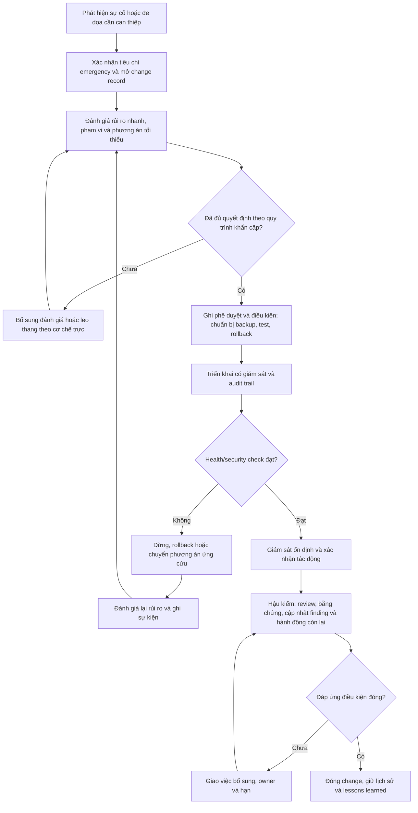

# Emergency change: Bảo đảm an toàn cho thay đổi khẩn cấp

## 1. Emergency change là gì?

Trong **Change assurance**, tổ chức cần chứng minh rằng những thay đổi đối với hệ thống được nhận diện, đánh giá rủi ro, phê duyệt, thực hiện và kiểm chứng theo mức độ ảnh hưởng đến bảo mật và hoạt động. Khi sự cố nghiêm trọng xảy ra hoặc mối đe dọa đòi hỏi can thiệp ngay, quy trình thay đổi thông thường có thể không đáp ứng được thời gian cần thiết.

**Emergency change** (thay đổi khẩn cấp) là thay đổi cần được triển khai trong thời gian rất ngắn nhằm xử lý hoặc ngăn chặn ảnh hưởng nghiêm trọng, với quy trình đánh giá và phê duyệt **được rút gọn theo chính sách nhưng vẫn có trách nhiệm và bằng chứng**. Nó có thể liên quan đến cấu hình, ứng dụng, hạ tầng, mạng, IAM, khóa/chứng thư hoặc security controls.

Ví dụ:

- Chặn khẩn cấp một đường truy cập đang bị khai thác trên API công khai.
- Thu hồi khóa truy cập bị lộ và luân chuyển thông tin xác thực liên quan.
- Triển khai bản vá ngoài lịch vì lỗ hổng nghiêm trọng đang bị khai thác trên dịch vụ trọng yếu.
- Chuyển lưu lượng sang vùng hoạt động an toàn để giảm tác động từ sự cố nghiêm trọng.
- Điều chỉnh gấp rule tường lửa hoặc WAF để chặn kỹ thuật tấn công đã quan sát thấy.

Không phải thay đổi nào được yêu cầu “làm ngay” cũng là emergency change. Một yêu cầu kinh doanh bị quên lịch, tính năng ra mắt muộn hoặc cấu hình thường lệ muốn bỏ qua cửa sổ change không tự đủ điều kiện. Cần có **nguy cơ hoặc tác động đủ nghiêm trọng**, lập luận về hậu quả nếu chờ quy trình chuẩn và người có thẩm quyền xác nhận phân loại.

Emergency change thường đi cùng quá trình **incident response** nhưng không đồng nhất với incident. Incident management tập trung phát hiện, điều phối và khôi phục sau sự cố; change management kiểm soát hành động thay đổi cấu hình/hệ thống để ứng phó. Một incident có thể cần nhiều change; một emergency change phòng ngừa có thể xảy ra trước khi incident thực sự phát sinh.

**Điểm cốt lõi của Security Assurance:** tăng tốc triển khai không được đồng nghĩa với mất khả năng trả lời các câu hỏi: thay đổi gì, vì sao khẩn cấp, ai quyết định, rủi ro nào được chấp nhận, điều gì đã xảy ra trên hệ thống thật và bằng chứng nào chứng minh kết quả.

## 2. Mục tiêu bảo đảm đối với emergency change

Quy trình phải cân bằng hai loại rủi ro: **rủi ro nếu trì hoãn** và **rủi ro do chính thay đổi gây ra**.

| Mục tiêu | Câu hỏi assurance | Bằng chứng cần giữ |
| --- | --- | --- |
| Tính khẩn cấp có căn cứ | Nếu chờ lịch change thông thường, điều gì có thể xảy ra? | Sự kiện bảo mật, incident ticket, cảnh báo, đánh giá tác động, thời điểm phát hiện |
| Phạm vi được giới hạn | Thay đổi đúng tài sản, môi trường, cấu hình và luồng cần thiết chưa? | Asset ID, service owner, diff, phạm vi triển khai, dependency |
| Quyết định đúng thẩm quyền | Ai yêu cầu, ai đánh giá, ai phê duyệt và dựa vào rủi ro nào? | Emergency change record, log chấp thuận, phiên bản quyết định, thời điểm |
| Tác động được kiểm soát | Có giảm thiểu khả năng gián đoạn, mất dữ liệu hoặc mở thêm lỗ hổng không? | Phân tích rủi ro ngắn, kế hoạch kiểm tra, backup, rollback, monitoring |
| Thực thi có thể truy vết | Ai đã triển khai gì, ở đâu, lúc nào, bằng quyền gì? | Git commit, artifact digest, pipeline run, change log, privileged session log |
| Kết quả được kiểm chứng | Thay đổi có đạt mục tiêu và không làm yếu security controls ngoài phạm vi? | Test result, health check, control verification, log và số liệu trước/sau |
| Hậu kiểm và khắc phục tồn đọng | Các bước nào phải thực hiện thêm khi tình hình ổn định? | Post-implementation review, finding, action item, owner, due date |

Đây là tập mục tiêu thực hành, không phải yêu cầu số ngày hay sơ đồ phê duyệt áp dụng cho mọi tổ chức. Chính sách nội bộ cần quyết định ngưỡng emergency, mức rủi ro có thể chấp nhận, cấp phê duyệt, hình thức báo cáo và thời hạn hậu kiểm.

### 2.1. Ba lớp bằng chứng

Có thể tổ chức bằng chứng theo ba thời điểm:

1. **Trước thay đổi:** căn cứ khẩn cấp, phạm vi, đánh giá tác động, phương án hành động, tiêu chí đạt/dừng và người chấp thuận.
2. **Trong thay đổi:** ai thực hiện, diff và phiên bản thực tế, mốc triển khai, kết quả kiểm tra tức thời, sự kiện phát sinh, quyết định rollback.
3. **Sau thay đổi:** kiểm chứng độc lập khi phù hợp, theo dõi ổn định, kết quả khắc phục rủi ro, PIR và các nhiệm vụ còn mở.

Khi hệ thống đang chịu tấn công và không đủ thời gian điền đầy đủ biểu mẫu, có thể ghi nhận thông tin tối thiểu qua kênh được phê duyệt, rồi hoàn thiện hồ sơ theo SLA hậu kiểm. Không được dựng lại bằng chứng giả như thể quyết định đã xảy ra trước thời điểm thực tế.

## 3. Điều kiện phân loại emergency change

### 3.1. Những tín hiệu điển hình

- Hoạt động đang bị gián đoạn nghiêm trọng, mất khả năng phục vụ dịch vụ trọng yếu hoặc có nguy cơ lan rộng.
- Bằng chứng có hoạt động khai thác lỗ hổng nghiêm trọng trên hệ thống chịu ảnh hưởng, đòi hỏi giảm thiểu ngay.
- Thông tin xác thực đặc quyền đã bị lộ hoặc nghi ngờ bị chiếm dụng và cần thu hồi quyền.
- Kiểm soát an ninh trọng yếu bị vô hiệu hóa, tạo khoảng trống phơi nhiễm không thể chờ lịch thay đổi thông thường.
- Hạ tầng sắp hết hạn chứng thư/khóa gây nguy cơ gián đoạn nghiêm trọng trước khi quy trình chuẩn có thể hoàn tất.

### 3.2. Đặt câu hỏi trước khi kích hoạt

Người đề xuất và người có quyền quyết định cần trả lời tối thiểu:

1. **Hậu quả nếu không làm ngay là gì?** Định lượng hoặc mô tả cụ thể ảnh hưởng đến tính bí mật, toàn vẹn, sẵn sàng và mục tiêu kinh doanh.
2. **Vì sao không thể chờ quy trình chuẩn?** Nêu thời gian còn lại đến khi xảy ra tác động, dấu hiệu khai thác hoặc mất dịch vụ.
3. **Thay đổi nhỏ nhất có thể giải quyết vấn đề là gì?** Ưu tiên khoanh vùng, kiểm soát tạm thời hoặc chỉnh sửa mục tiêu rõ ràng.
4. **Rủi ro khi triển khai ngay là gì?** Xác định blast radius, phụ thuộc, ảnh hưởng dữ liệu, khả năng gián đoạn và nguy cơ tạo lỗi bảo mật mới.
5. **Ai có thể chấp thuận trong thời gian này?** Dùng người/nhóm trực sẵn theo ma trận thẩm quyền.
6. **Khi nào phải dừng hoặc rollback?** Gắn điều kiện có thể quan sát thay vì chỉ dựa vào cảm giác.

Một phân loại emergency cần ghi cả **mức khẩn cấp** lẫn **độ rủi ro của thay đổi**. Hai thuộc tính khác nhau: có thay đổi khẩn cấp rất nhỏ và có thay đổi khẩn cấp tác động rộng. Loại sau đòi hỏi thêm sự tham gia và giám sát tương xứng, dù không thể tổ chức đầy đủ phiên họp CAB thường lệ.

### 3.3. Ví dụ quyết định

| Tình huống | Đánh giá gợi ý | Lý do |
| --- | --- | --- |
| Phát hiện API public bị khai thác và cần chặn đường truy cập trong vài phút | Emergency change | Chờ lịch triển khai có thể khiến dữ liệu tiếp tục bị truy cập trái phép |
| Triển khai tính năng mới kịp chiến dịch nhưng không có đe dọa/sự cố nghiêm trọng | Normal change | Gấp về tiến độ chưa đủ là tình huống khẩn cấp kỹ thuật |
| Chứng thư production sắp hết hạn trong vài giờ, dịch vụ trọng yếu sẽ ngừng kết nối | Có thể là emergency change | Tùy mức ảnh hưởng và thời gian xử lý; cần bằng chứng và đánh giá tác động |
| Thay đổi cấu hình theo lịch thường kỳ có cửa sổ bảo trì | Standard/normal change theo chính sách | Có thời gian đánh giá, kiểm thử và phê duyệt thông thường |

## 4. Trách nhiệm và thẩm quyền trong tình huống khẩn cấp

Tổ chức nên định nghĩa rõ vai trò trước khi có sự cố. Một mô hình tham khảo:

| Vai trò | Nhiệm vụ | Bằng chứng/phân tách |
| --- | --- | --- |
| Requester hoặc incident responder | Mô tả trigger, hậu quả trì hoãn, thay đổi đề xuất | Incident/cảnh báo và emergency request |
| Change owner | Phối hợp phạm vi, phương án triển khai, tiêu chí thành công, rollback và cập nhật ticket | Change record có người chịu trách nhiệm |
| Implementer (SRE/Ops/Dev) | Triển khai trong phạm vi đã chấp thuận, ghi diff và kết quả thực tế | Lịch sử triển khai, actor, pipeline và log |
| Emergency approver / ECAB theo chính sách | Xem xét nhanh tính khẩn cấp, rủi ro và phương án giảm thiểu trước triển khai nếu khả thi | Log chấp thuận gắn với bản đề xuất cụ thể |
| Service/asset owner | Xác nhận tác động nghiệp vụ, blast radius và kế hoạch phục hồi | Đánh giá tác động/communication |
| Security reviewer / Security Assurance | Kiểm tra rủi ro bảo mật, điều kiện giảm thiểu, bằng chứng và hậu kiểm | Nhận xét bảo mật, kết quả kiểm chứng và findings |
| Incident commander (nếu có) | Điều phối ưu tiên, liên lạc và các thay đổi trong quá trình ứng cứu | Incident timeline, quyết định điều phối |
| Independent verifier / reviewer | Đánh giá kết quả sau triển khai theo mức rủi ro | Test report, kết quả đối chiếu/nhận xét |

**Phê duyệt rút gọn vẫn là phê duyệt.** Có thể dùng kênh trực, cuộc gọi có biên bản, công cụ ITSM hoặc xác nhận điện tử phù hợp chính sách. Cần ghi được **người quyết định, thời điểm, phiên bản phạm vi, điều kiện và lý do**.

Nếu xử lý ngay để ngăn thiệt hại và không thể lấy phê duyệt trước theo cơ chế ngoại lệ mà tổ chức đã định nghĩa, phải có: người được ủy quyền thực hiện, giới hạn phạm vi và thời gian, ghi lại sự kiện thực, thông báo/escalation tức thời và quy trình phê duyệt/hậu kiểm theo đúng quy định. Không dùng tình huống khẩn cấp như giấy phép tự ý thay đổi mọi thứ.

Phân tách trách nhiệm đặc biệt quan trọng khi cấp quyền cao. Khi một người vừa đề xuất vừa triển khai do nhân sự trực hạn chế, nên bổ sung kiểm tra độc lập càng sớm càng phù hợp, cùng audit log không thể dễ dàng chỉnh sửa.

## 5. Hồ sơ thay đổi khẩn cấp tối thiểu

Trong tình huống gấp, hệ thống cần mẫu biểu ngắn đủ để ra quyết định và kết nối bằng chứng sau đó.

| Trường | Ví dụ/nội dung kỳ vọng |
| --- | --- |
| `emergency_change_id` | `ECHG-2026-042` |
| `linked_incident_id` | `INC-2026-018` hoặc cảnh báo/lỗ hổng kích hoạt |
| `reason_for_emergency` | Hoạt động khai thác đã xác nhận, đang ảnh hưởng dịch vụ public |
| `asset_and_scope` | Dịch vụ, cluster, vùng, endpoint, môi trường cụ thể |
| `risk_if_delayed` | Tác động đến dữ liệu/dịch vụ nếu chờ đến lịch chuẩn |
| `implementation_risk` | Lỗi rule chặn nhầm, mất kết nối đối tác, tác động dependencies |
| `minimal_action` | Rule WAF chặn đường khai thác trên endpoint được chỉ định |
| `approver_and_decision` | Danh tính/role, thời điểm, lý do, phạm vi và điều kiện |
| `test_and_success_criteria` | Health, regression trọng yếu, xác minh giảm phơi nhiễm |
| `stop_and_rollback` | Điều kiện dừng, owner rollback, phiên bản trước/snapshot |
| `execution_window` | Thời gian triển khai, thời điểm giám sát sau thay đổi |
| `evidence_refs` | Incident timeline, commit, pipeline, log, test report |
| `follow_up_and_PIR` | Owner, hạn xử lý gốc, hạn review và vấn đề còn mở |

**Quy tắc dữ liệu:** lưu timestamp có múi giờ; giữ định danh tài sản và liên kết incident/change/finding; không đưa secret, token hoặc khóa riêng vào ticket hay log. Mỗi lần thay đổi scope hoặc giải pháp sau khi duyệt phải được ghi nhận và đánh giá lại theo mức độ ảnh hưởng; không mặc định phê duyệt cũ bao trùm phương án mới.

## 6. Quy trình emergency change từ kích hoạt đến hậu kiểm



### Giai đoạn A — Nhận diện và ghi nhận

Xác định nguồn trigger: sự kiện SIEM, incident, vulnerability intelligence đáng tin cậy, cảnh báo chứng thư hoặc lỗi hạ tầng. Gắn mốc **phát hiện**, **quyết định** và **triển khai**; vì các mốc này có thể khác nhau, không nên chỉ lưu thời điểm mở ticket.

Xác định các hệ thống liên quan, ai đang sử dụng, mức độ quan trọng và tác động bảo mật. Đối với một cuộc tấn công đang diễn ra, cần phối hợp với người điều phối incident để tránh thay đổi làm mất bằng chứng điều tra hoặc cản trở biện pháp ứng cứu khác.

### Giai đoạn B — Đánh giá rủi ro rút gọn

Đánh giá theo những điểm không thể bỏ qua:

- **CIA và an toàn dữ liệu:** thay đổi có thể lộ dữ liệu, giảm toàn vẹn hoặc gián đoạn hệ thống nào?
- **Blast radius:** phạm vi node, khu vực, tài khoản, ứng dụng, phụ thuộc/đối tác; có thể rollout một phần không?
- **Phương án thay thế:** cô lập, rate limit, chặn tạm, vô hiệu hóa tính năng, xoay khóa hoặc bản vá.
- **Tác động phụ:** rule có thể chặn nhầm người dùng hợp lệ, quyền mới có thể quá rộng, bản vá có thể làm lỗi hợp đồng API.
- **Khả năng kiểm chứng:** tín hiệu nào cho biết đã giảm rủi ro, tín hiệu nào buộc dừng/rollback?
- **Bằng chứng và rollback:** có snapshot, cấu hình trước thay đổi, bản phát hành được ký/kiểm tra, người chịu trách nhiệm phục hồi không?

Phân tích có thể dài vài phút trong tình huống cần xử lý ngay, nhưng vẫn cần nội dung rõ và có người nhận trách nhiệm. Nếu một kiểm soát tối thiểu không khả thi, phải ghi nhận lý do cùng biện pháp bù trừ.

### Giai đoạn C — Phê duyệt, chuẩn bị và liên lạc

Đối chiếu phương án với phạm vi được duyệt, thống nhất thời gian tiến hành và đầu mối liên lạc. Chuẩn bị lệnh/automation và xác nhận người có quyền thực hiện. Nếu dùng cơ chế emergency access, kiểm soát cấp quyền theo thời hạn, chỉ dùng khi cần, ghi đầy đủ session và thu hồi sau khi xong.

Có người giám sát độc lập hoặc kênh liên lạc rõ nếu quy mô sự cố cho phép. Xác định trước thông điệp cập nhật cho người chịu ảnh hưởng nếu thay đổi có thể gây gián đoạn.

### Giai đoạn D — Triển khai và quan sát

Ưu tiên cơ chế vốn đã có độ tin cậy: pipeline deploy đã kiểm soát, IaC/GitOps, cấu hình theo phiên bản, canary hoặc rollout tuần tự. Tránh thay đổi thủ công trực tiếp trên nhiều máy khi có phương án đã được tự động hóa an toàn.

Khi buộc phải thao tác tay, ghi lại actor, quyền, lệnh hoặc loại thay đổi, phiên bản trước/sau, node chịu ảnh hưởng, thời gian và kết quả. Không sao chép token hoặc dữ liệu nhạy cảm vào log; thay vào đó dùng tham chiếu bí mật và metadata an toàn.

### Giai đoạn E — Kiểm chứng và quyết định tiếp tục

Cần kiểm tra đồng thời **mục tiêu ứng cứu** và **tác động ngoài ý muốn**. Một dịch vụ “trả HTTP 200” chưa chứng minh rằng cuộc tấn công đã bị ngăn chặn, dữ liệu còn đúng hoặc security controls vẫn hoạt động.

Nếu không đạt tiêu chí, dừng rollout, thực hiện rollback khi phù hợp hoặc chuyển sang phương án giảm thiểu khác. Rollback cũng có rủi ro: nếu cấu hình trước thay đổi không an toàn và đang bị khai thác, hoàn nguyên máy móc có thể mở lại lỗ hổng. Người điều phối phải lựa chọn **phục hồi an toàn** thay vì chỉ khôi phục trạng thái cũ.

## 7. Những kiểm soát bảo mật cần giữ dù thời gian gấp

| Kiểm soát | Cách áp dụng thực tế cho emergency change | Bằng chứng |
| --- | --- | --- |
| Xác thực và phân quyền | Dùng tài khoản định danh, quyền tối thiểu đủ dùng, có thời hạn; break-glass theo quy trình riêng | IAM audit event, thời điểm cấp/thu hồi quyền |
| Phê duyệt rút gọn | Chỉ định approver trực, ghi rõ phiên bản phạm vi và điều kiện | Decision record và timestamp |
| Kiểm soát phiên bản | Lưu diff, commit, artifact digest, cấu hình trước/sau | Git, pipeline, bản snapshot được kiểm soát |
| Kiểm tra thay đổi | Lint, test trọng yếu, security scanning nhanh và policy checks còn khả thi | Pipeline/test report; lý do bỏ qua kiểm tra nào |
| Phân đoạn triển khai | Canary, từng cụm hoặc chặn ở lớp biên với phạm vi hẹp khi khả thi | Deployment log và kết quả đo tại mỗi bước |
| Backup/rollback | Chuẩn bị rollback có thể thực hiện; test phục hồi mức phù hợp | Backup ID, phương án phục hồi, kết quả thử |
| Giám sát | Theo dõi error rate, latency, tính sẵn sàng, security telemetry và log sự kiện | Dashboard snapshot, alert log |
| Bảo toàn bằng chứng | Giữ timeline incident, tránh xóa dấu vết hoặc cấu hình gốc không cần thiết | Log lưu trữ, ticket, chain of custody nếu áp dụng |
| Rà soát sau triển khai | Review độc lập điều kiện, rủi ro và sai lệch quy trình | PIR, approvals, action items có hạn |

**Không nên tắt toàn bộ quality gate để đi nhanh.** Có thể điều chỉnh mức kiểm tra theo khả năng và rủi ro, nhưng phải ghi rõ kiểm tra nào đã chạy, kiểm tra nào tạm hoãn, vì sao và khi nào sẽ bù kiểm tra. Một bước scan tốn thời gian có thể được dời sang hậu kiểm theo thẩm quyền; kiểm tra cấu hình hoặc test tối thiểu nhằm ngăn gián đoạn lớn có thể vẫn là điều kiện bắt buộc.

### 7.1. Break-glass và quyền truy cập khẩn cấp

Cơ chế **break-glass** cho phép truy cập đặc biệt khi quy trình cấp quyền thông thường không còn đáp ứng được tình huống. Cần quy định trước:

- Ai được kích hoạt và trong loại tình huống nào.
- Xác thực, ghi log, cảnh báo và giám sát phiên truy cập.
- Giới hạn quyền/tài nguyên/thời gian, ghi lý do và liên kết emergency change ID.
- Thu hồi hoặc hết hạn tự động sau khi kết thúc và rà soát mọi hành động quan trọng.
- Cách xử lý khi quy trình tự động gặp sự cố hoặc người phê duyệt trực không liên lạc được.

Không coi break-glass là lựa chọn thường xuyên cho các tác vụ vận hành; lạm dụng sẽ làm suy yếu phân tách nhiệm vụ và khả năng truy vết.

## 8. Kế hoạch kiểm thử, giám sát và rollback

### 8.1. Đặt tiêu chí đạt, dừng và hoàn nguyên

Ví dụ thay đổi khẩn cấp rule WAF chống truy cập trái phép:

| Loại | Tiêu chí minh họa | Hành động |
| --- | --- | --- |
| Mục tiêu bảo mật | Request mang mẫu khai thác đã biết bị chặn tại lớp biên | Giữ rule nếu không gây tác động không chấp nhận được |
| Ảnh hưởng nghiệp vụ | Giao dịch hợp lệ của API quan trọng tiếp tục thành công | Nếu lỗi tăng vượt ngưỡng, dừng mở rộng rule và đánh giá |
| Vùng triển khai | Chỉ tác động endpoint và môi trường đã được duyệt | Nếu vượt scope, dừng và sửa phạm vi |
| Quan sát | Log cho thấy số request bị chặn, nguyên nhân và tỷ lệ false positive | Điều chỉnh có phê duyệt phạm vi nếu cần |
| Kế hoạch khôi phục | Có rule cũ/backup và tùy chọn giảm thiểu thay thế | Rollback có kiểm soát hoặc chuyển sang biện pháp cô lập khác |

Các ngưỡng như lỗi 5xx, tỷ lệ false positive, latency và thời gian ổn định phải dựa trên baseline dịch vụ. Không tự đặt giá trị cố định cho mọi hệ thống. Bằng chứng nên có cả số liệu **trước** và **sau** thay đổi trong cùng khoảng so sánh hợp lý.

### 8.2. Xác minh hiệu quả security control

Sau triển khai, cần xác định:

1. Nguyên nhân hoặc đường tấn công được nhắm tới đã bị hạn chế như dự kiến chưa?
2. Các đường truy cập khác có còn tạo ra cùng rủi ro không?
3. Logging, detection, authentication, authorization và mã hóa còn hoạt động trên những luồng trọng yếu không?
4. Người dùng/dịch vụ hợp lệ có bị chặn sai hoặc mất dữ liệu không?
5. Kết quả có được một reviewer đủ độc lập và am hiểu bối cảnh kiểm tra theo chính sách không?

Một emergency change có thể chỉ là **mitigation tạm thời**. Chẳng hạn rule WAF làm giảm khả năng khai thác nhưng lỗi xác thực trong mã nguồn vẫn tồn tại. Không đóng finding gốc như “đã sửa triệt để” chỉ dựa trên việc rule đang hoạt động; cần kế hoạch remediation và kiểm chứng riêng.

### 8.3. Khi rollback không phù hợp

Ví dụ vừa thu hồi access key đã bị lộ: hoàn nguyên key có thể khôi phục hoạt động nhưng đồng thời tái mở đường tấn công. Hãy ưu tiên phương án phục hồi chức năng an toàn như cấp khóa mới, chuyển lưu lượng, giới hạn chức năng hoặc triển khai bản sửa bổ sung. Ghi rõ lý do không áp dụng rollback cũ và người đã quyết định.

## 9. Ví dụ tình huống từ phát hiện đến kết luận assurance

Giả sử ứng dụng đặt hàng công khai đang bị khai thác lỗi bypass authorization. Nhóm bảo mật xác nhận request của kẻ tấn công truy cập dữ liệu đơn hàng của người dùng khác. Bản vá ứng dụng cần thêm thời gian xây dựng và kiểm thử, còn đội vận hành có thể nhanh chóng bật một rule ở gateway nhằm chặn mẫu truy cập nguy hiểm.

### 9.1. Timeline minh họa (ngày 28/11/2026, UTC+07:00)

| Thời gian | Hoạt động | Bằng chứng |
| --- | --- | --- |
| 09:00 | SOC phát hiện chuỗi request bất thường; mở incident và lưu log liên quan | `INC-031`, alert `AL-822` |
| 09:08 | Incident commander xác nhận rủi ro lộ dữ liệu và đề xuất emergency change | Triage note, phạm vi endpoint |
| 09:15 | SRE, service owner và security reviewer thống nhất biện pháp giảm thiểu tạm thời | Impact note, rule diff dự kiến, rollback plan |
| 09:20 | Emergency approver chấp thuận rule ở gateway theo scope cụ thể | `ECHG-042`, decision event |
| 09:27 | Pipeline áp dụng rule trên nhóm endpoint đã duyệt | Pipeline run, digest và change log |
| 09:33 | Kiểm tra request tấn công bị chặn và đường truy cập hợp lệ vẫn hoạt động | Test result, gateway log, API health |
| 09:45 | Giám sát ổn định và giao nhiệm vụ sửa lỗi authorization gốc | Monitoring snapshot, `FIND-118` |
| 30/11 | Review sau thay đổi; đánh giá việc tuân thủ, tác động, thiếu sót và remediation | PIR record, action items |

Phần thời gian và mã tài liệu trên đều là **giả định để học cách quản lý bằng chứng**, không phải sự kiện có thật.

### 9.2. Quyết định và rủi ro còn lại

Mục tiêu đã đạt: rule làm giảm khai thác trực tiếp qua đường truy cập được xác định, dịch vụ không ghi nhận lỗi bất thường trong khoảng quan sát. Tuy nhiên:

- Chưa có bằng chứng mã nguồn đã sửa căn nguyên lỗi authorization.
- Cần kiểm thử thêm khả năng bypass ở các endpoint khác.
- Rule tại gateway có thể bị vô hiệu hóa hoặc thay đổi sau này.
- Hành động tạm thời có thể gây chặn nhầm trong những luồng chưa được kiểm tra.

Vì vậy, kết luận assurance nên là: **emergency mitigation đã triển khai và kiểm chứng trong phạm vi X tại thời điểm Y; rủi ro tồn dư và nhiệm vụ remediation gốc vẫn đang được theo dõi**. Nếu tổ chức cần một ngoại lệ cho trạng thái chưa đáp ứng control, tạo hồ sơ exception theo đúng quy trình và thời hạn; không coi phê duyệt emergency change tự động là chấp nhận rủi ro lâu dài.

## 10. Ví dụ cấu trúc bản ghi change có thể truy vết

Bản ghi dưới đây chỉ minh họa dữ liệu tối thiểu để kết nối ticket, phê duyệt và bằng chứng thực thi. Các `evidence_ref` trỏ đến kho có kiểm soát truy cập:

```json
{
  "emergency_change_id": "ECHG-042",
  "linked_incident_id": "INC-031",
  "service": "public-order-api",
  "environment": "production",
  "scope": {
    "change_type": "gateway-rule",
    "endpoint": "/orders/*",
    "regions": ["ap-southeast-1"]
  },
  "emergency_reason": "Observed unauthorized data access attempts",
  "risk_if_delayed": "Potential exposure of customer order data",
  "implementation_risk": "False positives and customer request failures",
  "requested_at": "2026-11-28T09:08:00+07:00",
  "approved_at": "2026-11-28T09:20:00+07:00",
  "approval": {
    "approver_role": "Emergency Change Approver",
    "decision": "APPROVED",
    "scope_version": 1,
    "evidence_ref": "DECISION-ECHG-042-V1"
  },
  "execution": {
    "started_at": "2026-11-28T09:27:00+07:00",
    "artifact_digest_ref": "ARTIFACT-ECHG-042",
    "pipeline_run_ref": "DEPLOY-870",
    "completed_at": "2026-11-28T09:33:00+07:00"
  },
  "validation": {
    "attack_path_blocked": true,
    "critical_business_flow_passed": true,
    "verified_by_role": "Security Reviewer",
    "evidence_ref": "TEST-ECHG-042"
  },
  "result": "MITIGATION_APPLIED",
  "residual_risk": "Root authorization defect remains",
  "remediation_finding_id": "FIND-118",
  "post_implementation_review_ref": "PIR-ECHG-042"
}
```

Trạng thái `MITIGATION_APPLIED` thể hiện biện pháp giảm thiểu đã hoạt động theo điều kiện kiểm tra, không khẳng định lỗ hổng gốc đã khắc phục hoàn toàn.

Trong hệ thống thực, nên tách lịch sử sự kiện khỏi bản ghi tổng hợp. Ví dụ `REQUESTED`, `RISK_REVIEWED`, `APPROVED`, `DEPLOYMENT_STARTED`, `DEPLOYMENT_COMPLETED`, `VERIFICATION_PASSED`, `ROLLBACK_TRIGGERED`, `PIR_COMPLETED`. Mỗi event ghi timestamp, actor, scope/version, kết quả, giải thích và tham chiếu bằng chứng.

Để kiểm toán lại một sự kiện quá khứ, các bản ghi cần giữ **phiên bản theo thời điểm**: không thể dùng trạng thái hiện tại của rule hay pipeline để mặc định chứng minh nó đã ở trạng thái đó khi ứng cứu.

## 11. Post-implementation review (PIR) và hoàn thiện bằng chứng

PIR là bước quan trọng của emergency change. Thay đổi có thể đã giúp dập sự cố, nhưng tổ chức cần đánh giá liệu cách làm có phù hợp với chuẩn kiểm soát, tạo rủi ro mới hoặc để lại nhiệm vụ chưa hoàn tất hay không.

### 11.1. Câu hỏi hậu kiểm

1. Phân loại emergency có căn cứ không? Nếu thực tế đủ thời gian dùng normal change, vì sao đã đi đường khẩn cấp?
2. Ai phê duyệt, phạm vi có đúng thẩm quyền và có khác với phạm vi triển khai thực tế không?
3. Những bước đánh giá/test nào được rút gọn? Có bước nào không được chạy mà chưa có biện pháp bù trừ?
4. Thay đổi có đạt mục tiêu phục hồi hoặc giảm thiểu đã đặt ra không? Bằng chứng nào đo điều đó?
5. Có incident phụ, mất dữ liệu, vi phạm quyền truy cập hoặc tác động khách hàng nào không?
6. Quyền break-glass đã được thu hồi chưa? Có sự kiện truy cập bất thường hay thay đổi ngoài scope không?
7. Có cần mở finding, remediation task, problem record hoặc exception mới không?
8. Giải pháp tạm có kế hoạch loại bỏ hoặc thay bằng cách sửa tận gốc chưa?

Cần ghi rõ người tham gia PIR, thời điểm, kết luận, rủi ro còn lại, owner và hạn xử lý. Thời hạn hoàn thành PIR do chính sách tổ chức quy định; các mốc như “trong 24 giờ” hay “trong 72 giờ” chỉ nên dùng nếu được tổ chức chấp nhận và có khả năng thực thi.

### 11.2. Điều kiện đóng emergency change

Một checklist đóng change nên yêu cầu:

- Có lý do khẩn cấp và bản ghi phê duyệt hoặc biên bản cơ chế khẩn theo chính sách.
- Thay đổi triển khai đúng phạm vi, có log thao tác và bằng chứng phiên bản thực tế.
- Kết quả kiểm thử và giám sát chứng minh mục tiêu đạt hoặc mô tả rõ failure/rollback.
- Quyền khẩn cấp đã thu hồi, kiểm soát tạm thời được theo dõi; dữ liệu nhạy cảm/bí mật không bị phơi bày trong log.
- PIR hoàn thành hoặc có kế hoạch/owner/hạn được theo dõi theo chính sách.
- Finding/incident/exception liên quan được liên kết và có hành động cho rủi ro tồn dư.

Không nên đóng change chỉ vì pipeline trả `SUCCESS`: pipeline thành công thể hiện các bước tự động đã chạy, chưa đủ chứng minh tính đúng đắn hoặc mức an toàn của hệ thống sau thay đổi.

## 12. Chỉ số quản trị và dashboard

| Chỉ số | Diễn giải | Điểm cần lưu ý |
| --- | --- | --- |
| Số emergency change theo kỳ | Đếm change ID được phân loại khẩn cấp | Phân theo dịch vụ, loại trigger, đội và mức rủi ro |
| Tỷ lệ emergency/total change | Số emergency change / tổng số change trong cùng kỳ | Tăng có thể do đe dọa thật hoặc lạm dụng phân loại |
| Emergency change success rate | Số change đạt tiêu chí đã đặt / số change đã triển khai | Định nghĩa rõ success, tránh chỉ dựa trên trạng thái ticket |
| Emergency change failure rate | Số change gây sự cố, phải rollback hoặc không đạt kiểm chứng / số change đã triển khai | Theo dõi độ ổn định và tác động ngoài ý muốn |
| Approval evidence completeness | Tỷ lệ hồ sơ có quyết định, người và timestamp theo chính sách | Không dùng để đánh giá chỉ riêng tốc độ |
| Security validation completeness | Tỷ lệ change có kiểm chứng security control phù hợp | Phân biệt mục tiêu mitigation với remediation |
| PIR completion on time | Tỷ lệ change đến hạn PIR đã hoàn thành PIR đúng hạn | Mẫu số là change đến hạn review trong kỳ |
| Break-glass review/closure | Tỷ lệ phiên quyền khẩn được thu hồi và rà soát đúng hạn | Theo dõi quyền tồn đọng và session thiếu log |
| Open follow-up risk | Số finding, exception, action sau emergency còn mở và quá hạn | Quan trọng để giảm rủi ro lâu dài |
| Repeated emergency changes | Số lần cùng loại emergency lặp lại tại một dịch vụ | Tìm nguyên nhân hệ thống như thiếu capacity, patching, certificate automation |

Không đặt mục tiêu “bằng mọi giá phải giảm số emergency change” vì có thể khiến đội tránh khai báo tình huống khẩn cấp có thật. Phải phân tích **nguyên nhân**, **chất lượng quyết định** và **tác động** thay vì tối ưu một con số.

Dashboard có thể chia theo ba góc nhìn: trực vận hành xem change đang diễn ra và điều kiện dừng; Security Assurance xem bằng chứng, phê duyệt, kiểm chứng còn thiếu; lãnh đạo xem mức phơi nhiễm, lỗi lặp lại và các hành động giảm rủi ro dài hạn.

## 13. Những sai lầm thường gặp

**1. Gọi mọi việc gấp là emergency.** Điều này làm quy trình khẩn bị lạm dụng và giảm chất lượng chuẩn bị. Cần định nghĩa tiêu chí dựa trên tác động/rủi ro, kiểm tra phân loại trong PIR.

**2. Lấy lý do khẩn cấp để triển khai ngoài mọi kiểm soát.** Thực tế vẫn cần scope, trách nhiệm, quyết định và dấu vết triển khai tương xứng. Dùng cơ chế trực, phê duyệt rút gọn và audit trail.

**3. Bỏ qua kiểm tra vì “triển khai càng sớm càng tốt”.** Thay đổi bảo mật sai có thể phá vỡ giao dịch, mở quyền quá rộng hoặc xóa log điều tra. Tối thiểu phải có tiêu chí thành công/dừng, health check, kiểm chứng bảo mật, kế hoạch phục hồi an toàn.

**4. Rollback trả về trạng thái đang bị khai thác.** Khôi phục cấu hình cũ đôi khi khiến hệ thống lại mất an toàn. Hãy có phương án thay thế như cô lập, tắt luồng truy cập, chuyển traffic hoặc khôi phục bằng bản cấu hình an toàn.

**5. Coi mitigation là xử lý dứt điểm.** Chặn ở WAF chưa có nghĩa lỗi trong mã nguồn đã hết. Cần liên kết finding, giám sát biện pháp tạm và triển khai remediation có kiểm chứng.

**6. Hậu kiểm chỉ là ký xác nhận.** Nếu không ghi căn cứ phân loại, điều kiện phê duyệt, tác động phụ và nhiệm vụ cải thiện, tổ chức không học được từ sự cố và không chứng minh được quá trình assurance.

**7. Quên thu hồi quyền khẩn cấp.** Phiên break-glass bị bỏ mở trở thành bề mặt tấn công mới. Cần timeout, thu hồi và rà soát log.

**8. Ghi đè hiện trạng để làm đẹp báo cáo.** Xóa lỗi test, sửa thời điểm approval hay chỉ lưu phiên bản cuối làm mất tính tin cậy của bằng chứng. Ghi event thật, giữ lịch sử và giải thích nguyên nhân rõ ràng.

## 14. Bài tập vận dụng

Vào lúc **14:10 ngày 28/11/2026 (UTC+07:00)**, SOC nhận cảnh báo rằng credential của một tài khoản máy dịch vụ production có thể đã bị lộ. Tài khoản này đang được dùng để gọi API đối tác. Nếu thu hồi ngay, tích hợp có thể gián đoạn trong 20–40 phút; nếu chờ cửa sổ deploy cuối ngày, người tấn công có thêm thời gian dùng credential.

Nhóm vận hành đề xuất một emergency change: thu hồi credential cũ, phát hành credential mới qua secret manager, cập nhật workload, kiểm tra tích hợp và tăng giám sát truy cập. Cần hoàn tất trong khung giờ ứng cứu.

**Câu hỏi:**

1. Vì sao yêu cầu này có thể được phân loại emergency change? Rủi ro khi trì hoãn và rủi ro do thay đổi là gì?
2. Phạm vi tối thiểu, người phê duyệt và các điều kiện an toàn nào cần có trước triển khai?
3. Đâu là kiểm tra thành công và phương án phục hồi phù hợp nếu ứng dụng không kết nối được với đối tác?
4. Những bằng chứng và hành động hậu kiểm nào phải lưu?

**Gợi ý lời giải:**

- **Phân loại:** credential có nguy cơ lộ, có thể bị lợi dụng ngay trên production; thời gian chờ làm tăng phơi nhiễm. Thay đổi có nguy cơ gián đoạn tích hợp và lỗi luân chuyển bí mật.
- **Phạm vi và quyết định:** chỉ tài khoản/secret/workload chịu ảnh hưởng; ghi emergency change ID liên kết incident, service owner, risk và emergency approver theo ma trận. Chuẩn bị secret mới trong hệ thống quản lý bí mật, kế hoạch cập nhật client, kiểm tra quyền tối thiểu và giới hạn thời gian thao tác đặc quyền.
- **Kiểm chứng:** credential cũ thực sự mất hiệu lực; credential mới hoạt động; không bị lộ vào log; API tích hợp đạt smoke test; log cho thấy không có truy cập bất thường. Nếu lỗi, ưu tiên cấp lại hoặc cấu hình đúng credential mới, chuyển sang kênh xử lý an toàn; **không phục hồi credential đã nghi lộ**.
- **Bằng chứng và hậu kiểm:** phê duyệt, timestamp, secret version ID (không có giá trị secret), deployment log, test report, revoke event, tình trạng người dùng bị ảnh hưởng, rà soát truy cập đặc quyền, PIR và cải tiến luân chuyển secret tự động.

Bài học từ tình huống: quy trình nhanh có thể vẫn được kiểm soát tốt khi **quyết định có căn cứ, thay đổi được giới hạn, bảo mật được kiểm chứng và lịch sử được lưu đầy đủ**.

---

**Ghi nhớ:** Emergency change là một con đường xử lý thay đổi khẩn cấp có quản trị. Giá trị của nó nằm ở việc cho phép ứng phó nhanh **và** duy trì bằng chứng về lý do, thẩm quyền, rủi ro, thực thi, kiểm chứng và xử lý tồn đọng. Đây là yêu cầu cốt lõi để Security Assurance hoạt động liên tục khi hệ thống gặp sự cố hoặc đe dọa nghiêm trọng.
