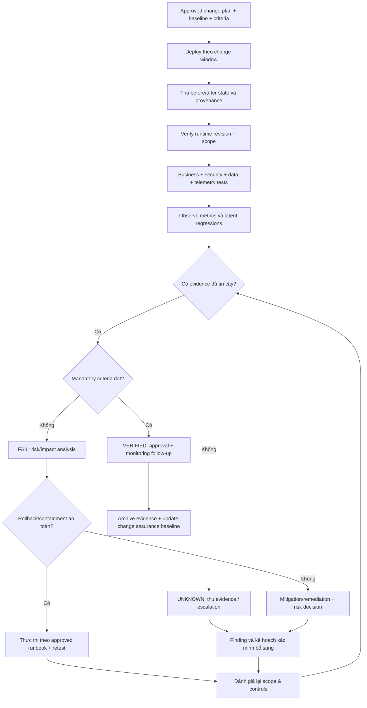

# Post-change review: Đánh giá sau thay đổi bằng bằng chứng trong Security Assurance

## 1. Post-change review là gì?

**Post-change review** (đánh giá sau thay đổi, viết tắt trong bài là **PCR**) là hoạt động có cấu trúc để kiểm tra **một thay đổi đã được triển khai thực tế có đạt mục tiêu, giữ các security controls trong trạng thái mong đợi, không tạo rủi ro không được chấp nhận và có đầy đủ bằng chứng để đưa ra quyết định hậu kiểm hay không**.

Một thay đổi có thể là cập nhật ứng dụng, sửa chính sách IAM, thay cấu hình Kubernetes, nâng cấp database, chuyển secrets, thay routing, điều chỉnh quy tắc SIEM, hoặc thay nhà cung cấp. Thay đổi đó có thể vượt qua các bước phê duyệt, kiểm thử trước triển khai và được CI/CD báo `SUCCESS`. Tuy nhiên, kết quả ấy mới chứng minh một phần **quy trình triển khai**, chưa đủ chứng minh hệ thống sau thay đổi **đáp ứng các mục tiêu nghiệp vụ và bảo mật**.

Trong chương **Change assurance** của module **SECURITY_SECURITY_ASSURANCE**, mục tiêu là xây dựng năng lực đánh giá có bằng chứng rằng hệ thống đáp ứng yêu cầu và security controls từ phân tích rủi ro đến kiểm thử, audit, giám sát và khắc phục. Post-change review kết nối **ý định và phê duyệt trước thay đổi** với **trạng thái, hành vi và rủi ro thực sự sau thay đổi**.

### Một tình huống mở đầu

Một pull request được phê duyệt để giảm quyền của service principal dùng cho CI/CD. Pipeline báo triển khai thành công, policy được cập nhật trong repository. Nhóm vận hành đánh dấu change `DONE`.

Tuy nhiên khi hậu kiểm, reviewer thấy service principal vẫn có quyền nguy hiểm qua **một role khác ở runtime**; token/session được cấp trước đó có thể vẫn dùng được; và hệ thống giám sát không phát hiện sự kiện thay đổi IAM mới. Vì vậy, “deployment thành công” **không đồng nghĩa “control least privilege đã được khôi phục”**.

Post-change review cần xác định **expected versus observed**, test theo phạm vi đúng, phát hiện sai lệch, đánh giá quyết định rollback/remediation, và lưu chuỗi bằng chứng có thể kiểm toán.

### Mục tiêu học tập

Sau bài học, người học có thể:

1. Phân biệt post-change review với post-deployment verification, change approval, post-implementation review và incident postmortem.
2. Thiết kế **review criteria** có thể kiểm chứng trước khi triển khai.
3. Xác định review scope, mốc thời gian, baseline, owner, nguồn dữ liệu và khoảng quan sát sau thay đổi.
4. Kiểm tra ảnh hưởng của change tới **confidentiality, integrity, availability**, IAM, logging/detection, data protection và recoverability.
5. Xác định điều kiện **PASS, FAIL, UNKNOWN, exception** và quy trình escalation/rollback.
6. Thu thập evidence từ repository, CI/CD, cloud/Kubernetes, runtime state, tests, monitoring và business acceptance.
7. Tạo post-change review record, findings và remediation/retest có khả năng truy vết.
8. Dùng kết quả review để cải tiến change controls và chương trình security assurance liên tục.

## 2. Phân biệt các hoạt động trong vòng đời thay đổi

| Hoạt động | Câu hỏi chính | Đầu ra | Giới hạn |
| --- | --- | --- | --- |
| **Pre-change assessment** | Change định làm gì, rủi ro và dependencies nào? | Risk assessment, plan, test và rollback criteria | Chưa thấy trạng thái production sau thay đổi |
| **Change authorization** | Ai được phép thực hiện, khi nào, theo điều kiện nào? | Approval và change window | Approval không chứng minh triển khai đúng |
| **Implementation/deployment** | Artifact, cấu hình hoặc lệnh có được áp dụng? | Deployment logs, PR, IaC revision | Pipeline xanh chưa bảo đảm runtime/security hiệu lực |
| **Post-deployment verification** | Các smoke/health checks ngay sau deploy có đạt? | Runtime readback, smoke tests | Có thể bỏ qua lỗi trễ, security và tác động nghiệp vụ |
| **Post-change review** | Mục tiêu ban đầu, controls, rủi ro và kết quả trong khoảng review có đạt? | Verdict theo criteria, evidence, findings, learning | Kết luận vẫn giới hạn theo scope/time window |
| **Post-implementation review (PIR)** | Change đã mang lại lợi ích/kết quả kỳ vọng và thực hiện tốt ở mức quy trình? | Review về hiệu quả, tác động, cost và bài học | Nếu không có security tests, PIR chung chưa đủ assurance |
| **Incident postmortem** | Vì sao sự cố xảy ra và điều gì cần đổi để tránh lặp lại? | Timeline, causal analysis, corrective actions | Không phải thay đổi nào cũng có incident |
| **Continuous monitoring** | Control sau khi review có tiếp tục hiệu lực không? | Drift, regression, alerts, trends | Monitoring không thay review có quyết định và owner |

Trong nhiều tổ chức, tên “post-change review” và “post-implementation review” có thể được dùng gần nhau. **Ở bài này, PCR tập trung vào việc chứng minh kết quả và security assurance của một thay đổi sau triển khai**, có thể là phần chuyên sâu của PIR.

**Không được dùng tiêu chí “không phát sinh incident trong 24 giờ” làm bằng chứng duy nhất**: sự cố có thể chưa xảy ra, detector có thể mất nguồn, hoặc điều kiện tấn công chưa được kích hoạt.

## 3. Thay đổi nào cần post-change review?

Mức độ sâu, thời điểm và người đánh giá nên dựa trên **risk tier** của thay đổi. Một sửa lỗi typo trong tài liệu public và một thay đổi IAM organization policy ở production không cần cùng bộ test.

### Các nhóm thay đổi

| Nhóm | Ví dụ | Độ sâu review phù hợp |
| --- | --- | --- |
| **Application release** | Đổi logic ủy quyền, API, thư viện | Functional + abuse-case + security regression |
| **Identity and access** | IAM roles, SSO, federation, secrets | Effective permissions, unauthorized access negative tests |
| **Infrastructure/IaC** | Cloud network, Kubernetes policy, storage | Drift, runtime config, network/data-plane verification |
| **Data/DB** | Schema, migration, retention, encryption | Integrity, compatibility, backup/restore readiness |
| **Logging/detection** | Parser, source onboarding, alert routing | Source-to-sink canary, detection tests, missing-source |
| **Network and resilience** | DNS/LB, failover, DR architecture | Routing, traffic isolation, RTO/RPO/rollback |
| **Supply chain** | Base image, CI/CD runner, artifact registry | Version/digest/provenance, secrets scope, vulnerability |
| **Third-party integration** | OAuth app, vendor API, subprocessor | Data flows, contracts/CUECs, permissions, monitoring |
| **Emergency change** | Hotfix trong incident | Tái dựng approval, tests bị bỏ qua, retrospective review |

**Risk-based review** không đồng nghĩa bỏ review hoàn toàn cho change ít rủi ro. Tổ chức có thể dùng automation và sampling theo chính sách. Khi thay đổi chạm **privileged access, dữ liệu nhạy cảm, shared control, trust boundary hoặc core business dependency**, cần xem xét assurance chuyên sâu và review độc lập.

## 4. Xác định review scope và change boundary

Một PCR đáng tin phải ghi rõ **đánh giá thay đổi nào trên tập tài sản nào**, thay vì nêu chung “release đã ổn”.

### Các chiều phạm vi bắt buộc

- **Change ID / version:** ticket, PR, build/run ID, release tag, commit hash hoặc digest.
- **Change intent:** vấn đề cần giải quyết, security requirement hoặc business outcome.
- **Environment:** staging, canary, production, DR, tài khoản/cluster/tenant.
- **Assets/identities:** hệ thống, workloads, API, database, service principals, policy bindings.
- **Data:** loại dữ liệu, mục đích, cách lưu/chuyển, đối tượng bị ảnh hưởng.
- **Dependencies:** IdP, KMS, storage, queues, DNS, vendor, audit pipeline.
- **Population:** số người dùng, khách hàng, region, requests và tài sản thuộc scope.
- **Time window:** triển khai, xác minh ngay, quan sát ổn định và điểm cuối review.
- **Controls in scope:** authorization, logging, encryption, recovery, config baseline, v.v.
- **Exclusions/assumptions:** giới hạn chủ đích, chưa đủ quyền hoặc chưa thể test.

### Hai hướng cần kiểm tra

**Theo hướng thay đổi được yêu cầu:** thay đúng artifact, resource và permission như kế hoạch? **Theo hướng ảnh hưởng thực tế:** các hệ thống phụ thuộc hoặc shared controls nào bị tác động mà ticket ban đầu chưa đề cập?

Ví dụ PR sửa một SIEM parser có thể ảnh hưởng **nhiều detection rules** dùng chung parser đó. Nếu PCR chỉ nhìn rule được yêu cầu sửa mà bỏ những rule khác, nó có thể bỏ qua hồi quy quan trọng.

## 5. Định nghĩa mục tiêu review trước thay đổi

Một lỗi thường gặp là **đợi triển khai xong mới đặt tiêu chí thành công**. Khi đó đội dự án có thể vô tình chọn những metric thuận lợi và bỏ qua các điều kiện thất bại.

Một PCR plan nên có:

1. **Approved baseline:** phiên bản yêu cầu và control IDs.
2. **Target state:** trạng thái kỹ thuật mong đợi và phạm vi.
3. **Business acceptance:** chức năng và mức dịch vụ tối thiểu phải đạt.
4. **Security acceptance:** IAM, audit, crypto, network, integrity, privacy và recovery gates liên quan.
5. **Observability:** metric, logs, alert route và bằng chứng đủ đo.
6. **Test plan:** positive, negative, boundary, failure-mode, regression, data validation.
7. **Thresholds:** ngưỡng được duyệt trước; alert noise, latency, error budget theo dịch vụ.
8. **Time horizon:** test tức thời và khoảng quan sát triệu chứng xuất hiện muộn.
9. **Decision logic:** khi nào accept, hold, remediate, roll back hoặc chuyển incident.
10. **Owners and authority:** người thực thi, reviewer, business owner, risk/change approver.

Nếu tiêu chí thay đổi giữa review, phải **version hóa và phê duyệt lý do**, không âm thầm sửa ngưỡng để chuyển một kết quả FAIL thành PASS.

## 6. Chuyển mục tiêu thành review claims

Thay vì hỏi “change OK chưa?”, hãy đặt một số **claim có thể bác bỏ**.

| Claim ID | Khẳng định cần chứng minh | Phép kiểm cần có |
| --- | --- | --- |
| **PCR-01** | Artifact được triển khai đúng phiên bản đã duyệt | Git/CI/CD provenance, runtime digest/revision |
| **PCR-02** | Phạm vi thực tế không vượt approved change scope | Inventory, IaC plan vs runtime diff, change log |
| **PCR-03** | Security baseline liên quan được giữ hoặc cải thiện | Control readback, negative tests, config drift |
| **PCR-04** | Business-critical functionality còn hoạt động đúng | End-to-end workflow, business owner acceptance |
| **PCR-05** | Không tạo đường truy cập hoặc quyền trái phép mới | IAM effective permissions, network/API abuse tests |
| **PCR-06** | Logging, detection và audit tiếp tục hiệu lực | Canary source-to-sink, rule regression, alert delivery |
| **PCR-07** | Dữ liệu không bị sai/lặp/mất ngoài tiêu chí chấp nhận | DB integrity, transaction reconciliation, queue offsets |
| **PCR-08** | Stability/performance trong review window đạt ngưỡng | Error/latency/availability metrics, baseline comparison |
| **PCR-09** | Khả năng phục hồi và rollback vẫn đáp ứng yêu cầu | Restore/failover readiness, rollback validation |
| **PCR-10** | Đường triển khai và phê duyệt có thể kiểm toán | Decision/change records, raw evidence, timestamps |
| **PCR-11** | Findings mới được phân loại/điều phối đúng | Gap register, owner, risk, due/retest plan |
| **PCR-12** | Kết luận có phạm vi, giới hạn và người phê duyệt | Review verdict, evidence index, sign-off |

**Không phải mọi PCR đều cần tất cả các claims**. Chọn các claim bắt buộc theo risk và loại change; phải lưu vì sao những claim còn lại N/A. Một claim “không có hồi quy bảo mật” quá rộng không thể được chứng minh chỉ bằng vài smoke tests.

## 7. Tạo baseline so sánh trước khi triển khai

**Before-state evidence** là nền để giải thích điều gì thực sự thay đổi. Không có nó, reviewer khó phân biệt tác động của change với vấn đề đã tồn tại trước đó.

### Baseline nên thu

| Nhóm | Dữ liệu trước thay đổi | Dùng để làm gì? |
| --- | --- | --- |
| Code/artifact | Approved commit, image digest, SBOM/provenance khi có | Xác định bản triển khai và delta |
| Runtime config | IAM/RBAC, firewall, cloud/K8s resource state | So sánh drift thực tế |
| Topology | Services, region, dependencies, data flows | Xác định blast radius |
| Security controls | MFA, audit, crypto, WAF, network policies | Phát hiện kiểm soát bị suy giảm |
| Telemetry | Log source count, health, routing, parser version | Phát hiện mất quan sát sau change |
| Business metrics | Error rate, latency, throughput, transaction success | So sánh hành vi trong điều kiện tương đương |
| Data | Schema revision, watermark, migration checkpoints | Kiểm tra integrity/rollback |
| Recovery | Restore point, backup health, rollback runbook | Giảm rủi ro khi cần đảo thay đổi |
| Risk/exception | Findings, known gaps, accepted risks | Phân biệt vấn đề cũ và phát sinh mới |

**Baseline có thể đã chứa lỗi.** PCR phải tách “đã tồn tại trước change” với “change tạo ra”; nhưng một control vốn FAIL vẫn không thể được chấm PASS chỉ vì **không tệ hơn trước**. Cần lập finding và xử lý theo yêu cầu của baseline.

## 8. Timeline cho đánh giá sau thay đổi

Một review có thể có nhiều vòng kiểm tra; không phải mọi rủi ro đều quan sát thấy ngay khi deploy hoàn tất.

| Mốc | Ý nghĩa | Evidence |
| --- | --- | --- |
| `T_approve` | Thay đổi được phê duyệt | Authorization, scope, conditions |
| `T_start` | Bắt đầu change window | Change timeline |
| `T_deploy` | Artifact/config bắt đầu được áp dụng | CI/CD events, IaC apply logs |
| `T_runtime` | Runtime revision hiện đúng trên assets mục tiêu | Config readback, deployment state |
| `T_smoke` | Smoke và health tests hoàn tất | Test IDs và results |
| `T_security` | Security control/regression checks hoàn tất | IAM/crypto/logging/security tests |
| `T_business` | Nghiệp vụ xác nhận chức năng và mức dịch vụ | Acceptance record |
| `T_observe_end` | Kết thúc khoảng quan sát đã duyệt | SLO/error/alert/reconciliation reports |
| `T_review` | Reviewer đưa verdict có căn cứ | Review report, findings và sign-off |

### Thiết kế khoảng quan sát

- **Thay IAM:** một phần tác động tức thời nhưng sessions/tokens hoặc scheduled jobs có thể kéo dài sau deploy.
- **Thay parser/detection:** cần test trực tiếp ngay và quan sát event cadence, missing-source alerts theo kỳ phù hợp.
- **Database migration:** cần kiểm tra transaction consistency và các batch jobs chạy theo lịch sau change.
- **Thay backup/DR:** cần chờ chu kỳ backup hoặc thực hiện restore test được duyệt; “đêm đầu không lỗi” chưa đủ.
- **Thay TLS/certificate:** cần kiểm tra clients, trust chains, expiry, renewal và handshake với các luồng quan trọng.

**Thời điểm kết thúc review không nhất thiết là thời điểm đóng mọi finding.** Có thể có review verdict FAIL/PENDING khi cần remediation dài hạn; các actions phải được quản lý và retest.

## 9. Workflow post-change review end-to-end



### Thực thi theo các bước

1. **Nối change ID với plan:** xác minh phiên bản baseline, mục đích, risk assessment, approved window và test criteria.
2. **So sánh triển khai và ý định:** commit/digest/version nào đã chạy, tài sản nào được ảnh hưởng, có thao tác ngoài plan không?
3. **Readback runtime:** lấy trạng thái thật của policy, workloads, databases, network và integrations trong phạm vi.
4. **Kiểm tra nghiệp vụ và bảo mật:** chạy bộ test đã duyệt, ghi negative/edge cases, dữ liệu và telemetry.
5. **Quan sát có mục tiêu:** đo metrics theo time window, seasonality, lượng traffic và phạm vi chịu thay đổi.
6. **Phân loại sai lệch:** pre-existing, change-induced, unrelated, inconclusive hoặc cần investigation.
7. **Đưa quyết định:** verified, hold/unknown, rollback, remediation hay emergency escalation.
8. **Lưu hồ sơ và follow-up:** evidence, findings, owners, deadlines, retest và review trigger mới.

Tất cả các bước phải gắn **asset IDs và timestamps**, không chỉ tin vào dashboard tổng hợp vốn có thể thiếu assets.

## 10. Xác minh chính xác artifact và runtime state

Một sai lầm nghiêm trọng là **đánh giá source repository thay vì trạng thái đang chạy**.

### Cần kiểm tra tối thiểu

- **Source revision:** PR/review, commit, release tag, signed artifacts khi áp dụng.
- **Build identity:** pipeline run, approved build provenance, dependencies/digest.
- **Deployment identity:** environment, namespace/account, rollout percentage, change window.
- **Runtime identity:** image digest, binary version, policy revision, config hash, role bindings thực tế.
- **Drift/out-of-band changes:** ai thay đổi ngoài IaC/CI/CD; có thay đổi sau deploy?
- **Coverage:** những assets được nhắm tới so với assets thực sự được cập nhật.
- **Rollout consistency:** tất cả replicas/workers/jobs đã lấy đúng phiên bản hay còn bản cũ?

### Ví dụ Kubernetes: kiểm tra quan sát ở môi trường được phép

```bash
# Xác minh cluster context trước khi đọc trạng thái.
kubectl config current-context

# Đọc trạng thái workload, replica và image tại namespace cụ thể.
kubectl get deployments -n payments -o wide
kubectl get pods -n payments -o wide
kubectl get deployment payment-api -n payments -o yaml

# Quan sát việc rollout đạt điều kiện theo Kubernetes.
kubectl rollout status deployment/payment-api -n payments --timeout=30s

# Đọc event liên quan để hiểu rollout/restart.
kubectl get events -n payments --sort-by=.metadata.creationTimestamp
```

Các lệnh mẫu ở trên mang tính **quan sát/readback** nhưng có thể cần quyền và giới hạn chi phí; không nên sao chép nguyên file YAML chứa secrets hoặc annotations nhạy cảm vào báo cáo chia sẻ rộng. `rollout status` đạt không chứng minh IAM, dữ liệu, crypto, business flows hay detector đã đạt.

Với cloud IaC, **plan/apply success** chưa đủ: đối chiếu cloud provider readback ở đúng account/region, kiểm tra effective policy và đường truy cập thực tế.

## 11. Security baseline và policy drift sau thay đổi

Một change có thể hợp lệ ở lớp chức năng nhưng tạo **configuration drift** so với chuẩn bảo mật.

| Control | Sai lệch có thể phát sinh | PCR test cần có |
| --- | --- | --- |
| IAM/RBAC | Quyền mở rộng, role binding mới, federation trust lỏng | Effective permission readback, least-privilege review |
| Network | Firewall/public ingress hoặc egress tăng | Diff network state, negative reachability test |
| TLS/crypto | Certificate sai, protocol yếu, encryption tắt | Runtime TLS/encryption verification |
| Secrets | Token được đưa vào environment/logs không phù hợp | Secret reference review, log exposure checks |
| Audit | Logging bị disable, retention hoặc delivery đổi | Source-to-sink canary, retrieval, config readback |
| Detection | Rule/parser disable hoặc không match event mới | Regression tests, alerts routed |
| Data protection | Data category mới truyền sang vendor không được duyệt | Data-flow diff, DPA/Privacy review khi cần |
| Build/supply chain | Artifact không đúng digest/nguồn đã duyệt | Provenance/SBOM/signature checks theo policy |
| Backup/DR | Retention, key access, restore point bị ảnh hưởng | Restore/read check, DR dependency review |
| Workload/runtime | Security context hoặc privilege mặc định thay | Container/host admission, privilege tests |

Không nên kết luận **“không có security regression”** nếu chỉ có configuration diff mà không chạy những test hành vi bắt buộc. Cũng không cần quét mọi control ở mức tối đa cho mọi change; phạm vi review cần căn cứ vào **change impact analysis**.

## 12. Functional regression và security regression: cùng quan trọng

Một thay đổi bảo mật có thể chặn đúng hành vi trái phép nhưng cũng **chặn nhầm giao dịch hợp lệ**, tạo availability incident. Ngược lại, một tối ưu hiệu năng có thể giữ API nhanh nhưng **bỏ qua authorization**.

### Ma trận positive/negative tests

| Đối tượng | Positive test | Negative/abuse-case test | Điều chứng minh |
| --- | --- | --- | --- |
| API authorization | User hợp lệ đọc tài nguyên thuộc tenant mình | User tenant A không thể đọc/sửa tenant B | Tách tenant và quyền đối tượng |
| IAM role change | CI/CD vẫn deploy action đã duyệt | Không thể tạo wildcard policy/credentials trái quyền | Least privilege mà không phá luồng hợp lệ |
| Kubernetes policy | Workload hợp lệ được admission | Pod privileged không được duyệt bị từ chối | Enforcement và scope |
| Network change | Dịch vụ nhận traffic từ path đúng | Cổng quản trị không public | Reachability được kiểm soát |
| Logging/parser | Event thật đi qua collector/parser/sink | Schema mismatch/missing-source phát sinh alert | Visibility không bị xanh giả |
| Data migration | Các giao dịch hợp lệ đọc/ghi được | Không có orphan/duplicate hoặc version mismatch | Integrity/compatibility |
| TLS/certificate | Client được phép bắt tay thành công | Chứng chỉ/endpoint không tin cậy bị từ chối | Security và interoperability |

**Positive tests** xác minh điều được phép vẫn hoạt động; **negative tests** xác minh điều bị cấm thật sự bị chặn. Cả hai cần được thực hiện **an toàn và trong môi trường được phê duyệt**, không dùng dữ liệu của khách hàng thật để mô phỏng truy cập trái phép.

## 13. IAM, session và privileged change: những điểm phải hậu kiểm

Với change liên quan danh tính/quyền, ngoài so sánh policy còn phải xét **quyền hiệu lực và trạng thái các phiên đã cấp**.

### Checklist

1. Tìm đúng principal ID, role ID, nhóm, federation trust và service accounts.
2. So sánh quyền được phê duyệt với **effective permissions**, kể cả grants qua nhiều role/group.
3. Kiểm tra quyền mới có vượt scope hay tạo privilege escalation path không.
4. Kiểm tra MFA/session policy cho đường xác thực có liên quan.
5. Với token rotation/revocation, xác minh sessions hoặc credentials cũ có được vô hiệu theo yêu cầu hay vẫn tồn tại.
6. Kiểm tra automation và batch jobs hợp lệ bằng positive tests.
7. Thử hành động bị cấm trong tài khoản/môi trường thử được ủy quyền.
8. Kiểm tra audit trail của thay đổi, actor, time, approval và alert delivery.
9. Tìm out-of-band grants hoặc drift sau change.
10. Ghi hạn chế: API/control plane latency, token cache, quyền đọc chưa đầy đủ.

### Ví dụ

PR sửa role từ `admin:*` xuống ba permission cụ thể. Sau deploy, readback thấy policy mới chính xác, nhưng principal vẫn là thành viên của một group có broad role. PCR-01 về artifact có thể PASS; **PCR-05 về least privilege FAIL**. Không được kết luận “IAM change thành công” cho mục tiêu bảo mật khi quyền hiệu lực vẫn quá rộng.

## 14. Logging, monitoring và detection sau change

Một thay đổi rất dễ làm gián đoạn monitoring theo cách khó nhìn thấy: ứng dụng vẫn chạy, dashboard ingestion vẫn có log, nhưng **không còn dữ liệu cho kịch bản phát hiện quan trọng**.

### Các tình huống điển hình

- Event schema thay tên trường, parser cũ bỏ các event hoặc map sai actor/resource.
- Collector nâng version, mất một permission để đọc audit source.
- Network policy chặn traffic tới log sink.
- Cấu hình sampling/retention thay đổi ngoài ý muốn.
- Một production namespace/account không còn trong monitored inventory.
- Alert rule bị disable/suppressed hoặc route không tới on-call.
- Timestamp hoặc timezone thay đổi, làm latency và correlation sai.

### Bộ chứng cứ bắt buộc khi change ảnh hưởng telemetry

| Lớp | Test | Bằng chứng |
| --- | --- | --- |
| Source | Event loại bắt buộc thực sự được tạo | Source event ID và timestamp |
| Transport | Event tới collector/queue | Delivery/ingest event ID |
| Parser/schema | Các trường cần thiết được trích xuất đúng | Normalized record, parser version |
| Detection | Rule khớp case hợp lệ, không bị suppression sai | Analytic test ID và alert |
| Routing | Alert đến đúng kênh/người xử lý | Receipt/ack/ticket ID |
| Missing-source | Source mất/lag/schema mismatch được phát hiện | Failure-mode test và monitoring alert |
| Retention/retrieval | Có thể tìm lại event theo policy | Retrieval query và evidence |
| Coverage | Danh sách assets/event types khớp inventory độc lập | Reconciliation result |

**Không có alert sau change** không chứng minh detector ổn. Có thể phải **tạo canary event được phép** để chứng minh cả tuyến, đồng thời sử dụng negative test để tránh alert giả trong trường hợp được phê duyệt.

### Một vấn đề về metrics

Counter `events_ingested_total` vẫn tăng có thể vì các event khác tiếp tục gửi. Điều đó **không chứng minh** event IAM trust update vẫn được parse đúng. Metrics nên phân theo source, event type, schema version, parser outcome và kịch bản.

## 15. Data migration, schema và tính toàn vẹn dữ liệu

Change ở lớp dữ liệu cần được xem là **sự thay đổi trạng thái lâu dài**, có thể không đảo ngược chỉ bằng rollback code.

### Những rủi ro quan trọng

- Dữ liệu bị mất/cắt do type conversion hoặc field nullable/required.
- Schema/app version không tương thích khi có blue-green deployment.
- Migrations chưa apply cho một shard/tenant/region.
- Backfill trùng hoặc sai đối tượng; messages bị replay nhiều lần.
- Referential integrity bị vi phạm.
- Quyền đọc/ghi/retention/row-level security thay đổi.
- Trigger, index hoặc job mới gây latency và locking.
- Backup/restore không khớp phiên bản schema mới.
- Dữ liệu nhạy cảm bị xuất sang logs/temporary tables hoặc môi trường thử trái policy.

### Kiểm tra hậu thay đổi theo lớp

| Lớp | Bằng chứng | Giới hạn |
| --- | --- | --- |
| Schema | Migration revision, columns, constraints, indexes | Đúng schema chưa chắc dữ liệu đúng |
| Data | Checksums khi phù hợp, row counts, referential checks | Số dòng bằng nhau vẫn có thể giá trị sai |
| Transactions | Commit watermarks, idempotency/deduplication | Replay/backfill có thể gây side effects |
| Application | Read/write/API/worker tests | Test theo mẫu, không đại diện mọi trường hợp |
| Security | RBAC/RLS, encryption, secrets, audit | Thay đổi DB grant có thể mở dữ liệu |
| Recovery | Backup validity, restore compatibility, rollback strategy | Backup job success không chứng minh restore |
| Observability | Slow query, lock, errors, lag, queue backlog | Cần so sánh với baseline và tải tương đương |

### SQL đọc dữ liệu minh họa

Giả sử có cơ sở dữ liệu PostgreSQL, người thực hiện được cấp quyền chỉ đọc trên môi trường phù hợp:

```sql
-- Quan sát phiên bản DB và kết quả phân loại trạng thái nghiệp vụ.
SHOW server_version;

SELECT status, COUNT(*) AS count_by_status
FROM public.orders
GROUP BY status
ORDER BY status;

-- Kiểm tra ví dụ các bản ghi thiếu liên kết theo điều kiện nghiệp vụ.
SELECT COUNT(*) AS orphan_items
FROM public.order_items AS i
LEFT JOIN public.orders AS o ON o.id = i.order_id
WHERE o.id IS NULL;
```

Đây là **schema giả định**. Truy vấn `COUNT(*)` có thể tốn tài nguyên trên bảng lớn và không phù hợp chạy tùy tiện trên production. Cần chọn phương pháp quan sát an toàn, dữ liệu mẫu được phép và tiêu chí chính xác do data owner xác nhận. Không đặt PASS chỉ từ ba truy vấn ví dụ.

## 16. Availability, SLO và tác động hiệu năng

Một change có thể giữ controls bảo mật nhưng tạo **gián đoạn hoặc suy giảm hiệu năng** ngoài dự kiến; đây cũng là rủi ro phải đánh giá.

### So sánh before/after đúng phương pháp

- So sánh nhóm canary với nhóm đối chứng nếu có, cùng loại workload.
- Xem **traffic mix, giờ cao điểm, cache warm-up, sự kiện bên ngoài** trước khi quy nguyên nhân.
- Sử dụng các metric phù hợp: error rate, p95/p99 latency, saturation, queue delay, throughput, transaction success, availability.
- Kiểm tra độ phủ instrumentations: metrics có bị đổi tên hoặc mất nguồn sau change?
- Đối chiếu **SLO/error budget** được phê duyệt và ngưỡng trong change plan.
- Không dựa chỉ vào trung bình: một nhóm khách hàng hoặc region nhỏ có thể bị ảnh hưởng nặng dù global average vẫn tốt.
- Nếu kiểm tra khả năng phục hồi, cần đánh giá runbook/rollback readiness và business impact.

### Một ví dụ giả định

Payment API có ngưỡng sau change là tỷ lệ lỗi của nhóm canary không vượt giới hạn đã định so với baseline trong khoảng quan sát. Metrics tổng hợp toàn hệ thống gần như không đổi, nhưng traffic canary 5% có lỗi tăng mạnh. **Không được dùng metric tổng hợp để đánh dấu PCR-08 PASS** nếu plan yêu cầu đánh giá canary.

## 17. Privacy, data flows và third-party implications

Không phải mọi change bảo mật chỉ là cấu hình kỹ thuật. Một tính năng mới có thể làm thay đổi **mục đích xử lý dữ liệu, luồng truyền, quyền vendor hoặc thời gian retention**.

Ví dụ thêm subprocessor AI vào ứng dụng hỗ trợ khách hàng có thể ảnh hưởng:

1. Data categories được gửi sang bên thứ ba.
2. Điều khoản DPA và trách nhiệm xử lý dữ liệu.
3. Vùng xử lý/lưu và remote access.
4. Quyền OAuth/API và các đường export mới.
5. Retention, deletion, training use và lựa chọn disable.
6. Cơ chế kiểm tra privacy/security theo nghĩa vụ thực tế.

PCR nên so sánh **approved data flow** và **actual data flow sau thay đổi**, kèm owner và Legal/Privacy review khi áp dụng. Một provider có chứng nhận bảo mật không tự chứng minh rằng cấu hình tenant hoặc việc sử dụng dữ liệu mới đã được cho phép.

**Không tự khẳng định một quy định pháp luật cụ thể áp dụng chỉ từ vị trí server hoặc địa chỉ khách hàng.** Việc xác định quy định áp dụng phải dựa trên pháp nhân, hoạt động, vai trò xử lý, phạm vi và bản luật có hiệu lực được Legal xác nhận.

## 18. Supply-chain integrity và artifact provenance

PCR có thể cần đánh giá **nguồn và nội dung thực sự của artifact** sau change, đặc biệt trong pipeline có quyền deploy production.

### Cần xác minh

- Artifact chạy có đúng **digest** của bản được phê duyệt không?
- Build pipeline/runner có dùng identity và quyền phù hợp không?
- Dependencies/base images có được thay đổi ngoài change scope không?
- Attestation, signature, SBOM/provenance có hợp lệ nếu policy yêu cầu?
- Secrets build/deploy có bị lộ vào logs hoặc artifacts không?
- Image runtime và workload config có khớp với security hardening không?
- Scanner có quét **đúng digest đã deploy** không, hay chỉ quét một tag có thể đổi?
- Có plan rollback tới artifact đáng tin và dependency tương thích không?

Một tag `latest` không đủ làm định danh artifact ổn định. Nếu reviewer chỉ kiểm tra vulnerability report của một image khác image đang chạy, PCR chưa chứng minh trạng thái production.

## 19. Rollback, roll-forward và các tác động khó đảo ngược

**Rollback** trả hệ thống về phiên bản/cấu hình trước trong phạm vi có thể. **Roll-forward** triển khai bản sửa mới để khắc phục tình trạng hiện tại. Chọn phương án phụ thuộc an toàn, integrity, dữ liệu và mức gián đoạn.

| Quyết định | Khi phù hợp | Điểm cần lưu ý |
| --- | --- | --- |
| **Rollback** | Tác động có thể đảo và bản cũ còn được hỗ trợ/an toàn | Sessions, DB schema, event offsets hoặc secrets có thể không đảo theo |
| **Roll-forward** | Bản cũ có lỗ hổng hoặc rollback gây mất dữ liệu/tương thích | Cần kiểm soát change mới, thử nghiệm và risk review |
| **Containment** | Nguy cơ đang diễn ra, cần giảm exposure ngay | Không thay thế fix và retest |
| **Feature disable/read-only** | Có thể hạn chế một chức năng để bảo toàn nghiệp vụ khác | Phải kiểm tra data/side effects và quyền |
| **Incident escalation** | Có nghi ngờ compromise, data loss hoặc tác động lớn | Lưu evidence, timeline và phân công ứng phó |
| **Hold/observe** | Thiếu evidence và chưa thấy nguy cơ tức thì; policy cho phép | Có owner, deadline, monitoring và phương án khi rủi ro tăng |

### Rollback không xóa lịch sử

- Token đã bị lộ không trở nên bí mật khi rollback code.
- Giao dịch đã ghi/cập nhật không được đảo tự động khi đổi binary.
- Network rule đã mở trong một thời gian có thể đã cho phép truy cập; cần xem logs.
- Dữ liệu đã chuyển tới vendor không được “thu hồi” chỉ bằng tắt feature.
- Database migration có thể không backward compatible.
- Log đã không được tạo không thể khôi phục chỉ nhờ bật collector về sau.

Sau rollback cũng phải chạy **post-rollback verification** với business/security/data controls. Một trạng thái “rolled back” **không tự tương đương “safe”**.

## 20. Review emergency changes và những bước được hoãn

Một incident có thể đòi hỏi hotfix khẩn, làm thay đổi thứ tự phê duyệt hoặc phạm vi test theo emergency change policy. PCR sau đó càng quan trọng.

### Kiểm tra bắt buộc sau emergency change

1. Ghi **lý do khẩn cấp, incident ID, decision maker và authorization** theo cơ chế cho phép.
2. Tái dựng chính xác những thao tác đã thực hiện, kể cả manual/out-of-band changes.
3. Xác định các **controls/tests bị hoãn**, ai chịu trách nhiệm thực hiện hậu kiểm và deadline.
4. So sánh runtime với baseline, không chỉ dựa trên mô tả trên ticket.
5. Kiểm tra quyền khẩn cấp, break-glass credentials, firewall exceptions và monitoring tạm.
6. Xác nhận availability, functional workflows, audit/security gate và data integrity.
7. Giám sát tác động muộn, các rủi ro phát sinh trong outage.
8. Mở findings/remediation cho sai lệch, cập nhật incident learning.
9. Thu hồi quyền và cấu hình tạm khi không cần, có evidence thực tế.
10. Tài liệu hóa residual risk và báo cáo tới thẩm quyền phù hợp.

**Emergency change không phải “miễn tất cả kiểm soát”**. Nó là một luồng có thẩm quyền khác, thường cần tăng hậu kiểm, không giảm trách nhiệm truy vết.

## 21. Phân tích nguyên nhân: change gây lỗi hay chỉ trùng thời điểm?

Khi PCR phát hiện anomaly, reviewer cần phân biệt:

- **Change-induced regression:** có evidence mối liên hệ nhân quả giữa change và lỗi.
- **Pre-existing defect:** control đã sai trước change, PCR mới phát hiện.
- **Independent incident:** sự kiện không liên quan trực tiếp đến change.
- **Interaction effect:** change kích hoạt lỗ hổng có sẵn hoặc làm lộ dependency chưa biết.
- **Indeterminate:** thiếu dữ liệu để kết luận.

### Kỹ thuật điều tra

| Kỹ thuật | Cách hỗ trợ | Giới hạn |
| --- | --- | --- |
| Timeline correlation | Đối chiếu sự kiện triển khai và lúc lỗi xuất hiện | Tương quan không tự là nhân quả |
| Before/after diff | Xác định trạng thái thay đổi | Baseline có thể thiếu hoặc lỗi |
| Canary/control cohort | So sánh nhóm chịu tác động và nhóm không | Khác biệt traffic/population có thể gây nhiễu |
| Reproduction/test | Tái hiện hành vi được phép trong lab | Môi trường thử có thể không đại diện |
| Audit/change history | Tìm out-of-band changes và người thực hiện | Log có thể thiếu/không đáng tin |
| Dependency analysis | Tìm thay đổi lan sang hệ thống dùng chung | Inventory có thể chưa đầy đủ |
| Root cause analysis | Xác định điều kiện trực tiếp và nguyên nhân hệ thống | Tránh dừng ở lỗi con người khi process design có vấn đề |

**Blameless review** hướng tới phân tích hệ thống, cải tiến và minh bạch evidence; không có nghĩa bỏ qua yêu cầu phê duyệt, trách nhiệm hoặc kiểm soát thao tác đặc quyền.

## 22. Kết luận review theo từng control, không chỉ một nhãn

Một PCR nên có **kết quả theo control** và **quyết định tổng**. Đừng trộn phần không kiểm tra được với phần đã đạt.

### Trạng thái theo phép kiểm

| Trạng thái | Khi dùng | Ví dụ |
| --- | --- | --- |
| **PASS** | Evidence đủ và đúng scope chứng minh tiêu chí đạt | IAM effective permissions đúng theo approved role matrix |
| **FAIL** | Có bằng chứng tiêu chí bắt buộc không đạt | Một production account thiếu audit source sau change |
| **UNKNOWN** | Test thiếu dữ liệu/quyền, source không tin cậy hoặc coverage chưa đủ | Không truy vấn được trạng thái subprocessor liên quan |
| **EXCEPTION** | Sai khác được risk owner chấp thuận hợp lệ theo phạm vi/thời hạn | Tạm dùng đường access bị giới hạn trong plan đã duyệt |
| **NOT_APPLICABLE** | Rule không áp dụng theo scope và baseline có lý do | RTO test không thuộc một đổi copy UI |

**EXCEPTION không biến FAIL thành PASS.** Control có thể vẫn FAIL theo yêu cầu trong khi business decision cho phép hoạt động có điều kiện. UNKNOWN cũng không phải PASS chỉ vì không xuất hiện alert.

### Verdict tổng ở mức change

- **VERIFIED:** mọi điều kiện bắt buộc đạt và có evidence phù hợp; giới hạn được công bố.
- **VERIFIED_WITH_NONBLOCKING_ACTIONS:** mandatory criteria đạt, còn cải tiến phụ có owner; không dùng để che FAIL.
- **FAILED_REQUIRES_ACTION:** một hoặc nhiều điều kiện bắt buộc không đạt, cần rollback, containment, remediation hoặc quyết định khác theo policy.
- **INCONCLUSIVE:** thiếu bằng chứng quan trọng; không kết luận change đã đạt.
- **ROLLED_BACK_REVIEW_REQUIRED:** change bị đảo/hạn chế nhưng phải xác minh lại trạng thái và historical impact.
- **EMERGENCY_DEVIATION_UNDER_REVIEW:** đang hậu kiểm bước bị hoãn, không được báo VERIFIED trước khi đủ điều kiện.

Tổ chức có thể đặt tên trạng thái khác, nhưng phải **định nghĩa rõ điều kiện chuyển, evidence cần có và thẩm quyền phê duyệt**.

## 23. Evidence package để người khác kiểm toán lại

Một post-change review không nên chỉ là email “mọi thứ OK”. Cần **traceable evidence chain**.

### Tập hồ sơ nên có

1. **Change request**: mục đích, scope, business justification, risk và baseline.
2. **Authorizations**: roles/người phê duyệt, thời gian, điều kiện, emergency path khi có.
3. **Before-state**: inventory, config, metric, artifact revision, security posture.
4. **Implementation record**: PR, build, release artifact, rollout, approvals, manual steps.
5. **After-state**: runtime config/digest/policy, assets được cập nhật và gaps.
6. **Functional verification**: positive/regression tests, business transaction results.
7. **Security verification**: negative/abuse-case tests, IAM/crypto/logging/policy controls.
8. **Telemetry validation**: nguồn, pipeline, alert routing, monitoring khoảng quan sát.
9. **Data/recovery assurance**: reconciliation, data integrity, backup/restore/rollback nếu liên quan.
10. **Findings**: sai lệch, ảnh hưởng, owner, deadline, mitigation, retest.
11. **Review decision**: kết luận, giới hạn, bất định, business/security acceptance, thời gian.
12. **Follow-up**: monitoring, incident lessons, control/test plan updates và closure evidence.

### Yêu cầu về provenance

Bằng chứng phải ghi **source system, timestamp có timezone, environment, asset ID, collector/test version, người kiểm tra, kết quả và evidence reference**. Nếu có nhiều nơi lưu, cần index dùng change ID thống nhất.

**Hash/checksum** có thể hỗ trợ bảo vệ integrity; nó không chứng minh log nguyên bản đúng nếu nguồn bị sai hoặc có gap. Không đưa raw tokens, credentials, dữ liệu khách hàng hay chi tiết khai thác không cần thiết vào các báo cáo rộng quyền.

## 24. RACI và thẩm quyền phê duyệt post-change review

| Vai trò | Trách nhiệm chính | Bằng chứng |
| --- | --- | --- |
| **Change owner** | Điều phối mục tiêu, scope, plan, readiness và follow-up | Change record, milestones |
| **Implementer / Platform** | Triển khai, runtime readback, rollback | Change/CI/CD/runbook logs |
| **Control owner** | Xác định mandatory security criteria | Control baseline, acceptance matrix |
| **Security Assurance** | Đánh giá độc lập hoặc kiểm tra phương pháp/evidence theo rủi ro | Control verdicts, limitations |
| **Application QA** | Regression, API/data/function tests | Test report |
| **Data owner/DBA** | Data integrity, schema, consistency và recovery evidence | Migration/reconciliation |
| **SRE/Operations** | Monitoring, SLO, incident readiness, follow-up window | Metrics, alerts, observation report |
| **Business owner** | Xác nhận business outcome, mức dịch vụ và ảnh hưởng | Business acceptance |
| **Risk owner** | Quyết định về residual risk/exception đúng thẩm quyền | Risk decision, expiry |
| **Legal/Privacy/Compliance** | Xem nghĩa vụ/hợp đồng và data impacts khi cần | Obligation review |
| **Incident commander** | Quyết định containment/rollback trong emergency theo quy trình | Incident timeline, approvals |

### Ví dụ phân chia quyền

- Implementer **chịu trách nhiệm vận hành thay đổi** nhưng không nên tự phê duyệt một control rủi ro cao nếu không có review đủ độc lập.
- Security Assurance **xác nhận bằng chứng và mục tiêu control**, không tự thay business owner ký chấp nhận chức năng.
- Risk owner **phê duyệt chấp nhận rủi ro**, nhưng quyết định này không chuyển một control FAIL thành PASS hoặc miễn nghĩa vụ pháp luật.
- Change manager có thể xác nhận thủ tục đã tuân thủ, nhưng vẫn cần chủ control chịu trách nhiệm kết quả bảo mật.

## 25. Tạo findings và nối với remediation

Post-change review không đạt phải tạo **remediation work có thể kiểm chứng** thay vì chỉ ghi “theo dõi thêm”.

| Trường | Nội dung |
| --- | --- |
| `findingId` | ID không đổi qua các lần test |
| `changeId` | Change đã phát hiện hoặc tạo vấn đề |
| `controlId` / `baselineVersion` | Điều kiện phải đáp ứng |
| `expected` / `observed` | Khác biệt rõ và nguồn quan sát |
| `scope` | Assets, dữ liệu, users, environments |
| `risk` | Impact, likelihood/exposure, owner |
| `causalAssessment` | Change-induced/pre-existing/unknown |
| `containment` | Hành động giảm tác động trước mắt |
| `remediationPlan` | Root cause, fix, milestones, rollback |
| `acceptanceCriteria` | Tiêu chí retest không được đổi tùy tiện |
| `evidenceRefs` | Raw records + test IDs |
| `status` | OPEN, IN_PROGRESS, PENDING_RETEST, VERIFIED, v.v. |
| `dueAt` | Hạn theo policy/risk; escalation |
| `closureApproval` | Người có quyền đóng finding khi đủ evidence |

**Không đóng finding vì PR khắc phục đã merge.** Cần chạy retest phù hợp: xác nhận runtime, test control, độ phủ scope và monitoring chống tái diễn. PCR là một điểm đầu vào của vòng đời remediation, không phải điểm kết thúc.

## 26. Change review trong môi trường nhiều tài sản và nhiều phiên bản

Một release triển khai theo canary/blue-green/rolling có thể để **nhiều phiên bản cùng hoạt động**. PCR cần lưu population denominator.

Ví dụ 100 pods được nhắm tới, 95 pods chạy digest mới và 5 pods vẫn dùng digest cũ. Tỷ lệ **rollout coverage = 95/100 = 95%** trong scope kiểm tra; nếu criteria là tất cả pods, **PCR-01 không thể PASS toàn scope** dù canary đạt.

Tương tự:

- Một cloud organization có 8 production accounts, IAM policy chỉ cập nhật trên 7.
- Một multi-tenant SaaS có khách hàng bật feature flag khác nhau.
- Một database migration đã chạy 4/5 shards.
- Một SIEM parser chỉ được nâng ở một data pipeline.
- Một network policy chỉ áp cho namespaces có label mới.

**Không tự loại các assets chưa cập nhật khỏi mẫu số** chỉ để báo 100%. Nếu rolling rollout chưa đến thời điểm hoàn tất theo plan, trạng thái review có thể đang tiến hành; nếu đã qua acceptance gate, cần đánh giá sai lệch đúng tiêu chí.

## 27. Mẫu YAML: post-change review plan

Schema sau là **quy ước học tập của một tổ chức giả định**, không phải cấu hình chuẩn được NIST, ISO hay Kubernetes định nghĩa.

```yaml
postChangeReviewPlan:
  id: PCR-PLAN-PAYMENTS-01
  version: "1.0.0"
  changeId: CHG-2026-1128-07
  service: payment-api
  environment: production
  changeType: iam-and-application-release
  baseline:
    securityPolicyVersion: "sec-baseline-v5"
    architectureRevision: "arch-rev-31"
    assetInventoryRevision: "inventory-r42"
  ownership:
    changeOwner: Platform Engineering
    securityAssessor: Security Assurance
    businessAcceptor: Payment Operations
    riskOwner: Business Security Risk
  scope:
    environments: [production]
    components: [payment-api, payment-worker, cloud-iam]
    cloudAccounts: [prod-a, prod-b, prod-c]
  expectedOutcome:
    business: "payment and status query remain available"
    security: "privileges reduced; audit and detection continue working"
  mandatoryChecks:
    - id: PCR-01
      name: approved-artifact-and-runtime-version
      requiredEvidence: [commit-and-build, runtime-digest, asset-coverage]
    - id: PCR-03
      name: security-baseline-and-policy-drift
      requiredEvidence: [iam-readback, negative-access-test, config-diff]
    - id: PCR-04
      name: business-critical-functions
      requiredEvidence: [payment-flow-test, business-acceptance]
    - id: PCR-06
      name: audit-and-detection-pipeline
      requiredEvidence: [source-to-sink-canary, alert-receipt]
    - id: PCR-08
      name: post-change-stability
      requiredEvidence: [error-latency-by-cohort, observation-window]
  observation:
    startEvent: deployment-complete
    endCondition: "approved-window-and-late-jobs-reviewed"
    thresholdsRef: "evidence://pcr-plan/performance-thresholds"
  onMissingMandatoryEvidence: INCONCLUSIVE
  onMandatoryFailure: FAILED_REQUIRES_ACTION
  rollbackPlanRef: "evidence://pcr-plan/approved-rollback"
  closureRequiresSecurityReview: true
```

**Không thể chỉ lưu YAML rồi coi review đã được thực hiện.** Mỗi check cần có evaluator, phương pháp thu bằng chứng, phạm vi, quyền truy cập và ngưỡng được phê duyệt. Những giá trị như `prod-a` và `evidence://` chỉ là mã giả định minh họa.

## 28. Mẫu JSON: kết quả review có cả PASS và FAIL

Ví dụ sau mô phỏng thay đổi IAM và ứng dụng thành công về triển khai nhưng làm thiếu audit ở một account.

```json
{
  "postChangeReviewId": "PCR-2026-1128-07",
  "changeId": "CHG-2026-1128-07",
  "service": "payment-api",
  "environment": "production",
  "releaseDigest": "sha256:illustrative-digest-not-real",
  "reviewedBaseline": "sec-baseline-v5",
  "approvedAt": "2026-11-28T08:30:00Z",
  "deployedAt": "2026-11-28T09:00:00Z",
  "runtimeVerifiedAt": "2026-11-28T09:15:00Z",
  "securityChecksAt": "2026-11-28T09:30:00Z",
  "observedUntil": "2026-11-28T11:30:00Z",
  "scope": {
    "cloudAccountsExpected": 3,
    "cloudAccountsWithRequiredAudit": 2
  },
  "controlResults": {
    "PCR-01": "PASS",
    "PCR-02": "PASS",
    "PCR-03": "PASS",
    "PCR-04": "PASS",
    "PCR-05": "PASS",
    "PCR-06": "FAIL",
    "PCR-08": "PASS",
    "PCR-10": "PASS"
  },
  "observations": {
    "deployment": "correct digest on all expected application instances",
    "business": "approved payment test cases passed",
    "security": "prod-c source event did not reach the audit sink"
  },
  "decision": {
    "verdict": "FAILED_REQUIRES_ACTION",
    "findingId": "PCR-FIND-034",
    "response": "approved-risk-based-containment-and-retest",
    "reviewer": "Security Assurance",
    "businessAccepted": true
  },
  "evidenceRefs": [
    "evidence://pcr-07/deployment",
    "evidence://pcr-07/runtime",
    "evidence://pcr-07/iam-negative-test",
    "evidence://pcr-07/audit-canary",
    "evidence://pcr-07/business-test"
  ],
  "followUp": {
    "owner": "Cloud Platform",
    "retestRequired": true,
    "closureStatus": "OPEN"
  }
}
```

**Tất cả dữ liệu là giả định**. Thông số `cloudAccountsWithRequiredAudit = 2` trong tập 3 accounts đã xác định cho thấy mandatory audit check FAIL. Bất kỳ quyết định tiếp tục vận hành có điều kiện nào cần approval riêng, nhưng **không làm PCR-06 PASS**.

Một production review thật phải lưu **asset IDs, control test IDs, event timestamps, release provenance và limitations** để người khác tái dựng; không đủ chỉ nhìn JSON tổng hợp.

## 29. SQL đọc báo cáo: change chưa có review hợp lệ

Giả sử tổ chức quản lý hai bảng `changes` và `post_change_reviews` với data model tự định nghĩa. Đây là **SQL minh họa**, không thực thi trên một hệ thống cụ thể.

```sql
-- Liệt kê production changes đã triển khai nhưng chưa có
-- review VERIFIED hợp lệ theo revision hiện tại.
SELECT
    c.change_id,
    c.service_id,
    c.environment,
    c.risk_tier,
    c.deployed_at,
    c.review_due_at,
    r.review_id,
    r.verdict,
    r.reviewed_at
FROM changes AS c
LEFT JOIN post_change_reviews AS r
  ON r.change_id = c.change_id
 AND r.release_revision = c.release_revision
 AND r.is_current = TRUE
WHERE c.environment = 'production'
  AND c.deployment_status = 'DEPLOYED'
  AND (
       r.review_id IS NULL
       OR r.verdict NOT IN (
         'VERIFIED',
         'VERIFIED_WITH_NONBLOCKING_ACTIONS'
       )
  )
ORDER BY c.review_due_at ASC, c.risk_tier;
```

Câu truy vấn không xác nhận review thật sự đủ chất lượng; nó chỉ tìm **hồ sơ cần theo dõi**. Nếu một change được rollback, verdict và version cần phản ánh đúng historical outcome. Nếu `r.is_current` sai hoặc change mới trùng `change_id` theo cách tổ chức định nghĩa, báo cáo cũng có thể sai.

### Tìm các review có mandatory control FAIL/UNKNOWN

```sql
SELECT
    r.review_id,
    r.change_id,
    x.control_id,
    x.result,
    x.evidence_ref
FROM post_change_reviews AS r
JOIN post_change_control_results AS x
  ON x.review_id = r.review_id
WHERE x.is_mandatory = TRUE
  AND x.result IN ('FAIL', 'UNKNOWN')
ORDER BY r.reviewed_at DESC, r.change_id;
```

Các bảng và fields `post_change_control_results`, `is_mandatory` hay `evidence_ref` là **mô hình giả định**; tổ chức cần version hóa các quy tắc mandatory theo loại change và baseline thực.

## 30. Pseudocode: hỗ trợ automation post-change review

Hệ thống có thể tự thu state và kích hoạt tests, nhưng **không nên tự động chấp thuận rủi ro hoặc kết luận rộng hơn evidence hỗ trợ**.

```text
function run_post_change_review(change_id):
    change = get_authorized_change(change_id)
    plan = get_approved_review_plan(change)

    if change is missing or plan is missing:
        return INCONCLUSIVE_WITH_ESCALATION

    actual_scope = reconcile_authoritative_inventory(
        plan.expected_assets,
        runtime_resources_for(change)
    )

    evidence = collect_approved_evidence(
        change_id,
        plan.baseline_version,
        actual_scope
    )

    results = {}
    for check in plan.mandatory_checks:
        if not evidence.sufficient_for(check, actual_scope):
            results[check.id] = UNKNOWN
        else:
            results[check.id] = execute_safe_check(
                check, actual_scope, evidence
            )

    record_review_evidence_and_versions(results, evidence)

    if any(results[x] == FAIL for x in plan.mandatory_checks):
        open_or_update_findings(change, results)
        request_authorized_containment_or_rollback_decision()
        return FAILED_REQUIRES_ACTION

    if any(results[x] == UNKNOWN for x in plan.mandatory_checks):
        request_missing_evidence()
        return INCONCLUSIVE

    if not plan.observation_window_is_complete:
        schedule_follow_up_observation()
        return INCONCLUSIVE

    require_independent_review_if_policy_says_so()
    require_business_security_acceptance()
    return VERIFIED_ONLY_AFTER_AUTHORIZED_DECISION
```

### Guardrails

- Automation phải bảo vệ secrets và dữ liệu nhạy cảm; chỉ thu thông tin tối thiểu.
- Không có quyền truy vấn asset ⇒ **UNKNOWN**, không phải asset không tồn tại.
- Không đổi verdict thành PASS khi test bị skip/canceled hoặc có lỗi hạ tầng.
- Phải gắn kết quả vào **đúng release revision và environment**.
- Không chạy rollback/destructive migration tự động ngoài runbook đã được kiểm thử/phê duyệt.
- Không bỏ qua các findings đã xác nhận chỉ vì nhóm đã quyết định ship.
- Khi có event đến trễ, cập nhật evidence/version và review quyết định cũ nếu cần.

## 31. Case study A: Đổi IAM policy nhưng quyền hiệu lực vẫn quá rộng

### Bối cảnh

Một platform team giảm IAM policy của service principal CI/CD theo yêu cầu least privilege. Change CHG-A được phê duyệt, pipeline thành công, PR merge và Terraform/điều phối cấu hình báo hoàn tất. Change owner chuẩn bị đóng hồ sơ.

### Review plan và quan sát

| Thành phần | Kỳ vọng | Quan sát |
| --- | --- | --- |
| Artifact | Policy revision và release được phê duyệt | Đúng |
| Runtime | Role policy mới đã apply | Đúng |
| Effective permission | Không còn quyền admin ngoài scope | **Sai:** principal vẫn thuộc group có quyền rộng |
| Functional | Pipeline deploy workload hợp lệ | Đạt |
| Negative test | Principal không thể sửa policy tổ chức | **FAIL** |
| Audit | Thao tác privileged được ghi nhận | Có log |
| Scope | Mọi principal dùng chung IaC module đã được review | Một principal khác chưa kiểm tra |

**Kết luận:** PCR-01 PASS về triển khai, PCR-05 FAIL về mục tiêu least privilege, scope còn UNKNOWN cho principal chưa kiểm tra. **Change overall không VERIFIED**.

### Hành động

1. Kiểm tra nguồn grants qua các role/group và đường federation.
2. Cập nhật permission model được duyệt, xóa grants ngoài nhu cầu.
3. Đánh giá sessions/tokens hiện có; thu hồi theo policy khi cần.
4. Retest positive deploy và negative privileged actions.
5. Kiểm tra những principals khác dùng chung template IaC.
6. Bổ sung policy-as-code và recurring access review để ngăn tái phát.
7. Lưu evidence và reviewer sign-off trước closure.

**Bài học:** Một thay đổi có thể triển khai hoàn hảo nhưng không đạt mục tiêu security control.

## 32. Case study B: SIEM parser update làm mất một loại detection

### Bối cảnh

Ngày 28/11, một collector được nâng phiên bản. Ingestion rate và dashboard đều bình thường. Post-change review chạy một bộ canary bao gồm các sự kiện IAM thông thường và **IAM trust policy update**.

Kết quả:

- Sự kiện login và role creation vẫn được ingest/parse.
- Raw log cho trust policy update có mặt tại source.
- Normalized event thiếu trường `targetRole` do schema mới.
- Detection analytic dùng `targetRole` không tạo alert.
- Monitoring chỉ đo số log tổng, không cảnh báo parser field mismatch.

### Ma trận review

| Claim | Verdict | Lý do |
| --- | --- | --- |
| Correct collector version | PASS | Runtime revision đúng |
| Logging ingestion | PARTIAL theo phạm vi event | Có dữ liệu nhưng semantic fields thiếu |
| Detection regression | FAIL | Kịch bản bắt buộc không có alert |
| Monitoring completeness | FAIL/UNKNOWN theo tiêu chí | Không quan sát được schema break |
| Business availability | Có thể PASS | Dịch vụ vẫn chạy nhưng không bù detection |
| Overall mandatory security acceptance | FAILED_REQUIRES_ACTION | Không được suy từ volume metric |

### Remediation

Sửa parser mapping, cập nhật schema contract tests, chạy lại event từ nguồn tới sink rồi đến rule và alert route; đánh giá tất cả analytics dùng trường bị ảnh hưởng. Xem có thể **replay raw events còn retention** cho kỳ blind spot không, và ghi rõ giới hạn nếu log lịch sử không còn.

**Bài học:** Việc “không có incident” hoặc “ingestion dashboard xanh” không phải bằng chứng security regression đã được loại trừ.

## 33. Case study C: Database migration đúng schema nhưng sai nghiệp vụ

### Bối cảnh

Order service đổi kiểu dữ liệu và chuẩn hóa bảng trạng thái đơn hàng. Migration script trả thành công, service endpoints 200, nhưng các batch jobs chỉ chạy ban đêm.

Hậu kiểm tìm:

- Một nhóm record lịch sử bị chuyển trạng thái sai do mapping legacy enum.
- Số hàng không giảm; row-count check trước/sau vẫn bằng nhau.
- Một event queue được replay làm tăng số lần xử lý một số giao dịch.
- Application rollback không thể tự sửa dữ liệu đã migrate.

### Vì sao PCR không thể đóng ngay?

**PCR-07 về dữ liệu FAIL** vì business invariants và idempotency không được đáp ứng, dù schema và code đúng version.

### Plan hành động có kiểm soát

1. Dừng hoặc giới hạn jobs liên quan theo runbook được duyệt, giữ dữ liệu và event logs cần điều tra.
2. Đánh giá transaction impact và các dữ liệu có thẩm quyền để reconciliation.
3. Xác định phương án **forward-fix** dữ liệu có kiểm soát hoặc phục hồi snapshot theo BIA/RPO nếu phù hợp.
4. Kiểm tra dữ liệu sau sửa theo business rules, tenant scope, versions và idempotency.
5. Xác minh audit/security controls và quyền truy cập dữ liệu.
6. Retest batch window và giao dịch end-to-end.
7. Ghi historical side effects và thông tin cần phối hợp khách hàng nếu có.

**Bài học:** Post-change review của migration phải tập trung vào **data integrity và hoạt động ngoài cửa sổ smoke test**, không chỉ database mở được.

## 34. Case study D: Emergency hotfix mở network rule tạm

Một incident khiến dịch vụ lỗi và nhóm vận hành mở một network rule tạm để khôi phục kết nối nội bộ. Quy trình emergency change cho phép hành động sau phê duyệt của incident authority trong phạm vi hẹp.

### Hậu kiểm phát hiện

- Dịch vụ đã phục hồi; business test PASS.
- Rule thực tế mở CIDR rộng hơn trong approved runbook.
- Sau incident, rule không được thu hồi.
- Chưa có test xác nhận management port bị chặn từ các nguồn ngoài ý định.
- Change ticket không ghi lý do manual deviation hoặc thời điểm kết thúc.

### Kết luận

Change có thể **khôi phục availability**, nhưng PCR security FAIL vì network exposure ngoài phạm vi phê duyệt. Cần sửa rule an toàn, rà log, negative reachability tests, xác định historical exposure và bổ sung guardrail/expiry cho temporary changes.

Không nên “rollback tất cả network” theo phản xạ nếu có nguy cơ cắt kết nối điều hành cần thiết; thực hiện **approved containment/rollback runbook** và giám sát impact.

## 35. Test plan cho chương trình post-change review

Một chương trình PCR không chỉ kiểm tra một ứng dụng; nó cần kiểm thử **khả năng của chính quy trình** trong phát hiện hồi quy và thiếu bằng chứng.

| Test ID | Tình huống | Kết quả mong đợi |
| --- | --- | --- |
| **PCR-T01** | Deploy đúng commit nhưng runtime chạy image khác | Không cho PCR-01 PASS |
| **PCR-T02** | 1/10 accounts ngoài rollout dù CI/CD success | Scope gap được phát hiện và đánh giá |
| **PCR-T03** | IAM policy giảm quyền nhưng inherited role vẫn rộng | Negative/effective-permission test FAIL |
| **PCR-T04** | API logic mới bỏ kiểm tra tenant isolation | Authorization negative test FAIL |
| **PCR-T05** | SIEM parser nhận log nhưng mất trường quan trọng | Semantic detection regression FAIL |
| **PCR-T06** | Collector mất một source trong lúc change | Missing-source/coverage alert và UNKNOWN/FAIL |
| **PCR-T07** | DB migration đúng row count nhưng sai enum | Business integrity test phát hiện |
| **PCR-T08** | Scheduled job chỉ chạy sau 24 giờ | Observation plan có follow-up, không đóng sớm |
| **PCR-T09** | Canary lỗi nhưng global average bình thường | Cohort-level review phát hiện |
| **PCR-T10** | Change rollback nhưng token cũ còn active | Post-rollback security check không PASS |
| **PCR-T11** | Emergency hotfix chưa có hậu kiểm controls bị hoãn | PCR được mở, owner và deadline rõ |
| **PCR-T12** | Security control pre-existing FAIL | Không gọi là regression mới nhưng vẫn mở finding |
| **PCR-T13** | Vendor thay vùng xử lý data sau release | Data-flow/Legal/Privacy review được kích hoạt |
| **PCR-T14** | Approval thiếu hoặc ngoài change window | PCR-10 finding, policy escalation |
| **PCR-T15** | Reviewer thiếu quyền đọc logs | Ghi UNKNOWN, không suy từ không có alert |
| **PCR-T16** | PCR mandatory FAIL nhưng business owner muốn giữ release | Risk decision riêng; không đổi verdict thành PASS |
| **PCR-T17** | Fix đã merge nhưng chưa retest | Finding vẫn OPEN/PENDING |
| **PCR-T18** | Change áp dụng vào nhiều versions đang tồn tại | Review theo version/population đầy đủ |
| **PCR-T19** | Evidence link hết quyền sau kỳ kiểm tra | Retrieval test phát hiện, bảo quản theo policy |
| **PCR-T20** | Control sửa rồi bị drift lại ngày hôm sau | Monitoring trigger, reopen hoặc reassessment |

### Cách chạy test workflow

1. Xây **test fixtures** gồm approved plan, baseline, fake asset inventory và dữ liệu không nhạy cảm.
2. Mô phỏng các kết quả PASS, FAIL, UNKNOWN và các trường hợp authorization lệch scope.
3. Kiểm tra rule chọn mandatory tests theo loại change/risk tier.
4. Chạy boundary/regression tests cho phiên bản, population và time window.
5. Kiểm tra reviewer decision, escalation, safe rollback routing và evidence index.
6. Đảm bảo không có nhánh nào cho phép **UNKNOWN hoặc EXCEPTION bị gộp thành PASS**.
7. Mở process finding nếu automation bỏ sót change hoặc đẩy sai status.
8. Sửa rule, version hóa và kiểm thử lại.

Bài thử quy trình không chứng minh một hệ thống sản xuất thật an toàn; nó chứng minh **công cụ/process PCR** nhận biết điều kiện và tạo quyết định theo chính sách.

## 36. Metrics cho change assurance có căn cứ

| Chỉ số | Định nghĩa | Điều cần tránh |
| --- | --- | --- |
| **Eligible change review coverage** | Change thuộc diện phải PCR có review hợp lệ / tổng change phải PCR | Không bỏ emergency/out-of-band changes khỏi mẫu số |
| **Mandatory security verification coverage** | Control checks bắt buộc có evidence đủ / tổng cặp change–control | Có evidence khác với PASS |
| **Verified review rate** | PCR VERIFIED theo đầy đủ criteria / PCR hoàn tất đánh giá | Không gộp exception và UNKNOWN |
| **Post-change regression rate** | Số change gây hồi quy có căn cứ / tập change liên quan | Phải xét detection sensitivity, sampling |
| **Change-related incident rate** | Incident có quan hệ với change / change scope | Không mọi incident gần thời điểm change đều do change |
| **Rollback rate** | Changes được rollback / tập được triển khai | Rollback không mặc định xấu; đôi khi là quyết định an toàn |
| **Time to detect regression** | Từ change-induced fault đến detection, khi đo được | Mốc bắt đầu có thể bất định |
| **Time to verify remediation** | Từ finding đến retest đạt và reviewer approval | Khác “time to merge fix” |
| **Evidence completeness** | PCR có nguồn/version/scope/time/test/decision đủ | Không chứng minh các controls đều hiệu lực |
| **Control coverage drift** | Asset/control pairs mới thiếu verification | Mẫu số phải dựa trên inventory |
| **Emergency retrospective completion** | Emergency changes có PCR đủ trong hạn | Không chỉ xem việc ticket đã đóng |
| **Observed security exceptions** | PCR có deviation/risk acceptance còn hiệu lực | Hiển thị expiry và owner |
| **Evidence freshness** | Tuổi và tính đại diện sau thay đổi liên quan | Test mới nhưng sai môi trường vẫn yếu |
| **Post-review recurrence** | Regression tái diễn sau verified closure | Cần monitoring đủ nguồn |

### Ví dụ tỷ lệ

Giả sử có **40 changes** cần PCR trong kỳ: 25 VERIFIED, 5 VERIFIED_WITH_NONBLOCKING_ACTIONS (mandatory tests đều đạt), 4 FAILED_REQUIRES_ACTION, 3 INCONCLUSIVE và 3 chưa review.

Nếu định nghĩa **review completion có quyết định hợp lệ** gồm 25 + 5 + 4 + 3 = **37/40 = 92,5%**, nhưng **verified outcome** chỉ gồm 25 + 5 = **30/40 = 75%** trên mẫu số changes phải PCR. **Ba review INCONCLUSIVE không thể tính là verified**. Tỷ lệ review completion cao không có nghĩa 92,5% changes đã an toàn.

Các số liệu cần phân tách theo change risk tier: một change Critical FAILED có thể đáng chú ý hơn nhiều changes Low VERIFIED.

## 37. Những anti-patterns thường gặp

1. **Đóng review vì CI/CD xanh:** chỉ chứng minh triển khai theo công cụ, chưa chứng minh runtime security.
2. **Không lưu before-state:** khó xác định regression và blast radius.
3. **Định nghĩa PASS sau khi test:** chọn metrics dễ đạt hoặc bỏ mandatory criteria.
4. **Đánh giá một asset rồi suy ra toàn production:** không có inventory/mẫu số độc lập.
5. **Chỉ test happy path:** bỏ authorization negative tests và failure modes.
6. **Coi không có incident là an toàn:** telemetry có thể bị mất hoặc attacker chưa khai thác.
7. **Chỉ theo dõi log volume:** parser semantics/detection rule có thể hỏng.
8. **Không xét các sessions và tokens cũ:** IAM change chưa thật sự có hiệu lực đầy đủ.
9. **Không xem permission inheritance:** sửa một role nhưng effective privilege vẫn rộng.
10. **Chỉ đếm DB rows:** dữ liệu có thể bị sai, lặp hoặc mất quan hệ.
11. **Kết thúc review quá sớm:** batch jobs, rotations, retention hoặc drift xuất hiện muộn.
12. **So sánh metrics khác tải/mùa vụ:** nhầm nguyên nhân thay đổi.
13. **Rollback được coi là hết rủi ro:** dữ liệu, quyền, secrets và lịch sử không đảo tự động.
14. **Không retest sau rollback:** bản cũ có thể không còn tương thích hoặc an toàn.
15. **Không kiểm tra IaC/runtime drift:** repository và production có trạng thái khác nhau.
16. **Không quản lý out-of-band/manual changes:** hành vi được thực hiện trong emergency không được ghi lại.
17. **Coi exception như control PASS:** nhầm chấp nhận rủi ro với security assurance.
18. **Tự động hóa đổi UNKNOWN thành PASS:** không có quyền/nguồn là khoảng mù.
19. **Không kiểm tra shared dependencies:** parser, KMS, DNS hoặc IdP tác động nhiều dịch vụ.
20. **Dùng vendor attestation thay tenant evidence:** provider tốt chưa chứng minh customer config đúng.
21. **Không giữ evidence provenance:** screenshot không có asset/time/version khó kiểm toán.
22. **Không có reviewer có thẩm quyền:** người triển khai tự xác nhận control Critical.
23. **Không phân biệt pre-existing và change-induced:** mở RCA sai hoặc bỏ qua finding cũ.
24. **Đếm KPI “review done” như tuân thủ:** kết quả FAIL/INCONCLUSIVE bị che.
25. **Không theo dõi remediation/retest:** post-change review thành biên bản không có tác động.
26. **Dùng một bộ test cho mọi changes:** thiếu kiểm tra đặc thù IAM, data, crypto, DR.
27. **Bỏ qua privacy/data-flow impact:** feature mới gửi dữ liệu không như đã duyệt.
28. **Không giới hạn độ tin cậy claim:** test staging không tự chứng minh production.
29. **Bỏ qua integrity của artifact:** tag có thể đổi hoặc build không khớp release.
30. **Không đưa kết quả vào control improvement:** lỗi lặp lại qua nhiều lần change.

## 38. Bài tập thực hành và câu hỏi tự đánh giá

1. Viết định nghĩa post-change review bằng một câu và so sánh với post-deployment smoke test.
2. Một deploy đã SUCCESS nhưng image digest tại một replica sai. Viết PCR-01 expected, observed, verdict và evidence.
3. Một IAM policy được thu hẹp nhưng principal vẫn có inherited permission. Thiết kế positive và negative tests.
4. Giải thích vì sao một dashboard `0 alerts` sau deploy không chứng minh detection vẫn đạt.
5. Một collector nâng version, log volume giữ nguyên nhưng rule IAM trust không tạo alert. Xây test source-to-sink và parser regression.
6. Sản phẩm thêm OAuth integration với vendor mới. Cần kiểm tra scope, data flow, privacy, token permissions và contract như thế nào?
7. Một DB migration có trước/sau đều 10 triệu rows. Vì sao vẫn có thể FAIL integrity? Đề xuất ba business invariants.
8. Thay DNS/load balancer, các clients lâu sống còn kết nối tới endpoint cũ. PCR phải lấy evidence nào?
9. Một emergency change dùng break-glass identity rồi không thu hồi. Hãy viết finding và remediation/retest.
10. Business metrics PASS nhưng source audit ở một production account mất. Overall verdict phải ra sao khi audit là mandatory?
11. Một change đã rollback, nhưng session tokens cũ vẫn còn. Xác định historical vs current risk.
12. Có 100 pods, 95 chạy digest mới, 5 bản cũ; tính rollout coverage và nhận xét nếu mục tiêu là 100%.
13. Một PCR có ba mandatory controls PASS, một FAIL và một UNKNOWN. Có được VERIFIED_WITH_NONBLOCKING_ACTIONS không?
14. Thiết kế RACI cho change owner, implementer, security assessor, data owner, business owner và risk owner.
15. Một change tăng latency p99 ở canary 5% nhưng số liệu toàn ứng dụng vẫn xanh. Phân tích cách kiểm chứng.
16. Tạo YAML review plan cho một change Kubernetes admission policy và ba negative tests.
17. Tạo JSON PCR result gồm artifact PASS, IAM PASS, logging FAIL, business PASS, kèm finding.
18. Một change không có baseline config trước deploy. Có thể đưa verdict thế nào? Nguồn bổ sung nào có thể dùng?
19. Hãy xác định các mốc `T_deploy`, `T_security`, `T_business` và `T_observe_end` cho một batch-oriented service.
20. Đề xuất các condition để review chỉ kết thúc sau khi scheduled batch chạy.
21. Một vendor thay subprocessor sau khi feature release. Phân biệt contract obligation, security control và Legal/Privacy assessment.
22. Một PR sửa SIEM parser ảnh hưởng 50 analytics. Làm sao chọn look-across và regression scope?
23. Thiết kế safe rollback plan cho dịch vụ có database schema migration không backward compatible.
24. Một đội chỉ giữ ảnh chụp dashboard. Hãy thiết kế evidence index cho auditor truy vết tới raw events.
25. Sau PCR phát hiện lỗ hổng đã tồn tại trước deploy. Có cần finding không, và nên ghi `causalAssessment` thế nào?
26. Tại sao `time to close ticket` không đại diện cho `time to verify remediation`?
27. Viết SQL tìm production changes có deployment thành công nhưng PCR chưa VERIFIED trong mô hình dữ liệu giả định.
28. Một production reviewer không có quyền đọc SIEM ở region thứ hai. Tại sao status UNKNOWN thay vì NOT_APPLICABLE?
29. Thiết kế test cho automation để không cho exception/UNKNOWN biến thành PASS.
30. Trong case study IAM, đề xuất cách cải thiện check trong CI/CD để cùng lỗi không tái diễn.
31. Trong case study DB migration, giải thích vì sao application rollback không tự khôi phục transaction integrity.
32. Cho 40 changes: 25 VERIFIED, 5 VERIFIED_WITH_NONBLOCKING_ACTIONS, 4 FAILED, 3 INCONCLUSIVE, 3 chưa review. Tính review completion và verified outcome theo định nghĩa của bài.
33. Đề xuất cách đo event-time vs ingest-time và sự bất định khi xác định thay đổi gây thiếu telemetry.
34. Viết decision log cho một change liên quan incident, chỉ rõ người phê duyệt containment và thời gian kiểm tra lại.
35. Thiết kế một PCR cho việc thay đổi backup key; nêu kiểm tra restore và trường hợp primary region không khả dụng.

**Tiêu chí bài làm tốt:** kết nối được **security objective / approved change → baseline và phạm vi → before-state → triển khai đúng artifact → actual runtime state → positive/negative/integration/telemetry/data tests → observation window → verdict có giới hạn → remediation/rollback và retest → evidence/monitoring**. Không được cho một build xanh hoặc một khoảng thời gian không thấy incident thay thế chứng cứ vận hành thực.

## 39. Tài liệu tham khảo

- **NIST SP 800-53**: tham khảo các họ **CM** (Configuration Management), **CA** (Assessment, Authorization, and Monitoring), **SI** (System and Information Integrity), **AC** (Access Control), **AU** (Audit and Accountability), **CP** (Contingency Planning), **IR** (Incident Response), **SA** (System and Services Acquisition).
- **NIST SP 800-128 – Guide for Security-Focused Configuration Management of Information Systems**: nguyên tắc quản lý thay đổi cấu hình và đánh giá tác động bảo mật.
- **NIST SP 800-137 – Information Security Continuous Monitoring**: liên hệ hậu kiểm với monitoring và đánh giá control theo thời gian.
- **NIST Cybersecurity Framework (CSF) 2.0**: quản trị rủi ro và security outcomes qua các chức năng Govern, Identify, Protect, Detect, Respond và Recover.
- **ISO/IEC 27001 và ISO/IEC 27002**: tham khảo hệ thống quản lý an ninh thông tin, kiểm soát thay đổi và assessment trong phạm vi được tổ chức áp dụng.
- **ITIL Change Enablement / Post-Implementation Review**: khái niệm quản trị thay đổi và review hiệu quả sau triển khai; cần đối chiếu cách tổ chức định nghĩa PCR/PIR.
- **OWASP ASVS / SAMM**: tham khảo yêu cầu và năng lực kiểm thử security cho application changes.
- **SLSA và hướng dẫn về software supply-chain integrity**: tham khảo xác nhận provenance và artifact integrity trong CI/CD theo mức áp dụng.
- **Tài liệu nội bộ**: security control catalog, risk appetite, BIA, change authorization, rollback runbooks, incident process, asset inventory và evidence retention policy.
- **Bằng chứng thực tế**: code review, pipeline/release IDs, cloud/Kubernetes state, IAM readback, SIEM event chains, database reconciliation và business acceptance.

**Post-change review là quá trình đối chiếu lời hứa của một thay đổi với sự thật có thể kiểm chứng sau triển khai.** Một security assurance có giá trị phải cho biết **thay gì, trên đâu, ảnh hưởng tới điều gì, đã kiểm tra theo tiêu chí nào, bằng chứng có đầy đủ không và ai chịu trách nhiệm khi không đạt**. Khi kết quả không đạt hoặc chưa rõ, PCR phải mở đường tới containment, rollback, remediation và retest; chỉ như vậy quản trị thay đổi mới thực sự hỗ trợ bảo mật liên tục.
