# Traceability change — Truy vết thay đổi trong security assurance

## 1. Vì sao cần truy vết thay đổi?

Một hệ thống có thể vượt qua đánh giá bảo mật hôm nay nhưng mất trạng thái an toàn sau một lần đổi mã nguồn, cấu hình, quyền truy cập, hạ tầng hoặc quy trình vận hành. Vì vậy, chương trình **security assurance** phải trả lời được câu hỏi: *Mỗi thay đổi được phép đi vào môi trường thực tế dựa trên quyết định nào, bằng chứng nào, và kết quả sau triển khai ra sao?*

**Change traceability** (truy vết thay đổi) là khả năng liên kết và tìm lại các thông tin liên quan đến một thay đổi qua toàn bộ vòng đời: nhu cầu và rủi ro → yêu cầu kiểm soát → phạm vi thay đổi → đánh giá/phê duyệt → hiện vật được sửa → kiểm tra và kết quả → bản phát hành/triển khai → quan sát và xác nhận sau triển khai. Các liên kết phải chỉ tới **đúng phiên bản** đã được xét duyệt, kiểm thử và đưa vào vận hành.

Ví dụ, khi quyền của một tài khoản dịch vụ trong production được mở rộng, nhóm assurance cần xác định:

- Vì sao dịch vụ cần quyền mới và rủi ro nào đang được chấp nhận?
- Chính xác chính sách/quyền nào thay đổi? Ai thực hiện và ai có thẩm quyền chấp thuận?
- Kiểm thử nào chứng minh quyền mới vừa đủ, không cấp quá rộng?
- Cấu hình nào thực sự được triển khai, ở môi trường nào và lúc nào?
- Có bằng chứng kiểm chứng trạng thái thực tế, theo dõi bất thường và phương án quay lui không?

**Truy vết không đồng nghĩa với chỉ lưu lịch sử Git hay ghi nhật ký triển khai.** Lịch sử chỉ cho biết điều gì đã xảy ra trong một hệ thống; truy vết chứng minh mối quan hệ giữa *mục đích, quyết định, thay đổi kỹ thuật, kiểm soát an ninh và trạng thái vận hành*.

### Mục tiêu học tập

Sau bài học, người học có thể:

1. Xác định chuỗi liên kết và trường dữ liệu tối thiểu để một thay đổi có thể được kiểm toán.
2. Thiết kế truy vết hai chiều giữa rủi ro, yêu cầu, hiện vật, kiểm thử và triển khai.
3. Xây dựng bằng chứng gắn với phiên bản bất biến, có nguồn gốc và thời điểm rõ ràng.
4. Áp dụng kiểm tra tự động để phát hiện thay đổi thiếu phê duyệt, thiếu kiểm thử hoặc thiếu kiểm chứng.
5. Xử lý truy vết cho thay đổi khẩn cấp, thay đổi ngoài quy trình và sai lệch cấu hình (drift).

## 2. Phạm vi và các khái niệm cốt lõi

Trong bối cảnh **SECURITY_SECURITY_ASSURANCE**, thay đổi có thể tác động đến mục tiêu bảo mật, thiết kế kiểm soát, kết quả kiểm thử hoặc chứng cứ audit. Không nên giới hạn đối tượng truy vết vào mã ứng dụng.

| Loại thay đổi | Ví dụ | Dấu vết cần kết nối |
| --- | --- | --- |
| Mã nguồn | Sửa xác thực API, kiểm tra phân quyền | Yêu cầu bảo mật, pull request, commit, test, bản build, triển khai |
| Hạ tầng dạng mã (IaC) | Sửa security group, IAM policy, KMS policy | Ticket, bản plan/diff, đánh giá quyền, apply run, trạng thái tài nguyên |
| Cấu hình runtime | Bật cờ tính năng, sửa timeout/session | Đề nghị, quyền sửa, cấu hình trước/sau, log thay đổi, xác nhận runtime |
| Danh tính và quyền | Thêm role, cấp quyền tạm thời | Chủ thể, phạm vi, thời hạn, phê duyệt, nhật ký cấp/thu hồi quyền |
| Thành phần phụ thuộc | Nâng thư viện, image hoặc base OS | Lỗ hổng/rủi ro, SBOM, phiên bản, kết quả quét, artifact đã phát hành |
| Control hoặc chính sách | Thay điều kiện MFA, thời gian lưu log | Security objective, control, tác động, quyết định, test và báo cáo tuân thủ |
| Vận hành khẩn cấp | Hotfix production, vô hiệu hóa tạm một kiểm soát | Sự cố, người ra quyết định, giới hạn ngoại lệ, hậu kiểm và khôi phục |

Ba khái niệm cần phân biệt:

- **Change management** điều phối việc đề xuất, xét duyệt, lên lịch, triển khai và đóng thay đổi.
- **Version/history tracking** ghi nhận các phiên bản hoặc sự kiện đã phát sinh.
- **Change traceability** nối các bằng chứng trên thành một chuỗi đủ để kiểm tra tính hợp lệ, mức độ ảnh hưởng và trạng thái bảo mật của thay đổi.

### Truy vết xuôi và truy vết ngược

**Truy vết xuôi** bắt đầu từ rủi ro, yêu cầu hoặc control để tìm mọi thay đổi và kết quả xác minh liên quan. Ví dụ: `CTRL-IAM-04` yêu cầu quyền tối thiểu → có những thay đổi IAM nào ảnh hưởng control → các test tương ứng đã chạy trên bản triển khai nào?

**Truy vết ngược** bắt đầu từ một thay đổi đang hoạt động trong production, lần về artifact, commit, ticket, lý do, phê duyệt và yêu cầu gốc. Ví dụ: một IAM policy đang cấp quyền → do run nào cập nhật → dùng artifact/diff nào → ai phê duyệt → vì sao được phép cấp quyền?

Hai hướng đều cần thiết. Chỉ có truy vết xuôi sẽ khó phát hiện thay đổi ngoài quy trình; chỉ có truy vết ngược sẽ khó chứng minh mọi yêu cầu bảo mật đều được triển khai và kiểm tra.

## 3. Mô hình liên kết đầu cuối

```mermaid
flowchart LR
    R["Rủi ro / sự cố / nhu cầu"] --> C["Yêu cầu / security control"]
    C --> T["Change record / ticket"]
    T --> D["Đánh giá tác động và phê duyệt"]
    D --> P["PR / cấu hình / IaC diff"]
    P --> V["Kiểm thử và policy checks"]
    V --> B["Build / artifact bất biến"]
    B --> X["Triển khai theo môi trường"]
    X --> O["Kiểm chứng runtime / giám sát"]
    O --> Z["Đóng thay đổi / hậu kiểm"]
```



Sơ đồ là chuỗi logic; trong thực tế nhiều mối liên kết có quan hệ **nhiều–nhiều**. Một ticket có thể sửa nhiều repo và nhiều control; một kiểm thử có thể bao phủ nhiều yêu cầu. Thiết kế truy vết cần ghi rõ loại quan hệ, ví dụ `addresses`, `modifies`, `validated_by`, `approved_by`, `deployed_as` thay vì chỉ chèn một URL tự do.

Một bản ghi hoàn chỉnh có thể chứa những thành phần sau:

| Thành phần | Thông tin tối thiểu | Câu hỏi kiểm toán |
| --- | --- | --- |
| Định danh | `change_id` duy nhất, loại, trạng thái, người chịu trách nhiệm | Đây là thay đổi nào, ai sở hữu? |
| Nguồn gốc | Ticket/sự cố, lý do kinh doanh, yêu cầu, risk/control ID | Vì sao cần thay đổi? |
| Phạm vi | Tài sản, hệ thống, môi trường, dữ liệu, diff phiên bản trước/sau | Những gì chịu ảnh hưởng? |
| Đánh giá | Phân tích tác động CIA, quyền, dữ liệu, phụ thuộc; risk rating | Rủi ro mới hoặc rủi ro còn lại là gì? |
| Quyết định | Người duyệt có thẩm quyền, kết quả, thời điểm, phạm vi hiệu lực | Ai chấp nhận và dưới điều kiện nào? |
| Thực thi | PR, commit SHA, phiên bản cấu hình, artifact digest, run ID | Cụ thể phiên bản nào đã thay đổi? |
| Xác minh | Test case, kết quả, policy scan, người thực hiện, đầu ra | Bằng chứng gì chứng minh yêu cầu được đáp ứng? |
| Triển khai | Môi trường, mục tiêu, thời điểm, người/hệ thống thực hiện, rollback | Cái gì đang chạy và ở đâu? |
| Hậu kiểm | Runtime state, telemetry, cảnh báo, kết quả đối chiếu với kỳ vọng | Hệ thống thực tế có đúng bản được duyệt? |
| Kết thúc | Trạng thái, phát hiện, ngoại lệ, đường dẫn bằng chứng, thời hạn lưu | Khi nào và vì sao được đóng? |

**Không phải mọi thay đổi đều cần cùng một bộ phê duyệt hoặc kiểm thử.** Độ sâu chứng cứ dựa trên mức rủi ro và yêu cầu chính sách nội bộ; nhưng với thay đổi ảnh hưởng security control, luôn phải có căn cứ để truy ra phiên bản, quyết định và kết quả xác minh.

## 4. Thiết kế ID và bằng chứng đáng tin cậy

Một URL đến nhánh `main`, file cấu hình hiện hành hoặc dashboard thay đổi liên tục không đủ chứng minh quá khứ. Sau vài tuần, nội dung ở liên kết đó có thể khác hẳn nội dung đã được phê duyệt. Bằng chứng tốt cần có:

1. **Định danh cố định:** `change_id`, commit SHA, pipeline run ID, artifact digest, policy version, deployment ID, cloud audit event ID.
2. **Ngữ cảnh:** thời gian (ưu tiên UTC), môi trường, tài sản, người hoặc danh tính dịch vụ, điều kiện kiểm thử và trạng thái kết quả.
3. **Nguồn tin cậy:** hệ thống quản lý mã, CI/CD, hệ thống ticket, audit log của cloud/IAM, test report; quyền ghi, sửa và xóa được kiểm soát.
4. **Tính toàn vẹn:** lưu phiên bản/snapshot, checksum hoặc chữ ký khi phù hợp; quy định truy cập và thời hạn lưu chứng cứ.
5. **Khả năng tái dựng:** chỉ ra test chạy trên commit/artifact nào; artifact nào được đưa vào môi trường nào; trạng thái sau triển khai so với bản đã duyệt.

Phân biệt **tính toàn vẹn** và **tính đúng đắn**: checksum chứng minh hiện vật không đổi so với giá trị tham chiếu nhưng không chứng minh nội dung đã được kiểm thử đầy đủ. Ngược lại, test đạt ở một commit khác cũng không chứng minh bản đang chạy an toàn.

Mô hình dữ liệu minh họa dưới đây là ví dụ để hiểu cấu trúc; ID và kết quả đều là giả định.

```yaml
change_id: CHG-2026-0042
title: Thu hep quyen doc doi tuong cho service bao cao
reason:
  request_id: REQ-417
  risk_id: RISK-018
  control_ids: [CTRL-IAM-04, CTRL-LOG-03]
owner: team-data-platform
scope:
  system: reporting-service
  environment: production
  asset: iam-role/reporting-reader
  before_revision: iam-policy@a73c91
  after_revision: iam-policy@d82f4e
assessment:
  risk_level: high
  concerns: [least-privilege, access-logging]
approval:
  decision: approved
  record_id: APR-981
  approver_role: security-owner
  approved_at: "2026-11-10T08:30:00Z"
implementation:
  pull_request: 318
  commit_sha: "9a6d0c1f2b3e4d5a6c7e8f90123456789abcdef0"
  pipeline_run_id: "ci-5721"
  artifact_digest: "sha256:<digest-cua-artifact-da-luu>"
verification:
  test_run_id: "sec-test-903"
  positive_case: passed
  negative_case: passed
  policy_scan: passed
deployment:
  run_id: "deploy-570"
  deployed_at: "2026-11-10T10:15:00Z"
  runtime_revision: iam-policy@d82f4e
  post_deploy_check: passed
closure:
  state: closed
  evidence_package: "evidence/CHG-2026-0042/"
```

Các chuỗi `sha256:<...>` trong ví dụ là vị trí minh họa; hệ thống thực tế phải ghi **giá trị digest thật** và lưu bằng chứng tại kho được quản lý. Không đưa secret, token, mật khẩu, dữ liệu nhạy cảm của người dùng hoặc nội dung log dư thừa vào change record.

### Đồ thị truy vết và quy tắc nhất quán

Có thể biểu diễn mỗi đối tượng thành một node và mỗi quan hệ thành một cạnh:

- `REQ-417 --requires--> CTRL-IAM-04`
- `CHG-2026-0042 --addresses--> REQ-417`
- `CHG-2026-0042 --modifies--> commit:9a6d0c1...`
- `commit:9a6d0c1... --validated_by--> sec-test-903`
- `deploy-570 --deployed_from--> artifact:<digest>`
- `deploy-570 --verified_by--> runtime-check-570`

Khi truy vấn, phải xác nhận commit được test là commit dùng tạo artifact và digest của artifact được triển khai đúng với digest được ghi. Nếu không, chuỗi chứng cứ bị đứt dù mọi URL đều tồn tại. Với triển khai cấu hình trực tiếp không tạo binary, dùng **revision/hash cấu hình, bản diff đã duyệt và event ID của thao tác apply** làm định danh tương đương.

## 5. Tình huống thực tế: đổi chính sách IAM trong production

Giả sử dịch vụ `reporting-service` đang có quyền đọc mọi object trong bucket dữ liệu. Mục tiêu bảo mật là giới hạn quyền ở prefix `reports/` và bảo đảm việc truy cập có thể kiểm tra qua audit log.

**Bước 1 — Lập yêu cầu và đánh giá tác động.** Chủ hệ thống mở `CHG-2026-0042`, liên kết `CTRL-IAM-04` (least privilege) và `CTRL-LOG-03` (ghi nhận truy cập). Ghi phạm vi `iam-role/reporting-reader`, bucket đích, dịch vụ phụ thuộc, rủi ro mất truy cập hợp lệ và rủi ro cấp quyền quá mức. Chuẩn bị kế hoạch rollback có giới hạn và người chịu trách nhiệm.

**Bước 2 — Thực hiện dưới dạng cấu hình có phiên bản.** PR #318 thay IAM policy; reviewer đối chiếu diff của quyền *trước* và *sau*. Phần rút gọn của chính sách đọc object sau thay đổi:

```json
{
  "Version": "2012-10-17",
  "Statement": [
    {
      "Effect": "Allow",
      "Action": ["s3:GetObject"],
      "Resource": ["arn:aws:s3:::example-reporting-data/reports/*"]
    }
  ]
}
```

Đây chỉ là một statement trong ví dụ. Quyền hiệu lực còn phụ thuộc các policy và lớp kiểm soát khác (identity/resource policy, permission boundary, SCP nếu có). Vì vậy, kiểm thử phải xem **quyền hiệu lực**, không chỉ kiểm tra chuỗi JSON.

**Bước 3 — Kiểm tra và phê duyệt.** Pipeline chạy kiểm tra cú pháp, IaC policy checks và bài kiểm thử quyền: role đọc được object hợp lệ dưới `reports/`, không đọc được object ngoài prefix, không có hành động ghi nếu không được cấp ở policy khác. Kết quả, commit và môi trường kiểm tra được lưu cùng run ID. Người phê duyệt xem kết quả kiểm tra và đánh giá rủi ro trước khi cho triển khai production.

**Bước 4 — Triển khai và xác nhận.** Deployment log ghi revision cấu hình thật được áp dụng; bước hậu kiểm đọc lại cấu hình/permission thực tế, xác nhận role hoạt động đúng kỳ vọng, ghi event ID của cloud audit và theo dõi lỗi truy cập. Chỉ đóng ticket khi kết quả hậu kiểm được liên kết.

**Bước 5 — Truy vấn lại khi audit hoặc xảy ra sự cố.** Nếu sau một tháng phát hiện role đọc object ngoài `reports/`, người điều tra đối chiếu trạng thái runtime với revision của `deploy-570`, tìm các thay đổi tiếp theo, xác định nguyên nhân do policy bổ sung, drift, đường triển khai khác hay đánh giá quyền hiệu lực chưa đủ. Chuỗi truy vết giúp khoanh vùng giả thuyết nhanh chóng, nhưng bản thân nó không bảo đảm không có cấu hình sai.

### Ma trận yêu cầu – bằng chứng của ví dụ

| Yêu cầu / control | Quyết định triển khai | Kiểm tra cụ thể | Chứng cứ cần lưu |
| --- | --- | --- | --- |
| `CTRL-IAM-04`: quyền tối thiểu | Chỉ cấp `s3:GetObject` cho prefix `reports/` | Ca cho phép và ca từ chối; đánh giá quyền hiệu lực | Policy diff, test report theo commit/revision |
| `CTRL-LOG-03`: truy cập có thể truy vết | Dùng cơ chế audit phù hợp đối tượng truy cập | Xác nhận sự kiện truy cập mẫu được thu nhận theo cấu hình đã bật | Cấu hình audit, event ID mẫu, kết quả hậu kiểm |
| `RISK-018`: tránh gián đoạn dịch vụ | Rollout có giám sát và phương án khôi phục | Smoke test truy cập hợp lệ; quan sát lỗi `AccessDenied` | Deployment run, kết quả smoke test, log giám sát |

## 6. Tích hợp truy vết vào quy trình SDLC và vận hành

Thiết kế hiệu quả cần thu thập chứng cứ **ngay khi sự kiện xảy ra**. Việc gom lại từ chat và ảnh chụp vào cuối quý thường thiếu thời điểm, phiên bản hoặc người thực hiện.

| Giai đoạn | Việc cần làm | Điểm chặn có thể tự động hóa |
| --- | --- | --- |
| Tiếp nhận | Tạo `change_id`; liên kết request, system, control/risk và owner | Không nhận thay đổi thiếu định danh/phạm vi bắt buộc |
| Trước sửa | Đánh giá tác động, risk rating và phương án khôi phục | Quy định reviewer/gate theo loại thay đổi và mức rủi ro |
| PR / IaC | Gắn ticket với PR, commit, policy diff và test case | Branch protection, review, kiểm tra secret và policy |
| Build / verify | Ghi commit, test run, kết quả, artifact digest/SBOM khi phù hợp | Chặn build hoặc promotion nếu yêu cầu bắt buộc chưa đạt |
| Deploy | Xác thực artifact, quyết định phê duyệt, target environment | Chặn triển khai khi digest/approval không khớp |
| Hậu triển khai | Đối chiếu runtime, giám sát, ghi drift/exception và đóng ticket | Không đóng nếu thiếu bằng chứng kiểm chứng bắt buộc |

Một chính sách kiểm tra logic cho deployment production có thể diễn đạt bằng giả mã:

```text
ALLOW_DEPLOY(change, artifact, environment) =
    change.id exists
    AND change.scope includes environment
    AND required_approvals_are_valid(change, environment)
    AND test_report.commit == artifact.source_commit
    AND test_report.result == "passed"
    AND artifact.digest == deployment.requested_digest
    AND no_unresolved_blocking_finding(change)

AFTER_DEPLOY:
    record(deployment_id, artifact_digest, target, timestamp)
    compare(runtime_revision, approved_revision)
    attach(post_deploy_evidence)
    close_only_when(required_post_checks_pass)
```

Giả mã biểu thị các **ràng buộc kiểm chứng**; không thể tự động suy ra `required_approvals_are_valid` chỉ từ việc tồn tại tên người duyệt. Cần kiểm tra thẩm quyền, thời hạn, điều kiện phê duyệt và phân tách trách nhiệm theo chính sách. Các hệ thống có môi trường/mức rủi ro khác nhau sẽ có chính sách gate khác nhau.

### Thay đổi khẩn cấp, ngoại lệ và triển khai thủ công

Khi có sự cố nghiêm trọng, có thể phải triển khai nhanh trước một số bước chuẩn. Khi đó, bản ghi truy vết vẫn cần lưu:

- Mã sự cố, người yêu cầu, phạm vi và lý do khẩn cấp.
- Danh tính ra quyết định, quyền khẩn cấp được dùng và thời điểm.
- Artifact hoặc cấu hình trước/sau, lệnh/thao tác và audit event của hệ thống đích.
- Kiểm tra tối thiểu đã làm, rủi ro còn tồn tại và điều kiện theo dõi.
- Hạn hậu kiểm, người phụ trách hoàn thiện approval/test, thời điểm thu hồi quyền tạm và kết quả khôi phục control.

Ví dụ, khi phải tạm nới một firewall rule để khôi phục kết nối, không coi việc đóng incident là hoàn tất assurance. Hồ sơ thay đổi phải liên kết tới ngoại lệ có hạn, chứng cứ ai mở rule, trạng thái rule trong production và bằng chứng rule đã được thu hồi hoặc được chấp thuận chính thức.

Nếu phát hiện **thay đổi ngoài quy trình** (chỉnh trực tiếp cloud console, quyền được cấp ngoài IaC, artifact khác digest), tạo một bản ghi sự kiện/điều tra, giữ nguyên audit trail và liên kết với hành động khắc phục. Không tự chỉnh hồ sơ quá khứ để tạo cảm giác thay đổi đã được phê duyệt đúng thời điểm.

## 7. Kiểm soát chất lượng truy vết và phát hiện khoảng trống

Có thể tự động kiểm tra những tình huống sau khi đồng bộ dữ liệu từ ticket, VCS, pipeline, CD, IAM và cloud audit:

| Dấu hiệu | Ví dụ | Hành động |
| --- | --- | --- |
| Thay đổi mồ côi | Deploy production không có `change_id` hợp lệ | Tạm chặn nếu chính sách yêu cầu; tạo điều tra nếu đã xảy ra |
| Bằng chứng lệch phiên bản | PR kiểm thử commit A, deployment dùng artifact từ commit B | Yêu cầu chứng cứ/test phù hợp bản được triển khai |
| Phê duyệt sai thời điểm | Approval được tạo sau deployment thường | Đánh dấu bất thường; kiểm tra có áp dụng quy trình khẩn cấp không |
| Thiếu kiểm thử bảo mật | Sửa IAM policy nhưng thiếu negative test | Bổ sung kiểm chứng quyền hiệu lực |
| Thiếu xác nhận runtime | Pipeline đạt nhưng môi trường thực tế có drift | Đối chiếu cấu hình và khắc phục hoặc chấp nhận ngoại lệ |
| Liên kết hết hiệu lực | Evidence URL trỏ đến job đã bị dọn dẹp | Khôi phục snapshot hoặc lưu trữ bằng chứng theo thời hạn |
| Ngoại lệ quá hạn | Quyền nâng cao chưa được thu hồi đúng hạn | Cảnh báo owner, xử lý ngoại lệ và cập nhật trạng thái |

### Chỉ số theo dõi

Một số chỉ số có thể dùng cho chương trình continuous security assurance:

- **Tỷ lệ bao phủ truy vết:** số thay đổi production thuộc phạm vi chính sách có đầy đủ liên kết bắt buộc / tổng số thay đổi production thuộc phạm vi chính sách trong kỳ.
- **Tỷ lệ khớp bản triển khai:** số triển khai đã đối chiếu digest/revision thành công / tổng số triển khai cần đối chiếu.
- **Tỷ lệ hậu kiểm hoàn tất đúng hạn:** số thay đổi cần hậu kiểm có kết quả đúng hạn / tổng số thay đổi cần hậu kiểm.
- **Số lượng thay đổi không được phép hoặc có drift**, phân theo mức độ ảnh hưởng và thời gian khắc phục.
- **Thời gian truy xuất chứng cứ:** thời gian từ yêu cầu audit đến lúc tạo được hồ sơ chứa đầy đủ ID, phiên bản và kết quả kiểm chứng.

Các chỉ số chỉ có ý nghĩa khi định nghĩa rõ mẫu số, phạm vi môi trường và trường hợp ngoại lệ. Một dashboard đạt 100% ticket có URL không chứng minh chất lượng nếu URL không liên quan đến bản đang chạy.

## 8. Đóng gói hồ sơ bằng chứng cho audit và điều tra

Khi cần đánh giá một thay đổi, nhóm có thể tạo **evidence package** theo `change_id`, gồm: lý do/risk/control, bản phê duyệt có thời điểm, diff trước/sau, định danh commit và artifact, test report, deployment event, kết quả hậu kiểm, ngoại lệ, phát hiện và quyết định đóng.

Quy trình kiểm tra gói chứng cứ nên trả lời tuần tự:

1. **Completeness:** Có đủ node và quan hệ bắt buộc theo risk class của thay đổi?
2. **Consistency:** Test, approval, artifact, deployment và runtime có tham chiếu cùng revision/đối tượng không?
3. **Chronology:** Trình tự yêu cầu → phê duyệt → triển khai → hậu kiểm có phù hợp chính sách, kể cả ngoại lệ được khai báo?
4. **Integrity:** Có thể kiểm tra checksum/chữ ký, quyền truy cập, nhật ký sửa và nguồn gốc của các bản ghi?
5. **Effectiveness:** Test và hậu kiểm có thực sự chứng minh control liên quan, gồm tình huống thất bại/âm tính khi cần?
6. **Retention:** Chứng cứ có thể truy cập bởi người có quyền trong thời gian lưu theo quy định?

Đối với bằng chứng nhạy cảm, lưu tại kho riêng có phân quyền và thời hạn lưu phù hợp; hồ sơ thay đổi giữ ID/metadata hoặc liên kết được kiểm soát. Không nên đưa toàn bộ log chứa dữ liệu cá nhân, secret hoặc thông tin khai thác bảo mật vào ticket chung.

**Lưu ý về audit:** Có chuỗi truy vết đầy đủ chứng minh rằng tổ chức có thể giải thích và kiểm chứng thay đổi tại một thời điểm. Nó là một thành phần của assurance, không thay thế đánh giá thiết kế control, kiểm thử độc lập hoặc giám sát liên tục.

## 9. Lỗi triển khai thường gặp và cách sửa

| Sai lầm | Hậu quả | Cách cải thiện |
| --- | --- | --- |
| Mỗi công cụ dùng ID riêng và không có mapping | Không thể nối ticket ↔ artifact ↔ deploy | Chọn `change_id` chuẩn; đồng bộ quan hệ bằng API/event |
| Dùng tên branch, tag có thể di chuyển | Không chắc bản nào đã được kiểm thử | Lưu commit SHA, digest và timestamp |
| Review PR được coi là phê duyệt production | Không xác định được quyền phê duyệt theo môi trường/rủi ro | Phân biệt code review, security sign-off và deployment approval |
| Chỉ thu thập kết quả test dương tính | Có thể bỏ qua cấp quyền quá rộng | Thêm negative test, đánh giá quyền hiệu lực, test hồi quy |
| Tin rằng deploy thành công nghĩa là runtime đúng | Không phát hiện drift, rollback ngầm hoặc thay đổi thủ công | Đọc lại cấu hình/trạng thái đích và liên kết hậu kiểm |
| Ghi nhận bằng chứng thủ công sau nhiều tuần | Thiếu sự kiện, thiếu phiên bản, lệch thứ tự | Thu event tự động tại PR/build/deploy và bảo vệ audit log |
| Lưu mọi thứ vào một ticket lớn | Khó tìm, lộ dữ liệu nhạy cảm, dễ mất lịch sử | Lưu metadata, ID và liên kết đến kho bằng chứng có kiểm soát |

## 10. Bài tập áp dụng

**Tình huống A — Kiểm thử sai bản.** Một thay đổi sửa cấu hình xác thực có test report đạt cho commit `abc123`; bản được deploy là `def456`. Ticket và PR đều đã được duyệt. Hỏi có thể đóng change record không?

*Gợi ý trả lời:* Chưa đủ bằng chứng. Cần xác định diff giữa hai commit, nguồn build của artifact và chạy lại/thu thập test phù hợp với bản `def456` đang hoạt động; đồng thời xem lại phạm vi phê duyệt nếu nội dung thay đổi.

**Tình huống B — Cấp quyền khẩn cấp.** On-call sửa policy trực tiếp khi pipeline IaC bị lỗi để khôi phục dịch vụ. Hãy nêu ít nhất năm dấu vết cần lưu.

*Gợi ý trả lời:* Incident/change ID, lý do khẩn cấp, danh tính người thực hiện và người chấp thuận theo cơ chế khẩn cấp, event ID và thời điểm cloud audit, policy diff trước/sau, phạm vi/tính hiệu lực quyền, kiểm chứng sau sửa, thời hạn hậu kiểm và bằng chứng đồng bộ lại IaC.

**Tình huống C — Yêu cầu audit.** Kiểm toán viên hỏi: “Các thay đổi ảnh hưởng `CTRL-IAM-04` trong tháng vừa qua có còn đang chạy và được xác minh không?”. Hãy mô tả cách truy vấn.

*Gợi ý trả lời:* Truy vết xuôi từ `CTRL-IAM-04` tới danh sách change ID thuộc kỳ, nối tới commit/diff, test report, quyết định, deployment ID và trạng thái runtime hiện tại; phân biệt bản đã rollback, bản còn chạy, ngoại lệ và khoảng trống bằng chứng. Sau đó chọn mẫu kiểm tra ngược từ các IAM resource thực tế để phát hiện thay đổi thiếu ticket.

### Checklist tự đánh giá

- Có truy vết hai chiều từ **yêu cầu/control đến thay đổi** và từ **trạng thái production về quyết định gốc**.
- Mỗi bằng chứng kỹ thuật chỉ ra đúng commit, revision, artifact và môi trường.
- Approval có danh tính/thẩm quyền, thời điểm, phạm vi và điều kiện áp dụng rõ ràng.
- Kết quả kiểm thử được liên kết với tiêu chí bảo mật và bao gồm các ca thất bại cần thiết.
- Trạng thái runtime và drift được kiểm tra; exception có owner, hạn và quyết định xử lý.
- Gói bằng chứng bảo đảm tính toàn vẹn, phân quyền và khả năng tra cứu khi audit.

Khi thực hiện được các tiêu chí này, **traceability change** tạo ra chuỗi chứng cứ giúp security assurance tiếp tục hiệu lực xuyên suốt các lần phát triển và vận hành hệ thống: có thể giải thích thay đổi, kiểm tra những gì thực sự được triển khai và xử lý nhanh khoảng trống giữa thiết kế kiểm soát và trạng thái thực tế.
