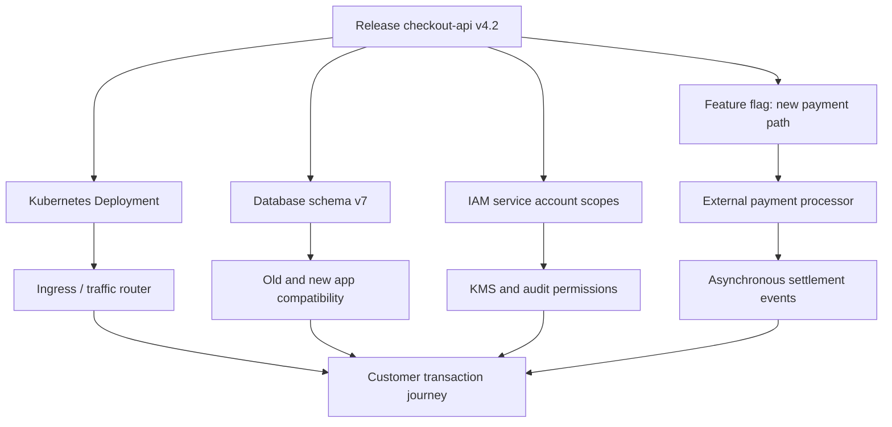
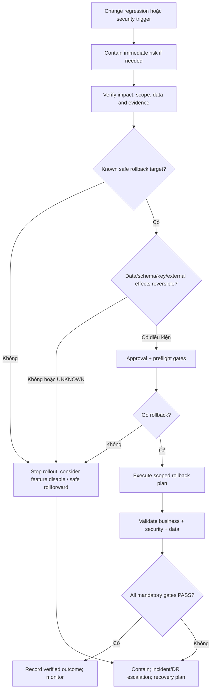

# Rollback change: Hoàn tác thay đổi có kiểm chứng để khôi phục trạng thái an toàn

## 1. Mục tiêu học tập

Sau bài học, người học có thể:

- Giải thích **rollback change** trong chương trình **change assurance**, phân biệt rollback, revert, rollforward, disable bằng feature flag, failover, restore và các hành động giảm thiểu tạm thời.
- Xác định **điều kiện nào khiến cần rollback**, dựa trên các security objectives, change risk, dấu hiệu suy giảm dịch vụ, bằng chứng từ monitoring và ngưỡng được phê duyệt; không chỉ dựa trên việc deployment báo lỗi.
- Thiết kế **rollback plan trước khi triển khai thay đổi**, nêu rõ điều kiện kích hoạt, trạng thái đích, phạm vi, owner, dependencies, thời gian thực hiện, nguy cơ và phương án khi rollback thất bại.
- Đánh giá **reversibility** đối với thay đổi ứng dụng, infrastructure as code, Kubernetes, database schema/data, IAM, khóa mã hóa, secrets, network, logging và hệ thống tích hợp.
- Giải thích vì sao **quay lại artifact cũ không đồng nghĩa khôi phục dữ liệu hoặc mức an toàn cũ**, đặc biệt khi có migration một chiều, side effects, credential revocation hoặc sự cố bảo mật.
- Thiết kế quy trình **GO/NO-GO**, phân quyền quyết định, rollback có thứ tự, kiểm tính nhất quán, security gates, khả năng quan sát và xác nhận hoạt động nghiệp vụ.
- Tạo **rollback assurance case** theo chuỗi **claim → control → test → evidence → assessment**, tách kết quả thực hiện rollback với kết luận rollback thành công có bằng chứng.
- Xây dựng **runbook, ma trận thử nghiệm, YAML rollback record** và cách thu thập bằng chứng trong các giai đoạn chuẩn bị, thực thi và hậu kiểm.
- Đánh giá **case study** về rollout gây lỗi tenant authorization và database schema compatibility, xác định phương án an toàn khi rollback tạo lại lỗ hổng cũ.
- Đo lường chất lượng rollback bằng các chỉ số thích hợp mà không biến “rollback nhanh” thành mục tiêu lấn át confidentiality, integrity và availability.

Bài thuộc chương **Change assurance** của dịch vụ `SECURITY_SECURITY_ASSURANCE`. Dịch vụ này tập trung xây dựng cách đánh giá **có bằng chứng** rằng hệ thống đáp ứng các mục tiêu bảo mật, từ phân tích rủi ro, yêu cầu và security controls đến kiểm thử, audit, khắc phục phát hiện, và tổ chức security assurance liên tục trong phát triển và vận hành.

Vì vậy, trọng tâm của bài không phải là học thuộc một lệnh “undo” cụ thể. Mục tiêu là hiểu **khi nào được hoàn tác, hoàn tác những gì, chứng minh những gì đã được khôi phục, rủi ro nào vẫn còn** và ai có trách nhiệm quyết định.

## 2. Rollback change là gì?

**Rollback change** là một hoạt động được kiểm soát nhằm **đảo ngược hoặc vô hiệu hóa một thay đổi đã triển khai** để đưa hệ thống về **trạng thái đích được chấp nhận**, khi thay đổi đó tạo ra hoặc có nguy cơ tạo ra hậu quả vượt ngưỡng cho phép.

Trạng thái đích không nhất thiết là **bản sao byte-for-byte của hệ thống trước triển khai**. Trong hệ thống phân tán, rollback có thể cần:
- Khôi phục phiên bản ứng dụng cũ nhưng giữ nguyên dữ liệu được ghi hợp lệ trong thời gian triển khai mới.
- Trả lại cấu hình network/IAM theo baseline đã được phê duyệt, đồng thời thu hồi credential hoặc session có nguy cơ.
- Vô hiệu một chức năng mới qua feature flag nhưng không thay đổi database schema.
- Dừng chuyển traffic tới release mới trong khi vẫn giữ các workload mới để phân tích bằng chứng.
- Chuyển sang một release **an toàn khác** chứ không quay lại bản có lỗ hổng bảo mật đã biết.

Ví dụ: release `checkout-api v4.2` gây lỗi authorization cho một đường truy cập. Đội vận hành cân nhắc quay về `v4.1`. Tuy nhiên, nếu `v4.1` đang có lỗi bảo mật nghiêm trọng đã được khắc phục trong `v4.2`, việc rollback về bản cũ có thể **khôi phục availability nhưng làm suy giảm confidentiality**. Quyết định phải cân nhắc **rủi ro tổng thể**, khả năng disable tính năng lỗi, hotfix/rollforward và các kiểm soát khẩn cấp.

### 2.1. Rollback không đồng nghĩa “đã an toàn”

Một thay đổi được báo là rollback thành công khi automation hoàn thành mới chứng minh được **hành động triển khai**. Để kết luận change assurance, cần kiểm:

1. Đã đạt **target state** được phê duyệt trên đúng assets?
2. Các thao tác có side effects đã được xử lý?
3. Dữ liệu có còn nhất quán và đúng quyền truy cập?
4. Những security controls bắt buộc có hoạt động?
5. Nghiệp vụ tối thiểu có phục hồi trong ngưỡng?
6. Monitoring, audit, alerting có đáng tin?
7. Có khoản rủi ro nào được chấp nhận tạm thời và ai phê duyệt?
8. Có bằng chứng đủ để **đóng rollback incident/change record** không?

**Rollback executed ≠ rollback verified ≠ risk resolved.**

## 3. Phân biệt các chiến lược khôi phục sau thay đổi

| Chiến lược | Làm gì | Khi phù hợp | Giới hạn quan trọng |
|---|---|---|---|
| **Rollback** | Trở về trạng thái/phiên bản đích đã duyệt | Release gây regression, cấu hình sai, triển khai không đạt gate | State/data có thể không tự trở lại |
| **Revert** | Tạo thay đổi mới đảo ngược commit/cấu hình trước đó | Git/IaC, config được quản lý bằng version | Revert source không đủ chứng minh runtime đã đổi |
| **Rollforward** | Sửa lỗi bằng phiên bản/hotfix kế tiếp | Bản cũ không an toàn hoặc data schema không còn tương thích | Cần kiểm thử và kiểm soát rủi ro thay đổi mới |
| **Feature disable / kill switch** | Tắt đường chức năng bằng cơ chế đã thiết kế | Lỗi cô lập trong feature có thể bật/tắt | State writes, session hoặc external effects vẫn tồn tại |
| **Traffic shift** | Chuyển request sang pool/region/release khác | Blue-green, canary, multi-region | Sessions, data consistency, routing và capacity |
| **Failover** | Chuyển xử lý tới hệ thống dự phòng | Primary không đáp ứng, thảm họa hoặc outage | Đây là chuyển khả năng phục vụ, không tự đảo change |
| **Restore** | Khôi phục dữ liệu/artifact từ bản sao đã xác nhận | Mất/hỏng dữ liệu khi có backup đúng mục tiêu | Nguy cơ mất transaction, khóa, identity, data lineage |
| **Containment** | Cô lập tác động bảo mật hoặc giảm phơi lộ | Có nghi compromise, exfiltration hoặc privilege abuse | Không thay cho điều tra, eradication hoặc hồi phục |
| **Compensating action** | Giảm rủi ro tạm trong khi sửa/rollback | Không thể hoàn tác ngay mà vẫn phải vận hành | Cần phê duyệt, owner, expiry và evidence |

Một response plan có thể **kết hợp nhiều chiến lược**: tắt tính năng bằng flag để chặn đường rủi ro, chuyển traffic sang pool đã kiểm, sau đó rollforward bằng bản vá được nghiệm thu. Không nên ép mọi sự cố vào lệnh rollback về release gần nhất.

### 3.1. Rollback, rollback window và backout plan

- **Rollback window:** giai đoạn còn có khả năng hoàn tác an toàn trong điều kiện đã phân tích.
- **Backout plan:** trình tự, quyền, dependency và gate để đưa hệ thống về target state.
- **Point of no safe return:** mốc sau đó việc đảo ngược trực tiếp có thể gây mất dữ liệu, xung đột schema, mất khóa hoặc side effect không thể thu hồi.
- **Forward recovery:** khôi phục bằng hành động sửa tiếp khi đảo ngược không còn an toàn.

Một change request có mục “Rollback: deploy previous image” chưa đủ nếu release làm thay đổi database, IAM hoặc thông điệp ra bên ngoài.

## 4. Tại sao rollback là bài toán security assurance?

Change assurance cần xác minh một thay đổi **không phá vỡ mục tiêu bảo mật**, hoặc nếu phá vỡ thì có **cách giới hạn tác động và khôi phục một cách có kiểm soát**.

### 4.1. Ba thuộc tính CIA trong quyết định rollback

| Thuộc tính | Câu hỏi trước và sau rollback |
|---|---|
| **Confidentiality** | Bản trước có tái mở quyền đọc trái phép, public access, key exposure, token reuse hay lộ log không? |
| **Integrity** | Dữ liệu, giao dịch, cấu hình, event hoặc audit trail có bị ghi đè/mất/sai trình tự không? |
| **Availability** | Dịch vụ tối thiểu có hoạt động, capacity đủ, dependencies sẵn sàng và RTO có bị ảnh hưởng không? |

Cùng một rollback có thể **tăng availability nhưng giảm confidentiality**, hoặc **giảm latency nhưng mất dữ liệu**. Nếu chỉ kiểm health endpoint, tổ chức chưa chứng minh rollback đáp ứng security objectives.

### 4.2. Tư duy theo claim

Một claim mẫu:

> “Khi thay đổi làm suy giảm control bảo mật trọng yếu, tổ chức có thể khôi phục **trạng thái đã được phê duyệt** trên các thành phần và dữ liệu liên quan, có kiểm soát tác động, trong cửa sổ phục hồi mục tiêu và với bằng chứng xác nhận.”

Claim này cần được chia:
- **G1:** có phương án và thẩm quyền kích hoạt phù hợp.
- **G2:** trạng thái đích, dependencies và data constraints đã được xác định.
- **G3:** rollback được thực thi chính xác và đủ phạm vi.
- **G4:** business/service behavior và security controls được xác minh.
- **G5:** phát hiện tồn dư, audit/evidence, giao trách nhiệm và follow-up được thực hiện.

Một runbook tồn tại mới chỉ hỗ trợ **design readiness**; drill, observed state, approvals và real incident records cần thiết cho **operating effectiveness**.

## 5. Những thay đổi có và không thể rollback trực tiếp

Không phải mọi thay đổi đều thuận nghịch.

### 5.1. Phân loại reversibility

| Nhóm | Ví dụ | Rủi ro khi hoàn tác |
|---|---|---|
| **Stateless application binary** | Container image chạy API không lưu state cục bộ | Cũ/mới vẫn có thể không tương thích schema hoặc API |
| **Runtime configuration** | Rate limit, routing, timeout, feature flag | Cấu hình có tương tác giữa nhiều thành phần |
| **Infrastructure declarative** | IaC IAM, security group, load balancer | Diff/plan đảo có thể hủy tài nguyên hay quyền cần thiết |
| **Database schema** | Thêm/đổi/xóa cột, index, constraint | Old binary không đọc được schema mới hoặc mất dữ liệu |
| **Data migration** | Chuyển định dạng, sửa dữ liệu hàng loạt | Không thể tự tái tạo giá trị cũ sau biến đổi một chiều |
| **Identity/credential** | Rotate secret, revoke token, thay trust | Không được phục hồi credential đã lộ/chấm dứt vì an ninh |
| **Cryptographic key** | Rotate KMS key, key deletion policy | Sai key có thể làm dữ liệu không giải mã được |
| **Event/transaction** | Đã gửi email, đã thu tiền, đã phát event | External side effect không thể “undo” bằng deploy image |
| **Third-party integration** | API contract, webhook, vendor config | Đối tác có thể đã dùng dữ liệu hoặc policy mới |
| **Security control update** | Khắc phục lỗ hổng hoặc khóa quyền nguy hiểm | Quay lại bản trước có thể tái tạo vulnerability |
| **Destructive operation** | Xóa bảng, destroy resource, purge log | Cần restore/reconciliation; rollback không tự phục hồi |

### 5.2. Phân loại hành động trước khi triển khai

Mỗi thành phần thay đổi nên được gắn:
- `REVERSIBLE_AUTOMATED`: có kiểm chứng và kế hoạch rollback nhanh.
- `REVERSIBLE_WITH_PRECONDITIONS`: chỉ an toàn nếu schema, dữ liệu, capacity hoặc access đáp ứng điều kiện.
- `COMPENSATING_ACTION_REQUIRED`: không hoàn tác trực tiếp, phải sửa trạng thái bằng hành động khác.
- `IRREVERSIBLE_OR_UNKNOWN`: cần risk review, backup/restore plan và giới hạn rollout.

Không tự đánh dấu `REVERSIBLE` chỉ vì công cụ có nút “Rollback”. Khả năng công cụ **đảo manifest** không đồng nghĩa **đảo mọi tác động nghiệp vụ**.

## 6. Bắt đầu bằng baseline và target state

Muốn rollback đúng cần biết **đang ở đâu, đã thay đổi gì và muốn tới đâu**.

### 6.1. Những dạng baseline

- **Business baseline:** những hành trình nghiệp vụ phải hoạt động, SLA/SLO và minimum service.
- **Security baseline:** controls về IAM, network, logging, encryption, secrets, runtime hardening và data protection.
- **Release baseline:** version, image digest, SBOM/attestation nếu áp dụng, artifact provenance.
- **Infrastructure baseline:** IaC revision, state, asset inventory, cloud account/region.
- **Data baseline:** schema version, migration level, transaction integrity, replication và backup context.
- **Risk baseline:** những threat scenarios, ngoại lệ, findings và residual risks đã được phê duyệt.
- **Observability baseline:** audit/source coverage, detectors, dashboards, canaries, data-quality thresholds.

### 6.2. Target state phải có ID và tiêu chí xác minh

Ví dụ:

> “Chuyển `checkout-api` từ release `rel-2026-11-28-b` về `rel-2026-11-28-a` trên các production clusters được liệt kê; giữ schema ở bản tương thích với cả hai release; giới hạn traffic ở mức được phê duyệt; xác nhận không có cross-tenant access, không mất giao dịch đã acknowledged và security audit tiếp tục ghi.”

Đây là **target state được mô tả**, chưa là bằng chứng đã đạt. Có thể cần nhiều điều kiện target song song, không chỉ một commit SHA.

### 6.3. Rollback target phải vẫn được phép sử dụng

Một bản cũ có thể:
- Có CVE chưa vá hoặc lỗi authz nghiêm trọng.
- Dùng cipher/protocol bị baseline cấm.
- Dùng khóa/secret đã bị thu hồi.
- Không tương thích schema hoặc event format hiện tại.
- Chưa được ký hoặc bị thu hồi provenance.
- Hết vòng đời hỗ trợ.
- Phụ thuộc vendor API đã thay đổi.

Khi đó phương án rollback trực tiếp có thể **NO-GO**, ưu tiên fail-safe containment, feature kill switch hoặc rollforward an toàn theo quyết định đã duyệt.

## 7. Change impact analysis trước khi viết rollback plan

**Change impact analysis** xác định thành phần nào bị thay đổi trực tiếp và những thành phần nào chịu tác động dây chuyền.

### 7.1. Ma trận cần khảo sát

| Chiều | Câu hỏi kiểm |
|---|---|
| Application | Những services, endpoints, jobs, flags, API contracts nào thay đổi? |
| Data | Schema, data migration, caches, queues, replicas, exports đã ghi gì? |
| Identity | Roles, grants, tokens, trust policies, federation có thay không? |
| Network | Routes, firewall, ingress/egress, DNS và TLS termination? |
| Cryptography | KMS policy, encryption state, certificates và key versions? |
| Observability | Logging, alerts, collectors, dashboard, detector rules có đổi? |
| Deployment | GitOps/IaC controller, artifacts, namespace/region, rollback history? |
| External systems | Vendor callbacks, payment events, webhooks, async consumers? |
| Security | Baseline, findings, exceptions, vulnerability fixes và attacker capabilities? |
| Business | User journeys, revenue/transaction state, SLA/SLO, peak load? |
| Recovery | Backup, restore, RTO/RPO, dependency order và failback? |
| Governance | Owner, approval, change window, notification, audit requirements? |

### 7.2. Dependency graph



Sơ đồ là minh họa. Nếu chỉ quay lại Deployment mà không xét schema, feature flags, payment events và IAM, có thể tạo một hệ thống **khởi động thành công nhưng xử lý giao dịch sai**.

## 8. Trigger rollback: Khi nào cần hành động?

Điều kiện rollback nên được định nghĩa **trước deployment**, có metrics, thresholds, phạm vi và người chịu trách nhiệm.

### 8.1. Các nhóm trigger

| Nhóm trigger | Ví dụ | Cách xác minh |
|---|---|---|
| **Security regression** | Unauthorized cross-tenant access, log disabled, IAM broadened | Negative tests, effective IAM, alert/incident confirmation |
| **Data integrity** | Incorrect balances, duplicate processing, schema incompatibility | Reconciliation, invariants, error traces |
| **Availability/SLO** | Error rate/latency vượt ngưỡng đã duyệt sau rollout | SLI/SLO và cohort canary |
| **Deployment health** | CrashLoop, readiness failure, bad image provenance | Runtime observed state, artifact checks |
| **External integration** | Payment/webhook contract break | End-to-end synthetic/real transaction verification |
| **Compliance/contract** | Control bắt buộc không được đáp ứng | Requirement mapping và compliance review |
| **Insufficient evidence** | Telemetry mất khiến không thể xác nhận an toàn | Pipeline/source health; có thể dừng rollout trước |
| **Incident containment** | Change mở đường khai thác cần cô lập | Incident command và security response |
| **Change window breach** | Quá thời gian cho phép mà chưa đạt gates | Approved change window, risk decision |

### 8.2. Không lấy một alert nhiễu làm điều kiện tự động vô điều kiện

Một alert đơn lẻ có thể là false positive. Với trigger không khẩn cấp, cần đánh giá **độ tin cậy**, correlation và tác động thật. Ngược lại, **bằng chứng rõ về data exposure hoặc privilege escalation nghiêm trọng** có thể phải kích hoạt containment ngay, không chờ một ngưỡng trung bình theo 15 phút.

Một trigger tốt nêu **mức chắc chắn và mức khẩn cấp**:
- `AUTOMATED_ABORT`: ngưỡng kỹ thuật rõ và có rủi ro thấp khi dừng rollout.
- `HUMAN_REVIEW_REQUIRED`: dấu hiệu mơ hồ hoặc ảnh hưởng stateful systems.
- `SECURITY_EMERGENCY`: nghi xâm nhập nghiêm trọng; chạy incident runbook, không đơn giản tự rollback.
- `HOLD_DEPLOYMENT`: data-quality/telemetry gap không cho phép đánh giá outcome.

## 9. Stop/rollback/rollforward: Decision gate có kiểm soát

Không phải trigger nào cũng nên dẫn đến rollback. Cần một bước quyết định bảo đảm rollback **không gây hậu quả tệ hơn**.

### 9.1. Bộ câu hỏi GO/NO-GO

1. Dịch vụ/cảnh báo đang có **tác động gì** và nguyên nhân đã đủ tin chưa?
2. Nếu giữ change hiện tại, rủi ro trong vài phút/giờ tới là gì?
3. Rollback target có lỗ hổng bảo mật hoặc thiếu security control đã biết không?
4. Schema/data hiện tại có tương thích với artifact cũ không?
5. Đã có transaction/event/secret/key **không thể đảo** chưa?
6. Có thể **disable feature**, giảm traffic hoặc cô lập component để giảm rủi ro ngay không?
7. Ai có quyền phê duyệt trong change thường, emergency change hoặc incident response?
8. Có đủ access, người trực, capacity và evidence source để kiểm sau rollback?
9. RTO/RPO và business impact budget có bị vượt nếu thực hiện rollback không?
10. Nếu rollback thất bại, phương án tiếp theo là gì, ai điều phối?
11. Có cần **legal/compliance/privacy** tham gia vì data exposure hoặc nghĩa vụ hợp đồng?
12. Quyết định có được ghi thành record với rationale và thời gian không?

### 9.2. Decision tree



**Không chạy rollback nguy hiểm chỉ vì một nhãn “AUTO”**. Cần giới hạn blast radius và các hành động tự động chỉ với nhóm thay đổi được chứng minh reversible, có khả năng quan sát và có safety guardrails.

## 10. RACI, quyền thực thi và emergency approval

Một rollback thường diễn ra khi hệ thống đang suy giảm. Việc không rõ ai quyết định dễ khiến nhiều nhóm thao tác cùng lúc, làm trầm trọng thêm sự cố.

| Vai trò | Trách nhiệm |
|---|---|
| **Change owner** | Cung cấp mục tiêu, release, diff, rollback plan, phạm vi |
| **Release/deployment operator** | Điều phối thực thi theo runbook được phê duyệt |
| **SRE/platform** | Đánh giá availability, traffic, capacity, rollback runtime |
| **Application owner** | Đánh giá business journeys, compatibility và API behavior |
| **Data/DB owner** | Xác minh migration, backup, data integrity và replay |
| **Security/control owner** | Đánh giá security baseline, authz, IAM, crypto, logging |
| **Incident commander** | Khi thành incident, điều phối và ưu tiên containment |
| **Business risk owner** | Chịu trách nhiệm chấp nhận residual risk đúng thẩm quyền |
| **Compliance/legal/privacy** | Đánh giá nghĩa vụ phát sinh khi liên quan dữ liệu/quy định |
| **Independent assurance reviewer** | Đánh giá evidence và kết luận rollback verified |
| **Approver / change authority** | Phê duyệt GO/NO-GO hoặc emergency path theo policy |

### 10.1. Tránh song trùng quyền thao tác

Trong tình huống khẩn cấp, mọi người có thể có ý tốt: một nhóm rollback image, một nhóm revert IAM, một nhóm restore DB. Nếu không phối hợp, sẽ gây **race, schema mismatch, duplicate processing và evidence contamination**.

Cần một kênh chỉ huy, timeline có mốc, **operation lock/coordination**, người chỉ định từng bước và **single source of truth** cho trạng thái.

### 10.2. Break-glass có kiểm soát

Nếu phải dùng quyền khẩn cấp:
- Xác nhận điều kiện kích hoạt và người có thẩm quyền.
- Giới hạn scope/thời gian.
- Ghi actor, target, hành động, dấu vết audit.
- Thu hồi quyền hoặc session sau khi hoàn tất.
- Review hậu kiểm đối với hành động vượt luồng chuẩn.

Không giữ tài khoản admin đặc quyền vô thời hạn chỉ vì rollback từng cần nó.

## 11. Chuẩn bị trước thay đổi: Rollback readiness

Rollback tốt được chuẩn bị **trước khi change đi vào production**.

### 11.1. Danh mục bắt buộc cho change rủi ro cao

- [ ] Target release/config có provenance, version, digest và đã qua security policy.
- [ ] Current release/config snapshot được lưu, nguồn có thể xác minh.
- [ ] Data schema version và compatibility matrix đã được kiểm.
- [ ] Backup/restore, key accessibility, data integrity và recovery window đã được đánh giá.
- [ ] Dependencies được liệt kê: upstream, downstream, queues, caches, vendors.
- [ ] Rollback triggers, SLI/SLO và hard security gates được phê duyệt.
- [ ] Người trực, quyền thao tác, thông báo và owner có mặt.
- [ ] Runbook đã được thử trong môi trường đại diện; các bước nguy hiểm có review.
- [ ] Telemetry, audit, canary và synthetic tests hoạt động.
- [ ] Có fallback nếu rollback dở dang hoặc timeout.
- [ ] Change/incident/exception records và approval workflow sẵn sàng.
- [ ] Rủi ro khi **quay lại vulnerability cũ** đã được đánh giá.

### 11.2. Kiểm rollback artifact

Không nên tin một tag mutable như `latest` hoặc `previous` để xác định bản an toàn. Cần dùng artifact có **immutable digest**, source repo commit, provenance và control test results. Nếu build lại cùng version nhưng dependencies đã đổi, đó có thể **không còn là cùng artifact**.

### 11.3. Phân biệt rehearsal với production assurance

Một drill rollback trong staging hỗ trợ **readiness** nhưng không tự chứng minh production sẽ đạt: production có dữ liệu lớn, traffic, IAM, network, DNS, external payment và keys khác. Phải nêu rõ những khác biệt và kiểm production-safe theo cách được phê duyệt.

## 12. Rollback trong CI/CD và GitOps

Với GitOps, trạng thái mong muốn thường được quản lý trong repository, còn controller tự đồng bộ runtime. Việc chỉnh runtime thủ công có thể **bị controller ghi đè**.

### 12.1. Nguyên tắc với declarative deployment

1. Xác định repository/source và revision đang quản lý deployment.
2. Xác định **desired rollback revision**, không chỉ image tag.
3. Dùng change process có audit để revert/đổi cấu hình tại nguồn đã phê duyệt.
4. Kiểm GitOps controller có sync đúng revision và **không lặp lại change lỗi**.
5. Xác minh effective runtime state, không dừng ở Git merge.
6. Kiểm control tests/telemetry và business behavior.
7. Ghi commit/revision/digest trước và sau rollback.
8. Nếu emergency imperative change được cho phép, phải **reconcile source of truth** sau sự cố và ghi hậu kiểm.

### 12.2. Vì sao “git revert” chưa đủ?

`git revert` tạo một commit đảo thay đổi nguồn (theo cách Git thực hiện). Nhưng:
- Pipeline có thể chưa chạy hoặc thất bại.
- Artifact registry có thể thiếu bản tương ứng.
- Controller có thể chưa sync đúng.
- Migration dữ liệu đã xảy ra và không bị revert.
- Secrets/keys trong external store chưa đổi.
- Feature flags nằm ngoài Git có thể vẫn bật.
- External vendor đã nhận event hoặc API contract mới.

Do đó:
**Source state → deployment state → runtime state → security/data/business validation** là những bước tách biệt.

### 12.3. Dấu vết tối thiểu

Record nên lưu:
- `source_revision_before` và `source_revision_target`.
- `artifact_digest_before` và `artifact_digest_target`.
- `deployment_run_id`, `controller_sync_status`.
- `runtime_observed_revision`.
- `post_rollback_test_ids` và kết quả.
- `operator/approver` và timestamps.

## 13. Rollback ứng dụng stateless và triển khai từng phần

Với service **không giữ state bền vững trong instance**, rollback image thường dễ hơn, nhưng vẫn cần kiểm compatibility.

### 13.1. Blue-green và canary

| Phương pháp | Cách hạn chế rủi ro | Rollback thường diễn ra thế nào | Điều cần kiểm |
|---|---|---|---|
| **Blue-green** | Hai môi trường release song song | Chuyển traffic về pool cũ | Session, capacity, schema và routing |
| **Canary** | Chỉ một phần traffic đến release mới | Ngừng tăng traffic/chuyển canary về stable | Cohort/risk segmentation và telemetry |
| **Rolling update** | Thay pods/instances từng phần | Triển khai revision trước theo runbook | Mixed-version compatibility, readiness |
| **Feature flag** | Giới hạn chức năng trong cùng release | Tắt flag theo scope | Side effects trước khi tắt và flag propagation |
| **Shadow traffic** | So sánh hành vi không ảnh hưởng response chính | Dừng shadow path | Không cho phép shadow writes/PII leak trái policy |

### 13.2. Canary metrics không được che security failures

Một canary có 1% traffic có thể chưa thấy lỗi nghiệp vụ hiếm. Nhưng một **confirmed cross-tenant data leak** trên canary không thể bị làm mờ vì 99% traffic ổn. Cần hard gates cho:
- Authorization/identity.
- Sensitive data handling.
- Transaction/data invariants.
- Audit source coverage.
- Artifact provenance và vulnerability controls quan trọng.

### 13.3. Session và sticky routing

Nếu người dùng có session state hoặc giao dịch qua nhiều request, chuyển traffic tức thời về stable release có thể làm lỗi:
- Session token claim format.
- Cache/schema/session serialization.
- Long-running request.
- WebSocket, streaming consumer, queue workers.
- Distributed transaction và idempotency.

Cần **drain/quiesce** theo thiết kế có phê duyệt, hoặc dùng schema/protocol tương thích. Không cố “kill all” thiếu kiểm soát trong hệ thống xử lý giao dịch quan trọng.

## 14. Rollback Kubernetes: Đúng revision và đúng desired state

Kubernetes hỗ trợ cơ chế quản lý revision của một số workload, nhưng **khả năng undo Deployment không đồng nghĩa khôi phục mọi resources và state**.

### 14.1. Những thứ có thể thay đổi ngoài image

- Deployment/ReplicaSet, StatefulSet và Jobs/CronJobs.
- ConfigMap, Secret references, admission policies.
- Service, Ingress/Gateway, DNS và network policies.
- ServiceAccount, RBAC, pod security settings, sidecars.
- PVC/storage classes và volume snapshots.
- CRDs/controllers và conversion webhooks.
- HPA, autoscaling, quotas, resource limits.
- Audit, tracing và log collectors.

### 14.2. Các lệnh quan sát an toàn để lập evidence

Ví dụ chỉ đọc trạng thái trong namespace đã được cấp quyền:

```bash
# Đọc workload và revision; không thực thi rollback.
kubectl get deployment checkout-api -n production -o wide
kubectl rollout history deployment/checkout-api -n production
kubectl get pods -n production -l app=checkout-api -o wide
kubectl get service checkout-api -n production
kubectl get networkpolicy -n production
```

Đây là **ví dụ cho môi trường được ủy quyền**; tên namespace và workload là giả lập. Dữ liệu YAML/JSON trả về có thể chứa cấu hình nhạy cảm, cần hạn chế chia sẻ và không xuất raw secrets vào báo cáo.

### 14.3. Khi nào Deployment undo chưa đủ?

- Image cũ không hỗ trợ schema mới.
- GitOps controller đồng bộ lại revision lỗi.
- Admission policy mới chặn bản cũ hoặc bản cũ không đáp ứng policy.
- CRD schema đã được nâng; controller/version cũ không đọc được object mới.
- Database, queue hoặc vendor API đã thay đổi.
- StatefulSet có data/PVC state không thể đảo tự động.
- Image cũ có security vulnerability nghiêm trọng.
- Các Pods báo Ready nhưng business/security tests không đạt.

Vì thế runbook nên chỉ ra **đúng cơ chế rollback được phê duyệt**, không đưa một lệnh `kubectl rollout undo` làm câu trả lời chung cho mọi change.

### 14.4. Đặc biệt với controllers

Một CronJob, Operator hoặc GitOps controller có thể tái tạo trạng thái không mong muốn. Phải kiểm **nguồn tái tạo**, không chỉ xóa một Pod. Nếu rollback làm thay admission/RBAC, cần kiểm **effective security posture** của workloads sau khi ổn định.

## 15. Rollback Infrastructure as Code và cloud configuration

IaC giúp giữ lịch sử desired state, nhưng đảo một thay đổi có thể gây **delete/recreate**, data loss hoặc drift lớn.

### 15.1. Cần xem plan trước khi áp dụng

Một rollback IaC an toàn cần kiểm:
- Tập resources bị thêm/sửa/xóa.
- Có resource nào chứa state: database, bucket, key, persistent volumes?
- Có rename/replace làm thay resource ID, endpoint hoặc quyền?
- Có thay đổi network path, WAF, firewall, access lists?
- State file và locking có đáng tin, có drift ngoài IaC?
- Có policy khác hoặc automation quản lý cùng resource?
- Có backup và khả năng restore nếu plan chứa destructive step?
- Có tài nguyên/permission mới phát sinh trong rollout vừa qua không?
- Có nguy cơ rollback làm tái mở public exposure hoặc privileged grants?

### 15.2. Revert desired state không thay thế effective-state check

Ví dụ một security group trước thay đổi đã mở egress toàn internet; change mới giới hạn egress nhưng làm app mất kết nối. Revert về security group cũ có thể khôi phục availability **bằng cách tái mở exposure**. An toàn hơn có thể là rollforward bằng rule hẹp cho endpoint cần thiết. Phải đánh giá **control objective** chứ không coi bản trước là mặc nhiên an toàn.

### 15.3. Cloud IAM và policy versioning

Một policy được revert ở IaC có thể không thu hồi:
- Session token đã phát hành.
- STS role assumptions còn hiệu lực theo semantics nền tảng.
- OAuth delegated permissions bên thứ ba.
- Group membership trong IdP khác.
- Keys được tạo hoặc secrets bị lộ.
- Alternate trust paths.

Cần xét effective access và token/session lifecycle trước khi kết luận rollback cloud access đã đạt baseline.

## 16. Database schema: Rollback có thể làm hỏng tương thích

Database là nơi nhiều rollback thất bại vì ứng dụng cũ **không tương thích dữ liệu đã ghi theo schema mới**.

### 16.1. Ví dụ migration không thể đảo trực tiếp

`v1` lưu `customer_name` trong một cột; `v2` tách thành `given_name` và `family_name`, đồng thời xóa cột cũ. Sau vài giờ `v2` đã ghi dữ liệu. Quay về app `v1` có thể:
- Không tìm thấy cột `customer_name`.
- Không biết cách ghép tên chính xác khi người dùng có tên nhiều thành phần.
- Thấy dữ liệu chưa được migrate ngược.
- Ghi vào schema không tương thích với các workers còn ở `v2`.

Việc triển khai lại binary `v1` **không đảo được biến đổi dữ liệu**, đặc biệt nếu transformation mất thông tin.

### 16.2. Expand–migrate–contract

Một chiến lược giúp giảm rủi ro:

1. **Expand:** thêm schema mới theo cách vẫn tương thích ứng dụng cũ.
2. **Deploy compatible app:** ứng dụng có thể đọc/ghi theo trạng thái chuyển tiếp có kiểm soát.
3. **Migrate/backfill:** chạy migration có checkpoint, integrity validation.
4. **Switch reads/writes:** thay đổi đường xử lý theo gates, giữ dữ liệu tương thích cần thiết.
5. **Observe:** kiểm lỗi, so dữ liệu, kiểm quyền và performance.
6. **Contract:** chỉ xóa schema cũ khi hết rollback window và đã xác nhận không còn consumer cần nó.

Tuy nhiên, expand–contract **không tự bảo đảm an toàn**: dual-write có thể sai thứ tự, backfill có race, constraint mới có thể tạo sai dữ liệu và việc giữ cột cũ có thể làm tăng privacy exposure. Cần design review và test phù hợp.

### 16.3. Backward/forward compatibility matrix

| App | Schema cũ S1 | Schema trung gian S1+S2 | Schema mới S2-only |
|---|---|---|---|
| `App v1` | Supported | Có thể supported nếu đã thiết kế | Thường không, nếu cột cũ đã xóa |
| `App v2-compatible` | Tùy code | Supported theo test | Có thể supported |
| `App v3` | Có thể không | Tùy code | Supported theo test |

Bảng là **khái niệm**, không phải đảm bảo cho một ứng dụng thực. Phải xác nhận bằng integration tests ở các cặp phiên bản có thể cùng tồn tại trong deployment/rollback.

### 16.4. Không rollback schema bừa bãi sau khi có writes mới

Nếu change đã chạy data migration và hệ thống tiếp tục ghi, **down migration** có thể xóa dữ liệu mới hoặc làm sai foreign keys. Nếu rollback không còn an toàn, chọn **rollforward/hotfix**, sử dụng feature flag hoặc restore có kiểm soát với **reconciliation của giao dịch** theo quyết định được phê duyệt.

## 17. State và giao dịch: Những điều một rollback ứng dụng không đảo được

Một release có thể đã tạo side effects:
- Phát payment request.
- Gửi email/SMS.
- Tạo hóa đơn hoặc gửi dữ liệu sang partner.
- Ghi event vào Kafka/queue.
- Thay entitlement, voucher, loyalty balance.
- Cập nhật cache/search index.
- Tạo object ở storage.
- Sinh token hoặc webhook subscription.

### 17.1. At-least-once và idempotency

Một message có thể đã được xử lý trước và sau rollback. Nếu consumers không có idempotency/ordering strategy, cùng một order có thể bị xử lý hai lần. Runbook cần biết:
- Những event IDs nào đã được publish/acknowledge.
- Consumer offsets/checkpoints đã đến đâu.
- Có dual-write hoặc processing song song không.
- Idempotency keys, deduplication window và retry semantics.
- Có cần tạm dừng producer/consumer an toàn không.
- Những giao dịch nào cần reconciliation hoặc compensating action.

### 17.2. Saga và compensating transactions

Trong hệ thống thanh toán, không thể “rollback commit” của một tổ chức tài chính bên ngoài bằng cách deploy app cũ. Có thể cần **compensation/refund/reconciliation** theo quy trình nghiệp vụ. Nhưng compensation có thể:
- Có phí, delay hoặc cần người phê duyệt.
- Không thể khôi phục mọi tác động đối với khách hàng.
- Tạo một giao dịch mới chứ không xóa bản ghi lịch sử.
- Yêu cầu audit/legal retention.

Đây là lý do cần phân biệt **rollback phần mềm** với **khôi phục trạng thái nghiệp vụ**.

### 17.3. Cache và background jobs

Cache có thể chứa dữ liệu/serialization của bản mới, khiến bản cũ đọc sai. Clearing cache có thể tốn thời gian và tạo load spike. Jobs đang chạy có thể ghi lại dữ liệu sau khi rollback; cần cơ chế fencing, version check hoặc drain thích hợp, không chỉ kill process.

## 18. Secrets, token, IAM và khóa mã hóa: Không quay lại trạng thái mất an toàn

Một số thay đổi liên quan bảo mật **không nên hoặc không thể đảo nguyên trạng**.

### 18.1. Secret rotation

Nếu credential bị nghi đã lộ và được rotate, rollback ứng dụng không được tự khôi phục secret cũ bị compromise. Cần:
- Kiểm bản rollback hỗ trợ secret mới hoặc cơ chế tương thích an toàn.
- Dùng secret reference/version có quản lý và hạn chế quyền.
- Đảm bảo token/session cũ đã được thu hồi theo semantics nền tảng.
- Không log secret plaintext khi kiểm.
- Không mở lại IAM grants rộng chỉ vì app cũ cần chúng.

### 18.2. KMS và encryption

Quay lại application release có thể khiến:
- App không đọc được dữ liệu đã mã hóa bằng key/version mới.
- Recovery region thiếu quyền dùng key.
- Dữ liệu bị re-encrypt nhưng metadata không tương thích.
- Key policy rollback lại cấp quyền không hợp lệ.
- Key destruction schedule không thể đảo theo cách dự định.

Cần key inventory, encryption context, compatibility tests và backup/restore readiness. **Không xóa hoặc vô hiệu hóa key** mà chưa kiểm khả năng giải mã dữ liệu còn cần.

### 18.3. Identity federation và SSO

Revert IdP/SSO policy có thể ảnh hưởng:
- Session đang hoạt động.
- Group sync chậm.
- MFA/conditional access bắt buộc.
- Break-glass pathways.
- Service-to-service tokens.
- Federated trust bên thứ ba.

Rollback một rule MFA mới gây lỗi đăng nhập không nên mặc nhiên chuyển sang chính sách yếu hơn. Có thể cần **scoped workaround, emergency access hạn chế, hotfix hoặc alternative policy** có risk approval.

## 19. Logging, detection và forensic evidence trong rollback

Đôi khi chính change làm hỏng **khả năng quan sát**. Rollback phải bảo vệ bằng chứng và không biến một điểm mù thành trạng thái PASS giả.

### 19.1. Những điều cần giữ

- Change request, release IDs, config diff và approval.
- Timeline trigger, alert, incident records, data source health.
- Audit events của rollback operator và automation.
- Immutable evidence về runtime trước/sau theo quyền và retention.
- Những logs phục vụ điều tra cause và containment.
- Detector rules/source versions và event ingestion lag.
- Kết quả xác minh end-to-end sau rollback.

### 19.2. Telemetry health là một gate

Nếu security logging bị tắt, “không còn cảnh báo” sau rollback **không chứng minh hệ thống an toàn**. Cần canary hoặc event kiểm chứng có kiểm soát, xác nhận event đến protected sink và detector/notification path hoạt động trong scope.

Nếu log đã mất trong một khoảng thời gian, rollback không tự tái tạo lịch sử; cần ghi **evidence gap** và quyết định điều tra/risk riêng.

### 19.3. Khi nghi có attacker đang hoạt động

Nếu change gây lộ đường truy cập và có dấu hiệu abuse:
1. Kích hoạt **incident response** theo severity và scope.
2. Bảo toàn evidence cần thiết trước các bước có thể làm mất dữ liệu.
3. Containment có thể cần thực hiện **ngay** để giới hạn thiệt hại.
4. Không chỉ rollback code mà bỏ các tokens, sessions, persistence, data exfiltration đã xảy ra.
5. Khôi phục service trên baseline an toàn và xác minh trước khi mở traffic.

**Rollback không thay thế eradication, forensic investigation hoặc breach assessment.**

## 20. Rollback, backup/restore và disaster recovery

Rollback và DR phục vụ các mục tiêu liên quan nhưng không đồng nhất.

- **Rollback:** đảo tác động của thay đổi theo target state có kiểm chứng.
- **Backup/restore:** khôi phục dữ liệu từ bản sao/cột mốc phù hợp.
- **DR/failover:** khôi phục năng lực nghiệp vụ sau gián đoạn lớn theo RTO/RPO.
- **Incident response:** containment, eradication và recovery sau sự cố bảo mật.

Một lỗi release có thể được xử lý bằng rollback ứng dụng trong 10 phút mà **không cần restore database**. Ngược lại, data corruption do migration có thể yêu cầu restore, reconciliation và DR-style business validation.

### 20.1. RTO/RPO trong quyết định

- **RTO:** mục tiêu thời gian cần phục hồi một mức dịch vụ nghiệp vụ được định nghĩa.
- **RPO:** mức mất dữ liệu chấp nhận được đo theo điểm phục hồi dữ liệu theo định nghĩa.
- **Rollback time:** thời gian từ quyết định/kích hoạt đến target state đã được xác minh, nếu chương trình định nghĩa như vậy.

Một rollback hoàn tất trong 5 phút nhưng làm mất 30 phút giao dịch có thể **vi phạm RPO**. Một restore DB nhanh nhưng ứng dụng/KMS/audit chưa hoạt động thì chưa chắc đạt **RTO của nghiệp vụ**.

### 20.2. Không restore cả database về snapshot cũ như một thao tác vô hại

Nếu một backup được chụp trước rollout, restore có thể **xóa transactions hợp lệ** phát sinh sau snapshot. Cần:
- Xác định safe restore point và dữ liệu đã acknowledged.
- Kiểm log-based recovery/PITR nếu nền tảng hỗ trợ.
- Reconcile với payment/queue/external systems.
- Xác minh integrity và double-processing.
- Review confidentiality, IAM, keys và audit sau restore.
- Phê duyệt risk và thông báo theo quy trình khi dữ liệu bị ảnh hưởng.

## 21. Kiểm thử rollback trước production và sau thay đổi

Khả năng rollback phải được **thử**, không chỉ mô tả trong runbook.

### 21.1. Ma trận kiểm thử mẫu

| Test ID | Điều cần kiểm | Expected | Evidence |
|---|---|---|---|
| `RB-01` | Rollback artifact tồn tại và hợp lệ | Digest/provenance đúng, không bị policy chặn | Registry/attestation/check |
| `RB-02` | Binary/schema compatibility | App stable đọc/ghi schema chuyển tiếp an toàn | Integration tests, migration state |
| `RB-03` | Rollback traffic | Router chuyển request về pool stable có giới hạn | Routing state, synthetic transactions |
| `RB-04` | IAM/security baseline | Không tái mở quyền quá rộng hoặc public path | Effective access + negative tests |
| `RB-05` | Secret/KMS compatibility | App phục vụ được với keys hợp lệ, không tái dùng compromised keys | Authorized decrypt/functional test |
| `RB-06` | Data integrity | Không mất/đúp giao dịch theo invariant | Reconciliation, checksums |
| `RB-07` | Async consumers | Queue/offset và idempotency đảm bảo | Message IDs, consumer checkpoints |
| `RB-08` | Audit/telemetry | Event tới sink, source coverage đủ | Canary, pipeline health |
| `RB-09` | Business journey | Checkout/order/login thực hiện đúng | Synthetic end-to-end test |
| `RB-10` | Resilience/rollback-failure path | Khi rollback không đạt, hệ thống vào trạng thái kiểm soát | Bài tập fail-safe và escalation |
| `RB-11` | Mixed-version operations | Blue/green, canary và workers không xung đột | Compatibility and replay tests |
| `RB-12` | Time budget | Khôi phục và kiểm chứng trong target phù hợp | Timestamped run log |

### 21.2. Dùng test data và environment được phê duyệt

Một bài rollback DRILL nên tránh dữ liệu khách hàng thật nếu không cần, giữ access scope, preflight/restore points và giới hạn blast radius. Nếu testing production thật sự cần thiết, phải có **change window, stakeholders, fallback và risk approval** theo quy trình.

### 21.3. “Rollback drill PASS” có giới hạn

Một drill trên staging không chứng minh trực tiếp:
- Capacity production.
- Key access production.
- Real external transactions.
- Customer data retention.
- Large database migration.
- Cloud account policy và region khác.

Nêu những khác biệt và kịch bản cần test bổ sung; không dùng một test nhỏ để khẳng định tất cả rollback paths đã được bảo đảm.

## 22. Quy trình rollback change có kiểm soát

Dưới đây là runbook khái niệm. Thao tác thực thi phụ thuộc hệ thống và phải dùng playbook **đã được phê duyệt**.

### Bước 1 — Triage trigger và bảo vệ ngay

Xác nhận event, ảnh hưởng và mức khẩn cấp. Nếu có data exposure hoặc security incident, ưu tiên containment, evidence preservation và incident command.

**Đầu ra:** trigger ID, severity, initial scope và người điều phối.

### Bước 2 — Stop/hold rollout

Dừng tăng traffic hoặc triển khai tiếp tới assets mới. Bảo đảm automation/controller không tiếp tục reapply release lỗi. Xác nhận trạng thái không thay đổi ngoài kế hoạch.

**Đầu ra:** rollout stopped/contained với evidence.

### Bước 3 — Chụp current state và timeline

Ghi artifact/config revisions, database schema, IAM/network, feature flags, queue lag, traffic, security events và tình trạng data source. Thu các bằng chứng cần thiết theo quyền trước khi thực thi bước có thể phá hủy dấu vết.

**Đầu ra:** pre-rollback snapshot và scope inventory.

### Bước 4 — Xác định safe target và dependency gate

Đối chiếu target release/baseline, tương thích schema/keys/API, data writes, side effects, policy/security vulnerabilities, capacity và backup. Nếu không đáp ứng, chọn phương án khác được phê duyệt.

**Đầu ra:** GO/NO-GO và alternative plan.

### Bước 5 — Phê duyệt và thông báo

Theo emergency/change authority phù hợp, ghi người quyết định, thời gian, rationale, risk, scope và liên hệ. Có người điều phối duy nhất khi nhiều hệ thống tham gia.

**Đầu ra:** decision record, contact list và operation ownership.

### Bước 6 — Thực thi theo thứ tự an toàn

Có thể gồm:
- Disable feature hoặc giảm traffic theo thiết kế.
- Quiesce/drain workload phù hợp.
- Revert/redeploy desired state và artifact đã duyệt.
- Giữ schema/data compatible; kiểm các migrations không thể đảo.
- Reconcile queues/sessions/external effects.
- Khôi phục IAM/security policy đúng baseline.
- Theo dõi từng bước và dừng nếu gate fail.

**Đầu ra:** action log, observed changes và blockers.

### Bước 7 — Xác minh kỹ thuật, bảo mật và nghiệp vụ

Chạy health, synthetic journeys, effective access, negative authorization tests, data reconciliation, audit canary, latency/error rates và rollback-specific assertions.

**Đầu ra:** PASS/FAIL/UNKNOWN từng test, evidence references.

### Bước 8 — Quyết định kết quả

Nếu mọi hard gate PASS: có thể chuyển `ROLLBACK_VERIFIED` trong phạm vi. Nếu vẫn FAIL/UNKNOWN: giữ `RECOVERY_IN_PROGRESS` hoặc `ESCALATED`, tiếp tục containment/rollforward/DR với owner. Không tuyên bố hoàn thành chỉ vì pipeline xanh.

**Đầu ra:** scoped assessment và remaining risks.

### Bước 9 — Chuyển giao và giám sát

Theo dõi canary, monitoring, change freeze có giới hạn, recurring alerts, job retries, token misuse và data consistency. Xác định khi nào được resume deployment.

**Đầu ra:** monitoring plan, owner, timeframe, escalation.

### Bước 10 — Post-change review và cải tiến

Tìm root cause, cập nhật test suite, rollback plan, risk register, policy-as-code, detection và evidence. Review vì sao trigger/decision/rollback có hoặc không đạt mục tiêu.

**Đầu ra:** lessons learned, preventive actions và re-test.

## 23. Các mốc trạng thái để không đánh dấu hoàn thành quá sớm

| Trạng thái | Định nghĩa thực hành |
|---|---|
| `ROLLBACK_READY` | Plan/target/evidence/test rõ, chưa thực thi |
| `ROLLBACK_TRIGGERED` | Có tín hiệu hoặc quyết định kích hoạt |
| `ROLLOUT_HELD` | Không tiếp tục phát tán thay đổi |
| `ASSESSING_REVERSIBILITY` | Đang kiểm tương thích và rủi ro đảo change |
| `ROLLBACK_APPROVED` | Đã có GO với phạm vi và thẩm quyền |
| `EXECUTING` | Đang làm các bước rollback |
| `EXECUTION_DONE` | Automation/thao tác triển khai đã kết thúc |
| `VALIDATING` | Đang kiểm business/data/security gates |
| `ROLLBACK_VERIFIED` | Đạt các criteria bắt buộc theo scope/kỳ |
| `VERIFICATION_FAILED` | Có gate FAIL, chưa khôi phục đủ |
| `UNKNOWN / EVIDENCE_GAP` | Không đủ nguồn dữ liệu để kết luận |
| `ESCALATED_TO_INCIDENT_OR_DR` | Đang áp dụng phương án ứng cứu/khôi phục khác |
| `CANCELLED_WITH_RATIONALE` | Quyết định không rollback vì phương án khác an toàn hơn |
| `CLOSED_WITH_FOLLOWUPS` | Hồ sơ vận hành được kết thúc, nhưng risk/finding follow-up giữ riêng |

Lưu ý: `EXECUTION_DONE` khác `ROLLBACK_VERIFIED`. Một hồ sơ có thể đóng về mặt hành chính mà vẫn có findings/risk riêng; phải giữ linkage để không làm rủi ro biến mất khỏi báo cáo.

## 24. Mẫu YAML rollback plan và record

YAML dưới đây là **mô hình dữ liệu giả lập**, không phải lệnh thực thi. Các nguồn `evidence://`, `release://`, `policy://` là tham chiếu minh họa. Trạng thái `PENDING` không chứng minh điều kiện được đáp ứng.

```yaml
rollback_id: ROLLBACK-2026-028
program: SECURITY_SECURITY_ASSURANCE
change_ref: CHG-2026-147
plan_version: "1.0"
scope:
  service_id: checkout-api
  environment: production
  clusters: [cluster-prod-a, cluster-prod-b]
  dependencies:
    - checkout-db
    - payment-gateway
    - cloud-kms
  owner: checkout-platform
release:
  current:
    release_ref: "release://checkout/v4.2"
    artifact_digest_ref: "registry://checkout/sha256-new"
  target:
    release_ref: "release://checkout/v4.1-safe"
    artifact_digest_ref: "registry://checkout/sha256-stable"
  rollback_target_security_review: PENDING
data:
  schema_current: "S1+S2"
  schema_target_compatibility: PENDING_VALIDATION
  irreversible_migrations_present: UNKNOWN
  backup_readiness: PENDING_VALIDATION
  transaction_reconciliation_owner: payment-platform
trigger:
  type: "Security authorization regression"
  incident_ref: INC-2026-081
  detected_at: "2026-11-28T09:00:00Z"
  evidence_refs: []
preflight:
  source_of_truth_checked: PENDING
  telemetry_healthy: PENDING
  target_not_vulnerable: PENDING
  identity_and_keys_safe: PENDING
  rollback_window_valid: PENDING
  external_effects_reviewed: PENDING
decision:
  status: NO_DECISION
  authority: change-emergency-approver
  decided_at: null
  rationale: null
execution:
  status: NOT_STARTED
  started_at: null
  ended_at: null
  change_run_ref: null
  operator: release-engineering
validation:
  tests:
    - id: RB-04
      assertion: "Effective authorization and IAM remain secure"
      expected: "No unauthorized cross-tenant read"
      observed: null
      status: NOT_TESTED
      evidence_refs: []
    - id: RB-06
      assertion: "Transactions and database remain consistent"
      expected: "No missing or duplicate acknowledged payment"
      observed: null
      status: NOT_TESTED
      evidence_refs: []
    - id: RB-08
      assertion: "Audit pipeline covers in-scope access actions"
      expected: "Approved audit canary reaches protected sink"
      observed: null
      status: NOT_TESTED
      evidence_refs: []
    - id: RB-09
      assertion: "Critical checkout journey works"
      expected: "Business acceptance gates pass"
      observed: null
      status: NOT_TESTED
      evidence_refs: []
  assessor: security-assurance
  assessment_status: UNKNOWN
  assessed_at: null
residual_risks: []
followup_findings: []
post_rollback:
  monitoring_window: "As defined in approved runbook"
  owner: checkout-sre
  release_resume_approval: PENDING
```

### 24.1. Mọi trường “PASS” cần nguồn đáng tin

Nếu thêm `validation.status: PASS`, phải có:
- Test assertion và expected/observed.
- Timestamp, environment, asset population và release.
- Evidence source, tool/query version, integrity và limitations.
- Reviewer hoặc decision path được phê duyệt.
- Không có hard gate FAIL/UNKNOWN trái ngược.

Không tự tạo ID evidence và tuyên bố đã kiểm nếu chưa có file/record thật.

### 24.2. Plan khác execution record

**Rollback plan** có thể được duyệt trước change; **execution record** chỉ tồn tại sau khi trigger và thao tác thực tế diễn ra. Nên giữ hai phiên bản/loại record hoặc tách sections rõ, không dùng default data “pass” trong template.

## 25. Evidence package cho rollback assurance

Một hồ sơ nên cho phép reviewer **tái lập được câu chuyện** về thay đổi và quyết định:

1. **Change identity:** request ID, risk tier, release versions, owners, thời gian.
2. **Initial baseline:** test và trạng thái đã phê duyệt trước rollout.
3. **Change diff:** code, IaC, IAM, DB, flags, network và external dependencies.
4. **Trigger evidence:** metric/alert/incident, timestamp, scope, data quality.
5. **Decision record:** lựa chọn rollback hay rollforward, rationale, authority.
6. **Preflight:** artifact provenance, schema compatibility, backups, keys, vulnerability check.
7. **Execution log:** actor/automation, actions, timestamps, outputs, failures, retries.
8. **Post-state:** runtime config, release digest, traffic routing, data schema và permissions.
9. **Tests:** business journeys, negative authz, data integrity, audit, recovery gates.
10. **Assessment:** PASS/FAIL/UNKNOWN, limitations, reviewer.
11. **Residual risk:** incidents, findings, exceptions còn mở với owner.
12. **Post-rollback monitoring:** kế hoạch, dữ liệu sau theo dõi, triggers.
13. **Lessons/revalidation:** sửa runbook/tests và kiểm lại trước lần release kế tiếp.

### 25.1. Bảo vệ evidence

Change logs có thể chứa endpoint nội bộ, cấu hình cloud, principal IDs, customer transaction samples hoặc token metadata. Evidence phải được:
- Phân quyền dựa trên vai trò và nhu cầu.
- Redact secrets và PII không cần.
- Lưu lịch sử có timestamps, immutable record nếu cần và retention phù hợp.
- Liên kết qua IDs thay vì sao chép raw production data vào slide.
- Bảo toàn nguồn khi có incident/forensic investigation.

### 25.2. Hai loại bằng chứng hay bị nhầm

- **Deployment success evidence:** cho biết công cụ đã hoàn thành thao tác.
- **Risk/security recovery evidence:** cho biết hệ thống đang đáp ứng các mục tiêu được kiểm.

Có loại thứ nhất mà thiếu loại thứ hai thì trạng thái phù hợp vẫn là `PENDING_VALIDATION` hoặc `UNKNOWN`.

## 26. Đo thời gian rollback và những chỉ số không nên đánh đồng

Để báo cáo có nghĩa, cần xác định mốc rõ:

- `t_trigger`: lúc điều kiện rollback được nhận diện.
- `t_decision`: lúc phê duyệt strategy.
- `t_start`: lúc bắt đầu các hành động rollback.
- `t_execution_end`: công cụ hoàn tất thao tác.
- `t_verified`: business/data/security gates được chấp thuận.
- `t_service_restored`: dịch vụ nghiệp vụ tối thiểu hoạt động theo tiêu chí.
- `t_followup_closed`: các findings/long-term actions đã xử lý.

### 26.1. Các phép đo khác nhau

| Chỉ số | Công thức theo mốc đã định nghĩa | Ý nghĩa |
|---|---|---|
| Decision latency | `t_decision - t_trigger` | Thời gian xác định phương án/authority |
| Execution duration | `t_execution_end - t_start` | Thời gian thao tác kỹ thuật |
| Verification duration | `t_verified - t_execution_end` | Thời gian xác minh sau thao tác |
| Time to verified rollback | `t_verified - t_trigger` | Thời gian đến trạng thái rollback được chứng minh |
| Time to service restored | `t_service_restored - t_trigger` | Thời gian phục hồi chức năng nghiệp vụ |
| Rollback drill success rate | Số drill đạt tất cả gates / số drill đủ điều kiện | Không chỉ đếm pipeline success |
| Reversion-induced incident rate | Số rollback gây incident mới / tổng rollback đủ điều kiện | Theo dõi rủi ro của chính rollback |
| Rollback readiness coverage | Changes có plan/drill phù hợp / changes cần plan | Design readiness, không phải effectiveness |
| Data integrity failure rate | Rollbacks có reconciliation FAIL / rollbacks được kiểm đủ | Cần báo UNKNOWN separately |
| Security control regression | Rollbacks làm security gate FAIL / tổng rollback đã kiểm | Tránh phục hồi bản cũ yếu |
| Unverified rollback aging | Thời gian ở trạng thái execution done nhưng chưa validated | Chống “green deployment” giả |

### 26.2. Ví dụ số học

Giả sử:
- Trigger lúc **10:00**.
- Decision **10:04**.
- Bắt đầu rollback **10:06**.
- Execution kết thúc **10:13**.
- Minimum checkout journey restored **10:16**.
- Security/data verification hoàn tất **10:24**.

Kết quả:
- Decision latency: **4 phút**.
- Execution duration: **7 phút**.
- Verification duration: **11 phút**.
- Time to service restored theo trigger: **16 phút**.
- Time to verified rollback theo trigger: **24 phút**.

Không báo “rollback 7 phút” rồi suy ra toàn dịch vụ đã an toàn trong 7 phút. Cần ghi mốc và **assurance window**.

### 26.3. Chỉ số phải có dữ liệu chất lượng

Nếu `t_verified` chưa tồn tại, không lấy `t_execution_end` thay thế. Nếu rollback chưa đạt security gate, **time to verified rollback là chưa xác định**, không phải bằng 0. Nếu incident được phát hiện retrospectively, phải lưu thay đổi thời điểm và restatement policy.

## 27. Ví dụ truy vấn kiểm soát trạng thái rollback

Giả sử hệ thống quản lý có các bảng:

- `rollback_runs(rollback_id, change_id, status, started_at, execution_end_at, verified_at, environment)`.
- `rollback_gate_results(rollback_id, gate_id, mandatory, result, checked_at)`.

Một truy vấn PostgreSQL **read-only minh họa** có thể tìm rollback đã hoàn thành thao tác nhưng **chưa đủ kết quả bắt buộc để được coi verified**:

```sql
WITH required_gates AS (
    SELECT
        rollback_id,
        gate_id,
        result,
        ROW_NUMBER() OVER (
            PARTITION BY rollback_id, gate_id
            ORDER BY checked_at DESC
        ) AS rn
    FROM rollback_gate_results
    WHERE mandatory = TRUE
),
gate_summary AS (
    SELECT
        rollback_id,
        COUNT(*) AS gate_count,
        COUNT(*) FILTER (WHERE result = 'PASS') AS passed_count,
        COUNT(*) FILTER (
            WHERE result IS DISTINCT FROM 'PASS'
        ) AS unresolved_count
    FROM required_gates
    WHERE rn = 1
    GROUP BY rollback_id
)
SELECT
    r.rollback_id,
    r.change_id,
    r.status,
    r.execution_end_at,
    r.verified_at,
    COALESCE(g.gate_count, 0) AS recorded_mandatory_gates,
    COALESCE(g.unresolved_count, 0) AS recorded_unresolved_gates
FROM rollback_runs AS r
LEFT JOIN gate_summary AS g
  ON g.rollback_id = r.rollback_id
WHERE r.execution_end_at IS NOT NULL
  AND (
    r.verified_at IS NULL
    OR COALESCE(g.gate_count, 0) = 0
    OR COALESCE(g.unresolved_count, 0) > 0
  )
ORDER BY r.execution_end_at DESC;
```

### 27.1. Giới hạn quan trọng

- Truy vấn chỉ biết những **gates đã được đăng ký**; không phát hiện gate bắt buộc bị bỏ hẳn khỏi bảng nếu thiếu registry of expected gates.
- Lấy latest test theo `checked_at`, cần tie-breaker `test_run_id` nếu timestamps trùng và các test results có nhiều phiên bản.
- `result = PASS` trong DB không tự chứng minh evidence hợp lệ; phải kiểm source, scope, reviewer và version.
- `verified_at` có thể bị điền nhầm bằng timestamp deployment; cần review quy trình tạo trường này.
- Một rollback đang `VERIFICATION_FAILED` có thể tiếp tục incident recovery theo policy; truy vấn không tự phê duyệt trạng thái.
- Không thay thế đối chiếu rollback target với security baseline hoặc phân tích data integrity.
- Không dùng kết quả truy vấn để bỏ qua approvals hay tự sửa production.

Một chương trình hoàn chỉnh cần kết hợp expected-gate registry, evidence QA, real-time data source health, scope inventory và independent assessment.

## 28. Case study: Rollback release gây lỗi tenant authorization

**Bối cảnh giả định:** một nền tảng SaaS triển khai `orders-api v2.7`. Release mới bổ sung cache optimization và đổi cách tạo cache key. Hệ thống dùng shared Redis và database nhiều tenant; chính sách bảo mật yêu cầu **tenant A không đọc được dữ liệu tenant B** qua API, export hoặc cache.

### 28.1. Sự cố

- `09:00`: rollout bắt đầu trên 10% traffic.
- `09:07`: synthetic test với tenant A/B phát hiện response cache có dữ liệu sai tenant trong một trường hợp.
- `09:08`: deployment pipeline được giữ, không tăng traffic tiếp.
- `09:10`: security on-call xác nhận một negative test có thể tái lập; mở incident, đánh giá data exposure.
- `09:12`: team nhận diện cache key `order_id` thiếu `tenant_id`.
- `09:14`: feature flag tắt cache path mới cho canary, kiểm response đã được chặn.
- `09:18`: cân nhắc rollback về `v2.6`.
- `09:20`: xác minh `v2.6` không có lỗ hổng đã biết liên quan và tương thích schema hiện hành; cache entries mới cần được cô lập/loại khỏi đường đọc theo procedure.
- `09:25`: change authority phê duyệt rollback có giới hạn sau preflight.
- `09:32`: traffic được định tuyến về release ổn định; workload version mới vẫn được giữ đủ logs theo incident handling.
- `09:39`: negative tests xác nhận các đường REST trong scope không có cross-tenant read; data reconciliation và audit coverage tiếp tục chạy.
- `09:48`: reviewer xác nhận các gates bắt buộc cho traffic đã được phục hồi; phần điều tra dữ liệu có thể đã bị lộ **vẫn đang mở**.

Đây là **timeline giả định để học**, không phải sự kiện thực tế hoặc quy trình bắt buộc cho mọi SaaS.

### 28.2. Vì sao “rollback v2.6” chưa đủ?

Có ít nhất năm vấn đề:

1. **Cache state:** các entries do v2.7 ghi có thể vẫn tồn tại và được v2.6 đọc theo đường không tương thích.
2. **Security exposure:** nếu dữ liệu từng được trả sai tenant, quay về bản cũ **không thu hồi dữ liệu đã bị đọc**.
3. **Background jobs:** export worker có thể vẫn dùng v2.7.
4. **Identity:** token/tenant binding phải được xác minh, không chỉ dựa vào cache fix.
5. **Scope:** public API test không bao phủ admin/export routes và data copies.

Vì thế **security incident assessment** và **rollback verification** là hai luồng có liên kết nhưng không được gộp thành một nút đóng.

### 28.3. Ma trận post-rollback

| Assertion | Test | Expected | Status giả định |
|---|---|---|---|
| REST read không lộ chéo tenant | Negative test A→B và B→A | Không trả dữ liệu sai tenant | PASS trong tập đã kiểm |
| Cache path không đọc entries cũ sai ngữ nghĩa | Kiểm versioned namespace và cache-invalidation procedure | Không có cross-tenant hit | PASS sau kiểm |
| Export jobs bảo toàn tenant isolation | Kiểm worker version và negative export test | Không có export chéo tenant | PENDING_VALIDATION |
| Production image đúng bản approved | Release digest và runtime inventory | Stable version trên toàn scope | PASS |
| Audit/monitoring hoạt động | Canary event end-to-end | Source coverage phù hợp | PASS cho sources đã kiểm |
| Tác động dữ liệu quá khứ | Incident investigation/data lineage | Xác định khả năng và phạm vi exposure | UNKNOWN |
| Database consistency | Invariants và reconciliation | Không mất dữ liệu hợp lệ | PASS trong transaction scope đã kiểm |

### 28.4. Kết luận có giới hạn

Một kết luận phù hợp:

> “Trong phạm vi public REST read traffic được kiểm, `orders-api` đã trở về release ổn định theo target, đường cache mới được vô hiệu và negative tests không còn tái hiện cross-tenant response. Tuy nhiên, export jobs vẫn chờ xác minh và phạm vi dữ liệu có thể đã bị lộ trước rollback đang điều tra. Vì vậy có thể xác nhận **rollback một phần được kiểm chứng theo scope**, nhưng **không được đóng incident hoặc tuyên bố toàn bộ tenant isolation đã được bảo đảm**.”

Reviewer chỉ nên gắn nhãn `ROLLBACK_VERIFIED` cho đúng scope nếu policy cho phép scoped verification; top-level security assurance vẫn chưa đạt khi các nhánh bắt buộc còn UNKNOWN.

## 29. Case study: Rollback database migration và giao dịch thanh toán

**Bối cảnh giả định:** `checkout v3` bổ sung cột `settlement_state` và publish thêm event cho payment processor. Sau rollout, một số orders bị gắn trạng thái sai, nhưng các payment confirmations đã được gửi sang hệ thống bên ngoài.

### 29.1. Những phương án cần so

| Phương án | Lợi ích | Rủi ro và điều kiện |
|---|---|---|
| Rollback app v2 ngay | Giảm lỗi logic mới | App cũ có hiểu schema/event mới không? |
| Restore DB snapshot trước release | Đưa DB về state trước thay đổi | Mất các transactions đã acknowledged sau snapshot |
| Disable new payment path | Cô lập logic lỗi nhanh | Phải kiểm queued events và writes đã phát sinh |
| Rollforward hotfix | Giữ schema/transaction history | Cần kiểm sửa đúng và không gây thêm regression |
| Compensating transactions | Sửa nghiệp vụ đã xảy ra | Refund/reconciliation có chi phí, audit, quyền |
| Failover sang DR | Khôi phục khả năng phục vụ | Replica có cùng dữ liệu lỗi; không chữa logic |

### 29.2. Quyết định hợp lý theo bối cảnh

Một tổ chức có thể:
1. Giữ rollout, tắt đường thanh toán mới an toàn.
2. Ngừng nhận traffic mới nếu không còn cách bảo vệ integrity.
3. Chụp trạng thái và bảo toàn evidence.
4. Đối soát payment IDs, idempotency keys, events và DB commits.
5. Xác định liệu app v2 còn tương thích với schema `S1+S2`.
6. Chọn hotfix/rollforward thay vì restore mất giao dịch.
7. Kiểm các giao dịch chưa hoàn tất và compensating actions cần thiết.
8. Chỉ resume sau khi data/business/security gates PASS.

Không có phương án “mặc định đúng”; mục tiêu là **không gây mất dữ liệu hoặc thanh toán trùng** khi tìm cách sửa một logic mới.

### 29.3. Bài học

Việc quay binary về v2 có thể tương đối nhanh, nhưng **phục hồi tính toàn vẹn giao dịch** có thể cần nhiều giờ và thêm quy trình ngoài hệ thống. Báo cáo phải tách thời gian execution khỏi thời gian dữ liệu/nghiệp vụ được xác minh.

## 30. Khi rollback làm tái xuất hiện lỗ hổng bảo mật

Đây là tình huống quan trọng trong **security change assurance**.

**Tình huống:** `v5.3` vá một lỗ hổng authorization nghiêm trọng, nhưng rollout gây tăng latency và một nhóm requests bị timeout. Bản `v5.2` từng có authorization flaw nên **không thể coi là safe rollback target**.

### 30.1. Không dùng availability làm lý do bỏ qua confidentiality

Một quyết định chỉ dựa trên “độ trễ tăng nên rollback” có thể đưa lỗ hổng đã biết trở lại production. Thay vào đó cần:
- Tạm dừng rollout và đánh giá mức độ lỗi.
- Giảm traffic hoặc disable tính năng không trọng yếu nếu có thể.
- Dùng canary/blue-green với security controls vẫn đảm bảo.
- Tạo hotfix/rollforward có verification.
- Nếu cần giải pháp tạm, áp dụng compensating controls với scope/time/owner và risk approval **nếu được phép**.
- Theo dõi exploit signals và các hệ quả bảo mật trong thời gian chuyển tiếp.

### 30.2. Nguyên tắc không đảo bảo vệ đã cần thiết

Không tự khôi phục:
- Vulnerable release đã bị chặn theo security policy.
- Credential/token nghi compromise.
- Public IAM/network access từng được thu hồi.
- Encryption/key policy không hợp lệ.
- Cơ chế audit đang bắt buộc mà release trước chưa hỗ trợ.
- Data retention hoặc privacy control đã cần áp dụng.

Nếu không có safe rollback, **không ép rollback**; chuyển sang **incident containment, emergency rollforward hoặc alternative recovery** được phê duyệt và có bằng chứng.

## 31. KPI/KRI và cách báo cáo chất lượng rollback cho lãnh đạo

Một báo cáo quản trị nên nêu **khả năng rollback**, **tác động thực tế**, **mức đủ bằng chứng** và **phần rủi ro tồn dư**.

### 31.1. Scorecard mẫu

| Miền | Metric hoặc câu hỏi | Cách hiểu |
|---|---|---|
| Readiness | % high-risk changes có rollback plan và đã rehearsal | Design readiness theo scope |
| Target safety | % rollback targets được đánh giá security baseline/compatibility | Không bảo đảm kết quả runtime |
| Execution | Time to execution done | Chưa phải verified recovery |
| Verification | % rollbacks đạt tất cả hard gates | Đo outcome có evidence |
| Data | Số rollbacks phải reconciliation hoặc gây data integrity issue | Phát hiện rủi ro stateful |
| Detection | % triggers được phát hiện và escalated đúng hạn | Yêu cầu source coverage đủ |
| Unknowns | Số rollbacks thiếu telemetry hoặc tests | Không được gộp PASS |
| Risk | Số rollback tái tạo vulnerability/finding | Cảnh báo lựa chọn target kém |
| Repeat problems | Changes phải rollback nhiều lần | Chất lượng release/testing trước triển khai |
| Recovery | Time to verified business restore và RTO/RPO alignment | Tập trung tác động nghiệp vụ |
| Governance | Emergency changes có approval/evidence/review phù hợp | Bảo vệ auditability |
| Remediation | Findings sau rollback có owner và re-test | Đảm bảo cải tiến liên tục |

### 31.2. Không tối ưu “rollback nhanh nhất”

Nếu một đội rollback image trong 2 phút nhưng bỏ qua data reconciliation, keys và authorization, metric tốc độ có thể rất đẹp nhưng tăng rủi ro. Lãnh đạo cần thấy:
- **N rollbacks và scope**.
- **Verified vs execution-only vs UNKNOWN**.
- **Data/security failure cases**.
- Thời gian rollback trong **các nhóm hệ thống tương đương**.
- Nguyên nhân và hành động sau sự cố.
- Các ngoại lệ/risk approvals còn mở.

### 31.3. Dữ liệu mẫu, không phải kết luận thật

Giả sử kỳ này có 12 rollbacks:
- 7 đã kiểm đủ business/data/security gates PASS.
- 2 chỉ mới execution done, chưa revalidate.
- 2 gặp data/compatibility FAIL và đang recovery.
- 1 được hủy để chọn safe rollforward.

Không báo “11/12 rollback thành công” bằng cách gộp 7 PASS + 2 unverified + 2 FAIL. Kết luận rõ hơn: **7 verified, 2 pending, 2 failed/recovering, 1 safe alternative chosen**, với risk severity, owner và hạn từng nhóm. Các con số chỉ để học phương pháp.

## 32. Bài tập thực hành: Rollback change có kiểm chứng

**Tình huống:** một doanh nghiệp triển khai release `checkout-api v4.2` qua canary 20%. Release thay:
- Authorization middleware và group mapping.
- Database schema `S1→S1+S2`.
- Feature flag `payment_fast_path`.
- Một IAM role của service account.
- Event format gửi payment gateway.
- Logging collector tại một production cluster.

Trong vòng 15 phút phát hiện error rate tăng và một synthetic tenant-isolation negative test thất bại. Change owner đề xuất một lệnh rollback Deployment. Danh mục bằng chứng ban đầu:

| Mã | Quan sát |
|---|---|
| A | Bản stable `v4.1` vẫn có artifact digest và pipeline record |
| B | `v4.1` từng có finding về quyền đọc rộng, chưa có evidence được sửa |
| C | Database đã ghi dữ liệu vào cột mới `settlement_state` |
| D | Đã publish 150 events cho payment processor |
| E | Feature flag có kill switch đã được kiểm trên staging, chưa kiểm production |
| F | GitOps vẫn trỏ desired revision `v4.2` |
| G | Một cluster production chưa gửi audit tới central sink |
| H | Team IAM đã đổi policy, nhưng access tokens cũ còn hiệu lực |
| I | Backup snapshot có trước release, nhưng sau đó có giao dịch được acknowledged |
| J | Platform reports Deployment undo có thể hoàn tất trong vài phút |
| K | SRE đã thử healthy endpoint của `v4.1`, chưa test critical checkout journey |
| L | Người có thẩm quyền emergency change đang trực; business owner yêu cầu không mất giao dịch |

### 32.1. Nhiệm vụ

1. Phân biệt **trigger**, **symptom**, **confirmed impact**, **security incident** và **scope/data gaps** từ A–L.
2. Liệt kê ít nhất **8 điều kiện preflight** trước khi quyết định rollback/rollforward.
3. Giải thích vì sao **không nên tự rollback về v4.1** nếu B chưa được giải quyết.
4. So sánh **feature disable**, **traffic shift**, **rollback app**, **safe rollforward** và **DB restore** theo CIA, thời gian, compatibility và risk.
5. Với C và I, nêu lý do không được tự down-migrate hoặc restore snapshot cũ.
6. Với D, thiết kế danh sách cần reconciliation: event IDs, payment IDs, idempotency keys, acknowledgment state, retries.
7. Với E/F, nêu cách bảo đảm source of truth không tái triển khai revision lỗi và cách kiểm flag ở runtime.
8. Với G, xác định data-quality limitation và điều kiện khôi phục audit coverage.
9. Với H, thiết kế kiểm effective IAM, token/session, key/secret và negative tests.
10. Với K, đề xuất ít nhất **5 business/security gates** đủ để quyết định resume traffic.
11. Thiết kế một **GO/NO-GO decision record** có lựa chọn, lý do, authority, risk, phạm vi và mốc.
12. Soạn một YAML rollback plan với current/target release, schema compatibility, dependencies, tests, evidence refs và trạng thái PENDING hợp lệ.
13. Vẽ sequence hoặc dependency graph của API–DB–queue–gateway–IAM–logging để nhận diện thứ tự kiểm.
14. Đề xuất một **rollback failure path** khi service phiên bản cũ không thể giải mã dữ liệu bằng key mới.
15. Cho timeline trigger 10:00, decision 10:04, start 10:06, execution done 10:13, business restored 10:16, security/data verification 10:24, tính các chỉ số thời gian ở mục 26.
16. Viết một báo cáo assurance 200–300 từ cho CISO/CTO: **đã thực hiện gì, đã chứng minh gì, chưa biết gì, risk cần xử lý và quyết định tiếp theo**.

### 32.2. Gợi ý tự đánh giá

- **B:** rollback target có lỗ hổng chưa rõ nên cần security gate; không chỉ chọn vì đã có image.
- **C:** schema/write mới có thể không tương thích với v4.1; xem matrix và data invariants.
- **D:** external payment effects không tự đảo bằng deploy phiên bản trước.
- **E/F:** kill switch và GitOps reconciliation có thể giúp containment nhưng cần runtime evidence.
- **G:** thiếu telemetry khiến một số security assurance claims vẫn UNKNOWN.
- **H:** revoke policy không nhất thiết làm mọi token cũ vô hiệu ngay; kiểm semantics và hiệu lực.
- **I:** restore snapshot trước release có thể làm mất giao dịch đã acknowledged.
- **J:** thời gian undo kỹ thuật không phải time to verified rollback.
- **K:** health endpoint không thay checkout, authz, data integrity, audit và KMS tests.
- **L:** business owner và security/change authority cần phối hợp theo quyền quyết định, không ai đơn phương bỏ qua hard gates.

Một bài làm tốt **không chọn rollback bằng phản xạ**, mà chứng minh chiến lược khôi phục nào đáp ứng mục tiêu bảo mật, integrity và continuity **trong điều kiện của tình huống**, có bằng chứng và trách nhiệm cụ thể.

## 33. Những sai lầm thường gặp

1. **Rollback ngay khi alarm kêu:** không phân tích nguyên nhân, false positives hoặc rủi ro đảo change.
2. **Coi bản trước luôn an toàn:** bản cũ có thể mang CVE/authorization flaw.
3. **Chỉ lưu image tag mutable:** rollback target không có provenance hoặc digest.
4. **Không có plan trước change:** tới lúc xảy ra lỗi mới tìm schema và backup.
5. **Không định nghĩa rollback window:** tiếp tục data migration vượt điểm có thể đảo an toàn.
6. **Không kiểm backward compatibility:** app cũ không đọc được schema mới.
7. **Dùng down migration tùy tiện:** mất dữ liệu đã ghi hợp lệ.
8. **Restore snapshot mà không reconciliation:** mất acknowledged transactions.
9. **Không xét external side effects:** tiền đã thu hoặc event đã gửi không tự bị thu hồi.
10. **Không kiểm idempotency:** replay làm xử lý giao dịch trùng.
11. **Không phối hợp nhiều nhóm:** DB, API, IAM, network rollback đồng thời gây race.
12. **Chỉ revert Git, bỏ runtime:** controller chưa sync hoặc cluster đang drift.
13. **Chỉ chạy imperative undo dưới GitOps:** desired state tái áp release lỗi.
14. **Chỉ kiểm Pod Ready:** user journey và security controls vẫn có thể FAIL.
15. **Không kiểm effective IAM và sessions:** quyền/token cũ còn được dùng.
16. **Khôi phục secret bị compromise:** tạo lại đường xâm nhập.
17. **Thay KMS policy không kiểm decrypt:** dữ liệu không thể phục hồi.
18. **Không bảo toàn audit/forensic evidence:** khó điều tra tác động thật.
19. **Không kiểm telemetry health:** “không có alert” trở thành false assurance.
20. **Không tách rollback và incident response:** attacker persistence vẫn còn.
21. **Không kiểm feature flag propagation:** một số instances tiếp tục logic lỗi.
22. **Không xét cache và background jobs:** state cũ/mới tương tác sai.
23. **Không giới hạn blast radius:** rollback tự động mở rộng ảnh hưởng.
24. **Không có alternative plan:** rollback thất bại mà không có fallback.
25. **Coi execution done là verified:** không có data/security/business gates.
26. **Không ghi approval và lý do:** audit không thể xác định thẩm quyền.
27. **Không nêu UNKNOWN:** thiếu coverage bị tính như PASS.
28. **Đóng incident sau rollback:** data exposure hoặc impact cũ vẫn phải điều tra.
29. **Chỉ đo thời gian chạy lệnh:** bỏ decision, verification và recovery thực.
30. **Không phân loại rollbacks theo rủi ro:** so system stateless và database migration cùng một mean.
31. **Không review root cause:** lỗi lặp lại trong release sau.
32. **Không có post-rollback monitoring:** regression tái xuất khi traffic tăng.
33. **Không lưu revised evidence:** kết luận kỳ trước bị sửa không audit trail.
34. **Dùng một rehearsal staging làm bằng chứng mọi production rollback an toàn:** phạm vi không tương ứng.
35. **Tắt compensating controls quá sớm:** làm xuất hiện risk path mới.
36. **Đặt KPI số rollbacks thấp tuyệt đối:** đội né rollback cần thiết dù hệ thống đang rủi ro.

## 34. Checklist ra quyết định và nghiệm thu rollback

### 34.1. Trước khi cho phép thực thi

- [ ] Change/incident ID, scope, owner, severity và trigger đã rõ.
- [ ] Target state/release có version, digest, provenance và security review.
- [ ] Không tái mở security flaw/credential/permission đã bị thu hồi.
- [ ] Schema/data compatibility và external side effects đã được phân tích.
- [ ] Có backup, reconciliation hoặc rollforward nếu không thể đảo.
- [ ] GitOps/IaC controllers và source of truth đã được phối hợp.
- [ ] IAM/KMS/secret/service accounts có phương án tương thích an toàn.
- [ ] Monitoring/audit canary/negative tests sẵn sàng.
- [ ] Có stop conditions và fallback khi rollback fail.
- [ ] Người có thẩm quyền đã ghi quyết định và risk rationale.

### 34.2. Sau thao tác

- [ ] Runtime release/config đạt target trên đúng assets.
- [ ] Business journey và availability gates đạt theo phạm vi.
- [ ] Data integrity, queues, payments và event state đã đối soát.
- [ ] Authorization/identity/crypto/network/security gates đạt.
- [ ] Audit log sources và detectors có health/evidence.
- [ ] Side effects còn lại có owner và compensation plan.
- [ ] Những FAIL/UNKNOWN được mở finding, không “đóng xanh”.
- [ ] Assessor/reviewer xác nhận evidence và giới hạn kết luận.
- [ ] Các risk/exception/incident hồ sơ liên quan được cập nhật riêng.
- [ ] Post-rollback monitoring, resume condition và revalidation được giao.

## 35. Tổng kết

**Rollback change** là một năng lực bảo đảm tính an toàn khi thay đổi hệ thống: **quay lại hoặc chuyển sang trạng thái đích được chấp nhận, có kiểm soát tác động và bằng chứng xác nhận**. Không phải thay đổi nào cũng có thể hoàn tác; database writes, payment events, compromised credentials, IAM sessions, KMS keys hoặc dữ liệu đã bị lộ có thể tạo **side effects không thể xóa bằng việc deploy lại image**.

Trong chương trình `SECURITY_SECURITY_ASSURANCE`, việc đánh giá rollback cần theo chuỗi **business/security objectives → change risk → approved target state → reversible dependencies → decision gate → execution → data/security/business verification → evidence → residual risk và revalidation**. Khi rollback target có vulnerability cũ, phải cân nhắc containment hoặc safe rollforward thay vì khôi phục một bản yếu. Một hệ thống **chỉ rollback thành công về mặt kỹ thuật** chưa đủ để tuyên bố đã an toàn; kết luận đúng là **đã kiểm chứng điều gì, trên phạm vi nào, tại thời điểm nào và còn trách nhiệm nào chưa hoàn tất**.
