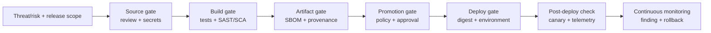
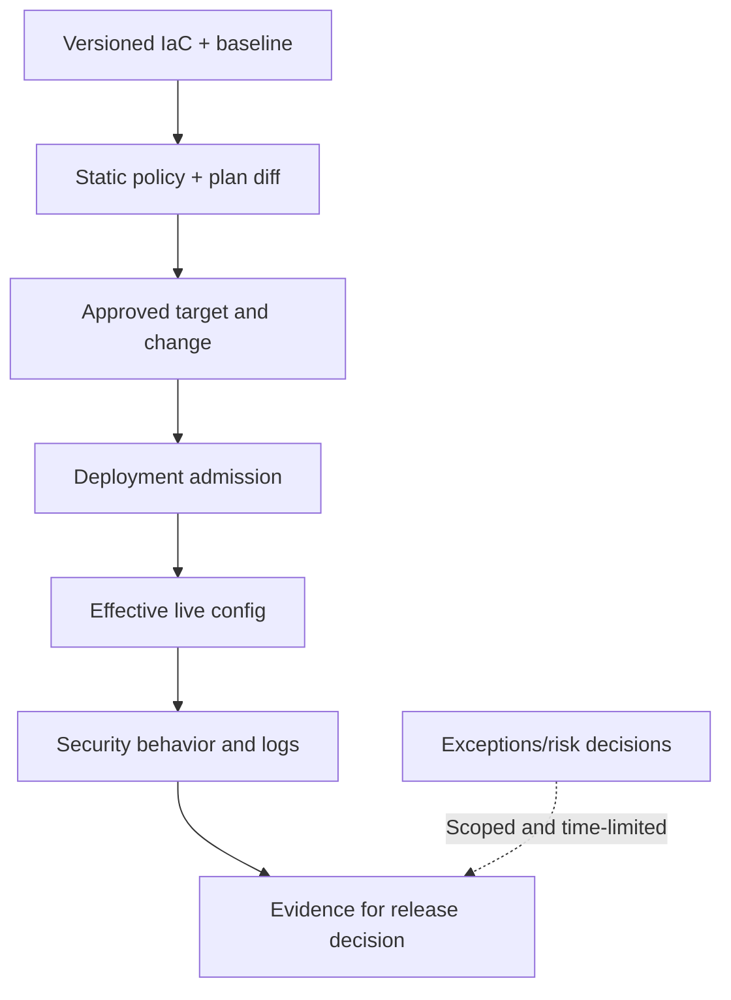
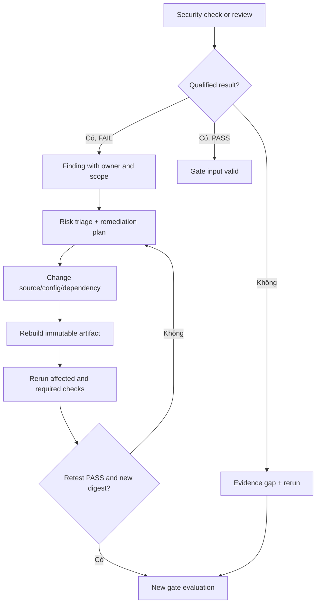

# Security release gate trong Release Assurance: cổng phát hành có bằng chứng và quyết định rủi ro

## 1. Security release gate là gì?

Một nhóm phát triển vừa hoàn thành tính năng xuất báo cáo. Pipeline CI báo “build succeeded”, tất cả unit tests đều xanh và đội sản phẩm muốn triển khai ngay. Tuy nhiên, lần build này bổ sung endpoint truy cập dữ liệu người dùng, cập nhật thư viện xử lý file và cấp một quyền cloud mới cho service account. Nếu chỉ kiểm tra build có chạy thành công, tổ chức chưa biết việc phát hành có đáp ứng các **điều kiện bảo mật đã được phê duyệt** hay không.

**Security release gate (cổng kiểm soát bảo mật trước phát hành)** là **điểm quyết định có quy tắc** trong chuỗi đưa thay đổi vào môi trường mục tiêu: chỉ cho phép tiến hành khi **những điều kiện bảo mật bắt buộc được chứng minh bằng bằng chứng phù hợp**, hoặc khi một sai lệch được xử lý bằng quyết định ngoại lệ hợp lệ theo chính sách. Gate có thể thực thi bằng automation, con người hoặc kết hợp cả hai.

Trong chương **Release assurance** của module **SECURITY_SECURITY_ASSURANCE**, gate phải phục vụ mục tiêu chung: **đánh giá có bằng chứng rằng hệ thống đáp ứng mục tiêu bảo mật**, từ phân tích rủi ro, yêu cầu và security controls đến kiểm thử, audit, khắc phục findings và giám sát liên tục. Vì vậy, một gate tốt không chỉ ghi “CI xanh” mà phải chỉ ra **release nào, control nào, evidence nào, quyết định nào, trong phạm vi nào**.

**Security release gate không bảo đảm phần mềm “hoàn toàn an toàn”.** Nó cho phép ra quyết định có trách nhiệm theo mức bảo đảm, phạm vi và failure model đã định. Gate không thay thế threat modeling, security testing có chiều sâu, kiểm toán hay hoạt động phát hiện và ứng phó sau triển khai.

### Mục tiêu học tập

Sau bài này, người học có thể:

1. Xây dựng release security criteria dựa trên rủi ro, requirements và các controls.
2. Xác định các gate tại **source change, build, artifact promotion, deployment và post-release verification**.
3. Gắn evidence với đúng **source revision, artifact digest, pipeline run, deployment target** và kỳ kiểm tra.
4. Thiết kế kiểm tra bảo mật gồm identity, code, dependencies, secrets, IaC, configuration, data/authorization và supply-chain provenance.
5. Phân biệt kết quả **PASS, FAIL, INCONCLUSIVE** của từng control với quyết định **GO, CONDITIONAL GO, HOLD, NO GO**.
6. Quản lý false positives, evidence gaps, ngoại lệ có thẩm quyền và emergency releases mà không âm thầm bỏ gate.
7. Thiết kế rollback/containment, canary monitoring và khép vòng assurance sau phát hành.

## 2. Thuật ngữ nền tảng

| Thuật ngữ | Ý nghĩa trong release assurance | Không nên nhầm với |
|---|---|---|
| **Release** | Phiên bản được lựa chọn để chuyển vào môi trường hoặc tới người dùng | Chỉ một commit hoặc bản build chưa phát hành |
| **Build** | Quá trình tạo artifacts từ nguồn và dependencies | Bản được production thực sự chạy |
| **Artifact** | Container image, binary, package, migration bundle, policy package | Tên tag có thể thay đổi |
| **Release candidate (RC)** | Tập artifact và cấu hình dự kiến phát hành | Một branch hay một số version đơn lẻ |
| **Security release gate** | Cổng kiểm tra và quyết định theo tiêu chí đã duyệt | Một scanner hoặc checkbox riêng lẻ |
| **Control requirement** | Điều kiện được kỳ vọng tại release theo policy/risk | Tên công cụ kiểm tra |
| **Evidence** | Kết quả đo, cấu hình, báo cáo, approval và raw record hỗ trợ claim | Một nhãn “compliant” không nguồn |
| **Policy-as-code** | Biểu diễn/kiểm tra quy tắc phát hành bằng mã có version | Tự động chấp nhận rủi ro ngoài thẩm quyền |
| **Attestation** | Bản ghi có chủ thể phát hành về nguồn/quy trình/đối tượng theo định dạng xác định | Bằng chứng tuyệt đối rằng nội dung không có lỗi |
| **Provenance** | Chuỗi thông tin về nguồn và các bước tạo artifact | Chỉ có checksum của tệp |
| **Promotion** | Đưa artifact được chấp nhận sang stage tiếp theo | Build lại một artifact khác từ cùng code |
| **Exception** | Quyết định có phạm vi, thời hạn và thẩm quyền về sai lệch | Xóa FAIL hoặc tắt gate vĩnh viễn |
| **Deploy verification** | Xác minh môi trường thực sự chạy đúng artifact/config đã đánh giá | Pipeline nói “deployment successful” |
| **Post-release assurance** | Theo dõi, xác minh và xử lý sai lệch sau deploy | Kết thúc trách nhiệm ngay khi gate PASS |

**Gate result** (PASS/BLOCK/UNKNOWN) và **release decision** (GO/HOLD/NO GO/CONDITIONAL GO) nên được lưu thành hai trường riêng: một quyết định kinh doanh có thể dựa vào ngoại lệ hợp lệ, nhưng ngoại lệ **không làm control FAIL trở thành PASS**.

## 3. Security release gate giải quyết rủi ro nào?

Cần bắt đầu từ **threats và tác động kinh doanh**, không từ danh sách các scanner đang có.

| Rủi ro ở thời điểm release | Failure mode ví dụ | Gate cần hỗ trợ |
|---|---|---|
| Thay đổi code nguy hiểm | Endpoint mới thiếu kiểm soát quyền từng đối tượng | Authorization test, review và threat model cập nhật |
| Supply-chain compromise | Artifact bị thay hoặc build trên runner không tin cậy | Provenance, trusted builder identity, digest/signature checks |
| Vulnerable dependencies | Thư viện có lỗ hổng nghiêm trọng trong path bị khai thác | SCA + reachability/exposure triage và decision |
| Secret leakage | Token thật xuất hiện trong commit hoặc artifact | Secret scan, revoke/rotation evidence nếu đã lộ |
| IaC drift | Storage/public network config vượt baseline | IaC policy, effective-config verification |
| Privilege escalation | Deployment tạo wildcard role cho workload | IAM policy diff, least-privilege test |
| Data integrity | Migration làm mất/nhầm dữ liệu hoặc phá invariants | Migration plan, backup/restore readiness, reconciliation |
| Observability gap | Source audit events hoặc alerts không hoạt động | Telemetry end-to-end test, monitor readiness |
| Failed rollback | Schema/code mới không tương thích ngược | Rollback/forward-fix plan và thử tập tình huống |
| Incomplete approval | Thay đổi chưa có người chịu trách nhiệm hoặc rủi ro được duyệt | Ownership, change authority, exception controls |

Gate thường đặc biệt quan trọng khi **blast radius tăng**: production, Internet-facing services, IAM, dữ liệu nhạy cảm, billing, KMS, CI/CD, cloud infrastructure và shared components.

**Đừng đặt một gate nặng như nhau cho mọi thứ.** Một thay đổi nội dung tĩnh và một thay đổi service phát hành access tokens có thể cần bộ control, evidence và approval khác nhau. Tuy vậy, mọi release cần những **điều kiện tối thiểu** về nguồn, kiểm tra và khả năng truy vết.

## 4. Ranh giới phát hành phải được xác định trước khi kiểm tra

Câu “version 2.4 đã qua security gate” chỉ có ý nghĩa khi version đó xác định một **tập tài sản bất biến** và môi trường mục tiêu.

**Release scope** nên có:

- Repository, protected source revision/commit và change request ID.
- Build workflow, run ID, builder/runner identity và build config version.
- Artifact names **kèm digest bất biến**, không chỉ tag `latest` hay `v2.4`.
- SBOM/dependency snapshot gắn với artifact.
- IaC manifests, database migrations, feature flags và config revisions cần đi cùng.
- Tên dịch vụ, namespace/account/cluster, tenant, region, environment và deployment strategy.
- Dữ liệu bị ảnh hưởng, privileged identities, new external connections và third parties.
- Những phiên bản client/API/schema phải tương thích và dependency release khác.
- Mục tiêu availability/data integrity, rollback hoặc forward-recovery plan.
- Thời điểm gate evaluation, cutoff và expiration/trigger của từng bằng chứng.

### Mẫu release identity

```yaml
release_id: rel-20261128-001
service_id: learning-api
environment: production
source:
  repository_id: repo-learning-api
  commit_sha: "b7e9f5a8c62d..."
build:
  workflow_id: secure-build-v5
  run_id: build-8742
artifacts:
  - name: learning-api
    image: "registry.example.invalid/learning-api"
    digest: "sha256:EXAMPLE_DIGEST_NOT_REAL"
deployment:
  cluster_id: prod-cluster-a
  namespace: learning
  regions: [region-a]
  helm_chart_revision: "chart-rev-73"
  database_migration_bundle: "migrations-021"
  feature_flags_revision: "flags-20261128-01"
```

Dữ liệu trên là **minh họa**, không phải URI hay digest hợp lệ để triển khai. Trong hệ thống thật, cần lưu **digest đủ độ dài và đúng thuật toán**, xác minh tất cả references từ nguồn tin cậy. Dấu `...` chỉ mô phỏng phần source commit, không phải định danh được phép dùng để attest.

Nếu gate kiểm tra digest A nhưng deployment tải digest B, kết quả gate **không còn áp dụng**. Cần kiểm chứng artifact promotion và runtime identity, tránh tình trạng *time-of-check/time-of-use (TOCTOU)*.

## 5. Security release gate nằm ở đâu trong SDLC?

Một cổng tại cuối pipeline không thể thay thế các kiểm tra sớm; nhưng nhiều checks sớm cũng không đủ nếu không có phép kiểm đúng tại thời điểm triển khai.



| Điểm kiểm soát | Mục tiêu | Evidence điển hình |
|---|---|---|
| **Pre-merge/source** | Ngăn code hoặc cấu hình không qua review | PR approval, diff, threat-model impact, secret detection |
| **Build** | Xác minh code/tests và build environment | Test runs, SAST/SCA, tool versions, build logs |
| **Artifact** | Biết chính xác điều được tạo và nguồn tạo | Immutable digest, provenance/attestations, SBOM, signing |
| **Pre-promotion** | Đối chiếu release candidate với baseline và risk | Gate evaluation, findings, exceptions, approval |
| **Pre-deploy** | Chặn sai artifact, sai môi trường và sai privilege | Target ID, image admission, policy check, change window |
| **Post-deploy** | Xác minh triển khai thực tế và phát hiện regression | Runtime digest, smoke/security tests, audit/alert evidence |
| **Continuous assurance** | Phát hiện drift, sự cố và CVE mới | Monitoring, retest, remediation và review trigger |

Có thể **reuse** một kết quả scan build nếu nó gắn chính xác với artifact digest và thời hạn còn phù hợp, thay vì quét lại mọi thứ ở mọi stage. Nhưng không dùng reuse để bỏ qua **runtime-specific controls** như IAM thực tế, network exposure, KMS access và tenant policy.

## 6. Thiết kế release security policy theo rủi ro

Security release gate cần một **policy rõ, có version, chủ sở hữu và thẩm quyền phê duyệt**. Trước khi chọn công cụ, cần xác định:

1. **Applicability:** loại release, service criticality, environment, dữ liệu và đặc quyền nào thuộc policy.
2. **Mục tiêu bảo mật:** confidentiality, integrity, availability, accountability, resilience và supply-chain trust.
3. **Control categories:** những điều kiện nào luôn bắt buộc, điều kiện nào chỉ áp cho một loại thay đổi.
4. **Evidence requirements:** loại bằng chứng, thời hạn, nguồn, coverage và phương pháp xác minh.
5. **Decision rules:** hard blocks, thresholds, severity/likelihood, điều kiện `INCONCLUSIVE` và N/A.
6. **Exception authority:** ai có quyền quyết định risk acceptance, phạm vi và thời hạn; điều gì không được miễn trừ.
7. **Deployment constraints:** artifact identity, target environment, change window và rollback readiness.
8. **Monitoring after GO:** các signal phải healthy, thời gian canary, quyền ra quyết định rollback.
9. **Version control:** policy changes phải được review; release cũ giữ kết quả đánh giá theo policy version cũ.
10. **Evidence retention:** nơi lưu, quyền truy cập, độ nhạy cảm và thời hạn.

**Baseline phải được xác định trước khi đọc kết quả kiểm tra.** Không nên đổi threshold hay tắt rule chỉ vì release cụ thể bị FAIL, trừ khi có policy change/risk decision với đúng thẩm quyền và lưu lịch sử.

### Tier release minh họa

| Release tier | Loại thay đổi | Yêu cầu tăng cường |
|---|---|---|
| **Low** | Copy/UI không xử lý dữ liệu hoặc quyền mới | Review, tests cơ bản, artifact traceability |
| **Medium** | Business API không thêm privileged access | Standard scans, security regression và dependency checks |
| **High** | API Internet-facing, dữ liệu nhạy cảm, cloud IAM/network | Threat-model delta, authorization tests, IaC/identity evidence, release sign-off |
| **Critical** | IdP, payments, KMS, CI/CD, shared platform, major data migration | Independent review theo policy, end-to-end tests, DR/rollback, executive/authority gate khi cần |

Tiers chỉ là gợi ý phương pháp. Một release low-tier vẫn phải **BLOCK** nếu có secret thật bị lộ hoặc artifact không được xác thực theo một điều kiện hard gate của tổ chức.

## 7. Từ requirement tới gate: mapping có thể kiểm toán

Mỗi rule trong release gate cần chỉ rõ **mệnh đề được chứng minh**, thay vì ghi “scan = green”.

| Requirement ID | Gate assertion | Evidence/test | Khi chưa đạt |
|---|---|---|---|
| `REL-SRC-01` | Code thuộc protected revision và review đúng quyền | Commit, branch policy, PR approval records | HOLD/BLOCK theo policy |
| `REL-BLD-02` | Build từ trusted pipeline, không có bước ngoài kiểm soát | Provenance, runner identity, workflow version | BLOCK khi mất chain of trust |
| `REL-SCA-03` | Dependency findings được triage theo risk policy | SBOM, SCA findings, exposure/exception records | BLOCK/HOLD nếu unresolved blocker |
| `REL-APP-04` | Authorization mới được thử theo scope | API tests, object-level access negative tests | BLOCK khi test xác minh bypass |
| `REL-SEC-05` | Không có secret thật chưa được xử lý trong source/artifact | Secret detection, revoke/rotation incident record | BLOCK hoặc yêu cầu security decision |
| `REL-IAC-06` | IaC và effective deployment scope đáp ứng baseline | Policy result, diff, live config/permissions | HOLD/BLOCK khi quyền hoặc public exposure sai |
| `REL-OBS-07` | Audit/security telemetry cho đường trọng yếu hoạt động | Source-to-SIEM event test, alert receipt | Không tự PASS khi thiếu telemetry |
| `REL-ART-08` | Artifact được nhận đúng nguồn và digest | Verified attestations, signature, registry digest | BLOCK nếu identity/digest mismatch |
| `REL-OPS-09` | Có phương án giảm tác động và recovery khả thi | Rollback/recovery test, schema plan, DR readiness | HOLD khi release làm tăng rủi ro continuity |
| `REL-GOV-10` | Owner, decision và exception hợp lệ | Release record, risk owner approval, expiry | Không triển khai ngoài thẩm quyền |

Các ID trên là **baseline ví dụ** của tổ chức, không phải số điều khoản chính thức của một framework. Khi dùng tiêu chuẩn thực tế, phải ánh xạ theo đúng tài liệu/version, scope và nghĩa vụ áp dụng.

## 8. Governance: ai chịu trách nhiệm cho release gate?

Một gate tự động có thể kết luận “BLOCK” nhưng vẫn cần con người chịu trách nhiệm thiết kế policy, thu bằng chứng, xử lý ngoại lệ và quyết định phát hành.

| Vai trò | Trách nhiệm |
|---|---|
| **Release owner** | Xác định release scope, chịu trách nhiệm điều phối go-live, checklist, deps và hậu kiểm |
| **Service/product owner** | Đánh giá tác động kinh doanh, dữ liệu, availability, nguồn lực và release priority |
| **Security control owner** | Sở hữu các policy/controls và tiêu chí kiểm chứng trong phạm vi chuyên môn |
| **Security assurance assessor** | Đánh giá evidence, kiểm tra limitations và phản chứng, kết luận controls |
| **Build/platform/DevSecOps owner** | Đảm bảo runner, pipeline, registry, admission và automation được bảo vệ |
| **Remediation/finding owner** | Điều phối các sai lệch, thời hạn, fix evidence và retest |
| **Risk owner** | Quyết định chấp nhận residual risk trong phạm vi quyền hạn |
| **Change authority** | Cho phép thay đổi production theo chính sách và cửa sổ triển khai |
| **Incident commander/on-call** | Chỉ huy xử lý khi phát hành tạo sự cố, theo quy trình IR |
| **Compliance/legal** | Xác nhận nghĩa vụ không được miễn trừ, approval/notification khi cần |

### Ví dụ RACI cho các quyết định quan trọng

| Hoạt động | Release owner | Engineering | Security assessor | Risk owner | Change authority |
|---|---|---|---|---|---|
| Chuẩn bị scope và manifest | **A** | **R** | C | I | I |
| Triển khai security checks | C | **A/R** | C | I | I |
| Kết luận quality của evidence | C | C | **A/R** | I | I |
| Đề xuất sửa blocker | **A** điều phối | **R** | C | C | I |
| Risk acceptance/exception | C | C | C | **A/R** | I |
| Quyết định triển khai production | **R** điều phối | R | C | C | **A** |
| Verification và roll-forward/back | **A** điều phối | **R** | C | C | C |

Đây là **mẫu phân vai**, không thay organizational authority matrix. Một người có thể kiêm vai trò ở tổ chức nhỏ, nhưng **risk acceptance** và **validation độc lập khi cần** không được suy diễn từ việc cùng sở hữu pipeline.

## 9. Evidence quality: gate có thể tin kết quả scan không?

Một file JSON ghi `"security": "pass"` chưa đủ. Evidence cho gate cần đạt những thuộc tính tối thiểu:

| Thuộc tính | Câu hỏi | Ví dụ sai |
|---|---|---|
| **Relevance** | Evidence có trả lời đúng assertion của gate? | Unit test chung dùng để chứng minh object-level authorization |
| **Scope** | Đúng artifact digest, service, branch, environment, tenant? | SAST của commit trước dùng cho binary hiện tại |
| **Completeness** | Đủ files/modules/assets, không bỏ qua failed jobs? | Scanner chỉ chạy trên folder `src/main` nhưng mã nằm cả `plugins` |
| **Freshness** | Kỳ kiểm tra đủ mới cho tình trạng release? | SBOM từ build tuần trước nhưng dependencies đã đổi |
| **Accuracy** | Scanner/translator hiểu dữ liệu và finding đúng? | False-positive filter áp lầm cho path thực |
| **Provenance** | Biết collector, job, tool version, repo, input và config? | Screenshot không run ID |
| **Integrity** | Artifact/result được bảo vệ khỏi sửa trái phép? | Report cho phép upload thay nội dung mà không ghi lịch sử |
| **Reproducibility** | Có thể rerun hoặc review raw data với cùng input? | Kết quả chỉ còn chữ “OK” |
| **Independence** | Reviewer không chỉ xác nhận chính output tự chọn? | Assignee tự loại findings và tự approve |
| **Confidentiality** | Evidence có loại secret, PII và thông tin nhạy cảm? | Upload credential vào ticket công khai |

**Evidence có chất lượng cao có thể chứng minh FAIL.** Ngược lại, nếu job không chạy do hết quyền, timeout hoặc scanner unavailable, gate phải nhận `INCONCLUSIVE`/`UNKNOWN`, không tự coi “0 findings” là PASS.

### Time-of-check/time-of-use

Giả sử image digest A được scan và ký lúc 10:00, nhưng deployment lúc 11:00 dùng tag `latest` trỏ tới digest B. Điều kiện “đã scan” của A không hỗ trợ B. Phải ràng buộc evaluation với **immutable subject digest**, xác minh từ registry và kiểm tra digest thực sự chạy sau deploy.

## 10. Source/change gate: bảo vệ nơi phát sinh thay đổi

Ở điểm source, cần xác minh **đúng mã, đúng người, đúng quy trình**, đặc biệt với thay đổi đặc quyền hoặc ranh giới tin cậy.

Các control thường xét:

- Protected branches/tags, quyền merge/push, rules về required checks.
- Review của người đủ quyền, policy về separation of duties và review khi chính pipeline/policy thay đổi.
- Threat-model delta cho endpoint, role, data flow, trust boundary hoặc secret mới.
- Secure coding rules, input validation, authentication/authorization và test plan phù hợp.
- Phát hiện secret trong commit/diff và cơ chế xử lý **lộ thật** (revoke/rotate, đánh giá incident), không chỉ xóa chuỗi.
- Commit/workflow identity và khả năng truy vết nguồn artifact.
- Bảo vệ build configs, dependency lockfiles, release scripts và IaC.
- Những thay đổi gate code/policy phải có review riêng, tránh tự giảm ngưỡng để triển khai.

**Review approved không đồng nghĩa code an toàn.** Nó chỉ là một phần evidence về quá trình change governance, cần kết hợp kiểm thử và kiểm tra kiến trúc.

### Thay đổi pipeline là thay đổi có rủi ro cao

Một sửa đổi vào workflow có quyền publish artifact hoặc deploy production có thể **mạnh hơn thay đổi feature code** vì nó có thể làm sai tất cả checks khác. Gate cần có guardrails cho runner permissions, credential use, workflow provenance, repository controls và phê duyệt những thay đổi nhạy cảm.

## 11. Build gate: bảo vệ chuỗi tạo artifact

Một bản build có thể đã qua tests nhưng được tạo từ runner chưa kiểm soát, dependencies không xác định hoặc workflow bị sửa trong lúc chạy.

Cần quan sát:

| Control | Câu hỏi kiểm tra |
|---|---|
| **Builder identity** | Ai/hệ thống nào đã thực hiện build, xác thực theo cơ chế nào? |
| **Source identity** | Commit/repository có đúng protected revision được phê duyệt? |
| **Build definition** | Workflow, Dockerfile, toolchain và config version nào được dùng? |
| **Runner trust** | Runner có cô lập, ephemeral khi phù hợp, quyền tối thiểu, không dùng secret tùy tiện? |
| **Dependency resolution** | Dependencies được pin/resolve và ghi nhận đủ để truy vết? |
| **Secrets isolation** | Secret nào được phép dùng, có tránh leak vào artifact/log/cache? |
| **Build output** | Artifact digest, subject và output location là gì? |
| **Reproducibility/provenance** | Có thể kiểm chứng source/build steps và output từ trusted system không? |
| **Policy evidence** | Tool runs, test suites và rule versions gắn với run/digest không? |

**Reproducible build** có thể tăng khả năng kiểm chứng nhưng không phải điều kiện luôn bắt buộc cho mọi hệ thống; **provenance attestation** cũng không mặc định chứng minh builder không bị compromise. Cần xét trust model: signing key, runner isolation, workload identity và nơi artifacts được lưu.

Các mức assurance supply chain có thể tham khảo những thực hành như **SLSA**, nhưng phải dùng đúng phiên bản, yêu cầu áp dụng và scope; không tuyên bố “SLSA compliant” chỉ vì có một manifest tự sinh.

## 12. Artifact identity, signatures và provenance

Để chặn release ngoài quy trình, gate cần xác minh **artifact được tạo đúng quy trình đáng tin**, có **digest đúng** và chưa bị thay thế trên đường promotion/deployment.

### Ba thuộc tính không thể thay thế nhau

| Thuộc tính | Chứng minh được khi kiểm đúng | Không tự chứng minh |
|---|---|---|
| **Cryptographic digest** | Nội dung byte khớp một giá trị đã ghi | Ai tạo hoặc nội dung không có malware |
| **Verified signature** | Chủ thể sở hữu khóa/identity hợp lệ đã ký dữ liệu theo chính sách trust | Người ký đáng tin trong mọi hoàn cảnh; test đã chạy |
| **Provenance attestation** | Một chủ thể được xác thực công bố source, builder và quá trình theo schema | Toàn bộ nội dung claim đều đúng nếu builder không đáng tin |
| **SBOM** | Danh mục thành phần được công bố theo scope và phương pháp | Mọi dependency đều đã liệt kê hoặc không có lỗ hổng |
| **Security test attestation** | Tool/test công bố kết quả cho một đối tượng/kỳ nhất định | Tất cả test paths và unknown risks đã được kiểm |

Gate cần kiểm: **subject digest**, ký bởi **đúng identity/trust root**; provenance mô tả **repo/source revision/workflow/builder** được cho phép; attestations được liên kết với **đúng digest** và các policy checks chạy ở môi trường phù hợp.

### Artifact promotion thay vì build lại ngẫu nhiên

Khuyến nghị giữ nguyên artifact digest qua các môi trường khi phù hợp kiến trúc. Rebuild production từ cùng commit nhưng một dependency floating đã đổi sẽ tạo artifact khác; gate cần kiểm lại phần evidence phụ thuộc artifact mới.

Nếu sử dụng nhiều kiến trúc CPU hoặc các build variants, phải gắn evidence vào từng **image/platform digest hoặc manifest subject** đúng kiểu phát hành, không giả định mọi variant đều giống nhau.

## 13. Dependency và SBOM gate

Dependencies là nguồn rủi ro supply chain, nhưng số lượng CVE trong report **không phải thước đo trực tiếp** mức rủi ro release nếu không biết bối cảnh.

### Cần đánh giá

1. Đã thu được danh sách dependencies trực tiếp, bắc cầu, runtime và build-time phù hợp chưa?
2. SBOM có gắn đúng release artifact/digest và method không?
3. Component version, artifact origin và package integrity được kiểm chứng ở mức nào?
4. Có advisory/lỗ hổng liên quan; severity, exploitability, reachability và exposure cụ thể?
5. Có package rủi ro: abandoned, compromised source, unsigned release, dependency confusion?
6. Có chính sách update, pin/lock, review transitive dependency và remediation owner?
7. Exception cho một lỗ hổng có áp vào đúng package/version/scope và còn hạn?
8. Có khả năng retest khi advisory mới xuất hiện sau khi release đã GO?

### Hai hướng diễn giải sai

- **“0 CVE” = không có rủi ro:** database vulnerability có thể thiếu thông tin, SBOM không đầy đủ, hoặc flaw nằm trong code của mình.
- **“Có 1 CVE High” = tự động BLOCK mọi trường hợp:** một vulnerability không reachable và đã được bù trừ có thể có risk decision khác theo policy; tuy nhiên nếu là **blocking requirement**, phải xử lý/approve đúng authority.

Threshold có thể dùng severity làm **đầu vào** nhưng không nên bỏ qua exposure, fix availability, mitigation validity và rủi ro do hoãn release. **Untriaged finding** khác với **accepted exception**; không xóa finding chỉ để đạt ngưỡng.

## 14. Static, dynamic và application security testing tại gate

Các loại kiểm tra hỗ trợ những claims khác nhau:

| Kiểm tra | Hỗ trợ điều gì | Giới hạn |
|---|---|---|
| **SAST** | Tìm một số mẫu bug trong source/binary đã xác định | False positive/negative; không chứng minh runtime authorization |
| **SCA** | Nhận diện packages và vulnerability advisories | Không tự xác nhận reachability/exploitability |
| **Secret scanning** | Tìm pattern/credential có nguy cơ bị lộ | Detector có thể bỏ sót; secret thật cần revoke |
| **DAST** | Thử hành vi ứng dụng đang chạy qua interface | Coverage phụ thuộc auth, paths, test data và config |
| **API security tests** | Authn/authz, input validation, data exposure theo API contract | Test path có thể không bao phủ trường hợp mới |
| **Unit/integration tests** | Kiểm chứng security invariants trong code và kết nối | Test xanh không chứng minh toàn hệ thống bảo mật |
| **Fuzz testing** | Tìm lỗi từ các đầu vào thay đổi trong thành phần phù hợp | Không bảo đảm tìm mọi lỗi và cần triage |
| **Manual review/pen test** | Khám phá business logic, trust boundaries, phức tạp | Có phạm vi và kỳ; không áp mặc định mọi release |
| **Threat model review** | Xem rủi ro mới và chiến lược controls | Là lập luận/thiết kế, không thay runtime tests |

Đừng đòi **pentest đầy đủ mỗi lần thay README**. Thay vào đó, xác định **trigger** cho kiểm thử tăng cường: thay đổi IAM, quyền trên dữ liệu, payment/PII flows, cryptography, public endpoints, risky parsing, auth flow hoặc major architectural change.

### Ví dụ assertion về authorization

Release thêm API `GET /reports/{report_id}`. Claim cần kiểm chứng không phải “API trả 200” mà là:

> Đối tượng sử dụng chỉ đọc được report họ có quyền, kể cả khi thay `report_id` hoặc tenant context, trong scope API và identity types đã duyệt.

Evidence: positive test của authorized user, negative test của user khác tenant và cùng tenant không có quyền, log nguồn, API revision và policy mappings. Không chứa dữ liệu người dùng thật trong artifact test nếu có thể dùng dữ liệu giả.

## 15. IaC, cloud và deployment configuration gate

Một codebase có thể đạt application tests nhưng Terraform/Kubernetes/Helm manifests lại mở rộng quyền hoặc phơi bày dữ liệu.

Những lớp cần xét:

- **IaC static check:** network reachability, storage exposure, encryption, KMS, workload privileges, audit logging, secure defaults.
- **Policy-as-code:** rule theo environment, resource type, data class, permission scope; có exception logic tách biệt.
- **Plan/diff review:** kiểm tra *delta* từ môi trường đang hoạt động, không chỉ state mong muốn trong repository.
- **Admission/runtime guard:** chặn deploy sai security context, unsafe privilege hoặc image không qua policy.
- **Live-state verification:** xác nhận configuration thực tế đúng cluster/account/region; drift có thể xuất hiện ngoài IaC.
- **IAM effective permissions:** kiểm tra quyền được kết hợp từ roles, inheritance, resource policy, impersonation hoặc cloud control plane.
- **Secrets/config:** environment variables, secret mounting, rotation, logging redaction và exposure.
- **Tenant-specific controls:** SSO/MFA, audit export, retention, data residency và quyền API khi dùng SaaS.

### Sơ đồ kiểm tra cấu hình



**Một policy-as-code PASS trên manifest không chứng minh production có cấu hình đúng** nếu deployment dùng override, feature flag, out-of-band change hoặc cluster policy khác. Gate cần biết **what was intended**, **what was deployed** và **what took effect**.

## 16. Data protection, database migration và privacy gate

Các release thay đổi schema, data flows, encryption hoặc retention thường có tác động **không thể hoàn tác đơn giản bằng rollback code**.

Ví dụ:

- Migration thay tên trường làm mất mapping dữ liệu khách hàng.
- Index/constraint mới khiến write API lỗi khi traffic cao.
- Thay key role khiến ứng dụng không giải mã được backup.
- Nâng feature dùng dữ liệu người học cho mục đích mới chưa được xét privacy.
- Thay retention/deletion khiến bản sao tồn tại ngoài thời hạn.
- New data export làm lộ báo cáo sang tenant khác.

### Checklist dữ liệu theo từng risk path

| Mệnh đề | Evidence phù hợp |
|---|---|
| Data flow và purpose không bị mở rộng trái phép | Data flow diff, privacy/security assessment, contract applicability |
| Migration preserve integrity | Schema change plan, staging rehearsal, reconciliation invariants |
| Data access đúng authorization | Tenant isolation tests, row/object access checks |
| Encryption/key use đúng requirement | Effective config, KMS grant checks, authorized decrypt test |
| Backup/recovery path vẫn hoạt động | Restore exercise phù hợp, data consistency checks, RPO/RTO when applicable |
| Retention/deletion vẫn tuân thủ | Config/rule diff, deletion workflow tests |
| Rollback không gây hỏng data | Expand/contract migration, compatibility matrix, recovery plan |

**Release gate không nên suy ra RPO từ “backup job succeeded”.** Một hệ thống backup phải được đánh giá theo khả năng phục hồi dữ liệu ở điểm nhất quán phù hợp; có thể cần restore test với transaction watermark khi release thay đổi backup/DB/KMS dependencies.

## 17. Test coverage, evidence freshness và các khoảng chưa biết

Đôi khi pipeline chạy **mọi job cấu hình sẵn** nhưng vẫn bỏ sót code hoặc environment. Security release gate cần xác định *coverage* theo claim, không chỉ đếm tỷ lệ job “green”.

| Coverage | Mẫu số cần xác định | Ví dụ gap |
|---|---|---|
| Source coverage | Tất cả module/files thay đổi cần kiểm tra | Monorepo scanner bỏ qua plugin |
| Dependency coverage | Dependencies trong release artifact | SBOM không gồm native libraries |
| Control coverage | Security requirements áp dụng | Logging check không chạy dù release thêm admin path |
| Asset coverage | Những services/accounts/regions chịu tác động | Chỉ kiểm tenant A, bỏ tenant B |
| API/test coverage | Endpoints/identity paths có rủi ro | Chỉ thử authorized success, không negative test |
| Pipeline coverage | Required jobs cho release tier | Job DAST skipped nhưng report tổng ghi xanh |
| Evidence qualification | Artifacts đủ provenance/scope/freshness | SAST result của commit cũ |
| Post-release coverage | Canary signals và security events | Không có auth/audit telemetry của release mới |

### Phân biệt sự kiện và kết quả

- `job_succeeded`: tool thực thi không lỗi; **chưa phải** security claim PASS.
- `scan_completed_with_findings`: scanner hoạt động, có phát hiện; cần triage và rule decision.
- `job_skipped`: có thể có lý do N/A đã duyệt hoặc thiếu kiểm tra; phải ghi rationale.
- `job_failed_to_run`: lỗi evidence acquisition, thường `INCONCLUSIVE` cho claim.
- `scanner_returned_zero_findings`: chỉ có nghĩa tool không nhận diện finding trong coverage; không chứng minh an toàn tuyệt đối.

Nếu security check bắt buộc có lỗi thu dữ liệu hoặc mất quyền, **fail safely**: giữ trạng thái HOLD/UNKNOWN và escalation. Chỉ cho phép bypass đúng authority và có control tương ứng, không tự “fail open” khi CI provider bị sự cố.

## 18. Cách xác định hard gates, advisory gates và manual gates

Không phải mọi kết quả scanner đều phải chặn release ngay, nhưng **những điều kiện không thể thương lượng** phải được thể hiện rõ.

| Loại gate | Ý nghĩa | Ví dụ |
|---|---|---|
| **Hard gate** | Thiếu điều kiện là không được promotion/deploy trừ một quy trình thay thế được policy cho phép | Artifact identity không xác minh được; production secret đang lộ |
| **Risk-based gate** | Quyết định từ findings + severity + exposure + approvals | Dependency vulnerability High theo ngữ cảnh |
| **Advisory gate** | Cảnh báo và tạo nhiệm vụ theo dõi, chưa tự block | Coding hygiene issue Low không ảnh hưởng release path |
| **Manual verification gate** | Cần người có thẩm quyền xem bằng chứng/đánh giá logic nghiệp vụ | Major auth redesign, privacy-sensitive data change |
| **Runtime admission gate** | Cơ chế thực thi ngay trước hoặc khi triển khai để chặn sai artifact/config | Image trust, workload privilege, namespace restrictions |
| **Post-deploy guardrail** | Dựa vào canary signals/monitoring để tạm dừng hoặc rollback | Error budget, auth failures, audit event loss |

**Hard gate khác “không có cách phục hồi dịch vụ”.** Trong sự cố nghiêm trọng, tổ chức có thể có emergency pathway có điều kiện, nhưng nó phải là **một quy trình có thẩm quyền, audit trail và giới hạn riêng**, không phải một nút tắt scanner vô thời hạn.

## 19. Kết luận control khác với quyết định GO/NO GO

Một release gate có ít nhất **ba lớp trạng thái**:

1. **Tình trạng kiểm tra control:** `PASS`, `FAIL`, `INCONCLUSIVE`, `NOT_APPLICABLE`.
2. **Risk/exception disposition:** không có ngoại lệ, đang chờ xử lý, ngoại lệ đã duyệt có hiệu lực, hoặc rủi ro không thể chấp nhận.
3. **Release decision:** `GO`, `CONDITIONAL_GO`, `HOLD` hoặc `NO_GO` theo authority.

| Kết quả control | Ý nghĩa | Hướng xử lý |
|---|---|---|
| **PASS** | Evidence đủ chất lượng trong scope và đạt tiêu chí | Có thể dùng làm input cho GO |
| **FAIL** | Evidence cho thấy một yêu cầu không đạt | Remediation, finding, risk decision; hard gate có thể BLOCK |
| **INCONCLUSIVE** | Thiếu evidence, sai scope, job lỗi, method không đủ | HOLD/thu bổ sung; không tự coi PASS |
| **NOT_APPLICABLE** | Có căn cứ rằng control không áp dụng theo policy và scope | Lưu rationale và approval khi cần |
| **Accepted exception** | Có quyết định chịu sai lệch đã xác định trong phạm vi/thời hạn | Giữ measured result FAIL, theo dõi exception riêng |

| Release decision | Khi phù hợp | Điều bắt buộc ghi |
|---|---|---|
| **GO** | Mọi yêu cầu bắt buộc đã đạt, evidence và approval hợp lệ | Artifact digest, target, policy version, decision authority |
| **CONDITIONAL GO** | Policy cho phép với giới hạn rõ, controls còn thiếu không thuộc hard stops, có risk decision | Phạm vi deployment, điều kiện, owner, expiry, monitoring và rollback |
| **HOLD** | Chưa đủ evidence/approval, jobs lỗi hoặc đang chờ remediation | Missing claims, owner, thời hạn và điều kiện quyết định lại |
| **NO GO** | Blocking failure đã xác minh hoặc không thể chấp nhận risk theo chính sách | Failed control, evidence, rejection reason và bước tiếp theo |

**CONDITIONAL GO không phải một đường vòng mặc định.** Nếu policy bắt buộc chặn release khi chưa xác minh artifact origin hoặc khi authorization leak đã được chứng minh, không thể ghi “conditional” để cho phép deploy nguyên trạng. Một conditional release có thể áp dụng, ví dụ, chỉ bật nội bộ trong môi trường cô lập với dữ liệu giả và không cấp production traffic, **nếu** cách dùng này nằm trong scope và được phép theo policy.

## 20. Quy tắc quyết định với nhiều kiểm tra chồng lấn

Một số gate dùng logic **AND**: mọi điều kiện bắt buộc cùng đạt mới cho GO. Những biện pháp thay thế theo **OR** chỉ hợp lệ khi policy nói rõ chúng tương đương đối với mục tiêu và scope.

\[
\text{GO}_{\text{standard}}
\Leftarrow
\text{TrustedArtifact}
\land
\text{RequiredControlsPass}
\land
\text{EvidenceQualified}
\land
\text{AuthorizedApproval}
\]

Đây là **quy tắc quyết định minh họa**, không là bảo đảm toán học rằng release không có lỗ hổng ngoài phạm vi đã kiểm.

### Logic không được bỏ qua UNKNOWN

| Tình huống | Kết luận thận trọng |
|---|---|
| Tất cả required checks PASS, scope/trust/approval hợp lệ | Có thể đề xuất GO |
| Có hard-stop FAIL đã được xác minh | NO GO hoặc xử lý qua emergency policy nếu cho phép |
| Không có FAIL, nhưng một required check INCONCLUSIVE | HOLD, không tự PASS |
| Một advisory FAIL, các hard gates PASS | Xem risk policy, finding và quyết định hợp lệ |
| Có accepted exception hợp lệ cho một non-hard deviation | Có thể COND_GO nếu đáp ứng toàn bộ giới hạn được duyệt |
| Artifact digest thay sau khi test | Invalidate các evidence phụ thuộc artifact cũ và đánh giá lại |
| Change authority chưa approve | HOLD dù security scanners PASS |
| Có active compromise từ release candidate | IR/containment, không dùng quy trình exception thường để bỏ qua |

**Tối ưu hóa tốc độ pipeline phải làm trong giới hạn assurance.** Có thể chạy các checks độc lập song song hoặc cache evidence gắn digest, nhưng không được bỏ điều kiện chỉ vì CI chậm.

## 21. False positives, false negatives và cách triage findings

Scanner có thể báo false positive; loại bỏ finding sai là hợp lý **khi có evidence và reviewer phù hợp**. Nhưng “false positive” không được biến thành nhãn miễn trừ tự do để phát hành.

Một triage record nên có:

- `finding_id`, tool/source, rule và tool version.
- Affected component/file/function/API/asset và artifact digest.
- Evidence phát hiện, reproduction/verification method.
- Kết luận: confirmed, false positive, not exploitable under verified conditions, mitigated, accepted, inconclusive.
- Phạm vi và những assumptions dùng khi đánh giá reachability/exposure.
- Reviewer có thẩm quyền, lý do, timestamp và links tới raw evidence.
- Expiry hoặc trigger tái đánh giá khi code/dependency/config đổi.

**False positive** khác **risk accepted**. Trong false positive, phép đo hoặc rule không phù hợp với trường hợp cụ thể; trong risk accepted, sai lệch có thật nhưng rủi ro được chấp nhận trong phạm vi được phép. Cần giữ hai kiểu decision riêng.

### Khi một scanner bị lỗi hoặc mất coverage

Kết quả “scan timed out” không chứng minh không có findings. Nếu dữ liệu không đủ, outcome là **INCONCLUSIVE**, cần rerun/hạn chế phạm vi, evidence tương đương theo policy hoặc HOLD. Chỉ cho phép emergency route khi có phê duyệt và biện pháp giảm rủi ro phù hợp; không tự đặt `continue-on-error` để mọi required job bị coi PASS.

## 22. Policy-as-code: biểu diễn các điều kiện có thể kiểm tra

Policy-as-code giúp kiểm tra lại cùng một bộ quy tắc qua nhiều release, nhưng **policy text cũng là tài sản phải được bảo vệ**: versioning, code review, restricted update permissions, tests và audit trail.

### Mẫu rule configuration (pseudo YAML, không thuộc cú pháp của một CI provider)

```yaml
policy:
  id: security-release-gate
  version: "3.1"
  owner: security-assurance
  applicable_to:
    environments: [production]
    release_tiers: [medium, high, critical]
  required:
    - id: REL-ART-08
      predicate: trusted_provenance_and_digest_match
      on_missing: HOLD
      on_fail: NO_GO
    - id: REL-SRC-01
      predicate: approved_source_and_reviews
      on_missing: HOLD
      on_fail: NO_GO
    - id: REL-SEC-05
      predicate: no_unresolved_real_secret_exposure
      on_missing: HOLD
      on_fail: NO_GO
    - id: REL-APP-04
      when: "change.affects_authorization == true"
      predicate: qualified_authorization_tests
      on_missing: HOLD
      on_fail: NO_GO
    - id: REL-IAC-06
      when: "change.affects_cloud_permissions == true"
      predicate: iac_and_effective_config_within_baseline
      on_missing: HOLD
      on_fail: NO_GO
  advisory:
    - id: REL-CODE-HYGIENE
      predicate: low_risk_quality_findings_are_triaged
      create_finding_when_failed: true
  exception:
    approval_system: authorized-risk-register
    require_scope_match: true
    require_nonexpired_decision: true
    allow_override_hard_stops: false
  audit:
    retain_policy_version: true
    retain_subject_digest: true
    retain_raw_evidence_refs: true
```

Đây là **cấu hình giáo dục**. Muốn thực thi phải viết evaluator xác định rõ semantics của `when`, xử lý missing fields, quyền truy cập dữ liệu, thứ tự evaluation và cách kiểm tra exception. Một chuỗi YAML đúng syntax **không bảo đảm** engine thực thi đúng logic.

### Tests cho gate evaluator

Tạo fixture có chủ đích:

1. Mọi required checks PASS → GO.
2. Một hard-stop FAIL → NO GO, dù các checks khác PASS.
3. Required job bị lỗi quyền đọc → HOLD.
4. Artifact digest không khớp → NO GO.
5. N/A bị khai báo nhưng applicability thực tế true → không được PASS.
6. Exception hết hạn hoặc khác service/digest → không được dùng.
7. Advisory finding được triage đúng quyền → decision theo policy.
8. Policy repo bị sửa mà chưa qua review → chặn áp dụng policy không hợp lệ.
9. Pipeline mất một trong các required jobs → HOLD và alert.
10. Post-deploy runtime khác digest được chấp thuận → security incident/rollback review theo quy trình.

## 23. Cơ chế fail-closed, break-glass và bypass abuse

Một security gate có thể bị vô hiệu nếu attacker hoặc chính người phát hành dễ dàng đổi biến môi trường, bỏ một job hoặc nhấn “rerun without checks”.

### Các guardrails gợi ý

| Đường lách | Biện pháp phòng |
|---|---|
| Thay policy trong cùng PR tính năng để giảm ngưỡng | Bảo vệ policy repo, review độc lập và version pinning |
| Chạy workflow khác không có security jobs | Enforce allowed workflow identity ở promotion/admission |
| Chuyển trạng thái `skipped` thành success | Evaluator xác thực danh sách checks bắt buộc |
| Re-push tag đã scan trỏ tới image khác | Verify immutable artifact digest tại deploy |
| Dùng token CI có quyền admin dài hạn | Workload identity/short-lived scoped credentials khi phù hợp |
| Upload kết quả test giả | Trusted attestation origin và raw output/audit metadata |
| Cho phép người tự sửa bug tự approve exception | Separation of duties và risk authority |
| Reuse exception của release cũ cho release mới | Scope, requirement, digest, period, expiry matching |
| Bỏ monitor sau deploy | Runtime health gate, drift checks và alert routing |

**Fail-closed** nghĩa là khi không chứng minh điều kiện bắt buộc, **không tự động cho promotion/deploy**. Nó không đồng nghĩa “khóa mọi hoạt động vận hành và gây downtime” nếu môi trường đang sự cố: đó là lý do phải có **emergency release protocol** được thiết kế từ trước.

Các cơ chế break-glass phải giới hạn **ai có thể kích hoạt, vì sao, trong bao lâu, cho artifact và environment nào, sẽ kiểm tra bù trừ ra sao** và chịu hậu kiểm bắt buộc. Không dùng tài khoản chung không truy vết.

## 24. Security gate evaluation record: quyết định phải gắn với release cụ thể

Một bản ghi có thể audit cần liên kết **policy, artifact, evidence, findings, approver và quyết định**. Mẫu giả định dưới đây thể hiện release **chưa được phê duyệt**, không phải “compliant”.

```yaml
gate_evaluation_id: SREG-20261128-001
policy_id: security-release-gate
policy_version: "3.1"
release:
  release_id: rel-20261128-001
  service_id: learning-api
  environment: production
  source_commit: "example-commit-revision-001"
  builder_workflow: secure-build-v5
  build_run_id: build-8742
  artifact_name: learning-api
  artifact_digest: "sha256:EXAMPLE_NOT_A_REAL_DIGEST"
  target_cluster_id: prod-cluster-a
  target_namespace: learning
assessment:
  started_at_utc: "2026-11-28T04:10:00Z"
  reviewed_at_utc: "2026-11-28T04:30:00Z"
  assessor: security-assurance
  population_source: approved-release-manifest
controls:
  - control_id: REL-SRC-01
    result: PASS
    evidence_ref: "secure-evidence/rel-001/review-record.json"
  - control_id: REL-ART-08
    result: PASS
    evidence_ref: "secure-evidence/rel-001/provenance-verification.json"
  - control_id: REL-APP-04
    result: FAIL
    observation: "Cross-tenant report access detected in negative test"
    evidence_ref: "secure-evidence/rel-001/authz-test-041.json"
    finding_id: FIND-REL-041
  - control_id: REL-OBS-07
    result: INCONCLUSIVE
    observation: "Audit event ingestion not verified for region-a"
    evidence_ref: "secure-evidence/rel-001/siem-collector-errors.json"
decision:
  status: NO_GO
  reason: "Verified authorization blocker; logging evidence also incomplete"
  decision_owner: release-change-authority
  approved_for_production: false
  exception_id: null
  next_action: "Fix authorization and restore telemetry, then reevaluate"
evidence_manifest:
  ref: "secure-evidence/rel-001/sha256-manifest.txt"
  evidence_access_classification: restricted
retest:
  required: true
  scheduled_by: release-owner
```

**Trường `REL-ART-08: PASS` trong ví dụ chỉ là dữ liệu mô phỏng**; digest giả không thể được dùng để xác minh chữ ký/trust chain thật. Trong production, attestation verifier phải xác minh nguồn và digest hợp lệ trước khi ghi PASS. Hồ sơ có `NO_GO` vì negative test đã tìm thấy lỗi authorization có căn cứ; không thể chữa bằng cách đổi `decision.status` thủ công.

### Bằng chứng quan trọng cần giữ

- Source commit, protected refs và code review.
- Build run, workflow/tool versions, builder identity và logs.
- Artifact digests, provenance/signature verification, SBOM.
- Raw test/scan outputs, configuration, scope, test data và quyết định triage.
- Findings, exception IDs, approver và rationale.
- Target environment, deployment transaction, runtime identity.
- Post-deploy test/monitoring evidence và rollback records khi có.
- Retention, access controls và evidence manifest được bảo vệ.

## 25. Pseudocode cho release gate evaluator

```text
evaluate_release(candidate, policy):
    assert policy.version_is_approved
    assert candidate.scope_is_complete

    identity = verify_source_builder_artifact_target(candidate)

    if identity == MISMATCH or identity == UNTRUSTED:
        return NO_GO with artifact_trust_finding

    if identity == INCONCLUSIVE:
        return HOLD with provenance_evidence_gap

    applicable = resolve_required_controls(policy, candidate)
    results = collect_qualified_evidence(applicable, candidate)

    if results.has_verified_nonwaivable_hard_stop:
        return NO_GO with blocking_findings_and_other_unknowns

    if results.has_unqualified_required_evidence:
        return HOLD with required_evidence_gaps

    if results.has_verified_failures:
        exceptions = verify_scoped_nonexpired_authorized_exceptions(
            candidate,
            policy,
            results.failures
        )
        if not exceptions.cover_every_eligible_failure:
            return NO_GO with unresolved_blockers

        if not exceptions.conditions_verified:
            return HOLD with exception_condition_gaps

        if not policy.allows_conditional_release:
            return NO_GO with policy_reason

        if not verify_change_authority_and_deployment_constraints(candidate):
            return HOLD with approval_or_environment_gaps

        return CONDITIONAL_GO with deployment_limits_and_monitoring

    if not verify_change_authority_and_deployment_constraints(candidate):
        return HOLD with approval_or_environment_gaps

    return GO with release_digest_policy_and_evidence_manifest

on_deployment(candidate, decision):
    verify_decision_not_expired_or_invalidated
    verify_runtime_target_and_artifact_digest_match
    enforce_admission_and_change_constraints
    record_deployment_attestation_and_post_deploy_checks
```

Pseudocode minh họa các **cổng quyết định**, không tự triển khai software. Bản thực tế phải định nghĩa rõ thứ tự ưu tiên khi **vừa có FAIL vừa có INCONCLUSIVE**. Một hard-stop FAIL phải được báo là FAIL/NO GO ngay cả khi nhiều evidences khác thiếu; không giấu các evidence gaps còn lại. Nếu kết quả thu thập không đủ nhưng có verified blocker, nên trả **NO GO kèm unknowns**, không chỉ trả HOLD và vô tình che nguyên nhân nghiêm trọng.

Một quyết định đã được ký chỉ áp cho **release candidate cụ thể** và hết hiệu lực khi phạm vi, artifact, target, policy hoặc facts trọng yếu thay đổi.

## 26. Đánh giá định lượng: coverage không phải compliance

Giả sử một release High có **24 required control checks** theo policy đã duyệt:

- 20 checks được thực thi (collection coverage).
- 18 checks có evidence đủ điều kiện đánh giá.
- Trong 18 checks qualified: 16 PASS, 2 FAIL.
- 2 checks có output nhưng không đủ quality; 4 checks chưa chạy.

| Chỉ số | Công thức | Kết quả |
|---|---:|---:|
| Check execution coverage | 20/24 | 83,33% |
| Qualified evidence coverage | 18/24 | 75% |
| PASS share trong tập qualified | 16/18 | 88,89% |
| Verified PASS share của toàn bộ required checks | 16/24 | 66,67% |
| Known FAIL share của toàn bộ required checks | 2/24 | 8,33% |
| Unknown/unqualified share | (2 + 4)/24 | 25% |

**Không gọi 88,89% là “release an toàn 88,89%”**. Hai checks FAIL có thể là hard stops nên quyết định tổng thể là **NO GO**; sáu checks còn thiếu qualified evidence phải tiếp tục được theo dõi. Mẫu số là **24 checks áp dụng**, không tự loại những jobs skipped hoặc missing.

Các chỉ số trên đo **kết quả đánh giá checks**, không đo xác suất sản phẩm có lỗ hổng. Một số checks có tầm quan trọng rất khác nhau và các checks có thể cùng phụ thuộc một scanner; không nên cộng chúng thành security score nếu chưa có rubric và hard gates.

## 27. Remediation và exception trước release

Khi gate FAIL, nhóm phát hành cần biết **lỗi gì, phạm vi nào và làm sao chứng minh đã sửa**.

### Từ finding đến retest



Một change fix tạo **artifact mới**; kết quả kiểm thử của artifact cũ không thể tự gán cho artifact mới. Có thể reuse evidence không phụ thuộc nội dung nếu có justification, nhưng những checks bị ảnh hưởng phải chạy lại.

### Exception hợp lệ cần gì?

| Trường | Điều kiện |
|---|---|
| Exception ID và finding/control refs | Định danh sai lệch |
| Release/service/environment scope | Biết đúng thứ đang được phép |
| Affected artifact/version/digest, nếu applicable | Không tự dùng cho mọi build tương lai |
| Risk rationale và compensating controls | Bằng chứng giảm rủi ro, không chỉ lời hứa |
| Approver có thẩm quyền | Không tự approve |
| Effective date, expiry, review trigger | Không mở vô hạn |
| Remediation owner, deadline, retest plan | Có con đường quay về baseline |
| Monitoring/deployment limitations | Conditions được thực thi, có thể phát hiện sai lệch |
| Non-waivable requirements check | Nghĩa vụ cấm ngoại lệ được tôn trọng |

**Risk acceptance không biến một security control FAIL thành PASS.** Nó là một **quyết định rủi ro riêng** có thể ảnh hưởng release decision nếu policy cho phép.

## 28. Emergency release: an toàn trong tình huống cần sửa khẩn

Một tổ chức có thể cần phát hành khẩn để khắc phục active exploit, outage hoặc lỗ hổng đang bị khai thác. Khi đó, làm mọi bài kiểm thử dài như một release thông thường có thể **tăng thời gian chịu rủi ro**, nhưng bypass tất cả controls cũng có thể đưa lỗi mới vào production.

### Quy trình emergency nên định nghĩa trước

1. **Trigger:** sự cố hoặc rủi ro khẩn được xác nhận, incident/change ID.
2. **Scope tối thiểu:** release chỉ chứa fix/hạn chế chức năng cần thiết; tránh gộp feature mới.
3. **Những checks không được bỏ:** artifact trust, source identity, tối thiểu tests/rollback constraints theo policy.
4. **Checks được hoãn có kiểm soát:** liệt kê lý do, điều kiện, risk owner và thời hạn hoàn thành sau.
5. **Approval:** incident commander/change authority và risk owner theo quy định.
6. **Containment:** feature flag, rollout giới hạn, privilege reduction, traffic isolation, WAF rule khi phù hợp.
7. **Post-deploy verification:** security behavior, telemetry và rollback/forward-fix readiness.
8. **Time-boxed follow-up:** hoàn thành các tests đã hoãn, postmortem, retest và cập nhật evidence.

| Cách xử lý | Chấp nhận được khi | Không nên làm |
|---|---|---|
| Tăng tốc checks song song | Không giảm coverage/security requirements | Bỏ hết scans vì sợ chậm |
| Khoanh vùng fix | Có thể kiểm tra patch rõ và scope nhỏ | Gộp thay đổi lớn không liên quan |
| Emergency approval theo policy | Có người đúng authority và audit record | Dùng shared admin token không ghi log |
| Conditional rollout | Giới hạn rủi ro thực sự và có monitoring | Bật 100% traffic ngay khi chưa kiểm |
| Post-release deferred tests | Có owner, hạn, escalation và xử lý nếu FAIL | Quên các bài kiểm tra đã bỏ qua |

**Không tự đặt tên “emergency” để né release gate.** Phải có sự kiện và thẩm quyền, được theo dõi số lần sử dụng và hậu kiểm độc lập. Việc một emergency path có thể chạy khi CI provider ngừng hoạt động cần được thiết kế, thử và bảo vệ trước.

## 29. Release nhiều dịch vụ và thay đổi database

Một release có thể bao gồm **API**, **frontend**, **data schema**, **async worker**, **message contracts**, **config/feature flag** và **cloud IAM**. Nếu chỉ kiểm tra từng artifact riêng, vẫn có thể bỏ sót lỗi toàn hệ thống.

### Những tình huống cần assurance xuyên dịch vụ

- Producer mới gửi sự kiện có schema không tương thích consumer.
- API mới cần role rộng hơn, nhưng service account hoặc tenant policy không cập nhật đúng.
- Migration xóa cột trước khi phiên bản application cũ ngừng đọc.
- Async jobs có retry/idempotency thay đổi làm ghi dữ liệu trùng.
- Dữ liệu có encryption key mới nhưng DR site chưa có quyền giải mã.
- Feature flag được bật sau deploy khiến code path chưa kiểm thử xuất hiện.
- Rollback application khôi phục code nhưng không thể đảo database migration an toàn.

**Expand–contract migration** thường hữu ích: mở schema tương thích, deploy consumers/producers, chuyển dữ liệu với đối soát, rồi loại phần cũ khi đủ điều kiện. Đây là **mẫu kỹ thuật**, không bảo đảm mọi migration đều rollback được.

### Release manifest nên có dependency graph

| Component | Identity cần version | Gate đặc thù |
|---|---|---|
| API service | Image digest + runtime config | Authn/authz và API schema regression |
| DB migration | Migration bundle/checksum + schema version | Dry run, integrity invariant, backup readiness |
| Queue consumer | Image digest + consumer-group config | Replay/idempotency và event contract |
| Cloud IAM | IaC revision + effective bindings | Least privilege, access negative tests |
| Feature flag | Flag revision + audience/tenant | Auth/data paths khi bật cờ |
| Observability | Rule/collector version | End-to-end event and alert testing |

Khi có **release train**, gate phải xét **khả năng tương thích giữa versions**, không giả định mọi service luôn deploy đồng thời.

## 30. Progressive delivery, canary và security guardrails

Blue/green, canary và phased rollout giúp giảm blast radius, nhưng **không thể dùng canary làm lý do bỏ qua một verified data exposure**. Nếu một release có lỗi cross-tenant authorization đã được xác minh, cho 1% người dùng tiếp xúc vẫn là rủi ro có thể không được phép.

Khi release đủ điều kiện triển khai có kiểm soát, nên định nghĩa:

- Canary cohort được phép: region, tenant, internal accounts hoặc non-sensitive traffic.
- **Risk metrics:** auth failures, permission denials, unusual export volume, privileged changes, data integrity anomalies.
- **Service metrics:** error rate, latency, saturation, availability và message backlog.
- **Evidence health:** audit source events, collector lag, alert delivery, trace continuity.
- Stop/rollback thresholds được duyệt **trước triển khai**.
- Nơi có quyền **pause/rollback**, on-call readiness và tuyến escalation.
- Thời lượng quan sát phù hợp rủi ro/cadence; không mặc định vài phút luôn đủ.
- Feature flags, config rollbacks và thay đổi data/schema được quản lý riêng.

### Một ví dụ về điều kiện canary

| Signal | Điều kiện quan sát | Nếu không đạt |
|---|---|---|
| API authorization negative test | Access trái tenant bị từ chối | Dừng promotion; bảo toàn evidence |
| Audit event flow | Security event tới được SIEM theo threshold đã duyệt | HOLD expansion và khôi phục telemetry |
| Error/latency | Trong giới hạn SLO/guardrail | Pause hoặc rollback theo runbook |
| Data reconciliation | Không xuất hiện sai lệch vượt ngưỡng được duyệt | Ngừng writes/migration theo phương án an toàn |
| Artifact identity | Runtime digest khớp gate approved subject | Điều tra unauthorized/mismatched deployment |

Canary chỉ giúp quan sát **những tín hiệu được instrument đầy đủ**. “Không có alert” không chứng minh “không có sự cố” nếu detector chưa có coverage hoặc collector bị lỗi.

## 31. Rollback readiness và giới hạn của rollback

Một release assurance có chất lượng cần trả lời **khi nào và bằng cách nào dừng giảm thiểu tác động**.

| Thay đổi | Rollback có thể làm gì | Rủi ro cần xem thêm |
|---|---|---|
| Container image | Quay về digest đã biết | DB schema, messages, feature flags đã đổi |
| Frontend/static assets | Trả về bản UI cũ | Cached clients hoặc API version không tương thích |
| Config/IAM | Khôi phục chính sách cũ theo phê duyệt | Policy cũ có thể mở lỗ hổng; audit và session state |
| Database schema | Có thể revert một số thay đổi tương thích | Data loss, irreversible migrations, long-running jobs |
| Encryption key | Điều chỉnh key usage theo recovery plan | Key deletion/revocation có thể làm mất khả năng giải mã |
| External API/vendor | Chuyển routing/fallback | Phụ thuộc dữ liệu/contract và rate limit |
| Feature flag | Tắt code path mới | Side effects đã ghi vào dữ liệu không tự được đảo |

**Rollback là một chiến lược giảm tác động**, không phải lúc nào cũng có khả năng đảo ngược dữ liệu. Đôi khi **forward fix** hoặc restore có kiểm soát là phương án an toàn hơn. Mọi phương án cần xem consistency, RPO/RTO và rủi ro bảo mật của **phiên bản quay lại**.

### Gate nên yêu cầu gì?

Có rollback owner, command/runbook được phê duyệt, artifact trước đó đáng tin, feature/config compatibility, checkpoint dữ liệu, monitoring, điều kiện stop và bài rehearsal phù hợp mức rủi ro. Gate không tự tuyên bố “rollback ready” chỉ vì tool orchestration có nút “rollback”.

## 32. Sau phát hành: xác minh điều gì và khi nào?

Gate trước deploy có thể dựa trên staging hoặc bản config dự kiến. **Post-release checks** xác nhận mục tiêu bảo mật vẫn đúng **trong môi trường đã triển khai**.

Các câu hỏi:

1. Runtime digest và config có đúng với release đã được đánh giá?
2. Identity/role grants, routes, ingress, network policies và tenant settings có đúng không?
3. Những security regression/negative tests được phép có đạt trên production hoặc môi trường đại diện không?
4. Audit/security logs có nhận đủ event sources, không drop/parse errors vượt ngưỡng?
5. Alerts, on-call/escalation và incident playbook đã sẵn sàng?
6. Data migrations/transactions có nhất quán; error patterns có tăng bất thường?
7. Canary/cutover có thỏa tiêu chí mở rộng traffic?
8. Có secret/token mới hoặc quyền tạm chưa được thu hồi?
9. Có findings phát sinh mới hoặc exception không còn hợp lệ do scope thay đổi?
10. Có cần đóng/mở lại security assurance case, risk record và change record?

Một release có thể **GO trước deploy nhưng FAIL post-deploy**. Điều này không mâu thuẫn: evidence mới cho thấy trạng thái thực tế khác với giả định. Khi đó phải containment, rollback/forward-fix, incident response nếu cần và cập nhật hồ sơ.

### Continuous assurance

Sau deploy, duy trì drift detection, vulnerability advisories, runtime security events, access reviews, dependency updates và log health. Security release gate là **một checkpoint** trong vòng bảo đảm liên tục, không phải điểm kết thúc.

## 33. Những lỗi thường gặp khi thiết kế và vận hành gate

| Anti-pattern | Hậu quả | Cách khắc phục |
|---|---|---|
| **CI xanh = secure** | Nhầm job success với control assurance | Control-specific assertions + evidence |
| **Chỉ quét SAST** | Bỏ data flow, runtime config, dependencies, identities | Risk-based multi-layer gates |
| **Chỉ kiểm tag image** | Artifact có thể đổi sau scan | Digest-bound evidence + runtime check |
| **SBOM có file là PASS** | Chưa kiểm coverage, vulnerabilities, provenance | Validate subject, contents và use in triage |
| **Scan output của commit cũ** | Evidence sai subject | Source/digest/run binding |
| **Scanner unavailable = 0 findings** | Fail-open và mất assurance | INCONCLUSIVE/HOLD + monitoring |
| **Xóa severity High bằng nhãn false positive** | Findings bị che | Triage có reviewer và evidence |
| **Bỏ N/A hàng loạt** | Thiếu checks áp dụng | Applicability determination và audit |
| **Thay threshold sát giờ deploy** | Policy bị “nới để qua” | Protected policy version + separate review |
| **Owner tự approve mọi exceptions** | Mất thẩm quyền và độc lập | Risk authority + timebound decisions |
| **Bật conditional release cho hard-stop FAIL** | Đưa rủi ro không được phép vào production | Non-waivable conditions/hard gates |
| **Không xem environment/tenant** | Staging PASS bị hiểu là prod PASS | Environment-scoped verification |
| **Deploy lại artifact khác** | Gate không còn liên quan | Immutable digest promotion/admission |
| **Không kiểm schema/data migration** | Rollback code không phục hồi dữ liệu | Compatibility/migration assurance |
| **Rollback chưa thử** | Kéo dài outage hoặc mất integrity | Recovery plan và rehearsal |
| **Cho canary khi authz leak đã biết** | Rò dữ liệu dù rollout nhỏ | Chặn verified privacy/authorization blockers |
| **Không có security telemetry sau deploy** | Không thấy regression | Post-deploy monitoring gates |
| **Chỉ lưu tổng số PASS** | Mất scope, evidence và unknowns | Provenance/coverage/decisions |
| **Gộp emergency release không hậu kiểm** | Ngoại lệ trở thành đường phát hành chuẩn | Time-boxed tests, review và trend monitoring |
| **Đóng finding vì fix merged** | Không biết production đã sửa chưa | Rebuild, retest, verified closure |

## 34. Case study: bản phát hành API báo “all green” nhưng không được GO

**Bối cảnh giả định:** nền tảng học trực tuyến phát hành API xuất kết quả bài thi. Release candidate gồm code mới, một database migration, service-account permission cập nhật và image digest. Pipeline CI báo build và unit tests PASS.

### Evidence thu được

| Mục tiêu kiểm tra | Evidence hiện có | Đánh giá |
|---|---|---|
| Protected source review | Có PR approval đúng scope và commit | `PASS` cho source governance |
| Build/artifact provenance | Subject digest, trusted builder identity, verification record đủ điều kiện | `PASS` cho artifact gate |
| SCA/SBOM | Scan có phạm vi đầy đủ; không có unresolved blocker theo policy | `PASS` trong scope |
| Authorization của export API | Negative test user tenant A đọc được report tenant B | **FAIL** – confirmed cross-tenant access |
| IAM permission | Service account được tăng quyền đọc object store trên phạm vi rộng hơn cần thiết | **FAIL** nếu vượt baseline đã duyệt |
| Audit log export | CI job kết thúc do thiếu quyền truy vấn SIEM | **INCONCLUSIVE**, không phải PASS |
| DB migration | Có dry run staging, chưa xác minh reconciliation với dataset production được mô phỏng đầy đủ | **INCONCLUSIVE** cho phần kiểm tra toàn phạm vi |
| Rollback plan | Có kế hoạch ứng dụng, chưa giải quyết schema incompatibility | **Gap** cần khắc phục |

### Quyết định gate

Không được lập luận “đã PASS 3/8 checks, phần còn lại có thể theo dõi sau” để cho GO. **Cross-tenant data exposure** đã được chứng minh và thuộc hard-stop của baseline trong tình huống giả định: **NO GO**. Các gaps khác vẫn được mở, có finding owner, action và retest.

### Kế hoạch xử lý

1. Ghi finding authorization với request/subject/test IDs và evidence từ dữ liệu giả, không lưu PII thật.
2. Sửa object-level/tenant authorization ở mọi access paths, tạo negative tests cho cross-tenant và cùng-tenant unauthorized users.
3. Giới hạn service-account permissions, đối chiếu effective role bindings; xác minh không còn wildcard grant không cần thiết.
4. Khôi phục IAM/SIEM evidence collector, kiểm tra source-to-destination audit events và alert routes.
5. Hoàn thiện migration reconciliation và phương án rollback/forward fix khi schema bị thay đổi.
6. Build artifact mới với digest mới, thu provenance/SBOM/tests tương ứng.
7. Đánh giá lại toàn bộ required controls theo policy version đã duyệt và xin change authority approval.
8. Sau GO hợp lệ, làm post-deploy verification, canary guardrails và theo dõi regression.

**Không đóng finding bằng email “fixed” hoặc merge PR.** Chỉ sau khi artifact mới đúng scope và retest có evidence chứng minh đường cross-tenant access bị từ chối, trạng thái control mới có thể được xem lại.

## 35. Bài tập: thiết kế release gate cho nền tảng học tập

Một doanh nghiệp chuẩn bị triển khai phiên bản mới của hệ thống học trực tuyến gồm:

- **Web/API:** bổ sung tải bài tập, export report và phân quyền giáo viên/học viên.
- **IAM:** cập nhật role mapping và token scopes.
- **Database:** migration từ schema v1 sang v2 để lưu lịch sử điểm.
- **Cloud:** thêm storage bucket và queue worker.
- **CI/CD:** pipeline build container, publish vào registry, deploy theo canary.
- **Third party:** dùng dịch vụ gửi email và quản lý audit export.

Release yêu cầu bảo vệ dữ liệu học viên, không truy cập trái tenant, có audit hoạt động quản trị, khả năng rollback/khôi phục theo business requirement và provenance của artifact.

### Nhiệm vụ

1. Lập **release inventory** gồm commits, artifact digests, migration/config versions, service/dependency scope, owners và target environment.
2. Phân loại release tier theo rủi ro và giải thích vì sao việc thêm data export và IAM role làm tăng assurance requirements.
3. Viết ít nhất **10 control assertions** có requirement ID, evidence cần và acceptance criteria; chọn hard/advisory/manual gates.
4. Thiết kế **source/build/artifact/promotion/deploy/post-deploy** checkpoints và chỉ ra check nào được reuse theo digest.
5. Đề xuất unit/integration/API negative tests cho **object-level authorization** và tenant isolation.
6. Tạo các checks về **SCA/SBOM, secret leaks, IaC exposure, effective IAM, artifact provenance và source-to-SIEM audit events**.
7. Viết chính sách `PASS/FAIL/INCONCLUSIVE/NOT_APPLICABLE` và quyết định `GO/HOLD/NO_GO/CONDITIONAL_GO` có hard stops.
8. Lập ví dụ release evidence manifest dạng YAML với run, digest, policy version, raw refs, findings, owner và approver.
9. Thiết kế exception record giả định cho một non-hard finding, nêu giới hạn scope, thời hạn và biện pháp bù trừ có test.
10. Đề xuất emergency release path khi phải vá lỗ hổng đang bị khai thác; không bỏ artifact trust và hậu kiểm.
11. Viết kế hoạch **expand–contract migration**, rollback/forward fix, backup and restore readiness, kiểm tra dữ liệu nhất quán.
12. Thiết kế canary rollout với điều kiện **pause/stop**, security telemetry, monitor ownership và post-release verification.
13. Tính coverage, known FAIL và unknown từ một bảng 24 checks; giải thích vì sao không suy ra tỷ lệ “an toàn” từ pass rate.
14. Mô tả khi nào gate result phải **invalidate** do build lại, đổi artifact, đổi target account, đổi release policy hoặc phát hiện sự cố.

### Câu hỏi tự đánh giá

- Vì sao “build succeeded” không đủ để quyết định security GO?
- Sự khác biệt giữa **artifact digest**, **verified signature**, **provenance** và **SBOM** là gì?
- Vì sao một policy scan trên commit cũ không hỗ trợ artifact của commit mới?
- “0 vulnerabilities found” có chứng minh không có lỗ hổng không?
- Khi nào một control N/A được chấp nhận, và ai chịu trách nhiệm?
- Scanner bị timeout thì vì sao gate không được tự PASS?
- Một exception hợp lệ có thể đổi measured `FAIL` thành `PASS` không?
- Vì sao việc giảm canary traffic xuống 1% không phù hợp khi đã biết data exposure?
- Những thay đổi database nào làm rollback code không đủ?
- Khi nào cần emergency pathway và evidence nào vẫn bắt buộc?
- Vì sao runtime digest phải được kiểm tra sau deployment?
- GO trước release và FAIL trong post-deploy monitoring có thể cùng đúng không?
- Tại sao các metrics coverage và risk/severity phải được báo riêng?
- Một security release gate được coi là hoạt động liên tục khi nào?

## 36. Checklist bàn giao một security release gate đáng tin

Trước khi một release được promotion hoặc go-live, người đánh giá cần xác minh:

- **Release identity:** source revision, build workflow/run, artifact digest, dependencies, configs và deployment target rõ ràng.
- **Applicability:** rủi ro, service criticality, environment, dữ liệu và baseline/policy version đã phê duyệt.
- **Source governance:** review, protected refs, threat-model delta và kiểm soát thay đổi pipeline.
- **Trusted build:** builder/runner identity, least-privilege credentials, artifact provenance và kiểm tra supply chain.
- **Test evidence:** SAST/SCA/secrets/DAST/API negative tests theo rủi ro, đúng scope/digest và không che jobs bị skipped.
- **Infrastructure controls:** IaC, effective network/IAM/KMS policies, tenant config và deployment admission.
- **Data/availability:** migration, schema compatibility, data integrity, backup/restore và rollback/forward-fix readiness.
- **Evidence quality:** source, timestamp, scope, population, method, completeness, integrity, reviewer và limitations.
- **Gating logic:** hard stops, advisory findings, unknowns và N/A được xử lý minh bạch, không làm đẹp tỷ lệ PASS.
- **Owner/authority:** release owner, control owner, finding owner, risk decision và change authority được phân biệt.
- **Exceptions:** hợp lệ theo nghĩa vụ, có giới hạn, thời hạn, compensating tests và không làm `FAIL` thành `PASS`.
- **Deployment protection:** đúng digest, đúng environment, target policy, change constraints và không có đường bypass bất hợp lệ.
- **Progressive delivery:** canary scope/stop conditions, service và security metrics, on-call, rollback authority.
- **Post-release assurance:** kiểm chứng runtime, audit/alert health, incident handling, finding/retest và drift monitoring.
- **Auditability:** gate evaluation record, raw evidence refs, decision rationale, approvals và trạng thái sau release được lưu bảo mật.

**Security release gate là một quyết định được hậu thuẫn bằng bằng chứng, không phải một bảng dấu tích để cho phần mềm ra production.** Một gate có giá trị phải truy vết được **yêu cầu bảo mật → control → phép kiểm → evidence gắn với bản phát hành → finding/exception → quyết định có thẩm quyền → deployment thực tế → giám sát và khắc phục**. Khi những chuỗi này được duy trì qua phát triển, build, promotion và vận hành, tổ chức có cơ sở đáng tin để phát hành nhanh mà không đánh đổi sự minh bạch của security assurance.
