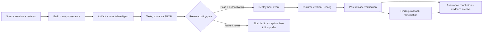

# Release evidence: xây dựng bộ bằng chứng bảo đảm cho mỗi lần phát hành

## 1. Release evidence là gì?

**Release evidence** là tập **bản ghi, kết quả kiểm thử, dữ liệu nguồn, tài liệu phê duyệt và chứng cứ thực thi** được liên kết với **một bản phát hành cụ thể** để người có thẩm quyền đánh giá liệu bản phát hành đó đã đáp ứng các điều kiện bảo mật, chất lượng và vận hành được phê duyệt hay chưa.

Một bộ bằng chứng phát hành có giá trị không chỉ trả lời “pipeline có màu xanh không?” mà phải trả lời rõ hơn:

- **Phát hành cái gì?** Mã nguồn, artifact, container image, cấu hình, dữ liệu và thành phần phụ thuộc nào thực sự được đưa đi?
- **Xây dựng như thế nào?** Job, runner, toolchain, dependency, tham số và chính sách nào tạo ra artifact?
- **Đã kiểm tra điều gì?** Những thử nghiệm và scan nào có kết quả gì, đúng trên artifact và phạm vi nào?
- **Ai quyết định?** Phê duyệt được đưa ra theo đúng thẩm quyền, đối tượng và thời điểm không?
- **Đã triển khai ở đâu?** Môi trường, account, cluster, region, tenant và phiên bản đang chạy có khớp bản đã kiểm tra không?
- **Sau phát hành ra sao?** Đã xác nhận chức năng, security controls, telemetry, rollback và những rủi ro còn lại chưa?

Ví dụ, một bản phát hành ứng dụng học trực tuyến có log `build succeeded` nhưng container được deploy được build lại từ nhánh khác sau kiểm thử. Kết quả CI trước đó **không tự chứng minh** container đang chạy là bản đã được đánh giá. Cần nối **source revision → build run → artifact digest → test result → decision → deployment → runtime verification**.

Trong chương **Release assurance** của module **SECURITY_SECURITY_ASSURANCE**, việc xây dựng release evidence là một kỹ năng trung tâm để **đánh giá có bằng chứng rằng hệ thống đáp ứng mục tiêu bảo mật**, từ phân tích rủi ro, yêu cầu, security controls, kiểm thử và audit đến khắc phục finding. Bài học tập trung vào **thiết kế, thu thập, đánh giá và duy trì tính tin cậy** của chứng cứ phát hành, không chỉ lập một checklist để lưu trữ.

Sau bài học, người học có thể:

1. Phân biệt release artifact, release evidence, approval, attestation, test result và kết luận assurance.
2. Xây dựng **release evidence contract** quy định nguồn, định danh, phạm vi, phiên bản, thời điểm, tiêu chí và người chịu trách nhiệm.
3. Truy vết artifact từ source tới build, scan, kiểm thử, phê duyệt, triển khai và giám sát sau release.
4. Xác minh các giới hạn của hash, chữ ký số, provenance, SBOM và scanner report.
5. Thiết kế chính sách phát hành theo rủi ro, xử lý missing/failed evidence, ngoại lệ và emergency release.
6. Kiểm tra thực tế tính đầy đủ, toàn vẹn, khả năng tái lập và giá trị kết luận của gói chứng cứ.

## 2. Release evidence là một phần của lập luận assurance

Một **assurance claim** cho release có thể là:

> “Phiên bản `order-api@2.8.0` được triển khai tới production trong phạm vi đã xác định, tương ứng với artifact đã được tạo bằng quy trình build được kiểm soát, đã hoàn thành các phép kiểm tra bắt buộc và được cho phép phát hành theo chính sách có hiệu lực.”

Đây là **tuyên bố cần hỗ trợ**, không tự động là sự thật vì xuất hiện trong release note. Một lập luận điển hình có các điều kiện:

| Điều kiện cần hỗ trợ | Câu hỏi | Evidence chủ yếu |
|---|---|---|
| **Đúng nguồn** | Artifact đến từ revision và repository được duyệt? | Commit ID, merge history, source provenance |
| **Đúng quá trình build** | Build chạy trong workflow được kiểm soát? | CI run ID, workflow ref, builder identity, provenance |
| **Đúng artifact** | Artifact được test có phải artifact được phát hành? | Digest, artifact registry, attestation subject |
| **Đủ kiểm tra** | Test/scan bao phủ yêu cầu bảo mật và điều kiện release? | Test reports, scan results, policy evaluation |
| **Quyết định hợp lệ** | Đúng người/quy tắc cho đúng bản và scope? | Approval event, risk tier, conditions |
| **Triển khai đúng đích** | Runtime có chạy digest và config đã cho phép? | Deployment audit, runtime inventory, config snapshot |
| **Theo dõi sau phát hành** | Không có vi phạm guardrail hoặc hậu quả chưa được xử lý? | Canary metrics, telemetry, validation, incidents |
| **Quản lý giới hạn** | Các gap/exception đã được ghi và giải quyết đúng thẩm quyền? | Exception register, finding, risk decision |

Những evidence này phải được kết nối bằng **ID, phiên bản và mối quan hệ nhân quả**, không chỉ bỏ chung một thư mục.

### 2.1. Phân biệt các loại kết quả

- **Evidence available:** dữ liệu hoặc tài liệu đã được thu thập.
- **Evidence valid:** chứng cứ có nguồn và phạm vi đáng tin, không mâu thuẫn điều kiện bắt buộc.
- **Test passed:** một phép thử cụ thể đạt tiêu chí trên input/version xác định.
- **Release authorized:** quyết định cho phép phát hành đúng scope và thời điểm.
- **Release deployed:** đã có sự kiện triển khai artifact vào một môi trường.
- **Release verified:** trạng thái triển khai và hậu quả được đánh giá theo yêu cầu sau deploy.
- **Release assurance supported:** toàn bộ claim cần thiết có đủ cơ sở, ngoại lệ và giới hạn được công khai.

Không dùng trạng thái `approved` của ticket để suy ra tất cả test đã đạt. Không dùng trạng thái `deployed` để suy ra bản đang chạy an toàn; cũng không vì có mọi file trong manifest mà tự kết luận kiểm soát hiệu quả.

## 3. Chuỗi truy vết của một bản phát hành

Một sơ đồ tổng quan:



Các cạnh là **liên kết cần chứng minh**, không phải giả định. Ví dụ:

- Từ `source_revision` tới `build_run`: build log hoặc provenance phải gắn đúng nguồn.
- Từ `build_run` tới `artifact_digest`: output digest phải thuộc run, không chỉ là tag `latest`.
- Từ `artifact_digest` tới `scan_report`: scanner phải phân tích đúng subject hoặc có giải thích về phương pháp mapping.
- Từ `approval` tới `deployment`: quyết định phải hợp lệ với bản, scope và thời điểm triển khai.
- Từ `deployment` tới `runtime`: phải có kiểm tra trạng thái thực, không chỉ dựa trên request tới orchestrator.

Một lỗ hổng giữa hai cạnh có thể làm giảm assurance của cả release dù những bản ghi riêng lẻ đều hợp lệ.

## 4. Định danh release: tag, version và digest không giống nhau

Một release thường có nhiều định danh:

| Định danh | Thường dùng để | Giới hạn |
|---|---|---|
| **Product version** | Giao tiếp với người dùng và quản lý tương thích | Có thể được build lại với artifact khác |
| **Release ID** | Nhóm các artifact/config/change trong một đợt | Cần mapping sang từng thành phần |
| **Git tag/branch** | Tham chiếu nguồn thuận tiện | Có thể bị sửa nếu không bảo vệ; không đại diện toàn bộ build input |
| **Commit SHA** | Chỉ một revision trong hệ thống quản lý phiên bản | Không tự chứng minh builder, dependencies hoặc artifact output |
| **Build run ID** | Truy vết một lần chạy pipeline | Một run có thể tạo nhiều outputs |
| **Artifact digest** | Định danh nội dung artifact qua hàm băm | Không tự chứng minh nội dung an toàn hoặc được build từ nguồn nào |
| **Container image tag** | Địa chỉ dễ đọc trong registry | Có thể được gán lại; cần resolve sang digest |
| **Deployment ID** | Định danh một hành động rollout | Có thể triển khai nhiều artifact hoặc một phần thành công |
| **Runtime revision** | Điều thực sự đang chạy tại một thời điểm | Có thể khác trạng thái yêu cầu khi rollout chưa xong |

**Một release ID có thể cần một manifest nhiều thành phần**: backend image, frontend assets, migration scripts, IaC revision, policy bundle, feature flags và cấu hình runtime. Không giả định “một phiên bản ứng dụng = một file”.

### 4.1. Ví dụ định danh tối thiểu

Một gói chứng cứ có thể ghi:

- `release_id: REL-2026-044`
- `service_id: learning-order-api`
- `source_revision: <full-commit-id>`
- `build_run_id: ci-run-7421`
- `artifact_uri: registry.example.invalid/order-api@sha256:<digest>`
- `deployment_id: prod-rollout-0931`
- `target_environment: production`
- `release_policy_version: release-policy-v5`

Các giá trị trên chỉ minh họa cấu trúc; `<digest>` là **placeholder, không phải digest thực**. Khi thu thập evidence thật, phải lưu digest đã tính và có khả năng đối chiếu trực tiếp với registry/runtime.

## 5. Release evidence khác Change approval thế nào?

**Change approval** tập trung vào **quyết định cho phép thay đổi**; **release evidence** là **bộ chứng cứ toàn diện cho một bản phát hành**.

Một release có thể gồm nhiều change requests; một change request có thể cần nhiều deployment ở các region, tenant hoặc đợt canary. Vì vậy:

- Approval phải gắn với **đúng phạm vi và artifact**; có phê duyệt không thay thế security tests.
- Release evidence bao gồm **provenance, build integrity, test results, dependency evidence, approval, execution và post-release validation**.
- Nếu deployment không khớp version đã phê duyệt, release evidence phải ghi sai lệch chứ không sửa lại bản ghi duyệt cho trùng.
- Một lần rollback hoặc hotfix có thể là **release event mới** với yêu cầu evidence thích hợp; không mặc định kế thừa trọn gói approval của bản trước.

Đặc biệt, **release được phép** và **release đủ assurance** có thể là hai trạng thái riêng. Có thể một bản emergency được triển khai theo quyền khẩn đã định nghĩa, nhưng một số phép thử chưa kịp chạy; hồ sơ cần thể hiện phần chưa biết, rủi ro và kế hoạch hoàn tất xác minh.

## 6. Thiết kế release evidence contract

**Evidence contract** là đặc tả các bằng chứng **bắt buộc hoặc điều kiện** cho từng loại release, với định nghĩa trường, nguồn, tần suất, phương pháp kiểm tra và tiêu chí sử dụng.

| Trường trong contract | Nội dung |
|---|---|
| `release_id` | Định danh release và mối liên hệ change/deployment |
| `scope` | Service, repo, artifact, environment, region, tenant, data |
| `release_type` | Planned, standard, emergency, hotfix, rollback, config-only... |
| `risk_tier` | Mức rủi ro theo policy có hiệu lực |
| `required_claims` | Các phát biểu phải được hỗ trợ trước/sau deploy |
| `required_evidence_items` | Source/build/test/scan/approval/deploy/monitoring |
| `authoritative_sources` | Hệ thống nguồn chính và cách truy xuất |
| `subject_binding` | Khóa liên kết bằng chứng tới artifact/diff/version |
| `temporal_semantics` | As-of, thời kỳ, expiry, thời gian test và cutoff |
| `acceptance_rules` | Pass/fail/inconclusive, ngưỡng và điều kiện chặn |
| `quality_requirements` | Completeness, provenance, signature verification, data lag |
| `exception_process` | Thẩm quyền, hạn, rủi ro, bù trừ và retest |
| `owners` | Người tạo bằng chứng, reviewer, release authority, risk owner |
| `retention_and_access` | Nơi lưu, hạn, phân quyền, bảo mật và audit trail |
| `review_triggers` | Khi code/config, pipeline, dependency hoặc scope đổi |

Không nhất thiết có hàng trăm item cho mọi thay đổi; contract nên **risk-based và có phần bắt buộc tối thiểu**. Những phần không áp dụng phải có căn cứ và thẩm quyền, không mặc định `N/A` vì công cụ không xuất được.

### 6.1. Bộ yêu cầu nền tảng thường có

Một bộ evidence cơ bản có thể gồm:

1. Định danh chính xác release và artifact được deploy.
2. Source revision và lịch sử review phù hợp.
3. Build run và provenance/builder theo mức bảo đảm yêu cầu.
4. Test outcomes và coverage theo policy.
5. Security scans và cách xử lý phát hiện trọng yếu.
6. Dependency/SBOM hoặc thông tin thành phần theo yêu cầu áp dụng.
7. Phê duyệt/decision có thẩm quyền và các exception hợp lệ.
8. Deployment audit, runtime version, post-deploy checks.
9. Findings, rollback/recovery và kết quả sau phát hành.
10. Manifest, metadata nguồn, retention và khả năng tái kiểm toán.

Đây là **khung gợi ý**; tổ chức cần điều chỉnh theo threat model và nghĩa vụ, không gắn nhãn một danh sách cố định là “bộ bằng chứng bắt buộc cho mọi hệ thống”.

## 7. Evidence tại tầng source control

Với release dựa trên code, cần xác định **đúng nguồn được đưa vào build**:

- Repository và tổ chức sở hữu, URL hoặc định danh nội bộ đã kiểm soát.
- Commit ID đầy đủ, tag và lịch sử bảo vệ tag/branch.
- Pull request hoặc change set, author/reviewer, bản diff đã review.
- Review status, checks bắt buộc, branch protection có hiệu lực tại thời điểm merge.
- Các commit bổ sung sau review, cách invalidate approval.
- Thay đổi đặc quyền như CI workflow, policy evaluator, deployment manifest, secrets references.
- Thành phần sinh tự động hoặc lấy từ upstream không nằm trong repo chính.
- Quyền push, merge và quyền admin sửa quy tắc review.

Ví dụ, báo cáo scan trên commit `A` không tự áp dụng cho release từ commit `B` nếu B có thay đổi dependencies hoặc build scripts. Kể cả khi mã nguồn ứng dụng giống nhau, một workflow đã đổi có thể thay đổi toolchain và output.

### 7.1. Source review không chứng minh toàn bộ artifact

Commit hash nhận diện **nội dung trong repository**, không chứng minh:

- Các package tải khi build đúng phiên bản đã dự kiến.
- Build chạy trên runner đáng tin.
- Một binary blob trong dependency cache không bị thay.
- Artifact chưa bị thay giữa build và release.
- Deploy thực sự chạy artifact đã được review.

Vì vậy source evidence là **một mắt xích**, không phải kết luận supply-chain integrity cuối cùng.

## 8. Build evidence và provenance

**Build provenance** mô tả **artifact được tạo từ nguồn nào, bằng quy trình và môi trường gì, bởi thực thể nào, với input và output nào**. Nó giúp người đánh giá truy vết từ sản phẩm được phát hành về quá trình tạo ra nó.

Thông tin có giá trị:

| Nhóm | Metadata |
|---|---|
| **Identity** | Pipeline/project ID, builder identity, run ID |
| **Source** | Repository, revision, nhánh/tag và policy để lấy nguồn |
| **Invocation** | Workflow version, build parameters, trigger, actor |
| **Materials** | Dependencies, base images, build tools, configuration inputs |
| **Environment** | Runner type, isolation/trust boundary, quyền và secrets handling |
| **Outputs** | Artifact IDs, digests, target registry và publish event |
| **Timestamp** | Build start/end, provenance emission time |
| **Integrity/authenticity** | Signature/attestation và dữ liệu để xác minh người ký |
| **Policy** | Quy tắc builder được tin cậy, nguồn được phép và điều kiện gate |

Một CI log ghi “build from branch main” thường kém tin cậy hơn một record có **commit bất biến và output digest** gắn với một builder identity có thể xác minh. Tuy nhiên, **provenance được tạo bởi một runner có thể bị kẻ tấn công điều khiển** vẫn có giới hạn; độ tin cậy phải xét cả **nơi sinh provenance, quyền ký, khả năng sửa log và bảo vệ pipeline**.

### 8.1. Source-to-artifact là quan hệ cần kiểm chứng

Một claim ví dụ:

> “Image `sha256:...` trong registry được tạo bởi pipeline cho phép từ commit S, với các input và policy đã được phê duyệt.”

Các phép kiểm tra tương ứng:

1. Chữ ký/attestation có subject là **digest đang định phát hành**.
2. Builder identity thuộc danh sách được tổ chức tin cậy.
3. Workflow và source revision đúng rule.
4. Input quan trọng được ghi và không có dependence không kiểm soát trái policy.
5. Provenance được phát hành cùng thời điểm build hoặc có chứng cứ nguồn phù hợp.
6. Registry không thay subject giữa lúc duyệt và triển khai.

**Build reproducibility** (khả năng tạo lại cùng output từ các input/điều kiện xác định) là một thuộc tính có giá trị nhưng **không phải điều kiện mặc định của mọi release**. Một số build có timestamp, metadata hoặc nguồn không hoàn toàn deterministic. Khi yêu cầu reproducibility, phải định nghĩa phạm vi và cách đối chiếu, không tự coi hai build khác digest là bằng chứng tấn công.

## 9. Artifact digest, checksum và chữ ký số

Ba khái niệm có vai trò khác nhau:

| Cơ chế | Có thể hỗ trợ | Không tự chứng minh |
|---|---|---|
| **Hash/checksum** | Hai bản dữ liệu có cùng nội dung khi so theo hàm băm phù hợp | Ai tạo file, nguồn code, kiểm thử và tính an toàn |
| **Digital signature** | Một thực thể nắm khóa đã ký dữ liệu/subject; hỗ trợ phát hiện sửa đổi | Người ký đã review đúng nội dung hoặc ký trong hệ thống đáng tin |
| **Signed attestation** | Một chủ thể tuyên bố metadata về subject theo định dạng có kiểm chứng | Mọi trường metadata đều đúng nếu nguồn sinh có thể bị chiếm |

Để kiểm chứng chữ ký hoặc attestation phải xem **đúng subject digest, identity/key, trust root, chính sách chấp nhận, thời điểm và trạng thái chứng thực**. Chữ ký hợp lệ bởi một khóa không thuộc trust policy không nên được coi là pass.

Nếu lưu `image:app:latest`, tag có thể bị thay; nên resolve và đối chiếu **image digest**. Nếu release cần nhiều artifact, mỗi artifact có digest và evidence riêng.

### 9.1. Ví dụ kiểm tra checksum đơn giản

Trên môi trường có công cụ `sha256sum`, có thể tính hash file:

```bash
sha256sum dist/order-api.jar
```

Trên PowerShell, có thể dùng:

```powershell
Get-FileHash -Algorithm SHA256 -LiteralPath ".\dist\order-api.jar"
```

Hai lệnh chỉ **tính hash của file đang có**. Chúng không xác minh nguồn, không quét mã độc, không xác thực release authorization. Để kiểm tra integrity, phải so hash với **giá trị chuẩn được lưu và bảo vệ độc lập**, không chỉ tính một hash rồi tự cho rằng file hợp lệ.

## 10. Software Bill of Materials (SBOM) và dependency evidence

**SBOM** là danh mục thành phần phần mềm và quan hệ phụ thuộc trong một sản phẩm/build theo phạm vi và định dạng đã định. Những định dạng thường gặp là **SPDX** và **CycloneDX**; lựa chọn tùy công cụ, nghĩa vụ và nhu cầu đối chiếu.

Các câu hỏi assurance quan trọng:

- SBOM có gắn với **đúng artifact digest/build** hay chỉ là danh sách dependencies từ repository?
- Có cả direct, transitive dependencies và thành phần thực sự được đóng gói không?
- Có bao phủ base image, runtime libs, native binaries, vendored code hoặc dynamic-loaded components cần thiết?
- Thành phần có định danh và version đủ để đối chiếu cảnh báo không?
- SBOM sinh khi nào, bằng công cụ nào, và có thể kiểm tra provenance không?
- Có trường hợp thiếu/unknown component được báo minh bạch không?
- Khi một dependency được cập nhật sau build, SBOM cũ có còn áp dụng?

**SBOM không phải scan report và cũng không phải danh sách lỗ hổng đã xử lý.** Một SBOM đầy đủ giúp quan sát thành phần; việc đánh giá CVE, exploitability, license/usage hoặc nghĩa vụ khác cần quy trình và dữ liệu bổ sung.

### 10.1. Dependency lock file chưa phải toàn bộ SBOM

Một lock file hỗ trợ việc ghi phiên bản dependency được resolver chọn, nhưng có thể không thấy thư viện đã được build sẵn trong base image hoặc binary độc lập. Một SBOM chỉ chạy trên source có thể thiếu runtime components; ngược lại, phân tích binary/image có thể không đủ metadata để nhận diện tất cả package. Có thể cần kết hợp các nguồn và ghi **phạm vi/giới hạn**.

## 11. Evidence cho security testing

Release evidence phải thể hiện **test nào đã chạy, trên input/version nào, điều kiện nào và kết quả gì**.

| Loại test | Claim thường hỗ trợ | Evidence mong đợi | Giới hạn |
|---|---|---|---|
| **Unit tests** | Logic đơn vị đáp ứng các trường hợp kiểm thử | Test runner result, commit/artifact ref | Không đủ chứng minh an toàn end-to-end |
| **Integration tests** | Các thành phần liên hệ đúng | Run ID, môi trường, fixtures, kết quả | Có thể khác production |
| **Authentication/authorization tests** | Quyền truy cập đúng role và chính sách | Positive/negative results, identity scope | Dễ bỏ qua đường API/legacy |
| **SAST** | Phân tích tĩnh phát hiện một số mẫu lỗi trong source | Tool/version, rule set, report, finding disposition | False positive/false negative; không bao phủ mọi hành vi |
| **DAST/API testing** | Kiểm tra hành vi runtime ở endpoint thuộc scope | Target build/version, URL scope, result | Có thể thiếu endpoint hoặc yêu cầu auth phức tạp |
| **SCA/dependency scanning** | Đánh giá thành phần theo cơ sở dữ liệu phát hiện | SBOM/dependency set, tool/db timestamp, findings | Không chứng minh exploitability của mọi finding |
| **Container/IaC scanning** | Kiểm tra image/config/policy | Digest/manifest, rules, severity | Snapshot có thể lệch runtime |
| **Secret scanning** | Tìm dấu hiệu secret bị lộ trong scope | Rule scope, finding review, result | Không bảo đảm không còn secret ở nơi không quét |
| **Threat-based security tests** | Kiểm tra đường tấn công cụ thể | Threat ID, test case, evidence và limits | Chỉ hỗ trợ kịch bản đã thử |
| **Performance/resilience tests** | Độ ổn định, tải, failure handling | Workload profile, metrics, test environment | Không tự chứng minh mọi production condition |

Một bản scan với `0 critical` không có nghĩa **không có lỗ hổng nghiêm trọng**. Cần xem coverage, dữ liệu scanner, exclusions, suppression, run failure và thời gian cập nhật. Một lần chạy `success` có thể chỉ có nghĩa **công cụ hoàn thành**, không phải “mọi finding đã được xử lý”.

### 11.1. Mapping test với requirement

Ví dụ requirement: “Không có đường API quản trị production cho phép một danh tính ngoài role được duyệt thực hiện thao tác thay đổi cấu hình.”

Evidence mạnh hơn khi có:

1. Danh mục API thuộc scope và phương thức yêu cầu quyền.
2. Positive test cho danh tính được cấp quyền.
3. Negative test cho danh tính không được phép.
4. Test quyền thừa hoặc tenant cross-boundary theo threat model.
5. API/build version và policy configuration.
6. Kết quả thực tế, test ID, thời gian, môi trường và giới hạn.
7. Test sau release nếu config/proxy/runtime ảnh hưởng enforcement.

Một bộ unit test authentication toàn pass nhưng chưa thử endpoint đặc quyền **không đủ** cho claim cụ thể này.

## 12. Vulnerability evidence và quyết định về findings

Release không phải lúc nào cũng yêu cầu “không còn bất kỳ finding nào”. Điều kiện quyết định phải dựa trên **chính sách rủi ro có hiệu lực**, yêu cầu nghĩa vụ và cách xử lý phát hiện.

Mỗi finding quan trọng nên có:

- Finding ID, loại, asset/component/version, artifact digest hoặc scope.
- Severity và **căn cứ xếp mức**, kết hợp exposure, tài sản, khả năng khai thác và hậu quả khi thích hợp.
- Nguồn scan, phiên bản tool/database, mốc phát hiện.
- Trạng thái: open, fixed, false positive có kiểm chứng, not applicable có căn cứ, exception hợp lệ hoặc cần điều tra.
- Owner, hạn, liên kết remediation, cách kiểm thử lại.
- Kết quả kiểm tra trên **artifact phát hành**, không chỉ bản source trước đó.
- Quyết định khi finding còn tồn: release block, giảm phạm vi, kiểm soát bù, hoãn, hoặc chấp nhận rủi ro đúng thẩm quyền nếu được phép.

Không tự coi một **false positive** chỉ vì nhóm phát triển viết comment “không khai thác được”. Phải có phân tích, evidence và reviewer phù hợp. Tương tự, “scanner không thấy” khác “đã test đường khai thác trong điều kiện thực”.

### 12.1. Freshness và thay đổi cơ sở dữ liệu vulnerability

Một image không đổi digest nhưng **kết quả scan có thể thay đổi** khi cơ sở dữ liệu lỗ hổng cập nhật. Release evidence phải ghi `scanned_at`, nguồn dữ liệu/rules và policy thời điểm đánh giá. Với artifact có tuổi cao hoặc bản phát hành kéo dài, có thể cần **re-scan** trước deploy hoặc giám sát sau release theo rủi ro.

Kết quả scan cũ không phải chứng cứ vô thời hạn rằng image hiện không có rủi ro đã biết.

## 13. Evidence cho container, IaC và cấu hình runtime

Không phải toàn bộ thay đổi có trong source binary. Release có thể đổi:

- Container base image, entrypoint, runtime user, filesystem permission.
- Kubernetes Deployment, Service, admission policies, RBAC, secret refs.
- Terraform/IaC module, security group, DNS, load balancer, routes.
- Feature flags, environment variables, config maps, runtime overrides.
- Datastore migration, retention, replication, backup schedule.
- IAM bindings, service account roles và trust relationships.
- WAF/SIEM/EDR policies ảnh hưởng bảo vệ dịch vụ.

Các evidence item nên bao gồm:

| Hạng mục | Evidence cần chú ý |
|---|---|
| **IaC plan/diff** | Nội dung thay đổi, resource ID, account, policy validation |
| **IaC apply** | Người thực thi, target, kết quả, thực tế được apply |
| **Kubernetes manifest** | Manifest hoặc revision đã chấp thuận, admission result |
| **Image** | Digest đã quét, registry, chính sách ký/provenance |
| **Runtime configuration** | Snapshot nguồn có thể truy vết sau rollout |
| **IAM** | Role delta, người phê duyệt, grant event |
| **Network** | Source/destination/cổng, kiểm tra negative path |
| **Secrets** | Ref tới secret manager, quyền và rotation; không lưu secret value |
| **Telemetry** | Collector, các event bắt buộc, rule health và retest |

**Planned state** khác **applied state**. Terraform plan có thể được duyệt, nhưng apply trên workspace khác hoặc resource thay đổi giữa plan/apply có thể tạo kết quả ngoài dự định. Cần gắn kết quả thực thi với plan, trạng thái và policy.

## 14. Database migration và data release evidence

Với release thay đổi dữ liệu, bằng chứng “unit tests passed” thường không đủ. Các rủi ro gồm **mất dữ liệu, sai thứ tự giao dịch, gián đoạn, rò rỉ hoặc không thể rollback**.

Bộ evidence gợi ý:

1. **Migration ID, script digest và thứ tự chạy**; mapping sang service/version và schema mục tiêu.
2. **Data impact assessment:** bảng, trường, loại dữ liệu, số bản ghi dự kiến, tác động riêng tư.
3. **Pre-migration validation:** schema hiện tại, constraints, backup/restore readiness.
4. **Compatibility test:** triển khai tuần tự app/database, khả năng đọc/ghi qua giai đoạn chuyển tiếp.
5. **Rollback/roll-forward plan:** ranh giới dữ liệu có thể đảo ngược, thời gian và điều kiện kích hoạt.
6. **Execution audit:** script đã chạy, actor, thời gian, database ID, count/transaction status.
7. **Post-migration reconciliation:** tổng số bản ghi, checksum logic/consistency, kiểm tra dữ liệu trọng yếu.
8. **Error/exception evidence:** record thất bại, xử lý duplicate, missing data và remediation.

Một migration `DROP COLUMN` có thể không đảo ngược được chỉ bằng rollback code ứng dụng. Release authority phải biết **hậu quả của một rollback giả định** và có biện pháp phục hồi/roll-forward phù hợp.

Nếu dữ liệu nhạy cảm xuất hiện trong migration logs, evidence phải được **tối thiểu hóa và bảo vệ**, không đẩy nguyên trạng vào hệ thống ticket hoặc kho artifact mở rộng.

## 15. Release approval và quyết định phát hành

Một **release decision** nên được đưa ra từ trạng thái **evidence readiness**, khác với việc người duyệt nhìn tên release và nhấn Approve.

Một quyết định tốt xác định:

- Phạm vi: release ID, artifact digests, môi trường, region/tenant, change IDs.
- Policy và các điều kiện bắt buộc theo risk tier.
- Danh sách test/scan và kết quả đã review, trường hợp bị chặn.
- Finding/exception còn mở và rủi ro còn lại.
- Kế hoạch triển khai, canary/rollback, điều kiện dừng.
- Người duyệt, thẩm quyền, SoD và thời điểm.
- Thời hạn hiệu lực và trigger duyệt lại nếu code/config/artifact thay đổi.

**Phê duyệt bản A không tự bao phủ bản B.** Nếu dependency bị cập nhật, build lại image hoặc thay config có tác động, hệ thống cần đánh giá lại những evidence liên quan. Một quyết định không gắn digest có thể bị sử dụng cho artifact khác.

**Emergency/hotfix** có thể theo đường rút gọn đã được phê duyệt trước trong chính sách. Nhưng phải ghi **điều kiện khẩn, quyền quyết định, bằng chứng tối thiểu, mục thiếu và lịch retrospective review/retest**, không tạo approval “lùi giờ” để giả quy trình bình thường.

## 16. Policy gate: chỉ cho phép release khi điều kiện được chứng minh

Một release gate phù hợp nên làm rõ các **invariants**:

- Artifact đã được định danh và source/build provenance đạt chính sách.
- Security checks bắt buộc đã **thực sự chạy trên subject cần phát hành**.
- Kết quả test còn hiệu lực theo source/artifact/config đã đánh giá.
- Findings vượt mức được phép đã được xử lý hoặc có quyết định hợp lệ theo nguồn yêu cầu.
- Release authorization áp dụng đúng artifact digest, scope, environment, thời điểm.
- Nhà phát hành/deployer có quyền phù hợp và không thể tự bỏ qua gate không để lại dấu vết.
- Khi evidence không có, thất bại hoặc không xác minh được, **không tự đánh dấu pass**.

```text
function releaseGate(manifest, subject, target, context):
    require manifest.release_id != null
    require subject.digest == manifest.approved_artifact_digest
    require source_and_build_provenance_verified(subject)
    require required_test_results_valid_for(subject, target)
    require required_scan_results_valid_for(subject, context.policy_version)
    require all_mandatory_claims_supported()
    require all_blocking_findings_resolved_or_validly_handled()
    require release_decision_authorized_for(subject, target)
    require no_material_change_since_evidence_cutoff()
    require required_data_quality_and_audit_sources_healthy()
    return ALLOW

on failed_requirement_or_unknown:
    record_reason_and_policy_version()
    return DENY_OR_APPROVED_EXCEPTION_PATH
```

Đây là **pseudocode minh họa**, không phải thư viện hay API đã được kiểm thử. Trong triển khai thật, cần xử lý **atomicity, thời điểm kiểm tra ngay trước deploy, race conditions, signer trust, quyền sửa policy và các đường deploy ngoài pipeline**.

Nếu policy cho phép phê duyệt có điều kiện, gate chỉ nên mở khi **các điều kiện của quyết định đã được thỏa** hoặc đường ngoại lệ có hiệu lực; không chỉ kiểm tra trạng thái ticket là `approved`.

## 17. Chống TOCTOU và đổi artifact sau khi kiểm tra

**TOCTOU (time-of-check to time-of-use)** xảy ra khi trạng thái hoặc đối tượng tại thời điểm kiểm tra **khác** trạng thái hoặc đối tượng được sử dụng lúc triển khai.

Các kịch bản:

1. Test image tag `v2`, sau đó tag được trỏ sang digest khác.
2. Scanner chạy với build A, release job build lại từ cùng branch sau khi dependency thay.
3. Approval được cấp cho manifest revision 10, pipeline deploy revision 11.
4. IaC plan được duyệt nhưng tài nguyên drift trước `apply`.
5. Security gate pass trước khi một exception hết hạn.
6. Feature flag hoặc runtime config bị thay ngay sau deploy.

Biện pháp phù hợp:

- **Promote cùng artifact digest đã test**, hạn chế rebuild giữa môi trường.
- Xác minh chữ ký/provenance/scan **theo subject digest**, không chỉ tên tag.
- Bind decision với manifest, config, môi trường và scope.
- Kiểm tra điều kiện có hiệu lực ngay trước deploy, có log kiểm chứng.
- Ghi deployment audit và so runtime digest/config sau rollout.
- Theo dõi drift hoặc thay đổi ngoài pipeline, đặc biệt với quyền và security controls.

Ngay cả khi artifact digest không đổi, **thay feature flag, secret reference hoặc external service dependency** vẫn có thể đổi hành vi hệ thống. Contract phải mô tả ranh giới của cái được approval và cái còn phải xác minh lúc runtime.

## 18. Deployment evidence: từ intent tới trạng thái thực tế

Một deployment record nên có:

| Trường | Lý do |
|---|---|
| `deployment_id` | Định danh rollout, bao gồm retry và partial results |
| `release_id`, `change_id` | Liên kết release và authorization |
| `environment`, `target_ids` | Cloud account, cluster, region, namespace, tenant |
| `started_at`, `completed_at` | Thời điểm thực thi, chuẩn hóa UTC |
| `actor` / `workload_identity` | Người hoặc job triển khai, thẩm quyền |
| `artifact_digests` | Các outputs triển khai thực, không chỉ tag |
| `config_revision` | Manifest/IaC/feature flags và version policy |
| `deployment_method` | Pipeline, manual, blue-green, canary, rollback |
| `status`, `errors` | Thành công, thất bại một phần, retry hoặc hủy |
| `post_deploy_checks` | Kết quả smoke, bảo mật và dữ liệu |
| `audit_source` | Log từ orchestrator/cloud/registry và query |
| `observed_runtime_state` | Những gì đang chạy sau rollout |

Nếu hệ thống deployment trả `success` nhưng một số replica còn image cũ, kết luận “100% phiên bản mới đã chạy” là quá mức. Cần đối chiếu **actual runtime inventory**; tỷ lệ rollout, canary và phần chưa quan sát được phải được nêu rõ.

### 18.1. Population deployment

Muốn kiểm tra **mọi release production có evidence**, đừng bắt đầu từ danh sách release ticket. Bắt đầu từ **population deployment thực tế** từ CI/CD, Kubernetes/cloud audit, IAM/config change, registry pulls và các nguồn độc lập phù hợp. Sau đó đối chiếu từng event với release ID và manifest. Nếu tồn tại deployment không có release record, đây có thể là **bypass hoặc evidence gap**, cần điều tra.

## 19. Post-release evidence và xác minh ở runtime

Một artifact đã qua CI vẫn có thể tạo rủi ro khi chạy trong production:

- Permission runtime rộng hơn cấu hình test.
- Secrets hoặc môi trường không đúng như dự kiến.
- Network policy được áp dụng khác IaC plan.
- Logging collector/alert bị lỗi sau rollout.
- Database migration thành công về câu lệnh nhưng dữ liệu nghiệp vụ sai.
- Canary tốt, nhưng tải thực tế hoặc một region khác gặp lỗi.
- Công cụ deployment hoàn thành nhưng dịch vụ chưa đạt readiness về bảo mật hoặc chức năng.

Các nhóm post-release evidence:

| Nhóm | Chứng cứ phù hợp | Claim giới hạn |
|---|---|---|
| **Version integrity** | Runtime digest/config snapshot | Đúng artifact/config tại thời điểm quan sát |
| **Functional health** | Smoke tests, SLO checks, canary outcomes | Chức năng được thử hoạt động trong điều kiện đo |
| **Security posture** | IAM/policy snapshot, config drift, network checks | Guardrails được áp dụng cho scope đã quan sát |
| **Telemetry** | Log ingestion, detection rule health, synthetic events | Có năng lực quan sát theo kịch bản được kiểm tra |
| **Data integrity** | Migration reconciliation, domain checks | Dữ liệu đạt các tiêu chí đã định |
| **Dependency health** | Database, queue, KMS, third-party connectivity | Phụ thuộc cần thiết hoạt động trong cửa sổ kiểm tra |
| **Operational handoff** | Runbook, on-call, rollback readiness | Đội vận hành có cơ sở phản ứng sau phát hành |
| **Finding tracking** | Exceptions, bugs, incidents, retests | Sai lệch được ghi và có owner |

**Không có incident sau một giờ** không chứng minh bản phát hành không có lỗi bảo mật. Cần ghi cửa sổ quan sát và giới hạn khả năng phát hiện.

## 20. Canary, progressive delivery và quyết định dừng

Với release rủi ro cao, tổ chức có thể dùng canary, blue-green hoặc triển khai theo giai đoạn để **giảm blast radius**. Evidence nên liên kết:

1. Artifact digest duy nhất hoặc mapping chính xác giữa các stage.
2. Nhóm người dùng/traffic/region canary, thời gian và đặc điểm tải.
3. Chỉ số trước/sau, error budget, latency, security telemetry.
4. Những kiểm thử bắt buộc cho auth, data integrity và security controls.
5. Quy tắc **promote, hold, abort hoặc rollback** đã được duyệt.
6. Người hoặc automation đưa ra quyết định với lý do và audit event.
7. Kết quả sau khi mở rộng traffic, không chỉ kết quả ở canary.

Ví dụ, một canary 5% traffic không có lỗi **không tự chứng minh** các đường dành riêng cho administrator hoặc khách hàng ở region khác đã được kiểm tra. Cần xác định **điều kiện canary đủ đại diện** cho risk scenario nào, và cần test riêng cho đường không được kích hoạt trong canary.

### 20.1. Guardrails không chỉ là chỉ số hiệu năng

Một rollout có thể được dừng vì:

- Tăng lỗi xác thực hoặc từ chối quyền bất thường.
- Sự kiện audit bắt buộc biến mất.
- Dữ liệu migration lệch checkpoint.
- Policy IAM/network bị nới sai phạm vi.
- Canary xuất hiện vi phạm dữ liệu hoặc cảnh báo bảo mật nghiêm trọng.
- Không thể xác minh runtime digest đúng subject.

Quy tắc dừng phải liên kết với mức rủi ro và thẩm quyền, không chỉ dùng `HTTP 200` làm dấu hiệu thành công.

## 21. Rollback, recovery và evidence sau thất bại

Rollback là **một hành động thay đổi** cần có evidence. “Rollback successful” chỉ có ý nghĩa nếu người đánh giá biết trạng thái sau đó.

Các bằng chứng gợi ý:

- Trigger và sự kiện quyết định rollback, người có quyền và thời gian.
- Artifact và config trước/sau; digest nào đang chạy.
- Dữ liệu nào có thể phục hồi, bước nào bất khả nghịch.
- Trạng thái kết nối downstream, queue, cache và message replay.
- Kết quả kiểm thử chức năng và bảo mật trên bản được khôi phục.
- Việc thu hồi quyền, secrets hoặc kết nối được thêm ở release lỗi.
- Incident/postmortem liên kết với release và các finding cần khắc phục.
- Quyết định phát hành lại và yêu cầu evidence mới.

Đặc biệt với **database migration**, rollback ứng dụng không tự đưa schema/dữ liệu về trạng thái trước. Nếu đã có giao dịch sau khi thay schema, cần chiến lược rollback/roll-forward hoặc khôi phục nhất quán theo RPO/RTO và nghiệp vụ.

Một failed release vẫn phải được **lưu bằng chứng**. Xóa deployment fail khỏi lịch sử để chỉ còn thành công sẽ làm sai population của chương trình assurance.

## 22. Emergency release và hotfix evidence

Một emergency release có thể cần triển khai khi lỗ hổng đang bị khai thác hoặc dịch vụ đang gặp sự cố nặng. Chính sách nên xác định từ trước **đường khẩn được phép** và **bộ evidence tối thiểu không được bỏ**.

Ví dụ tối thiểu theo một chính sách giả định:

| Điều kiện | Evidence cần |
|---|---|
| Tình huống thực sự khẩn | Incident ID, severity, impact, người tuyên bố emergency |
| Ai có quyền triển khai | Actor, emergency authority, sự kiện cấp quyền, expiry |
| Artifact nào | Source ref, build provenance tối thiểu, digest và nơi lưu |
| Rủi ro đã biết | Kiểm thử khả thi, limitations, threat và rollback readiness |
| Quyết định | Mốc, người duyệt/đường khẩn theo policy, lý do |
| Thực thi | Deployment event, runtime digest, health/security checks |
| Hậu kiểm | Review theo hạn, missing tests được chạy lại, finding và remediation |

**Bộ evidence tối thiểu không có nghĩa “tự động compliant”.** Nó giúp quyết định khẩn có thể truy vết và giới hạn; những yêu cầu bắt buộc bị trì hoãn cần có owner, thời hạn, quyết định đúng thẩm quyền và kiểm thử lại.

Không tạo approval lùi ngày để biến hậu kiểm thành pre-deploy approval. Khi policy cho phép retrospective review, hãy thể hiện đúng **nhánh emergency** và thời điểm thực tế.

## 23. Bảo vệ gói release evidence và provenance

Release evidence có thể chứa sơ đồ kiến trúc, thông tin dependency, lỗ hổng, quyền, cấu hình, dữ liệu thử hoặc log nhạy cảm. Cần bảo đảm:

- **Access control:** người tạo, reviewer, auditor, release authority và người vận hành có quyền phù hợp.
- **Separation of duties:** không để người bị đánh giá tự xóa/sửa tất cả evidence và rule kiểm tra.
- **Integrity:** versioning, hash, append-only/immutable retention khi phù hợp, audit log việc thay đổi.
- **Confidentiality:** mã hóa, data minimization, redaction có lý do; không đặt secrets/token/key vào artifact report.
- **Availability:** lưu trong kho có backup/recovery đáp ứng mục tiêu audit, không phụ thuộc duy nhất vào runner tạm.
- **Retention:** theo chính sách, nghĩa vụ hợp đồng/pháp lý và incident hold khi có căn cứ.
- **Provenance:** ai tạo, công cụ/version, phương pháp, input/subject, timestamp, chính sách được dùng.
- **Auditability:** evidence IDs và manifest nhất quán, có cách đối chiếu record gốc.

**Một hash lưu cùng file do cùng người có thể sửa cả hai** không phải bằng chứng độc lập mạnh. Khi độ đảm bảo yêu cầu cao, cần cơ chế nguồn/signer/retention phù hợp để giảm nguy cơ sửa đồng thời artifact và chứng cứ.

Không cần lưu **toàn bộ dữ liệu khách hàng thực** để chứng minh data migration. Có thể lưu row counts, checksum/phép đối chiếu theo tập, ID đã mã hóa phù hợp và kết quả test có kiểm soát; tránh để evidence trở thành điểm rò rỉ mới.

## 24. Release evidence manifest: gắn các phần lại với nhau

Một **evidence manifest** là chỉ mục mô tả **các subject, evidence item, relation và kết quả kiểm tra**. Manifest giúp reviewer không phải đoán file `scan-final-2.json` tương ứng release nào.

Các quan hệ điển hình:

| Thành phần | Liên kết bắt buộc |
|---|---|
| Release ID | Service và phạm vi triển khai |
| Source revision | Build run và review |
| Build run | Artifact digest và builder identity |
| Artifact digest | SBOM, scan/test subject và signature/attestation |
| Approval | Release policy, risk tier, subject, target và validity |
| Deployment | Artifact digest, target và execution actor |
| Runtime observation | Deployment, thời gian, state và config |
| Finding/exception | Test/scan result, owner, risk decision và expiry |
| Post-release checks | Deployment ID và claim đã thử |
| Archive | Evidence URI, digest/verification status, retention |

Một manifest tốt **chỉ là chỉ mục**; không tự thay thế validation logic, nguồn record hoặc chữ ký. Những tham chiếu bị hỏng và evidence không thể mở lại phải được coi là **data-quality gap**.

## 25. YAML mẫu: release evidence bundle

Ví dụ này là **mẫu học tập cho hệ thống quản trị release**, không phải định dạng chuẩn bắt buộc hay cấu hình có thể chạy trực tiếp. Các ID, digest giả và thời gian đều minh họa. Trạng thái cố ý để `pending` vì chưa có chứng cứ thực.

```yaml
release_evidence_bundle:
  release_id: REL-2026-044
  version: "1.0"
  service: learning-order-api
  release_type: normal
  risk_tier: high
  target:
    environment: production
    cloud_account: account-prod-a
    region: region-example
  assurance_status: pending

source:
  repository: repo-learning-order-api
  revision_ref: "example-full-source-revision"
  pull_request_ref: PR-184
  review_evidence_refs: [EV-REVIEW-001]
  source_policy_version: scm-policy-v3

build:
  run_id: CI-RUN-7421
  builder_identity: builder-prod-release
  workflow_ref: release-workflow-v6
  provenance_ref: EV-PROV-002
  build_started_at: "2026-11-28T01:30:00Z"
  build_completed_at: "2026-11-28T01:43:00Z"

subjects:
  - artifact_id: order-api-image
    artifact_uri: "registry.example.invalid/order-api:2.8.0"
    digest: "placeholder-not-a-real-sha256-digest"
    signature_attestation_ref: EV-SIGN-003
    sbom_ref: EV-SBOM-004
    security_scans:
      - evidence_ref: EV-SCA-005
        status: pending_review
      - evidence_ref: EV-CONTAINER-SCAN-006
        status: pending_review

quality_and_security:
  test_result_refs:
    - EV-UNIT-007
    - EV-INTEGRATION-008
    - EV-AUTHZ-009
  test_policy_ref: release-test-policy-v5
  test_assessment: pending
  unresolved_findings: []
  exception_refs: []
  evidence_cutoff_at: null

decision:
  policy_ref: release-policy-v5
  status: not_authorized
  approver_refs: []
  approval_event_ids: []
  authorized_artifact_digests: []
  approved_scope_ref: null

deployment:
  deployment_id: null
  deployment_status: not_started
  runtime_digest_ref: null
  actual_config_ref: null
  audit_evidence_refs: []

post_release:
  verification_status: not_started
  security_checks: []
  rollback_evidence_ref: null
  incident_refs: []

governance:
  evidence_owner: release-engineering
  assurance_reviewer: security-assurance
  risk_owner: product-security-owner
  retention_policy_ref: audit-evidence-retention-v2
  manifest_review_status: pending
```

Trong thực tế, trường `digest` phải chứa **giá trị hợp lệ từ registry/đối tượng thực**. Trường `unresolved_findings: []` trong ví dụ **không chứng minh rằng không có finding** khi scans còn chờ review. Cần phân biệt “chưa thu thập” với “đã kiểm tra và xác nhận không có”.

### 25.1. Vì sao không chỉ dùng `all_green: true`?

Một biến tổng hợp làm mất thông tin:

- Ai kiểm tra từng evidence item?
- Test chạy trên build nào, scan dựa vào SBOM nào?
- Ngoại lệ có được phép theo nghĩa vụ?
- Môi trường production có còn cùng artifact/config?
- Có thêm finding sau evidence cutoff?
- Review có độc lập với người vận hành pipeline không?

Gói evidence cần giữ **kết quả con, tiêu chí kết luận và những phần chưa biết**, ngay cả khi có dashboard trạng thái tổng hợp.

## 26. Machine-readable attestation và cách kiểm tra

Một **attestation** là phát biểu có cấu trúc về một subject được một chủ thể đưa ra; có thể có chữ ký hoặc các cơ chế bảo vệ tính xác thực. Với release assurance, nội dung cần phân biệt:

- **Subject:** artifact digest nào?
- **Predicate/type:** phát biểu về build provenance, scan result hay deployment?
- **Issuer/identity:** hệ thống nào đưa ra chứng nhận?
- **Timestamp:** phát biểu cho lần chạy nào?
- **Input:** nguồn, materials, workflow và kết quả nào được xét?
- **Signature/trust:** cơ chế xác minh và những identity được phép.
- **Policy:** quy tắc đánh giá predicate có đủ thẩm quyền và đúng phiên bản không?

Ví dụ dữ liệu JSON rút gọn **không phải chuẩn định dạng attestation**:

```json
{
  "evidence_id": "EV-BUILD-ATT-001",
  "subject": {
    "name": "learning-order-api-image",
    "sha256": "placeholder-not-a-real-digest"
  },
  "predicate_type": "internal-build-provenance",
  "builder": "trusted-ci-builder",
  "source_revision": "example-revision",
  "build_run": "CI-RUN-7421",
  "created_at": "2026-11-28T01:43:00Z",
  "signature_verification": "not_performed",
  "policy_assessment": "pending"
}
```

Trường `signature_verification: not_performed` cho thấy **có JSON không đồng nghĩa đã xác thực**. Một người có thể tạo file JSON mô tả “trusted-ci-builder” mà không có quyền của builder thật. Cần xác minh nguồn phát hành, chữ ký, identity và subject.

### 26.1. Signed provenance không chứng minh code không chứa bug

Một signed build attestation có thể hỗ trợ rằng **builder được xác nhận đã tạo artifact theo một quá trình**, nhưng vẫn cần test và security review. Một quy trình build đáng tin có thể tạo ra artifact có lỗi logic hoặc dependency dễ bị khai thác. Do đó, **supply-chain integrity** và **security functionality** là các phần khác nhau của assurance claim.

## 27. Kiểm tra chất lượng release evidence

Một reviewer có thể dùng các tiêu chí:

| Thuộc tính | Cách kiểm tra | Dấu hiệu thiếu |
|---|---|---|
| **Completeness** | Tất cả claim bắt buộc có evidence theo contract? | Thiếu deployment hoặc scan của một component |
| **Relevance** | Evidence kiểm tra đúng release/requirement? | Unit tests không đụng auth vẫn được dùng cho auth claim |
| **Subject binding** | Artifact/test/approval/deploy cùng digest hoặc mapping có giải thích? | Report chỉ ghi branch `main` |
| **Authenticity** | Nguồn và identity có thể xác minh? | JSON tự tạo tuyên bố builder tin cậy |
| **Integrity** | Không có sửa file âm thầm; có version/audit trail? | Bản report thay đổi nhưng không lưu lịch sử |
| **Timeliness** | Scan/test/approval đúng bản và cutoff, không quá cũ? | Dùng scan của image trước nhiều lần update |
| **Reliability** | Tool/version, input, method, trust boundary phù hợp? | Pipeline có thể bỏ qua test không để log |
| **Population coverage** | Đủ artifact, region, tenant, config, deploy events? | Chỉ kiểm tra một instance nhưng kết luận toàn hệ thống |
| **Reproducibility** | Có query, run ID, source và bước tái kiểm chứng? | Screenshot không có tenant/version |
| **Independence** | Reviewer và người sửa guardrail có tách vai trò phù hợp? | Người deploy tự sửa kết quả và duyệt |
| **Confidentiality** | Bằng chứng được bảo vệ, tối thiểu hóa dữ liệu? | Lưu access token trong log scan |
| **Actionability** | Finding/unknown có owner và kế hoạch xử lý? | Report đỏ nhưng không có remediation |

Có thể phân loại trạng thái từng item:

- `accepted_for_testing`: đủ điều kiện dùng làm đầu vào kiểm thử.
- `supplement_required`: thiếu trường, nguồn hoặc phạm vi có thể bổ sung.
- `rejected_invalid`: không đúng subject, không xác thực được hoặc mâu thuẫn nghiêm trọng.
- `not_applicable`: có căn cứ không thuộc scope.
- `pending`: chưa nhận hoặc chưa đánh giá.

**Accepted evidence không đồng nghĩa control passed**. Khi một scan hợp lệ phát hiện lỗ hổng bị chặn theo policy, nó vẫn có thể là **bằng chứng hợp lệ cho kết quả fail**.

## 28. Những lỗi release evidence thường gặp

| Lỗi | Hậu quả | Cách khắc phục |
|---|---|---|
| Dùng tag `latest` làm định danh duy nhất | Không biết artifact nào đã test | Lưu digest, build run và runtime mapping |
| Rebuild sau scan/approval | Evidence không còn gắn với artifact phát hành | Promote cùng digest hoặc đánh giá lại |
| Chỉ có CI màu xanh | Không rõ test chạy gì, có bypass không | Lưu test run, rules, failures và conditions |
| Lấy SBOM từ source rồi khẳng định đủ runtime | Thiếu base image/native components | Định nghĩa SBOM scope và đối chiếu artifact |
| Dùng `0 critical` từ scanner để nói “an toàn” | False negatives và gaps bị che | Kiểm tra coverage, data freshness và threat tests |
| Chỉ có approval ticket | Không chứng minh artifact hoặc deploy được duyệt | Bind approval với digest, scope và time |
| Không lấy population deployment | Release ngoài pipeline không được thấy | Reconcile cloud/orchestrator/CI logs |
| Bỏ qua config/feature flag | Runtime khác bản đã test | Snapshot, policy và drift monitoring |
| Không có post-release validation | Không biết actual state sau deploy | Runtime verify và canary security checks |
| Lưu secret trong test evidence | Tạo rủi ro rò rỉ mới | Secret redaction, reference và RBAC |
| Người tạo artifact tự kiểm chứng toàn bộ | Thiếu độc lập theo risk tier | Independent reviewer và log nguồn |
| Ngoại lệ không có hạn hoặc thẩm quyền | Lỗ hổng tồn tại mãi | Exception workflow, expiry, retest |
| Ghi đè bản report sau khi finding xuất hiện | Mất audit trail | Versioned records, immutable retention phù hợp |
| Đổi release status thành `passed` khi dữ liệu thiếu | Assurance giả | Unknown/inconclusive và data gap |
| Không kiểm tra rollback sau migration | Không thể phục hồi dữ liệu | Test restore/roll-forward và điều kiện rollback |
| Không có cách mở lại evidence kỳ cũ | Audit không tái kiểm toán được | Manifest, retention, provenance và access |

## 29. Kiểm thử hệ thống release evidence

Bản thân pipeline evidence và gate cần được **kiểm thử như một security control**. Một số tình huống:

| Tình huống | Đầu vào thử | Kết quả kỳ vọng |
|---|---|---|
| **Valid normal release** | Artifact và approvals khớp, checks đủ | Gate allow, lưu full audit |
| **Missing test report** | Không có auth test bắt buộc | Deny hoặc đúng đường ngoại lệ có thẩm quyền |
| **Scanner error** | Tool chạy lỗi, không tạo kết quả | `unknown`, không mặc định pass |
| **Wrong artifact** | Scan trên digest A, deploy digest B | Reject subject mismatch |
| **Tampered attestation** | Payload đổi sau ký | Signature/trust validation fail |
| **Untrusted signer** | Chữ ký hợp lệ nhưng identity không thuộc allowlist | Không được coi là approved evidence |
| **Stale approval** | Approval cũ trước thay diff/release policy | Re-review theo rule |
| **Missing SBOM component** | Base image không được liệt kê khi policy yêu cầu | Evidence gap; điều tra và bổ sung |
| **Bypass CI** | Cloud admin deploy trực tiếp | Deny khi có preventive control, hoặc detect và finding |
| **Unknown deployment** | Event có thật nhưng không có release ID | Không được loại khỏi population |
| **Emergency path** | Incident hợp lệ, bằng chứng tối thiểu | Đúng đường khẩn, hạn và hậu kiểm |
| **False emergency** | Release thường gắn nhãn emergency | Bị phát hiện, không hợp thức hóa |
| **Config drift** | Runtime policy khác manifest sau rollout | Fail verification/alert và action |
| **Partial rollout** | 80% pod digest mới, 20% cũ | Báo trạng thái thực, không gọi triển khai hoàn tất toàn phần |
| **Storage access loss** | Evidence archive không mở được | Data-quality incident, không giả đủ chứng cứ |
| **Rollback** | Quay về artifact cũ nhưng schema mới | Test compatibility/integrity, không giả phục hồi xong |
| **Invalid exception** | Expired hoặc approver sai thẩm quyền | Reject và escalation |

Test case nên có `test_id`, policy version, input subject, expected/actual, thời điểm, nguồn kết quả, owner và bằng chứng. Các test phá hoại hoặc bypass phải chạy trong môi trường/điều kiện được phê duyệt, tránh vô tình gây sự cố production.

## 30. Release evidence theo mức rủi ro và loại bản phát hành

Một tổ chức nên có **baseline tối thiểu** và tăng yêu cầu theo risk tier.

| Release profile | Bằng chứng cần chú ý thêm | Những thứ không nên bỏ |
|---|---|---|
| **Low-risk UI/config** | Diff, chức năng chính, phạm vi không ảnh hưởng dữ liệu/quyền | Subject ID, source, decision và deployment trace |
| **Application/API production** | Security tests, dependency/scan, runtime validation | Artifact binding và finding disposition |
| **IAM/network/security-policy** | Quyền/trust/network delta, negative tests, độc lập phê duyệt | Kiểm tra actual config và đường bypass |
| **Sensitive-data migration** | BIA, data impact, backup, reconciliation, rollback | Dữ liệu và schema post-deploy evidence |
| **Critical payment/availability** | Resilience, DR, canary, recovery, business-owner sign-off | RTO/RPO và business validation theo scope |
| **Third-party/SaaS config** | Shared responsibility, vendor evidence, data flow/permission changes | Căn cứ source và actual tenant config |
| **Emergency/hotfix** | Incident ID, authority, minimal tests và retrospective | Audit trace, subject digest và time |
| **Rollback** | Recovered artifact/config, compatibility, hậu quả dữ liệu | Định danh trạng thái thực và post-checks |

Nếu một nghĩa vụ bắt buộc yêu cầu một bằng chứng cụ thể, không thể bỏ chỉ vì release được nhóm dự án phân loại `low`. Risk tier nội bộ **không sửa điều khoản pháp lý/hợp đồng**.

## 31. Case study: bản phát hành API đặt hàng và artifact bị thay

### 31.1. Bối cảnh

Một nền tảng học tập phát hành `order-api@2.8.0` để thay cơ chế ủy quyền đơn hàng. Các thành phần: backend image, IAM service role, database migration và policy giám sát giao dịch. Release được phân loại **high risk** vì ảnh hưởng thanh toán và dữ liệu khách hàng.

Quy trình dự kiến:

1. PR được review ở commit `A`.
2. CI build image digest `D1`.
3. Security tests và dependency scan chạy trên `D1`, các finding được review.
4. Release authority phê duyệt `D1` cùng scope production region A.
5. Pipeline promote `D1`, chạy migration đã duyệt, xác minh runtime và audit.

### 31.2. Sự kiện thực tế giả định

Sau bước 3, một build job chạy lại từ branch đã cập nhật dependency. Nó tạo **digest `D2`** nhưng release ticket vẫn có trạng thái `Approved`. Tag `2.8.0` được trỏ sang `D2`, pipeline deploy theo tag. Dashboard CI hiển thị các test của `D1` màu xanh.

| Evidence | Thu thập được | Đánh giá |
|---|---|---|
| PR review | Commit A đã được review | Chưa đủ cho dependency thay đổi sau đó |
| Build run | D1 và D2 là hai outputs khác nhau | Cần xác định input/provenance của D2 |
| Security scan | Report gắn với D1 | Không thể tự sử dụng cho D2 |
| Release approval | Phê duyệt subject D1 | Không bao phủ D2 nếu không có review lại |
| Deployment audit | Registry/orchestrator xác nhận D2 | Bằng chứng cho subject thực |
| Runtime verification | Pod đang chạy D2 | Nhấn mạnh mismatch, không làm scan D1 hợp lệ |
| Data migration | Có log thực thi script | Cần test consistency và version mapping |

**Kết luận assurance:** Release evidence **không hỗ trợ claim bản D2 đã được kiểm tra và cho phép đúng quy trình**. Việc có một bản scan màu xanh và một approval là không đủ vì chúng thuộc **subject D1**.

### 31.3. Xử lý và phòng ngừa tái diễn

- Đánh giá ngay tác động bảo mật của D2 và quyết định containment/rollback theo thẩm quyền.
- Lưu các record D1 và D2 nguyên trạng; không sửa lại kết quả scan/approval.
- Yêu cầu test, scan, review và authorization mới **cho đúng D2** khi cần tiếp tục dùng.
- Cấu hình gate so `approved_digest == deploy_digest`, chặn tag mutable không được xác minh.
- Thêm kiểm soát khi build/release parameters thay đổi sau evidence cutoff.
- Kiểm tra các bản release khác để xác định pattern, risk owner và finding.
- Retest negative: thay tag sang D2 sau khi D1 đã được duyệt, gate phải từ chối.
- Giám sát runtime và data integrity để đánh giá hậu quả đã xảy ra.

### 31.4. Tính rủi ro của “có đủ file” nhưng thiếu liên kết

Giả sử kho evidence có 8 file: PR screenshot, CI log, scan report, SBOM, approval email, deployment log, runtime dashboard và test report. **Cả 8 file đều tồn tại**, nhưng nếu không có ID/digest nối chúng tới cùng một bản, tổ chức vẫn không thể kết luận D2 đạt điều kiện. **Completeness về số file** khác **completeness của lập luận và đường truy vết**.

## 32. Chỉ số đánh giá chương trình release assurance

| Chỉ số | Ý nghĩa | Giới hạn |
|---|---|---|
| **Evidence completeness by release** | Tỷ lệ release có đủ item bắt buộc | Cần kiểm tra subject binding, không chỉ count |
| **Verified provenance coverage** | Tỷ lệ artifact có provenance được xác minh | Chữ ký/provenance không chứng minh không có bug |
| **Artifact mismatch rate** | Số release có scan/approval khác digest deploy | Có thể tăng khi phát hiện tốt hơn |
| **Unknown deployment backlog** | Deployment không có release ID/evidence | Không nên xóa khỏi mẫu số |
| **Security gate failures** | Số trường hợp policy từ chối | Có thể là gate hoạt động tốt, không tự đồng nghĩa chất lượng tệ |
| **Blocking finding escape** | Finding vượt điều kiện chính sách nhưng vẫn release | Phân tích nguyên nhân và ngoại lệ thực |
| **Exception aging** | Thời gian các release exception tồn tại | Cần mức rủi ro và deadline |
| **Post-release verification coverage** | Tỷ lệ rollout thực có checks phù hợp | Tách từng region/tenant và partial |
| **Time-to-evidence** | Độ trễ từ release đến khi gói chứng cứ đủ | Không khuyến khích bỏ checks để nhanh |
| **Rollback verification failures** | Tình huống recovery không đạt | Không tự coi rollback event là recovery |
| **Evidence reproducibility** | Khả năng reviewer khác tìm và kiểm lại source/query | Nguồn bị xóa có thể gây gap |
| **Release traceability gaps** | Cạnh source→build→artifact→deploy thiếu liên kết | Phải ưu tiên trên hệ thống quan trọng |

Một công thức mô tả:

\[
\mathrm{VerifiedEvidenceCoverage}
= \frac{\mathrm{Releases\ with\ verified\ required\ evidence}}
{\mathrm{All\ confirmed\ in\text{-}scope\ release\ events}}\times100\%.
\]

Điều kiện là **mẫu số** phải lấy từ các release/deployment events được xác định bằng nguồn đủ tin cậy. Nếu một phần deployment không quan sát được, phải báo **unknown coverage** riêng.

### 32.1. Ví dụ phân tích số liệu

Giả sử tháng này có **120 deployment events** thuộc scope:

- **108** có đầy đủ bộ evidence gắn đúng digest và được kiểm chứng.
- **6** có bằng chứng mismatch hoặc điều kiện bắt buộc chưa đạt.
- **6** thiếu một hoặc nhiều nguồn nên **inconclusive**.

Tỷ lệ bằng chứng đã xác minh đủ là `108/120 = 90%`; tỷ lệ `unknown = 6/120 = 5%`. **6 event fail không được gộp chung với 6 unknown**. Nếu một số event không có release record do direct cloud deployment, phải điều tra thêm chứ không giảm mẫu số để báo tỷ lệ cao hơn.

Con số 90% **không chứng minh 90% hệ thống an toàn**. Nó phản ánh độ phủ bằng chứng đủ theo contract và việc đối chiếu được xác nhận tại một kỳ.

## 33. Bài thực hành: thiết kế evidence bundle cho release ứng dụng học tập

**Bối cảnh giả định:** nền tảng học trực tuyến có frontend, API khóa học, dịch vụ thanh toán, IdP, database và hai SaaS tích hợp. Release mới bổ sung phân quyền giáo viên và thay migration schema của đơn hàng. CI build container image và deploy tới hai production regions.

Hãy thực hiện:

1. Viết **top-level assurance claim** của bản release; nêu version, region, thời điểm và mục tiêu bảo mật.
2. Xác định **mọi release subjects**: backend/frontend images, migration scripts, IaC, IAM policy và feature flags.
3. Thiết kế **release evidence contract** phân theo low/high-risk với các trường cần thiết.
4. Vẽ sơ đồ nguồn → build → digest → tests/scan/SBOM → approval → deploy → runtime; đánh dấu nơi có thể xảy ra TOCTOU.
5. Viết manifest cho mỗi artifact với `source_revision`, `build_run_id`, `digest`, `test_refs`, `scan_refs`, `approval_ref`, `deployment_id`.
6. Thiết kế negative tests cho endpoint quyền giáo viên và kiểm thử data migration, kể cả rollback không thể đảo ngược.
7. Nêu cách **xác minh provenance hoặc attestation** (subject, signer identity, trust policy, thời gian), phân biệt với hash.
8. Thiết kế gate từ chối khi scan của digest A được dùng để deploy digest B; ghi evidence cho kết quả từ chối.
9. Xác định nguồn deployment population độc lập với release tracker; xét cloud console, emergency và config-only changes.
10. Thiết kế canary và hậu kiểm: runtime digest, authz tests, dữ liệu giao dịch, log source health, conditions để hold/rollback.
11. Giả sử 120 events có 108 đủ evidence, 6 fail, 6 unknown. Tính số liệu và diễn giải giới hạn; không coi các trường hợp thiếu evidence là pass.
12. Viết một **finding** khi team dùng tag mutable và approval không gắn digest; nêu root cause, mức rủi ro, owner, action và retest.
13. Tạo quy trình **emergency hotfix** khi một lỗi auth bị khai thác: bằng chứng tối thiểu, actor có thẩm quyền, hậu kiểm và xử lý tests chưa kịp chạy.
14. Nêu cách bảo vệ evidence (không lưu token), retention và cấp quyền reviewer/auditor.
15. Viết báo cáo assurance một trang với các nhóm: claim, scope, bằng chứng đủ, limitations, exceptions, decision, post-release checks và next actions.

**Tiêu chí đạt:** người kiểm tra độc lập có thể **xác định chính xác artifact đang chạy, truy nguồn xây dựng, chứng minh test/scan/approval áp dụng cho cùng subject, biết phạm vi và kết quả triển khai, đánh giá dữ liệu thiếu và tái hiện kết luận**. Nếu có subject mismatch hoặc đường deployment chưa được đối chiếu, không được tuyên bố tất cả phát hành đã được bảo đảm.

## 34. Ghi nhớ

**Release evidence là bằng chứng được liên kết có chủ đích với một bản phát hành, giúp kiểm tra từ nguồn, build và artifact tới quyết định, triển khai và trạng thái chạy thực tế.** Giá trị của nó không nằm ở số file đính kèm mà ở **tính đúng đối tượng, đáng tin của nguồn, độ đầy đủ, chất lượng phép kiểm tra và khả năng tái kiểm toán**.

Chuỗi cốt lõi:

**Source revision → build provenance → artifact digest → SBOM + security tests/scans → findings/exception decision → release authorization → deployment events → runtime verification → archive và remediation.**

Trong **SECURITY_SECURITY_ASSURANCE**, câu hỏi phải luôn là: **“Bằng chứng này hỗ trợ chính xác claim nào, trên artifact nào, trong scope và thời kỳ nào, do nguồn nào tạo, ai đã kiểm tra và còn giới hạn gì?”** Một file được ký không chứng minh ứng dụng không có lỗi; một CI xanh không chứng minh deployment đúng bản; một approval không thay thế kiểm thử; và một release thành công về vận hành không được tự coi là đã đáp ứng mọi yêu cầu bảo mật.

Khi có gap, cần **phân biệt fail với inconclusive, bảo lưu finding, giao owner, kiểm tra lại sau khắc phục và giữ lịch sử** để chương trình release assurance liên tục có giá trị thực tế.
