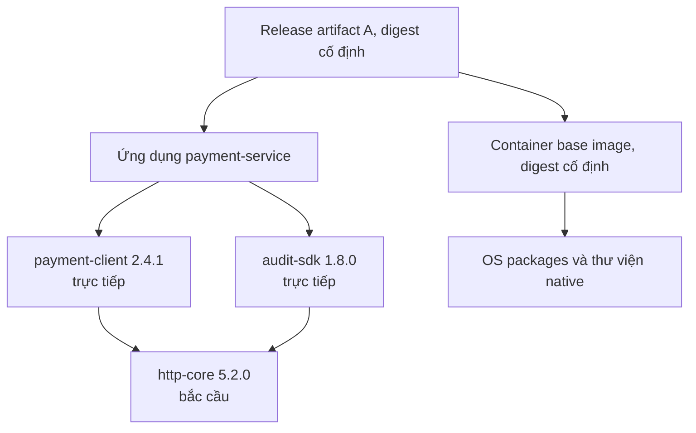
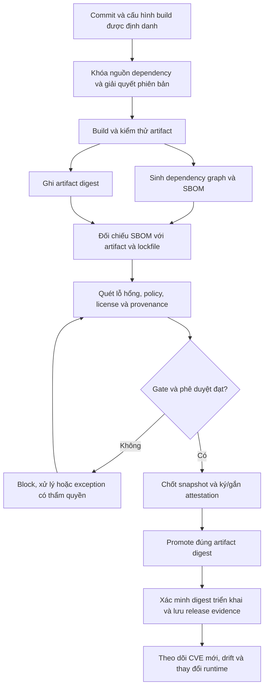

# Dependency snapshot: Chốt bằng chứng phụ thuộc cho từng bản phát hành

## 1. Dependency snapshot là gì?

Trong **Release assurance**, tổ chức cần chứng minh một bản phát hành đáp ứng yêu cầu bảo mật dựa trên **đúng những thành phần đã được đưa vào artifact và triển khai thực tế**. Việc quét lỗ hổng trên mã nguồn hay đọc danh sách dependency ở thời điểm kiểm thử chưa đủ nếu quá trình build sau đó có thể chọn phiên bản khác, tải package từ nguồn khác hoặc bổ sung thành phần mới.

**Dependency snapshot** là bản ghi tại một thời điểm xác định về các phụ thuộc và quan hệ phụ thuộc của **một đơn vị release cụ thể**. Snapshot cần nhận diện được thành phần, phiên bản, nguồn gốc và khi có thể cả định danh nội dung bất biến (digest), đồng thời liên kết đến source revision, build, artifact và bằng chứng kiểm tra tương ứng.

Ví dụ: mã nguồn khai báo thư viện `auth-client:2.x`, nhưng trong lần build A hệ thống giải quyết thành `2.4.1`, còn lần build B thành `2.5.0`. Nếu chỉ lưu khai báo `2.x`, đội assurance không thể chắc chắn phiên bản nào đã đi vào production. Snapshot của mỗi lần build/release phải cho biết **phiên bản thực sự được chọn** và gắn với artifact được triển khai.

Trong service **SECURITY_SECURITY_ASSURANCE**, dependency snapshot là một dạng bằng chứng của chuỗi *yêu cầu → security control → build/release → kiểm tra → vận hành → audit*. Nó giúp trả lời:

- Release nào đang chứa thành phần có lỗ hổng mới được công bố?
- Một bản vá đã loại bỏ dependency dễ bị khai thác khỏi **artifact đang chạy** hay mới chỉ khỏi file khai báo?
- Hai release có cùng source revision nhưng vì sao cho ra tập thư viện khác nhau?
- Những phiên bản, package hay nguồn repository nào thay đổi giữa release A và B?
- Khi xảy ra sự cố, có thể chứng minh **hệ thống đã chạy gì vào thời điểm đó** và ai đã cho phép triển khai không?

### 1.1. Snapshot khác các tài liệu liên quan

| Tài liệu/dữ liệu | Chứa gì | Giới hạn khi dùng riêng lẻ |
| --- | --- | --- |
| Manifest như `pom.xml`, `package.json` | Ý định khai báo dependency, ràng buộc phiên bản và plugin | Chưa nhất thiết cho biết dependency bắc cầu hay phiên bản được giải quyết |
| Lockfile như `package-lock.json` hoặc `gradle.lockfile` | Phiên bản đã resolve trong bối cảnh công cụ/hệ sinh thái hỗ trợ | Có thể không bao phủ OS package, container, dynamic plugin hoặc thành phần được tải lúc chạy |
| Dependency tree | Quan hệ trực tiếp và bắc cầu mà bộ giải quyết dependency nhìn thấy | Phụ thuộc vào module, scope, profile, nền tảng và trạng thái công cụ |
| SBOM (Software Bill of Materials) | Danh mục thành phần phần mềm, định danh, quan hệ và metadata theo định dạng chuẩn như CycloneDX/SPDX | Chất lượng phụ thuộc vào công cụ và phạm vi sinh SBOM; không tự chứng minh mọi thành phần đã được triển khai |
| Artifact digest | Định danh theo nội dung của file, container image hoặc đối tượng phát hành | Chứng minh artifact cụ thể, nhưng bản thân digest không mô tả thư viện bên trong |
| Provenance/build attestation | Nguồn mã, môi trường/builder, bước build, subject artifact và metadata được khai báo/xác thực | Cần xác minh chủ thể ký, quy tắc tin cậy và quan hệ với artifact |
| **Dependency snapshot** | **Bộ bằng chứng gắn dependency resolution/SBOM với release, artifact, thời gian và kết quả assurance** | Đòi hỏi quy trình đồng bộ, kiểm tra đầy đủ và lưu trữ đáng tin cậy |

Dependency snapshot có thể **sử dụng SBOM làm dữ liệu lõi**, nhưng snapshot cho mục tiêu release assurance còn phải có **release identity, artifact identity, nguồn sinh, thời điểm, kết quả policy gate và liên kết triển khai**.

## 2. Mục tiêu và ranh giới của dependency snapshot

Một snapshot đáng tin cậy cần đạt sáu mục tiêu:

1. **Đúng đối tượng:** tập dependency thuộc về một artifact hoặc tập artifact của release cụ thể, không phải tình trạng chung của repository.
2. **Đúng phiên bản:** ghi phiên bản thực tế đã được chọn, bao gồm dependency trực tiếp, bắc cầu và các lớp package quan trọng khác.
3. **Đủ định danh:** có định danh gói ổn định; bổ sung checksum/digest và nguồn tải khi có thể để phát hiện thay thế nội dung cùng tên/phiên bản.
4. **Có liên kết nguồn gốc:** xác định commit, pipeline run, build configuration, tool version, môi trường, artifact và người/quy trình phát hành.
5. **Có trạng thái assurance:** lưu các kết quả kiểm tra rủi ro, policy, ngoại lệ, phê duyệt và giới hạn đã biết tại thời điểm release.
6. **Có khả năng tái tra cứu:** khi xuất hiện CVE mới hoặc audit quá khứ, có thể tìm release đã bị ảnh hưởng mà không phụ thuộc vào trạng thái mới nhất của branch.

### 2.1. Snapshot cho build, release và runtime không phải cùng một thứ

**Build snapshot** mô tả dependency được giải quyết hoặc thu thập trong một build cụ thể. **Release snapshot** gắn thông tin đó với artifact đã được phê duyệt để phát hành. **Runtime/deployment observation** ghi nhận image/artifact và thành phần thực sự có mặt hoặc được tải trong môi trường chạy.

Ba góc nhìn có thể sai khác do:

- Runtime container có OS package hoặc thư viện native mà quá trình build ứng dụng không nhận diện.
- Các profile `dev`, `test`, `runtime` khác nhau; một số thư viện chỉ tồn tại khi đóng gói.
- Ứng dụng nạp plugin, driver, script hoặc dependency động sau khi triển khai.
- Một image tag có thể được trỏ sang digest khác nếu không khóa bằng digest.
- Một artifact có thể chạy trong nhiều region hoặc kiến trúc CPU với base image khác nhau.

Vì vậy, cần tuyên bố **phạm vi bao phủ** của snapshot. Nếu không quét runtime dependencies, báo cáo không được tự khẳng định đã biết toàn bộ thành phần đang chạy.

### 2.2. Đơn vị của snapshot

Đơn vị quản lý gợi ý là **một snapshot cho một artifact bất biến trong ngữ cảnh build/release**, hoặc một tập manifest được liên kết với các artifact có định danh riêng.

Ví dụ một release gồm:

- Backend container image: `sha256:...`
- Frontend static bundle: digest riêng
- Migration artifact hoặc script đã phát hành: checksum riêng
- Helm chart/IaC module được triển khai: version và digest/reference riêng

Release tổng thể cần chỉ đến **từng artifact**. Một snapshot duy nhất của backend không đủ để kết luận an toàn cho cả hệ thống nếu frontend, image nền hay migration có phụ thuộc độc lập.

## 3. Các thành phần và metadata cần chốt

Một mô hình hồ sơ tối thiểu:

| Nhóm | Trường gợi ý | Mục đích assurance |
| --- | --- | --- |
| Định danh snapshot | `snapshot_id`, `schema_version`, `generated_at` | Truy vết và đọc đúng cấu trúc |
| Release | `release_id`, phiên bản, môi trường mục tiêu, release candidate | Chỉ ra mục tiêu phát hành |
| Nguồn | Repository, `commit_sha`, branch/tag tham khảo, submodule commit | Xác minh mã nguồn đã được sử dụng |
| Build | `build_id`, pipeline run, tool version, build profile, OS/architecture | Nhận diện bối cảnh giải quyết dependency |
| Artifact | Tên, loại, `artifact_digest`, registry URI | Liên kết snapshot với bytes thực tế |
| Thành phần | Tên, hệ sinh thái, phiên bản, PURL, checksum/digest nếu có | So khớp với cảnh báo và nguồn supply chain |
| Quan hệ | Dependency cha/con, dependency path, scope/runtime/build/test | Hiểu đường đi và ảnh hưởng |
| Nguồn phụ thuộc | Registry/repository, nguồn tải, lockfile hoặc resolver output | Điều tra thay thế gói và truy xuất nguồn gốc |
| Kết quả kiểm tra | SBOM completeness, vulnerability/license/policy scan, thời điểm và phiên bản dữ liệu phân tích | Chứng minh gate đã chạy trên tập nào |
| Phê duyệt/ngoại lệ | Policy verdict, approver, exception ID, ngày hết hiệu lực | Kiểm soát quyết định cho release |
| Triển khai | Deployment ID, thời điểm, image/artifact digest quan sát | Chứng minh thành phần được phát hành thực tế |
| Tính toàn vẹn | Hash snapshot, chữ ký hoặc attestation, storage ref | Phát hiện sửa dữ liệu sau khi phê duyệt |

**Package URL (PURL)** có thể giúp định danh package theo hệ sinh thái, chẳng hạn `pkg:maven/org.example/payment-client@2.4.1`. Tuy nhiên PURL chủ yếu là định danh logic; không mặc nhiên chứng minh bytes từ hai nguồn đều giống nhau. Digest, provenance và nguồn tải được dùng khi cần so sánh nội dung thực.

Tên gói có thể trùng, thay đổi hoặc không chuẩn hóa. Nên giữ **định danh gốc từ công cụ**, PURL khi hỗ trợ và một khóa nội bộ ổn định; không suy ra “cùng thư viện” chỉ bằng cách so khớp tên hiển thị.

### 3.1. Đồ thị dependency thay vì danh sách phẳng

Phụ thuộc **trực tiếp** do dự án khai báo; phụ thuộc **bắc cầu** do package khác kéo vào. Danh sách phẳng giúp tìm kiếm, nhưng **đồ thị quan hệ** giúp xác định nguyên nhân xuất hiện package và các đường sử dụng.



Một package bắc cầu có thể đi tới từ nhiều đường; không nên đếm thành nhiều thành phần khi thống kê theo định danh, nhưng cần giữ **từng cạnh quan hệ** khi phân tích phạm vi ảnh hưởng.

### 3.2. Phân loại dependency cần xét

- **Ứng dụng:** Maven/Gradle, npm, PyPI, NuGet, Go modules, package plugin.
- **OS và native:** package từ apt/rpm/apk, shared libraries, runtime JVM/Node/Python, image base.
- **Build và delivery:** plugin, compiler, build action, script được kéo về, image builder, IaC module.
- **Runtime động:** driver, plugin, thư viện được tải khi chạy, sidecar và agent giám sát.
- **Dịch vụ bên ngoài:** API/SaaS và các phụ thuộc mạng là **service dependencies**, không nhất thiết là package trong SBOM. Cần quản lý riêng bằng inventory/contract/interface evidence.

**Scope** cần có định nghĩa nhất quán. Một dependency chỉ phục vụ `test` không nên mặc định được diễn giải là code chạy trong production; nhưng tool phục vụ build vẫn có thể là nguồn rủi ro supply chain, dù không nằm trong artifact cuối.

## 4. Nguồn dữ liệu và độ tin cậy

Không có một lệnh duy nhất đảm bảo tìm thấy mọi dependency. Nên chọn nhiều nguồn phù hợp kiến trúc:

| Nguồn | Điểm mạnh | Giới hạn/kiểm tra cần thêm |
| --- | --- | --- |
| Manifest và dependency lockfile | Ghi ý định, constraint và phiên bản đã giải quyết trong phạm vi được quản lý | Kiểm tra lockfile có được thực sự dùng trong build và được cập nhật nhất quán không |
| Build tool dependency graph | Phản ánh kết quả resolver theo profile, module và nền tảng | Có thể bỏ sót thành phần ngoài resolver hoặc runtime |
| SBOM sinh từ source/build | Giúp chuẩn hóa định danh và graph | Cần biết tool, chế độ, thời gian và phạm vi sinh |
| SBOM/image scanner từ artifact | Tiếp cận package thật trong image/bundle, kể cả OS package | Có thể không nhận ra code vendored, file nén, runtime download hoặc metadata bị loại bỏ |
| Registry metadata và checksum | Truy xuất gói và định danh bytes | Registry/tag có thể mutable; cần xác thực nguồn, signature/provenance nếu có |
| CI/CD provenance | Gắn commit, builder, tham số và artifact output | Phải xác minh chủ thể và nội dung attestation |
| Runtime discovery | So sánh triển khai thật, sidecar/plugin và drift | Snapshot runtime có thể thay đổi và không bao trùm tải động đã kết thúc |

Nên **đối chiếu ít nhất hai góc nhìn khi rủi ro yêu cầu**, chẳng hạn SBOM từ build với quét artifact image, hoặc manifest/lockfile với dependency graph đã resolve. Một discrepancy không nhất thiết là gian lận: có thể là OS package, shaded JAR, build cache, plugin, architecture hoặc artifact chưa đúng version.

Nếu phát hiện thiếu coverage, cần ghi **`completeness_status`** và lý do, thay vì âm thầm coi “không thấy” là “không tồn tại”.

## 5. Chụp snapshot ở thời điểm nào?

Thời điểm quan trọng nhất là **sau khi dependency được giải quyết và artifact cuối đã tạo, trước khi quyết định promote/release**. Quy trình nên chốt cả output của quá trình build và bằng chứng từ artifact.



### 5.1. Tại sao không chỉ chụp trước khi build?

Các file khai báo được đọc từ repository có thể khác kết quả cuối do:

- Constraint cho phép cập nhật phiên bản khi build.
- Dependency bắc cầu được chọn bởi quy tắc giải quyết hoặc repository khác.
- Build theo profile/architecture kéo các package không có trong môi trường test.
- Plugin hoặc script tải thêm nội dung.
- Base image tag đã đổi digest kể từ lần build trước.

Do đó, snapshot trước build là **baseline** để đối chiếu, không thay thế snapshot được liên kết với output thực tế.

### 5.2. Vì sao promote cần giữ nguyên artifact?

Nếu đã scan bản `release-candidate` nhưng sau đó build lại cùng source cho production, kết quả phụ thuộc có thể đổi theo thời gian hoặc môi trường. Mục tiêu tốt là **build một lần, promote artifact đã được xác minh** và kiểm tra digest tại mỗi bước.

Khi build lại là bắt buộc, coi đó là artifact mới: tạo snapshot và đánh giá lại tương ứng. Không tái sử dụng verdict của bản build khác chỉ vì cùng version hoặc tag.

## 6. Định danh bất biến, reproducibility và provenance

### 6.1. Hash và signature giải quyết hai câu hỏi khác nhau

- **Digest** (ví dụ SHA-256) giúp xác nhận bytes của một file/artifact không bị thay đổi giữa các lần so sánh.
- **Chữ ký hoặc attestation đã xác minh** giúp kiểm tra một chủ thể đáng tin cậy đã cam kết nội dung nào, theo policy tin cậy nào.
- **Provenance** mô tả quá trình hình thành artifact (nguồn, builder, tham số, vật liệu đầu vào và output), nhưng phải kiểm tra bằng chứng về người/builder tạo ra provenance.

Một artifact có SHA-256 vẫn có thể độc hại nếu quá trình tạo artifact bị chiếm dụng. Một chữ ký hợp lệ của chủ thể không được tin cậy cũng không chứng minh release an toàn.

Trong bối cảnh supply-chain assurance có thể sử dụng các khái niệm/định dạng như **SLSA provenance**, **in-toto attestations**, **SPDX** hoặc **CycloneDX** tùy hệ sinh thái và chính sách. Cần ghi rõ phiên bản schema và công cụ sinh; snapshot không nên giả định mọi định dạng chứa cùng tập trường.

### 6.2. Reproducible build và dependency snapshot

**Reproducible build** hướng tới khả năng tạo output giống nhau khi sử dụng cùng input và điều kiện đã kiểm soát. Dependency snapshot là một input/bằng chứng quan trọng nhưng **không tự bảo đảm build tái lập**. Build còn phụ thuộc compiler, timestamp, OS, locale, plugin, cache, biến môi trường và các nguồn dữ liệu động.

Các biện pháp hữu ích:

1. Pin dependency tới phiên bản/commit cụ thể; dùng lockfile và cơ chế xác minh checksum theo hệ sinh thái.
2. Pin container image bằng digest; với multi-platform image, phân biệt digest của index/manifest list và digest image cho kiến trúc được triển khai.
3. Pin build actions, IaC modules và plugin ở mức đủ ổn định; kiểm soát repository/registry tin cậy.
4. Ghi toolchain, OS/arch, cấu hình resolver, repository URLs và builder identity.
5. Kiểm tra checksum/signature của dependency theo khả năng; chặn gói đến từ registry ngoài chính sách.
6. Giữ kết quả build, dependency graph, SBOM và attestation trong kho có kiểm soát.

**Mục tiêu vận hành:** có thể giải thích một thay đổi dependency bằng dữ liệu được ghi nhận, kể cả khi không thể tái tạo hoàn toàn mọi byte của build.

## 7. Quy trình thực hành với dự án Java/Maven

Xét ứng dụng Java dùng Maven và xuất container image. Quy trình nên bao gồm các thành phần Java trong ứng dụng lẫn thư viện nền hệ điều hành trong image.

### 7.1. Bước thu thập và đối chiếu

1. Chốt `commit_sha` và `build_id`. Kiểm tra các profile Maven, module và runtime target.
2. Tại **cùng build context** dùng cho artifact phát hành, xuất dependency tree đã resolve.
3. Sinh SBOM theo công cụ được đội build quản lý; nếu hỗ trợ, ghi cả graph và package identifiers.
4. Build artifact cuối và tạo image; lấy digest của JAR/image theo repository/registry chính thức.
5. Quét image hoặc artifact để nhận diện OS/native package và đối chiếu với SBOM xây từ source.
6. Chạy policy gate trên tập dependency có liên kết artifact: lỗ hổng, nguồn gói, checksum, giấy phép, exception và các quy tắc tổ chức.
7. Chốt snapshot bất biến, phát hành kèm artifact và kiểm tra digest khi triển khai.

Ví dụ xuất cây dependency bằng một phiên bản cụ thể của Maven Dependency Plugin (lệnh **minh họa**, chạy trong dự án Maven có plugin/resolution phù hợp):

```bash
mvn -B -ntp \
  org.apache.maven.plugins:maven-dependency-plugin:3.7.1:tree \
  -DoutputType=json \
  -DoutputFile=target/dependency-tree.json
```

Dependency tree chủ yếu mô tả những gì Maven resolver nhìn thấy theo project/profile; **không** thay thế SBOM của container image, kiểm tra artifact JAR cuối, hoặc nguồn tải động runtime. Không coi file JSON trên là bằng chứng đủ để phát hành khi còn các lớp dependency khác.

Đối với Java, còn cần quan tâm `dependencyManagement`/BOM, Maven profiles, scope `runtime`/`provided`/`test`, multi-module, shaded/fat JAR và thư viện được image đưa vào. Với Gradle, có thể khai thác dependency resolution/lockfile theo configuration tương ứng, nhưng cần kiểm tra từng configuration thay vì dựa trên một graph mặc định.

### 7.2. Ví dụ snapshot ở mức mô hình dữ liệu

Bản JSON sau là **mô hình đơn giản do bài học tự dựng**, không phải toàn bộ schema CycloneDX/SPDX và **không chứa digest thật**. Hệ thống sản xuất phải thay tham chiếu bằng giá trị đã được tính và xác minh:

```json
{
  "snapshot_id": "SNAP-PAY-20261128-017",
  "schema_version": "example-1",
  "release_id": "payment-service-3.8.0",
  "source_revision": "GIT-COMMIT-REF",
  "build_id": "CI-RUN-2048",
  "builder_ref": "TRUSTED-BUILDER-ID",
  "generated_at": "2026-11-28T10:40:00+07:00",
  "artifact": {
    "type": "container-image",
    "registry_ref": "registry.example.invalid/payment-service:3.8.0",
    "digest_ref": "VERIFIED-IMAGE-SHA256-REF",
    "platform": "linux/amd64"
  },
  "sbom": {
    "format": "CycloneDX",
    "version": "1.6",
    "file_ref": "SBOM-CI-RUN-2048",
    "digest_ref": "VERIFIED-SBOM-SHA256-REF"
  },
  "components": [
    {
      "purl": "pkg:maven/org.example/payment-client@2.4.1",
      "version": "2.4.1",
      "scope": "runtime",
      "direct": true,
      "digest_ref": "VERIFIED-PACKAGE-SHA256-REF"
    },
    {
      "purl": "pkg:maven/org.example/http-core@5.2.0",
      "version": "5.2.0",
      "scope": "runtime",
      "direct": false,
      "introduced_by": "pkg:maven/org.example/payment-client@2.4.1",
      "digest_ref": "VERIFIED-PACKAGE-SHA256-REF-2"
    }
  ],
  "verification": {
    "policy_result": "PASS",
    "vulnerability_database_as_of": "2026-11-28T10:30:00+07:00",
    "sbom_artifact_link_checked": true,
    "provenance_ref": "ATTESTATION-CI-RUN-2048"
  },
  "evidence_ref": "RELEASE-EVIDENCE-017"
}
```

Tên domain `example.invalid` và các mã `*-REF` là dữ liệu giả định. Bản ghi thực cần dùng khóa nội bộ duy nhất cho từng component, mô tả đầy đủ quan hệ dependency, scope, nguồn tải, kết quả đối chiếu, kiểm soát chất lượng và chữ ký/attestation theo yêu cầu.

### 7.3. Làm thế nào để kiểm tra snapshot đúng artifact?

Một chuỗi xác minh tham khảo:

- CI tạo artifact A, tính digest `D_A`.
- Công cụ SBOM quét/đọc từ artifact A hoặc tạo dữ liệu có binding đáng tin cậy tới `D_A`.
- Pipeline phát hành lưu snapshot S, chứa `D_A`, SBOM digest và provenance ref.
- Gate đánh giá S và ghi verdict gắn với `D_A`; không chỉ ghi “pipeline xanh”.
- Khi deploy, hệ thống đọc artifact đang chạy, xác định digest `D_DEPLOYED` và đối chiếu với `D_A`.
- Nếu `D_DEPLOYED ≠ D_A`, phải điều tra trước khi kết luận verdict của S áp dụng cho runtime.

Đối với Kubernetes, kiểm tra image digest thực tế trong workload/pod thay vì chỉ đọc tag trong YAML. Với môi trường nhiều replica/kiến trúc, thu đầy đủ digest theo nhóm cần thiết.

## 8. Đánh giá rủi ro từ snapshot trước release

Dependency snapshot hỗ trợ **software supply-chain risk management** nhưng không tự đánh giá rủi ro. Phải áp policy dựa trên thành phần, ngữ cảnh triển khai và bằng chứng.

| Rủi ro/câu hỏi | Tín hiệu từ snapshot | Hành động kiểm soát |
| --- | --- | --- |
| Gói chứa lỗ hổng đã biết | Package/version/digest khớp dữ liệu cảnh báo, mức ảnh hưởng | Xác minh tính áp dụng và mức phơi nhiễm; vá, giảm thiểu hoặc xử lý ngoại lệ |
| Dependency bị thay thế | Cùng tọa độ nhưng checksum thay đổi bất thường | Kiểm tra repository, provenance, integrity; chặn khi không giải thích được |
| Typosquatting/dependency confusion | Package tên lạ, nguồn public cho package nội bộ, thay đổi namespace | Kiểm tra nguồn được phép, chủ sở hữu và registry policy |
| Tag/base image mutable | Image tag trùng nhưng digest đổi | Pin theo digest, tái tạo snapshot/gate cho artifact mới |
| Dependency mới ngoài danh sách phê duyệt | Delta thêm component hoặc plugin | Review license, nguồn, bảo trì, phạm vi runtime và độ cần thiết |
| Dependency bắc cầu dễ tổn thương | Graph xuất hiện đường kéo vào gián tiếp | Xác định parent, phương án nâng cấp/override có kiểm chứng |
| Gói không còn được duy trì | Metadata phát hành, tình trạng hỗ trợ hoặc tuổi phiên bản | Đánh giá rủi ro vận hành; lập kế hoạch thay thế |
| Thiếu dữ liệu/quan hệ | Không có digest, scope, PURL hoặc component không liên kết artifact | Đánh dấu coverage gap, yêu cầu sinh bổ sung hoặc đánh giá thủ công |
| Build tool bị ảnh hưởng | Plugin, action, compiler, builder trong nguồn build | Xác minh provenance, cách cô lập build và nguồn công cụ |

Một kết quả scanner ghi mức “Critical” cần được xem cùng **khả năng khai thác, đường tấn công, phạm vi runtime và tác động kinh doanh**. Việc SBOM liệt kê package không chứng minh ứng dụng gọi đến đoạn mã dễ tổn thương. Ngược lại, không thấy CVE ở thời điểm quét cũng không chứng minh an toàn tuyệt đối.

### 8.1. Bằng chứng về lỗ hổng có tính thời điểm

Cơ sở dữ liệu CVE và tri thức khai thác thay đổi theo thời gian. Nên lưu:

- `scan_timestamp`, nguồn và phiên bản dữ liệu lỗ hổng tại thời điểm đánh giá.
- Phiên bản scanner, tập component/snapshot, cấu hình policy.
- Kết quả, độ tin cậy/ngoại lệ và lý do suppression nếu có.
- Quyết định remediation hoặc phê duyệt residual risk có thẩm quyền.
- Kết quả scan lại khi có dữ liệu mới hoặc khi artifact thay đổi.

Do đó, cùng snapshot không đổi vẫn có thể xuất hiện rủi ro mới. **Snapshot là bản ghi thành phần đã chốt; đánh giá lỗ hổng là một kết quả được tính tại từng thời điểm**. Đừng sửa snapshot cũ để xóa kết quả; tạo bản ghi phân tích mới liên kết với snapshot bất biến.

Nếu dùng VEX (Vulnerability Exploitability eXchange) hay đánh giá `not affected`, cần có căn cứ áp dụng cho artifact, phiên bản, đường mã và runtime thực, có người chịu trách nhiệm và ngày đánh giá. VEX không phải cơ chế “ẩn CVE” vô thời hạn.

## 9. Policy gate, ngoại lệ và quyết định phát hành

Một tập quy tắc tham khảo:

| Kiểm soát/gate | Ví dụ điều kiện | Phản ứng |
| --- | --- | --- |
| Artifact binding | Snapshot/SBOM không gắn được với digest của release candidate | **Block** để xác lập lại danh tính artifact |
| Integrity và provenance | Package quan trọng đến từ nguồn không tin cậy hoặc provenance không hợp lệ | **Block/điều tra** theo chính sách |
| Coverage | Thiếu thành phần OS/native trên image production trọng yếu | Yêu cầu bổ sung SBOM/quét, hoặc quyết định rủi ro có thẩm quyền |
| Vulnerability | Lỗ hổng vượt ngưỡng rủi ro được phép và không có phương án xử lý | Block release hoặc exception có giới hạn |
| License/compliance | License hoặc nghĩa vụ pháp lý không được phê duyệt | Chuyển xét duyệt phù hợp |
| Release delta | Dependency mới hoặc đổi nguồn không được review | Yêu cầu review bổ sung trước promote |
| Policy exception | Có ngoại lệ nhưng sai phạm vi/hết hạn/không đủ thẩm quyền | Không áp dụng ngoại lệ; thực hiện gate tương ứng |

**Tách ba đối tượng:** snapshot mô tả thành phần; scan/policy ghi kết quả kiểm tra; release approval là quyết định cho phép triển khai trong phạm vi xác định. Một quyết định `APPROVED` không thay đổi nội dung snapshot, và một ngoại lệ rủi ro không làm dependency trở nên “không có lỗ hổng”.

Nếu phải phát hành do yêu cầu khẩn cấp, quy trình emergency change có thể điều chỉnh bước kiểm tra và thẩm quyền theo chính sách, nhưng vẫn cần lưu artifact digest, snapshot hoặc coverage gap, rủi ro còn lại, phương án giảm thiểu và hành động hậu kiểm có owner/hạn.

## 10. So sánh snapshot giữa hai release

Snapshot cho phép phát hiện **dependency drift** có căn cứ.

Giả sử hai bản release của `payment-service`:

| Component | Release 3.7.9 | Release 3.8.0 | Diễn giải |
| --- | --- | --- | --- |
| `payment-client` | `2.4.0` | `2.4.1` | **CHANGED**: nâng phiên bản trực tiếp |
| `http-core` | `5.1.8` | `5.2.0` | **CHANGED**: dependency bắc cầu cũng đổi |
| `trace-agent` | Không có | `1.3.0` | **ADDED**: phải đánh giá quyền/khả năng thu thập dữ liệu |
| `legacy-logging` | `1.9.0` | Không có | **REMOVED**: kiểm chứng không còn được đóng gói hoặc tải lúc chạy |

Cần so sánh theo **khóa package ổn định, phiên bản, scope, digest và quan hệ**; một component có thể cùng version nhưng nội dung thay đổi. Trường hợp đó vẫn phải được báo thay đổi khi checksum/digest khác nhau.

### 10.1. Ví dụ truy vấn SQL cho bảng snapshot đã chuẩn hóa

Giả sử `release_dependencies` chứa `snapshot_id`, `component_key` (khóa định danh package qua các version), `resolved_version`, `artifact_sha256` (checksum của package), `dependency_scope`. Truy vấn PostgreSQL minh họa:

```sql
WITH old_snapshot AS (
    SELECT component_key, resolved_version, artifact_sha256, dependency_scope
    FROM release_dependencies
    WHERE snapshot_id = 'SNAP-PAY-3.7.9'
),
new_snapshot AS (
    SELECT component_key, resolved_version, artifact_sha256, dependency_scope
    FROM release_dependencies
    WHERE snapshot_id = 'SNAP-PAY-3.8.0'
),
delta AS (
    SELECT
        COALESCE(o.component_key, n.component_key) AS component_key,
        o.resolved_version AS old_version,
        n.resolved_version AS new_version,
        CASE
            WHEN o.component_key IS NULL THEN 'ADDED'
            WHEN n.component_key IS NULL THEN 'REMOVED'
            WHEN o.resolved_version IS DISTINCT FROM n.resolved_version
              OR o.artifact_sha256 IS DISTINCT FROM n.artifact_sha256
              OR o.dependency_scope IS DISTINCT FROM n.dependency_scope
            THEN 'CHANGED'
            ELSE 'UNCHANGED'
        END AS change_type
    FROM old_snapshot AS o
    FULL OUTER JOIN new_snapshot AS n
      ON o.component_key = n.component_key
)
SELECT component_key, old_version, new_version, change_type
FROM delta
WHERE change_type <> 'UNCHANGED'
ORDER BY component_key;
```

Đây là phép so sánh **giá trị các trường**; để thấy biến đổi đường dẫn dependency, cần so sánh thêm bảng quan hệ cha/con. Việc dùng cùng `component_key` cho các phiên bản phải tuân thủ quy tắc chuẩn hóa PURL/ecosystem; nếu có hai bản khác version cùng tồn tại trong một release, khóa và quan hệ phải cho phép biểu diễn cả hai, thay vì ghi đè bằng một dòng.

Khi hai release được tạo cho môi trường/kiến trúc khác nhau, kết quả delta phải hiển thị sự khác biệt scope và nền tảng. Đừng kết luận có dependency drift bất thường chỉ vì so sánh hai target vốn khác nhau.

## 11. Truy tìm ảnh hưởng khi xuất hiện lỗ hổng mới

Ví dụ một bản tin bảo mật vừa xác nhận vấn đề trong một khoảng phiên bản của `http-core`. Đội assurance cần xác định **những release và deployment có thể bị ảnh hưởng**.

Quy trình điều tra:

1. Chuẩn hóa danh tính package bị ảnh hưởng, phiên bản/constraint, cách đóng gói lại và alias.
2. Truy vấn tập snapshot còn được lưu để tìm component phù hợp, kể cả dependency bắc cầu.
3. Gắn từ snapshot tới artifact digest, release và deployment inventory; tìm môi trường thực đang chạy digest nào.
4. Đánh giá tính áp dụng với runtime, luồng sử dụng, mức phơi nhiễm, biện pháp giảm thiểu và bằng chứng.
5. Tạo finding/remediation hoặc incident theo mức độ; ưu tiên hệ thống quan trọng và công khai.
6. Sau sửa, build artifact mới, tạo snapshot mới, chạy lại security gate, xác minh digest khi deploy.
7. Giữ bằng chứng rằng release cũ đã được thay thế hoặc cô lập; xác nhận không còn instance chạy bản bị ảnh hưởng trong phạm vi mục tiêu.

Nếu chỉ quét code branch hiện tại, dễ bỏ sót **phiên bản cũ vẫn đang chạy** ở production, DR, on-prem hoặc vùng triển khai ít thay đổi. Inventory triển khai và snapshot theo artifact giải quyết khoảng trống này.

### 11.1. Kịch bản trả lời audit

Kiểm toán viên hỏi: “Ngày 20/11 ứng dụng X có sử dụng package dễ bị khai thác Y không?”

Câu trả lời cần dựa trên:

- Deployment record chỉ rõ artifact digest chạy ngày 20/11, theo môi trường/region.
- Snapshot/SBOM gắn với digest đó và tập component tương ứng.
- Phương pháp nhận diện package và khoảng phiên bản bị ảnh hưởng.
- Nếu cần khẳng định mức rủi ro khai thác: đánh giá áp dụng tại bối cảnh vận hành lúc đó, log và các kiểm soát bảo vệ.
- Quyết định/các hành động sau phát hiện và bằng chứng khắc phục.

Không dùng SBOM mới nhất để suy ngược trực tiếp tình trạng của release đã triển khai trước đó.

## 12. Lưu giữ, quyền truy cập và truy vết bằng chứng

Một dependency snapshot có giá trị audit khi nó **được bảo toàn cùng quá trình ra quyết định**.

### 12.1. Quy tắc lưu trữ

- Lưu bản snapshot/SBOM gốc, checksum, phiên bản schema, tool và trạng thái xác minh.
- Liên kết không mơ hồ tới source revision, builder, artifact digest, kết quả gate và deployment.
- Tăng độ bất biến bằng object versioning, write-once hoặc cơ chế kiểm soát sửa/xóa phù hợp.
- Bảo vệ chữ ký/attestation và chính sách xác minh; không để cùng một actor tùy ý sửa bản ghi và lịch sử xác minh.
- Có retention phù hợp vòng đời sản phẩm, yêu cầu kiểm toán, pháp lý và thời gian hỗ trợ release cũ.
- Cho phép truy vấn theo artifact digest, package/PURL, release, service, môi trường và thời gian.

SBOM có thể để lộ cấu trúc hệ thống, dependency, phiên bản và điểm yếu; cần phân quyền truy cập theo nhu cầu, dù việc chia sẻ với đối tác có thể cần thiết theo nghĩa vụ hợp đồng.

### 12.2. Bằng chứng không tự chứng minh độ tin cậy nếu nguồn không đáng tin

Ví dụ một pipeline đã bị chiếm quyền có thể sinh ra SBOM giả nói rằng không chứa thành phần nguy hiểm. Do đó cần bảo vệ **identity của builder, quyền ghi artifact, nguồn dependency, attestation và quyền promote**. Đánh giá độc lập hoặc quét trên artifact đã phát hành có thể giúp phát hiện sự khác biệt.

Nên theo dõi các sự kiện `SNAPSHOT_CREATED`, `SBOM_VALIDATED`, `POLICY_EVALUATED`, `EXCEPTION_APPROVED`, `ARTIFACT_PROMOTED`, `DEPLOYMENT_VERIFIED` và `NEW_VULNERABILITY_REASSESSED`. Mỗi event có actor/builder identity, timestamp, digest tham chiếu, kết quả và evidence ref.

## 13. Dashboard và chỉ số release assurance

| Chỉ số | Cách tính/ý nghĩa | Lưu ý |
| --- | --- | --- |
| Snapshot coverage | Release artifact có snapshot hợp lệ / tổng artifact cần có snapshot | Tính theo từng artifact, không chỉ theo số release |
| Artifact binding coverage | Snapshot được kiểm chứng gắn đúng digest / tổng snapshot đánh giá | Một snapshot tồn tại nhưng sai digest không được tính đạt |
| SBOM completeness | Mức bao phủ package/OS/runtime theo tiêu chí kiểm soát | Không tuyên bố 100% khi chưa có phương pháp đo đáng tin |
| Unpinned dependency count | Số dependency/base image/build input dùng tham chiếu có thể thay đổi ngoài kiểm soát | Theo nguồn, scope và mức độ rủi ro |
| Critical/High release exposure | Số release đang triển khai có dependency bị đánh giá là rủi ro cao | Tách phát hiện kỹ thuật khỏi tình trạng exploitability |
| Unexpected dependency delta | Số thay đổi package/scope/digest không có lý do hoặc phê duyệt | Hỗ trợ phát hiện supply-chain drift |
| Policy gate pass rate | Artifact/release candidate đạt gate / tổng artifact được đánh giá | Ghi rõ những trường hợp ngoại lệ và cách tính |
| Evidence integrity | Tỷ lệ snapshot, SBOM, attestation có digest/signature được xác minh | Lưu cả identity/trust policy của signer |
| Time to identify exposure | Thời gian từ khi có cảnh báo phù hợp đến khi tìm đủ release/deployment bị ảnh hưởng | Đo khả năng ứng phó lỗ hổng mới |
| Remediation verification | Tỷ lệ deployment đã thay bằng artifact sạch hơn và được xác minh digest | Không chỉ đếm ticket đã đóng |

Chỉ số cần ghi `as_of`, tập release đang được quản lý, chính sách bao phủ và loại môi trường. Một dashboard có nhiều SBOM nhưng thiếu liên kết triển khai thực tế vẫn khó trả lời câu hỏi “hệ thống đang chạy phiên bản nào?”.

## 14. Những lỗi thường gặp và cách phòng tránh

**1. Chỉ lưu `pom.xml` hoặc manifest.** Khai báo version range không bảo đảm resolution cố định; phụ thuộc bắc cầu có thể đổi. Hãy thu dependency đã giải quyết trong build thực tế và đối chiếu với output.

**2. SBOM sinh sau từ source mới nhất.** Nếu branch đã thay đổi, SBOM không còn đại diện artifact cũ. Hãy sinh/chốt bằng chứng khi build và bind tới artifact digest.

**3. Dùng image tag thay vì digest.** Tag có thể chuyển sang image khác. Hãy kiểm tra digest của manifest/image đúng kiến trúc lúc promote và deploy.

**4. Chỉ quét package ứng dụng.** OS package, thư viện native, base image và sidecar có thể bị bỏ sót. Hãy khai báo phạm vi, quét bổ sung và quản lý coverage gap.

**5. Không ghi nguồn gói và checksum.** Cùng tên/phiên bản từ repository khác có thể khác nội dung. Hãy giữ nguồn và định danh bytes khi khả thi.

**6. Coi scan PASS là mãi mãi an toàn.** Dữ liệu lỗ hổng mới có thể xuất hiện sau release. Giữ snapshot bất biến và đánh giá lại khi có cảnh báo liên quan.

**7. Tái sử dụng verdict sau rebuild.** Cùng source không đồng nghĩa cùng artifact. Rebuild phải có digest mới, snapshot mới và kiểm tra mới.

**8. Không quản lý dependency từ runtime.** Plugin tải động hoặc thay đổi base image có thể không có trong SBOM ban đầu. Kết hợp deployment inventory và quan sát runtime theo rủi ro.

**9. Coi SBOM là danh sách CVE.** SBOM là inventory; CVE, VEX, exploitability, mức ảnh hưởng và quyết định rủi ro là lớp phân tích riêng.

**10. Xóa snapshot cũ sau nâng cấp.** Việc này làm mất khả năng điều tra incident và audit lịch sử. Áp retention theo vòng đời và nghĩa vụ của tổ chức.

## 15. Bài tập thực hành

Một đội phát hành ứng dụng Java `order-api` phiên bản `4.2.0`. Pipeline build vào 08:00 và quét SBOM lúc 08:30; dashboard hiển thị “PASS”. Đến 10:00, nhóm triển khai chạy lại lệnh build từ cùng commit rồi đẩy image dưới tag `order-api:4.2.0`. Quá trình build không khóa phiên bản một plugin, và tag base image có thể cập nhật. Không có digest được lưu từ lần quét đầu. Ngày hôm sau, một thông báo lỗ hổng nhắc đến package bắc cầu mà Maven tree tại branch hiện tại không còn liệt kê.

**Câu hỏi:**

1. Vì sao trạng thái “PASS” lúc 08:30 không đủ chứng minh image được deploy lúc 10:00 an toàn?
2. Cần thu thập những dữ liệu nào để xác định chính xác release nào đang chứa package bắc cầu?
3. Nên sửa quy trình để ngăn vấn đề tái diễn như thế nào?
4. Nếu package thực sự nằm trong image đang chạy và bị ảnh hưởng, cần tạo bằng chứng gì sau khắc phục?

**Gợi ý lời giải:**

1. Có **hai lần build** nên có thể có hai artifact khác nhau; plugin không khóa và base image mutable tạo rủi ro resolution/drift. Verdict cũ chưa được gắn với digest của image triển khai.
2. Truy xuất CI runs, commit và build configuration, artifact registry digest, deployment/pod digest, SBOM/scan từng artifact, Maven dependency graph và OS package inventory. Nếu thiếu bản ghi lần build 10:00, cần quét trực tiếp image đã được lưu hoặc đang chạy, ghi rõ giới hạn bằng chứng.
3. Khóa dependency và build inputs theo khả năng, sinh snapshot/SBOM từ lần build cuối thực sự được promote, lưu digest và provenance, chạy gate trên artifact đó, promote **đúng digest** và xác minh khi deploy. Chặn việc rebuild âm thầm sau khi duyệt.
4. Lập finding hoặc incident tùy mức rủi ro; xác minh tính áp dụng, quyết định remediation/giảm thiểu, tạo artifact và snapshot mới, chạy lại gate, ghi digest được deploy, xác nhận loại bỏ thành phần bị ảnh hưởng và giữ lịch sử quá trình xử lý.

---

**Ghi nhớ:** Dependency snapshot không đơn thuần là một bảng liệt kê thư viện. Nó là **bằng chứng theo từng release**, cho phép kết nối dependency thật với source, build, artifact bất biến, security gate và môi trường triển khai. Khi tập thành phần được chốt đúng thời điểm và truy vết đáng tin cậy, tổ chức có thể đánh giá rủi ro supply chain, phản ứng trước lỗ hổng mới và chứng minh các quyết định phát hành trong chương trình Security Assurance.
