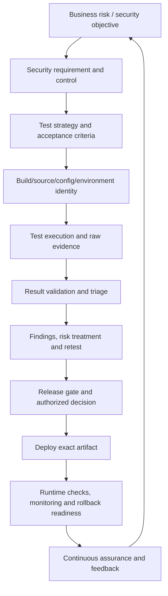
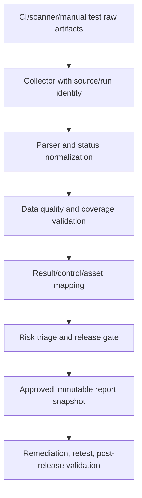
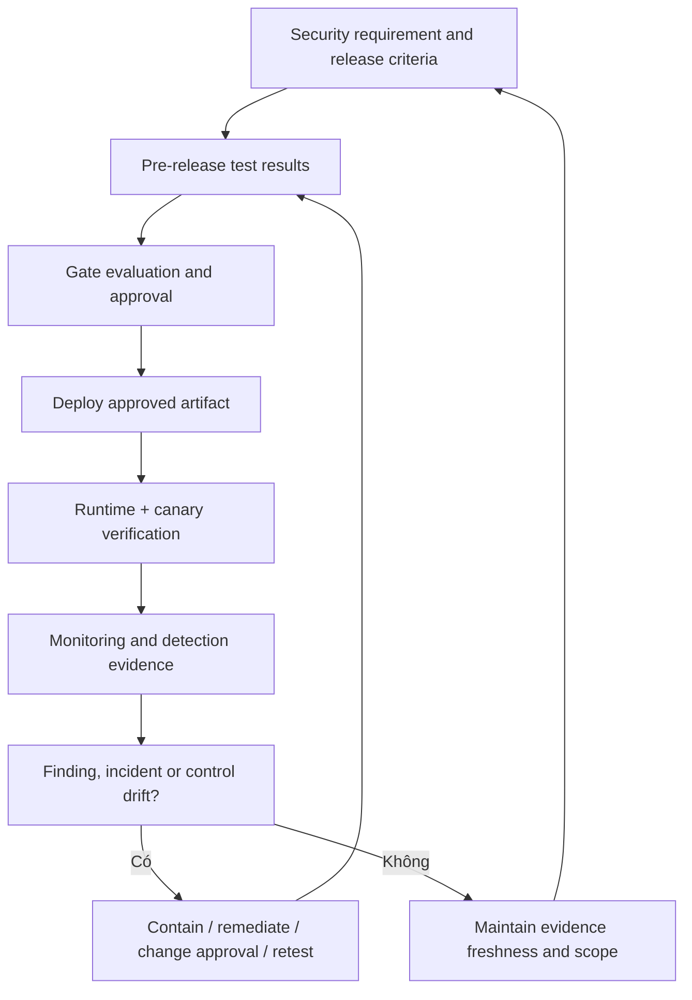

# Test Result trong Release Assurance: biến kết quả kiểm thử thành bằng chứng ra quyết định phát hành

## 1. Test Result là gì và vì sao cần được đánh giá?

**Test result (kết quả kiểm thử)** là bản ghi mô tả **một phép kiểm đã hoặc chưa được thực hiện**, trên đối tượng và điều kiện nào, với **tiêu chí mong đợi, dữ kiện quan sát, trạng thái thực thi, kết luận và bằng chứng** tương ứng. Trong **Release assurance**, test result là một mắt xích của quyết định **có đủ cơ sở để phát hành phiên bản phần mềm, thay đổi cấu hình hoặc triển khai artifact vào môi trường đích hay chưa**.

Trong module **SECURITY_SECURITY_ASSURANCE**, mục tiêu là xây dựng cách đánh giá **có bằng chứng** rằng hệ thống đáp ứng các mục tiêu bảo mật, từ phân tích rủi ro, requirements và security controls đến testing, audit, remediation và assurance liên tục trong phát triển và vận hành. Vì thế, thông điệp `BUILD SUCCESS` hoặc dashboard “100% xanh” **không tự chứng minh một release an toàn**.

Ví dụ, một pipeline báo:

> “420 tests passed, 0 failed. Release approved.”

Người đánh giá cần hỏi thêm:

- Những **420 tests** có kiểm các security requirements rủi ro cao hay chỉ unit tests chức năng?
- Có bao nhiêu test **SKIPPED, NOT_RUN, ERROR, TIMED_OUT hoặc INCONCLUSIVE**?
- Tests chạy trên **commit, image digest, configuration và môi trường** nào? Có đúng artifact được phát hành?
- Dữ liệu kiểm thử, role, dependency, policy và tool version có tương đương điều kiện production không?
- Có **finding critical đang mở**, test coverage gap hay exception hết hạn nào bị bỏ qua?
- Nếu chạy lại một test sau khi sửa, **bằng chứng của lần FAIL cũ** có được giữ lại?
- Ai đã review, tiêu chí quality gate nào đã áp dụng và ai có quyền chấp nhận residual risk?

Một bản ghi có giá trị phải trả lời được: **kiểm cái gì → tại sao cần kiểm → kiểm trên đối tượng nào → quan sát điều gì → có đáp ứng tiêu chí không → bằng chứng ở đâu → release decision nào được hỗ trợ**.

### 1.1. Mục tiêu học tập

Sau bài này, người học có thể:

1. Phân biệt **test case, test execution, test result, test report, security finding và release decision**.
2. Thiết kế test result chứa **test ID, requirement/control/risk mapping, artifact identity, môi trường, thời gian, expected/actual, outcome và evidence provenance**.
3. Hiểu các trạng thái **PASS, FAIL, ERROR, SKIPPED, NOT_RUN, INCOMPLETE/INCONCLUSIVE, FLAKY** và giới hạn của mỗi trạng thái.
4. Đánh giá security testing trên nhiều lớp: SAST, SCA, secrets, IaC, image, DAST, API authorization, integration, end-to-end và manual testing.
5. Xây release quality gate **risk-based, fail-safe** mà không nhầm công cụ lỗi với ứng dụng an toàn.
6. Truy vết **test result → immutable artifact → deployment → runtime validation**, tránh lỗi “test artifact A, deploy artifact B”.
7. Kiểm chất lượng bằng chứng, độ mới, scope, data completeness, reproducibility, false positive và retry.
8. Quản lý findings, exceptions, remediation và verified retest không xóa lịch sử.
9. Lập release test result summary, metrics có mẫu số và quyết định **GO/NO-GO/HOLD** có thẩm quyền.
10. Thực hành đánh giá kết quả một release Java/API trên CI/CD.

**Giới hạn:** Các IDs, thresholds, policy và dữ liệu minh họa dưới đây là giả lập phục vụ học tập, không đại diện kiểm chứng một hệ thống thật; mỗi tổ chức phải xác định risk tolerance, nghĩa vụ và quyền phê duyệt của mình.

## 2. Vai trò của Test Result trong Release Assurance

Release assurance không chỉ là test ngay trước khi ấn nút deploy. Nó liên kết **security objectives, threat modeling, control implementation, verification, risk acceptance, change approval và operational readiness** thành chuỗi bằng chứng xuyên suốt.



### 2.1. Test result hỗ trợ những câu hỏi nào?

| Nhóm câu hỏi | Ví dụ | Bằng chứng phù hợp |
|---|---|---|
| **Security requirement** | API có ngăn user tenant A đọc đơn tenant B? | Authorization positive/negative tests, fixtures, application logs |
| **Supply-chain integrity** | Artifact deploy có phải artifact đã được kiểm và approved? | Commit/build/run IDs, digest, provenance, deployment record |
| **Configuration assurance** | Production IaC có mở quyền public ngoài baseline? | Policy-as-code/IaC tests, effective runtime config |
| **Vulnerability exposure** | Dependency/image có findings vượt release policy? | SCA/image scanner result, SBOM, triage/false-positive evidence |
| **Change safety** | Release có làm regress một security control đã PASS? | Security regression suite, comparative tests, version linkage |
| **Detection readiness** | Những hành vi quan trọng từ release mới có được log/cảnh báo? | Source event/canary ID, detection pipeline evidence |
| **Recovery readiness** | Có rollback/restore test được duyệt cho thay đổi rủi ro cao? | Runbook, rehearsal results, data integrity và recovery gates |
| **Release governance** | Ai đã xem FAIL/INCOMPLETE và quyết định? | Gate evaluation, approved exception, sign-off và audit trail |

### 2.2. Từ “kiểm thử đã chạy” đến “security claim có cơ sở”

Ví dụ “mọi API bắt buộc kiểm phân quyền cấp object” là một **security requirement**. Việc chạy 100 unit tests không chứng minh yêu cầu này được đáp ứng, trừ khi test plan liên kết đúng endpoints, principals, resources, data boundaries và negative authorization behaviors.

Một claim có cơ sở phải mang **scope và giới hạn**:

> “Các negative authorization tests thuộc suite AUTHZ-v4 PASS đối với những role/tenant/API paths đã liệt kê trên image digest D trong staging tương đương production tại thời điểm chạy. Những route và data flow không thuộc ma trận chưa được kết luận.”

Đây không phải bảo đảm hệ thống miễn nhiễm mọi cách vượt quyền. Test result chỉ hỗ trợ **những thuộc tính được kiểm trong điều kiện được mô tả**.

## 3. Phân biệt Test Case, Execution, Result, Finding và Decision

Nhầm các đối tượng này khiến hệ thống mất bằng chứng lịch sử, nhất là khi test được chạy lại.

| Đối tượng | Vai trò | Ví dụ |
|---|---|---|
| **Requirement/control** | Điều kiện bảo mật cần đạt | `REQ-AUTHZ-01`: cấm đọc đơn hàng của tenant khác |
| **Test case** | Đặc tả bước kiểm và expected behavior | `TC-AUTHZ-021`: user A đọc order của B phải bị từ chối |
| **Test suite/plan** | Nhóm tests, phương pháp, coverage và version | `AUTHZ-REGRESSION-v4` |
| **Test execution/run** | Một lần chạy cụ thể trên artifact/config/env cụ thể | `RUN-2026Q4-0123` |
| **Test result** | Kết quả của test case trong run đó | `TC-AUTHZ-021` FAIL, observed 200 thay vì denial |
| **Evidence record** | Dữ liệu cho reviewer đối chiếu observed/expected | Request/response redacted, logs, trace IDs, timestamps |
| **Security finding** | Sai lệch có risk/impact, owner, treatment | `FIND-AUTHZ-021`: IDOR trên route cụ thể |
| **Risk acceptance/exception** | Quyết định quản trị có điều kiện về deviation | `EX-2026-044`, expiry và compensating controls |
| **Release decision** | Quyết định đưa phiên bản/artifact vào môi trường nào theo chính sách | `HOLD`, `NO_GO` hoặc `GO` cho digest D |
| **Deployment verification** | Kiểm artifact và controls thật sự hoạt động sau deploy | Runtime digest, canary, logs, monitor và rollback check |

### 3.1. Một test case có nhiều executions

```text
TC-AUTHZ-021: user A must not read tenant B order
  ├─ RUN-100 / digest D1 / 10:00 → FAIL (200, data returned)
  ├─ FIX-CHANGE-24 → code modified and reviewed
  ├─ RUN-101 / digest D2 / 13:00 → PASS (403; valid positive control)
  └─ PROD-CANARY-17 / digest D2 → PASS within approved runtime scope
```

Không **ghi đè `RUN-100`** bằng PASS của `RUN-101`. Release decision cho digest `D2` dựa trên kết quả mới có thẩm quyền và phải giữ lịch sử FAIL, remediation, review. Một test case có PASS trên artifact D2 không chứng minh D1 đã được sửa.

### 3.2. Test failure khác scanner finding

- Test behavior FAIL khi observed không đúng expected, hoặc tiêu chí cụ thể bị vi phạm.
- Static scanner có thể sinh **finding cần triage**: chưa chắc mọi finding đều là lỗ hổng thực, severity/risk cần xác minh.
- Tool execution ERROR hoặc INCOMPLETE có thể không chứng minh control PASS hay FAIL, nhưng là **assurance gap** cần xử lý.
- Release gate có thể NO-GO vì **thiếu evidence**, dù chưa có một technical vulnerability được xác nhận.

Vì thế nên tách **test execution outcome**, **security defect state** và **release gate decision**, không gom mọi vấn đề thành một nhãn “Build Failed”.

## 4. Thiết kế security test từ mục tiêu và threat scenario

Không chọn test suite chỉ vì framework có sẵn nhiều checks. Cần đi từ mục tiêu an ninh đến **behavior, misconfiguration và failure mode** có thể kiểm.

### 4.1. Từ risk sang acceptance criteria

```text
Risk: khách hàng đọc dữ liệu đơn hàng thuộc tenant khác
  → Requirement: tenant isolation on every order-resource operation
  → Control: server-side object-level authorization
  → Scope: GET/POST/PATCH/DELETE and bulk/export routes
  → Test: allowed actor success; forbidden actor denied
  → Evidence: exact path, actor/tenant fixture, result, request ID
  → Release rule: required high-risk authz tests must PASS
```

### 4.2. Chất lượng của một acceptance criterion

Một criterion tốt mô tả **đúng đối tượng và điều kiện**, không dùng từ mơ hồ như “an toàn”, “không có rủi ro”:

| Mơ hồ | Kiểm chứng được hơn |
|---|---|
| “Bảo mật tốt” | “Role không có `orders:read` nhận access denial trên mọi API path trong coverage matrix” |
| “Không có lỗ hổng” | “Không có confirmed findings thuộc blocked risk categories trên artifact đã scan đầy đủ theo policy revision X” |
| “Có ghi log” | “Privileged role-change event với actor, target, outcome và timestamp đến SIEM trong giới hạn đã duyệt” |
| “Rollback được” | “Canary rollback đưa service về artifact approved trước, phục hồi functional/security gates trong cửa sổ kiểm đã định” |
| “Artifact tin cậy” | “Deployment chạy digest đúng với signed/provenance-checked build output được approved” |

Criterion cần gắn **mức rủi ro và policy**, ví dụ route customer-data cần kiểm negative authorization đầy đủ hơn route public health. Không được tự coi mọi test có tác động ngang nhau khi tính gate.

### 4.3. Positive, negative và abuse-case tests

Đối với authorization:

- **Positive control:** user được cấp phép truy cập object canary có tồn tại, nhận kết quả dự kiến.
- **Negative control:** user ngoài quyền truy cập cùng object, bị từ chối theo policy.
- **Abuse case:** thay resource identifier, tenant context, role hoặc ownership để thử đường vượt quyền trong phạm vi được ủy quyền.
- **Precondition control:** data fixture đã tạo chính xác; failure do object không tồn tại không tự là authorization PASS.

Chỉ thực hiện các security tests trên **môi trường, tài khoản và dữ liệu được ủy quyền**. Tránh dùng thông tin khách hàng thật hoặc làm hỏng production để tạo kết quả học tập.

## 5. Phân loại test theo lớp và control domain

Một release assurance plan có thể chứa nhiều loại test với **phạm vi và năng lực kết luận khác nhau**.

| Test/công cụ | Tìm hoặc xác minh điều gì | Giới hạn điển hình |
|---|---|---|
| **Unit security tests** | Logic validators, authorization functions, crypto API wrappers, input handling | Không chứng minh deployment/runtime policy đầy đủ |
| **Integration/contract tests** | Phối hợp service, IdP, DB, message queue, tenant boundaries | Test environment có thể khác thực tế |
| **API/E2E security regression** | Effective authorization, sessions, security headers, permission paths | Chỉ routes/roles/fixtures đã định |
| **SAST** | Patterns trong source/bytecode theo rules | False positives, không bao phủ runtime behavior |
| **SCA/SBOM analysis** | Dependencies và known vulnerable components | SBOM incomplete, reachability cần đánh giá |
| **Secrets scanning** | Token/key patterns trong source/artifacts | False positives, không chứng minh mọi secret đã được bảo vệ |
| **Container/image scanning** | OS packages, dependencies, image misconfiguration | Scan image không xác minh runtime permissions |
| **IaC/policy-as-code checks** | Cloud/K8s/Terraform declarations khác baseline | IaC state có thể drift với actual deployment |
| **DAST** | Các hành vi web/API quan sát được qua scan đã cho phép | Cần scope/auth credentials, có thể bỏ qua API path |
| **Fuzz/property-based tests** | Edge cases, parser resilience, invalid inputs | Kết quả tùy corpus, time budget, oracle |
| **Threat-informed manual tests** | Abuse cases phức tạp, logic nghiệp vụ, chaining | Bị giới hạn scope, chuyên môn, thời gian |
| **Detection/logging tests** | Event generation→collector→rule→alert→routing | Injection ở SIEM không chứng minh source logging |
| **Deployment/provenance checks** | Binary/image digest, build integrity, signed metadata | Chữ ký không chứng minh code không có lỗi |
| **Resilience/restore tests** | RTO/RPO/MBCO, rollback, integrity | Lab không tự đại diện mọi kịch bản production |

### 5.1. Không dùng một tool thay thế mọi control

Ví dụ SAST PASS không chứng minh API tránh được **business logic authorization abuse**; SCA sạch không chứng minh secrets chưa từng bị lộ; signed image không chứng minh image không chứa CVE. Cần mapping risk/requirement sang **test layers phù hợp**, và công bố những phần không bao phủ.

### 5.2. Bảo đảm cấp độ test phù hợp release

Một hotfix chỉ thay cấu hình logging có thể không cần chạy lại toàn bộ performance test trong mọi môi trường, nhưng phải **xác minh chính control logging và các dependencies có thể bị ảnh hưởng**. Ngược lại một upgrade authentication library hoặc policy engine có thể yêu cầu **regression/negative tests rộng hơn**. Test selection cần có phương pháp impact/risk analysis được phê duyệt, không tối ưu chỉ để pipeline chạy nhanh.

## 6. Trạng thái test result: PASS không phải trạng thái duy nhất

Một test result có giá trị phải phân biệt **control không đạt** với **không có khả năng kết luận**. Đặc biệt, tool trả exit code 0, chạy không lỗi hoặc tạo file report **không nhất thiết** nghĩa mọi yêu cầu bảo mật PASS.

### 6.1. Đề xuất taxonomy

| Trạng thái | Ý nghĩa | Cách diễn giải trong Release Assurance |
|---|---|---|
| **PASS** | Test được thực hiện hợp lệ; observed đáp ứng criterion | Hỗ trợ claim đúng scope/artifact/run đã xác minh |
| **FAIL** | Test hợp lệ chứng minh observed không đáp ứng criterion | Technical deviation; triage và release gate theo risk |
| **ERROR** | Harness/tool/infrastructure lỗi, test không hoàn tất đáng tin | **Chưa kết luận** về security control; sửa lỗi test rồi chạy lại |
| **TIMEOUT** | Không hoàn thành trong giới hạn theo định nghĩa | Có thể là FAIL nếu latency là criterion; hoặc ERROR/INCOMPLETE nếu hạ tầng test lỗi |
| **SKIPPED** | Test nằm trong kế hoạch nhưng bị bỏ qua có chủ đích hoặc điều kiện | Không được tính PASS; cần lý do, owner và gate policy |
| **NOT_RUN** | Required test chưa được thực hiện | Coverage gap; đánh giá có đủ bằng chứng để release không |
| **INCOMPLETE / INCONCLUSIVE** | Có dữ liệu nhưng không đủ xác nhận expected/observed | Không được biến thành PASS; điều tra prerequisites, nguồn, nhãn |
| **FLAKY / NONDETERMINISTIC** | Lần chạy khác nhau không có thay đổi kiểm chứng được | Chưa có kết luận tin cậy cho control critical; điều tra instability |
| **QUARANTINED** | Test tạm cách ly khỏi pipeline thường lệ theo governance | Không đồng nghĩa requirement được miễn; có owner, expiry và cách kiểm thay thế |
| **NOT_APPLICABLE (N/A)** | Requirement không áp dụng với scope cụ thể theo criteria có review | Chỉ loại khỏi mẫu số applicable khi có căn cứ/phê duyệt |

Tên trạng thái có thể khác nhau giữa JUnit, CI engine, scanner hoặc hệ thống GRC. Chương trình phải quy định **mapping không mất nghĩa** từ trạng thái nguồn sang taxonomy chung, không chỉ dùng `SUCCESS`, `WARNING`, `FAILED`.

### 6.2. Test FAIL khác tool ERROR

Ví dụ:

- Test `cross_tenant_access_is_denied` nhận **HTTP 200 với dữ liệu tenant B**: nếu fixture/actor hợp lệ, đó là **FAIL có thể là finding nghiêm trọng**.
- Test không chạy vì container DB chưa khởi động: **ERROR**, chưa có evidence rằng authorization hoạt động.
- Test nhận HTTP 404 vì order chưa được tạo: **INCONCLUSIVE** nếu mục đích kiểm là object-level authorization; cần positive control chứng minh order tồn tại.
- Test timeout vì API xử lý quá 5 giây **và** criterion quy định <5 giây: có thể là FAIL về latency; nếu harness mất kết nối và không biết server behavior, có thể ERROR.

Không được gom những trường hợp trên thành “app failed” hoặc “no vulnerabilities”.

### 6.3. Bỏ qua test có thể là một release risk

Giả sử release có 40 required tests, kết quả:

| Outcome | Số lượng |
|---|---:|
| PASS | 31 |
| FAIL | 2 |
| ERROR | 2 |
| SKIPPED | 2 |
| NOT_RUN | 3 |
| **Tổng required** | **40** |

Nếu quy tắc chỉ tính các test có **kết luận hợp lệ** PASS/FAIL:

\[
\text{Conclusive coverage}=\frac{31+2}{40}=82.5\%.
\]

\[
\text{Pass rate among conclusive}=\frac{31}{31+2}\approx93.94\%.
\]

\[
\text{Validated PASS coverage}=\frac{31}{40}=77.5\%.
\]

**93,94% pass rate trên 33 tests có kết luận không có nghĩa 93,94% các yêu cầu bảo mật đã được chứng minh đạt.** Có 7 tests chưa có kết luận đạt, cộng 2 FAIL; nội dung từng test và mức criticality còn quan trọng hơn tỷ lệ.

### 6.4. Một trạng thái “warning” không được dùng để che blocker

Khi scanner chuyển một confirmed critical finding thành `WARNING` vì policy cấu hình như vậy, technical observation vẫn phải giữ **severity/risk, affected artifact và finding ID**. Có thể có một **governance decision** cho release có điều kiện nếu được phép, nhưng không gọi control PASS hoặc xóa finding khỏi report.

## 7. Tối thiểu một Test Result Record cần những trường nào?

Để hỗ trợ kiểm toán và revalidation, test result phải thể hiện **ngữ nghĩa phép kiểm**, không chỉ thông điệp console.

### 7.1. Schema khái niệm

| Nhóm | Thuộc tính | Tác dụng |
|---|---|---|
| **Identity** | `test_case_id`, `test_case_version`, `run_id`, `suite_id` | Phân biệt test definition với lần chạy |
| **Traceability** | `requirement_id`, `control_id`, `risk_scenario_id`, `change_id` | Biết vì sao test cần cho release |
| **Artifact** | Git commit/tree, build ID, package/image digest, SBOM/provenance refs | Biết chính xác đối tượng đã kiểm |
| **Environment** | account, cluster/namespace, service version, config/policy revisions, dependencies | Xác định điều kiện của phép thử |
| **Execution** | actor/runner, tool version, command/profile, start/end timestamps, exit signal | Tái lập và đánh giá reliability |
| **Criterion** | expected behavior, assertions, applicability, acceptance rule | Để không quyết định tùy cảm tính |
| **Observation** | actual outcome, sample/request IDs, logs/traces, failed assertion | Căn cứ PASS/FAIL |
| **Coverage** | asset/tenant/role/route, dataset/test fixtures, preconditions | Biết điều gì chưa được kiểm |
| **Result status** | PASS/FAIL/ERROR/... cùng reason code | Không gộp absence of evidence thành success |
| **Evidence** | immutable records, hashes khi phù hợp, collection time, redaction, access | Reviewer kiểm nguồn và integrity |
| **Triage** | finding ref, severity/priority, false-positive rationale hoặc follow-up | Đóng vòng kiểm thử với remediation |
| **Review** | policy applied, reviewer decision, sign-off và thời điểm | Phân biệt tự động hóa và thẩm quyền |

### 7.2. Test case definition và test result phải có version riêng

Nếu `TC-LOGIN-07` được sửa từ “mọi login phải PASS” thành “login của admin phải enforce phishing-resistant MFA theo policy”, các lần chạy trước và sau **không có cùng phép kiểm**. Giữ `test_case_version` và `criteria_revision` để giải thích trend.

Tương tự, tool version hoặc rule-set revision thay đổi có thể phát hiện nhiều issues hơn; cần ghi version vào test result, không mặc định số findings tăng phản ánh một security regression thực sự.

### 7.3. Timestamp và timezone

Phân biệt:

- `started_at_utc`, `finished_at_utc` của test.
- `event_time` khi application thực hiện hành vi.
- `ingested_at_utc` khi logs tới hệ thống giám sát.
- `approved_at_utc` khi người có thẩm quyền ký release hoặc exception.
- `deployed_at_utc` và `runtime_verified_at_utc` của artifact.

Một approval ký sau khi artifact đã deploy **không thể được trình bày như phê duyệt trước phát hành**. Timestamp có clock skew hoặc nguồn không đồng bộ cần được ghi hạn chế.

### 7.4. Đừng lưu secrets trong test result

Request/response evidence có thể chứa JWT, cookies, access tokens, thông tin khách hàng và mật khẩu. Dùng **synthetic fixtures**, redaction, least-privilege evidence storage và kiểm soát retention. Khi chỉ cần chứng minh actor/tenant khác nhau, có thể lưu **pseudonymous IDs, role mappings, request correlation IDs** và raw restricted evidence khi thực sự cần.

## 8. Test Result có cấu trúc: ví dụ YAML

Đây là một bản ghi **minh họa**, không phải schema chuẩn của một CI tool. Nó mô tả test xác thực ranh giới tenant cho một bản release giả định.

```yaml
test_result_id: TEST-RESULT-EXAMPLE-005-021
test:
  case_id: TC-ORDER-AUTHZ-021
  case_revision: 4
  suite_id: AUTHZ-RELEASE-REGRESSION-v4
  title: "Cross-tenant order read is denied"
  requirement_id: REQ-AUTHZ-01
  control_id: CTRL-AUTHZ-01
  threat_scenario_id: RISK-ORDER-IDOR-01
run:
  run_id: RUN-EXAMPLE-2026Q4-123
  started_at_utc: "2026-11-28T02:00:00Z"
  finished_at_utc: "2026-11-28T02:01:30Z"
  runner: approved-ci-runner
  harness_revision: authz-test-harness-v3
  retry_count: 0
artifact:
  source_commit: example-commit-abcdef
  build_id: BUILD-EXAMPLE-123
  image_digest: "sha256:example-digest-not-a-real-image"
  sbom_ref: SBOM-EXAMPLE-123
environment:
  name: security-staging
  account: orders-stage-a
  namespace: orders
  config_revision: orders-config-example-r7
  idp_policy_revision: idp-policy-example-r3
test_scope:
  actor: user-tenant-a-synthetic
  target_resource: order-tenant-b-canary-001
  api_route: "GET /api/orders/{id}"
  data_class: synthetic
preconditions:
  - "Target canary order exists and is accessible to tenant B"
  - "Tenant A identity has no permission for tenant B order"
expected:
  http_status: 403
  unauthorized_data_returned: false
observed:
  http_status: 403
  unauthorized_data_returned: false
  correlation_id: req-example-381
outcome: PASS
evidence:
  request_response_ref: evidence/authz/TC-ORDER-AUTHZ-021-redacted.json
  application_event_ref: event-example-821
  positive_control_result_ref: TEST-RESULT-EXAMPLE-005-020
review:
  method_revision: release-gate-example-r5
  test_validity: validated
  release_decision: not_determined_by_this_test_alone
limitations:
  - "Only declared route, actor and fixture covered by this execution"
```

**Toàn bộ IDs, timestamps, đường dẫn và kết quả trên là dữ liệu giả.** Nó không chứng minh testcase thực sự chạy trên Order Service nào. Trong môi trường thật, đường dẫn evidence phải trỏ tới artifact tồn tại, revision phải tương ứng build và người review cần có quyền kiểm.

### 8.1. Chỉ có một PASS là chưa đủ

Test này chứng minh một cặp actor/route/resource bị chặn **khi test hợp lệ**. Muốn khẳng định object-level authorization của toàn API, cần inventory các routes và hành vi đọc/ghi/xuất dữ liệu, actor classes, tenant boundaries, alternate APIs và policy coverage. Report cần ghi **coverage matrix**, không suy rộng từ một synthetic request.

### 8.2. Cùng test, tình huống FAIL

```yaml
test_result_id: TEST-RESULT-EXAMPLE-005-022
case_id: TC-ORDER-AUTHZ-021
run_id: RUN-EXAMPLE-2026Q4-122
artifact_digest: "sha256:example-older-digest"
expected_http_status: 403
observed_http_status: 200
data_exposure_on_synthetic_fixture: true
outcome: FAIL
finding_ref: FIND-ORDER-AUTHZ-EXAMPLE-009
release_gate_effect: block_release_per_approved_policy
evidence_refs:
  - evidence/authz/failed-request-redacted.json
  - evidence/authz/application-trace.json
```

Test FAIL của artifact cũ vẫn là một sự kiện lịch sử cần giữ. Một PASS mới trên artifact sửa lỗi chỉ đóng finding sau khi **fix, deployment consistency và retest** được xác minh.

## 9. Tính đại diện của Test Environment và Test Data

Một test PASS trên laptop không tự chứng minh production sẽ PASS. Phải ghi **mức tương đồng hoặc khác biệt có ý nghĩa** của môi trường với release target.

### 9.1. Những thành phần cần so

| Thành phần | Cần xác minh | Nếu khác thì sao? |
|---|---|---|
| **Artifact** | Exact digest/bytes, build flags, base image | Test may not apply to deployed bits |
| **Configuration** | Feature flags, service settings, security defaults | Có thể đổi đường authorization/logging |
| **IAM/IdP** | Role mappings, tokens, claims, auth policies, break-glass | Negative authz test staging có thể sai production |
| **Networking** | Ingress/egress, service mesh, API gateway, WAF | Exposed routes hoặc bypass khác nhau |
| **Secrets/KMS** | Quyền truy cập key, rotation, encryption, certificates | Một flow chỉ lỗi hoặc chỉ exposed ở production |
| **Database/storage** | Schema, row-level/tenant policy, replicas, backup | Data access/transaction integrity khác |
| **Third parties** | API version, trust boundary, sandbox/prod differences | Sandbox PSP không chứng minh production contract |
| **Telemetry** | Logging categories, collector, parser, detection rule | Staging events có thể không đến SIEM production |
| **Runtime/platform** | K8s admission, security context, service account, autoscale | IaC test không phản ánh runtime drift |
| **Data fixtures** | Synthetic nhưng đủ mô phỏng edge cases và tenant boundaries | 404/empty dataset làm test invalid |

### 9.2. Môi trường khác không làm mọi test vô giá trị

Unit test cho một hàm validation thuần có thể vẫn hữu ích khi chạy trong CI độc lập. Nhưng **test effective cloud IAM, network policy hoặc logging** nên có bằng chứng từ môi trường tương đương hoặc xác minh runtime được ủy quyền; phải công bố mức chênh lệch.

### 9.3. Production testing cần quy tắc an toàn

Một số canary tests read-only, limited authorization checks hoặc audit log injection được phép có thể hữu ích. Tuy nhiên, mọi phép thử trên production cần:

- Scope, identity, thời gian, người phê duyệt rõ.
- Không dùng PII hoặc gây tác động đến đơn hàng thật nếu không có điều kiện hợp lệ.
- Rate limits, rollback/stop criteria, monitoring và incident communication.
- Không vượt quyền hoặc thực hiện exploit phá hoại.

Nếu chỉ chạy ở staging, report phải ghi **production validation pending/not covered** thay vì tự động coi tương đương.

## 10. Đọc và chuẩn hóa kết quả từ nhiều công cụ

Release pipeline thường tổng hợp JUnit-style results, SAST/SCA, DAST reports, container scans, IaC rules và manual review. Mỗi nguồn có **định nghĩa status riêng**, vì vậy cần lớp chuẩn hóa và kiểm soát chất lượng.

### 10.1. Không đánh đồng format với assurance

| Format/nguồn phổ biến | Đặc điểm | Điều cần chú ý |
|---|---|---|
| **JUnit XML** | Thường biểu diễn test cases, test suites, elapsed time, failure/error/skip | Các công cụ khác nhau có convention/extension khác nhau |
| **SARIF** | Format cho nhiều static analysis findings và metadata | Có finding không đồng nghĩa runtime exploit; cần triage, applicability |
| **Scanner-native JSON/HTML** | Severity, CVE, package, rule, target và status | Xem scan completeness, rules, policy, tool exit code |
| **CI job logs/status** | Kết quả stage, runner/environment, exit code | Job success không tự là all-tests-PASS |
| **Manual test report** | Scope, methodology, steps, observed findings, reviewer | Phải có evidence, dates và limitations |
| **Infrastructure/policy assessment** | Resource–rule outcomes, inventory snapshot | IaC declared state có thể khác effective production |
| **Runtime canary/observability** | Event/alert/detection and actual deployed config | Cần source event IDs, timestamp và đúng digest |

**Không coi một SARIF result là một unit test FAIL theo cùng nghĩa.** SARIF có thể liệt kê findings cần triage, trong khi unit test assertion FAIL là quan sát behavior. Chuẩn hóa phải giữ **source semantics**, không đơn giản ép tất cả thành PASS/FAIL.

### 10.2. Một bản scan “clean” có điều kiện

Trước khi ghi scanner PASS/NO_FINDINGS, cần xác minh:

1. Scanner chạy thành công và hoàn tất đủ phạm vi?
2. Policy/rule version đúng release?
3. Artifact digest được scan có đúng artifact để deploy?
4. Required language/packages/paths/lockfiles có được phát hiện?
5. Authentication và endpoint discovery đủ cho DAST?
6. Scanner có bị rate limit, network timeout hoặc quyền bị chặn?
7. Những suppressions/ignore rules có được review và còn hiệu lực?
8. Scan age còn trong freshness window?

Nếu scan không quét được một microservice, không có findings từ microservice ấy **không phải bằng chứng nó sạch**.

### 10.3. Chuyển đổi kết quả phải giữ raw source

Nên lưu:

```text
Tool-native raw report
  → signed/controlled collection reference
  → parser and normalization revision
  → normalized test/finding records
  → data quality validation
  → applicable control/asset matrix
  → release gate decision with source links
```

Khi parser thay đổi hoặc sửa schema, có thể tính lại kết quả và giải thích khác biệt. Nếu chỉ giữ file CSV đã được tóm tắt thủ công, reviewer khó phân biệt liệu một test thật sự PASS hay chỉ bị mất dòng trong quá trình nhập liệu.

## 11. Artifact identity, supply-chain provenance và release traceability

Một test result chỉ có giá trị cho **đúng đối tượng đã kiểm**. Nếu build tạo image A, test image A nhưng deploy image B, một report đẹp không chứng minh release B an toàn.

### 11.1. Chuỗi định danh

```text
Source commit / reviewed change
  → Approved build definition and dependencies
  → CI build ID, runner and tool revisions
  → Artifact bytes and immutable digest
  → SBOM / provenance / signature verification
  → Test executions bound to the same digest
  → Release manifest and authorized gate decision
  → Registry promotion / deployment with pinned digest
  → Runtime readback and operational security checks
```

Đường truy vết phải cho phép reviewer hỏi **“binary đang chạy ở production có đúng bytes đã được test và approved không?”**. Nếu build được thực hiện lại sau test, dù cùng commit, outputs có thể khác bởi dependency resolution, timestamps, toolchains hoặc network inputs. Cần chính sách về reproducibility/provenance và test lại nếu artifact identity thay đổi.

### 11.2. Digest quan trọng hơn tag mutable

Một container tag như `orders:latest` có thể trỏ tới nội dung khác sau khi đã kiểm. Dùng **digest hoặc immutable identity** khi liên kết test results với deployment. Tên `v1.4` cũng có thể bị gán lại nếu registry cho phép; phải biết policy về immutability.

### 11.3. Kiểm riêng tính toàn vẹn và chất lượng security

| Bằng chứng | Hỗ trợ nhận định | Không tự chứng minh |
|---|---|---|
| Image digest match | Bytes đang xem là cùng artifact được tham chiếu | Artifact không có lỗ hổng |
| Build provenance | Quá trình tạo artifact theo metadata đã ghi | Source code là an toàn tuyệt đối |
| Signature verification | Artifact/metadata đã được ký theo trust policy được kiểm | Key, signer và policy không thể bị compromise |
| SBOM | Danh sách components/phụ thuộc với coverage đã ghi | Mọi dependency chắc chắn đã được liệt kê hoặc đều không có CVE |
| SCA pass | Không có findings bị chặn trong dữ liệu và rules được kiểm | Không có unknown vulnerabilities hoặc abuse-case |
| Runtime attestation/readback | Deployment đang dùng artifact/config được kiểm | Tất cả runtime behaviors đều đúng |

**Chữ ký và provenance giúp xác minh nguồn gốc/toàn vẹn trong trust boundary**, không thay thế các security tests về quyền, dữ liệu, logic và cấu hình.

### 11.4. Quan hệ một-nhiều

Một digest có thể được triển khai tại nhiều environments/accounts/regions với configs khác nhau. **Build-time test** có thể tái sử dụng nếu artifact giữ nguyên và chính sách cho phép, nhưng **effective IAM, network, KMS, runtime policy và logging tests** vẫn phải gắn với từng target scope. Một PASS staging không tự chuyển thành PASS production cho các control phụ thuộc môi trường.

### 11.5. Khi nào cần re-evaluate test validity?

Trigger gồm:

- Artifact digest hoặc base image đổi.
- SBOM/package dependency được cập nhật.
- IaC, Kubernetes admission policy, IAM role hoặc secret scope đổi.
- IdP/auth policy hoặc tenant routing đổi.
- Feature flag làm xuất hiện code path khác.
- Vulnerability intelligence/rule-set thay.
- Test harness hay required criteria thay.
- Scan đã quá freshness window hoặc evidence source không còn.

Không nhất thiết mọi thay đổi đều chạy lại mọi test, nhưng **impact analysis và test selection phải được ghi**; required controls có thể buộc revalidation ngay.

## 12. Release Quality Gate: test results được dùng để quyết định thế nào?

**Release quality gate** là bước đánh giá có quy tắc, dùng các bằng chứng và policy để **cho phép, giữ hoặc từ chối phát hành**. Gate không nên dùng một tổng `pass_percentage` duy nhất để chấp nhận rủi ro trọng yếu.

### 12.1. Các nhóm điều kiện

| Gate criterion | Ví dụ rule được phê duyệt nội bộ | Ý nghĩa khi không đáp ứng |
|---|---|---|
| **Artifact identity** | Exact digest được scan/test/sign theo policy | Không đủ traceability để release |
| **Required tests** | Mọi critical security regression tests PASS và còn hiệu lực | FAIL hoặc test missing có thể block |
| **Coverage** | Test scope/route/role matrix không thiếu phần high-risk | Không tự gọi 100% chỉ vì chạy một subset |
| **Vulnerabilities** | Không có confirmed blocked-risk findings không được xử lý hợp lệ | Triage/remediate/authorized exception |
| **Secrets & supply chain** | Không có active leaked credentials được xác nhận; provenance hợp lệ | Incident assessment/rotation hoặc HOLD |
| **Configuration** | IaC/admission/effective policies đáp ứng baseline | Fix drift hoặc review risk |
| **Telemetry** | Các required events có canary và alert pipeline đúng scope | Missing detection evidence cần xử lý |
| **Change governance** | Review, approvals, rollout/rollback plan còn hợp lệ | Không deploy khi chưa có thẩm quyền |
| **Exception validity** | Mọi waiver khớp exact issue/artifact/scope/time và được phê duyệt | Expired/out-of-scope bypass bị từ chối |
| **Post-deploy checks** | Readback digest, health/security canary, observability | Cần stop/rollback theo safety plan |

Các quy tắc là **minh họa**, không phải ngưỡng áp dụng tự động cho mọi doanh nghiệp. Một hệ thống có nghĩa vụ pháp lý nghiêm ngặt hoặc dữ liệu nhạy cảm có thể có **non-waivable controls**.

### 12.2. GO, HOLD, NO-GO và conditional release

| Decision | Khi nào phù hợp | Lưu ý |
|---|---|---|
| **GO** | Required evidence và controls đạt, approvals đầy đủ, residual risk trong tolerance | Vẫn cần kiểm deploy/runtime |
| **HOLD** | Evidence missing, tool error, triage chưa xong, owner chưa quyết định | Không “đổi màu xanh” bằng cách bỏ test |
| **NO-GO** | Control quan trọng FAIL vượt policy/risk tolerance hoặc có blocker bắt buộc | Cần fix/stop/change design |
| **CONDITIONAL GO** | Chỉ nếu policy cho phép và có risk decision hợp lệ, scope/time-box, mitigation, monitoring, rollback | Không tự là PASS; follow-up và expiry bắt buộc |

Một tổ chức có thể dùng nhãn khác nhau. **Release authorization** phải gắn đúng target, artifact và time window; không dùng approval cho digest D1 để tự triển khai D2.

### 12.3. Gate evaluation pseudocode

```text
INPUT:
  release_candidate_digest
  approved_change_and_scope
  required_test_matrix_and_criteria
  raw_and_normalized_test_results
  security_findings
  trusted_exception_registry

VERIFY:
  build and provenance references match exact digest
  test results refer to exact candidate and relevant environments
  required test population is complete
  test tooling, data freshness, and source health are valid

FOR each required test/control unit:
  if result is FAIL:
    link finding, business impact and release policy outcome
  if result is ERROR/SKIPPED/NOT_RUN/INCONCLUSIVE:
    mark missing assurance; do not count PASS

FOR each exception candidate:
  verify exact finding/control/artifact/environment/time scope
  verify approver authority, expiry, conditions and mitigation evidence
  preserve technical finding outcome even if exception is valid

EVALUATE blocking requirements and policy risk conditions

if critical non-waivable control fails:
    decision = NO_GO
else if required evidence missing or review pending:
    decision = HOLD
else if material deviation is allowed only with authorized conditions:
    decision = CONDITIONAL_GO only when all conditions verified
else if every required condition is satisfied:
    decision = GO

RECORD policy version, inputs, digest, decision, actor and timestamp
```

Đây là **pseudocode**, không phải chương trình CI có thể triển khai trực tiếp. Trong thực tế cần xử lý race conditions, permission boundaries, artifact mutation, signing/key compromise, trusted clock, rollback, availability và governance riêng.

### 12.4. Không cho một trung bình che critical blocker

Giả sử 999 tests PASS, 1 test FAIL chứng minh khách hàng tenant A đọc được dữ liệu tenant B. **99,9% pass rate** không phải cơ sở hợp lý để bỏ qua finding critical trong môi trường xử lý dữ liệu nhạy cảm. Gate cần **mandatory blocker rules**, không chỉ ngưỡng trung bình.

### 12.5. Fail closed không có nghĩa phá production

Khi tool lỗi hoặc policy registry unavailable, gate trước deploy nên **không cho release mới đi qua bằng một approval không xác thực**. Nhưng hệ thống phải có **safety plan**: không tự xóa database, cắt dịch vụ đang chạy hoặc rollback gây mất dữ liệu chỉ vì gate không nhận được kết quả. Phân biệt **chặn thay đổi mới** với **xử lý workload đang phục vụ khách hàng**.

## 13. Positive/Negative Security Regression Tests: ví dụ API

Một test suite tốt chứng minh cả **hành vi được phép** và **hành vi không được phép**, tránh “từ chối mọi yêu cầu” bị tưởng là bảo mật đúng.

### 13.1. Ma trận authorization minh họa

Giả sử Order API có các principals:

- `userA`: khách hàng tenant A, sở hữu order `A-101`.
- `userB`: khách hàng tenant B, sở hữu order `B-201`.
- `opsReader`: service role hỗ trợ quan sát, không được đọc dữ liệu cá nhân chi tiết.
- `orderWorker`: workload identity xử lý queue, không có quyền gọi admin API.

| Test | Operation | Expected | Loại kiểm |
|---|---|---|---|
| `AUTHZ-01` | `userA GET /orders/A-101` | Success, dữ liệu đúng tenant | Positive |
| `AUTHZ-02` | `userA GET /orders/B-201` | Denied, không lộ dữ liệu | Negative |
| `AUTHZ-03` | `userB PATCH /orders/A-101` | Denied, không thay DB | Negative |
| `AUTHZ-04` | `opsReader GET /orders/A-101/details` | Denied nếu không có phép | Negative |
| `AUTHZ-05` | `orderWorker POST /admin/roles` | Denied, audit event ghi đúng | Negative |
| `AUTHZ-06` | Tenant B reads own B-201 after denied A attempt | Success, không bị state corruption | Positive regression |

Thực hiện với **fixture synthetic**, tài nguyên tồn tại và kiểm trước/sau đối với DB state. Với endpoints có quy định trả 404 thay vì 403 để không tiết lộ sự tồn tại của object, **expected outcome phải theo security policy**, không cố định một HTTP code cho mọi API.

### 13.2. Khi nào kết quả bị coi là không hợp lệ?

- Order B-201 chưa được tạo, test nhận 404 nhưng không phân biệt authorization.
- Test dùng service admin token thay vì identity `userA`.
- API gateway trả 403 từ IP allowlist trước khi authorization logic được kiểm.
- Mock IdP luôn cấp admin role, khiến negative test không thật.
- Test không assert response body/data leakage hoặc database side effect.
- Dataset giữa các runs bị tái sử dụng và state đã thay.

Khi prerequisites sai, nên báo **ERROR/INCONCLUSIVE**, sửa fixture/harness rồi chạy lại, không tăng pass rate.

### 13.3. Một ví dụ JUnit kiểu Java (đơn giản hóa)

```java
@Test
void customerCannotReadAnotherTenantsOrder() {
    var ownerOrder = fixtures.createOrder("tenant-b");
    var ownerResponse =
        api.getOrderAs("tenant-b-user", ownerOrder.id());
    assertEquals(200, ownerResponse.statusCode());

    var outsiderResponse =
        api.getOrderAs("tenant-a-user", ownerOrder.id());

    assertTrue(
        outsiderResponse.statusCode() == 403
        || outsiderResponse.statusCode() == 404
    );
    assertFalse(outsiderResponse.body().contains(ownerOrder.secretMarker()));
}
```

Mã Java này **mang tính minh họa**, dùng helper `fixtures` và `api` giả lập; không chạy nguyên trạng nếu chưa có test harness tương ứng. Việc cho phép 403/404 cần dựa vào policy thực; assert body ở ví dụ đơn giản không thay tất cả các kiểm về **side effects, cross-tenant enumeration, auth/session và audit logs**.

### 13.4. Security regression không chỉ là exploit test

Với mỗi finding đã sửa, nên có:

1. **A test từng FAIL** (reproduction với fixture được ủy quyền).
2. **Expected secure behavior** sau fix.
3. **A verified PASS** trên artifact sửa lỗi.
4. **Negative test của đường gần kề**, tránh fix chỉ một route.
5. **Evidence runtime/config** khi control phụ thuộc môi trường.

Đó là cách biến finding thành **test có thể tái sử dụng**, không chỉ “đã đóng bug”.

## 14. Reproducibility, flakiness, retry và quarantine

Một test result ổn định không có nghĩa lúc nào cũng PASS, mà là khi chạy dưới điều kiện được định nghĩa, **phép thử và kết luận có thể kiểm tra lại**. Flaky tests dễ làm nhóm quen với nút “rerun until green”.

### 14.1. Các nguyên nhân flaky

- Race conditions, asynchronous queue processing và timing không kiểm soát.
- Shared test data hoặc concurrent jobs tác động nhau.
- Network/IdP/service dependencies không ổn định.
- Không reset state, caching và eventual consistency.
- Clock skew, non-deterministic fixture IDs, timezone.
- Resource exhaustion trên CI runner.
- Test assertion thiếu precondition, phân biệt sai 404/403/timeouts.
- Tool/scan rate limits, runner permissions hoặc secret expiry.

### 14.2. Một PASS sau nhiều retries nói lên điều gì?

Giả sử `TC-AUTHZ-021` có các executions:

```text
RUN-10 → FAIL  (unexpected 200)
RUN-11 → PASS  (403)
RUN-12 → FAIL  (unexpected 200)
RUN-13 → PASS  (403)
```

Nếu artifact/config không đổi mà test kết quả bất nhất, **không nên lấy RUN-13 làm trạng thái duy nhất rồi “xanh”**. Có thể có race condition hoặc lỗ hổng authorization khi session/cache state thay đổi. Cần lưu mọi attempts và phân tích behavior, nhất là nếu FAIL có bằng chứng lộ dữ liệu.

### 14.3. Chính sách retry

Một retry hợp lý:

1. Ghi original outcome, run/attempt ID, tool/environment metadata.
2. Chỉ retry theo policy xác định, không chạy vô hạn tới khi PASS.
3. Phân biệt **test harness ERROR** với **security assertion FAIL**.
4. Giữ mọi attempts; không dùng một passing retry xóa validated FAIL.
5. Đánh giá root cause và risk của sự bất ổn.
6. Với critical security requirement, không coi flaky là đã được chứng minh PASS cho release.

### 14.4. Quarantine phải có quản trị

Quarantine một test không làm requirement mất hiệu lực. Cần:

| Trường | Nội dung |
|---|---|
| Test ID và control requirement | Biết assurance nào bị thiếu |
| Reason và diagnosis | Chứng minh tool/harness issue hoặc known environment mismatch |
| Owner và ticket | Người sửa, mốc deadline |
| Scope | Những releases/artifacts/environments bị ảnh hưởng |
| Replacement validation | Manual/alternate test đủ phù hợp nếu có |
| Risk decision | Ai cho phép tiếp tục, với điều kiện nào |
| Expiry và re-entry | Khi nào test phải trở lại mandatory gate |
| Evidence | Run history, failure pattern và mitigation |

Quarantine 20 tests chỉ để pipeline chạy nhanh là **assurance degradation**; dashboard cần báo số tests còn trong required population nhưng đang chưa có kết luận.

### 14.5. Không “fix” flaky bằng cách tắt assertion

Nếu assertion liên quan authorization, secrets hoặc data isolation, việc xóa assertion chỉ làm giảm coverage. Hãy cải tiến fixture, await strategy, nguồn clock, isolation hoặc harness; nếu buộc thay test design, ghi **test revision và reason**, chạy validation độc lập.

## 15. Chất lượng dữ liệu test: completeness, freshness, validity và provenance

Một báo cáo PASS có thể sai dù phép tính chính xác nếu **test population hoặc dữ liệu đầu vào không đáng tin**.

### 15.1. Các thuộc tính chất lượng

| Thuộc tính | Câu hỏi kiểm | Ví dụ lỗi |
|---|---|---|
| **Completeness** | Tất cả required tests/scopes đã có result records? | Parser chỉ nhập 80/100 tests |
| **Accuracy** | Outcome phản ánh observed behavior và correct assertions? | HTTP 200 được mapping PASS cho negative authz |
| **Validity** | Preconditions, fixtures, role và target thực sự đúng? | Test trên object không tồn tại |
| **Freshness** | Result có còn áp dụng sau artifact/config/threat changes? | Dùng scan trước khi nâng base image |
| **Uniqueness** | Mỗi test attempt/asset có canonical ID? | Hai imports đếm một PASS thành hai |
| **Consistency** | Schema/status/severity giữa tool revisions có khớp? | SKIPPED được parser đổi thành SUCCESS |
| **Integrity** | Artifact/log có chain of custody, access, hash khi phù hợp? | File CSV bị sửa thủ công không audit |
| **Reproducibility** | Có run ID, tool/profile, environment/data revision? | “QA tested, looks good” |
| **Representativeness** | Test đúng controls, routes/roles, target env? | Test only public health endpoint |
| **Security/privacy** | Evidence tránh lộ secrets/PII và có retention? | Chụp JWT thật và gửi vào chat nhóm |

### 15.2. Evidence freshness là điều kiện riêng

Một test PASS hôm qua có thể hết giá trị hôm nay nếu:

- Artifact được rebuild, dependency hoặc SBOM đổi.
- Feature flags hoặc auth policy đổi.
- K8s/network policy đã drift.
- Test rule đã bị phát hiện thiếu threat scenario mới.
- Phạm vi release mở thêm account/region/tenant.

Để tránh dùng bằng chứng cũ vô điều kiện, metric/result cần `tested_at`, `artifact_identity`, `criteria_version` và `revalidation_triggers`.

### 15.3. Raw source và normalized output



Khi có missing record, malformed XML hoặc unavailable scanner, **không được im lặng bỏ phần tử rồi tính 100% các test còn lại**.

### 15.4. Check tổng số và các loại unknown

Ví dụ bộ 40 required tests ở mục 6:

```text
required = pass + fail + error + skipped + not_run
40       = 31   + 2    + 2     + 2       + 3
```

Nếu normalized report chỉ nhập 33 result rows (PASS+FAIL) và thiếu bảy rows, quality gate phải **phát hiện missing required test IDs** từ test plan; không được coi đây là toàn bộ tests cần đánh giá.

### 15.5. Retention và evidence traceability

Nên lưu raw result, parser revision, normalized result, test/run IDs và decision record theo retention/contract/security policy. Bằng chứng nhạy cảm phải hạn chế quyền; không nhất thiết người xem executive summary có quyền truy cập response payload. Hash giúp phát hiện thay đổi so với bản đã lưu **nếu tham chiếu được bảo vệ**, nhưng không tự chứng minh nội dung đúng hoặc test thực sự đại diện cho production.

## 16. Từ Test FAIL đến Finding, Remediation và Verified Retest

Một test FAIL có thể báo hiệu **lỗ hổng, sai lệch chính sách, sự cố môi trường test hoặc lỗi assertion**. Triage đúng là điều kiện để release decision không võ đoán.

### 16.1. Quy trình phân loại

1. **Xác minh test hợp lệ:** fixture, scope, actor, artifact, environment, request path, log và expected behavior.
2. **Đối chiếu criterion:** requirement/control version có áp dụng cho target không?
3. **Reproduce trong phạm vi được ủy quyền:** với environment/synthetic data phù hợp; không khai thác hệ thống thật ngoài scope.
4. **Phân loại:** confirmed security finding, false positive đã chứng minh, test/harness bug, policy mismatch, environmental error hoặc unknown.
5. **Phân tích impact/risk:** data sensitivity, exploitability, reachability, privilege, threat context và business criticality.
6. **Xác định owner và treatment:** fix, rollback, feature-disable, containment, controlled exception hoặc escalate.
7. **Giữ lịch sử:** original failed execution, triage evidence, change ID và decision.
8. **Retest trên đúng artifact:** xác minh issue không còn và không gây regression lân cận.

### 16.2. False positive không phải nhãn để giảm release blocker

| Trường hợp | Triage đúng |
|---|---|
| Scanner báo secret nhưng đó là placeholder public không có quyền và được xác minh | Có thể reclassify false positive với evidence |
| Secret thật trong artifact nhưng team nói “chưa ai dùng” | Vẫn có thể là finding; cần xử lý validity, scope và leak |
| SAST cảnh báo một method không reachable theo phân tích có bằng chứng | Xem applicability/false positive dựa trên control criteria |
| Authorization test trả 404 do object chưa được tạo | Test invalid/inconclusive, không phải control PASS |
| SCA scan không thấy dependency vì lockfile không được parse | Incomplete scan, không phải “0 CVE” |

**Không dùng “false positive” như ngoại lệ trá hình.** Nếu technical deviation là thật nhưng release phải chờ, có thể xin risk treatment theo chính sách chứ không ghi rằng tool sai.

### 16.3. Một finding có thể ảnh hưởng nhiều test cases

Ví dụ lỗi kiểm ownership trong middleware được phát hiện ở `GET /orders/{id}` và `PATCH /orders/{id}`. Hai tests FAIL có thể có **một root cause**, nhưng vẫn phải giữ hai test result IDs để biết coverage sau fix. Ngược lại, một test FAIL có thể bao gồm nhiều issues, cần phân tách để remediation và retest chính xác.

### 16.4. “Fixed” có ít nhất ba mốc

```text
1. Code/config change merged
2. New artifact produced and deployed into target scope
3. Security behavior verified by test(s) on that artifact/runtime
```

Việc merge PR chỉ là bằng chứng của **thay đổi dự kiến**, không tự là verified fix ở production. Một issue liên quan IAM policy hoặc secrets có thể cần thêm **effective permissions validation, credential revocation, runtime log health**.

### 16.5. Finding record minh họa

```yaml
finding_id: FIND-ORDER-AUTHZ-EXAMPLE-009
source_test_result: TEST-RESULT-EXAMPLE-005-022
control_id: CTRL-AUTHZ-01
criterion: "Tenant-bound order access is enforced server-side"
affected_scope:
  service: order-api
  route: "GET /api/orders/{id}"
  environment: staging
  artifact_digest: "sha256:example-older-digest"
expected: "Tenant A cannot read tenant B order"
observed: "Synthetic tenant A received tenant B order data"
classification: confirmed_security_deviation
release_priority: blocking_under_example_policy
risk_owner: example-order-business-owner
fix:
  change_id: CHG-EXAMPLE-389
  state: implemented_pending_verification
verification:
  required_tests:
    - TC-ORDER-AUTHZ-021
    - TC-ORDER-AUTHZ-022
  required_scope: "new artifact plus approved runtime target"
  outcome: not_yet_confirmed
```

Mẫu là dữ liệu giả lập; `confirmed_security_deviation` trong ví dụ không phải kết quả scanner thật. Khi dùng thực tế, severity/risk phải có phương pháp và evidence review.

## 17. Exception, Waiver và Release có điều kiện

Một release có thể gặp deviation thật chưa thể khắc phục đúng kế hoạch. **Exception** là quyết định quản trị có điều kiện, không phải cách chuyển technical FAIL thành PASS.

### 17.1. Khi nào cần xem xét ngoại lệ?

- Finding đúng, requirement áp dụng, không thể fix ngay vì constraint có evidence.
- Alternative actions (rollback, feature disable, scope reduction, patch, architecture change) đã được đánh giá.
- Residual risk có thể được quản trị trong risk appetite và **không xung đột nghĩa vụ bắt buộc**.
- Compensating controls cụ thể được kiểm và monitoring hoạt động.
- Scope/time/asset/digest/finding/identity được khóa rõ.
- Risk owner có thẩm quyền và review độc lập phù hợp.
- Exit plan, expiry, escalation, rollback và retest rõ ràng.

### 17.2. Scope của ngoại lệ phải khớp artifact đang release

Ví dụ hợp đồng ngoại lệ:

```yaml
exception_id: REL-EX-EXAMPLE-005
status: under_review
control_id: CTRL-VULN-01
finding_id: VULN-EXAMPLE-057
release_scope:
  service: order-worker
  environment: production
  account: orders-prod-a
  image_digest: "sha256:example-immutable-digest"
  allowed_deviation: "Only one verified dependency finding"
  excluded_from_exception:
    - other_findings
    - other_services
    - new_artifact_digests
validity:
  valid_from_utc: null
  expires_at_utc: null
risk_owner: example-order-business-owner
security_reviewer: pending
compensating_controls:
  - network_path_restriction_with_test
  - validated_runtime_logging
remediation:
  change_id: CHG-EXAMPLE-908
  retest_required: true
decision: not_approved
```

**Hồ sơ này đang `under_review`, không cấp phép triển khai.** Muốn trở thành effective exception, cần thẩm quyền và điều kiện thật theo policy. Không được dùng request pending để đi qua gate.

### 17.3. Những anti-pattern phải ngăn

| Anti-pattern | Vấn đề | Cơ chế kiểm |
|---|---|---|
| `SKIP_SECURITY_SCAN=true` cho cả repository | Bỏ các findings mới | Matcher đúng finding/control/digest |
| Exception không expiry | Rủi ro kéo dài | Time-box và review |
| Approval theo tag `latest` | Artifact thay mà bypass vẫn còn | Immutable digest |
| Developer tự approve | Conflict of interest | Separation of duties |
| Dùng approval sau deploy ghi nhận như trước deploy | Xóa sai lịch sử | Sign-off timestamps và change log |
| Exception cho finding A nhưng gate bỏ luôn B | Bypass không đúng scope | Negative gate tests |
| Hết hạn nhưng deploy vẫn đi qua | Enforcement failure | Expiry test và fail-safe for new changes |
| Risk accepted thì đếm PASS | Compliance metric sai | Technical outcome vs treatment status |

### 17.4. Conditional GO không loại bỏ trách nhiệm

Nếu policy cho phép **conditional release** có ngoại lệ hợp lệ, release report cần giữ:

1. Original finding FAIL và test result/evidence.
2. Exception ID, scope, effective time, expiry và người phê duyệt.
3. Compensating controls có validated evidence.
4. Residual risk, business impact và monitoring.
5. Remediation ticket, due date, verification và rollback conditions.
6. Biện pháp ngăn exception lan sang artifact phiên bản sau.

Một vài control có thể **không được phép waiver** theo quy định/hợp đồng. Risk acceptance nội bộ không thay đổi nghĩa vụ bên ngoài.

## 18. Manual Testing, Penetration Testing và Third-party Results

Không phải security requirement nào cũng kiểm đầy đủ bằng unit test hoặc scanner. Business logic, trust boundaries, social/process controls và chained attack scenarios có thể cần **manual review, threat-informed testing hoặc independent assessment**.

### 18.1. Manual test result cần gì?

| Nội dung | Ví dụ |
|---|---|
| Engagement ID/authorization | `PT-EXAMPLE-2026Q4`, người cho phép và rules of engagement |
| Scope | Services, hosts/paths, roles, tenant fixtures, environments |
| Method | Threat model, test cases, approved techniques và test window |
| Artifact/config context | Release digest, policy revision, deployed environment |
| Observations | Expected/actual, request/trace IDs và evidence |
| Finding validity/risk | Confirmed/reproducible hoặc inconclusive, business impact |
| Exclusions/limitations | Routes chưa test, time constraints, inaccessible systems |
| Fix/retest | New release digest, same scenario test và peer review |
| Author/reviewer | Tester, independent reviewer, report version |

**“Đã penetration test” không có nghĩa mọi hành vi đã được kiểm**. Một pentest tại phiên bản r1, Q2 và chỉ ở staging không tự là assurance cho release r4 Q4 tại production sau khi auth architecture đổi.

### 18.2. Sử dụng bên thứ ba

Nếu dùng báo cáo của SaaS/cloud/security assessment provider:

- Kiểm **service, region, controls, time period và exclusions** phù hợp release target.
- Phân biệt provider responsibility với customer-controlled configuration/IAM/application logic.
- Xem complementary controls/obligations mà customer vẫn phải thực hiện.
- Không diễn giải certification hoặc penetration-test report bên thứ ba thành PASS cho những yêu cầu **nằm ngoài phạm vi đã đánh giá**.
- Ghi thời kỳ chưa có evidence, confidentiality và quyền chia sẻ báo cáo.

### 18.3. Kết quả manual và automated khác thời điểm

Ví dụ manual pentest xác nhận lỗi authz ở digest D1, rồi pipeline chạy PASS trên D2. Để đóng finding và release D2 cần **mapping fix/retest** tới đúng scenario, không chỉ tổng scan PASS. Nếu manual test không thể được lặp lại vì dữ liệu/đường chạy đã thay đổi, ghi **limitation** và phương pháp bổ sung, không khẳng định đã xác minh xong.

### 18.4. Sampling và mức suy rộng

Penetration testing theo lịch thường dùng sampling và judgmental exploration. **Không thể dùng “0 findings” để suy ra xác suất 0 có lỗ hổng** trong toàn ứng dụng. Kết luận chỉ hỗ trợ paths, identities, systems và thời gian đã đánh giá; quan trọng là reviewer hiểu scope và limitations.

## 19. Release Test Result Report và Approval

Một report tốt có thể ngắn cho lãnh đạo nhưng phải có **technical annex và evidence index** cho những người kiểm toán hoặc engineering có quyền.

### 19.1. Các phần bắt buộc

| Phần | Cần thể hiện |
|---|---|
| **Release identity** | Service, change ID, version, immutable digest, target accounts/regions |
| **Purpose & criteria** | Security objectives, control catalogue/policy revisions, GO/NO-GO rules |
| **Test scope** | Suites, required test IDs, risk scenarios, environments và thời kỳ |
| **Execution summary** | PASS/FAIL/ERROR/SKIPPED/NOT_RUN/INCOMPLETE trên mẫu số |
| **Material findings** | Confirmed issues, severity/risk, owners và remediation/waiver |
| **Evidence quality** | Completeness, freshness, tool failures, data gaps, representativeness |
| **Artifact/provenance** | Build, SBOM, digest, signing/promotion và runtime identity |
| **Residual risks/exceptions** | Valid approvals, scope, expiry, compensating controls và risk owner |
| **Operational readiness** | Rollout/canary, monitoring, alerting, rollback/restore và owner |
| **Release decision** | GO/HOLD/NO-GO/conditional, approver/time/policy version |
| **Follow-up** | Retests, monitoring, drift/change triggers và evidence retention |
| **Technical annex** | Per-test result IDs, raw report links, fixtures, logs và review notes |

### 19.2. Executive summary minh họa

> **Release candidate:** Order API, source revision r5, immutable image digest D5, target production account A. Bộ required security tests có 40 cases: 31 PASS, 2 FAIL, 2 ERROR, 2 SKIPPED và 3 NOT_RUN. Validated PASS coverage là 77,5%; các tests thiếu kết luận và hai failures cần được triage. Đối với release policy minh họa, quyết định hiện tại là **HOLD** cho tới khi có bằng chứng kiểm thử đầy đủ và xử lý các blockers. Không có xác nhận an toàn tổng thể cho production từ những kết quả staging này.

Đây là **ví dụ dữ liệu**, không có approval thật. Report có thể diễn giải risk bằng văn bản, nhưng không được che các test critical hoặc mất mẫu số sau khi gộp.

### 19.3. Sign-off và trách nhiệm

| Vai trò | Trách nhiệm |
|---|---|
| **Engineering/release owner** | Cung cấp release manifest, scope, change record, fix status |
| **Quality/test owner** | Test plan, harness, result validity, regression |
| **Security Assurance/AppSec** | Mapping risks/controls, review FAIL/ERROR, evidence sufficiency |
| **Platform/DevSecOps** | CI/CD gate, artifact integrity, deploy/runtime verification |
| **Risk/business owner** | Quyết định residual risk/exception trong thẩm quyền |
| **Compliance/privacy** | Đánh giá nghĩa vụ không thể tự waiver và data handling |
| **Authorized release approver** | Quyết định target/artifact/time cụ thể |
| **Operations/SRE/IR** | Canary/monitoring, stop/rollback, incident readiness |

Nên tách **người lập test result** khỏi **người phê duyệt chấp nhận risk đáng kể**, tránh người chịu deadline release tự gỡ mọi blocker mà không có review.

### 19.4. Báo cáo có phiên bản và thời điểm khóa

Một release report được ký cần freeze **artifact digest, scope, test plan version, results snapshot, findings, exception decisions và time cutoff**. Nếu chạy lại test sau approval, phát hành revision mới hoặc addendum và ghi impact lên GO decision; không sửa âm thầm bản cũ như thể kết quả mới đã tồn tại lúc ký.

## 20. Case Study xuyên suốt: Release Order API trên Java và Kubernetes

### 20.1. Bối cảnh nghiệp vụ và architecture

Giả sử một ứng dụng **Order API** xây dựng bằng Java cung cấp các chức năng tạo, xem, sửa đơn hàng; backend lưu đơn trên managed database, attachments trên object storage, sử dụng cloud IAM/IdP, CI/CD và Kubernetes. Dịch vụ có tenant isolation và yêu cầu auditability vì xử lý thông tin khách hàng.

Một release r5 bổ sung bulk export và nâng authentication library. Nhóm cần đánh giá trước khi triển khai production. Những rủi ro ưu tiên:

1. **Unauthorized data access:** user của tenant A đọc hoặc xuất dữ liệu tenant B.
2. **Privilege escalation:** workload identity thao tác IAM hoặc database ngoài quyền.
3. **Supply-chain compromise:** image không đúng source/build đã kiểm, dependencies có vấn đề chưa triage.
4. **Loss of accountability:** API thay đổi nhưng audit event không ghi actor/resource/result.
5. **Unsafe rollout:** rollback hoặc database migration làm mất dữ liệu, bypass security policy.

### 20.2. Release Test Plan

| Test group | Số required | Năng lực kiểm |
|---|---:|---|
| Authorization/tenant isolation | 10 | Positive/negative tests của API và bulk export |
| Authentication/session | 6 | Token validation, session expiry, role change, auth fail |
| SCA/SAST/secrets/image | 8 | Build-time risks, blocked findings, secret presence |
| IaC/K8s/IAM baseline | 5 | Runtime/service-account/network-policy alignment |
| Logging/detection | 4 | Event canary, schema, retention, routing |
| Integrity/deployment/rollback | 4 | Provenance, image digest, change approval, revert |
| Resilience/data consistency | 3 | Safe migration và restore preconditions |
| **Tổng** | **40** | Required security test matrix cho release r5 |

**Không phải mọi test có cùng criticality.** Thử đọc dữ liệu xuyên tenant là blocker nghiêm trọng; lỗi thiếu một annotation không có tác động tương tự. Policy phải nói rõ test nào bắt buộc PASS và khi nào thiếu evidence làm release bị HOLD.

### 20.3. Candidate D1 — report nhiều PASS nhưng không thể release

```text
Release candidate: Order API r5
Digest: D1 (synthetic immutable identifier)
Build: BUILD-EXAMPLE-401
Suite: RELEASE-SECURITY-40-v2
Results: PASS 31 | FAIL 2 | ERROR 2 | SKIPPED 2 | NOT_RUN 3
Status: NEEDS_TRIAGE / NO_GO for confirmed cross-tenant violation
```

Hai results FAIL:

- `AUTHZ-07`: tenant A gọi bulk export tenant B nhận dữ liệu của B; synthetic fixture và positive control xác nhận đây là **real authorization defect**.
- `LOG-03`: privileged export event không xuất hiện ở target logging pipeline dù source action đã tạo và các prerequisites được xác minh.

Hai ERROR do test runner và temporary IdP sandbox outage; hai SKIPPED do filter cấu hình sai; ba NOT_RUN chưa được plan vào pipeline stage. **Không được tính những lỗi này thành PASS**, cũng không thể chỉ sửa hai FAIL rồi giữ nguyên 7 test thiếu kết luận.

**Decision:** D1 **NO-GO** theo policy minh họa vì có confirmed cross-tenant authorization failure. Cần fix, rerun required suites, giải quyết data gaps và đánh giá logging.

### 20.4. D2 — sửa code nhưng chưa đủ bằng chứng

Engineering sửa authorization middleware, cấu hình audit event và tạo **digest D2** với build mới. Test suite required được thực hiện lại:

| Outcome | Số required |
|---|---:|
| PASS | 39 |
| FAIL | 0 |
| ERROR | 1 |
| SKIPPED | 0 |
| NOT_RUN | 0 |
| **Tổng** | **40** |

Một test `IAM-05` lỗi vì CI runner không đọc được policy simulator. Không có bằng chứng rằng control đó đạt. **D2 vẫn HOLD**, dù tested pass rate của 39 tests có kết luận là 100%.

Nhóm sửa credential của test runner theo quyền được duyệt và kiểm tra:

1. `IAM-05` thật sự chạy với correct principal/config revision.
2. Test assertion PASS và raw evidence được lưu.
3. Previous ERROR record còn trong run history.
4. Các thay đổi sửa harness **không đổi artifact D2**; nếu đổi digest, phải đánh giá việc tái sử dụng results.
5. Test runner đã có đủ quyền cần thiết nhưng không được cấp admin rộng không kiểm soát.

Sau khi **chạy lại hợp lệ** trên cùng D2 và xác nhận các required results vẫn còn hiệu lực, có 40/40 required test units **đã có verified PASS** cho release scope này; không cần biến old ERROR thành PASS trong lịch sử.

### 20.5. GO không phải kết thúc assurance

Ngay cả khi pre-deployment gate đủ điều kiện GO, nhóm vẫn cần:

- Verify image digest D2 được deploy đúng cluster/namespace/account.
- Check security configuration, service account, network policy và secrets ở runtime.
- Chạy canary với synthetic authorized/unauthorized access đã duyệt.
- Xác nhận audit events và detection alert routing theo policy.
- Theo dõi error rates, data integrity và suspicious access attempts.
- Có rollback/failback plan, người trực và stop conditions.
- Ghi final release decision time, approver và target scope.

Nếu canary production cho thấy lại cross-tenant data exposure, cần **stop rollout và thực hiện incident/rollback response theo runbook**, không lấy 40/40 staging PASS để bỏ qua runtime evidence.

### 20.6. Lessons learned

| Bài học | Lý do |
|---|---|
| Không lấy PASS percentage thay security policy | 31/40 PASS vẫn có critical authz FAIL |
| Không tính ERROR/SKIPPED/NOT_RUN là “clean” | Những phần đó chưa chứng minh control |
| D2 khác D1 phải có test evidence tương ứng | Fix code tạo artifact mới |
| Harness sửa phải bảo toàn history | Không viết đè FAIL/ERROR của previous runs |
| Artifact identity nối test với deploy | Tránh test một bản, deploy một bản khác |
| Production canary cần tính an toàn | Runtime permissions và data flow có thể khác staging |
| Decision và observations là hai lớp riêng | GO không có nghĩa mọi rủi ro bằng 0 |

## 21. Release Assurance Manifest và Evidence Index

Một manifest máy có thể đọc cho phép liên kết **release candidate**, các suite results, findings và quyết định cuối. Nó là **dữ liệu quản trị**, không phải chứng nhận hay một CI framework chuẩn.

### 21.1. YAML report mẫu

```yaml
# Illustrative internal manifest; not a formal certification schema
release_assurance_report_id: REL-ASSURANCE-EXAMPLE-005
service: SECURITY_SECURITY_ASSURANCE
application: order-api
release_candidate: r5
report_revision: 3
status: approved_for_declared_scope
target:
  environment: production
  account: orders-prod-a
  namespace: orders
artifact:
  source_commit: example-commit-r5
  build_id: BUILD-EXAMPLE-402
  image_digest: "sha256:example-D2-not-real"
  sbom_reference: SBOM-EXAMPLE-402
  provenance_reference: PROVENANCE-EXAMPLE-402
criteria:
  security_policy_revision: baseline-example-r5
  release_gate_policy_revision: release-policy-example-r3
  security_test_plan_revision: RELEASE-SECURITY-40-v2
pre_release_tests:
  applicable_required_units: 40
  pass: 40
  fail: 0
  error: 0
  skipped: 0
  not_run: 0
  inconclusive: 0
  latest_accepted_run_id: RUN-EXAMPLE-402-VALIDATED
  run_history_includes_previous_failures: true
  evidence_manifest: example/evidence/index.yml
findings:
  verified_fixed:
    - FIND-ORDER-AUTHZ-EXAMPLE-009
    - FIND-ORDER-LOG-EXAMPLE-010
  open_blocking: []
exceptions:
  effective_for_this_candidate: []
approval:
  security_assurance_reviewer: example-security-reviewer
  risk_owner_review: not_required_for_no_open_deviations
  release_approver: example-release-approver
  approved_at_utc: "2026-11-28T08:00:00Z"
  decision: GO_FOR_SPECIFIED_TARGET
rollout:
  strategy: staged_canary
  runtime_digest_verification: required
  security_canary_tests: required
  logging_validation: required
  rollback_plan_ref: example/ops/rollback-plan.yml
limitations:
  - "Results cover defined artifact, controls and tested scenarios"
  - "Production security and observability checks required after deployment"
classification: restricted
```

Các IDs, timestamps, đường dẫn và trạng thái là **ví dụ**. `approved_for_declared_scope` và `GO_FOR_SPECIFIED_TARGET` trong YAML không biểu thị approval thật. Không có file `example/evidence/index.yml` hay `example/ops/rollback-plan.yml` được tạo trong bài học.

### 21.2. Tại sao vẫn lưu previous failures?

Trong case D1→D2:

- D1 FAIL chứng minh một vấn đề đã tồn tại và giúp lưu dấu root cause.
- D2 initial run ERROR chứng minh **giai đoạn chưa đủ evidence**, không phải control FAIL.
- D2 validated PASS hỗ trợ quyết định release khi suite/control scope còn phù hợp.
- Runtime canary là kiểm tra sau deploy ở môi trường cụ thể.

Nếu report chỉ giữ bản cuối “40 PASS”, auditor sẽ không biết **vấn đề đã được xử lý và được kiểm lại như thế nào**, hoặc có phần bị xóa khỏi test plan hay không.

### 21.3. Evidence index cho một test

```yaml
evidence_id: REL-EVID-EXAMPLE-005-021
test_case_id: TC-ORDER-AUTHZ-021
test_run_id: RUN-EXAMPLE-402-VALIDATED
artifact_digest: "sha256:example-D2-not-real"
environment: security-staging
criteria_revision: AUTHZ-CONTROL-EXAMPLE-R4
source:
  type: integration_test
  harness_revision: authz-test-harness-v3
  raw_report_ref: example/evidence/raw/junit-authz.xml
  request_response_ref: example/evidence/redacted/authz021.json
collection:
  observed_at_utc: "2026-11-28T07:20:00Z"
  collector: approved-ci-runner
  access_classification: restricted
result:
  expected: "Cross-tenant access denied"
  observed: "Denied, no synthetic data exposed"
  outcome: PASS
  validity: validated
limitations:
  - "One declared route and actor/resource combination tested"
```

Giữ **source report, tool revision, test definition và test scope**. Khi evidence là file đã tạo thật, có thể lưu checksum và manifest protected; một checksum giả trong ví dụ không có giá trị chứng cứ nên không được điền như thể đã tính.

### 21.4. Invariant kiểm tra tính nhất quán

```text
assert required == pass + fail + error + skipped + not_run + inconclusive
assert all PASS rows have valid evidence, prerequisites and matching artifact
assert every blocking FAIL links to a finding and authorized resolution
assert every exception matches exact artifact, control, scope and valid time
assert approved gate policy revision matches evaluated result set
assert release decision applies to the deployment target and time window
assert previous attempts and findings remain auditable
assert post-deploy verification requirements have owners and stop criteria
```

Các assertions chỉ là yêu cầu thiết kế validator. Một pipeline có thể đạt kiểm tra cấu trúc nhưng **vẫn bỏ lỡ một threat scenario không có trong test plan**; vì vậy phải review coverage đối chiếu risk và controls thường xuyên.

## 22. Post-release Verification, Canary, Rollback và Continuous Assurance

**Test result trước deploy** không đủ để biết release được triển khai đúng cách hoặc runtime vẫn đáp ứng security objectives. Security assurance tiếp diễn trong canary, rollout và vận hành.

### 22.1. Ba mức xác minh

| Thời điểm | Kiểm tra | Điều có thể kết luận |
|---|---|---|
| **Pre-build/pre-release** | Source review, tests, scans, policies, provenance | Artifact candidate đã đáp ứng criteria trong test scope |
| **Deployment/runtime readback** | Exact digest, effective config/IAM/network, feature flags | Target đang dùng artifact và controls được kiểm |
| **Post-release monitoring** | Security canary, audit logs, alerts, incident/failure indicators | Controls tiếp tục hoạt động trong cửa sổ quan sát |

### 22.2. Rollout kiểu canary

Một quy trình minh họa:

1. Deploy digest approved tới một subset nhỏ của target có rollback plan.
2. Xác minh **runtime digest** và target identity.
3. Chạy smoke/health tests và **security canary** với synthetic actor/resources.
4. Kiểm logging source→collector→rule→alert theo yêu cầu.
5. Xem error/latency, data integrity, unauthorized-access signals.
6. Chỉ mở rộng rollout khi gate đã nêu đạt; nếu phát hiện material regression, **stop/contain/rollback** theo policy.
7. Ghi evidence/canary run và decision của mỗi bước.

Độ nhỏ của canary không bảo đảm an toàn nếu nó chỉ nhận lưu lượng dễ hoặc không đại diện tenant/data paths; phải xác định các **security-critical behaviors** cần test.

### 22.3. Rollback cũng là một phép kiểm

Rollback có thể làm sống lại một vulnerable image, đảo ngược database migration, hỏng schema compatibility hoặc mất audit logs. Cần có:

- Danh sách **approved rollback artifacts** và known risk.
- Data migration/failback/backup compatibility, irreversible changes.
- Security check sau rollback: auth, IAM, network, keys, logging.
- Trigger và người có thẩm quyền yêu cầu rollback.
- RTO/RPO/business continuity impact nếu thay đổi lớn.

“Rollback button exists” khác với **verified rollback readiness**. Một rollback đã chạy phải được đọc lại artifact/runtime và kết quả kiểm để biết trạng thái thực tế.

### 22.4. Điều kiện revalidation sau release

Tái đánh giá khi:

- Feature flag bật code path mới không được test.
- IAM/IdP, Kubernetes admission, network policy, secrets hoặc KMS đổi.
- Scale-out tới region/cluster/account mới.
- Thêm tenant, data class, partner API hoặc business functionality.
- Scanner/detection rule phát hiện mới, critical CVE hoặc incident.
- Test result hết freshness window hoặc evidence/telemetry source lỗi.
- Có drift, operator hotfix, emergency change hoặc compromised pipeline.

Một lần GO không nên được hiểu là **approval vĩnh viễn cho mọi triển khai của artifact ấy**.

### 22.5. Continuous assurance loop



Vòng này giúp liên kết release assurance với **incident response, configuration assurance, compliance, metrics/reporting và risk management** trong cùng hệ thống governance.

## 23. Test Result Metrics: đo đúng chất lượng release thay vì đếm tests

Một dashboard test result cần phân biệt **testing activity**, **validated coverage**, **quality của security controls**, **risk vẫn tồn tại** và **độ tin cậy bằng chứng**. Nếu chỉ tối ưu số PASS hoặc số tests, nhóm có thể vô tình bỏ các test khó.

### 23.1. Nhóm metric hữu ích

| Metric | Định nghĩa minh họa | Không được suy ra |
|---|---|---|
| **Required test execution coverage** | Tests đã chạy theo định nghĩa / required test population | Tests chạy không đồng nghĩa PASS |
| **Conclusive test coverage** | PASS + FAIL hợp lệ / required tests | Không nói mức tuân thủ nếu nhiều FAIL |
| **Validated PASS coverage** | PASS hợp lệ, đúng artifact và scope / required tests | Không là xác suất hệ thống an toàn |
| **Critical scenario validation coverage** | Risk scenarios critical có end-to-end test PASS / required scenarios | Một test không bao phủ mọi biến thể của scenario |
| **Evidence freshness/quality** | Results đủ source, run, artifact, thời hạn / results required | Không tự chứng minh test design đúng |
| **Flaky test burden** | Tests có kết quả bất nhất cần triage / required tests | Flaky thấp không có nghĩa detection tốt |
| **Scanner/tool error rate** | Required tool runs error / required tool runs | Tool lỗi không có nghĩa 0 findings |
| **Blocking findings open** | Confirmed findings vi phạm gate và chưa verified resolved | Số ít có thể do coverage thấp |
| **Time to verified fix** | Time từ finding confirmed tới retest PASS trên target | Ticket closed sớm không tự là fix |
| **Expired exception count** | Exceptions hết hạn nhưng vẫn được viện dẫn/enforce | Không nên được gộp vào approved count |
| **Artifact identity mismatch rate** | Deployments có digest khác approved/tested / deployments evaluated | Một mismatch nghiêm trọng có thể cần escalation ngay |
| **Post-release regression count** | Confirmed defects phát hiện sau release trong control scope | Phụ thuộc detection và monitoring |

### 23.2. Ví dụ tính coverage

Với 40 tests required của candidate D1:

```text
PASS:     31
FAIL:      2
ERROR:     2
SKIPPED:   2
NOT_RUN:   3
TOTAL:    40
```

\[
\text{Conclusive coverage}=\frac{31+2}{40}=82.5\%.
\]

\[
\text{PASS among conclusive}=\frac{31}{31+2}\approx93.94\%.
\]

\[
\text{Validated PASS coverage}=\frac{31}{40}=77.5\%.
\]

Không viết “release 93,94% secure”. Hai FAIL có thể nằm ở critical tenant isolation; năm SKIPPED/NOT_RUN và hai ERROR còn thiếu evidence. Số lượng không quyết định release thay cho risk/control criteria.

### 23.3. Metrics cần phân tầng

- Theo **security objective/control** (authz, IAM, data protection, logging, supply chain, DR).
- Theo **business criticality**, data sensitivity, Internet exposure và tenant boundary.
- Theo **artifact/environment/account/region**.
- Theo **test level/tool/source**.
- Theo **required vs optional**, **blocking vs nonblocking** và **risk scenario**.
- Theo **new vs regression tests**, original attempts và retries.

Một tỷ lệ 99% PASS tổng thể có thể che việc **toàn bộ tests của một critical service đều NOT_RUN**. Dashboard phải hiển thị critical gaps và IDs, không chỉ màu tổng.

### 23.4. Trend qua các releases cần cùng định nghĩa

Release r4 có 30 required tests, r5 có 40 vì thêm bulk export và tenant authz cases. Không thể chỉ so “r4 100% PASS, r5 90% PASS” mà không xem **test population growth, coverage và new risk scenarios**. Báo:

- **Like-for-like** trên các test case IDs có cùng semantics/revisions.
- Coverage của những tests mới.
- Changes trong criteria, test harness và severity mapping.
- Escaped defects theo cohort và monitoring capability.

### 23.5. Anti-gaming

| KPI được tối ưu | Hành vi nguy hiểm | Guardrail |
|---|---|---|
| % tests PASS | Xóa negative tests khó hoặc đổi required→optional | Requirement-to-test coverage review |
| CI duration giảm | Tắt scanners hoặc skip suites | Required test inventory + source health |
| Số bugs closed | Chuyển fixed trước verified retest | Fix validation và reopened rate |
| 0 critical findings | Hạ severity/loại scanner targets | Independent triage và asset coverage |
| 0 flaky tests | Quarantine không expiry | Quarantined tests + missing assurance metric |
| 100% signed builds | Ký artifact bất kỳ, không verify trust/source | Provenance, signer policy và runtime digest check |
| 0 post-release incidents | Tắt telemetry hoặc giảm khai báo | Detection health và controlled scenario tests |

**Security Assurance không tối ưu để có ít vấn đề được nhìn thấy nhất, mà để phát hiện đúng và giảm rủi ro thực tế**.

## 24. Bài thực hành: đánh giá Test Result và quyết định Release

### 24.1. Bối cảnh

Một nhóm phát triển Java **Customer Order API** chuẩn bị release `v2.8.0`, gồm thay đổi authorization và library upgrade. Pipeline tạo một container image và chạy test suite trên staging. Nhóm có ma trận **24 required security test units**, nhưng executive dashboard hiển thị “18 passed, 1 failed” và không nói số còn lại.

Các con số giả lập:

| Nhóm test | Required | PASS | FAIL | ERROR | SKIPPED | NOT_RUN |
|---|---:|---:|---:|---:|---:|---:|
| API authorization | 8 | 6 | 1 | 0 | 0 | 1 |
| SCA/SAST/secrets | 5 | 4 | 0 | 1 | 0 | 0 |
| IAM/IaC/runtime policy | 4 | 3 | 0 | 0 | 1 | 0 |
| Logging/detection | 4 | 3 | 0 | 1 | 0 | 0 |
| Deployment/provenance/rollback | 3 | 2 | 0 | 0 | 0 | 1 |
| **Tổng** | **24** | **18** | **1** | **2** | **1** | **2** |

Quan sát bổ sung:

- `AUTHZ-07` FAIL: synthetic user A đọc được order của tenant B.
- SCA runner ERROR vì thiếu quyền truy cập artifact registry.
- Một IAM baseline test bị SKIPPED vì filter nhầm environment.
- Audit log canary ERROR vì collector không kết nối được.
- Một deploy provenance check NOT_RUN.
- Còn một rollback test NOT_RUN vì test plan không gắn job.
- Team muốn ship vì “18/19 executed assertions PASS”; deadline release gần.

### 24.2. Nhiệm vụ A — Phân loại và tính toán

Hãy tính:

\[
\text{Conclusive coverage}=\frac{18+1}{24}\times100\%\approx79.17\%.
\]

\[
\text{PASS rate among conclusive}=\frac{18}{18+1}\times100\%\approx94.74\%.
\]

\[
\text{Validated PASS coverage}=\frac{18}{24}\times100\%=75\%.
\]

Giải thích tại sao **94,74%** không chứng minh release đã sẵn sàng. Liệt kê chính xác **5 tests chưa có kết luận PASS/FAIL** (2 ERROR, 1 SKIPPED, 2 NOT_RUN), cùng 1 FAIL ảnh hưởng tenant isolation.

### 24.3. Nhiệm vụ B — Kiểm test validity và source evidence

Với `AUTHZ-07`:

1. Test fixture tenant B có thật và accessible với owner?
2. User A identity và claims có chính xác?
3. Request path/API gateway/filter có đúng?
4. Response có synthetic data thật của tenant B hay chỉ lỗi mapping?
5. Trace/application logs và DB state có evidence?
6. Artifact digest, config revision và run time có được lưu?
7. Nếu confirmed, finding/risk/control IDs và release policy nào áp dụng?

Với scanner và logging ERROR:

1. Đây là technical FAIL hay **tool/collector error**?
2. Có test khác thay thế tương đương được policy phê duyệt không?
3. Nếu sửa runner quyền truy cập, làm sao kiểm lại trên **đúng digest**?
4. Nếu log source không hoạt động trong staging, cần xác minh gì ở production trước khi GO?

### 24.4. Nhiệm vụ C — Quyết định GO/NO-GO

Hãy thiết kế quality gate với các điều kiện:

- Authorization tests critical phải PASS trên đúng artifact và correct fixtures.
- Các scanner/tools required có nguồn dữ liệu và scope đầy đủ.
- Mọi tests required thuộc kỳ release đều có validated outcome hoặc risk decision hợp lệ nếu policy cho phép.
- Artifact, source commit, build, signed/provenance data và deploy target phải khớp.
- Waiver/exception nếu có phải đúng finding/digest/account/time và thẩm quyền.
- Logging/security canary và rollback requirements được xử lý theo impact.

**Đáp án định hướng:** khi `AUTHZ-07` được xác minh FAIL và liên quan cross-tenant data access, release candidate hiện tại **NO-GO** theo policy minh họa; đồng thời 5 tests thiếu kết luận tạo assurance gaps. Không tự cho conditional GO chỉ vì deadline; phải sửa, test lại, hoặc đánh giá theo thẩm quyền khi control có thể waiver — trong tình huống này critical tenant isolation thường là blocker trọng yếu.

### 24.5. Nhiệm vụ D — Retest sau remediation

Giả sử nhóm sửa authorization, tạo digest mới `D2` và retest 24 required cases:

| Outcome sau fix | Số lượng |
|---|---:|
| PASS | 22 |
| FAIL | 0 |
| INCOMPLETE/ERROR | 2 |
| **Tổng** | **24** |

Nếu hai tests còn ERROR liên quan log routing và scanner, **chưa thể báo 100% validated PASS coverage**. Tỷ lệ là `22/24 ≈ 91,67%`; conclusive pass rate là `22/22 = 100%` nhưng evidence gaps còn tồn tại. Nên quyết định **HOLD** nếu hai tests required chưa được phép thay thế theo release policy.

Khi retest hợp lệ trên D2 hoặc bằng chứng bổ sung được phê duyệt theo rules đã chốt, cần lưu **original FAIL/ERROR và new PASS records**, không ghi đè. Nếu có artifact D3, phải đánh giá lại hiệu lực kết quả D2.

### 24.6. Nhiệm vụ E — Evidence package

Hãy viết một test result manifest với:

- `release_id`, `build_id`, `artifact_digest`, `change_id`.
- `test_case_id` và version, `run_id`, runner/tool revisions.
- `criterion`, `expected`, `observed`, `outcome`.
- `scope`: environment, tenant, account, API path, data class.
- `evidence_refs` và data classification/redaction.
- `finding_id`, triage/retest và reviewer.
- `gate_decision`, approver, time, limitations và follow-up.

Không tạo evidence giả rồi trình bày như kết quả kiểm thử thật. Với bài thực hành, mọi trường phải ghi rõ `example` hoặc `synthetic`.

### 24.7. Worksheet nộp bài

```markdown
# Release Assurance — Test Result Worksheet

Release ID / target scope / change request:
Source commit / build ID / immutable artifact digest:
SBOM / provenance / signature verification references:
Security objectives and risk scenarios:
Applicable control IDs and policy revisions:
Required test plan / suite revision and population:

Test case ID / version / risk priority:
Expected behavior / test prerequisites:
Test environment, role, data fixture and account:
Runner/tool version / start and end UTC timestamps:
Raw result / parser revision / result status:
Observed behavior and evidence IDs:
Data quality / coverage / limitations:
Finding and triage outcome if needed:

Required / PASS / FAIL / ERROR / SKIPPED / NOT_RUN counts:
Conclusive coverage / PASS among conclusive / validated PASS coverage:
Critical blockers and untested security requirements:
Active exceptions, exact scope, approval and expiry:
Remediation owner / change ID / retest conditions:

Release gate policy / decision / authorized reviewer:
Signed report revision / distribution and retention:
Production deployment identity check:
Runtime security canary / logging verification:
Rollback plan / stop conditions / operational owner:
Follow-up monitoring / reassessment triggers:
```

### 24.8. Rubric

| Tiêu chí | Đạt | Chưa đạt |
|---|---|---|
| **Traceability** | Requirement/control/risk → test → evidence → decision | Chỉ có số lượng tests |
| **Status semantics** | Tách FAIL và ERROR/SKIPPED/NOT_RUN | Tool lỗi được tính PASS |
| **Artifact matching** | Test đúng digest và target | Test D1 rồi deploy D2 không xét lại |
| **Test validity** | Positive/negative, prerequisites và fixtures đúng | 404 do object không tồn tại được coi authorization PASS |
| **Coverage metrics** | Có mẫu số và trạng thái thiếu evidence | Báo 100% vì loại tests chưa chạy |
| **Finding handling** | Observed facts, risk, remediation và verified retest | “Closed” khi merge PR |
| **Exception governance** | Exact scope, approver, expiry và mitigation | Skip all gates vì deadline |
| **Release decision** | Policy và risk authority rõ, không che critical fail | Dùng pass rate làm quyền GO tự động |
| **Post-deploy** | Runtime digest, canary, monitoring và rollback | CI xanh là kết thúc assurance |

### 24.9. Câu hỏi tự kiểm tra

**Câu 1.** Scanner trả exit code 0 nhưng do sai cấu hình chỉ quét một trong năm service. Có thể ghi tất cả SCA tests PASS không?

**Gợi ý:** Không. Phải kiểm **scope completeness** và reported findings cho phần được quét. Bốn services chưa được đánh giá tạo coverage gap.

**Câu 2.** Test FAIL ba lần và PASS một lần trên cùng artifact không đổi. Có thể lấy lần cuối làm duy nhất?

**Gợi ý:** Không. Cần giữ run history, phân tích flaky behavior và khả năng security regression; passing rerun không tự xóa validated FAIL.

**Câu 3.** Test critical authorization PASS ở staging nhưng production deploy khác digest. Release có evidence đủ không?

**Gợi ý:** Không cho claim về artifact production nếu chưa có traceability và kiểm phù hợp. Cần xác nhận/build-test lại hoặc xử lý theo policy.

**Câu 4.** Security owner duyệt exception cho một vulnerability trên D1, D2 được rebuild sau đó. Exception D1 còn áp không?

**Gợi ý:** Không tự áp. Cần review exact scope/version/risk; một exception theo immutable digest không mở rộng sang D2 mặc định.

**Câu 5.** 1.000 functional unit tests PASS nhưng test tenant isolation FAIL. Release readiness thế nào?

**Gợi ý:** Critical security control có thể NO-GO theo policy bất chấp số PASS cao. Tập tests và mức rủi ro quan trọng hơn trung bình.

**Câu 6.** Test rollback PASS trên staging có chứng minh recoverability của production ở mọi sự cố?

**Gợi ý:** Không. Kết quả chỉ hỗ trợ kịch bản/môi trường đã kiểm; cần đánh giá production dependencies, dữ liệu, key, permissions và RTO/RPO khi áp dụng.

## 25. Những sai lầm phổ biến với Release Test Results

| Sai lầm | Rủi ro | Cách cải thiện |
|---|---|---|
| Đồng nhất `CI SUCCESS` với bảo mật đạt | Job xanh nhưng test không chạy | Required test inventory và result quality gates |
| Chỉ báo PASS percentage | Critical FAIL và unknowns bị che | PASS/FAIL/ERROR/SKIPPED/NOT_RUN trên mẫu số |
| Chỉ đếm số tests đã chạy | Không đo security requirement coverage | Risk/control-to-test matrix |
| Test image tag mutable | Có thể deploy artifact khác | Immutable digest và runtime readback |
| Rebuild artifact sau test không kiểm lại | Test không áp cho build mới | Bind test to exact artifact; impact-based retest |
| SAST sạch được gọi “no vulnerabilities” | Bỏ runtime/business logic | Multi-layer tests, scoped conclusion |
| Scanner không scan được service nhưng báo zero findings | False assurance | Scanner coverage và tool health validation |
| Gộp scanner finding với assertion FAIL không triage | Severity và behavior bị hiểu sai | Giữ source semantics, validation state |
| Bỏ qua negative authorization tests | Bỏ lỗi IDOR, tenancy boundary | Positive/negative fixture matrix |
| Negative test nhận 404 từ object không tồn tại | Test invalid nhưng báo PASS | Precondition and positive controls |
| Dùng production customer data cho test thông thường | Privacy/leak/availability risk | Synthetic/canary data và approval |
| Retry tới khi PASS rồi xóa FAIL | Che flaky/security regression | Immutable attempts, root-cause review |
| Quarantine test không expiry | Permanent assurance hole | Owner, risk decision, re-entry deadline |
| Mark test skipped là not applicable | Bỏ required control khỏi mẫu số | Applicability approval và reason |
| Chỉ fix test assertion để tăng PASS | Không sửa control | Test design review và behavior validation |
| Chuyển issue fixed khi PR merged | Runtime vẫn có lỗ hổng | Deployment/retest/effective state |
| Không giữ previous result history | Không audit được remediation | Run IDs, finding history, append-only records |
| Waiver làm control PASS | Báo compliance sai | Technical FAIL và treatment trạng thái riêng |
| Exception theo toàn project | Bypass nhiều findings/releases | Exact issue/digest/time-bound scope |
| Approval sau deploy nhưng trình bày như trước | Audit chronology sai | Timestamp và sign-off integrity |
| Một passing staging test được suy ra production | Effective config khác nhau | Environment parity và runtime validation |
| CI gate fail-open khi scanner inaccessible | Missing evidence thành success | HOLD for new release, safe fallback |
| Dùng một score tổng để qua gate | Critical blockers bị che | Mandatory controls + risk-based policy |
| Không kiểm source/test data freshness | Bằng chứng hết giá trị sau change | Versions/time và revalidation triggers |
| Không kiểm third-party report scope | Provider evidence không áp được | Service/location/period/control mapping |
| Chỉ xác minh deploy thành công | Không biết security regression sau deploy | Canary, logging, telemetry, rollback |
| Rollback theo tag không pinned digest | Có thể phục hồi image bị lỗi | Approved rollback artifact và integrity check |
| Không lưu data provenance của report | Không tái lập được conclusion | Raw source, parser version, evidence manifest |
| Raw logs chứa JWT/PII phát tán | Assurance tạo security incident | Redaction, restricted storage, retention |
| So test pass trend khác test plan/version | Kết luận tiến bộ sai | Like-for-like cohort và change annotations |

## 26. Tổng kết

**Test Result** trong **Release assurance** là một **bản ghi chứng cứ có ngữ cảnh**, không phải một màu xanh trên CI. Một kết quả đáng tin cho biết **mục tiêu/tiêu chí bảo mật, test definition, artifact identity, environment, expected và actual, execution outcome, raw evidence, validity, reviewer và limitations**.

Đối với **SECURITY_SECURITY_ASSURANCE**, chuỗi cần truy vết là:

```text
Business risk / security objective
  → Security requirement / control
  → Test strategy and required test cases
  → Exact source/build/artifact/config/environment
  → Test execution and source evidence
  → PASS / FAIL / ERROR / SKIPPED / NOT_RUN / INCOMPLETE
  → Finding, triage, risk owner and remediation
  → Verified retest + approved risk decisions if applicable
  → Authorized GO / HOLD / NO-GO for exact release target
  → Deployment digest readback, security canary and monitoring
  → Continuous assurance, drift review and future revalidation
```

Các nguyên tắc then chốt:

1. **Không nhầm “đã chạy” với “đã đạt”.** ERROR, SKIPPED, NOT_RUN và test invalid là **thiếu bằng chứng**, không phải PASS.
2. **Không lấy số lượng PASS che critical FAIL.** Security objectives và blocked-risk conditions quan trọng hơn một tỷ lệ tổng hợp.
3. **Không test artifact này rồi mặc nhiên deploy artifact khác.** Dùng immutable identity, provenance, scope và thời gian để liên kết kết quả.
4. **Không xóa lịch sử bằng rerun hoặc exception.** Giữ original observations, triage, thẩm quyền risk treatment, remediation và verified retest.
5. **Không dừng assurance tại CI.** Sau release cần xác minh effective runtime, canary, logging, rollout/rollback và triggers khi hệ thống thay đổi.

**Một release được bảo đảm tốt không phải release có nhiều tests nhất, mà là release có những security claims quan trọng được kiểm đúng đối tượng, bằng chứng đủ tin cậy, rủi ro còn lại minh bạch và quyết định phát hành có thể audit lại.** Đây là nền tảng duy trì Security Assurance liên tục trong phát triển và vận hành.
