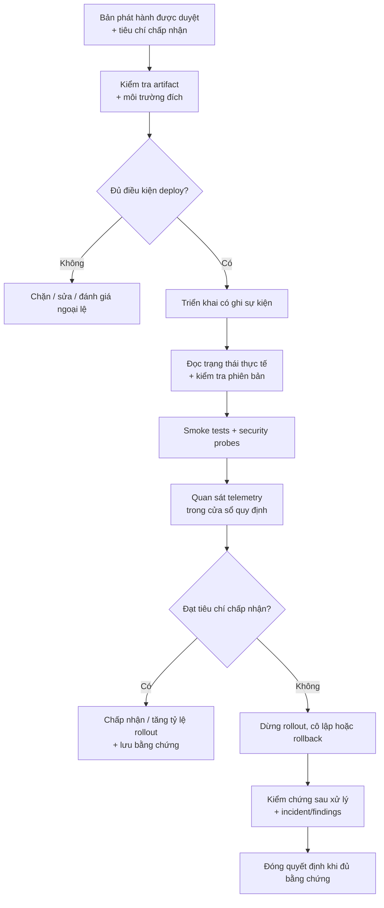

# Deployment verification — Xác minh triển khai trong release assurance

## 1. Deployment verification là gì và vì sao cần?

Trong quy trình phát hành phần mềm, pipeline có thể báo **deploy succeeded** khi một công cụ triển khai gửi cấu hình thành công tới Kubernetes hoặc nền tảng cloud. Điều đó chưa chứng minh phiên bản đã được phê duyệt thực sự đang phục vụ lưu lượng, ứng dụng hoạt động đúng hoặc các biện pháp kiểm soát bảo mật vẫn còn hiệu lực.

**Deployment verification** (xác minh triển khai) là hoạt động thu thập và đánh giá **bằng chứng sau khi triển khai** để xác nhận rằng một bản phát hành cụ thể đã đến đúng đích, đạt trạng thái mong đợi, đáp ứng các điều kiện chấp nhận về chức năng và bảo mật, đồng thời không xuất hiện tín hiệu rủi ro vượt ngưỡng đã quy định. Kết quả này giúp quyết định tiếp tục rollout, giữ nguyên để quan sát, rollback hoặc mở sự cố.

Trong module **SECURITY_SECURITY_ASSURANCE**, deployment verification nằm ở giao điểm của:

- **Security objectives:** yêu cầu bảo vệ tính bí mật, toàn vẹn, sẵn sàng và các mục tiêu kiểm soát cụ thể.
- **Risk management:** đánh giá rủi ro phát sinh từ khác biệt môi trường, quyền hạn, cấu hình, dữ liệu và chuỗi cung ứng.
- **Security controls:** xác nhận những control quan trọng vẫn được bật, áp dụng đúng đối tượng và có hiệu quả sau thay đổi.
- **Testing và audit:** liên kết phiên bản đã kiểm thử với phiên bản đang chạy; lưu bằng chứng có thể truy xuất lại.
- **Remediation:** xử lý phát hiện, cô lập, rollback hoặc tạo ngoại lệ có thẩm quyền và thời hạn.

Một bản phát hành có thể được xem là **đã triển khai** ở góc độ công cụ nhưng **chưa được chấp nhận** ở góc độ assurance nếu bằng chứng sau triển khai còn thiếu hoặc không đạt.

### Mục tiêu học tập

Sau bài học, người học có thể:

1. Phân biệt thông báo thành công từ hệ thống triển khai với bằng chứng về trạng thái runtime.
2. Xây dựng tiêu chí chấp nhận triển khai dựa trên rủi ro, kiểm soát và môi trường.
3. Kiểm tra được danh tính artifact, cấu hình, trạng thái ứng dụng và các hành vi bảo mật tiêu biểu.
4. Thiết kế vòng **deploy → verify → decide → observe** có rollback và hậu kiểm.
5. Tạo hồ sơ chứng cứ phục vụ audit và truy vết từ release đến môi trường thực tế.

## 2. Cần xác minh điều gì?

Có thể chia việc xác minh thành năm lớp. Mỗi lớp trả lời một câu hỏi riêng và có thể phát hiện thất bại mà những lớp khác bỏ qua.

| Lớp | Câu hỏi xác minh | Ví dụ bằng chứng |
| --- | --- | --- |
| 1. **Đúng bản phát hành** | Artifact đang chạy có đúng bản đã được duyệt và kiểm thử? | Artifact digest, commit, build provenance, deployment ID, image ID |
| 2. **Đúng đích và cấu hình** | Thành phần được đặt vào đúng cluster, namespace, tài khoản, region và có chính sách phù hợp? | Resource spec/runtime snapshot, config revision, policy/IAM diff |
| 3. **Sẵn sàng vận hành** | Các instance có thể phục vụ đúng khối lượng công việc được kỳ vọng? | Readiness, traffic routing, smoke tests, truy cập dependency, dữ liệu |
| 4. **Bảo mật hiệu lực** | Authentication, authorization, TLS, secret handling, log/audit và network controls còn đáp ứng yêu cầu? | Positive/negative security probes, cấu hình control, kết quả đọc lại |
| 5. **An toàn trong vận hành** | Sau rollout có dấu hiệu hồi quy, tấn công hoặc tác động khách hàng không? | Error rate, latency, tín hiệu bảo mật, alerts, canary analysis, trạng thái rollback |

Không có một tín hiệu đơn lẻ nào thay thế được tất cả: `Pod Ready` không chứng minh phân quyền đúng; kiểm thử bảo mật ở staging không chứng minh cấu hình production giống staging; tỷ lệ lỗi thấp không chứng minh không rò rỉ thông tin.

### Ba trạng thái bắt buộc phân biệt

- **Intended state:** trạng thái đã phê duyệt, ví dụ image digest, policy version, cấu hình đã mã hóa thành tài liệu hoặc manifest.
- **Deployed state:** trạng thái mà công cụ rollout báo đã áp dụng và lịch sử thao tác cho biết đã thực thi.
- **Observed runtime state:** những gì hiện đang chạy và thể hiện hành vi thực tế tại môi trường đích.

Assurance đòi hỏi **đối chiếu ba trạng thái**. Chênh lệch giữa intended state và runtime state có thể xuất phát từ drift, deploy dở dang, thay đổi thủ công, sidecar hoặc controller cập nhật tài nguyên sau deploy.

## 3. Chuỗi kiểm chứng và điểm ra quyết định



Với triển khai theo từng giai đoạn (canary hoặc blue/green), vòng `E → F → G → H` được lặp lại tại mỗi nấc tăng lưu lượng. Nếu kết quả không rõ ràng vì mất telemetry, điều kiện **không xác định** phải được xử lý riêng; không tự động coi là đạt.

### Điểm chặn trước và sau deployment

**Trước triển khai** cần biết: phạm vi, change/release ID, artifact đã kiểm thử, rủi ro còn lại, quyền triển khai, cấu hình và secret target, chính sách ký/xác minh artifact, kế hoạch rollout/rollback, ngưỡng quan sát và người có trách nhiệm ra quyết định.

**Sau triển khai** cần xác nhận: phiên bản thực chạy, trạng thái replica/traffic, kiểm tra hành vi nghiệp vụ trọng yếu, kết quả test bảo mật, telemetry trong cửa sổ được định nghĩa, các phát hiện chưa xử lý và quyết định accept/hold/rollback có timestamp.

Lưu ý: kết quả đạt của một lần kiểm chứng là **có phạm vi và thời điểm**. Cấu hình, lưu lượng và mối đe dọa có thể thay đổi sau đó; vì vậy release assurance cần tích hợp giám sát và kiểm tra drift liên tục.

## 4. Thiết kế tiêu chí chấp nhận theo rủi ro

Tiêu chí đạt phải cụ thể, kiểm tra được và được xác định **trước khi rollout**. Tránh câu mơ hồ như “ứng dụng ổn định” hay “không có vấn đề bảo mật”.

| Mã | Kiểm soát / mục tiêu | Tiêu chí chấp nhận minh họa | Phản ứng nếu không đạt |
| --- | --- | --- | --- |
| `DV-01` | Tính toàn vẹn bản phát hành | Artifact được triển khai truy được đến build đã duyệt; không có khác biệt phiên bản không được cho phép | Chặn promotion hoặc dừng rollout |
| `DV-02` | Đúng đích | Cluster, tenant/account, namespace, region, service identity và config revision khớp bản chấp thuận | Dừng và điều tra môi trường/định tuyến |
| `DV-03` | Sẵn sàng | Số instance sẵn sàng đạt mục tiêu; tuyến lưu lượng hoạt động; smoke test nghiệp vụ cốt lõi thành công | Giữ traffic tại bản cũ hoặc rollback |
| `DV-04` | Authentication / authorization | Người dùng hợp lệ truy cập đúng; người dùng thiếu quyền bị từ chối theo test case | Dừng rollout; đánh giá nghiêm trọng nếu có bypass |
| `DV-05` | Bảo vệ dữ liệu | Kênh TLS hợp lệ; encryption/config và đường đi dữ liệu tuân control áp dụng | Chặn mở rộng rollout |
| `DV-06` | Logging / detection | Có event mẫu phù hợp và pipeline xử lý log/alert vận hành đúng | Hold/điều tra, tùy mức ảnh hưởng |
| `DV-07` | Sức khỏe hệ thống | Chỉ số lỗi/độ trễ/tài nguyên trong ngưỡng đã định cho window và phân khúc traffic | Giữ canary hoặc rollback |
| `DV-08` | Khả năng phục hồi | Có phương án rollback hoặc forward-fix hợp lệ, nhất là khi thay đổi schema/dữ liệu | Không triển khai nếu thiếu biện pháp kiểm soát đã yêu cầu |

Các giá trị trong bảng là **khung thiết kế**. Ngưỡng cụ thể phải dựa trên SLO, mức độ quan trọng của hệ thống, hành vi lịch sử và lượng lưu lượng đủ để phát hiện hồi quy. Không nên lấy ngưỡng giả định chung áp dụng cho mọi ứng dụng.

### Ma trận theo cấp độ rủi ro

| Phạm vi thay đổi | Độ sâu kiểm chứng nên cân nhắc |
| --- | --- |
| Tài liệu hoặc thành phần tĩnh không ảnh hưởng control | Kiểm tra artifact, routing và smoke test phù hợp |
| API thông thường | Thêm kiểm tra chức năng, authn/authz ở các đường đi bị ảnh hưởng và telemetry |
| IAM, secrets, firewall, TLS hoặc luồng dữ liệu nhạy cảm | Kiểm tra quyền hiệu lực, ca từ chối, cấu hình thực tế, sự kiện audit và phê duyệt theo chính sách |
| Thay đổi schema, migration, lưu trữ hoặc khôi phục | Kiểm tra tương thích dữ liệu, độ toàn vẹn, tính khả hồi và kế hoạch forward-fix |
| Nền tảng trọng yếu hoặc phát hành diện rộng | Staged rollout, canary analysis, rollback exercise, quan sát lâu hơn hoặc phê duyệt tăng cường |

## 5. Kiểm chứng danh tính artifact và nguồn gốc

Không nên chỉ kiểm tra tag như `v2.4.1` hoặc `latest` vì tag trong nhiều registry có thể trỏ sang nội dung khác. Khi phát hành container, nên ghi nhận digest bất biến mà pipeline đã cho phép và kiểm tra quan hệ giữa artifact đó với thứ đang thực thi.

Các bước kiểm chứng điển hình:

1. Từ `release_id` tìm commit/revision, CI build run, kết quả test, artifact ID/digest và phê duyệt tương ứng.
2. Xác minh artifact được lấy từ registry/repository được tin cậy; nếu chính sách yêu cầu thì kiểm chữ ký và attestations đối với trust root đúng.
3. Đối chiếu manifest được triển khai với bản được chấp thuận; xác nhận cấu hình đích và danh tính triển khai.
4. Đọc lại workload ở runtime để xác định image/config revision thực sự đang chạy, kể cả container phụ trợ nếu nằm trong phạm vi.
5. Kiểm tra biến thể triển khai: digest của manifest multi-architecture và digest của image platform cụ thể có thể khác nhau; việc so khớp phải hiểu quan hệ giữa chúng, không kết luận sai chỉ vì hai chuỗi digest khác loại.

**Integrity**, **provenance** và **runtime correctness** là ba thuộc tính khác nhau. Hash không chứng minh artifact được xây dựng từ nguồn đáng tin; chữ ký không chứng minh không có lỗ hổng; xác minh nguồn gốc không chứng minh cấu hình production đang chạy an toàn. Các bằng chứng cần bổ sung cho nhau.

Ví dụ dạng bản ghi chấp thuận phát hành (giá trị định danh chỉ minh họa):

```yaml
release_id: REL-2026-0112
change_id: CHG-2026-0490
service: payments-api
environment: production
approved:
  source_commit: "e1f2a3b4c5d6"
  build_run: "ci-18760"
  artifact: "registry.example.local/payments-api"
  artifact_digest: "sha256:<digest-that>"
  configuration_revision: "cfg-73"
  policy_bundle_revision: "sec-policy-18"
verification_plan:
  profile: critical-api
  required_checks: [DV-01, DV-02, DV-03, DV-04, DV-05, DV-06, DV-07]
  observation_window_minutes: 30
  decision_owner: release-duty-owner
```

`<digest-that>` là placeholder, không phải giá trị băm hợp lệ. Hệ thống triển khai thực tế phải ghi digest thật và lưu record có kiểm soát sửa đổi.

### Những lỗi đối chiếu cần phát hiện

- Test chạy trên commit A, artifact được build từ commit B.
- Admission policy xác minh artifact X, nhưng runtime đang chạy artifact Y do một lượt cập nhật khác.
- Bản release đã duyệt target ở namespace A, deployment lại hướng tới namespace B.
- Secrets/config qua side channel thay đổi sau khi image được kiểm thử mà không có chứng cứ đánh giá tương ứng.
- Deployment đã thành công nhưng một tập instance cũ hoặc một region chưa chuyển sang phiên bản mong đợi.

## 6. Ví dụ: xác minh triển khai API trên Kubernetes

Giả sử `payments-api` triển khai với Deployment, Service và Ingress/Gateway trong namespace `payments`. Mục tiêu là xác nhận bản có digest đã duyệt chạy trên đúng môi trường, không vô tình mở endpoint quản trị và không làm mất audit logging.

Đây là các câu lệnh **đọc trạng thái**, cần dùng kube-context/namespace đã kiểm tra trước. Chúng là một phần kiểm chứng và không tự tạo ra quyết định assurance.

```bash
# Xác nhận đang thao tác trên cụm mong đợi.
kubectl config current-context

# Xem rollout và trạng thái Deployment/Pod.
kubectl --context prod-cluster -n payments rollout status   deployment/payments-api --timeout=300s

kubectl --context prod-cluster -n payments get deployment payments-api -o wide
kubectl --context prod-cluster -n payments get pods -l app=payments-api -o wide

# Đọc manifest đang áp dụng và image của các container trong Pod template.
kubectl --context prod-cluster -n payments get deployment payments-api   -o jsonpath='{.spec.template.spec.containers[*].image}'

# Đọc imageID mà runtime thực sự ghi nhận ở các Pod đã chọn.
kubectl --context prod-cluster -n payments get pods -l app=payments-api   -o jsonpath='{range .items[*]}{.metadata.name}{"\t"}{range .status.containerStatuses[*]}{.name}{"="}{.imageID}{" "}{end}{"\n"}{end}'
```

`prod-cluster`, namespace, label và tên workload là giả định. Lệnh `rollout status` cho biết tiến triển rollout theo logic controller, **không chứng minh đạt test bảo mật**. Nhãn `app=payments-api` cần được xác nhận là lựa chọn đúng và đầy đủ; nếu thiếu pod ở một zone hoặc một phiên bản cũ, phải khảo sát thêm selector, ReplicaSet và trạng thái Service/EndpointSlice. Các lệnh này cần chạy với danh tính có quyền đọc phù hợp.

### Kiểm tra readiness và tuyến lưu lượng

Trong hệ phân tán, chỉ đọc Pod là chưa đủ. Cần đối chiếu Service selector, EndpointSlice, Gateway/Ingress và thực tế yêu cầu được định tuyến đến phiên bản nào. Nếu triển khai canary, kiểm tra cả nhóm stable và nhóm canary cùng tỷ lệ traffic kỳ vọng.

Một ví dụ smoke test bằng HTTPS đến địa chỉ được phép kiểm thử:

```bash
# Chỉ chạy với endpoint được phép kiểm thử.
curl --fail --silent --show-error   --connect-timeout 5 --max-time 15   https://payments.example.test/health/ready

# Kiểm chứng endpoint không tiết lộ nội dung khi chưa được xác thực.
# Lưu status code; kết quả kỳ vọng phụ thuộc hợp đồng API.
curl --silent --show-error --output /dev/null   --write-out '%{http_code}\n'   --connect-timeout 5 --max-time 15   https://payments.example.test/api/internal/reports
```

Đường dẫn ví dụ chỉ là placeholder. `/health/ready` thường chỉ phản ánh tập điều kiện readiness được lập trình; cần định nghĩa rõ liệu nó có kiểm tra dependency quan trọng không. Status `401` hay `403` của endpoint nội bộ phụ thuộc cơ chế bảo vệ; nếu một reverse proxy trả lỗi chung, vẫn phải kiểm tra rằng dữ liệu nhạy cảm **không được trả về** và danh tính có quyền vẫn thực hiện đúng hành vi.

### Kiểm tra security controls sau triển khai

| Kiểm soát | Cách xác minh thực tế | Giới hạn cần hiểu |
| --- | --- | --- |
| Authn | Thử với token/tài khoản thử nghiệm hợp lệ và không hợp lệ | Không dùng secret hoặc token thật trong bằng chứng công khai |
| Authz | Với principal thử nghiệm, kiểm tra cả thao tác được phép và bị cấm | Một `403` đơn lẻ không chứng minh tất cả role/tenant |
| TLS | Kiểm tra hostname, chuỗi chứng chỉ, hiệu lực và chính sách TLS tại endpoint | TLS ở load balancer không chứng minh mã hóa chặng phía sau |
| Network policy | Đọc lại rule và thử kết nối được phép/bị cấm trong môi trường được cho phép | Rule tồn tại không chứng minh CNI thi hành đúng |
| Secrets | Xác nhận secret reference/version, quyền gắn secret và lỗi truy cập | Không in giá trị secret vào log hoặc báo cáo |
| Audit / detection | Sinh sự kiện kiểm thử an toàn, xác nhận ingestion/correlation và cảnh báo | Sự kiện không xuất hiện có thể do độ trễ pipeline; cần timeout rõ |
| Workload identity | Đọc service account/role thực tế và kiểm tra quyền hiệu lực cần thiết | Tên service account đúng chưa chứng minh không có quyền thừa |
| Admission/runtime policies | Kiểm tra revision policy đã áp dụng và kết quả đánh giá/ràng buộc | Đã có policy không đồng nghĩa áp dụng được cho mọi workload |

Với hệ thống xử lý thanh toán, cần bảo đảm test không tạo giao dịch tài chính ngoài ý muốn. Có thể dùng synthetic tenant, sandbox account hoặc lệnh kiểm tra chỉ đọc và gắn nhãn rõ ràng; tuyệt đối tránh biến test assurance thành thao tác nghiệp vụ không được phép.

## 7. Quan sát sau triển khai và quyết định canary

Ở hệ thống có lưu lượng cao, lỗi bảo mật hoặc tính sẵn sàng đôi khi chỉ xuất hiện khi một phần traffic thực đi qua phiên bản mới. **Post-deploy observation** bổ sung góc nhìn đó nhưng phải có khung đo được xác định trước.

Theo dõi tối thiểu thường bao gồm:

- **Sức khỏe dịch vụ:** tỷ lệ 5xx, timeout, độ trễ theo percentile phù hợp, saturation và crash/restart.
- **Chất lượng nghiệp vụ:** tỷ lệ giao dịch thất bại, lỗi validation, mất tính năng chính hoặc chênh lệch kết quả.
- **Tín hiệu bảo mật:** xác thực thất bại bất thường, tăng lỗi `AccessDenied`, vi phạm policy, sự kiện secret access, lỗi TLS, cảnh báo từ WAF/IDS/SIEM.
- **Tình trạng giám sát:** logging/metrics/tracing có còn gửi dữ liệu đủ và đúng tag phiên bản, route, môi trường không.
- **So sánh phiên bản:** canary so với stable trên traffic mix tương đồng, xét cả quy mô mẫu và xu hướng nền.

Ví dụ một kế hoạch canary minh họa, **không phải ngưỡng khuyến nghị phổ quát**:

```yaml
rollout:
  stages:
    - traffic_percent: 5
      observe_minutes: 15
    - traffic_percent: 25
      observe_minutes: 20
    - traffic_percent: 100
      observe_minutes: 30
  gates:
    - id: business-smoke
      expected: pass
    - id: authorization-negative-tests
      expected: pass
    - id: error-rate
      compare: canary_to_stable
      threshold: "project-defined"
    - id: audit-event-arrival
      expected: pass_within_defined_delay
on_failed_gate: hold_and_decide
```

Ở từng giai đoạn, người hoặc hệ thống có thẩm quyền phải ghi rõ kết quả **pass / fail / unknown**. Nếu traffic canary rất ít, thiếu tín hiệu không nên bị diễn giải thành tỷ lệ lỗi bằng 0. Cửa sổ quan sát phải đủ cho các luồng ít dùng hoặc tác vụ bất đồng bộ; có thể cần synthetic traffic hoặc giám sát kéo dài.

Một quyết định tốt xem đồng thời bằng chứng kỹ thuật và rủi ro: một negative authz test thất bại thường nghiêm trọng hơn một dao động latency nhỏ dù cả hai xuất hiện trong cùng dashboard. Việc tiếp tục triển khai khi một chỉ báo không rõ cần có quy tắc và thẩm quyền rõ ràng, không mặc định chấp nhận.

## 8. Xử lý lỗi, rollback và kiểm chứng sau khôi phục

Khi gate không đạt, không nên chỉ ra lệnh `rollback` rồi đóng hồ sơ. Cần giữ log/bằng chứng nguyên trạng, đánh giá phạm vi ảnh hưởng và kiểm tra rằng dịch vụ **đã quay về trạng thái bảo mật chấp nhận được**.

Các lựa chọn thường có:

| Phát hiện | Hành động phù hợp để xem xét | Kiểm chứng tiếp theo |
| --- | --- | --- |
| Digest bản chạy không khớp bản duyệt | Dừng promotion, cô lập phiên bản nghi vấn | Xác minh nguồn artifact, quyền triển khai, trạng thái của từng instance |
| Positive smoke test thất bại | Giữ traffic ở stable, sửa hoặc rollback | Chạy lại kiểm tra chức năng và phụ thuộc |
| Negative authz test thất bại, nguy cơ truy cập trái phép | Dừng/giảm traffic, cô lập đường vào, incident theo mức độ | Đọc quyền hiệu lực và xác minh hành vi bị cấm đã được chặn |
| Logging/security alerts bị gián đoạn | Hold theo policy; khôi phục telemetry | Xác nhận event được ghi và nhận ở pipeline đích |
| Database migration không tương thích | Áp dụng kế hoạch phục hồi hoặc forward-fix đã chuẩn bị | Kiểm tra tính toàn vẹn, đọc/ghi, phiên bản schema và dữ liệu |
| Không có dữ liệu observability đáng tin | Hold, khôi phục hệ thống đo lường | Chạy lại cửa sổ quan sát với nguồn telemetry hợp lệ |

**Rollback không luôn an toàn hoặc khả thi.** Một ứng dụng có thể quay về image cũ nhưng dữ liệu đã biến đổi, message trong queue đã thay đổi format hoặc schema đã tiến lên. Với migration không đảo ngược, quy trình phải xác định sẵn backward compatibility, khôi phục từ backup/snapshot và khả năng forward-fix. Không thực hiện rollback dữ liệu ngoài kế hoạch phục hồi có phê duyệt.

Sau rollback cần kiểm tra: image/config revision thực tế, routing, chức năng chính, authn/authz, trạng thái log/audit và khả năng phục vụ traffic. Tạo liên kết đến incident/finding, quyết định rollback, thời gian bắt đầu–kết thúc, phạm vi khách hàng và lý do chưa chấp nhận release.

### Ví dụ chuỗi xử lý một thất bại

Phiên bản canary trả `200` cho request không được phép vào endpoint quản trị. Đây là dấu hiệu cần ưu tiên kiểm tra quyền truy cập thực sự, không thể bỏ qua chỉ vì `rollout status` và latency đều tốt.

1. Dừng tăng canary, thu giữ bằng chứng test (không chứa token nhạy cảm), phiên bản và time range.
2. Giảm hoặc chặn đường traffic tới phiên bản bị ảnh hưởng theo runbook đã phê duyệt.
3. Kiểm chứng lại đường truy cập từ principal thử nghiệm và trạng thái authz của phiên bản stable.
4. Điều tra change liên quan: policy, feature flag, gateway config, code path, cache hoặc identity mapping.
5. Ghi phát hiện, người ra quyết định và yêu cầu xác minh lại trước lần triển khai tiếp theo.

## 9. Bằng chứng có thể kiểm toán: từ release đến runtime

Mỗi lần kiểm chứng nên tạo bản ghi có ngữ cảnh bất biến hoặc có lịch sử sửa đáng tin cậy. Thiếu một trong các định danh quan trọng có thể làm đứt chuỗi chứng cứ khi cần audit.

| Nhóm trường | Nội dung |
| --- | --- |
| Phạm vi | Release/change ID, service, owner, môi trường, cluster/account, vùng và thời điểm |
| Bản phát hành | Source commit, build run, artifact digest, SBOM/attestation ID khi áp dụng |
| Kiểm soát | Control IDs, phiên bản test plan và security policy, rủi ro/ngoại lệ liên quan |
| Thao tác | Deployment run ID, actor/service identity, sự kiện audit, thời gian từng stage |
| Trạng thái quan sát | Image/config revision đọc từ đích, số phiên bản đang chạy, trạng thái traffic |
| Kiểm tra | Test run ID, input phạm vi an toàn, kỳ vọng, kết quả, telemetry links/snapshots |
| Quyết định | Pass/fail/unknown, gate bị ảnh hưởng, người/phần mềm quyết định, lý do |
| Hậu kiểm | Thời gian chấp nhận cuối cùng, hold/rollback, incident/finding, người chịu trách nhiệm |

Ví dụ gói kết quả dạng JSON để hệ thống release automation hoặc kiểm toán tiêu thụ:

```json
{
  "release_id": "REL-2026-0112",
  "deployment_id": "deploy-8064",
  "environment": "production",
  "verified_at": "2026-11-18T09:05:00Z",
  "approved_artifact_digest": "sha256:<approved>",
  "observed_runtime_artifact": "sha256:<observed>",
  "configuration_revision": "cfg-73",
  "checks": [
    {"id": "DV-01", "result": "pass", "evidence_id": "artifact-check-71"},
    {"id": "DV-04", "result": "pass", "evidence_id": "authz-probe-71"},
    {"id": "DV-06", "result": "unknown", "evidence_id": "audit-ingestion-71"}
  ],
  "decision": "hold",
  "reason": "Khong du bang chung nhan su kien audit trong cua so quan sat",
  "decision_owner": "release-duty-owner"
}
```

Các digest `<approved>` và `<observed>` là placeholder. Để lưu chứng cứ thật, bản ghi phải chứa định danh hiện vật hợp lệ hoặc tham chiếu có kiểm chứng tới chúng. Ví dụ minh họa `DV-06 = unknown` dẫn tới **hold**, không tự động quy thành `pass`.

### Nguyên tắc lưu trữ bằng chứng

- Ghi timestamp rõ múi giờ (ví dụ UTC), target, loại probe và phạm vi quyền của principal thử nghiệm.
- Lưu report theo run ID và phiên bản test; tránh chỉ link đến dashboard động không có snapshot/time range.
- Bảo vệ kết quả khỏi chỉnh sửa trái phép: phân quyền, audit trail, retention và checksum/chữ ký khi chính sách yêu cầu.
- Không đưa token, secret, nội dung giao dịch thật, dữ liệu cá nhân hoặc dữ liệu nhạy cảm khác vào log tổng hợp.
- Kết nối bằng chứng từ control/risk → release approval → artifact → deployment → runtime → verification result → quyết định cuối cùng.

Nơi lưu bằng chứng và thời hạn giữ lại phụ thuộc vào phân loại dữ liệu, chính sách nội bộ và nghĩa vụ pháp lý; không áp dụng một thời hạn mặc định cho mọi tổ chức.

## 10. Tổ chức verification tự động trong pipeline

Mục tiêu tự động hóa là giảm việc thu gom chứng cứ bằng tay và áp dụng nhất quán các gate. Cần phân biệt ba nhóm:

- **Static/pre-deployment:** policy-as-code, signature/provenance verification, SBOM/vulnerability checks, xét duyệt promotion.
- **Runtime/post-deployment:** đối chiếu image và config đang chạy, smoke/security tests, read-back IAM/network, kiểm tra log ingestion.
- **Observation/continuous:** canary comparison, SLO indicators, drift detection, cảnh báo audit hoặc cấu hình mới bị thay đổi ngoài quy trình.

Giả mã dưới đây tập trung vào logic quyết định; không phụ thuộc một công cụ CI/CD nhất định:

```text
verify_release(release, target):
    assert approved(release, target)
    assert trusted_artifact(release.artifact_digest)
    assert policy_checks_passed(release)

    execution = deploy(release.artifact_digest, target)
    record(execution.id, release.id, target, execution.timestamp)

    runtime = read_runtime_state(target)
    identity = verify_artifact_mapping(release, runtime)
    environment = verify_target_config(target, release.config_revision)

    functional = run_smoke_tests(target)
    security = run_security_probes(target, release.control_ids)
    telemetry = observe(target, release.observation_window)

    evidence = persist(identity, environment, functional,
                       security, telemetry, execution)

    if any_required_result_is_fail(evidence):
        hold_and_execute_authorized_recovery(target)
        verify_recovered_state(target)
        return REJECTED

    if any_required_result_is_unknown(evidence):
        hold_rollout_and_request_investigation()
        return HOLD

    authorize_next_stage_or_accept(release, target)
    return ACCEPTED
```

`trusted_artifact`, `approved` và `verify_artifact_mapping` phải được định nghĩa theo chính sách thật; giả mã không tạo chứng cứ nếu các phép kiểm tra chỉ trả một boolean không có ID và dữ liệu nguồn.

### Vai trò và trách nhiệm

| Vai trò | Trách nhiệm điển hình |
| --- | --- |
| Release owner | Chịu trách nhiệm phạm vi, quyết định chấp nhận và truyền đạt trạng thái release |
| Dev / service owner | Xác nhận hành vi nghiệp vụ, test cases, khả năng tương thích và cách khắc phục |
| SRE / platform | Triển khai, kiểm tra runtime, traffic, telemetry, rollback và khả năng phục hồi |
| Security assurance | Định nghĩa control-specific gates, xem bằng chứng bảo mật, xử lý ngoại lệ/phát hiện |
| Independent approver / auditor (khi cần) | Kiểm tra nguồn gốc và mức độ đầy đủ chứng cứ, phân tách trách nhiệm theo rủi ro |

Việc phân công chính xác phụ thuộc quy mô tổ chức và mức rủi ro. Với hệ thống trọng yếu, một người tạo thay đổi, tự duyệt, tự triển khai và tự xác nhận có thể không đáp ứng yêu cầu phân tách nhiệm vụ.

## 11. Các lỗi thường gặp

| Cách làm thiếu chính xác | Rủi ro | Cách khắc phục |
| --- | --- | --- |
| Dựa duy nhất vào trạng thái pipeline xanh | Không phát hiện traffic chưa chuyển, runtime drift hoặc control lỗi | Đọc lại trạng thái thực và chạy probe theo tiêu chí |
| So sánh tên tag thay vì đúng artifact | Tag bị thay đổi hoặc triển khai bản khác | Dùng digest/provenance và mapping tới runtime |
| Chỉ test ở staging rồi coi production tương đương | Quyền, secret, routing hoặc policy production khác | Kiểm tra riêng trạng thái và hành vi ở target |
| Chỉ chạy happy-path smoke test | Không phát hiện lỗ hổng authz hoặc logging bị tắt | Thêm negative probes, test kiểm soát bảo mật trọng yếu |
| Tất cả gate chỉ có hai trạng thái pass/fail | Mất telemetry được coi là pass | Có trạng thái unknown và quy tắc hold rõ |
| Quan sát quá ngắn, dữ liệu canary không đủ | Bỏ sót lỗi tải cao, truy vấn hiếm, task nền | Định nghĩa cửa sổ, cỡ mẫu và synthetic probes phù hợp |
| Rollback xong mặc định coi là phục hồi | Runtime/traffic/schema có thể chưa trở về an toàn | Chạy hậu kiểm sau khôi phục và ghi quyết định |
| Evidence chỉ có URL dashboard hiện tại | Không tái dựng được chứng cứ tại thời điểm phát hành | Chốt time range, report run, snapshot và immutable IDs |

## 12. Tình huống thực hành và câu hỏi tự đánh giá

### Bài tập 1 — “Deploy succeeded” nhưng chưa đạt assurance

Pipeline báo Deployment `payments-api` thành công, pod Ready 100%. Sau deploy, bài kiểm tra request không có quyền với `/api/internal/reports` lại nhận dữ liệu dù hệ thống đáng lẽ phải trả lỗi từ chối.

**Câu hỏi:** Có thể xác nhận release đạt không? Cần làm gì trước tiên và lưu những bằng chứng nào?

*Gợi ý:* Không chấp nhận. Dừng promotion/giảm traffic và xử lý theo mức độ rủi ro; lưu release/commit/digest, target, test principal, kết quả truy cập được ẩn dữ liệu nhạy cảm, gateway/authz config, thời điểm, quyết định và hậu kiểm sau xử lý.

### Bài tập 2 — Artifact đúng nhưng môi trường lệch

Artifact digest tại runtime khớp bản được duyệt, nhưng `cfg-73` chỉ được áp dụng ở một vùng; vùng còn lại vẫn dùng `cfg-72`. Các smoke test tổng thể đều pass.

**Câu hỏi:** Kiểm chứng đã đủ chưa?

*Gợi ý:* Chưa. Cần đánh giá tác động cấu hình, kiểm tra từng vùng và tuyến traffic; so sánh với baseline và test liên quan. Tùy mức rủi ro, giữ rollout, sửa drift hoặc chấp thuận ngoại lệ có hạn trước khi kết luận.

### Bài tập 3 — Mất tín hiệu audit khi canary

Canary 5% trong 15 phút có latency ổn định, 5xx không tăng, authz tests đạt nhưng pipeline audit log không hiển thị sự kiện thử nghiệm vì dịch vụ ingestion đang lỗi.

**Câu hỏi:** Kết quả gate nên là gì?

*Gợi ý:* Với tiêu chí bắt buộc về logging/detection, kết quả là **unknown** hoặc **fail** theo định nghĩa gate, và rollout cần được giữ; khắc phục telemetry rồi xác nhận sự kiện có mặt trong thời hạn cho phép. Không suy luận log hoạt động chỉ vì ứng dụng không báo lỗi.

### Bài tập 4 — Rollback và thay đổi dữ liệu

Bản phát hành đã áp dụng migration schema. Sau đó phát hiện hồi quy và muốn đưa binary về phiên bản cũ, nhưng binary cũ không đọc được schema mới.

**Câu hỏi:** Quy trình recovery cần điều chỉnh như thế nào?

*Gợi ý:* Kiểm tra kế hoạch migration/recovery đã duyệt, khả năng backward compatibility, phục hồi dữ liệu/snapshot hoặc forward-fix; xác nhận tính toàn vẹn và hoạt động của ứng dụng sau khắc phục. Không chạy rollback dữ liệu tùy tiện.

### Checklist áp dụng tại dự án

- [ ] Release có ID duy nhất, artifact digest và record phê duyệt hợp lệ.
- [ ] Có tiêu chí kiểm chứng theo rủi ro, được công bố trước khi rollout.
- [ ] Artifact, config, target và runtime được đối chiếu tại đúng môi trường.
- [ ] Smoke test chức năng và positive/negative security probes theo control đã chạy.
- [ ] Telemetry đủ tin cậy trong cửa sổ quan sát; biết xử lý `unknown`.
- [ ] Mỗi quyết định rollout, hold, rollback hoặc accept có owner và bằng chứng.
- [ ] Kế hoạch khôi phục và kiểm chứng sau khôi phục đã được xét đến.
- [ ] Hồ sơ gồm phiên bản, timestamp, test run, trạng thái thực và liên kết control/risk.

**Deployment verification** chỉ có giá trị assurance khi quyết định chấp nhận bản phát hành gắn với bằng chứng của **đúng phiên bản đang chạy, đúng môi trường, đúng hành vi bảo mật và đúng thời điểm**. Làm tốt việc này biến một thông báo triển khai thành một kết luận có thể kiểm tra và phục vụ chương trình security assurance liên tục.
