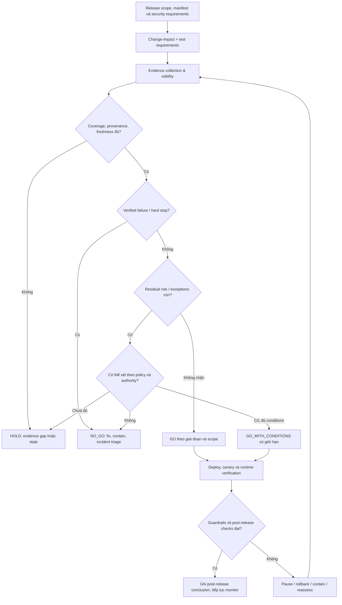
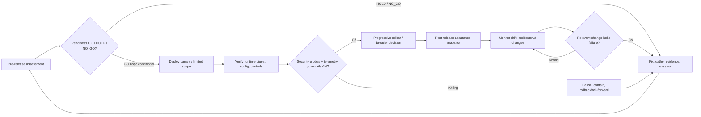
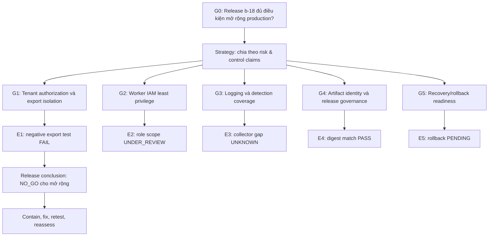

# Kết luận release: đưa ra quyết định phát hành dựa trên bằng chứng bảo mật

## 1. Kết luận release là gì?

**Kết luận release** trong security assurance là nhận định có căn cứ về việc một bản phát hành **có đủ điều kiện đi vào một môi trường, giai đoạn triển khai hoặc phạm vi người dùng xác định hay không**, dựa trên yêu cầu bảo mật, trạng thái kiểm soát, kết quả kiểm thử, mức rủi ro tồn dư, khả năng vận hành và giới hạn của bằng chứng tại thời điểm quyết định.

Trong chương **Release assurance** của module **SECURITY_SECURITY_ASSURANCE**, việc kết luận release là điểm nối giữa các hoạt động **phân tích rủi ro → security requirements → controls → kiểm thử/audit → bằng chứng → quyết định → giám sát và khắc phục**. Nó không phải một ô `approved=true` hay câu “bộ kiểm thử xanh”. Một kết luận tốt giải thích rõ **chúng ta đã biết gì, chưa biết gì, điều gì có thể làm quyết định thay đổi và ai chịu trách nhiệm**.

Ví dụ: ứng dụng `invoice-api` chuẩn bị nâng cấp từ build `b-17` lên `b-18`. Unit tests và SAST đều PASS, nhưng endpoint export mới chưa có negative test về truy cập chéo tenant. Release manager không thể dựa vào 95% các test đã chạy thành công để khẳng định **dữ liệu tenant đã được bảo vệ trên toàn bộ bản phát hành**. Phần chưa kiểm tra là một **assurance gap** trọng yếu, cần bổ sung bằng chứng hoặc sử dụng một quyết định được ủy quyền theo chính sách nếu trường hợp đó có thể được xét ngoại lệ.

Ngược lại, nếu phát hiện bản `b-18` cho token tenant A tải file của tenant B, đây là **bằng chứng control failure**, không chỉ là thiếu tài liệu. Quyết định thích hợp thường là giữ release, containment hoặc xử lý sự cố theo phạm vi tác động; không được lấy số test PASS lớn để lấn át phản chứng.

**Kết luận release có hiệu lực theo thời điểm và phạm vi.** `GO` cho canary ở một region không tự đồng nghĩa `GO` cho tất cả region hoặc `GO` vô thời hạn. Sau deploy, configuration drift, event source outage hay một exploit mới có thể làm căn cứ ban đầu mất hiệu lực.

### Kết quả học tập

Sau bài học, người học có thể:

1. Phân biệt security assurance conclusion, release readiness, release approval, risk acceptance, deployment outcome và post-release verification.
2. Xây bộ **release acceptance criteria** theo rủi ro và security objectives.
3. Thu thập release evidence package gắn đúng code, build digest, cấu hình, environment, scope và mốc thời gian.
4. Phân loại `GO`, `GO_WITH_CONDITIONS`, `HOLD`, `NO_GO` và `ROLLBACK/CONTAIN` mà không đánh đồng `UNKNOWN` với PASS.
5. Tổng hợp findings, test coverage, ngoại lệ và residual risk một cách có thể kiểm toán.
6. Viết kết luận release có claim, supporting evidence, assumptions, limitations, approvers và điều kiện giám sát rõ.
7. Thiết kế workflow pre-release, canary, post-release và reassessment khi bối cảnh thay đổi.
8. Kiểm thử cơ chế quyết định release và báo cáo assurance theo các trường hợp thiếu nguồn, sai phiên bản, regression và ngoại lệ hết hạn.

## 2. Phân biệt các lớp kết luận trong vòng đời phát hành

Câu “release đã được duyệt” có thể che nhiều hoạt động khác nhau. Cần tách ít nhất bốn lớp:

| Lớp | Câu hỏi | Người/nhóm liên quan | Đầu ra |
| --- | --- | --- | --- |
| **Security evidence assessment** | Controls và tests có được kiểm chứng đủ trong phạm vi? | Security reviewer, control owners | Findings, coverage, assurance claims, limitations |
| **Release readiness conclusion** | Theo release criteria, bản phát hành có đủ căn cứ đi tiếp ở phạm vi nào? | Release assurance reviewer, release team | `GO/HOLD/NO_GO/CONDITIONAL` có lý do |
| **Risk/exception decision** | Có chấp nhận tạm rủi ro tồn dư hoặc sai khác với yêu cầu được không? | Risk owner có thẩm quyền, policy/legal khi cần | Risk decision hoặc exception record có điều kiện |
| **Release authorization & execution** | Ai cho phép deploy và deploy thực tế ra sao? | Release authority, operations, change management | Approval, deployment events, outcome, rollback |
| **Post-release assurance** | Runtime đúng artifact/control và giám sát đủ sau triển khai? | Platform/SecOps, service owner, assurance | Runtime verification, monitoring, follow-up findings |

Một **security reviewer** có thể kết luận “bằng chứng chưa đủ”, trong khi **risk owner** quyết định chấp nhận một mức rủi ro theo thẩm quyền; nếu chính sách cho phép và không vi phạm hard stop, **release authority** vẫn có thể cho phép một triển khai giới hạn. Các quyết định cần lưu **riêng**, không viết lại review thành “security control PASS”.

### 2.1. Phê duyệt và kết luận không thay cho nhau

- `TEST_PASSED`: phép thử cụ thể đạt acceptance criteria trong scope.
- `CONTROL_SUPPORTED`: bằng chứng hỗ trợ claim về control trong scope và thời kỳ đã đánh giá.
- `RISK_ACCEPTED`: người có quyền chấp nhận rủi ro còn tồn tại, với giới hạn.
- `RELEASE_AUTHORIZED`: người có thẩm quyền cho phép thực hiện release theo điều kiện.
- `DEPLOYED`: artifact đã thực sự được triển khai.
- `POST_RELEASE_VERIFIED`: những điều kiện hậu kiểm quy định đã được xác minh.

Không có suy luận trực tiếp kiểu `DEPLOYED ⇒ SECURE` hoặc `RISK_ACCEPTED ⇒ CONTROL_PASSED`.

## 3. Kết luận release là một assurance claim có giới hạn

Một kết luận phát hành nên được diễn đạt như **claim**:

> “Đối với release R, artifact A, môi trường E và phạm vi S, tại thời điểm T, các điều kiện bảo mật được áp dụng theo policy P đã được kiểm tra với bằng chứng liệt kê; những findings/giới hạn còn lại đã được xử lý theo quyết định tương ứng; release có thể (hoặc không thể) tiếp tục tới giai đoạn G.”

Một claim cần có:

| Thành phần | Ý nghĩa |
| --- | --- |
| **Subject** | Release/build, dịch vụ, chức năng và thay đổi cần quyết định |
| **Target** | Environment, region, cloud account, tenant cohort, feature flag, deployment stage |
| **Risk context** | Data classification, criticality, attack surface, threat scenarios trọng yếu |
| **Requirements** | Security policies, standards, baselines, release gate rules có phiên bản |
| **Evidence** | Test run, artifact provenance, security review, effective configuration, audit logs |
| **Acceptance criteria** | Điều kiện cần đạt và những trường hợp không được phép bỏ qua |
| **Open issues** | Findings, exceptions, missing evidence, untested scope, unknowns |
| **Decision** | GO/HOLD/NO_GO/GO_WITH_CONDITIONS và lý do |
| **Authority** | Reviewer, người phê duyệt rủi ro và release approver |
| **Validity** | `as_of`, thời hạn, giai đoạn rollout, change triggers |
| **Post-release obligations** | Health checks, canary criteria, monitoring, follow-up và rollback/containment |

**Không cần hứa “an toàn tuyệt đối”.** Security assurance có giá trị khi nêu đúng phạm vi và giới hạn, đặc biệt trước thay đổi phức tạp có nhiều phụ thuộc.

### 3.1. Một kết luận yếu và một kết luận mạnh

**Yếu:** “Đã scan và QA PASS; có thể release.”

**Mạnh hơn:**

> “Tại 10:00 UTC ngày đánh giá, bản build digest D của `invoice-api` đã hoàn thành các phép thử bắt buộc cho những routes thuộc inventory I trên staging và có bằng chứng về tính toàn vẹn artifact. Test cross-tenant export còn chưa chạy, và nguồn audit của `export-worker` chưa xác minh đủ coverage. Vì vậy, chưa đủ căn cứ để GO cho toàn bộ production; cần hoàn tất test E và kiểm tra nguồn L trước khi phê duyệt lại. Bằng chứng hiện có không hỗ trợ kết luận tenant isolation trên export route.”

Câu thứ hai cho biết **điều gì làm thay đổi quyết định**. Khi chưa test xong, không tự giả định kết quả sau này sẽ PASS.

## 4. Đầu vào của một release conclusion

Release reviewer không nên bắt đầu bằng dashboard màu xanh; phải xác lập **population và yêu cầu đánh giá**.

| Nhóm đầu vào | Nội dung cần biết |
| --- | --- |
| **Change description** | Release ID, change tickets, features, hotfixes, removed/added capabilities |
| **System context** | Kiến trúc, inventory, data flows, tenant boundaries, trust assumptions |
| **Security objectives** | Confidentiality, integrity, availability, privacy, recoverability |
| **Requirement sources** | Internal policies, standards, baseline, hợp đồng và nghĩa vụ khác khi áp dụng |
| **Risk assessment** | Mức ảnh hưởng, exploitability, exposure, asset criticality, critical threats |
| **Design/control changes** | Authn/authz, KMS, IAM, logging, network, supply-chain, DR/BC |
| **Test plan** | Required tests, expected behavior, environment, owner, sample/population |
| **Execution evidence** | Test results, scans, reviews, policy evaluations, sign-offs |
| **Artifact provenance** | Commit, toolchain, dependency snapshot, digest, signature nếu áp dụng |
| **Deployment plan** | Target, windows, canary cohort, feature flags, rollback/roll-forward |
| **Operational readiness** | Monitoring, source health, on-call, incident response, restore paths |
| **Open findings/exceptions** | Severity, affected scope, remediation, accepted risk và expiry |

**Phạm vi là điều kiện đầu tiên.** Nếu inventory thiếu production account mới, kết quả “đạt trên tất cả account đã quét” chưa đủ cho claim “đạt trên toàn production”. Không loại những asset thiếu dữ liệu khỏi mẫu số chỉ để có số đẹp.

## 5. Bước 1 — Xác định phạm vi release và mức thay đổi

Trước khi xét PASS/FAIL, hãy trả lời: **bản nào, đang thay cái gì, chạy ở đâu, ai bị ảnh hưởng?**

### 5.1. Các chiều phạm vi bắt buộc cân nhắc

- **Artifact:** source commit, build ID, image digest, package, SBOM nếu được dùng.
- **Runtime:** environment, production accounts, cluster, region, namespace, tenant cohort.
- **Interfaces:** API endpoints, background jobs, batch/export, integrations, webhooks, admin routes.
- **Identity:** user, privileged users, service accounts, CI/CD identities, vendor tokens.
- **Data:** dữ liệu cá nhân, khách hàng, hóa đơn, payment data, secrets, logs, backups.
- **Dependencies:** IdP, KMS, database, message broker, object store, CDN, SIEM, vendor API.
- **Release mechanics:** feature flag, schema migration, deployment rings, staged rollout, manual operations.
- **Time:** ngày build, scan, review, deploy và thời kỳ coverage của operating evidence.

### 5.2. “Một release” có thể gồm nhiều đối tượng

Một phát hành SaaS đôi khi gồm:

1. API service build mới.
2. Database migration chạy một lần.
3. Worker image mới.
4. IAM role update.
5. Feature flag chỉ mở ở một cohort.
6. Monitoring rule và dashboard update.

Nếu security tests chỉ chạy ở API build, reviewer không thể suy rằng **migration, worker IAM và detection rule** đều đạt. Có thể cần **release bill of materials** hoặc manifest chỉ rõ tất cả thành phần cùng phiên bản liên quan.

## 6. Bước 2 — Risk-based change impact assessment

Release conclusion phải nhìn vào tác động đến **security objectives**, không chỉ đếm thay đổi code.

| Loại thay đổi | Failure mode trọng yếu | Bằng chứng có ưu tiên |
| --- | --- | --- |
| Authorization middleware | Bỏ kiểm tra tenant/resource ownership | Cross-tenant negative E2E và service-token tests |
| Identity provider config | MFA/SSO/session bypass | IdP effective policy, revoked-user và negative authn |
| Cloud IAM role | Quyền ngoài nhu cầu hoặc nới trust policy | Effective permissions, diff và approval |
| KMS/key rotation | Decrypt trái quyền hoặc không restore được | Key-use negative tests, restore rehearsal |
| Object storage/export | Signed URL sai scope, lộ dữ liệu qua cache | Download expiry, resource authorization, storage ACL |
| Logging pipeline | Audit source mất hoặc detector không match schema | Synthetic event end-to-end, source health |
| CI/CD pipeline | Bỏ security gate, ký artifact sai, token deploy quá rộng | Gate enforcement, provenance, protected deployment |
| Dependency/image | Cấu hình mặc định đổi, advisory mới, supply-chain exposure | SCA/image scan, digest match và targeted regression |
| Database migration | Cross-tenant joins, data loss, rollback không tương thích | Data integrity/isolation và restore/rollback checks |
| Network/ingress | Public management port, mTLS bypass | Effective config và path tests |
| Vendor integration | Phạm vi dữ liệu, subprocessor, quyền API mới | Scope/contract evidence và technical integration tests |

Một thay đổi nhỏ ở boundary bảo mật có thể mang rủi ro lớn. Một thay đổi nhiều dòng về giao diện có thể rủi ro thấp hơn. Phân loại theo **hậu quả, khả năng khai thác, phơi nhiễm và phụ thuộc**, không theo độ dài diff.

### 6.1. Test selection theo risk không có nghĩa bỏ invariant bắt buộc

Các phép thử tối thiểu về phân quyền, bảo vệ dữ liệu, artifact provenance, logging và khả năng khôi phục có thể được quy định theo loại dịch vụ. Impact assessment giúp bổ sung test mục tiêu; không được dùng nhãn “không liên quan” thiếu căn cứ để bỏ test critical đã được policy bắt buộc.

## 7. Bước 3 — Release acceptance criteria có thể kiểm tra

**Acceptance criteria** là những điều kiện cần đáp ứng để đưa release tới giai đoạn chỉ định. Nên được thống nhất **trước khi xem kết quả**, tránh sửa tiêu chí khi test FAIL.

Một bộ tiêu chí thường gồm:

1. Không có **verified security failure** thuộc nhóm hard stop chưa được containment/remediation theo chính sách.
2. Required security controls có test/evidence **phù hợp artifact, environment và scope**.
3. Required tests có trạng thái rõ: PASS/FAIL/SKIP/ERROR/UNKNOWN; không biến missing thành PASS.
4. Test coverage bao gồm các **changes và trust boundaries trọng yếu**.
5. SAST/SCA/IaC/secret scan và review có kết quả theo policy, ngoại lệ được ghi riêng nếu có.
6. Artifact được ký/xác minh provenance theo quy định, đúng digest deploy.
7. IAM, encryption, logging, backup/DR và runtime config không có regression chưa xử lý thuộc phạm vi critical.
8. Tất cả high-impact findings, mitigation và risk exceptions được xử lý theo authority matrix.
9. Rollback/roll-forward/containment plan có tính khả thi; ít nhất một phương án đã được đánh giá với dependency thực.
10. Monitoring/source health, on-call và incident escalation sẵn sàng cho post-release.
11. Mốc hậu kiểm, owner, canary exit criteria và kill switch được xác định.
12. Bất kỳ giới hạn nào chưa giải quyết phải được nêu trong quyết định và không vượt ranh giới policy.

### 7.1. Tiêu chí “không có Critical” là chưa đủ

Một report có `0 Critical` nhưng scanner không chạy hoặc inventory thiếu thì không hỗ trợ kết luận. Phải kết hợp **finding state + source health + coverage + review quality**.

Ngược lại, một finding được gắn Critical có thể cần xác minh tính áp dụng trên artifact thực tế trước khi đánh giá release; không được tự hạ severity hoặc xóa finding chỉ để đạt gate.

### 7.2. Hard stop và soft gate

- **Hard stop:** điều kiện policy không cho phép bỏ qua bằng ngoại lệ thông thường; ví dụ verified cross-tenant data exposure thuộc phạm vi dữ liệu nghiêm trọng trong chính sách giả định.
- **Conditional gate:** có thể đi tiếp trong phạm vi giới hạn nếu risk decision được phê duyệt, có controls bù trừ đã kiểm chứng và thời hạn rõ.
- **Informational check:** cung cấp bằng chứng hỗ trợ, không nhất thiết tự quyết định release nhưng vẫn phải xét nếu có finding liên quan.

Hard stop là **quy tắc nội bộ được phê duyệt theo rủi ro/nghĩa vụ áp dụng**, không phải danh sách chuẩn dùng cho mọi doanh nghiệp.

## 8. Các trạng thái quyết định release

Một mô hình trạng thái rõ ràng giúp tránh nút “Approve” mơ hồ.

| Trạng thái | Điều kiện điển hình | Hành động |
| --- | --- | --- |
| **GO** | Bằng chứng đạt các gate bắt buộc trong scope; không còn vấn đề chặn theo policy | Cho phép đi tới giai đoạn được nêu, tiếp tục hậu kiểm |
| **GO_WITH_CONDITIONS** | Những khoảng trống được cho phép có phạm vi, approval, mitigation và review time | Triển khai giới hạn, giám sát và thực thi điều kiện |
| **HOLD** | Test/evidence thiếu, stale, nguồn lỗi hoặc kết quả inconclusive | Không đi tiếp theo đường thường; bổ sung thông tin/retest |
| **NO_GO** | Verified security failure hoặc hard stop; không có phương án được phép | Chặn giai đoạn đó, remediate/contain rồi đánh giá lại |
| **ROLLBACK_OR_CONTAIN** | Regression sau deploy, nguồn giám sát hoặc safety guardrail thất bại | Theo runbook và thẩm quyền, không mặc định rollback luôn an toàn |
| **REASSESS_REQUIRED** | Thay đổi lớn sau kết luận hoặc điều kiện quyết định mất hiệu lực | Đánh giá lại claim, evidence và approval |

**`HOLD` khác `NO_GO`.** `HOLD` thường do chưa đủ căn cứ; `NO_GO` có bằng chứng hoặc quy định khiến release không được phép tiến hành. Cả hai đều không có nghĩa “đã biết chắc hệ thống không an toàn trong mọi trường hợp”.

**`GO_WITH_CONDITIONS` không phải “PASS một phần”.** Đây là quyết định quản trị giới hạn; kết quả các security tests/controls FAIL hoặc UNKNOWN vẫn phải hiện đúng.

## 9. Quy trình từ bằng chứng tới kết luận



Trong triển khai thực tế, `GO` có thể phải qua thêm approval, change window và phân tách nhiệm vụ; sơ đồ minh họa **quyết định assurance**, không bỏ qua quy trình release management của doanh nghiệp.

### 9.1. Thứ tự đánh giá có chủ đích

- **Không đánh giá risk acceptance trước khi biết chính xác finding và scope.**
- **Không xem thiếu evidence là failure đã xác minh**, nhưng cũng không cho qua.
- **Không đánh giá lại severity bằng cảm tính** để giải quyết gate thất bại.
- **Không lấy risk acceptance làm điều kiện thay thế** cho những hard stops hoặc nghĩa vụ không thể miễn trừ.
- **Không phát hành rộng** khi chỉ có bằng chứng cho canary, staging hoặc một tenant.

## 10. Chất lượng và tính phù hợp của bằng chứng

Một release decision chỉ mạnh bằng các evidence hỗ trợ. Cần đánh giá nhiều chiều:

| Thuộc tính | Câu hỏi kiểm tra |
| --- | --- |
| **Authenticity/provenance** | Nguồn nào tạo artifact, collector nào, có thể truy ngược không? |
| **Integrity** | Evidence và artifact có bị thay đổi trái phép sau lúc được ghi nhận? |
| **Relevance** | Test này hỗ trợ đúng requirement/security claim không? |
| **Completeness** | Có đủ endpoints, identities, assets, regions, thời kỳ và test cases cần thiết? |
| **Freshness** | Evidence còn đại diện cho trạng thái hiện tại sau các changes liên quan không? |
| **Environment parity** | Staging và production có khác configuration, IdP, network, dữ liệu hay feature flags? |
| **Artifact match** | Build được scan/test có cùng digest với artifact định deploy? |
| **Reproducibility** | Có lưu tool/test version, input, expected/actual và run ID để kiểm tra lại? |
| **Independence** | Những bằng chứng “độc lập” có cùng phụ thuộc một nguồn lỗi không? |
| **Limitations** | Có test skipped, output truncated, missing source hoặc ngoại lệ chưa xử lý không? |

### 10.1. File mới chưa chắc là dữ liệu mới

Báo cáo upload lúc 14:00 có thể chứa scan chụp runtime lúc 09:00; giữa hai mốc IAM đã đổi. `uploaded_at`, `test_run_at`, `observed_at`, `period_end` và `reviewed_at` phải được lưu riêng.

Một báo cáo vendor vừa phát hành nhưng chỉ bao phủ sản phẩm và audit period cũ không hỗ trợ release có integration mới nếu thiếu bridge/đánh giá phạm vi.

### 10.2. Chữ ký và hash không chứng minh business logic an toàn

Hash cho phép so byte, chữ ký có thể hỗ trợ xác thực nguồn theo trust policy; chúng không tự chứng minh **authorization đúng**, **không có data leak** hoặc **không tồn tại lỗ hổng**. Cần test/argument theo threat scenario.

## 11. Test coverage và mẫu số bắt buộc

Một release có thể PASS 500 tests nhưng vẫn bỏ sót một endpoint mới. Kết luận cần dựa trên **required test matrix**, không dựa số test thành công tùy tiện.

Giả sử release có 40 test scenarios bảo mật bắt buộc:

| Trạng thái | Số lượng | Ý nghĩa |
| --- | ---: | --- |
| PASS | 31 | Đã kiểm tra và đạt tiêu chí |
| FAIL | 2 | Có bằng chứng không đạt |
| NOT_RUN | 4 | Chưa chạy |
| ERROR | 2 | Tool/pipeline không đưa kết luận |
| INCONCLUSIVE | 1 | Có kết quả nhưng không đủ xác định |
| **Tổng** | **40** | Mẫu số phải giữ đầy đủ |

`Required test verified pass rate = 31/40 = 77,5%` trên ma trận bắt buộc. Không được tính `31/(31+2) ≈ 93,9%` rồi công bố như tỷ lệ đạt của **toàn bộ 40** test yêu cầu. Hai cách tính phục vụ câu hỏi khác nhau, nhưng phải ghi mẫu số.

Tuy nhiên **77,5% cũng không phải “mức độ an toàn”**. Một test FAIL về đọc chéo tenant có thể quan trọng hơn nhiều test PASS của hành vi ít rủi ro.

### 11.1. Bao phủ population chứ không chỉ test IDs

Nếu một test “IAM least privilege” chỉ quét 2 trong 4 production cloud accounts, trạng thái của test không đủ mô tả coverage. Cần tách:

- Required account/region/tenant population.
- Population quan sát được.
- Query/test đã thực thi trên population nào.
- Các nguồn bị từ chối quyền hoặc không trả dữ liệu.
- Những exclusion được phê duyệt và giới hạn report.

**Dữ liệu thiếu không được chuyển thành giá trị 0 violations.**

## 12. Findings, mức độ rủi ro và quyết định release

Một finding đang mở cần được xem xét theo **hậu quả, khả năng khai thác, phơi nhiễm, mức phù hợp với release scope và bằng chứng remediation/mitigation**.

| Tình trạng finding | Ý nghĩa đối với release |
| --- | --- |
| **Verified critical failure trong scope** | Thường kích hoạt NO_GO/hard stop hoặc incident/containment theo chính sách |
| **High finding có control bù trừ đã test** | Đánh giá residual risk, thẩm quyền exception và điều kiện giới hạn |
| **Finding ngoài scope với căn cứ rõ** | Không tự chặn đúng release, nhưng phải ghi lý do và dependency |
| **Scanner result chưa triage** | Chưa được gọi confirmed failure; cần phân loại, xem mức độ ưu tiên |
| **Known false positive có evidence** | Có thể loại khỏi điều kiện chặn theo quy trình, giữ audit trail |
| **Remediation fix claimed, chưa retest** | Không chuyển `VERIFIED_CLOSED`, cần xác minh |
| **Issue đã sửa và retest phù hợp** | Có thể gỡ blocker theo scope/test đã kiểm |
| **Missing logging hoặc test source** | Assurance gap, không tự biến thành COMPLIANT |
| **Risk acceptance có hạn** | Quyết định cho tiếp tục trong phạm vi; finding vẫn tồn tại nếu chưa sửa |

### 12.1. Tách ba loại khoảng trống

- **Control gap:** bằng chứng cho thấy control không đạt; cần sửa/giảm thiểu.
- **Evidence gap:** thiếu nguồn/coverage, chưa biết control có đạt; cần thu thập/xác minh.
- **Policy/requirements gap:** tiêu chí ban hành thiếu, mâu thuẫn hoặc không phản ánh rủi ro; cần governance review.

Ba loại có thể cùng tồn tại. Ví dụ lỗi object ACL đã được xác minh **và** collector không nhận log: vừa có control failure vừa có assurance gap.

### 12.2. Remediation aging và release

Một finding tồn tại 45 ngày vẫn có tuổi 45 ngày nếu có release GO_WITH_CONDITIONS, chứ không reset vì quyết định mới. Khi fix triển khai, cần retest trước khi `VERIFIED_CLOSED`. Không tạo ticket mới với ngày phát hiện mới để xóa dấu vết quá hạn.

## 13. GO_WITH_CONDITIONS và risk acceptance

Điều kiện release phải **kiểm tra được và có owner**, không phải câu “theo dõi thêm”.

Một quyết định có điều kiện nên có:

| Điều kiện | Cách ghi cụ thể |
| --- | --- |
| **Scope** | Chỉ canary 5% khách hàng của region A; không bật export hàng loạt |
| **Time window** | Có thời hạn và mốc review, không tự động kéo dài |
| **Compensating control** | Rule/hạn chế quyền đã test với ID, build và evidence |
| **Monitoring** | Synthetic negative test, audit lag, source last-seen, owner trực |
| **Stop condition** | Cross-tenant access FAIL, config drift, loss of telemetry, incident signal |
| **Revalidation deadline** | Khi nào chạy phần test còn thiếu, ai chịu trách nhiệm |
| **Risk acceptance** | Quyết định có chữ ký/workflow, risk scenario, residual risk và authority |
| **Exposure boundary** | Feature flag, account allowlist, rate limits hoặc disable switch |
| **Response plan** | Pause rollout, revoke credential, containment/rollback an toàn |
| **Evidence/approval** | Decision ID, policy version, người review và người cho phép release |

### 13.1. Conditional GO không được dùng cho mọi trường hợp

Nếu negative test đã chứng minh file hóa đơn tenant B đọc được từ tenant A và chính sách quy định dữ liệu khách hàng cross-tenant exposure là hard stop, không thể ghi “GO_WITH_CONDITIONS vì business owner hứa sửa tuần sau”. Phải ưu tiên containment, điều tra ảnh hưởng và remediation theo quyền phù hợp.

Đối với rủi ro được phép xem xét ngoại lệ, **reviewer có thể giữ kết luận FAIL của control**, trong khi risk owner phê duyệt phần rủi ro có điều kiện. Báo cáo phải giữ nguyên hai nhãn và giải thích đầy đủ.

### 13.2. Những điều kiện không đủ chất lượng

- “Security team sẽ chú ý.”
- “Không có ai khai thác đến nay.”
- “Vendor nói đang xử lý.”
- “Sẽ fix sprint sau.”
- “Sẽ giám sát bằng SIEM” nhưng chưa biết log có đến SIEM không.

Những câu này cần được chuyển thành **owner, metric, evidence, deadline, threshold và action khi không đạt** trước khi coi là một guardrail thật.

## 14. Ai chịu trách nhiệm kết luận và ai cho phép phát hành?

Một release có thể đi qua nhiều thẩm quyền. Không nên giả định người đứng đầu security tự quyết mọi tác động nghiệp vụ, cũng không nên để chủ sở hữu code tự bỏ qua gate trọng yếu.

| Vai trò | Trách nhiệm điển hình |
| --- | --- |
| **Release manager** | Điều phối readiness, time window, dependencies và phê duyệt tổng theo governance |
| **Service/business owner** | Xác định impact, criticality, quyết định ưu tiên nghiệp vụ và contingency |
| **Control/security owner** | Thiết kế/duy trì control, cung cấp test, sửa findings |
| **Security assurance reviewer** | Kiểm tra scope, quality, findings, claim, hạn chế và đưa kết luận chuyên môn |
| **Risk owner có thẩm quyền** | Đánh giá/chấp nhận residual risk hoặc ngoại lệ trong giới hạn policy |
| **Change/release authority** | Quyết định triển khai vào môi trường/giai đoạn theo quy trình |
| **Platform/SRE/DevOps** | Thực hiện deploy, xác minh runtime, monitoring, rollback |
| **SecOps/incident team** | Kiểm tra telemetry, phát hiện regressions, containment khi có sự cố |
| **Legal/privacy/compliance** | Review nghĩa vụ dữ liệu/hợp đồng khi phạm vi yêu cầu |
| **Internal audit** | Có thể đánh giá độc lập tính đầy đủ của workflow, evidence và traceability |

### 14.1. Phân tách nhiệm vụ

Với release rủi ro cao, người viết code không nên là người duy nhất tự đánh giá test, tự approve exception và tự phê duyệt deployment. Có thể dùng phê duyệt nhiều vai trò, đối soát độc lập hoặc automated policy enforcement theo quy mô tổ chức.

**Ý kiến bất đồng cần được lưu.** Ví dụ security reviewer kết luận NO_GO, business owner yêu cầu triển khai vì gián đoạn dịch vụ và risk committee ra quyết định có giới hạn; record phải giữ được nhận định ban đầu, thẩm quyền, giải trình và những nghĩa vụ không thể bỏ qua.

## 15. Mẫu bảng quyết định release

| Tiêu chí | Tình trạng | Evidence | Quyết định/đầu việc |
| --- | --- | --- | --- |
| Artifact identity | PASS | Build digest + deployment manifest | Có thể dùng test gắn đúng artifact |
| Authn/authz regression | FAIL | Negative test E-AUTH-17 | Block scope bị ảnh hưởng, remediation |
| Cloud IAM least privilege | UNDER_REVIEW | Policy diff chưa có effective-permission test | Chưa kết luận |
| Audit logging coverage | UNKNOWN | `export-worker` collector không nhận event | Khôi phục nguồn, test end-to-end |
| Critical vulnerability scan | PASS_WITH_SCOPE | Image scan và rule version | Nêu scope, không suy không có mọi lỗ hổng |
| Backup/restore readiness | STALE | Restore test trước key rotation | Retest đường giải mã/khôi phục |
| Rollback safety | PENDING | Migration compatibility chưa được kiểm tra | Xác minh hoặc chuẩn bị roll-forward |
| Risk exception | NOT_APPROVED | Chưa có quyết định authority | Không cho phép dựa ngoại lệ |
| Deployment approval | NOT_GRANTED | Readiness còn blocker | `NO_GO` hoặc `HOLD` tùy rule và failure |

Ở bảng này, negative authz test đã **FAIL** nên có căn cứ `NO_GO` đối với scope bị ảnh hưởng. Các ô UNDER_REVIEW/UNKNOWN là vấn đề riêng, không làm FAIL biến mất.

### 15.1. Mẫu kết luận ngắn cho ban điều hành

> “Release R không được mở rộng production ở thời điểm T vì test E đã xác nhận truy cập trái tenant trên export route; đồng thời audit coverage và khả năng rollback chưa được kiểm chứng. Owner A xử lý authorization, owner B phục hồi audit, owner C đánh giá phương án rollback an toàn. Security assurance sẽ review lại sau khi các bằng chứng mục tiêu có đủ và việc containment được xác minh.”

Kết luận có **lý do và hành động**, không chỉ ghi “đỏ”.

## 16. Trường dữ liệu của một release conclusion record

Một hồ sơ nên lưu được **tại sao quyết định được ban hành** và **điều gì được biết đúng tại thời điểm đó**.

| Nhóm | Trường quan trọng |
| --- | --- |
| **Identity** | `conclusion_id`, `release_id`, `change_id`, `decision_version` |
| **Subject** | `service`, `artifact_digest`, `source_commit`, `manifest_ref` |
| **Scope** | `target_environment`, `regions`, `accounts`, `tenant_cohort`, `feature_flags` |
| **Policy** | `policy_version`, `applicable_requirements`, `hard_stop_rules` |
| **Risk** | `risk_assessment_ref`, `criticality`, `open_findings`, `residual_risk` |
| **Coverage** | `required_test_matrix`, `executed`, `failed`, `skipped`, `not_run`, `unknown` |
| **Evidence** | `evidence_refs`, `test_runs`, `source_health`, `artifact_provenance`, `limitations` |
| **Conclusion** | `readiness_state`, `reason_codes`, `claim_text`, `as_of` |
| **Authority** | `assessed_by`, `risk_accepted_by`, `approved_by`, `approval_record` |
| **Conditions** | `allowed_scope`, `expires_at`, `stop_conditions`, `next_review_at` |
| **Operations** | `rollout_stage`, `canary_gates`, `rollback_plan_ref`, `on_call` |
| **History** | `supersedes`, `invalidated_at`, `invalidation_reason`, `post_release_ref` |

Không lưu secret, raw authentication token hay dữ liệu khách hàng vào decision record. Dùng references tới kho bằng chứng có bảo vệ truy cập.

## 17. Ví dụ YAML: một quyết định HOLD có thể tái kiểm

Mẫu dưới đây là **minh họa cấu trúc**; không phải một quyết định phát hành thật hay một cấu hình CI/CD có thể dùng ngay:

```yaml
release_conclusion:
  conclusion_id: REL-CONCLUSION-2026-010
  version: 1
  release_id: REL-INVOICE-B18
  change_id: CH-INVOICE-102
  service: invoice-platform
  subject:
    source_commit: "example-commit-b18"
    artifact_digest: "example-sha256-build-b18"
    manifest_ref: "release-manifest://invoice/b18"
  target:
    environment: production
    regions: [region-a]
    services: [invoice-api, export-worker]
    cohort: "full-production"
    feature_flags: [invoice-export-v2]
  assessment:
    as_of: "2026-11-28T10:00:00Z"
    policy_version: "release-security-gates-v4"
    security_objectives:
      - tenant_confidentiality
      - privileged_access_control
      - auditability
      - recoverability
    evidence_refs:
      - "evidence-store://build/b18/provenance"
      - "evidence-store://test/b18/authz-negative"
    required_tests:
      - id: T-AUTHZ-EXPORT-CROSS-TENANT
        status: NOT_RUN
      - id: T-IAM-WORKER-EFFECTIVE
        status: PENDING
      - id: T-LOG-EXPORT-E2E
        status: UNKNOWN_SOURCE
    unknowns:
      - "New export endpoint not in approved API inventory"
      - "Worker audit source coverage not verified"
  risk:
    open_findings: []
    risk_acceptance_ref: null
    exception_status: NOT_APPROVED
  conclusion:
    readiness_state: HOLD
    reason_codes:
      - MISSING_REQUIRED_AUTHORIZATION_TEST
      - INCOMPLETE_ENDPOINT_COVERAGE
      - UNVERIFIED_AUDIT_SOURCE
    scope_limitation: "No authorization to expand export feature to production"
  reviewers:
    security_assurance: security_assurance_team
    control_owner: invoice_api_team
    release_approver: null
  conditions:
    next_review_at: null
    required_before_reassessment:
      - "Complete cross-tenant export test on target build"
      - "Verify worker IAM and audit source health"
      - "Update endpoint inventory and change-impact assessment"
  operations:
    rollout_authorized: false
    rollback_plan_ref: "controlled-change-record://CH-INVOICE-102/rollback"
```

Kết quả `HOLD` phản ánh **chưa đủ bằng chứng**, không khẳng định control đã FAIL. Khi có test FAIL xác minh unauthorized data read, decision mới phải phản ánh `NO_GO`/hard stop theo chính sách và giữ kết quả cũ trong lịch sử.

### 17.1. Ngữ nghĩa của giá trị `PENDING`

`PENDING` không phải một verdict security. Đối với các required tests, evaluator cần chuẩn hóa thành các trạng thái kết luận phù hợp (`NOT_RUN`, `ERROR`, `INCONCLUSIVE`, `PASS`, `FAIL`) và lý do; không chấp nhận `PENDING` như PASS.

`release_approver: null` nghĩa **chưa có approval**; `rollout_authorized: false` là kết quả phù hợp trong ví dụ. Một workflow không được tự suy có thẩm quyền vì artifact đã tồn tại.

## 18. Pseudocode tổng hợp quyết định

Giả mã minh họa cách không đánh đồng `UNKNOWN`, `FAIL` và `APPROVED_EXCEPTION`:

```text
function assessRelease(release, policy, evidence, asOf):
    scope = resolveReleaseManifestAndTargetScope(release)
    required = selectSecurityRequirementsAndTests(scope, policy)
    failures = verifiedFailuresApplicableToTarget(release, evidence)
    if containsProhibitedFailure(failures, policy):
        return NO_GO("HARD_STOP_SECURITY_FAILURE", failures)

    gaps = []
    if scope is incomplete or unknown:
        gaps.add("RELEASE_SCOPE_INCOMPLETE")
    if not evidenceProvenanceAndBuildMatch(evidence, release.digest):
        gaps.add("ARTIFACT_OR_EVIDENCE_MISMATCH")
    if requiredTestsHaveMissingSourceOrCoverage(required, evidence):
        gaps.add("INSUFFICIENT_EVIDENCE")
    if requiredEvidenceStaleAfterRelevantChange(required, evidence):
        gaps.add("NEEDS_REVALIDATION")
    if not operationalReadinessAndRecoveryEvidenceAdequate(release):
        gaps.add("OPERATIONAL_READINESS_GAP")

    decision = null
    if containsUnresolvedRequiredFailure(failures):
        decision = findAuthorizedRiskException(failures, scope, asOf)
        if not policyAllowsException(decision, failures):
            return NO_GO("UNRESOLVED_SECURITY_FAILURE")
        if not compensatingMeasuresVerified(decision, evidence):
            gaps.add("EXCEPTION_CONDITIONS_UNVERIFIED")
        if not isValidTimeBoundApproval(decision, scope, asOf):
            gaps.add("INVALID_OR_EXPIRED_EXCEPTION")

    if gaps is not empty:
        return HOLD(gaps, failures)

    if decision is not null:
        return GO_WITH_CONDITIONS(decision.scope, decision.stopConditions)

    return GO(scope, asOf, evidence.references, limitations)
```

Đây **không phải thuật toán production đầy đủ**. Hệ thống thật phải có nhiều controls/claims cùng lúc, event ordering, clock skew, policy precedence, release authority, luật/hợp đồng khi áp dụng và giám sát sau deploy. Đặc biệt, không được dừng kiểm tra khi thấy một exception hợp lệ rồi bỏ qua **những required tests khác chưa chạy**; cần tổng hợp toàn bộ các blocker và unknowns trước khi đưa ra quyết định cuối.

### 18.1. Các invariants của decision engine

- `GO` không được tạo khi còn hard-stop failure đã xác minh.
- `GO_WITH_CONDITIONS` chỉ khi scope/authority/conditions/hạn phù hợp chính sách và **mọi điều kiện chấp nhận bắt buộc khác** đã đạt.
- `UNKNOWN`, `SKIP`, `ERROR`, `STALE` không trở thành PASS do mặc định.
- Ngoại lệ hết hạn hoặc scope đổi thì quyết định phải đánh giá lại.
- Một positive test PASS không triệt tiêu negative security test FAIL cùng control.
- Không được suy từ scan output rỗng khi nguồn offline là `NO_FINDING`.
- Release GO không tự đánh dấu các findings tồn đọng là đã verified remediated.

## 19. Kết luận trước release, lúc canary và sau release

Một **release conclusion** nên có vòng đời, không coi sign-off trước deploy là kết thúc assurance.



### 19.1. Pre-release conclusion

Dựa trên các môi trường thử nghiệm, artifact provenance, review và evidence có thể kiểm tra trước deploy. Kết luận này hỗ trợ **quyết định cho phép bước tiếp theo**, không tự khẳng định runtime production đã được chứng minh toàn diện.

### 19.2. Canary/restricted rollout conclusion

Sau khi deploy tới một cohort giới hạn:

- Xác minh **runtime artifact digest và effective configuration**.
- Kiểm tra negative authn/authz probes bằng actor/resource test phù hợp.
- Kiểm tra source health và audit event end-to-end.
- So guardrails về isolation, errors, unusual access, key operations.
- Xác nhận feature flag/tenant/account restrictions vẫn được thực thi.
- Ghi những routes và identity classes không có traffic/test trong cohort.

**Canary không phát alert không chứng minh an toàn**, đặc biệt khi kênh alert bị lỗi hoặc không có traffic tới đường nhạy cảm.

### 19.3. Post-release conclusion

Post-release verification phải liên kết với quyết định trước deploy: những giả định nào đúng hoặc sai? Scope có mở rộng? Có runtime drift, incident signal hoặc data gap? Nếu có, cần cập nhật claim và rủi ro.

Một kết luận pre-release `GO` có thể trở thành `REASSESS_REQUIRED` sau khi phát hiện nới quyền IAM trong production, ngay cả khi code không đổi.

## 20. Rollback, roll-forward và containment trong quyết định

Một release cần có phương án **kiểm soát hậu quả khi security guardrail fail**. Nhưng rollback không tự động an toàn.

| Phương án | Phù hợp khi | Rủi ro cần kiểm tra |
| --- | --- | --- |
| **Pause rollout** | Canary có dấu hiệu bất thường, chưa lan rộng | Traffic routing và trạng thái mixed versions |
| **Feature disable** | Lỗi tập trung ở chức năng mới | Async workers, queue, cache, signed URLs có thực sự ngừng? |
| **Rollback application** | Build cũ tương thích với dữ liệu, schema, keys và IAM | Có tái đưa lỗi cũ, mất dữ liệu hoặc sai định dạng? |
| **Roll-forward hotfix** | Rollback không tương thích nhưng fix hẹp có thể kiểm tra | Test gấp, provenance, migration, blast radius |
| **Revoke credentials** | Token/key bị lộ hoặc quyền quá rộng | Service availability, rotation và recovery |
| **Isolate/contain** | Nguy cơ lộ dữ liệu/khai thác đang diễn ra | Ảnh hưởng khách hàng, khả năng điều tra và phục hồi |
| **Restore/recover** | Mất integrity/availability | RTO/RPO, khóa giải mã, dữ liệu và forensic evidence |

### 20.1. Recovery readiness là bằng chứng release

Một **rollback plan viết trong ticket** là design evidence. Để tin rằng rollback khả thi, cần xem mức tương thích của schema, versions, storage format, feature flags, data migration và key policy, cùng rehearsal/verification phù hợp.

Với thay đổi irreversible database migration, không nên đưa kế hoạch “rollback image” vào kết luận như một guardrail đã chứng minh. Có thể phải thiết kế **roll-forward, dual-write, compatibility window hoặc feature isolation** trước khi triển khai.

### 20.2. Tạm dừng không đồng nghĩa đã khắc phục

Nếu vừa phát hiện unauthorized export và tắt endpoint, đó có thể là **containment có hiệu lực**. Finding authorization vẫn cần sửa gốc và test lại; dữ liệu từng bị truy cập có thể cần điều tra riêng. Decision history phải tách containment, remediation và verification.

## 21. Trường hợp emergency release

Một emergency hotfix có thể cần triển khai nhanh để chặn sự cố đang diễn ra, khi một số kiểm thử thông thường chưa kịp hoàn thành. Điều này đòi hỏi một **đường quyết định khác có kiểm soát**, không phải bỏ qua mọi gate.

### 21.1. Hồ sơ tối thiểu của emergency conclusion

- Incident/finding ID và nguy cơ nếu không triển khai.
- Những security invariants bắt buộc phải kiểm tra ngay.
- Scope/hạn của emergency authorization.
- Artifact/build/provenance và những test đã/không chạy.
- Risk owner và release authority theo phân cấp.
- Biện pháp containment, canary, on-call và nguồn giám sát.
- Stop conditions và rollback/roll-forward readiness.
- Deadline bổ sung tests, retrospective review và owner.
- Những nghĩa vụ pháp lý/hợp đồng liên quan cần xử lý, nếu áp dụng.

Nếu test chưa chạy, ghi `NOT_RUN` và quyết định `EMERGENCY_AUTHORIZED_WITH_GAPS` theo taxonomy của tổ chức, **không chuyển thành PASS**. Không phải mọi loại failure hoặc nghĩa vụ đều có thể được miễn trong emergency.

### 21.2. Ưu tiên ngăn thiệt hại thực tế

Khi đang có exploit gây lộ dữ liệu, containment có thể là hành động cần thực hiện ngay theo quyền incident response. Không nên chờ hoàn tất mọi form release thông thường nếu việc chờ làm tăng hậu quả; đồng thời phải giữ audit trail của quyết định khẩn và review lại sau đó.

## 22. Ví dụ xuyên suốt: kết luận release cho nền tảng hóa đơn SaaS

### 22.1. Bối cảnh và mục tiêu

Giả định release `REL-INVOICE-B18` bao gồm:

- `invoice-api` thay middleware authorization.
- `export-worker` tạo file export và signed URLs trên object storage.
- Database migration thay lookup key của invoice.
- Cloud IAM nới quyền cho worker để đọc prefix mới.
- Detection rule được cập nhật cho event export.

Đích triển khai là **production region A**, ban đầu canary, sau đó mở cho tất cả tenant nếu đạt điều kiện. Những yêu cầu trọng yếu: **tenant isolation, least privilege, logging, data integrity và khả năng phục hồi**.

### 22.2. Evidence reviewer nhận được

| Nhóm | Evidence giả định | Đánh giá |
| --- | --- | --- |
| Build provenance | Digest `b-18` của CI khớp manifest canary | Hỗ trợ artifact identity |
| SAST/SCA | PASS cho các rule đã định; một finding Medium có plan | Hữu ích nhưng không chứng minh authz runtime |
| Authz unit tests | PASS 120 test cases | Không đủ nếu route export thiếu trong test matrix |
| Negative cross-tenant API | Existing routes PASS | Hỗ trợ các routes đã kiểm |
| Negative export download | Tenant A dùng signed URL lấy được file tenant B | **Verified failure** trong kịch bản thử nếu dữ liệu/test đúng |
| Worker IAM | Role `storage.read.*` rộng hơn scope được duyệt | Cần effective-permission review và remediation |
| Logging | Collector export-worker không nhận event 30 phút | **Assurance/detection gap** |
| Restore | Test trước KMS migration, chưa thử key mới | Stale đối với recovery claim sau thay đổi |
| Rollback | `b-17` không đọc được object key format do worker mới viết | Rollback không đủ chứng minh an toàn |
| Exception | Business owner đề nghị đi tiếp 14 ngày, chưa approval | Không tạo quyền bypass gate |

### 22.3. Mô hình claim và subclaim



Một subclaim `G4` được hỗ trợ không triệt tiêu failure của `G1`. Tùy mức độ, team có thể phải **tạm dừng canary, disable export, bảo vệ evidence và điều tra ảnh hưởng**, không chỉ ngừng kế hoạch mở rộng.

### 22.4. Bảng đánh giá quyết định

| Claim/tiêu chí | Tình trạng | Hệ quả |
| --- | --- | --- |
| Tenant confidentiality trên export | `FAIL` | Chặn mở rộng; xem incident/containment theo policy |
| Existing invoice read paths | `PASS_WITH_SCOPE` | Không suy sang route export mới |
| Worker least privilege | `UNDER_REVIEW` | Cần quyền effective và deny tests |
| Event audit/detection | `UNKNOWN_COVERAGE` | Cần phục hồi telemetry và backfill nếu khả thi |
| Build/deployment integrity | `PASS_WITH_SCOPE` | Chỉ hỗ trợ identity của artifact |
| Recovery readiness | `NOT_VERIFIED` | Chuẩn bị kế hoạch an toàn khác rollback đơn giản |
| Exception authority | `NOT_APPROVED` | Chưa có risk decision hợp lệ |
| **Kết luận** | **`NO_GO` cho full production rollout** | Contain, remediate và đánh giá lại |

### 22.5. Kết luận viết hoàn chỉnh

> **Đối tượng:** release `REL-INVOICE-B18`, deployment production region A, dự kiến mở `invoice-export-v2` cho toàn bộ tenant.
>
> **Thời điểm:** theo bản ghi đánh giá và nguồn evidence của lần review được liên kết.
>
> **Đã xác minh:** artifact canary khớp build digest đã được kiểm tra; các negative tests của những API cũ thuộc inventory đã PASS trong scope thử.
>
> **Không đạt:** một negative test trên export path trả dữ liệu không thuộc tenant của actor trong điều kiện thử đã xác minh. Đây là phản chứng đối với claim tenant isolation của chức năng export.
>
> **Chưa đủ bằng chứng:** IAM effective permissions của worker, logging coverage trong khoảng collector outage và khả năng recovery sau thay đổi key/data format.
>
> **Quyết định:** `NO_GO` đối với việc mở rộng production release. Không sử dụng tỷ lệ test PASS để chấp thuận. Cần containment chức năng bị ảnh hưởng, triage tác động theo quy trình sự cố, sửa authorization, giới hạn quyền worker, khôi phục nguồn audit, kiểm chứng recovery plan và retest trên artifact phù hợp. Chỉ đánh giá lại release sau khi có evidence và approval đúng thẩm quyền.

Đây là **mẫu học tập giả định**, không phải kết quả kiểm thử của một hệ thống thật. Thông tin release/time/evidence IDs cụ thể phải được điền từ nguồn đáng tin trong triển khai thực.

### 22.6. Điều kiện để xem xét GO sau remediation

1. Export path/worker đã được sửa root cause theo acceptance criteria.
2. Negative tests cho actor/tenant/resource, signed URL, cache, async path PASS trên đúng build.
3. Worker IAM least-privilege đã được đối soát và kiểm thử deny cases.
4. Audit event tới kho, detection rule match, health alerts hoạt động; gaps được công bố.
5. Recovery/roll-forward plan phù hợp schema/key mới được kiểm chứng.
6. Findings được retest; không xóa lịch sử FAIL.
7. Canary target và post-deploy guardrails đạt, không có change chưa đánh giá.
8. Release authority ra quyết định mới có thời điểm, scope và bằng chứng.

**Retest PASS trên staging không tự cho phép full production GO.** Cần đối soát artifact, effective config, identities và guardrails của môi trường đích.

## 23. Viết assurance statement theo từng trạng thái

### 23.1. GO

> “Tại T, release R trên artifact digest D được đánh giá cho giai đoạn S ở environment E theo policy P. Các kiểm tra bắt buộc và evidence hiện có đáp ứng những acceptance criteria trong scope; không có blocker chưa xử lý theo quy tắc áp dụng. Phát hành được xem là sẵn sàng đi tới S, với hậu kiểm H và các trigger đánh giá lại đã xác định.”

Không dùng “không có lỗ hổng” trừ khi thật sự có phương pháp đủ sức hỗ trợ một claim cực mạnh như vậy — điều này thường không thực tế.

### 23.2. HOLD

> “Bằng chứng còn thiếu hoặc chưa xác minh đối với các yêu cầu Q trong scope S; hiện chưa đủ căn cứ xác định release readiness. Cần bổ sung test/source và đánh giá lại; chưa có approval cho giai đoạn tiếp theo.”

Không ghi “control thất bại” nếu mới thiếu dữ liệu.

### 23.3. NO_GO

> “Test E đã xác minh tiêu chí C không đạt trên artifact A, scope S; vấn đề thuộc blocker theo policy P. Release chưa được phép tiếp tục tới giai đoạn G. Owner O thực hiện containment/remediation và retest trước reassessment.”

### 23.4. GO_WITH_CONDITIONS

> “Release được cho phép trong phạm vi S và cửa sổ T1–T2 theo decision ID X; các control gaps/limitations Y vẫn được ghi nhận. Compensating measures M đã được kiểm chứng với evidence E; stop conditions và monitoring H là bắt buộc. Quyết định không có hiệu lực ngoài S/T2 hoặc sau material change chưa được đánh giá.”

Một văn bản conditional GO **không được xóa các FAIL/UNKNOWN đã được ghi nhận**, và không được nói “requirements hoàn toàn đạt” nếu đang dùng exception.

### 23.5. Post-release revalidation

> “Kết luận pre-release áp dụng tại T0 đã được tái kiểm tại T1 đối với artifact/config thực chạy. Kết quả xác nhận các điều kiện A, B trong scope canary; phát hiện drift C yêu cầu mở lại claim liên quan và tạm dừng giai đoạn mở rộng tới khi có evidence mới.”

## 24. Bằng chứng cho operational readiness

Release kết thúc thành công trên CI nhưng không vận hành an toàn trong production có thể là thất bại về security assurance.

| Năng lực | Evidence tối thiểu cần cân nhắc |
| --- | --- |
| **Asset/target inventory** | Service/account/region/tenant cohort thực nhận build mới |
| **Runtime artifact check** | Digest, image signature/attestation nếu áp dụng, deployment events |
| **Identity/secrets** | Service accounts, permission scope, key use, rotation/revocation runbook |
| **Logging & detection** | Synthetic event, source last-seen, schema validation, alert delivery |
| **On-call/incident response** | Escalation contacts, runbook, quyền containment, communications |
| **Capacity/availability** | Health probes, error budgets/SLO monitoring, dependency limits |
| **Backup/recovery** | Test restore/rollback/roll-forward phù hợp architecture và key state |
| **Data integrity** | Migration checks, reconciliation, idempotency, access control |
| **Change controls** | Feature flag ownership, manual override auditing, canary boundaries |
| **Risk governance** | Open finding ownership, exceptions, stop criteria, review calendar |

### 24.1. Không đồng nhất service health với security health

HTTP 200 và CPU bình thường không cho biết token trái tenant có bị từ chối. Cần **security-specific probes** và kiểm tra nguồn giám sát. Một release “zero downtime” vẫn có thể làm giảm confidentiality hoặc auditability.

### 24.2. Khi monitoring là một điều kiện quyết định

Nếu conditional GO yêu cầu audit logs được ghi và cảnh báo trong tối đa N phút, hệ thống phải theo dõi cả **độ trễ ingestion**, **độ bao phủ các nguồn**, **quy tắc detection**, **last-seen** và **on-call acknowledgment**. Khi nguồn ngừng, quyết định có thể cần reassessment/containment; không được coi “không thấy alert” là điều kiện đạt.

## 25. Metrics đánh giá chất lượng release conclusion

Các metric cần hỗ trợ cải tiến **chất lượng quyết định**, không khuyến khích team cắt bớt kiểm thử để tăng số release GO.

| Metric | Định nghĩa | Giới hạn |
| --- | --- | --- |
| **Release readiness coverage** | Releases có đầy đủ required assessments / tổng releases thuộc scope | Phải bao gồm emergency/manual releases nếu policy yêu cầu |
| **Required test completeness** | Các test bắt buộc có kết quả hợp lệ / tổng test được yêu cầu | Không bỏ NOT_RUN/ERROR/UNKNOWN |
| **Security gate failure count** | Số releases bị chặn do verified security failures | Số lớn có thể phản ánh khả năng phát hiện tốt hơn |
| **Evidence/source quality gaps** | Số release có source health, provenance hoặc scope chưa xác minh | Không suy 0 finding khi scanner offline |
| **Conditional GO count & age** | Decisions có điều kiện đang hiệu lực, tuổi và expiry | Ngoại lệ không phải remediation |
| **Expired exception count** | Decisions quá hạn nhưng vẫn có rollout/exposure | Tín hiệu governance cần xử lý |
| **Post-release security regressions** | Findings xuất hiện sau deploy có liên hệ thay đổi | Phụ thuộc năng lực giám sát và window quan sát |
| **Time to detect/contain** | Từ rollout hoặc evidence đầu tới phát hiện/containment | Cần timestamp và phương pháp thống nhất |
| **Retest/closure lead time** | Từ fix deployed tới verified closure | Ticket DONE không đủ |
| **Decision reversals** | GO bị HOLD/rollback sau bằng chứng mới | Cần root-cause analysis, không chỉ phạt số lượng |
| **Traceability completeness** | Kết luận có link risk→test→evidence→decision→deployment | Không chứng minh nội dung evidence đúng nếu chỉ có link |
| **Production verification coverage** | Giai đoạn/cohort đã xác minh runtime controls / tổng cohort đích | Cần tách canary khỏi full production |

### 25.1. Dashboard cần thể hiện rủi ro chứ không chỉ tiến độ

Một release có 99% tests PASS nhưng một verified critical cross-tenant leak phải có trạng thái chặn nổi bật. Một release 100% tests PASS nhưng scanner mất một production region cũng cần ghi **coverage unknown**.

Lãnh đạo cần biết: release nào bị chặn, vì sao, phạm vi tác động, phương án xử lý và quyết định cần ai duyệt. Engineering cần biết: test/finding/evidence ID cụ thể, owner, deadline và điều kiện để retest.

## 26. Thực hiện kiểm toán ngược đối với release conclusion

Một reviewer độc lập nên chọn một kết luận GO hoặc NO_GO và tái dựng nó mà không cần tin vào người đã viết báo cáo.

**Chuỗi truy vết mong đợi:**

```text
Security objective / Risk scenario
  → Requirement + policy version
  → Release/change ID + target environment/scope
  → Affected control / security invariant
  → Test plan + required test population
  → Test execution + artifact/build digest + runtime evidence
  → Findings / exceptions / residual risk
  → Review and release authority
  → Readiness decision + reason codes + as-of
  → Deployment outcome + post-release verification
  → Follow-up finding / remediation / re-assessment
```

Nếu một mắt xích thiếu, cần xác định có làm claim không còn đủ cơ sở không.

### 26.1. Những lỗi traceability đặc biệt nguy hiểm

- Test result không ghi build digest, còn production đã dùng version khác.
- Exception approval không có scope/expiry hoặc người phê duyệt không đúng thẩm quyền.
- Release GO chỉ có checklist, không truy về raw evidence/provenance.
- Findings được đánh `closed` vì PR merge, chưa xác minh runtime.
- Approved test exclusion không được ghi cùng decision; dashboard chỉ hiện PASS.
- Không lưu snapshot thời điểm quyết định nên số liệu lịch sử đổi theo trạng thái ticket mới.
- Artifact bị đổi tag, scan report vẫn gắn tag nhưng không cùng digest.
- Rollback plan có nhưng không có căn cứ về schema/data compatibility.
- Auditor không thể xem evidence gốc trong kênh có quyền phù hợp, dẫn đến không kiểm chứng được.

### 26.2. Bảo vệ bằng chứng và tính riêng tư

Release evidence có thể chứa cấu hình nhạy cảm, tên tài khoản, policy, endpoints, vulnerabilities và cả dữ liệu test. Cần **data minimization**, phân quyền, redaction và kho lưu có versioning/audit/retention. Không gắn secrets hoặc tokens vào ticket hoặc release note công khai.

Hash/digest giúp kiểm tra tính toàn vẹn; nó **không tự xác minh logic security** và không thay quality review của nguồn.

## 27. Ma trận kiểm thử decision engine và workflow release

Không chỉ kiểm tra security controls; cần kiểm tra **hệ thống đưa ra kết luận** có xử lý đúng dữ liệu thiếu, sai scope và approval hay không.

| Test ID | Tình huống | Kỳ vọng |
| --- | --- | --- |
| **RC-01** | Required tests đầy đủ, đúng artifact/scope, không blocker | Có thể đưa `GO` theo policy và quyền |
| **RC-02** | Test bắt buộc chưa chạy | `HOLD`, không tự PASS |
| **RC-03** | Negative authz test cho dữ liệu chéo tenant FAIL | `NO_GO` theo hard stop, triage/contain |
| **RC-04** | 99 test PASS, một hard-stop test FAIL | Không tính trung bình để GO |
| **RC-05** | Test error do runner mất quyền | `UNKNOWN/ERROR`, kiểm tra pipeline |
| **RC-06** | Staging PASS, production khác build digest | Reject evidence mismatch |
| **RC-07** | API inventory thiếu export route mới | Coverage gap, test bổ sung |
| **RC-08** | Cloud account production mới không trong scan population | Hold/claim giới hạn, không báo toàn production |
| **RC-09** | Source audit ngừng gửi 30 phút | Không dùng “zero alerts” làm PASS |
| **RC-10** | Vulnerability scanner rule pack đổi và findings tăng | Phân biệt method delta với regression |
| **RC-11** | Finding đã fix bằng PR, chưa deploy/retest | Chưa verified closure |
| **RC-12** | Risk acceptance có hiệu lực nhưng ngoài tenant cohort | Không áp dụng cho cohort mới |
| **RC-13** | Exception hết hạn nhưng release gate vẫn nhận | Chặn và đánh giá lại |
| **RC-14** | Release approver không đúng authority matrix | Không cho deploy, audit trail |
| **RC-15** | Compensating control mới chỉ được đề xuất | Không coi residual risk đã giảm được kiểm chứng |
| **RC-16** | Conditional GO có stop condition nhưng không có monitoring owner | Invalid conditions, giữ HOLD |
| **RC-17** | Canary đúng artifact nhưng log collector outage | Không mở rộng rollout; đánh giá contingency |
| **RC-18** | Rollback image về version cũ gây schema incompatibility | Không coi rollback ready |
| **RC-19** | Security regression xuất hiện sau GO | Reassess/invalidate decision theo trigger |
| **RC-20** | Một hotfix khẩn có waiver đúng quyền | Lưu `EMERGENCY_WITH_GAPS`, không giả test PASS |
| **RC-21** | Một hotfix thiếu approval bắt buộc | Governance gate FAIL |
| **RC-22** | Signed URL cũ vẫn đọc được sau disable feature | Containment test FAIL; không tuyên bố đã an toàn |
| **RC-23** | KMS policy đổi, restore test còn từ key cũ | Stale recovery evidence, cần retest |
| **RC-24** | Detection rule test replay PASS nhưng runtime event không đến | End-to-end source gap |
| **RC-25** | Một finding được reopen sau retest FAIL | Giữ history, không reset remediation aging tùy tiện |
| **RC-26** | Bằng chứng bị cập nhật sau decision mà không có version | Traceability violation, cần forensic/review |
| **RC-27** | Manual IAM change ngoài CI sau pre-release review | Invalidate affected claim và review |
| **RC-28** | Reviewer nêu NO_GO, risk owner đề nghị GO | Giữ hai kết luận và kiểm tra policy/authority |
| **RC-29** | Một feature flag mở rộng sang region chưa được đánh giá | Scope violation và reassessment |
| **RC-30** | SaaS vendor audit report không bao phủ integration mới | Không dùng cho release claim mới |
| **RC-31** | `GO` từ nhiều tuần trước dùng cho build khác | Không tái sử dụng decision ngoài thời kỳ/subject |
| **RC-32** | Post-release tests PASS nhưng có finding Critical chưa khắc phục | Kiểm tra blocker và không tự close finding |
| **RC-33** | Bị lỗi CI script nhưng pipeline trả exit 0 | Security gate không được xác nhận PASS |
| **RC-34** | Audit chọn release GO để tái dựng | Đầy đủ policy, artifacts, tests, approvals và runtime checks |
| **RC-35** | Compensating measure hỏng trong conditional window | Revoke/reassess decision, containment theo plan |
| **RC-36** | Rollout dừng giữa chừng, một số cohort đã triển khai | Báo kết luận theo cohort thực, không gộp toàn hệ thống |

### 27.1. Tiêu chí kiểm thử một kết luận

Một test decision engine chất lượng nên lưu:

- Input release manifest, policy version, evidence snapshot.
- Expected decision và reason codes.
- Actual decision, người chạy, version evaluator và thời gian.
- Bằng chứng về scope, authority và stop conditions.
- Các test bị bỏ qua, dữ liệu thiếu, nguồn offline và kết quả nhạy cảm.
- Audit log của thay đổi quyết định, approval và revalidation.

Nếu chỉ test “HOLD khi test FAIL” mà không thử **test thiếu, sai digest hoặc exception sai phạm vi**, decision engine vẫn có thể cho release trái chính sách.

## 28. Những sai lầm phổ biến

| Sai lầm | Hậu quả | Cách làm đúng |
| --- | --- | --- |
| Kết luận “green pipeline = release an toàn” | Bỏ qua authorization/runtime failures | Gắn gates với security claims và evidence |
| Đếm test PASS thay vì bao phủ yêu cầu | Route mới hoặc source thiếu không được tính | Required test matrix và population |
| Dùng staging evidence cho mọi production | Khác IAM, secrets, feature flags, network | So artifact/config và post-deploy verification |
| Một SAST scan thay cho security regression tests | Không thấy logic cross-tenant/API bypass | Negative tests, effective config |
| Xem finding chưa triage là false positive | Có thể bỏ qua rủi ro thật | Triage có căn cứ và owner |
| Xem không có finding là không có rủi ro | Scanner có thể mất nguồn | Source health và completeness |
| Dùng ngoại lệ để đổi FAIL thành PASS | Che vi phạm và residual risk | Tách test/control từ risk decision |
| Conditional GO không có hạn hoặc stop rule | Ngoại lệ kéo dài không kiểm soát | Bounded scope, expiry, monitoring |
| Chỉ ghi “Approved” mà không có authority | Không xác minh được người chịu trách nhiệm | Approval matrix và audit |
| Đóng finding ngay khi code merge | Lỗi vẫn có thể còn production | Deployed artifact + retest |
| Không kiểm tra signed URLs/cache/async flows | Lỗ hổng vẫn tồn tại qua đường phụ | Attack-path testing |
| Không kiểm chứng rollback | Rollback có thể đưa lại lỗ hổng/hỏng data | Rehearsal/compatibility analysis |
| Không xác minh runtime sau deploy | Cloud drift và wrong digest bị bỏ sót | Post-release checks |
| Không bảo toàn evidence cũ khi retest | Mất lịch sử và lý do ra quyết định | Versioned immutable evidence |
| Không quản lý emergency path | Gate bị tắt không có trách nhiệm | Time-bound authorized workflow |
| Phê duyệt toàn production từ canary nhỏ | Scope bị suy rộng | Stage-specific readiness decisions |
| Dùng bản ghi upload mới thay evidence quan sát cũ | Freshness bị đánh giá sai | Observation/period + change triggers |
| Không đánh giá vendor/data dependency đổi | Assurance case cũ không còn phù hợp | Third-party scope/change review |
| Metric “0 block releases” là thành tích | Có thể do gate yếu hoặc tắt | Theo dõi post-release regressions/coverage |
| Kết luận “không có lỗ hổng” sau test | Quá mạnh so với phương pháp hữu hạn | Statement có giới hạn và bất định |

## 29. Bài tập thực hành: kết luận release cho dịch vụ thanh toán và hóa đơn

Bạn là security assurance reviewer của hệ thống SaaS đa tenant gồm `payment-api`, `invoice-api`, `export-worker`, CI/CD, IdP, KMS, object storage, SIEM và vendor xử lý báo cáo. Release `REL-2026-010` dự kiến cập nhật authorization middleware, thêm API export, rotate KMS key, nâng cấp database và mở feature cho toàn production.

Dữ liệu ban đầu **giả định**:

1. Release manifest liệt kê ba images, migration và IAM policy update; một worker phụ xuất báo cáo chưa có digest trong manifest.
2. SAST/SCA/IaC scans PASS theo suite đã chạy, nhưng security tests về cross-tenant bulk export bị `NOT_RUN`.
3. Một test thực tế xác nhận token tenant A có thể lấy file tenant B bằng signed URL cũ từ cache.
4. Cloud IAM role của export-worker có quyền đọc nhiều prefix hơn design đã phê duyệt.
5. Logging rule đã đổi schema, SIEM thiếu event export trong 45 phút; hiện chưa có bằng chứng nguồn đã hồi phục.
6. Restore test đã PASS tháng trước nhưng chạy trước key rotation và database migration.
7. Release manager có kế hoạch rollback image, nhưng schema sau migration không tương thích với worker cũ.
8. Business owner đề nghị conditional GO 48 giờ cho 100% khách hàng. Risk owner chưa đánh giá residual risk và exception chưa được phê duyệt.
9. Canary mới chạy trong một region với traffic ít, không có các request của privileged/support identities.
10. Sau test, có một manual change nới network rule trên production account khác chưa được kiểm tra.

### Nhiệm vụ

1. Viết **security objectives và top-level release claim** cho phạm vi production; tách điều kiện từng region/cohort.
2. Lập release manifest và xác định những artifact/dependency còn thiếu.
3. Phân loại từng dữ kiện: `VERIFIED_FAILURE`, `EVIDENCE_GAP`, `STALE_EVIDENCE`, `RUNTIME_DRIFT`, `OPERATIONAL_GAP` hoặc `APPROVAL_GAP`.
4. Thiết kế ma trận required tests cho authorization, signed URLs, worker IAM, KMS/restore, audit logging, migration và network.
5. Chỉ ra vì sao SAST PASS và nhiều unit tests không che được verified cross-tenant exposure.
6. Lập release gate decision với `GO/HOLD/NO_GO` cho từng stage; không biến `NOT_RUN` thành PASS.
7. Đánh giá đề xuất conditional GO: điều kiện scope, risk owner, hard stops, mitigation, duration và monitoring. Có trường hợp nào **không được** xét ngoại lệ?
8. Đề xuất containment tức thời cho signed URL và đánh giá hậu quả, không khẳng định đã có data breach khi chưa điều tra đủ.
9. Xây rollback/roll-forward plan có xét compatibility giữa image, schema, KMS và object key format.
10. Viết release conclusion record gồm evidence IDs, build digest, policy version, findings, risk decision, approval, as-of và reason codes.
11. Soạn một **NO_GO assurance statement** với phần đã được chứng minh, phản chứng, unknowns và điều kiện đánh giá lại.
12. Sau khi sửa và retest, nêu những evidence bắt buộc để xem xét GO cho canary rồi full rollout.
13. Thiết kế post-release security probes/metrics và stop conditions khi source logging tiếp tục mất.
14. Viết tám test cases cho decision engine, bắt buộc có hard-stop FAIL, missing source, wrong digest, expired exception, wrong authority, rollback incompatibility, post-release drift và reassessment.
15. Giải thích ai ký readiness, ai có quyền chấp nhận rủi ro, ai phê duyệt release và ai chịu trách nhiệm incident/containment.

### Gợi ý hướng giải

- Một signed URL truy cập được dữ liệu tenant B bởi tenant A là **phản chứng quan trọng** đối với claim tenant isolation, nếu phép thử đã được xác minh.
- `NOT_RUN`, thiếu worker digest, logging gap, restore evidence cũ, rollback incompatibility và manual drift là các blocker/unknowns cần được giải quyết theo policy.
- Đề nghị của business owner chưa phải acceptance có hiệu lực; `GO_WITH_CONDITIONS` không phù hợp nếu hard stop không cho phép ngoại lệ.
- Một canary PASS với traffic ít không chứng minh toàn bộ identity classes và production regions đều đạt.
- Sau remediation, cần **retest và production runtime verification** thay vì chỉ dựa việc merge PR.

**Tiêu chí hoàn thành:** reviewer độc lập có thể lần từ **risk → security requirement → release manifest/scope → control/test → evidence → finding/exception → gate decision → deployment → post-release verification → remediation** và nêu rõ mọi giới hạn của kết luận.

## 30. Ghi nhớ

**Kết luận release là quyết định assurance có bằng chứng, phạm vi, thời điểm và thẩm quyền — không phải dấu tick cho pipeline xanh.** Để kết luận có giá trị, cần xác định đúng release artifact và môi trường, đánh giá rủi ro của thay đổi, kiểm tra security invariants và required tests, đối chiếu provenance/freshness/coverage, tách findings khỏi risk acceptance, giữ `UNKNOWN` khác PASS và bảo đảm rollback/monitoring thực chất. `GO` chỉ cho phép đi tới phạm vi/giai đoạn được nêu; sau deploy phải tiếp tục xác minh runtime và đánh giá lại khi control, nguồn hoặc bối cảnh thay đổi. Với **SECURITY_SECURITY_ASSURANCE**, chuỗi **rủi ro → yêu cầu → kiểm soát → evidence → kết luận release → giám sát → remediation** tạo nên một chương trình bảo đảm bảo mật liên tục trong phát triển và vận hành.
