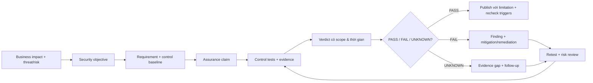
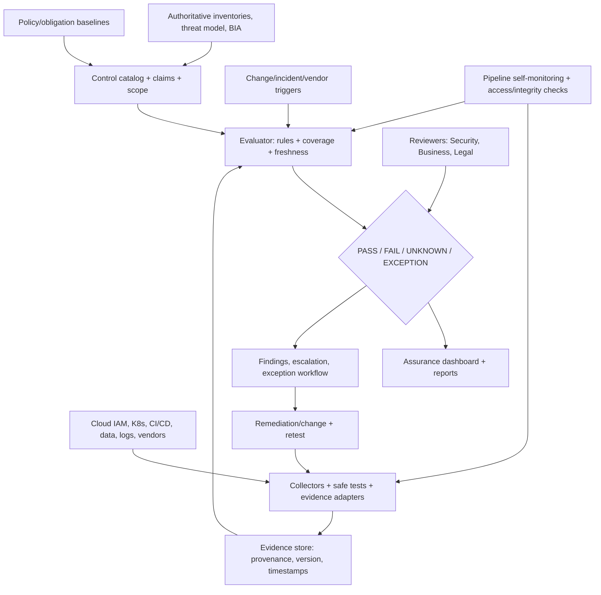
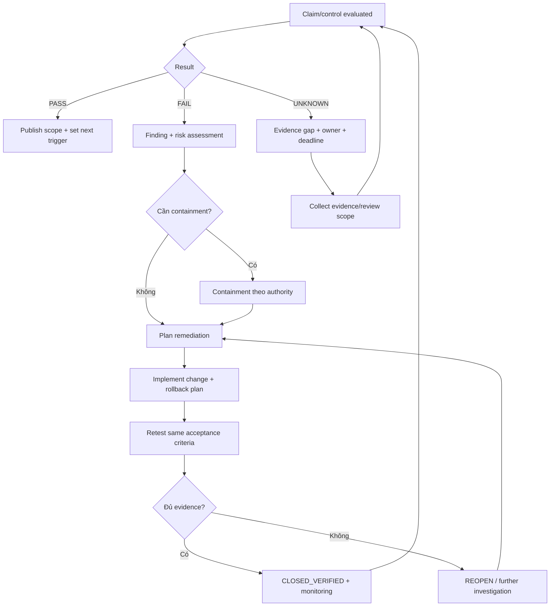

# Continuous assurance là gì? Bảo đảm an ninh liên tục dựa trên bằng chứng

## 1. Khái niệm và mục tiêu học tập

**Continuous assurance** (bảo đảm liên tục) là cách tổ chức **thu thập, đánh giá và sử dụng bằng chứng được cập nhật theo thời gian** để xác định mức độ những khẳng định quan trọng về hệ thống, quy trình và security controls **còn được hỗ trợ trong phạm vi hiện tại hay không**. Thay vì chỉ kết luận “đạt” tại một thời điểm kiểm toán, chương trình liên tục quan sát các điều kiện có thể làm thay đổi kết luận: tài sản mới, cấu hình drift, thay đổi quyền, bản phát hành mới, log ngừng tới, sự cố, và sự thay đổi của rủi ro hoặc nghĩa vụ.

Trong chương **Continuous assurance** của module **SECURITY_SECURITY_ASSURANCE**, mục tiêu xuyên suốt là **xây dựng cách đánh giá có bằng chứng rằng hệ thống đáp ứng các mục tiêu bảo mật**, từ phân tích rủi ro, yêu cầu và security controls đến kiểm thử, audit, khắc phục phát hiện và đánh giá trong phát triển lẫn vận hành.

Một chương trình tốt không chỉ hỏi “có chạy kiểm tra hằng ngày không?” mà còn hỏi:

1. **Claim nào** đang được bảo đảm, cho hệ thống, dữ liệu và kỳ nào?
2. Những **control, phép thử và nguồn telemetry** nào đủ để hỗ trợ claim?
3. Bao nhiêu tài sản và tình huống **thực sự được quan sát**, bao nhiêu còn mù?
4. Bằng chứng có đúng **scope, version, thời gian và độ tin cậy** không?
5. Khi điều kiện thay đổi, chương trình **phát hiện, hạ mức tin cậy, cảnh báo và đánh giá lại** ra sao?
6. Khi control FAIL hoặc UNKNOWN, ai **quyết định xử lý rủi ro**, ai sửa và ai xác minh lại?
7. Có thể **truy vết kết luận về nguồn bằng chứng gốc**, và tái dựng trạng thái tại một thời điểm quá khứ không?

Ví dụ: tháng trước, kiểm tra MFA cho 100 tài khoản đặc quyền đều đạt. Tuần này, cloud account mới được tạo, identity mới có quyền admin và một đường federation khác được bổ sung. Kết luận kiểm toán tháng trước có thể vẫn đúng **với 100 tài khoản đã kiểm tra ở kỳ đó**, nhưng chưa chứng minh nhóm quyền đặc quyền **hiện tại** vẫn đạt. Continuous assurance phải phát hiện thay đổi ở mẫu số, mở kiểm tra mới và công bố phần chưa có bằng chứng.

### Sau bài học, người học có thể

- Phân biệt continuous assurance, continuous monitoring, continuous audit, kiểm thử định kỳ và tự động hóa compliance.
- Thiết kế luồng **security objective → claim → controls → test/telemetry → evidence → verdict → risk response**.
- Xác định phạm vi bao phủ, tính đầy đủ của bằng chứng, thời gian hiệu lực và mức bất định.
- Chọn phương pháp **event-driven, định kỳ, on-change và sampling** phù hợp từng control.
- Xây dựng pipeline đánh giá có guardrails, không tự biến missing data thành PASS.
- Thiết kế dashboard có ý nghĩa, phát hiện drift, exceptions và remediation quá hạn.
- Áp dụng mô hình vào IAM, cloud configuration, detection engineering, CI/CD, data protection, DR và third-party assurance.

## 2. Tại sao kiểm tra “một lần đạt” không đủ?

Trong hệ thống động, một kết quả được kiểm chứng ở thời điểm \(t_0\) không tự động đúng ở mọi thời điểm \(t>t_0\). Những yếu tố thường làm kết luận lỗi thời gồm:

- **Asset churn:** workload tự mở rộng, cloud account/namespace/tenant mới, tài sản ngoài inventory.
- **Identity churn:** nhân viên, nhóm, service accounts, tokens và quyền được tạo/thay/thu hồi.
- **Configuration drift:** cấu hình runtime lệch IaC/policy, thay đổi ngoài pipeline.
- **Software changes:** phiên bản mới, library, image, parser, API contract hoặc feature flag.
- **Threat changes:** lỗ hổng mới, khai thác thực tế, ranh giới tin cậy và attacker capability khác trước.
- **Operational degradation:** log collector mất quyền, alert route hỏng, backup thất bại, certificate hết hạn.
- **External dependencies:** nhà cung cấp đổi hạ tầng, subprocessor, khu vực xử lý hoặc nghĩa vụ hợp đồng.
- **Business changes:** dữ liệu nhạy cảm, khách hàng, khu vực cung cấp hoặc mức độ trọng yếu đổi.

Một báo cáo audit định kỳ là **ảnh chụp một phần thực tế**. Continuous assurance bổ sung khả năng xác định **khi nào ảnh chụp đó không còn đại diện**, kiểm tra lại đúng điều kiện và nối kết quả với quyết định quản trị.

**Continuous** không có nghĩa mọi control được chứng minh đúng ở mọi mili giây. Trên thực tế, có độ trễ đo, thời gian kiểm thử, giới hạn quyền, sampling và outage. Một chương trình trưởng thành **định nghĩa rõ các giới hạn này** thay vì khẳng định an toàn tuyệt đối.

## 3. Phân biệt các khái niệm gần nhau

| Khái niệm | Câu hỏi chính | Sản phẩm điển hình | Điều còn thiếu nếu đứng riêng |
| --- | --- | --- | --- |
| **Security monitoring** | Điều gì đang xảy ra, có tín hiệu bất thường? | Events, metrics, alerts | Chưa chắc có claim/control mapping hoặc kết luận assurance |
| **Continuous monitoring** | Trạng thái/rủi ro/control signals biến đổi ra sao? | Dashboards, drift/health reports | Không tự chứng minh mọi yêu cầu đạt |
| **Continuous control monitoring (CCM)** | Các controls đã chọn có còn theo điều kiện kiểm tra không? | Control check results | Chưa chắc bao quát claim và tính đầy đủ nguồn |
| **Continuous audit** | Các hoạt động/kiểm soát được kiểm tra với độ trễ thấp thế nào? | Audit tests, exception reports | Phụ thuộc tính độc lập, scope và tiêu chí kiểm toán |
| **Continuous compliance** | Bằng chứng về nghĩa vụ và control được cập nhật ra sao? | Obligation-control-evidence mapping | “Policy check PASS” không mặc nhiên là tuân thủ pháp luật |
| **Continuous validation** | Một control có thực sự chặn/phát hiện kịch bản được chọn không? | Negative tests, canary, attack emulation có phép | Bộ kịch bản có thể thiếu phạm vi và threat scenarios |
| **Observability** | Hệ thống có thể được suy luận từ tín hiệu nào? | Logs, metrics, traces, profiling | Có telemetry không đồng nghĩa bằng chứng đầy đủ hoặc kết luận bảo mật |
| **Continuous assurance** | Các **security claims** còn được hỗ trợ bằng bằng chứng phù hợp không, và thiếu sót được xử lý thế nào? | Claim verdicts, evidence chain, risk/remediation decisions | Cần phối hợp tất cả các lớp trên và reviewer theo rủi ro |

Ví dụ: một dashboard có `99.99%` thời gian SIEM nhận event không chứng minh **100% tài khoản production có audit**. Có thể cả một tài khoản không được đưa vào dashboard. Continuous assurance phải kiểm tra **inventory độc lập → nguồn cần có → event loại bắt buộc → tuyến thu thập → phép thử phát hiện → kết luận**.

## 4. Continuous assurance không phải “tự động hóa mọi thứ”

Một số kiểm soát có trạng thái máy đọc được (encryption flag, IAM role, TLS version). Một số khác cần **phán đoán, quan sát có ngữ cảnh hoặc xác minh độc lập**: tính phù hợp của risk acceptance, tác động pháp lý, thẩm quyền ra quyết định, sự đầy đủ của BIA, độ đại diện của kịch bản DR, tính hợp lệ của vendor audit scope.

Vì vậy, chương trình nên kết hợp:

1. **Máy tự thu thập:** cloud API, policy readback, IaC state, CI/CD, logs, configuration snapshots.
2. **Máy tự kiểm tra an toàn:** policy-as-code, regression tests, source-to-sink canaries, drift queries.
3. **Người đánh giá có thẩm quyền:** scope, materiality, risk, ngoại lệ, trách nhiệm pháp lý, business acceptance.
4. **Governance workflow:** evidence review, finding ownership, escalation, retest và sign-off.
5. **Cơ chế tự kiểm tra pipeline assurance:** phát hiện sensor chết, parser lỗi, thiếu asset và mất evidence.

Một chương trình “liên tục” mà **mỗi ngày chạy cùng một script trên tập tài sản không đầy đủ** chỉ làm tăng tần suất của một sai kết luận.

## 5. Từ security objective đến assurance claim

Một security objective nêu kết quả bảo mật cần đạt. **Assurance claim** là khẳng định cụ thể về việc mục tiêu đó được đáp ứng trong một scope và kỳ đánh giá; nó phải có tiêu chí để kiểm chứng.

### Chuỗi truy vết



### Ví dụ thiết kế claim

**Objective:** phát hiện thay đổi quyền quản trị trên cloud.

**Claim:** “Trong production accounts thuộc danh mục v42, các event thay đổi IAM thuộc nhóm E được ghi, truyền tới SIEM, phân tích và chuyển cảnh báo theo ngưỡng vận hành đã duyệt trong assessment window W.”

**Support:** inventory reconciliation, logging policy readback, source-to-sink canary, parser/schema test, analytic positive/negative tests, alert delivery receipts, retention retrieval.

**Assumption:** inventory sản xuất đủ và đại diện; mọi nguồn liên quan tạo đúng event; clock/time provenance đủ chính xác.

**Limitations:** không thể suy từ một bộ test E rằng mọi kỹ thuật attack trên cloud đều được phát hiện.

Cách viết “hệ thống an toàn 100%” không phải một claim đủ xác định để xây dựng assurance có thể kiểm toán.

## 6. Claim–Argument–Evidence trong đánh giá liên tục

Một **assurance case** có thể biểu diễn theo **Claim → Argument → Evidence (CAE)**. Claim tổng thường được phân rã thành subclaims.

| Thành phần | Ví dụ cho detection assurance |
| --- | --- |
| **Top goal G0** | Những hành vi thay đổi quyền thuộc phạm vi được phát hiện/điều tra theo tiêu chí |
| **Strategy S1** | Chứng minh inventory, audit source, parser, analytic, routing, on-call |
| **G1 Visibility** | Tất cả asset/event types trong scope có telemetry bắt buộc |
| **G2 Detection** | Analytics phát hiện chính xác các kịch bản được chọn |
| **G3 Response** | Alert tới owner và được xử lý theo quy trình |
| **A1 Assumption** | Danh mục cloud accounts hiện hành là đầy đủ |
| **E1/E2/E3** | Inventory test; canary; detection and response receipts |
| **Defeater** | Account mới chưa onboard, schema đổi, collector lỗi hoặc suppression quá rộng |

Assurance liên tục **không phải vẽ lại lập luận mỗi giờ**. Ta quản lý **các premises/evidence có thể biến đổi**: khi chúng thay đổi, đánh giá lại những claim phụ thuộc.

Một assumption quan trọng bị chứng minh sai có thể làm nhiều top-level claims **mất nền tảng kết luận**, dù test cũ vẫn đúng ở phạm vi ban đầu.

## 7. Xây inventory và xác định mẫu số bao phủ

Không thể công bố độ bao phủ đáng tin nếu **mẫu số** chỉ lấy từ những tài sản mà công cụ kiểm tra đã biết.

### Các nguồn inventory cần đối chiếu

| Tập | Nguồn có thể dùng | Rủi ro thiếu |
| --- | --- | --- |
| Cloud accounts/subscriptions | Organization API, billing, CMDB/service catalog | Tài khoản mới chưa được onboard SIEM |
| Hosts/workloads | Cloud runtime API, orchestration, asset platform | Ephemeral nodes, shadow environments |
| Kubernetes | Cluster API, namespaces, admission configs | Cluster mới hoặc namespace loại trừ policy |
| Identities | IdP, cloud IAM, SCIM, secrets/workload identities | Service principals không thuộc user directory |
| Data stores | Cloud DB/storage inventory, data catalog | Backup/snapshot hoặc region ngoài phạm vi |
| APIs/services | API gateway, ingress, service catalog | Internal/bypass endpoints |
| Third parties | Procurement, SSO app inventory, OAuth grants | SaaS ngoài procurement và token không quản trị |
| Detection sources | Expected source inventory và SIEM connectors | Thiếu nguồn nhưng dashboard vẫn xanh |
| Repositories/artifacts | VCS, CI/CD registry, runtime image inventory | Image đang chạy không trùng bản đã scan |

Khi có nhiều nguồn, cần quy tắc **canonical asset IDs, xử lý duplicate, phiên bản inventory và owner**. Sự bất đồng giữa các nguồn **là một signal cần điều tra**, không phải lý do loại tài sản khỏi mẫu số.

### Ba tập cần phân biệt

- **Expected population:** mọi asset/control pair thuộc baseline đã phê duyệt.
- **Observed population:** asset/control pair mà collector/test thực sự nhìn thấy.
- **Compliant population:** các cặp đã đủ bằng chứng và PASS.

Nếu expected=100, observed=90, PASS=85, có thể báo **observability coverage 90%** và **verified pass coverage 85% trên expected population**, nhưng **không** gọi 85/90 = 94,4% là compliance toàn scope. 10 tài sản chưa được quan sát phải được ghi UNKNOWN hoặc finding theo yêu cầu.

## 8. Từ control catalog tới testable outcomes

Một bảng security controls chỉ liệt kê “đã bật MFA, đã bật logging” là chưa đủ. Mỗi control cần:

1. **Control ID và version baseline**.
2. **Applicability:** assets, roles, data categories, environments và exceptions.
3. **Control owner** và người chịu trách nhiệm cung cấp evidence.
4. **Acceptance criteria:** trạng thái/hành vi bắt buộc và ngưỡng được duyệt.
5. **Evidence sources:** authoritative inventory, runtime, tests và reports.
6. **Evaluation method:** declarative check, behavioral test, sampling, human review.
7. **Frequency/trigger** và validity window.
8. **Failure/unknown handling:** escalation, containment, risk decision.
9. **Assumptions/limitations:** dữ liệu và kiến trúc mà kết luận phụ thuộc.
10. **Retest/closure requirements:** điều kiện đóng finding sau remediation.

### Bảng controls minh họa

| ID | Security claim | Kiểm tra liên tục có ý nghĩa | Bằng chứng cần xác minh |
| --- | --- | --- | --- |
| **CA-01** | Mọi cloud accounts thuộc scope đều được inventoried | Reconcile organization API–CMDB–SIEM | Population diff, owner, scope/version |
| **CA-02** | Quyền đặc quyền tối thiểu và được review | Effective IAM permissions + joiner/mover/leaver | Role graph, approvals, negative tests |
| **CA-03** | Audit logging có source, parser và retention đúng | Config readback + synthetic source-to-sink | Event IDs, delivery/parse/retrieval |
| **CA-04** | Detection rule có hiệu lực theo các kịch bản | Parser contract + canary + route tests | Analytic result, alert receipt |
| **CA-05** | Cấu hình production không drift ngoài baseline | IaC/runtime diff + policy-as-code | Readback, exception refs |
| **CA-06** | Data access và encryption phù hợp | IAM, crypto, data-flow kiểm tra | Keys/config, denied access, mapping |
| **CA-07** | Artifacts đáng tin và đúng phiên bản | Provenance/digest/SBOM checks | Build signature, runtime digest |
| **CA-08** | Recovery có thể đáp ứng mục tiêu | Backup checks + controlled restore | Recovery point, RTO/RPO, integrity |
| **CA-09** | Third-party risks/obligations còn được quản trị | Event-driven vendor reassessment | Report scope, CUECs, contracts |
| **CA-10** | Findings được khắc phục và retest | Ticket↔change↔evidence reconciliation | Verified closure, overdue/risk acceptance |
| **CA-11** | Ngoại lệ có phạm vi/thời hạn hợp lệ | Expiry + owner + controls/condition health | Approval, retest, monitoring |
| **CA-12** | Bằng chứng assurance đáng tin và truy xuất được | Evidence completeness + retrieval tests | Provenance, integrity, access logs |

Các mã CA-01...CA-12 **chỉ là ví dụ học tập**, không phải catalog tiêu chuẩn bắt buộc. Độ sâu thực tế phải theo risk tier và các yêu cầu được tổ chức xác nhận.

## 9. Chất lượng bằng chứng là thành phần cốt lõi

Một check có thể chạy thường xuyên nhưng vẫn cho kết luận sai nếu bằng chứng không đáng tin.

| Thuộc tính | Câu hỏi review | Ví dụ lỗi |
| --- | --- | --- |
| **Provenance** | Evidence từ đâu, ai thu, version nào? | Screenshot không có nguồn hoặc thời điểm |
| **Scope** | Bao phủ đúng asset, control, môi trường và legal entity? | Scan một staging cluster để suy ra production |
| **Freshness** | Bằng chứng còn đại diện sau những thay đổi gần đây? | IAM snapshot cũ sau khi thêm role |
| **Completeness** | Các assets/events bắt buộc có được quan sát? | Missing source bị loại khỏi dashboard |
| **Integrity** | Có cơ chế hạn chế sửa/xóa trái phép, kiểm tra tính toàn vẹn? | Kết quả test có thể bị thay mà không có log |
| **Reliability** | Tự khai, thử nghiệm trực tiếp, kiểm toán độc lập hay suy đoán? | Vendor email “đã sửa” không có retest |
| **Independence** | Evidence và control dùng cùng failure domain không? | Cả logging check và control phụ thuộc một collector lỗi |
| **Reproducibility** | Người khác tái dựng query, rule, test, verdict được không? | Chỉ còn tổng điểm “100% PASS” |
| **Time alignment** | Snapshot/tests có cùng phạm vi và kỳ? | So sánh policy T1 với inventory T2 đã thay đổi |
| **Limitations** | Những gì chưa kiểm chứng được ghi rõ? | Không nêu tenant chưa có quyền truy vấn |

**Hash đúng** có thể chứng minh một file không bị thay đổi so với hash đã ghi, nhưng **không chứng minh nguồn gốc dữ liệu là trung thực**, event đầy đủ hay kết luận hợp lý. Cần kiểm tra **chuỗi chứng cứ**, không chỉ định dạng artifact.

## 10. Độ mới, cửa sổ hiệu lực và thời gian đánh giá

Bằng chứng về trạng thái cấu hình tại thời điểm \(t_0\) có thể **mất tính đại diện** khi có change hoặc vượt cửa sổ freshness được xác định.

### Các mốc quan trọng

- `observed_at`: lúc phép đo thực sự quan sát trạng thái.
- `event_time`: thời gian sự kiện xảy ra tại nguồn.
- `collected_at` / `ingested_at`: lúc hệ thống thu/nhận evidence.
- `evaluated_at`: lúc evaluator áp tiêu chí và kết luận.
- `valid_until`: thời điểm cần đánh giá lại nếu không có sự kiện kích hoạt trước.
- `last_known_good`: điểm cuối đã có bằng chứng tốt theo nguồn có căn cứ.
- `first_known_bad`: điểm sớm đã có bằng chứng lỗi.
- `reviewed_at`: lúc người có thẩm quyền xác nhận kết luận khi cần.

Một rule minh họa:

\[
\text{Evidence usable}(t)
= \text{scopeMatch}
\land \text{sourceTrusted}
\land \text{fresh}(t)
\land \text{noInvalidatingChange}.
\]

Đây là biểu thức **khái niệm**, không có ý nghĩa chứng minh toán học rằng control đúng mọi lúc. Cần định nghĩa các predicate theo policy. Bằng chứng đủ mới về cấu hình **không thay** evidence của hành vi nếu yêu cầu là control effectiveness.

### Ví dụ

Cloud IAM policy được đọc đúng lúc 10:00; 10:30 có manual grant ngoài pipeline. Dù “maxAge = 24h” chưa hết, **event thay đổi có thể làm evidence 10:00 không còn hợp lệ** cho claim quyền hiện tại. Vì vậy, nên dùng **event-driven invalidation** bên cạnh lịch quét.

Một đánh giá hồi tố phải lưu **bản tiêu chí và evidence đúng kỳ đó**, không dùng state hiện tại để tự viết lại kết luận quá khứ.

## 11. Assurance claim phải xử lý assumptions và uncertainty

Một hệ thống có thể hoạt động đúng trong phạm vi đã kiểm tra nhưng còn giả định chưa chứng minh:

- Inventory production đầy đủ.
- Mọi privileged access paths đều qua IdP đã được giám sát.
- Cloud event schema không đổi.
- Clock skew đủ nhỏ để tính detection latency.
- Backup không chứa malicious persistence.
- Subprocessor không xử lý dữ liệu ngoài DPA.
- Một bài test staging đại diện được production.
- Sensor và evaluator không cùng bị attacker chiếm quyền.

Các giả định cần **ID, owner, scope, kiểm chứng, trigger và dependent claims**. Khi giả định sai, phải đánh giá lại claim bị ảnh hưởng thay vì chỉ sửa nhãn giả định.

**UNKNOWN** là kết quả kỹ thuật có ý nghĩa khi thiếu thông tin, không phải “màu xám cho đẹp”. Một dashboard đáng tin phân biệt rõ:

- **Đã chứng minh đạt trong scope/time window.**
- **Đã chứng minh không đạt.**
- **Không đủ bằng chứng.**
- **Chưa được áp dụng theo scope có căn cứ.**
- **Đang lệch baseline theo ngoại lệ có thẩm quyền.**

## 12. Kiến trúc tham khảo cho continuous assurance

Một kiến trúc logic có thể chia thành **control plane của chương trình assurance**, **evidence plane** và **risk/decision plane**.



### Từng thành phần đảm nhận gì?

1. **Authoritative inventory:** mẫu số asset/control và owner, cập nhật khi hệ thống thay đổi.
2. **Claim/control registry:** các yêu cầu, scope, baseline versions, acceptance criteria.
3. **Evidence adapters:** thu dữ liệu qua API, agents, logs, test runners và vendor sources.
4. **Evidence store:** lưu nguồn gốc, timestamps, version, kết quả, quyền và lịch sử.
5. **Evaluation engine:** so sánh evidence với tiêu chí, kiểm tra coverage, freshness, contradictions.
6. **Trigger/event bus:** thay đổi mới hoặc nguồn bị mất làm invalidation/reassessment.
7. **Governance workflow:** reviews, exceptions, findings, risk acceptances, legal gates.
8. **Dashboards/reporting:** hiển thị từng claim và risk, tránh gộp UNKNOWN thành PASS.
9. **Self-assurance:** chính pipeline được giám sát, test và bảo vệ.

Không bắt buộc mua một nền tảng GRC lớn. Một tổ chức nhỏ có thể kết hợp Git/IaC, cloud APIs, test automation và finding tracker, miễn là giữ được **tính kiểm toán, scope và decision trail**.

## 13. Chọn nhịp kiểm tra theo rủi ro và loại control

Không có một tần suất kiểm tra phổ quát cho mọi control. Tần suất là một quyết định dựa trên **tốc độ thay đổi, độ nghiêm trọng, khả năng quan sát và giá trị của dữ liệu**.

| Chiến lược | Ví dụ phù hợp | Giới hạn |
| --- | --- | --- |
| **Event-driven / on change** | IAM grant, network policy, new account, deployment | Event source có thể bị thiếu hoặc trễ |
| **Scheduled scan** | Cấu hình encryption, TLS, baseline drift | Khoảng mù giữa hai lần quét |
| **Continuous streaming evaluation** | Log loss, source health, alerts, identity events | Cần giám sát collector và parser semantics |
| **CI/CD gate** | SBOM, policy-as-code, unit/security regression | Test trước deploy chưa chứng minh runtime |
| **Synthetic validation** | Audit source-to-sink, alert routing, API auth | Bài thử chỉ bao phủ kịch bản đại diện |
| **Risk-based sampling** | Access review, operational process và audit records | Sampling risk, phải nêu population/method |
| **Human periodic review** | Vendor SOC scope, exception validity, legal obligations | Phụ thuộc nguồn mới và thời gian review |
| **Hybrid** | DR readiness: backup checks thường xuyên + restore drill có kế hoạch | Cần kiểm tra cả job và outcome phục hồi |

**Cách chọn:** controls bị ảnh hưởng mạnh bởi thay đổi cần event-driven triggers; controls kỹ thuật có trạng thái nên dùng runtime readback; controls về **hành vi** cần tests; controls về **governance/thẩm quyền** cần reviewer phù hợp.

### Ví dụ rủi ro cao

Với cloud privileged IAM, chỉ chụp policy mỗi quý có thể bỏ qua quyền tạm được cấp rồi thu hồi trong cùng quý. Kết hợp IAM audit events, periodic effective-permission reviews và negative tests. Khi event sources thiếu, **không được tuyên bố đầy đủ về history**.

## 14. Event-driven invalidation: khi nào một PASS cần đánh giá lại?

Một cơ chế mạnh nên xem các yếu tố sau là trigger:

1. Tạo/xóa/đổi cloud account, namespace, cluster, service hoặc identity.
2. Thay policy/role binding, session/SSO/MFA, privileged access path.
3. Đổi network route, ingress/egress, service mesh, firewall.
4. Cập nhật image, package, runtime, collector, parser, detection rule.
5. Thay loại dữ liệu, mục đích xử lý, tenant hoặc subprocessor.
6. Thay KMS/key, cert, backup, replication hoặc DR dependency.
7. Phát hiện sự cố, lỗ hổng đang bị khai thác hoặc vendor incident có liên quan.
8. Baseline hoặc quy định/hợp đồng áp dụng thay đổi sau legal review.
9. Assumption trọng yếu bị phản bác hoặc hết validity window.
10. Evidence pipeline mất quyền, collector lag, test job lỗi hoặc inventory thiếu nguồn.
11. Ngoại lệ hết hạn/bị thu hồi, remediation rollback hoặc control tái phát.
12. Risk/business criticality thay đổi theo BIA hoặc kiến trúc.

Trigger không tự chứng minh FAIL. Nó thường có nghĩa **claim cần được xem lại**, hoặc bằng chứng cũ phải bị đánh dấu không còn đủ điều kiện. Cần giữ **versioned history** để phân biệt “PASS trước thay đổi” với “UNKNOWN sau thay đổi”.

## 15. Không phải mọi test đều là control effectiveness

Một control có thể được kiểm tra ở nhiều mức:

| Mức | Ví dụ | Câu hỏi còn lại |
| --- | --- | --- |
| **Design** | Security policy quy định MFA | Có triển khai cho đúng assets và paths không? |
| **Implementation** | Config MFA bật ở IdP | Có bypass hoặc account ngoài IdP không? |
| **Operation** | Authentication events cho thấy MFA được yêu cầu | Có đủ nguồn, mọi loại tài khoản và thời kỳ không? |
| **Effectiveness** | Test login trái điều kiện bị từ chối | Các attack paths khác có bị bao phủ không? |
| **Continuity** | On-change checks và drift monitoring | Có khoảng mù hoặc thay đổi không quan sát? |
| **Assurance review** | Reviewer kết luận với scope/evidence | Giới hạn, risk decision và next trigger nào? |

Ví dụ policy-as-code PASS chỉ chứng minh **một cấu hình được kiểm tra tại một điểm trong pipeline**. Nếu người có quyền thay cấu hình trực tiếp trên cloud, cần **runtime readback và drift detection**. Nếu kiểm soát bị bypass khi dùng đường API khác, cần **negative test** phù hợp.

## 16. Bằng chứng từ cloud và configuration assurance

Cloud là môi trường có nhiều tác nhân tự động tạo tài sản và thay đổi trạng thái.

### Ví dụ continuous assurance cho storage

**Claim:** “Mọi storage buckets có dữ liệu nhạy cảm trong production không cho phép public read theo baseline.”

**Nguồn cần đối chiếu:** data catalog/classification, cloud storage inventory, account inventory, bucket policies, access points, object ACL khi có, exception register.

**Kiểm tra:**

1. Xây population từ **storage inventory độc lập**, không chỉ danh sách bucket do CSPM scanner nhìn thấy.
2. Xác định từng bucket thuộc data class nào và policy hiện hành.
3. Đọc hiệu lực public access restrictions và các đường truy cập liên quan.
4. Thực hiện phép thử truy cập bị từ chối được phê duyệt, không dùng dữ liệu nhạy cảm.
5. Kiểm tra ngoại lệ/nguồn public có đúng phạm vi đã được phê duyệt.
6. So sánh runtime với IaC và on-change events.
7. Khi data classification hoặc permission thay đổi, invalidation evidence cũ.
8. Ghi PASS/FAIL/UNKNOWN cho mỗi bucket–control pair, lưu reviewer/owner.

**Không đủ:** một screenshot giao diện “block public access = on” của một bucket nếu nhiều account/bucket khác chưa được kiểm tra hoặc có trust/access paths đặc biệt.

### Cloud posture tools

CSPM/CNAPP có thể tự động phát hiện drift và rủi ro cấu hình, nhưng vẫn cần xem **asset coverage, rule semantics, exemptions, data classification, phạm vi subscription và false-negative conditions**. Một score của công cụ không thay thế security claim có evidence.

## 17. IAM và continuous identity assurance

IAM biến động mạnh: người dùng đổi bộ phận, vendor hết hợp đồng, service principal tạo mới, quyền tạm và session vẫn có hiệu lực.

### Các controls thường cần đánh giá

- **Joiner–Mover–Leaver:** provisioning/deprovisioning được thực hiện và kiểm chứng.
- **Least privilege:** effective permissions, inherited grants, dynamic roles, OAuth scopes.
- **MFA/SSO:** các đường interactive và privileged login phù hợp baseline.
- **Privileged access:** phê duyệt, session controls, break-glass và expirations.
- **Service identities:** workload identity, secret age, token rotation và ownership.
- **Access review:** kiểm tra người duyệt, nội dung và trạng thái quyền runtime.
- **Authentication telemetry:** nguồn và event types có được thu đúng, đủ và truy xuất?

### Ví dụ claim và trigger

**Claim:** “Không có privileged identity đang hoạt động ngoài danh sách được phê duyệt và review.”

**Event triggers:** role grant, group membership, federation trust change, account create, break-glass usage, offboarding event.

**Evidence:** authoritative IdP/IAM inventory, permission graph, approval record, negative tests với accounts được phép, session/revocation status.

Một access review tháng trước **không bao phủ principal được tạo hôm nay**. Nếu nguồn IAM không thể đọc một account, kết luận toàn scope là **UNKNOWN**, không phải “không có quyền trái phép”.

## 18. Logging và detection: đo chính khả năng nhìn thấy

Đối với phát hiện, một hệ thống có thể có nhiều luật phân tích nhưng không có telemetry đủ để chạy chúng. Continuous assurance cần kiểm tra **coverage và hiệu lực**.

### Thứ tự kiểm tra

1. **Expected sources:** tài sản và event types cần thu theo baseline.
2. **Source configuration:** audit được bật, quyền và chế độ sampling đúng.
3. **Transport:** event được gửi đến queue/collector/sink.
4. **Parsing/schema:** các trường cần thiết có nghĩa đúng.
5. **Detection analytics:** rule chạy, positive/negative test cho kịch bản.
6. **Alert routing:** đến đúng kênh và on-call, acknowledgment khi áp dụng.
7. **Retention/retrieval:** event còn có thể truy xuất theo requirement.
8. **Missing-source alert:** mất nguồn/permission/schema được phát hiện.
9. **Assurance verdict:** trả về coverage, test scope, limitations.

### Ví dụ

Collector báo `UP` nhưng parser không còn ánh xạ field `targetRole` sau thay đổi schema. Event vẫn tới sink nhưng detection IAM trust không chạy. **Metric pipeline health không chứng minh semantic correctness**. Phải có regression/canary event cho những fields và use cases quan trọng.

### PromQL minh họa giới hạn quan sát

```promql
# Kiểm tra một target đã biết và lần scrape lỗi.
up{job="audit-collector"} == 0

# Kiểm tra không có chuỗi mẫu nào của job trong cửa sổ.
absent_over_time(up{job="audit-collector"}[10m])
```

Đây chỉ là **ví dụ PromQL**, không đủ chứng minh coverage của những collector đã **không được khai báo**. Cần đối chiếu từ authoritative inventory. Ngoài ra, kiểm tra `up` **không thay** canary test từ event nguồn tới detection/alert.

## 19. Secure SDLC và software supply-chain assurance

Continuous assurance nên nối các kiểm tra trong CI/CD với bằng chứng **trạng thái thực tế sau triển khai**.

| Giai đoạn | Bằng chứng | Điều cần cảnh giác |
| --- | --- | --- |
| Source | Reviews, branch protection, commit identity | Quyền bypass và thay đổi ngoài quy trình |
| Build | Reproducible/provenance, pipeline controls | Runner/secret bị chiếm, dependency không đáng tin |
| Dependencies | SBOM, vulnerability scans theo version | Scanner không bao phủ transitive/path khác |
| Artifact | Digest/signature/attestation khi yêu cầu | Tag trỏ image khác sau scan |
| Release | Approval, signed change record, deployment ID | Emergency/out-of-band actions |
| Runtime | Image digest/config thực trên workloads | Một phần replicas/cluster chưa cập nhật |
| Security regression | API auth negative tests, policy tests, log canary | Test staging có thể không đại diện production |
| Continuous operations | Vulnerability updates, drift, expiry, incident signals | Bản được phê duyệt trước có thể trở nên rủi ro sau CVE mới |

### Một ví dụ về false assurance

Pipeline scan image tag `app:stable` và báo PASS. Trong production, deployment chạy digest khác do tag được gán lại. **Claim “image đang chạy đã được scan” là UNKNOWN/FAIL tùy bằng chứng**, dù báo cáo scanner xanh. Cần liên kết **scanned artifact digest ↔ released digest ↔ runtime digest**.

**SBOM là một hiện vật mô tả thành phần**, không tự chứng minh không tồn tại lỗ hổng hoặc chuỗi cung ứng an toàn tuyệt đối.

## 20. Data protection, privacy và encryption assurance

Continuous assurance đối với dữ liệu cần kiểm tra **dòng chảy, quyền sử dụng, cấu hình và lifecycle**, không chỉ bit mã hóa.

- Data inventory/classification có cập nhật theo feature mới không?
- Những hệ thống/vendor nào được nhận dữ liệu theo mục đích được phê duyệt?
- Storage/transport encryption có áp dụng đúng service và vùng dữ liệu không?
- KMS key access/rotation/backup có đúng ownership và failure model không?
- Retention, deletion và legal hold được thực thi phù hợp các nghĩa vụ đã xác nhận?
- Dữ liệu có bị đưa vào logs, analytics, AI services hoặc backup ngoài scope không?
- Các thao tác nhạy cảm có audit và access review đủ?
- Có test negative access, deletion/restore hay metadata/config readback an toàn?

Một flag `encryptionEnabled=true` không chứng minh key access không bị lạm dụng, dữ liệu cũ đã chuyển đúng, hay dữ liệu không bị xuất ra subprocessor mới.

Đối với **luật và quy định**, phải xác định điều kiện áp dụng theo pháp nhân, hoạt động, dữ liệu, khu vực và phiên bản pháp lý. Không nên tự tuyên bố tuân thủ GDPR hoặc một quy định chuyên ngành chỉ vì cloud provider có chứng nhận hay dữ liệu lưu tại một region.

## 21. Business continuity và disaster recovery assurance

Không nên đánh đồng **backup job success** với “dịch vụ khôi phục được”.

### Các mức evidence

| Claim | Evidence | Giới hạn |
| --- | --- | --- |
| Backup được tạo | Backup run status, object metadata | Chưa biết có thể restore |
| Backup integrity | Checksum/format/retrieval tests | Chưa chứng minh business consistency |
| Restore kỹ thuật | Restore environment và read tests | Chưa đủ RTO/RPO |
| Data consistency | DB commit watermark, queue offsets, reconciliation | Phải có business invariants |
| Security gates | IAM, TLS, audit, logging, malware review | Restore không được mở lỗ hổng mới |
| End-to-end recovery | Timeline impact-to-business acceptance, RTO/RPO | Test scenario không đại diện mọi thảm họa |
| DR readiness theo thời gian | Monitoring dependencies, định kỳ diễn tập và on-change retest | Chi phí test và khoảng mù giữa lần tập |

Nếu một backup đạt vào đêm trước nhưng hôm nay ứng dụng đổi schema/key, evidence cũ có thể **không còn đủ để bảo đảm restore khả dụng**. Trigger cần nối với database migration, KMS, DR region, storage và identity changes.

### Gắn vào BIA

BIA xác định **dịch vụ quan trọng, Maximum Tolerable Downtime, RTO/RPO và dependency** theo cách tổ chức phê duyệt. Continuous assurance phải chứng minh đúng tiêu chí đo — **RTO từ mốc tác động được xác định tới business acceptance**, không chỉ từ lúc bấm chạy restore tới VM boot nếu BIA yêu cầu điều khác.

## 22. Third-party, supply-chain và external evidence

Một phần control hoạt động ở nhà cung cấp, vì vậy bằng chứng thường không sẵn theo giây.

### Kết hợp theo dõi và đánh giá

- Theo dõi thay đổi contract/DPA, SOC report, ISO scope, subprocessor và vùng xử lý.
- Xác nhận **CUECs**: những controls khách hàng phải tự làm theo báo cáo dịch vụ.
- Kiểm tra subservice carve-outs và fourth-party dependencies quan trọng.
- Mở **event-driven reassessment** sau incidents, đổi mục đích xử lý, quyền API hoặc thay kiến trúc.
- Kiểm tra evidence freshness, report period, audit exceptions và retest từ vendor.
- Xác định customer-side compensating controls và exit readiness.
- Khi thiếu evidence, ghi **UNKNOWN** cho claim liên quan và xử lý theo risk decision.

**Vendor security score** hoặc chứng chỉ còn hạn không đồng nghĩa mọi yêu cầu trong tenant khách hàng đạt, đặc biệt sau một thay đổi feature hoặc subprocessor ngoài kỳ báo cáo.

## 23. RACI và ownership cho assurance liên tục

| Vai trò | Quyền và trách nhiệm | Evidence cần có |
| --- | --- | --- |
| **Business/risk owner** | Xác định tác động, ưu tiên và chấp nhận rủi ro trong thẩm quyền | BIA, risk decision, expiry |
| **Control owner** | Thiết kế tiêu chí, scope, triggers và mức tin cậy tối thiểu | Control version, acceptance criteria |
| **Platform/engineering** | Triển khai và cung cấp runtime state, sửa drift, duy trì collectors | Config readback, change records |
| **Security engineering** | Xây checks, detection canaries, technical validation | Test definitions, results, coverage |
| **Security assurance/GRC** | Review chất lượng bằng chứng, tổng hợp claims và findings | Assessment verdict, evidence index |
| **SOC/Incident response** | Tiếp nhận alert, điều tra và phản ứng khi rủi ro thực tế | Incident tickets, response timeline |
| **SRE/BC/DR** | Monitoring reliability, availability và recovery evidence | SLO, restore drills, runbooks |
| **Legal/Privacy/Compliance** | Xác định nghĩa vụ áp dụng, giới hạn ngoại lệ, nguồn pháp lý | Obligation register, legal review |
| **Vendor management** | Điều phối báo cáo, remediation và fourth-party evidence | Vendor reassessment, contracts |
| **Internal audit/independent reviewer** | Xem tính đầy đủ, tái dựng kết luận và kiểm thử quy trình | Audit sampling/review observations |

Một người có thể kiêm nhiều vai trò trong tổ chức nhỏ, nhưng nên tách **người sửa control** và **người chấp thuận rủi ro/đánh giá PASS cho control trọng yếu** theo mức độ phù hợp.

## 24. Cơ chế đánh giá trạng thái: PASS, FAIL, UNKNOWN

Một control nên có trạng thái được tính từ **phạm vi, bằng chứng và tiêu chí hiện hành**.

| Trạng thái | Khi nào phù hợp? | Ví dụ |
| --- | --- | --- |
| **PASS** | Bằng chứng hiện hành đủ scope và đáp ứng mandatory checks | Mọi account thuộc scope có log, canary/retention tests đạt |
| **FAIL** | Có evidence điều kiện bắt buộc không đạt | Một account bắt buộc thiếu audit |
| **UNKNOWN** | Thiếu nguồn, thiếu quyền, thời gian hoặc test không đại diện | Chưa truy vấn được một region |
| **EXCEPTION** | Sai khác được chấp nhận hợp lệ, có scope, owner, hạn và bù trừ | Legacy auth tạm thời theo approval |
| **NOT_APPLICABLE** | Control không thuộc scope theo baseline có căn cứ | Một check Windows không áp dụng cho Linux |
| **STALE / REVIEW_REQUIRED** | Evidence đã hết validity hoặc có invalidating change | Permission snapshot cũ sau IAM grant |

Có thể giữ **EXCEPTION** và **STALE** như thuộc tính riêng thay vì kết quả control chính. Điều quan trọng là **không biến EXCEPTION thành PASS** và **không dùng UNKNOWN như N/A**.

### Kết luận mức claim

Nếu một claim bắt buộc phụ thuộc ba subclaims: G1 PASS, G2 PASS, G3 UNKNOWN, thì **top-level claim chưa đủ bằng chứng để PASS**. Một lỗi FAIL ở subclaim trọng yếu có thể khiến top-level claim không đạt trong phạm vi, nhưng reviewer phải xác định có lập luận/control thay thế thực sự hợp lệ không.

## 25. Findings, remediation và exception lifecycle

Continuous assurance có giá trị khi phát hiện được chuyển thành **hành động có trách nhiệm**.



### Sự phân biệt bắt buộc

- **Remediation implemented:** fix/code/config đã thay nhưng chưa chứng minh hiệu lực.
- **Remediation verified:** readback và test phù hợp chứng minh yêu cầu đạt.
- **Risk accepted:** rủi ro còn lại được chấp nhận hợp lệ; **không phải control PASS**.
- **Exception active:** ngoại lệ còn trong thời hạn/phạm vi và điều kiện; **không tự miễn nghĩa vụ pháp luật**.
- **Closed with limitations:** kết luận được công bố có giới hạn, không được suy rộng.
- **Historical impact:** khôi phục logging hiện tại không tái tạo events chưa từng được ghi.

Nhờ automation, việc **phát hiện lỗi và tạo ticket** có thể nhanh hơn, nhưng quyết định rollback gây gián đoạn, chấp nhận rủi ro hoặc xem có vi phạm pháp luật phải thuộc thẩm quyền phù hợp.

## 26. Assurance evidence store và audit trail

Một evidence store nên cho phép **truy vết ngược và tái dựng kết luận theo thời gian**.

### Bản ghi tối thiểu

| Trường | Ý nghĩa |
| --- | --- |
| `evidenceId` / `hash` | Định danh hiện vật và phương pháp kiểm tra integrity |
| `claimId` / `controlId` | Kết luận/điều kiện được hỗ trợ |
| `baselineVersion` / `ruleVersion` | Tiêu chí đang áp dụng |
| `assetId` / `environment` | Đối tượng quan sát |
| `eventTime` / `observedAt` | Mốc trạng thái tại nguồn |
| `collectedAt` / `evaluatedAt` | Mốc thu và đánh giá |
| `source` / `collectorVersion` | Provenance và khả năng tái dựng |
| `scopeRevision` | Population đã dùng khi tính coverage |
| `testId` / `testVersion` | Điều kiện và cách thực hiện kiểm thử |
| `verdict` / `confidence` | Kết quả và mức tin cậy/giới hạn |
| `rawRef` / `decisionRef` | Liên kết artifact và quyết định reviewer |
| `expiresAt` / `invalidationTriggers` | Khi nào cần đánh giá lại |
| `findingId` / `exceptionId` | Liên kết tới rủi ro, sửa và ngoại lệ |

Một folder có các screenshot không đủ làm evidence architecture. **Ảnh chụp không thể thay event IDs và test definitions** khi cần tái kiểm tra phát hiện/đường truyền.

### Bảo vệ evidence

- Áp dụng RBAC/least privilege và logging truy xuất/sửa/xóa.
- Tách dữ liệu nhạy cảm/secrets khỏi ticket chia sẻ rộng.
- Retention theo nghĩa vụ và chính sách thực tế; hỗ trợ legal hold khi áp dụng.
- Bảo đảm versioning, provenance, immutability hoặc integrity phù hợp mức rủi ro.
- Kiểm tra **restore/retrieval** evidence; link đến vendor portal có thể hết quyền.
- Ghi việc redaction để auditor biết dữ liệu nào đã bị loại và vì sao.

## 27. Self-assurance: kiểm soát chính chương trình assurance

Nếu engine kiểm tra bị lỗi mà dashboard vẫn xanh, continuous assurance tạo **cảm giác an toàn giả**.

### Những thành phần cần theo dõi

1. **Collector availability và permissions**: nguồn không gửi dữ liệu hoặc token hết hạn.
2. **Expected vs observed assets**: nguồn chưa được onboard.
3. **Data lag và event loss**: queue chậm, drop, duplicate, parser failure.
4. **Rule/test version drift**: evaluator dùng baseline cũ hoặc test bị skip.
5. **Scheduler reliability**: jobs chạy đúng kỳ, thất bại có được escalated?
6. **Evidence store integrity/access**: dữ liệu bị sửa/xóa/hết quyền mà không biết.
7. **Notification delivery**: findings tới đúng owners và người trực.
8. **Clock accuracy**: time provenance sai dẫn đến freshness/expiry sai.
9. **Independent audit of evaluator**: logic PASS/FAIL/UNKNOWN được kiểm tra bằng negative tests.
10. **Security of assurance infrastructure**: chính IAM, secrets, network và change controls của hệ thống GRC/evidence.

### Một số kiểm tra chống xanh giả

- Chạy một **negative fixture** đã biết phải FAIL; nếu evaluator trả PASS, coi pipeline có vấn đề.
- Giả lập **missing source** trong môi trường thử và xác nhận UNKNOWN/alert, không PASS.
- Thử thay đổi một asset mới và xác nhận population denominator tăng.
- Kiểm thử đến hạn `valid_until` khiến claim bị đánh dấu stale.
- Đối chiếu ít nhất hai nguồn khác loại khi tính inventory critical assets.

**Assurance pipeline mất khả năng quan sát** là một finding riêng, không chỉ “số liệu dashboard chưa cập nhật”.

## 28. Case study A: Cloud account mới làm thay đổi mẫu số

### Bối cảnh

Một công ty có bốn cloud production accounts. Chương trình ban đầu giám sát và kiểm chứng audit logging trên cả bốn. Trạng thái ngày 01/11 là PASS với **population revision R1**.

Ngày 15/11, nhóm sản phẩm tạo **account thứ năm** để vận hành workload mới. Account này đã xuất hiện trong cloud organization API nhưng chưa được onboard vào SIEM, vì một bước provisioning không có logging gate.

### Điều continuous assurance cần thực hiện

1. **Trigger:** account-create event từ cloud organization.
2. **Inventory reconciliation:** expected accounts tăng 4 → 5, SIEM observed vẫn 4.
3. **Invalidate claim:** bằng chứng PASS cho R1 không còn chứng minh claim toàn production R2.
4. **Find gap:** account mới không có required audit pipeline, mở finding.
5. **Containment/mitigation:** theo risk, giới hạn thay đổi quyền ở account mới trong khi fix.
6. **Remediation:** tích hợp logging provisioning vào account creation và onboarding nguồn.
7. **Retest:** source event → queue → parser → SIEM → rule → alert và retrieval.
8. **Prevent recurrence:** policy gate và periodic inventory reconciliation.
9. **Decision:** chỉ đánh dấu claim PASS cho R2 sau khi đủ tests và reviewer theo policy.

### Cách tính đúng

Nếu expected=5, observed=4, verified PASS=4:

- **Telemetry coverage:** 4/5 = **80%**.
- **Verified coverage:** 4/5 = **80%** nếu cả bốn đáp ứng.
- **Unknown/uncovered:** 1/5 = **20%**.

Dashboard lấy mẫu số SIEM sẽ báo 4/4 = 100%, **nhưng đây chỉ là pass rate của các nguồn đã biết**, không phải toàn scope.

**Bài học:** continuous assurance phải phát hiện thay đổi ở **mẫu số**, không chỉ ở số lượng alert.

## 29. Case study B: Detection pipeline xanh nhưng parser đã hỏng

### Bối cảnh

Cloud provider đổi event schema sau nâng cấp. Một SIEM parser vẫn parse login events nhưng mất trường `targetRole` cho sự kiện đổi IAM trust policy. Dashboard `events_ingested_total` tiếp tục tăng, job health không lỗi.

**Claim cũ:** “Rule DET-TRUST-01 phát hiện IAM trust update trong các account quan trọng.”

### Chuỗi điều tra

| Lớp | Kết quả | Kết luận |
| --- | --- | --- |
| Source event tồn tại | PASS | Cloud audit source có sự kiện |
| Delivery | PASS | Raw event tới sink |
| Semantic parser | **FAIL** | `targetRole` không được ánh xạ |
| Analytic test | **FAIL** | Rule không match |
| Alert routing | **UNKNOWN** cho kịch bản này | Không tạo alert nên chưa chứng minh routing |
| Monitoring | **FAIL** ở schema contract | Health dashboard không phát hiện |
| Overall claim | **FAIL** | Detection cho kịch bản đã xác định không hiệu lực |

### Remediation và verification

Cập nhật parser/schema contract, regression tests trên các loại event liên quan, kiểm tra downstream analytics cùng dùng field, chạy canary event an toàn và xác nhận alert receipt. Nếu raw events lịch sử còn giữ, đánh giá replay hoặc hunting trên blind period. Nếu không còn dữ liệu, ghi **historical visibility limitation**; sửa hiện tại không chứng minh quá khứ an toàn.

**Bài học:** đánh giá **ý nghĩa của dữ liệu** và hiệu lực rule, không chỉ lượng log.

## 30. Case study C: Pipeline scan PASS nhưng image production khác

### Bối cảnh

CI/CD scan container image `billing:stable` và không phát hiện issue thuộc baseline. Sau đó registry tag bị cập nhật; runtime deployment tham chiếu tag chứ không khóa digest. Một nhóm workloads có image khác bản được scan.

### Evidence chain cần phục hồi

1. Commit/build/provenance được phê duyệt.
2. Digest thực được scanner đánh giá.
3. Digest được ký/phát hành theo policy.
4. Digest/immutable reference runtime ở từng workload.
5. Asset scope và rollout coverage từ Kubernetes/cloud inventory.
6. Các vulnerability advisories mới kể từ lần scan.
7. Security regression và workload permission tests sau release.

**Không thể dựa vào screenshot scanner PASS** để bảo đảm image hiện đang chạy đạt. Nếu digest khác, claim matching bị **FAIL/UNKNOWN tùy điều kiện và evidence**. Cần pin artifact bằng digest/kiểm tra provenance, retest trên bản runtime và bổ sung gate ngăn tag drift.

## 31. Case study D: Backup job PASS, restore claim UNKNOWN

### Bối cảnh

Dịch vụ thanh toán có BIA yêu cầu phục hồi đáp ứng RTO/RPO đã duyệt. Backup job báo SUCCESS hằng đêm. Tuy nhiên, sau thay đổi KMS, không ai kiểm chứng việc vùng DR còn giải mã được backup trong kịch bản primary region không khả dụng.

### Đánh giá

| Thành phần | Bằng chứng | Trạng thái |
| --- | --- | --- |
| Backup tạo thành công | Job results và object existence | PASS theo phạm vi kiểm |
| Backup retrieval/integrity | Một số checksum và read tests | PASS/PARTIAL theo criteria |
| DR key access độc lập primary | Chưa thử và thiếu dependency map | UNKNOWN |
| Application restore | Chưa chạy với key mới | UNKNOWN |
| RTO/RPO end-to-end | Chưa đo tới business acceptance | UNKNOWN |
| Recovery security gates | Chưa kiểm log/IAM sau restore | UNKNOWN |

**Kết luận đúng:** “backup jobs chạy thành công” nhưng **claim phục hồi trong thảm họa chưa đủ bằng chứng**. Event thay KMS phải kích hoạt review dependencies, restore test có kiểm soát, transaction reconciliation, RTO/RPO measurement và security acceptance.

## 32. Case study E: Vendor certificate còn hạn nhưng scope đổi

Một SaaS được đánh giá dựa trên SOC report và hợp đồng của dịch vụ A. Sau đó doanh nghiệp bật tính năng AI mới xử lý dữ liệu khách hàng bằng subprocessor B. Chứng chỉ có thể còn hạn nhưng **không chứng minh đầy đủ mục đích xử lý, data flow và kiểm soát của B**.

Một chương trình assurance tốt:

- Theo dõi product feature, DPA/contract và subprocessor notices.
- Đối chiếu actual tenant config và dữ liệu thực dùng.
- Xác định controls phía khách hàng/CUECs cần kiểm chứng.
- Ghi phần chưa có vendor evidence là UNKNOWN.
- Tạo event-driven reassessment thay vì chờ kỳ đánh giá năm sau.
- Quyết định tắt feature, giới hạn dữ liệu, thêm controls hoặc risk acceptance phù hợp nếu policy cho phép.
- Chỉ khẳng định tuân thủ quy định khi Legal xác định applicability và obligation cụ thể.

**Bài học:** thời hạn còn hiệu lực của một văn bản không đồng nghĩa **scope và thời điểm của claim** vẫn hợp lệ.

## 33. YAML mẫu: continuous assurance policy

Đây là **schema minh họa**, không phải cấu hình chuẩn tự chạy trên GRC, SIEM hay Kubernetes.

```yaml
continuousAssurancePolicy:
  id: SEC-CA-PRODUCTION
  version: "1.0.0"
  state: approved
  owner: Security Assurance
  scope:
    environments: [production]
    assetInventorySource: authoritative-service-and-cloud-inventory
    populationKey: asset-id-and-control-id
  evaluation:
    onMissingEvidence: UNKNOWN
    onStaleEvidence: REVIEW_REQUIRED
    denyAutomaticRiskAcceptance: true
    requireScopeMatch: true
    requireEvidenceProvenance: true
    requireIndependentReviewForCritical: true
  triggers:
    - new-production-asset
    - privilege-or-network-policy-change
    - release-or-runtime-digest-change
    - parser-or-detection-rule-change
    - data-flow-or-subprocessor-change
    - backup-or-kms-change
    - incident-or-active-exploitation
    - critical-assumption-contradicted
    - evidence-source-lost
    - exception-expired
  controls:
    - id: CA-01
      claim: production-assets-known-and-onboarded
      method: inventory-reconciliation
      expectedSources:
        - cloud-organization-api
        - service-catalog
        - siem-registered-sources
      onMismatch: FAIL_OR_UNKNOWN_BY_EVIDENCE
    - id: CA-03
      claim: management-events-end-to-end
      method: source-to-sink-and-retrieval-tests
      requiredEvidence:
        - source-event
        - collector-receipt
        - normalized-event
        - retrieval-record
      onMissing: UNKNOWN
    - id: CA-04
      claim: privileged-change-detection
      method: safe-canary-and-analytic-regression
      requiredEvidence:
        - detection-test-result
        - alert-delivery-receipt
        - parser-version
      onMissing: UNKNOWN
  findings:
    requireOwner: true
    requireSeverityAndScope: true
    requireRemediationAndRetest: true
  evidence:
    retainSourceAndVersion: true
    recordEventAndEvaluationTimes: true
    retention: organization-policy-defined
```

Các chuỗi như `FAIL_OR_UNKNOWN_BY_EVIDENCE` chỉ mô tả quy tắc cần hiện thực. Một check không trả về FAIL chỉ vì có mismatch nếu nguyên nhân là **chưa đủ dữ liệu**; phân loại phải theo tiêu chí kiểm tra cụ thể. Các tần suất và hạn do policy thực tế xác định, không lấy mặc định từ ví dụ.

## 34. JSON mẫu: một evidence verdict có giới hạn

```json
{
  "assessmentId": "CA-2026-11-28-001",
  "service": "payment-platform",
  "environment": "production",
  "claimId": "G-CLOUD-AUDIT-COVERAGE",
  "baselineId": "SEC-CA-PRODUCTION",
  "baselineVersion": "1.0.0",
  "inventoryRevision": "R2",
  "observedAt": "2026-11-28T09:00:00Z",
  "evaluatedAt": "2026-11-28T09:05:00Z",
  "scope": {
    "expectedAssets": 5,
    "observedAssets": 4,
    "verifiedPassAssets": 4,
    "unknownAssets": 1
  },
  "controlResults": {
    "CA-01": "FAIL",
    "CA-03": "UNKNOWN",
    "CA-04": "UNKNOWN"
  },
  "verdict": "NOT_ASSURED_FOR_FULL_SCOPE",
  "evidenceRefs": [
    "evidence://ca/cloud-organization-inventory-r2",
    "evidence://ca/siem-source-list",
    "evidence://ca/source-to-sink-test"
  ],
  "limitations": [
    "One production account lacks audit onboarding",
    "Historical activity on that account is not established"
  ],
  "finding": {
    "id": "CA-FIND-008",
    "riskOwner": "Cloud Security Risk Owner",
    "technicalOwner": "Cloud Platform",
    "retestRequired": true
  },
  "review": {
    "decisionType": "FOLLOW_UP_REQUIRED",
    "reviewerRole": "Security Assurance",
    "nextTrigger": "logging-onboarding-and-new-evidence"
  }
}
```

Đây là **bản ghi giả định**. `CA-01 FAIL` dựa trên evidence xác nhận inventory và SIEM source coverage không khớp yêu cầu; `CA-03/04 UNKNOWN` thể hiện chưa đủ test/evidence cho toàn scope. Không nên gán CA-04 FAIL chỉ từ việc thiếu nguồn nếu câu hỏi “rule có xử lý event khi có nguồn không?” chưa được thử. Lưu **các đánh giá riêng**, không trộn suy luận vượt evidence.

## 35. SQL minh họa: kiểm tra evidence quá hạn và thiếu phạm vi

Ví dụ giả định sử dụng PostgreSQL. Các bảng dưới đây **không phải schema có sẵn trong hệ thống GRC**.

### 35.1. Finding: assets chưa có control evidence phù hợp

```sql
-- Read-only query. Danh mục scope đến từ nguồn độc lập.
SELECT
    a.asset_id,
    a.service_id,
    c.control_id,
    c.baseline_version,
    e.evaluation_result,
    e.evaluated_at
FROM expected_asset_controls AS c
JOIN authoritative_assets AS a
  ON a.asset_id = c.asset_id
LEFT JOIN latest_control_evaluations AS e
  ON e.asset_id = c.asset_id
 AND e.control_id = c.control_id
 AND e.baseline_version = c.baseline_version
WHERE a.in_scope = TRUE
  AND (
       e.asset_id IS NULL
       OR e.evaluation_result IN ('UNKNOWN', 'FAIL', 'STALE')
  )
ORDER BY a.service_id, c.control_id, a.asset_id;
```

Nếu evidence thiếu hẳn, bản ghi **chưa được đánh giá** chứ không tự suy ra control FAIL; classification theo baseline phải được evaluator quyết định.

### 35.2. Findings quá hạn chưa được verified

```sql
SELECT
    f.finding_id,
    f.control_id,
    f.risk_tier,
    f.owner,
    f.due_at,
    f.status,
    f.last_retest_at
FROM assurance_findings AS f
WHERE f.status NOT IN ('CLOSED_VERIFIED', 'NOT_APPLICABLE_CLOSED')
  AND f.due_at < CURRENT_TIMESTAMP
ORDER BY f.risk_tier, f.due_at;
```

**Một finding có risk exception vẫn có thể cần hiện diện** trong backlog/overdue theo policy. Không loại nó chỉ vì một approval tồn tại. Kết quả query phải được kiểm tra tính đúng đắn của data source và quyền truy vấn.

## 36. Pseudocode: vòng đánh giá liên tục có guardrails

```text
on trigger_or_schedule(event):
    baseline = get_approved_control_baseline(event.scope)
    population = get_authoritative_asset_control_population(baseline)

    if population is unavailable:
        record_program_health_gap("missing authoritative inventory")
        mark_affected_claims("UNKNOWN")
        notify_assurance_owner()
        return

    evidence = collect_safe_evidence(population, baseline, event)
    results = {}

    for pair in population:
        control = baseline.control_for(pair)

        if not evidence.scope_matches(pair, control):
            results[pair] = "UNKNOWN"
        else if evidence.is_stale_or_invalidated(pair, control):
            results[pair] = "REVIEW_REQUIRED"
        else if evidence.proves_required_condition_fails(pair, control):
            results[pair] = "FAIL"
        else if evidence.sufficient_and_passes(pair, control):
            results[pair] = "PASS"
        else:
            results[pair] = "UNKNOWN"

    store_versioned_results_and_provenance(results, evidence)
    reassess_dependent_claims(results, baseline.argument_graph)

    for affected_claim in affected_claims(results):
        if affected_claim.has_mandatory_failure():
            open_or_update_finding(affected_claim)
            request_risk_based_containment_decision()
        else if affected_claim.has_mandatory_unknown():
            request_missing_evidence_and_owner(affected_claim)

    require_authorized_review_for_material_decisions()
    publish_scope_aware_dashboard(results, population)
    schedule_rechecks_and_retests()
```

**Đây là pseudocode**, không phải triển khai hoàn chỉnh. Cần xử lý concurrency, event ordering, clock skew, API rate limits, idempotence, changes xảy ra khi đang thu evidence, quyền truy cập, retention và độ tin cậy của nguồn.

### Guardrails bắt buộc

- Không tự cấp phép ngoại lệ hoặc chấp nhận residual risk.
- Không tự sửa/xóa tài nguyên, revoke keys hay tắt production nếu chưa có runbook/an toàn và thẩm quyền.
- Không coi absence of event = absence of threat.
- Không coi test skipped/timeout/no permission = PASS.
- Không lấy population từ đúng tool đang được đánh giá mà không có đối chiếu.
- Không cập nhật verdict lịch sử bằng cách ghi đè mất dấu vết.
- Không công bố claim PASS ở phạm vi lớn hơn asset/time/test coverage.
- Không dùng một vendor attestation ngoài scope thay customer-side evidence.

## 37. Phương pháp đo hiệu quả chương trình assurance

Một KPI tốt phải giúp người chịu trách nhiệm **biết nơi nào chưa được chứng minh**, không chỉ tạo dashboard xanh.

| Metric | Định nghĩa gợi ý | Rủi ro diễn giải |
| --- | --- | --- |
| **Asset/control coverage** | Pairs đã có đánh giá hợp lệ / pairs bắt buộc | Mẫu số phải từ authoritative inventory |
| **Verified PASS coverage** | Pairs PASS đủ scope/evidence / total expected pairs | Không bỏ UNKNOWN khỏi mẫu số |
| **Critical claim assurance** | Top-level Critical claims có tất cả premises bắt buộc được chứng minh | Không dùng trung bình mọi controls để che gap Critical |
| **UNKNOWN aging** | Thời gian thiếu evidence cho các claim quan trọng | Không coi thiếu dữ liệu là N/A |
| **Evidence freshness** | Tỷ lệ evidence chưa quá hạn hoặc invalidated | Chứng cứ mới sai scope vẫn không hợp lệ |
| **Mean time to detect drift** | Từ lúc drift xảy ra (khi biết) đến lúc phát hiện | Có thể chỉ biết first known bad, cần ghi uncertainty |
| **Time to verified remediation** | Từ finding đến retest được chấp thuận | Khác thời gian deploy fix |
| **Recurring findings** | Lỗi đã sửa nhưng tái phát theo scope/root cause | Tỷ lệ thấp có thể do không quan sát đủ |
| **Exception debt** | Ngoại lệ còn active, renewal count và cumulative exposure | Approved exception không phải compliance PASS |
| **Detection-source health** | Tỷ lệ expected sources có event và semantics đạt | Collector UP không đủ |
| **Test reliability** | Tests đúng lịch, failure fixtures, false-negative kiểm tra | Bài test có thể “xanh” vì bỏ qua kiểm tra |
| **Evidence retrieval** | Mẫu evidence có thể truy xuất với chain-of-custody phù hợp | Link không còn quyền thì audit khó tái dựng |
| **Review completion** | Claims có reviewer/decision theo policy | Kết luận UNKNOWN vẫn là review hoàn tất nếu có căn cứ |
| **Change invalidation response** | Từ invalidating change tới re-evaluation/owner | Nhanh không đồng nghĩa evidence đủ |

### Ví dụ mẫu số

Tập kỳ này có 200 expected asset–control pairs. Có:

- 150 PASS với bằng chứng đủ;
- 20 FAIL;
- 20 UNKNOWN;
- 10 chưa có đánh giá nào.

Khi đó:

\[
\text{Verified PASS coverage}=\frac{150}{200}\times100\%=75\%.
\]

Đã có kết quả kiểm tra rõ cho 190 pairs nếu xem UNKNOWN là kết quả assessment có căn cứ, nhưng **10 pairs chưa được đánh giá** vẫn phải hiển thị. Không thể công bố 150/(150+20) ≈ 88,2% là “mức tuân thủ của toàn hệ thống” và quên 30 pairs còn thiếu chứng cứ/đánh giá.

Một chương trình có 75% pass ở tất cả pairs cũng không cho biết rủi ro nếu **những pairs FAIL nằm trên assets Critical**. Cần drill down theo criticality, service, control, owner và age.

## 38. Kiểm thử chính quy trình continuous assurance

Bản thân workflow cũng cần test có thể bác bỏ.

| Test ID | Kịch bản | Điều kiện thành công |
| --- | --- | --- |
| **CA-T01** | Tạo cloud account mới | Inventory denominator tăng, claim phải re-evaluate |
| **CA-T02** | Tài sản không có trong SIEM nhưng có trong organization inventory | Missing-source/coverage gap được phát hiện |
| **CA-T03** | Collector chạy nhưng parser mất field | Semantic test FAIL, không dashboard xanh giả |
| **CA-T04** | Security rule được disable/suppressed | Change trigger và canary phát hiện |
| **CA-T05** | IAM privilege tăng ngoài IaC | Runtime drift + audit + risk escalation |
| **CA-T06** | Role giảm quyền nhưng inherited grant vẫn rộng | Effective-permission test không PASS |
| **CA-T07** | Artifact runtime khác digest đã scan | Provenance claim không PASS |
| **CA-T08** | CI/CD build PASS nhưng deployment một vùng chưa cập nhật | Coverage gap rõ theo asset/region |
| **CA-T09** | Evidence cũ hết validity khi không có event mới | REVIEW_REQUIRED, không tiếp tục PASS vô thời hạn |
| **CA-T10** | Monitoring collector hết quyền | Pipeline health gap + UNKNOWN |
| **CA-T11** | Test job bị skip hoặc timeout | Không tính là PASS |
| **CA-T12** | GRC record bị sửa trái phép | Integrity/audit trail phát hiện |
| **CA-T13** | Ngoại lệ hết hạn nhưng control vẫn FAIL | Exception EXPIRED, finding vẫn OPEN |
| **CA-T14** | Vendor bổ sung subprocessor | Reassessment/Privacy triggers được kích hoạt |
| **CA-T15** | Backup job PASS nhưng restore fail do KMS | Recovery claim FAIL/UNKNOWN theo test |
| **CA-T16** | Remediation PR merge nhưng runtime chưa sửa | Không CLOSED_VERIFIED |
| **CA-T17** | Người reviewer không đủ quyền xem evidence | UNKNOWN + owner, không giả định đạt |
| **CA-T18** | Hai nguồn cùng lỗi do shared dependency | Independent source/assumption check phát hiện |
| **CA-T19** | Clock skew làm event tới muộn | Ghi uncertainty và điều chỉnh evaluation window |
| **CA-T20** | Claim Critical FAIL trong khi overall dashboard >95% | Có cảnh báo riêng theo mức rủi ro |
| **CA-T21** | Phép kiểm đọc được 9/10 asset | Không lấy 9 làm mẫu số toàn scope |
| **CA-T22** | Change hoặc incident đến sau khi claim đã publish | Giữ lịch sử, invalidation và re-evaluate |

### Kế hoạch thực hiện

1. Dùng **test fixtures và tài sản mô phỏng** thay vì gây lỗi thực ở production.
2. Xây các expected PASS/FAIL/UNKNOWN/STALE, scope và evidence refs.
3. Test selector chọn đúng baseline và control theo risk tier.
4. Kiểm tra failure injection vào sensor/test runner trong môi trường được phép.
5. Đo khả năng phát hiện false assurance, đặc biệt khi **sensor mất nguồn**.
6. Kiểm tra luồng escalation, risk acceptance và remediation/retest.
7. Kiểm thử audit trail, versioning, evidence retrieval.
8. Mở finding cho chính chương trình nếu rule/đường kiểm chứng thất bại.

Bài test workflow PASS **chỉ chứng minh cơ chế workflow** trong phạm vi thử; nó không thay thế việc kiểm tra hệ thống cần bảo đảm.

## 39. Lộ trình triển khai continuous assurance theo từng mức trưởng thành

### Mức 1 — Xác định claims và phạm vi

- Chọn **3–5 mục tiêu security rủi ro cao**, ví dụ privileged IAM, audit coverage, production drift.
- Xác định owners, inventory và control baselines.
- Viết acceptance criteria có thể test và limitations.
- Thu baseline và tạo evidence IDs.

### Mức 2 — Tự động hóa những checks có giá trị

- Thu readback/IaC/inventory theo lịch và change triggers.
- Thiết kế source-to-sink/security canaries được phép.
- Lưu provenance, timestamps, versions, scope.
- Thiết kế rõ logic UNKNOWN khi nguồn mất.

### Mức 3 — Nối với risk, change và remediation

- Auto-open finding với owner và severity.
- Gắn PR/change/ticket/retest vào cùng evidence chain.
- Giám sát exceptions, expiry, risk decisions và overdue.
- Có review độc lập cho claims trọng yếu.

### Mức 4 — Mở rộng và tự kiểm tra chương trình

- Thêm coverage theo data protection, CI/CD, DR, vendor.
- Kiểm tra evaluator bằng negative fixtures, blind-spot tests.
- Thực hiện threat modeling cho assurance pipeline và evidence store.
- Dùng dashboards theo risk/criticality và thời gian.

### Mức 5 — Assurance có khả năng thích nghi

- Event-driven invalidation và cập nhật argument graph.
- Ưu tiên phép thử theo thay đổi rủi ro/threat/business impact.
- Tự động đề xuất kiểm tra, **không tự ra quyết định chấp nhận rủi ro ngoài thẩm quyền**.
- Liên tục cải tiến coverage và phương pháp kiểm chứng từ incidents/QA/audit.

Không phải chương trình trưởng thành nào cũng cần hàng ngàn controls hoặc platform phức tạp. **Chọn ít claim quan trọng, đo đúng và phản ứng được** có thể tốt hơn dashboard lớn nhưng không đáng tin.

## 40. Những sai lầm thường gặp

1. **Đồng nhất monitoring với assurance:** có logs/alerts nhưng không có claim và criteria.
2. **Đồng nhất automation với liên tục:** chạy test lặp lại trên population lỗi thời.
3. **Chỉ xem assets đã onboard:** không có authoritative denominator.
4. **Báo 100% compliance từ 100% PASS trong các tests đã chạy:** thiếu coverage và untested pairs.
5. **Dùng one-time screenshot:** không kiểm tra time window hoặc invalidating change.
6. **Tự động cho missing source thành PASS:** không có alert bị hiểu như không có tấn công.
7. **Chỉ đo pipeline UP:** parser và semantic detection có thể không hoạt động.
8. **Không kiểm tra negative tests:** quyền vượt mức hoặc bypass path còn tồn tại.
9. **Coi policy-as-code xanh là runtime đúng:** out-of-band drift bị bỏ qua.
10. **Không đối chiếu artifact digest:** scan image khác bản đang chạy.
11. **Không tách control design với operating effectiveness:** có policy không đủ chứng minh thực thi.
12. **Không công bố assumptions:** claim dựa trên inventory/clock/vendor chưa được kiểm chứng.
13. **Dùng một KPI để đánh giá mọi rủi ro:** che những claim Critical FAIL.
14. **Bỏ qua data/third-party changes:** certificate còn hạn nhưng service scope đổi.
15. **Coi backup success là recovery assurance:** chưa thử restore, data consistency, RTO/RPO.
16. **Đóng remediation khi code merge:** chưa readback/retest.
17. **Risk exception bị ghi như PASS:** nhầm risk decision và control outcome.
18. **Gia hạn ngoại lệ vô hạn:** không có remediation plan, expiry hay independent review.
19. **Không lưu evidence provenance:** không tái dựng được claim theo thời gian.
20. **Bỏ qua self-monitoring:** chính evaluator/collector có lỗi nhưng dashboards vẫn xanh.
21. **Dùng SIEM làm cả nguồn inventory và bằng chứng coverage:** nguồn mất khỏi SIEM sẽ biến mất khỏi mẫu số.
22. **Không phân biệt test coverage và threat coverage:** nhiều tests không đồng nghĩa mọi attack techniques đã được chặn.
23. **Không tính hiệu lực sau change:** test đạt hôm trước nhưng hôm nay architecture đã khác.
24. **Không có owner/escalation:** finding nhiều nhưng không chuyển thành giảm rủi ro.
25. **Cố tự động mọi legal/risk decision:** ngữ cảnh pháp luật và nghĩa vụ có điều kiện cần reviewer.
26. **Không phân tách evidence hiện tại và lịch sử:** fix mới không tái tạo logs/backup đã mất.
27. **Coi không thấy incident nghĩa là 100% an toàn:** không có evidence tương ứng cho kết luận tuyệt đối.
28. **Không kiểm thử pipeline bằng trường hợp FAIL biết trước:** chương trình có thể mất khả năng phát hiện lỗi.
29. **Thu quá nhiều dữ liệu nhạy cảm:** tăng rủi ro vì evidence store yếu hơn hệ thống cần bảo vệ.
30. **Không đo ảnh hưởng tới quyết định:** dashboard nhiều nhưng không dẫn tới remediation, risk review hoặc thay đổi control.

## 41. Bài tập thực hành và câu hỏi tự đánh giá

1. Nêu định nghĩa continuous assurance và chỉ ra ba điều phân biệt với continuous monitoring.
2. Một tổ chức có 40 accounts đã được SIEM biết; cloud organization API liệt kê 44. KPI nào thể hiện scope thực tế? Tại sao 40/40 không phải 100%?
3. Viết một assurance claim cho MFA trên privileged accounts, gồm scope, thời kỳ, baseline và evidence.
4. Cho claim về audit logging, hãy phân rã thành visibility, detection và response subclaims.
5. Một chứng chỉ ISO/IEC 27001 còn hạn nhưng công ty mới bật subprocessor AI. Những evidence nào cần đánh giá lại?
6. Vì sao `build PASS` không chứng minh `runtime secure`? Liên kết commit/build/digest với deployment như thế nào?
7. Một collector có `up=1` nhưng parser thiếu event fields. Thiết kế kiểm tra semantic detection.
8. Một environment không có quyền đọc. Kết quả PASS/FAIL/UNKNOWN nào phù hợp? Có cần finding không?
9. Thiết kế inventory reconciliation cho cloud accounts, Kubernetes clusters và CI/CD runners.
10. Một role bị thu hẹp trong IaC nhưng effective permissions vẫn rộng. Phép kiểm nào phải thất bại?
11. Nêu khác biệt giữa evidence `observed_at`, `ingested_at` và `evaluated_at`; khi nào dữ liệu bị stale?
12. Thiết kế event-driven triggers cho thay KMS, DB schema và parser cùng lúc.
13. Một backup job thành công liên tục, nhưng DR restore chưa thử sau nâng cấp key. Phân biệt claim PASS và UNKNOWN.
14. Dựa trên 200 expected pairs có 150 PASS, 20 FAIL, 20 UNKNOWN, 10 chưa test, tính verified pass coverage và giải thích ý nghĩa.
15. Một exception đang ACTIVE nhưng kiểm soát bù trừ không còn evidence. Hệ thống assurance nên làm gì?
16. Lập ma trận CA-01...CA-12 cho một fintech SaaS giả định, chọn ba claim Critical ưu tiên.
17. Vẽ sơ đồ pipeline từ nguồn dữ liệu đến assessment verdict và remediation/retest.
18. Viết một YAML policy có `onMissingEvidence: UNKNOWN` và trigger khi cloud account mới xuất hiện.
19. Viết JSON evidence verdict sau khi phát hiện một asset không được giám sát.
20. Thiết kế SQL truy vấn các asset/control pairs chưa có evidence hoặc đã hết hạn trên data model tự đề xuất.
21. Một pipeline tự sửa network rules khi rule FAIL, có thể gây outage. Nêu guardrails và thẩm quyền cần có.
22. Một GRC dashboard báo 98% controls PASS nhưng IAM Critical claim FAIL. Tại sao phải drill-down theo risk?
23. Thiết kế test fixture làm evaluator phải trả FAIL, sau đó thử mất collector để xem liệu nó có trả UNKNOWN.
24. Một principal mới được tạo sau access review; làm thế nào để không tiếp tục công bố claim cũ vô điều kiện?
25. Thiết kế bằng chứng về source-to-sink telemetry từ raw event tới alert receipt.
26. Một nhà cung cấp từ chối SOC report do NDA; nên đánh giá evidence reliability và residual risk thế nào?
27. Một SIEM source mất logs trong hai ngày, sau đó được sửa. Phân biệt rủi ro hiện tại và khoảng không thể chứng minh hồi tố.
28. Nếu auditor muốn tái dựng kết luận từ ba tháng trước, cần metadata/version nào trong evidence store?
29. Thiết kế bộ 5 metrics vừa đo coverage, vừa đo remediation effectiveness và health của chương trình.
30. Một chương trình có hàng ngàn checks chạy mỗi giờ nhưng không kiểm tra mẫu số hoặc sở hữu findings. Đánh giá mức trưởng thành thực tế của nó.
31. Đề xuất cách áp dụng continuous assurance theo roadmap năm mức cho đội chỉ có hai kỹ sư security.
32. Viết acceptance criteria để một change làm mất audit source tự động invalidates claim cũ.
33. Giải thích vì sao chương trình phải theo dõi **assumption validity** và **evidence freshness** song song.
34. Phân biệt “evidence retrieval PASS” với “security control PASS”.
35. Thiết kế RACI cho một chương trình bao gồm product owner, platform, SOC, GRC, auditor và risk owner.

**Tiêu chí bài làm tốt:** nối được **rủi ro/nghiệp vụ → security claim → baseline và authoritative population → phương pháp kiểm tra phù hợp → evidence và validity → PASS/FAIL/UNKNOWN có phạm vi → owner/risk decision → remediation và retest → monitoring và re-evaluation**. Một hệ thống nhiều dashboard không thay thế một lập luận có thể kiểm chứng.

## 42. Tài liệu tham khảo

- **NIST SP 800-137 — Information Security Continuous Monitoring (ISCM):** phương pháp xây dựng và duy trì giám sát tình trạng bảo mật hỗ trợ quyết định dựa trên rủi ro.
- **NIST SP 800-53** (các họ CA, CM, RA, AU, AC, SI, IR, CP, PM, SR): catalog các security/privacy controls và các mục tiêu để thiết kế kiểm tra.
- **NIST SP 800-53A — Assessing Security and Privacy Controls:** phương pháp kiểm tra, phỏng vấn, kiểm thử và bằng chứng đánh giá control.
- **NIST SP 800-37 — Risk Management Framework:** vòng đời đánh giá, authorization và continuous monitoring theo rủi ro.
- **NIST Cybersecurity Framework 2.0:** outcomes của Govern, Identify, Protect, Detect, Respond, Recover để xây control/claim mapping.
- **ISO/IEC 27001 và ISO/IEC 27002:** quản lý hệ thống an ninh thông tin, controls, giám sát và cải tiến; không tự áp dụng như luật nếu không có căn cứ.
- **Goal Structuring Notation (GSN) và Claims–Arguments–Evidence (CAE):** cách diễn đạt assurance case, điều kiện/assumptions và bằng chứng.
- **OMG Structured Assurance Case Metamodel (SACM):** tham khảo cách mô hình hóa claims, arguments và evidence cho hệ thống cần khả năng truy vết.
- **CIS Controls / CIS Benchmarks:** tham khảo cấu hình và các kiểm tra cụ thể khi phù hợp môi trường; phải đối chiếu phiên bản và phạm vi.
- **OWASP ASVS / SAMM:** tham khảo application security controls, kiểm thử và năng lực SDLC liên tục.
- **SLSA và hướng dẫn software supply-chain security:** provenance/artifact identity trong build và release pipelines.
- **CSA Cloud Controls Matrix:** tham khảo cloud control mapping và shared responsibilities khi sử dụng dịch vụ cloud.
- **Tài liệu và hệ thống thực tế của tổ chức:** BIA, threat model, control baseline, asset inventory, IAM, CI/CD, SIEM, exception/remediation registers, contracts, recovery plan, legal obligations và evidence retention.

**Continuous assurance không phải lời tuyên bố rằng hệ thống luôn an toàn, mà là năng lực liên tục xác định điều gì đang được chứng minh, điều gì đã thất bại và điều gì chưa đủ bằng chứng.** Khi security claims, phạm vi tài sản, dữ liệu và kiến trúc thay đổi, bằng chứng phải được cập nhật; khi control không đạt, cần có người chịu trách nhiệm, quyết định rủi ro, khắc phục và kiểm thử lại. Một chương trình trưởng thành biến security assurance từ báo cáo định kỳ thành **chu trình quan sát, kiểm chứng, ra quyết định và cải tiến có thể kiểm toán**.
